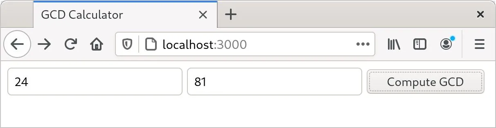
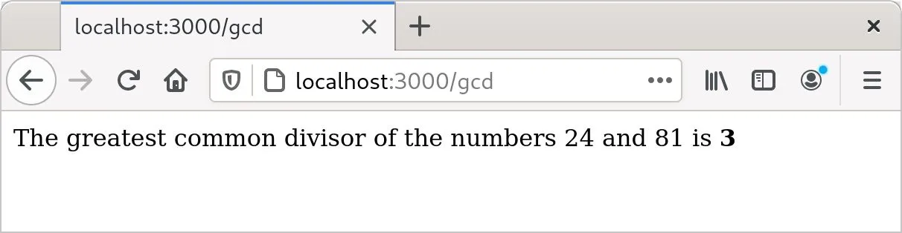
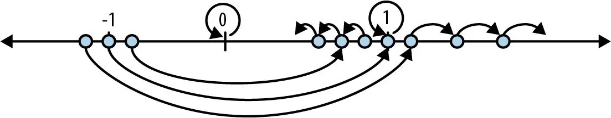
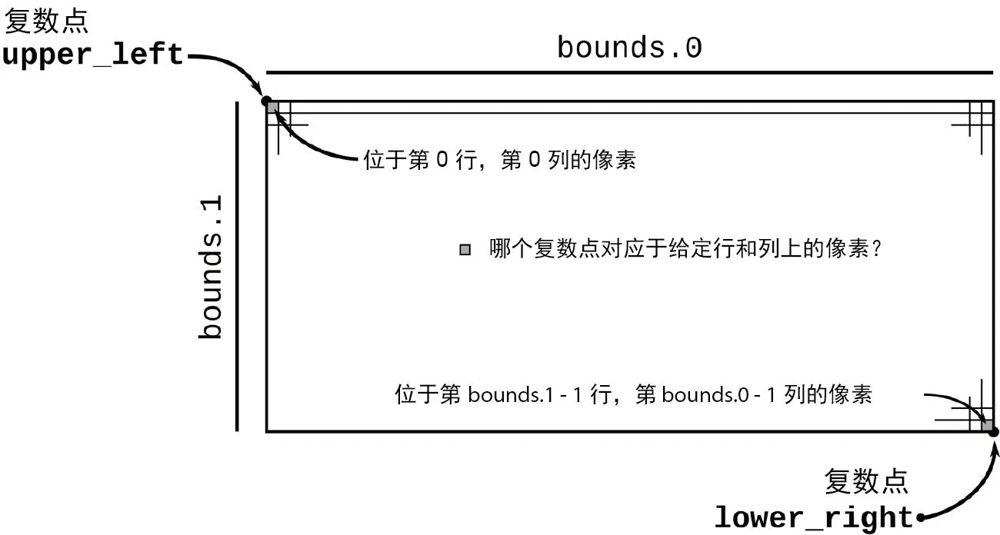
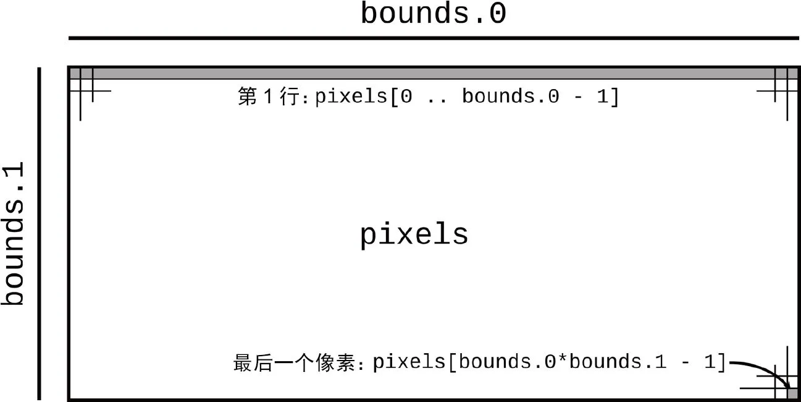
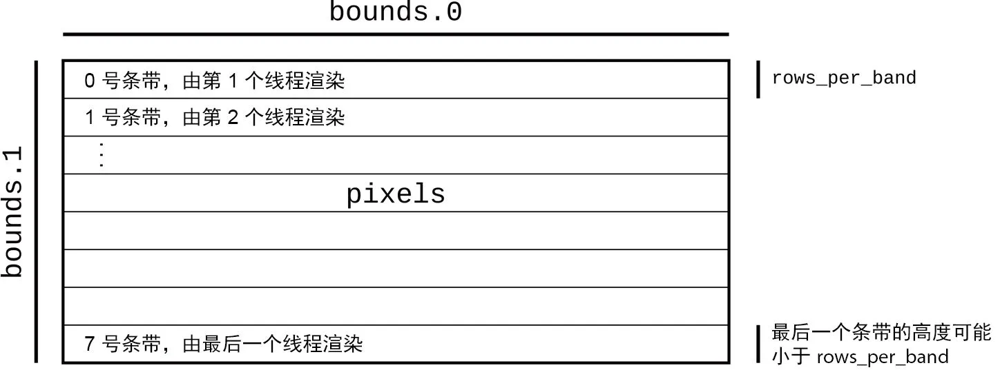

# 第2章Rust导览(2)

为了让我们的程序接收一系列数值作为命令行参数并打印出它们的最大公约数，可以将

```javascript
src/main.rs 中的 main 函数替换为以下内容：
use std::str::FromStr;
use std::env;
fn main() {
   let mut numbers = Vec::new();
   for arg in env::args().skip(1) {
       numbers.push(u64::from_str(&arg)
                    .expect("error parsing argument"));
   }
   if numbers.len() == 0 {
       eprintln!("Usage: gcd NUMBER ...");
       std::process::exit(1);
   }
   let mut d = numbers[0];
   for m in &numbers[1..] {
       d = gcd(d, *m);
   }
   println!("The greatest common divisor of {:?} is {}",
            numbers, d);
```


```
}
```


我们来逐段分析一下：

```
use std::str::FromStr;
use std::env;
第一个 use 声明将标准库中的 FromStr 特型引入了当前作用域。特型是可以由类型实现的
方法集合。任何实现了 FromStr 特型的类型都有一个 from_str 方法，该方法会尝试从字
符串中解析这个类型的值。u64 类型实现了 FromStr，所以我们将调用 u64::from_str
来解析程序中的命令行参数。尽管我们从未在程序的其他地方用到 FromStr 这个名字，但仍
然要 use（使用）它，因为要想使用某个特型的方法，该特型就必须在作用域内。第 11 章会
```

详细介绍特型。

```javascript
第二个 use 声明引入了 std::env 模块，该模块提供了与执行环境交互时会用到的几个函数
和类型，包括 args 函数，该函数能让我们访问程序中的命令行参数。
继续看程序中的 main 函数：
fn main() {
main 函数没有返回值，所以可以简单地省略 -> 和通常会跟在参数表后面的返回类型。
let mut numbers = Vec::new();
```

```
我们声明了一个可变的局部变量 numbers 并将其初始化为空向量。Vec 是 Rust 的可增长向
量类型，类似于 C++ 的 std::vector、Python 的列表或 JavaScript 的数组。虽然从设计上
说向量可以动态扩充或收缩，但仍然要标记为 mut，这样 Rust 才能把新值压入末尾。
```

```
numbers 的类型是 Vec<u64>，这是一个可以容纳 u64 类型的值的向量，但和以前一样，
不需要把类型写出来。Rust 会推断它，一部分原因是我们将 u64 类型的值压入了此向量，另
一部分原因是我们将此向量的元素传给了 gcd，后者只接受 u64 类型的值。
for arg in env::args().skip(1) {
这里使用了 for 循环来处理命令行参数，依次将变量 arg 指向每个参数并运行循环体。
```

- 1

```
std::env 模块的 args 函数会返回一个迭代器，此迭代器会按需生成
```

- 每个参数，并在完

成时给出提示。各种迭代器在 Rust 中无处不在，标准库中也包括一些迭代器，这些迭代器可以生成向量的元素、文件每一行的内容、通信信道上接收到的信息，以及几乎任何有意义的循环变量。Rust 的迭代器非常高效，编译器通常能将它们翻译成与手写循环相同的代码。第 15章会展示迭代器的工作原理并给出相关示例。

```
除了与 for 循环一起使用，迭代器还包含大量可以直接使用的方法。例如，args 返回的迭
代器生成的第一个值永远是正在运行的程序的名称。如果想跳过它，就要调用迭代器的 skip
```

方法来生成一个新的迭代器，新迭代器会略去第一个值。

```
numbers.push(u64::from_str(&arg)
            .expect("error parsing argument"));
```

```
这里我们调用了 u64::from_str 来试图将命令行参数 arg 解析为一个无符号的 64 位整
数。u64::from_str 并不是 u64 值上的某个方法，而是与 u64 类型相关联的函数，类似于
```

```
C++ 或 Java 中的静态方法。from_str 函数不会直接返回 u64，而是返回一个指明本次解
析已成功或失败的 Result 值。Result 值是以下两种变体之一：
形如 Ok(v) 的值，表示解析成功了，v 是所生成的值；
形如 Err(e) 的值，表示解析失败了，e 是解释原因的错误值。
```

执行任何可能会失败的操作（例如执行输入或输出或者以其他方式与操作系统交互）的函数都

```
会返回一个 Result 类型，其 Ok 变体会携带成功结果（传输的字节数、打开的文件等），而
其 Err 变体会携带错误码，以指明出了什么问题。与大多数现代语言不同，Rust 没有异常
（exception）：所有错误都使用 Result 或 panic 进行处理，详见第 7 章。
我们用 Result 的 expect 方法来检查本次解析是否成功。如果结果是 Err(e)，那么
expect 就会打印出一条包含 e 的消息并直接退出程序。但如果结果是 Ok(v)，则 expect
会简单地返回 v 本身，最终我们会将其压入这个数值向量的末尾。
if numbers.len() == 0 {
   eprintln!("Usage: gcd NUMBER ...");
   std::process::exit(1);
}
```

空数组没有最大公约数，因此要检查此向量是否至少包含一个元素，如果没有则退出程序并报

```javascript
错。这里我们用 eprintln! 宏将错误消息写入标准错误流。
let mut d = numbers[0];
for m in &numbers[1..] {
   d = gcd(d, *m);
}
该循环使用 d 作为其运行期间的值，不断地把它更新为已处理的所有数值的最大公约数。和
```

```
以前一样，必须将 d 标记为可变，以便在循环中给它赋值。
```

```
这个 for 循环有两个值得注意的地方。首先，我们写了 for m in &numbers[1..]，那么
这里的 & 运算符有什么用呢？其次，我们写了 gcd(d, *m)，那么 *m 中的 * 又有什么用
```

呢？这两个细节是紧密相关的。

迄今为止，我们的代码只是在对简单的值（例如适合固定大小内存块的整数）进行操作。但现在我们要迭代一个向量，它可以是任意大小，而且可能会非常大。Rust 在处理这类值时非常慎重：它想让程序员控制内存消耗，明确每个值的生存时间，同时还要确保当不再需要这些值时能及时释放内存。

```
所以在进行迭代时，需要告诉 Rust，该向量的所有权应该留在 numbers 上，我们只是为了
本次循环而借用它的元素。&numbers[1..] 中的 & 运算符会从向量中借用从第二个元素开
始的引用。for 循环会遍历这些被引用的元素，让 m 依次借出每个元素。*m 中的 * 运算符
会将 m解引用，产生它所引用的值，这就是要传给 gcd 的下一个 u64。最后，由于
numbers 拥有着此向量，因此当 main 末尾的 numbers 超出作用域时，Rust 会自动释放
```

它。

Rust 的所有权规则和引用规则是 Rust 内存管理和并发安全的关键所在，第 4 章和第 5 章会对此进行详细讨论。只有熟悉了这些规则，才算熟练掌握了 Rust。但是对于这个介绍性的导

```
览，你只需要知道 &x 借用了对 x 的引用，而 *r 访问的是 r 所引用的值就足够了。
```

继续我们的程序：

```
println!("The greatest common divisor of {:?} is {}",
        numbers, d);
遍历 numbers 的元素后，程序会将结果打印到标准输出流。println! 宏会接受一个模板字
符串，在模板字符串中以 {...} 形式标出的位置按要求格式化并插入剩余的参数，最后将结
```

果写入标准输出流。

```
C 和 C++ 要求 main 在程序成功完成时返回 0，在出现问题时返回非零的退出状态，而 Rust
假设只要 main 完全返回，程序就算成功完成。只有显式地调用像 expect 或
std::process::exit 这样的函数，才能让程序以表示错误的状态码终止。
cargo run 命令可以将参数传给程序，因此可以试试下面这些命令行处理：
$ cargo run 42 56
  Compiling hello v0.1.0 (/home/jimb/rust/hello)
   Finished dev [unoptimized + debuginfo] target(s) in 0.22s
    Running `/home/jimb/rust/hello/target/debug/hello 42 56`
The greatest common divisor of [42, 56] is 14
$ cargo run 799459 28823 27347
   Finished dev [unoptimized + debuginfo] target(s) in 0.02s
    Running `/home/jimb/rust/hello/target/debug/hello 799459 28823 27347`
The greatest common divisor of [799459, 28823, 27347] is 41
$ cargo run 83
   Finished dev [unoptimized + debuginfo] target(s) in 0.02s
    Running `/home/jimb/rust/hello/target/debug/hello 83`
The greatest common divisor of [83] is 83
$ cargo run
   Finished dev [unoptimized + debuginfo] target(s) in 0.02s
    Running `/home/jimb/rust/hello/target/debug/hello`
Usage: gcd NUMBER ...
```

本节使用了 Rust 标准库中的一些特性。如果你好奇还有哪些别的特性，强烈建议看看 Rust的在线文档。它具有实时搜索功能，能让你的探索更容易，其中还包括指向源代码的链接。安

```
装 Rust 时，rustup 命令会自动在你的计算机上安装一份文档副本。你既可以在 Rust 网站
```

上查看标准库文档，也可以使用以下命令打开浏览器查看。

```
$ rustup doc --std
```

## 2.5　搭建 Web 服务器

```
Rust 的优势之一是在 crates.io 网站上发布的大量免费的可用包。cargo 命令可以让你的代码
```

轻松使用 crates.io 上的包：它将下载包的正确版本，然后会构建包，并根据用户的要求更新

包。一个 Rust 包，无论是库还是可执行文件，都叫作 crate（发音为 /kreɪt/，意思是“板条箱”）2

- 。Cargo 和 crates.io 的名字都来源于这个术语。

```
为了展示这种工作过程，我们将使用 actix-web（Web 框架 crate）、serde（序列化
```

crate）以及它们所依赖的各种其他 crate 来组装出一个简单的 Web 服务器。如图 2-1 所示，该网站会提示用户输入两个数值并计算它们的最大公约数。



- 图 2-1：计算最大公约数的网页

```
首先，让 Cargo 创建一个新包，命名为 actix-gcd：
$ cargo new actix-gcd
    Created binary (application) `actix-gcd` package
$ cd actix-gcd
```

然后，编辑新项目的 Cargo.toml 文件以列出所要使用的包，其内容应该是这样的：

```
[package]
name = "actix-gcd"
version = "0.1.0"
edition = "2021"
# 请到“The Cargo Book”查看更多的键及其定义
```

```
[dependencies]
actix-web = "1.0.8"
serde = { version = "1.0", features = ["derive"] }
```

```
Cargo.toml 中 [dependencies] 部分的每一行都给出了 crates.io 上的 crate 名称，以及我
们想要使用的那个 crate 的版本。在本例中，我们需要 1.0.8 版的 actix-web crate 和
1.0 版的 serde crate。crates.io 上这些 crate 的版本很可能比此处展示的版本新，但通过指
```

明在测试此代码时所使用的特定版本，可以确保即使发布了新版本的包，这些代码仍然能继续

- 3第 8 章会更详细地讨论版本管理。

编译。

crate 可能具备某些可选特性：一部分接口或实现不是所有用户都需要的，但将其包含在那个

```
crate 中仍然有意义。例如，serde crate 就提供了一种非常简洁的方式来处理来自 Web 表单
的数据，但根据 serde 的文档，只有选择了此 crate 的 derive 特性时它才可用，因此我们
```

在 Cargo.toml 文件中请求了它。

```
请注意，只需指定要直接用到的那些 crate 即可，cargo 会负责把它们自身依赖的所有其他
```

crate 带进来。

在第一次迭代中，我们将实现此 Web 服务器的一个简单版本：它只会给出让用户输入要计算的数值的页面。actix-gcd/src/main.rs 的内容如下所示：

```javascript
use actix_web::;
fn main() {
   let server = HttpServer::new(|| {
       App::new()
           .route("/", web::get().to(get_index))
   });
   println!("Serving on http://localhost:3000...");
   server
       .bind("127.0.0.1:3000").expect("error binding server to address")
       .run().expect("error running server");
}
fn get_index() -> HttpResponse {
```

```
   HttpResponse::Ok()
       .content_type("text/html")
```

```xml
       .body(
           r#"
               <title>GCD Calculator</title>
               <form action="/gcd" method="post">
               <input type="text" name="n"/>
               <input type="text" name="m"/>
               <button type="submit">Compute GCD</button>
               </form>
           "#,
       )
}
use 声明可以让来自 actix-web crate 的定义用起来更容易些。当我们写下 use
actix_web::{...} 时，花括号中列出的每个名称都可以直接用在代码中，而不必每次都拼
出全名，比如 actix_web::HttpResponse 可以简写为 HttpResponse。（稍后还会提及
serde crate。）
main 函数很简单：它调用 HttpServer::new 创建了一个响应单个路径 "/" 请求的服务
```

器，打印了一条信息以提醒我们该如何连接它，然后监听本机的 TCP 端口 3000。

```
我们传给 HttpServer::new 的参数是 Rust 闭包表达式 || { App::new() ... }。闭
```

包是一个可以像函数一样被调用的值。这个闭包没有参数，如果有参数，那么可以将参数名放

```
在两条竖线 || 之间。{ ... } 是闭包的主体。当我们启动服务器时，Actix 会启动一个线程
池来处理传入的请求。每个线程都会调用这个闭包来获取 App 值的新副本，以告诉此线程该
```

如何路由这些请求并处理它们。

```
闭包会调用 App::new 来创建一个新的空白 App，然后调用它的 route 方法为路径 "/" 添
加一个路由。提供给该路由的处理程序 web::get().to(get_index) 会通过调用函数
get_index 来处理 HTTP 的 GET 请求。route 方法的返回值就是调用它的那个 App，不过
其现在已经有了新的路由。由于闭包主体的末尾没有分号，因此此 App 就是闭包的返回值，
可供 HttpServer 线程使用。
get_index 函数会构建一个 HttpResponse 值，该值表示对 HTTP GET / 请求的响应。
```

```
HttpResponse::Ok() 表示 HTTP 200 OK 状态，意味着请求成功。我们会调用它的
content_type 方法和 body 方法来填入该响应的细节，每次调用都会返回在前一次基础上
```

```
修改过的 HttpResponse。最后会以 body 的返回值作为 get_index 的返回值。
```

由于响应文本包含很多双引号，因此我们使用 Rust 的“原始字符串”语法来编写它：首先是字

```
母 r、0 到多个井号（#）标记、一个双引号，然后是字符串本体，并以另一个双引号结尾，
后跟相同数量的 # 标记。任何字符都可以出现在原始字符串中而不被转义，包括双引号。事
实上，Rust 根本不认识像 \" 这样的转义序列。我们总是可以在引号周围使用比文本内容中
出现过的 # 更多的 # 标记，以确保字符串能在期望的地方结束。
编写完 main.rs 后，可以使用 cargo run 命令来执行为运行它而要做的一切工作：获取所需
```

的 crate、编译它们、构建我们自己的程序、将所有内容链接在一起，最后启动 main.rs。

```
$ cargo run
   Updating crates.io index
Downloading crates ...
 Downloaded serde v1.0.100
 Downloaded actix-web v1.0.8
 Downloaded serde_derive v1.0.100
...
  Compiling serde_json v1.0.40
  Compiling actix-router v0.1.5
  Compiling actix-http v0.2.10
  Compiling awc v0.2.7
  Compiling actix-web v1.0.8
  Compiling gcd v0.1.0 (/home/jimb/rust/actix-gcd)
   Finished dev [unoptimized + debuginfo] target(s) in 1m 24s
    Running `/home/jimb/rust/actix-gcd/target/debug/actix-gcd`
Serving on http://localhost:3000...
```

此刻，在浏览器中访问给定的 URL 就会看到图 2-1 所示的页面。

但很遗憾，单击“Compute GCD”除了将浏览器导航到一个空白页面外，没有做任何事。为了

```
继续解决这个问题，可以往 App 中添加另一个路由，以处理来自表单的 POST 请求。
```

```
现在终于用到我们曾在 Cargo.toml 文件中列出的 serde crate 了：它提供了一个便捷工具来
协助处理表单数据。首先，将以下 use 指令添加到 src/main.rs 的顶部：
```

```
use serde::Deserialize;
```

```
Rust 程序员通常会将所有的 use 声明集中放在文件的顶部，但这并非绝对必要：Rust 允许这
```

些声明以任意顺序出现，只要它们出现在适当的嵌套级别即可。

接下来，定义一个 Rust 结构体类型，用以表示期望从表单中获得的值：

```
#[derive(Deserialize)]
struct GcdParameters {
   n: u64,
   m: u64,
}
上述代码定义了一个名为 GcdParameters 的新类型，它有两个字段（n 和 m），每个字段都
是一个 u64，这是我们的 gcd 函数想要的参数类型。
此 struct 定义上面的注解是一个属性，就像之前用来标记测试函数的 #[test] 属性一样。
在类型定义之上放置一个 #[derive(Deserialize)] 属性会要求 serde crate 在程序编译
```

时检查此类型并自动生成代码，以便从 HTML 表单 POST 提交过来的格式化数据中解析出此

```
类型的值。事实上，该属性足以让你从几乎任何种类的结构化数据（JSON、YAML、TOML 或
许多其他文本格式和二进制格式中的任何一种）中解析 GcdParameters 的值。serde crate
还提供了一个 Serialize 属性，该属性会生成代码来执行相反的操作，获取 Rust 值并以结
```

构化的格式序列化它们。

有了这个定义，就可以很容易地编写处理函数了：

```
fn post_gcd(form: web::Form<GcdParameters>) -> HttpResponse {
```

```javascript
   if form.n == 0 || form.m == 0 {
       return HttpResponse::BadRequest()
           .content_type("text/html")
           .body("Computing the GCD with zero is boring.");
   }
   let response =
       format!("The greatest common divisor of the numbers {} and {} \
                is <b>{}</b>\n",
               form.n, form.m, gcd(form.n, form.m));
   HttpResponse::Ok()
       .content_type("text/html")
       .body(response)
}
```

对于用作 Actix 请求处理程序的函数，其参数必须全都是 Actix 知道该如何从 HTTP 请求中提

```
取出来的类型。post_gcd 函数接受一个参数 form，其类型为
web::Form<GcdParameters>。当且仅当 T 可以从 HTML 表单提交过来的数据反序列化
时，Actix 才能知道该如何从 HTTP 请求中提取任意类型为 web::Form<T> 的值。由于我们
已经将 #[derive(Deserialize)] 属性放在了 GcdParameters 类型定义上，Actix 可以
从表单数据中反序列化它，因此请求处理程序可以要求以 web::Form<GcdParameters> 值
```

作为参数。这些类型和函数之间的关系都是在编译期指定的。如果使用了 Actix 不知道该如何处理的参数类型来编写处理函数，那么 Rust 编译器会直接向你报错。

```
来看看 post_gcd 内部，如果任何一个参数为 0，则该函数会先行返回 HTTP 400 BAD
REQUEST 错误，因为如果它们为 0，我们的 gcd 函数将崩溃。同时，post_gcd 会使用
format! 宏来为此请求构造出响应体。format! 与 println! 很像，但它不会将文本写入
标准输出，而是会将其作为字符串返回。一旦获得响应文本，post_gcd 就会将其包装在
HTTP 200 OK 响应中，设置其内容类型，并将它返回给请求者。
还必须将 post_gcd 注册为表单处理程序。为此，可以将 main 函数替换成以下这个版本：
```

```javascript
fn main() {
   let server = HttpServer::new(|| {
       App::new()
           .route("/", web::get().to(get_index))
           .route("/gcd", web::post().to(post_gcd))
   });
   println!("Serving on http://localhost:3000...");
   server
       .bind("127.0.0.1:3000").expect("error binding server to address")
       .run().expect("error running server");
}
这里唯一的变化是添加了另一个 route 调用，确立 web::post().to(post_gcd) 作为路
径 "/gcd" 的处理程序。
最后剩下的部分是我们之前编写的 gcd 函数，它位于 actix-gcd/src/main.rs 文件中。有了
```

它，你就可以中断运行中的服务器，重新构建并启动程序了：

```
$ cargo run
  Compiling actix-gcd v0.1.0 (/home/jimb/rust/actix-gcd)
   Finished dev [unoptimized + debuginfo] target(s) in 0.0 secs
    Running `target/debug/actix-gcd`
Serving on http://localhost:3000...
```

这一次，访问 http://localhost:3000，输入一些数值，然后单击“Compute GCD”按钮，应该会

看到一些实质性结果，如图 2-2 所示。



- 图 2-2：展示计算最大公约数结果的网页

## 2.6　并发

Rust 的一大优势是它对并发编程的支持。Rust 中用来确保内存安全的那些规则也同样可以让线程在共享内存的时候避免数据竞争。

- 如果使用互斥锁来协调对共享数据结构进行更改的多个线程，那么 Rust 会确保只有持有锁才能访问这些数据，并会在完工后自动释放锁。而在 C 和 C++ 中，互斥锁和它所保护的数据之间的联系只能体现在注释中。

- 如果想在多个线程之间共享只读数据，那么 Rust 能确保你不会意外修改数据。而在 C 和C++ 中，虽然类型系统也可以帮你解决这个问题，但很容易出错。

- 如果将数据结构的所有权从一个线程转移给另一个线程，那么 Rust 能确保你真的放弃了对它的所有访问权限。而在 C 和 C++ 中，要由你来检查发送线程上的任何代码是否会再次接触数据。如果你弄错了，那么后果可能取决于处理器缓存中正在发生什么，以及你最近对内存进行过多少次写入。我们或多或少都在这方面吃过一点儿苦头。

本节将引导你写出第二个多线程程序。

你已经写完了第一个程序：用 Actix Web 框架实现的最大公约数服务器，它使用线程池来运行请求处理函数。如果服务器同时收到多个请求，那么它就会在多个线程中同时运行

```
get_index 函数和 post_gcd 函数。这可能有点儿令人震撼，因为我们在编写这些函数时
```

甚至都没有考虑过并发。但 Rust 能确保这样做是安全的，无论你的服务器变得多么复杂：只要程序编译通过了，就一定不会出现数据竞争。所有 Rust 函数都是线程安全的。

本节的程序绘制了曼德博集（一组分形几何图形，包括著名的海龟图等），这是一种对复数反复运行某个简单函数而生成的分形图。人们通常把“绘制曼德博集”称为易并行算法，因为其线程之间的通信模式非常简单，第 19 章会介绍更复杂的模式，但这里的任务已足以演示一些基本要素了。

首先，创建一个新的 Rust 项目：

```
$ cargo new mandelbrot
    Created binary (application) `mandelbrot` package
$ cd mandelbrot
```

所有代码都将放在 mandelbrot/src/main.rs 中，我们将向 mandelbrot/Cargo.toml 添加一些依赖项。

在进入并发曼德博实现之前，先来讲一下接下来将要执行的计算。

### 2.6.1　什么是曼德博集

在阅读代码时，具体了解一下它要执行的任务是很有帮助的，所以，我们可以稍微了解一点儿纯数学。先从一个简单的案例开始，然后添加复杂的细节，直到抵达曼德博集最核心的计算领域。

```
下面是一个使用 Rust 特有语法实现的 loop 语句无限循环：
```

```
fn square_loop(mut x: f64) {
```

```
   loop {
       x = x * x;
   }
}
```

```
在现实世界中，Rust 能看出 x 从未用来做任何事，因此不会计算它的值。但目前，假设代码
能按编写的方式运行。那么 x 的值会如何变化呢？对任何小于 1 的数值求平方会使它变得更
```

小，因此它会趋近于 0；1 的平方会得到 1；对大于 1 的数值求平方会使它变大，因此它会趋近于无穷大；对一个负数求平方会先使其变为正数，之后它的变化情况和前面的情况类似，如图 2-3 所示。



- 图 2-3：重复对数值求平方的效果

```
因此，根据传给 square_loop 的值，x 的取值为 0 或 1、趋近 0 或趋近无穷大。
```

现在考虑一个略有不同的循环：

```javascript
fn square_add_loop(c: f64) {
   let mut x = 0.;
   loop {
       x = x * x + c;
   }
}
这一次，x 从 0 开始，我们通过对它求平方后再加上 c 来调整它在每次迭代中的进度。这更
```

```
难看出 x 的变化情况了，但通过一些实验会发现，如果 c 大于 0.25 或小于 -2.0，那么 x 最
```

终会变得无限大，否则，它就会停留在 0 附近的某个地方。

```
下一个问题：如果不再使用 f64 值而是改用复数做同样的循环会怎样？crates.io 上的 num
```

crate 已经提供了开箱即用的复数类型，因此要在程序的 Cargo.toml 文件的

```
[dependencies] 部分添加一行 num。这是迄今为止的整个文件（稍后会添加更多）：
[package]
name = "mandelbrot"
version = "0.1.0"
edition = "2021"
# 请到“The Cargo Book”查看更多的键及其定义
[dependencies]
num = "0.4"
```

现在可以编写此循环的倒数第二个版本了：

```javascript
use num::Complex;
fn complex_square_add_loop(c: Complex<f64>) {
   let mut z = Complex { re: 0.0, im: 0.0 };
   loop {
       z = z * z + c;
   }
}
传统上会用 z 来代表复数，因此我们重命名了循环变量。表达式 Complex { re: 0.0,
im: 0.0 } 是使用 num crate 的 Complex 类型编写复数 0 的方式。Complex 是一种 Rust
结构体类型（或 struct），其定义如下：
```

```
struct Complex<T> {
   /// 复数的实部
   re: T,
```

```
   /// 复数的虚部
   im: T,
}
```

```
上述代码定义了一个名为 Complex 的结构体，该结构体有两个字段，即 re 和 im。
Complex 是一种泛型结构体：可以把在类型名称之后的 <T> 读作“对于任意类型 T”。例如，
Complex<f64> 是一个复数，其 re 字段和 im 字段为 f64 值，Complex<f32> 则使用 32
位浮点数，等等。根据此定义，像 Complex { re: 0.24, im: 0.3 } 这样的表达式就会
生成一个 Complex 值，其 re 字段已初始化为 0.24，im 字段已初始化为 0.3。
num crate 支持用 *、+ 和其他算术运算符来处理 Complex 值，因此该函数的其余部分仍然
```

像之前的版本那样工作，只是它会将数值视作复平面上而不是实数轴上的点进行运算。第 12章会讲解如何让 Rust 的运算符与自定义类型协同工作。

```
我们终于抵达了纯数学之旅的终点。曼德博集的定义是：令 z 不会“飞到”无穷远的复数 c 的
```

集合。我们最初的简单平方循环是可以预测的：任何大于 1 或小于 -1 的数值都会“飞”出去。

```
把 + c 放入每次迭代中会使变化情况更难预测：正如前面所说，大于 0.25 或小于 -2.0 的 c
值会导致 z“飞”出去。但是将此游戏推广到复数就会生成真正奇异而美丽的图案，这就是我们
```

所要绘制的分形图。

```
由于复数 c 具有实部 c.re 和虚部 c.im，因此可以把它们视为笛卡儿平面上某个点的 x 坐
标和 y 坐标，如果 c 在曼德博集中，就在其中用黑色着色，否则就用浅色。因此，对于图像
```

中的每个像素，必须在复平面上的相应点位运行前面的循环，看看它是逃逸到无穷远还是永远绕着原点运行，并相应地将其着色。

无限循环需要一段时间才能完成，但是对缺乏耐心的人来说有两个小技巧。首先，如果不再永远运行循环而只是尝试一些有限次数的迭代，事实证明仍然可以获得该集合的一个不错的近似

```
值。我们需要多少次迭代取决于想要绘制的边界的精度。其次，业已证明，一旦 z 离开了以
```

原点为中心的半径为 2 的圆，它最终就一定会“飞到”无穷远的地方。所以下面是循环的最终版

本，也是程序的核心：

```javascript
use num::Complex;
/// 尝试测定`c`是否位于曼德博集中，使用最多`limit`次迭代来判定
///
/// 如果`c`不是集合成员之一，则返回`Some(i)`，其中的`i`是`c`离开以原点
/// 为中心的半径为2的圆时所需的迭代次数。如果`c`似乎是集合成员之一（确
/// 切而言是达到了迭代次数限制但仍然无法证明`c`不是成员），则返回`None`
fn escape_time(c: Complex<f64>, limit: usize) -> Option<usize> {
   let mut z = Complex { re: 0.0, im: 0.0 };
   for i in 0..limit {
       if z.norm_sqr() > 4.0 {
           return Some(i);
       }
       z = z * z + c;
   }
   None
}
此函数会接受两个参数：c 是我们要测试其是否属于曼德博集的复数，limit 是要尝试的迭
代次数上限，一旦超出这个次数就放弃并认为 c 可能是成员。
该函数的返回值是一个 Option<usize>。Rust 的标准库中对 Option 类型的定义如下所
```

示：

```
enum Option<T> {
   None,
   Some(T),
}
Option 是一种枚举类型（通常称为“枚举”，enum），因为它的定义枚举了这个类型的值可能
是几种变体之一：对于任意类型 T，Option<T> 类型的值要么是 Some(v)，其中 v 的类型
为 T；要么是 None，表示没有可用的 T 值。与之前讨论的 Complex 类型一样，Option 是
```

```
一种泛型类型：你可以使用 Option<T> 来表示任何一种类型 T 的可选值。
```

```
在这个例子中，escape_time 返回一个 Option<usize> 来指示 c 是否在曼德博集中——
如果不在，是迭代了多少次才发现的。如果 c 不在集合中，那么 escape_time 就会返回
Some(i)，其中 i 是 z 在离开半径为 2 的圆之前的迭代次数。否则，c 显然在集合中，并且
escape_time 返回 None。
for i in 0..limit {
前面的示例展示了如何用 for 循环遍历命令行参数和向量元素，这个 for 循环则只是遍历从
0 开始到 limit（不含）的整数范围。
z.norm_sqr() 方法调用会返回 z 与原点距离的平方。要判断 z 是否已经离开半径为 2 的
```

圆，不必计算平方根，只需将此距离的平方与 4.0 进行比较即可，这样速度更快。

```
你可能已经注意到我们使用了 /// 来标记函数定义上方的注释行，Complex 结构体成员上方
的注释同样以 /// 开头。这些叫作文档型注释，rustdoc 实用程序知道如何解析它们和它们
```

所描述的代码，并生成在线文档。Rust 的标准库文档就是以这种形式编写的。第 8 章会详细讲解文档型注释。

该程序的其余部分所“关心”的是决定以何种分辨率绘制此集合中的哪个部分，并将此项工作分发给多个线程以加快计算速度。

### 2.6.2　解析并配对命令行参数

该程序会接受几个命令行参数来控制我们要写入的图像的分辨率以及要绘制曼德博集里哪部分的图像。由于这些命令行参数遵循着一种共同的格式，因此我们写了一个解析它们的函数：

```
use std::str::FromStr;
```

```
/// 把字符串`s`（形如`"400x600"`或`"1.0,0.5"`）解析成一个坐标对
///
/// 具体来说，`s`应该具有<left><sep><right>的格式，其中<sep>是由`separator`
```

```
/// 参数给出的字符，而<left>和<right>是可以被`T::from_str`解析的字符串。
/// `separator`必须是ASCII字符
///
/// 如果`s`具有正确的格式，就返回`Some<(x, y)>`；如果无法正确解析，就返回`None`
fn parse_pair<T: FromStr>(s: &str, separator: char) -> Option<(T, T)> {
   match s.find(separator) {
       None => None,
       Some(index) => {
           match (T::from_str(&s[..index]), T::from_str(&s[index + 1..])) {
               (Ok(l), Ok(r)) => Some((l, r)),
               _ => None
       }
       }
   }
}
#[test]
fn test_parse_pair() {
   assert_eq!(parse_pair::<i32>("",        ','), None);
   assert_eq!(parse_pair::<i32>("10,",     ','), None);
   assert_eq!(parse_pair::<i32>(",10",     ','), None);
   assert_eq!(parse_pair::<i32>("10,20",   ','), Some((10, 20)));
   assert_eq!(parse_pair::<i32>("10,20xy", ','), None);
   assert_eq!(parse_pair::<f64>("0.5x",    'x'), None);
   assert_eq!(parse_pair::<f64>("0.5x1.5", 'x'), Some((0.5, 1.5)));
}
parse_pair 的定义是一个泛型函数：
fn parse_pair<T: FromStr>(s: &str, separator: char) -> Option<(T, T)> {
可以把 <T: FromStr> 子句读作“对于实现了 FromStr 特型的任意类型 T……”，这样就能
高效地一次定义出整个函数家族：parse_pair::<i32> 是能解析一对 i32 值的函数、
parse_pair::<f64> 是能解析一对 f64 浮点值的函数，等等。这很像 C++ 中的函数模
板。Rust 程序员会将 T 称作 parse_pair 的类型参数。当使用泛型函数时，Rust 通常能帮
```

我们推断出类型参数，并且我们不必像这里的测试代码那样把它们明确写出来。

```
我们的返回类型是 Option<(T, T)>：它或者是 None，或者是一个值 Some((v1,
```

```
v2))，其中 (v1, v2) 是由两个 T 类型的值构成的元组。parse_pair 函数没有使用显式
return 语句，因此它的返回值是其函数体中最后一个（也是唯一的一个）表达式的值：
match s.find(separator) {
   None => None,
   Some(index) => {
       ...
   }
}
String 类型的 find 方法会在字符串中搜索与 separator 相匹配的字符。如果 find 返
回 None，那么就意味着字符串中没有出现分隔符，这样整个 match 表达式的计算结果就为
None，表明解析失败。否则，index 值就是此分隔符在字符串中的位置。
match (T::from_str(&s[..index]), T::from_str(&s[index + 1..])) {
   (Ok(l), Ok(r)) => Some((l, r)),
   _ => None
}
这里初步展现了 match（匹配）表达式的强大之处。match 的参数是如下元组表达式：
(T::from_str(&s[..index]), T::from_str(&s[index + 1..]))
表达式 &s[..index] 和 &s[index + 1..] 都是字符串的切片，分别位于分隔符之前和之
后。类型参数 T 的关联函数 from_str 会获取其中的每一个元素并尝试将它们解析为类型 T
```

的值，从而生成结果元组。下面是我们要匹配的目标：

```
(Ok(l), Ok(r)) => Some((l, r)),
```

```
仅当此元组的两个元素都是 Result 类型的 Ok 变体时，该模式才能匹配上，这表明两个解析
都成功了。如果是这样，那么 Some((l, r)) 就是匹配表达式的值，也就是函数的返回值。
```

```
_ => None
通配符模式 _ 会匹配任意内容并忽略其值。如果运行到此处，则表明 parse_pair 已然失
败，因此其值为 None，并继而作为本函数的返回值。
现在有了 parse_pair，就很容易编写一个函数来解析一对浮点坐标并将它们作为
Complex<f64> 值返回：
/// 把一对用逗号分隔的浮点数解析为复数
fn parse_complex(s: &str) -> Option<Complex<f64>> {
   match parse_pair(s, ',') {
       Some((re, im)) => Some(Complex { re, im }),
       None => None
   }
}
#[test]
fn test_parse_complex() {
   assert_eq!(parse_complex("1.25,-0.0625"),
              Some(Complex { re: 1.25, im: -0.0625 }));
   assert_eq!(parse_complex(",-0.0625"), None);
}
parse_complex 函数调用了 parse_pair，如果坐标解析成功则构建一个 Complex 值，
```

如果失败则传回给它的调用者。

```
如果你很细心，可能会注意到我们用了简写形式来构建 Complex 值。用同名变量来初始化结
构体中的字段是很常见的写法，所以 Rust 不会强迫你写成 Complex { re: re, im: im
```

```
}，而会让你简写成 Complex { re, im }。这是从 JavaScript 和 Haskell 中的类似写法借
```

鉴来的。

### 2.6.3　从像素到复数的映射

我们的程序需要在两个彼此相关的坐标空间中运行：输出图像中的每个像素对应于复平面上的一个点。这两个空间之间的关系取决于要绘制曼德博集的哪一部分以及所请求图像的分辨率，这些都要通过命令行参数指定。以下函数会将图像空间转换为复数空间：

```javascript
/// 给定输出图像中像素的行和列，返回复平面中对应的坐标
///
/// `bounds`是一个`pair`，给出了图像的像素宽度和像素高度。`pixel`是表示该
/// 图像中特定像素的(column, row)二元组。`upper_left`参数和`lower_right`
/// 参数是在复平面中表示指定图像覆盖范围的点
fn pixel_to_point(bounds: (usize, usize),
                 pixel: (usize, usize),
                 upper_left: Complex<f64>,
                 lower_right: Complex<f64>)
   -> Complex<f64>
{
   let (width, height) = (lower_right.re - upper_left.re,
                          upper_left.im - lower_right.im);
   Complex {
       re: upper_left.re + pixel.0 as f64 * width / bounds.0 as f64,
       im: upper_left.im - pixel.1 as f64 * height / bounds.1 as f64
       // 为什么这里要用减法？这是因为在屏幕坐标系中pixel.1是
       // 向下递增的，但复数的虚部是向上递增的
   }
}
#[test]
fn test_pixel_to_point() {
   assert_eq!(pixel_to_point((100, 200), (25, 175),
                             Complex { re: -1.0, im: 1.0 },
                             Complex { re: 1.0, im: -1.0 }),
              Complex { re: -0.5, im: -0.75 });
}
```

```
图 2-4 说明了 pixel_to_point 所执行的计算规则。
```



- 图 2-4：复平面与图像像素的对应关系

```
pixel_to_point 的代码只是简单的计算，就不详细解释了。但是，有几点需要指出一下。
```

下列形式的表达式引用的是元组中的元素：

```
pixel.0
这里引用的是 pixel 元组的第一个元素。
pixel.0 as f64
```

```
这是 Rust 的类型转换语法：这会将 pixel.0 转换为 f64 值。与 C 和 C++ 不同，Rust 通常
```

会拒绝在数值类型之间进行隐式转换，因此你必须写出所需的转换。这可能有些烦琐，但明确说明发生了哪些转换以及发生于何时是非常有帮助的。隐式整数转换看似“人畜无害”，但从历史上看，它们一直是现实世界 C 和 C++ 代码中缺陷和安全漏洞的常见来源。

### 2.6.4　绘制曼德博集

```
要绘制出曼德博集，只需对复平面上的每个点调用 escape_time，并根据其结果为图像中的
```

像素着色：

```javascript
/// 将曼德博集对应的矩形渲染到像素缓冲区中
///
/// `bounds`参数会给出缓冲区`pixels`的宽度和高度，此缓冲区的每字节都
/// 包含一个灰度像素。`upper_left`参数和 `lower_right`参数分别指定了
/// 复平面中对应于像素缓冲区左上角和右下角的点
fn render(pixels: &mut [u8],
         bounds: (usize, usize),
         upper_left: Complex<f64>,
         lower_right: Complex<f64>)
{
   assert!(pixels.len() == bounds.0 * bounds.1);
   for row in 0..bounds.1 {
       for column in 0..bounds.0 {
           let point = pixel_to_point(bounds, (column, row),
                                      upper_left, lower_right);
           pixels[row * bounds.0 + column] =
               match escape_time(point, 255) {
                   None => 0,
                   Some(count) => 255 - count as u8
               };
       }
   }
}
```

此刻，这一切看起来都很熟悉。

```
pixels[row * bounds.0 + column] =
   match escape_time(point, 255) {
       None => 0,
       Some(count) => 255 - count as u8
   };
```

```
如果 escape_time 认为该 point 属于本集合，render 就会将相应像素的颜色渲染为黑色
(0)。否则，render 会将需要更长时间才能逃离圆圈的数值渲染为较深的颜色。
```

### 2.6.5　写入图像文件

```
image crate 提供了读取和写入各种图像格式的函数，以及一些基本的图像处理函数。特别
```

是，此 crate 包含一个 PNG 图像文件格式的编码器，该程序使用这个编码器来保存计算的最

```
终结果。为了使用 image，请将下面这行代码添加到 Cargo.toml 的 [dependencies] 部
```

分：

```
image = "0.13.0"
```

然后可以这样写：

```javascript
use image::ColorType;
use image::png::PNGEncoder;
use std::fs::File;
/// 把`pixels`缓冲区（其尺寸由`bounds`给出）写入名为`filename`的文件中
fn write_image(filename: &str, pixels: &[u8], bounds: (usize, usize))
   -> Result<(), std::io::Error>
{
   let output = File::create(filename)?;
   let encoder = PNGEncoder::new(output);
   encoder.encode(pixels,
                  bounds.0 as u32, bounds.1 as u32,
```

```
                  ColorType::Gray(8))?;
```

```
   Ok(())
}
```

这个函数的操作一目了然：它打开一个文件并尝试将图像写入其中。我们给编码器传入来自

```
pixels 的实际像素数据、来自 bounds 的宽度和高度，然后是最后一个参数，以说明如何
解释 pixels 中的字节：值 ColorType::Gray(8) 表示每字节都是一个 8 位的灰度值。
```

这些也同样一目了然。该函数值得一看的地方在于当出现问题时它是如何处理的。一旦遇到错

```javascript
误，就要将错误报告给调用者。正如之前提过的，Rust 中的容错函数应该返回一个 Result
值，成功时为 Ok(s)（其中 s 是成功值），失败时为 Err(e)（其中 e 是错误代码）。那么
write_image 的成功类型和错误类型是什么呢？
当一切顺利时，write_image 函数只是把所有值得一看的东西都写到了文件中，没有任何有
用的返回值。所以它的成功类型就是单元（unit）类型 ()，而如此命名是因为这个类型只有
一个值 ()。单元类型类似于 C 和 C++ 中的 void。
如果发生错误，那么可能是因为 File::create 无法创建文件或 encoder.encode 无法将
图像写入其中，此 I/O 操作就会返回错误代码。File::create 的返回类型是
Result<std::fs::File, std::io::Error>，而 encoder.encode 的返回类型是
Result<(), std::io::Error>，所以两者共享着相同的错误类型，即
std::io::Error。write_image 函数也应该这么做。在任何情况下，失败都应导致立即
返回，并传出用以描述错误原因的 std::io::Error 值。
所以，为了正确处理 File::create 的结果，需要 match 它的返回值，如下所示：
let output = match File::create(filename) {
   Ok(f) => f,
   Err(e) => {
       return Err(e);
   }
```

```
};
```

```
成功时，就将 output 赋值为 Ok 值中携带的 File。失败时，就将错误透传给调用者。
这种 match 语句在 Rust 中是一种非常常见的模式，所以该语言提供了 ? 运算符作为它的简
```

写形式。因此，与其每次在尝试可能失败的事情时都明确地写出这个逻辑，不如使用以下等效且更易读的语句：

```javascript
let output = File::create(filename)?;
如果 File::create 失败，那么 ? 运算符就会从 write_image 返回，并传出此错误。否
则，output 就会持有已成功打开的 File。
```


```
　新手常犯的一个错误就是试图在 main 函数中使用 ?。但是，由于 main 本身不返
回值，因此这样做行不通。应该使用 match 语句，或者像 unwrap 和 expect 这样的简
写方法。还可以选择简单地把 main 改成返回一个 Result，稍后会介绍这种方式。
```

### 2.6.6　并发版曼德博程序

```
万事俱备，可以展示一下 main 函数了，我们可以在其中利用并发来完成任务。为简单起见，
```

先来看一个非并发版本：

```javascript
use std::env;
fn main() {
   let args: Vec<String> = env::args().collect();
   if args.len() != 5 {
       eprintln!("Usage: {} FILE PIXELS UPPERLEFT LOWERRIGHT",
                 args[0]);
```

```
       eprintln!("Example: {} mandel.png 1000x750 -1.20,0.35 -1,0.20",
                 args[0]);
       std::process::exit(1);
```

```javascript
   }
   let bounds = parse_pair(&args[2], 'x')
       .expect("error parsing image dimensions");
   let upper_left = parse_complex(&args[3])
       .expect("error parsing upper left corner point");
   let lower_right = parse_complex(&args[4])
       .expect("error parsing lower right corner point");
   let mut pixels = vec![0; bounds.0 * bounds.1];
   render(&mut pixels, bounds, upper_left, lower_right);
   write_image(&args[1], &pixels, bounds)
       .expect("error writing PNG file");
}
将命令行参数收集到一个 String 向量中后，我们会解析每个参数，然后开始计算。
let mut pixels = vec![0; bounds.0 * bounds.1];
宏调用 vec![v; n] 创建了一个 n 元素长的向量，其元素会被初始化为 v，因此前面的代码
创建了一个长度为 bounds.0 * bounds.1 的全零向量，其中 bounds 是从命令行解析得
```

来的图像分辨率。我们将使用此向量作为单字节灰度像素值的矩形数组，如图 2-5 所示。



- 图 2-5：使用向量作为矩形像素阵列

下一行值得关注的代码是：

```
render(&mut pixels, bounds, upper_left, lower_right);
这会调用 render 函数来实际计算图像。表达式 &mut pixels 借用了一个对像素缓冲区的
可变引用，以允许 render 用计算出来的灰度值填充它，不过 pixels 仍然是此向量的拥有
```

者。其余的参数传入了图像的尺寸和要绘制的复平面矩形。

```
write_image(&args[1], &pixels, bounds)
   .expect("error writing PNG file");
```

最后，将这个像素缓冲区作为 PNG 文件写入磁盘。在这个例子中，我们向缓冲区传入了一个

```
共享（不可变）引用，因为 write_image 不需要修改缓冲区的内容。
```

此时，可以在发布模式下构建和运行程序，它启用了许多强力的编译器优化，几秒后会在文件mandel.png 中写入一个漂亮的图像：

```
$ cargo build --release
   Updating crates.io index
  Compiling autocfg v1.0.1
  ...
  Compiling image v0.13.0
  Compiling mandelbrot v0.1.0 ($RUSTBOOK/mandelbrot)
   Finished release [optimized] target(s) in 25.36s
$ time target/release/mandelbrot mandel.png 4000x3000 -1.20,0.35 -1,0.20
```

```
real    0m4.678s
user    0m4.661s
sys     0m0.008s
```

此命令会创建一个名为 mandel.png 的文件，你可以使用系统的图像查看器或在 Web 浏览器中查看该文件。如果一切顺利，它应该如图 2-6 所示。


- 图 2-6：并行曼德博程序的结果

```
在之前的记录中，我们使用过 Unix 的 time 程序来分析程序的运行时间——对图像的每个像
素运行曼德博计算总共需要大约 5 秒。但是几乎所有的现代机器都有多个处理器核心，而这
```

个程序只使用了一个。如果可以将此工作分派给机器提供的所有计算资源，则应该能更快地画完图像。

为此，可以将图像分成多个部分（每个处理器一个），并让每个处理器为分派给它的像素着色。为简单起见，可以将其分成一些水平条带，如图 2-7 所示。当所有处理器都完成后，可以

将像素写入磁盘中。



- 图 2-7：将像素缓冲区划分为一些条带以进行并行渲染

```
crossbeam crate 提供了许多有价值的并发设施，包括这里正需要的一个作用域线程设施。
```

要使用此设施，必须将下面这行代码添加到 Cargo.toml 文件中：

```javascript
crossbeam = "0.8"
然后要找出调用 render 的代码行并将其替换为以下内容：
let threads = 8;
let rows_per_band = bounds.1 / threads + 1;
{
   let bands: Vec<&mut [u8]> =
       pixels.chunks_mut(rows_per_band * bounds.0).collect();
```

```javascript
   crossbeam::scope(|spawner| {
       for (i, band) in bands.into_iter().enumerate() {
           let top = rows_per_band * i;
```

```javascript
           let height = band.len() / bounds.0;
           let band_bounds = (bounds.0, height);
           let band_upper_left =
               pixel_to_point(bounds, (0, top), upper_left, lower_right);
           let band_lower_right =
               pixel_to_point(bounds, (bounds.0, top + height),
                              upper_left, lower_right);
           spawner.spawn(move |_| {
               render(band, band_bounds, band_upper_left, band_lower_right);
           });
       }
   }).unwrap();
}
```

仍以刚才的方式分步进行讲解：

```javascript
let threads = 8;
let rows_per_band = bounds.1 / threads + 1;
```

- 4

这里我们决定使用 8 个线程。

- 然后会计算每个条带应该有多少行像素。我们向上舍入行数以

```javascript
确保条带覆盖整个图像，即使其高度并不是 threads 的整数倍。
let bands: Vec<&mut [u8]> =
   pixels.chunks_mut(rows_per_band * bounds.0).collect();
这里我们将像素缓冲区划分为几个条带。缓冲区的 chunks_mut 方法会返回一个迭代器，该
迭代器会生成此缓冲区的可变且不重叠的切片，每个切片都包含 rows_per_band *
bounds.0 个像素，换句话说，rows_per_band 包含整行的像素。chunks_mut 生成的最
```

后一个切片包含的行数可能少一些，但每一行都包含同样数量的像素。最后，此迭代器的

```
collect 方法会构建一个向量来保存这些可变且不重叠的切片。
```

```
现在可以使用 crossbeam 库了：
```

```
crossbeam::scope(|spawner| {
   ...
}).unwrap();
参数 |spawner| { ... } 是 Rust 闭包，它需要一个参数 spawner。请注意，与使用 fn
```

声明的函数不同，无须声明闭包参数的类型，Rust 将推断它们及其返回类型。在这里，

```
crossbeam::scope 调用了此闭包，并将一个值作为 spawner 参数传给闭包，以便闭包使
用 spawner 来创建新线程。crossbeam::scope 函数会等待所有线程执行完毕后返回。这
种机制能让 Rust 确保这些线程不会在 pixels 超出作用域后再访问分配给自己的那部分，并
能让我们确保当 crossbeam::scope 返回时，图像的计算已然完成。如果一切顺利，那么
crossbeam::scope 就会返回 Ok(())，但如果我们启动的任何线程发生了 panic，则它会
返回一个 Err。我们会对该 Result 调用 unwrap，这样一来，在那种情况下我们也会发生
```

panic，并且用户会收到报告。

```
for (i, band) in bands.into_iter().enumerate() {
在这里，我们遍历了像素缓冲区的各个条带。into_iter() 迭代器会为循环体的每次迭代赋
```

予独占一个条带的所有权，确保一次只有一个线程可以写入它（第 5 章会详细解释

```
into_iter() 迭代器的工作原理）。然后，枚举适配器生成了一些元组，将向量中的元素与
```

其索引配对。

```javascript
let top = rows_per_band * i;
let height = band.len() / bounds.0;
let band_bounds = (bounds.0, height);
let band_upper_left =
   pixel_to_point(bounds, (0, top), upper_left, lower_right);
let band_lower_right =
```

```
   pixel_to_point(bounds, (bounds.0, top + height),
                  upper_left, lower_right);
```

给定索引和条带的实际大小（回想一下，最后一个条带可能比其他条带矮），可以生成

```
render 需要的一个边界框，但它只会引用缓冲区的这个条带，而不是整个图像。同样，我们
会重新调整渲染器的 pixel_to_point 函数的用途，以找出条带的左上角和右下角落在复平
```

面上的位置。

```
spawner.spawn(move |_| {
   render(band, band_bounds, band_upper_left, band_lower_right);
});
最后，创建一个线程，运行 move |_| { ... } 闭包。前面的 move 关键字表示这个闭包
会接手它所用变量的所有权，特别是，只有此闭包才能使用可变切片 band。参数列表 |_|
```

意味着闭包会接受一个参数，但不使用它（另一个用以启动嵌套线程的启动器）。

```
如前所述，crossbeam::scope 调用会确保所有线程在它返回之前都已完成，这意味着将图
```

像保存到文件中是安全的，这就是我们下一步要做的。

### 2.6.7　运行曼德博绘图器

```
我们在这个程序中使用了几个外部 crate：num 用于复数运算，image 用于写入 PNG 文件，
crossbeam 用于提供“作用域线程创建”原语。下面是包含所有这些依赖项的最终 Cargo.toml
```

文件：

```
[package]
name = "mandelbrot"
version = "0.1.0"
edition = "2021"
[dependencies]
num = "0.4"
image = "0.13"
crossbeam = "0.8"
```

接下来就可以构建并运行程序了：

```
$ cargo build --release
   Updating crates.io index
  Compiling crossbeam-queue v0.3.2
  Compiling crossbeam v0.8.1
  Compiling mandelbrot v0.1.0 ($RUSTBOOK/mandelbrot)
   Finished release [optimized] target(s) in #.## secs
$ time target/release/mandelbrot mandel.png 4000x3000 -1.20,0.35 -1,0.20
real    0m1.436s
user    0m4.922s
sys     0m0.011s
这里我们再次使用 time 来查看程序运行所需的时间，请注意，尽管我们仍然花费了将近 5
```

秒的处理器时间，但实际运行时间仅为 1.5 秒左右。你可以通过注释掉执行此操作的代码并再次进行测量来验证这部分时间是否花在了写入图像文件上。在测试此代码的笔记本计算机上，并发版本将曼德博计算时间缩短了近 3/4。第 19 章会展示如何对此做实质性改进。

和以前一样，该程序会创建一个名为 mandel.png 的文件。有了这个更快的版本，你就可以根据自己的喜好更改命令行参数，更轻松地探索曼德博集了。

### 2.6.8　大“安”无形

这个并行程序与用任何其他语言写出来的程序并没有本质区别：我们将像素缓冲区的片段分给不同的处理器，由每个处理器单独处理，并在它们都完工时展示结果。那么 Rust 的并发支持有什么独到之处呢？

这里并没有展示那些被编译器一票否决的 Rust 程序。本章中展示的代码能正确地在线程之间对缓冲区进行分区，但是这些代码的许多小型变体将无法正确进行分区（因此会导致数据竞争），不过这些变体里没有一个能逃过 Rust 编译器的静态检查。C 编译器或 C++ 编译器将乐于帮助你探索具有微妙数据竞争的广阔程序空间，而 Rust 会预先告诉你什么时候可能出错。

第 4 章和第 5 章会讲解 Rust 的内存安全规则。第 19 章会讲解这些规则如何确保适当的安全并发环境。

## 2.7　文件系统与命令行工具

Rust 在命令行工具领域构筑了重要的基本应用场景。作为一种现代、安全、快速的系统编程语言，它为程序员提供了一个工具箱，他们可以用这个工具箱组装出灵活的命令行界面，从而

- 5

```
复现或扩展现有工具的功能。例如，bat 命令
```

- 就提供了一个支持语法高亮的替代方案

```bash
cat，并内置了对分页工具的支持，而 hyperfine 可以自动对任何通过命令或管道运行的程
```

序执行基准测试。

虽然如此复杂的内容已经超出了本书的范畴，但 Rust 可以让你轻松步入符合工效学的命令行领域。本节将向你展示如何构建自己的搜索与替换工具，并内置丰富多彩的输出和友好的错误消息。

首先，创建一个新的 Rust 项目：

```
$ cargo new quickreplace
    Created binary (application) `quickreplace` package
$ cd quickreplace
我们的程序要用到另外两个 crate：用于在终端中创建彩色输出的 text-colorizer 以及执
行实际搜索和替换的 regex。和以前一样，将这些 crate 放在 Cargo.toml 中，告诉 cargo
```

我们需要它们：

```
[package]
name = "quickreplace"
version = "0.1.0"
edition = "2021"
# 请到“The Cargo Book”查看更多的键及其定义
[dependencies]
```

```
text-colorizer = "1"
regex = "1"
```

凡是达到 1.0 版的 Rust crate 都会遵循“语义化版本控制”规则：在主版本号 1 发生变化之前，所有更新都应当在兼容前序版本的基础上扩展。因此，如果针对某个 crate 的 1.2 版测试过我们的程序，那它应该仍然适用于 1.3、1.4 等版本，但 2.0 版可能会引入不兼容的变更。如果

```
在 Cargo.toml 文件中只是请求版本 "1" 的 crate，那么 Cargo 就会使用 2.0 之前的 crate 里
```

最新的可用版本。

### 2.7.1　命令行界面

这个程序的界面非常简单。它有 4 个参数：要搜索的字符串（或正则表达式）、要替换成的字符串（或正则表达式）、输入文件的名称和输出文件的名称。我们将从包含这些参数的结构体开始写 main.rs 文件：

```bash
#[derive(Debug)]
struct Arguments {
   target: String,
   replacement: String,
   filename: String,
   output: String,
}
#[derive(Debug)] 属性会让编译器生成一些额外的代码，这能让我们在 println! 中使
用 {:?} 来格式化 Arguments 结构体。
```

如果用户输入的参数个数不对，那么通常会打印出一份关于如何使用本程序的简单说明。我们

```
会使用一个名为 print_usage 的简单函数来完成此操作，并从 text-colorizer 导入所
```

有内容，以便为这些输出添加一些颜色：

```
use text_colorizer::*;
```

```
fn print_usage() {
```

```
   eprintln!("{} - change occurrences of one string into another",
             "quickreplace".green());
   eprintln!("Usage: quickreplace <target> <replacement> <INPUT> <OUTPUT>");
}
```

```
只要将 .green() 添加到字符串字面量的末尾，就可以生成包裹在适当 ANSI 转义码中的字
```

符串，从而在终端模拟器中显示为绿色。然后，在打印之前将生成的字符串插到信息中的其他部分。

现在可以开始收集并处理程序的参数了：

```bash
use std::env;
fn parse_args() -> Arguments {
   let args: Vec<String> = env::args().skip(1).collect();
   if args.len() != 4 {
       print_usage();
       eprintln!("{} wrong number of arguments: expected 4, got {}.",
           "Error:".red().bold(), args.len());
       std::process::exit(1);
   }
   Arguments {
       target: args[0].clone(),
       replacement: args[1].clone(),
       filename: args[2].clone(),
       output: args[3].clone()
   }
}
为了获取用户输入的参数，我们会使用与前面例子中相同的 args 迭代器。.skip(1) 会跳
```

过迭代器的第一个值（正在运行的程序的名称），让结果中只含命令行参数。

```
首先 collect() 方法会生成一个 Vec 参数。然后我们会检查它的参数个数是否正确，如果
```

不正确，则打印一条信息并以返回一个错误代码的形式退出。接下来我们再次对部分信息进行

```
着色，并用 .bold() 把这段文本加粗。如果参数个数正确，就把它们放入一个 Arguments
```

结构体中，并返回该结构体。

```javascript
下面添加一个只会调用 parse_args 并打印输出的 main 函数：
fn main() {
   let args = parse_args();
   println!("{:?}", args);
}
```

现在，运行本程序，可以看到它正常输出了错误消息：

```
$ cargo run
Updating crates.io index
Compiling libc v0.2.82
Compiling lazy_static v1.4.0
Compiling memchr v2.3.4
Compiling regex-syntax v0.6.22
Compiling thread_local v1.1.0
Compiling aho-corasick v0.7.15
Compiling atty v0.2.14
Compiling text-colorizer v1.0.0
Compiling regex v1.4.3
Compiling quickreplace v0.1.0 (/home/jimb/quickreplace)
Finished dev [unoptimized + debuginfo] target(s) in 6.98s
Running `target/debug/quickreplace`
quickreplace - change occurrences of one string into another
Usage: quickreplace <target> <replacement> <INPUT> <OUTPUT>
Error: wrong number of arguments: expected 4, got 0
如果传给程序的参数个数正确，那么它就会打印出 Arguments 结构体的文本表示：
```

```
$ cargo run "find" "replace" file output
   Finished dev [unoptimized + debuginfo] target(s) in 0.01s
```

```
    Running `target/debug/quickreplace find replace file output`
Arguments { target: "find", replacement: "replace", filename: "file", output:
"output" }
这是一个很好的开端。这些参数都已被正确提取并放置在 Arguments 结构体的正确部分中。
```

### 2.7.2　读写文件

接下来，我们需要用某种方法从文件系统中实际获取数据，以便进行处理，并在完工后将数据写回去。Rust 有一套健壮的输入 / 输出工具，但标准库的设计者知道读写文件是很常用的操

```javascript
作，所以刻意简化了它。我们所要做的是导入模块 std::fs，然后就可以访问
read_to_string 函数和 write 函数了：
use std::fs;
std::fs::read_to_string 会返回一个 Result<String, std::io::Error>。如果
此函数成功，就会生成一个 String；如果失败，就会生成一个 std::io::Error，这是标
准库中用来表示 I/O 问题的类型。类似地，std::fs::write 会返回一个 Result<(),
std::io::Error>：在成功的时候不返回任何内容，一旦出现问题就返回错误详情。
fn main() {
   let args = parse_args();
   let data = match fs::read_to_string(&args.filename) {
       Ok(v) => v,
       Err(e) => {
           eprintln!("{} failed to read from file '{}': {:?}",
                     "Error:".red().bold(), args.filename, e);
           std::process::exit(1);
       }
   };
```

```
   match fs::write(&args.output, &data) {
       Ok(_) => {},
       Err(e) => {
```

```
           eprintln!("{} failed to write to file '{}': {:?}",
               "Error:".red().bold(), args.output, e);
           std::process::exit(1);
       }
   };
}
在这里，我们使用前面写好的 parse_args() 函数并将生成的文件名传给
read_to_string 和 write。对这些函数的输出使用 match 语句可以优雅地处理错误，打
```

印出文件名、错误原因，并用一点儿醒目的颜色引起用户的注意。

```
有了这个改写后的 main 函数，运行程序时就可以看到下面这些了，当然，新旧文件的内容是
```

完全相同的：

```
$ cargo run "find" "replace" Cargo.toml Copy.toml
  Compiling quickreplace v0.1.0 (/home/jimb/rust/quickreplace)
   Finished dev [unoptimized + debuginfo] target(s) in 0.01s
    Running `target/debug/quickreplace find replace Cargo.toml Copy.toml`
```

该程序确实读取了输入文件 Cargo.toml，也确实写入了输出文件 Copy.toml，但是由于我们尚

```
未编写任何代码来实际进行查找和替换，因此输出中没有任何变化。通过运行 diff 命令轻松
```

进行查验，该命令确实没有检测到任何差异。

```
$ diff Cargo.toml Copy.toml
```

### 2.7.3　查找并替换

```
这个程序的最后一步是实现它的实际功能：查找并替换。为此，我们将使用 regex crate，它
会编译并执行正则表达式。它提供了一个名为 Regex 的结构体，表示已编译的正则表达式。
```

```
Regex 有一个 replace_all 方法，该方法名副其实：在一个字符串中搜索此正则表达式的
```

所有匹配项，并用给定的替代字符串替换每个匹配项。可以将这段逻辑提取到一个函数中：

```javascript
use regex::Regex;
fn replace(target: &str, replacement: &str, text: &str)
   -> Result<String, regex::Error>
{
   let regex = Regex::new(target)?;
   Ok(regex.replace_all(text, replacement).to_string())
}
注意看这个函数的返回类型。就像之前使用过的标准库函数一样，replace 也会返回一个
Result，但这次它携带着 regex crate 提供的错误类型。
Regex::new 会编译用户提供的正则表达式，如果给定的字符串无效，那么它就会失败。与
曼德博程序中一样，我们使用 ? 符号在 Regex::new 失败的情况下短路它，但该函数将返回
regex crate 特有的错误类型。一旦正则表达式编译完成，它的 replace_all 方法就能用给
定的替代字符串替换 text 中的任何匹配项。
如果 replace_all 找到了匹配项，那么它就会返回一个新的 String，而这些匹配项会被
替换成我们给它的文本。否则，replace_all 就会返回指向原始文本的指针，以回避不必要
```

的内存分配和复制。然而，在这个例子中，我们想要一个独立的副本，因此无论是哪种情况，

```
都要使用 to_string 方法来获取 String 并返回包裹在 Result::Ok 中的字符串，就像其
```

他函数中的做法一样。

```javascript
现在，是时候将这个新函数合并到 main 代码中了：
fn main() {
   let args = parse_args();
   let data = match fs::read_to_string(&args.filename) {
       Ok(v) => v,
       Err(e) => {
          eprintln!("{} failed to read from file '{}': {:?}",
```

```
              "Error:".red().bold(), args.filename, e);
          std::process::exit(1);
       }
```

```javascript
   };
   let replaced_data = match replace(&args.target, &args.replacement, &data) {
       Ok(v) => v,
       Err(e) => {
           eprintln!("{} failed to replace text: {:?}",
               "Error:".red().bold(), e);
           std::process::exit(1);
       }
   };
   match fs::write(&args.output, &replaced_data) {
       Ok(v) => v,
       Err(e) => {
           eprintln!("{} failed to write to file '{}': {:?}",
               "Error:".red().bold(), args.filename, e);
           std::process::exit(1);
       }
   };
}
```

完成了最后一步，程序已经就绪，你可以测试它了：

```
$ echo "Hello, world" > test.txt
$ cargo run "world" "Rust" test.txt test-modified.txt
  Compiling quickreplace v0.1.0 (/home/jimb/rust/quickreplace)
   Finished dev [unoptimized + debuginfo] target(s) in 0.88s
    Running `target/debug/quickreplace world Rust test.txt test-modified.txt`
$ cat test-modified.txt
Hello, Rust
```

错误处理做得也很到位，它优雅地向用户报告错误：

```
$ cargo run "[[a-z]" "0" test.txt test-modified.txt
   Finished dev [unoptimized + debuginfo] target(s) in 0.01s
```

```
    Running `target/debug/quickreplace '[[a-z]' 0 test.txt test-modified.txt`
Error: failed to replace text: Syntax(
~~~~~~~~~~~~~~~~~~~~~~~~~~~~~~~~~~~~~~~~~~~~~~~~~~~~~~~~~~~~~~~~~~~~~~~~~~~~~~~
```

```
regex parse error:
   [[a-z]
   ^
error: unclosed character class
~~~~~~~~~~~~~~~~~~~~~~~~~~~~~~~~~~~~~~~~~~~~~~~~~~~~~~~~~~~~~~~~~~~~~~~~~~~~~~~
)
```

当然，这个简单的演示中还缺少许多特性，但已经“五脏俱全”。至此，你已经了解了如何读取和写入文件、传播和显示错误，以及为输出着色以提升终端程序里的用户体验。

在未来的章节中，我们将探讨应用程序开发中的高级技术，从数据的集合以及使用迭代器进行函数式编程到可实现高效并发的异步编程技术，但首先，你得在第 3 章的 Rust 基本数据类型方面打下坚实的基础。

[1]：“生成”只是沿袭普遍译法，事实上，这里并不会创建任何新条目，只是把已有条目提供给消费者。——译者注[2]：相对于包，crate 更强调自己的硬边界，也暗示着更高的安全性。助记：马车（Cargo）上装着一些板条箱。——译者注[3]：理想情况下确实如此，但现实中并不是每个第三方包都能实现这种兼容性。——译者注[4]：crate 提供了一个返回当前系统可用 CPU 数量的函数。[5]：这是一个跨平台的命令行工具，可以用来浏览和交互式地查看文件内容。——译者注
