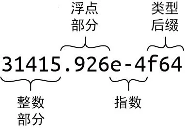
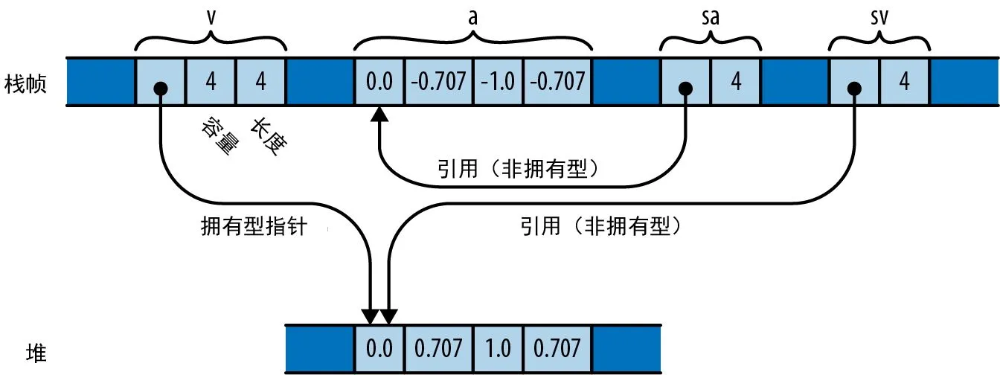
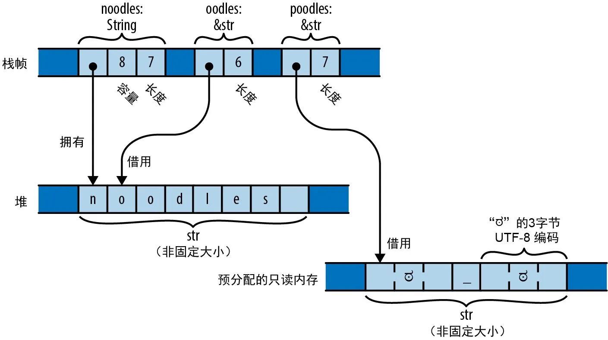

# 第3章基本数据类型

- 之所以世界上有很多很多类型的书，是因为世界上有很多很多类型的人，而每个人都在追求不同类型的知识。——Lemony Snicket

在很大程度上，可以说 Rust 语言就是围绕其类型来设计的。Rust 对高性能代码的支持，源自它能让开发人员选择最适合当前场景的数据表示法，并在简单性和成本之间进行合理的权衡。Rust 的内存和线程安全保障也依赖于其类型系统的健全性，而 Rust 的灵活性则源于其泛型类型和特型。

本章涵盖了 Rust 用以表示值的基本数据类型。这些源代码级类型都有其对应的机器级表示法，具有可预测的成本和性能。尽管 Rust 无法保证会完全按你的要求去表示各项事物，但只有当它确信能做出可靠的改进时才会谨慎地偏离你的原始要求。

与 JavaScript 或 Python 等动态类型语言相比，Rust 需要你提前做出更多规划。你必须明确写出各个函数参数和返回值的类型、结构体字段以及一些其他结构体。然而，Rust 的以下两个特性让这项工作比你预想的要轻松一点儿。

- 基于已明确写出的类型，Rust 的类型推断会帮你推断出剩下的大部分类型。实际上，对于给定的变量或表达式，通常只会有一种恰当的类型，在这种情况下，Rust 允许你省略类型。例如，你可以明确写出函数中的每一种类型，如下所示。

```javascript
fn build_vector() -> Vec<i16> {
1
   let mut v: Vec<i16> = Vec::<i16>::new();
2
   v.push(10i16);
3
   v.push(20i16);
4
   v
5
}
6
```

```
但这既凌乱又啰唆。既然已知函数的返回类型，那么显然 v 只能是一个 Vec<i16>，也就
是 16 位有符号整数的向量，其他类型都不行。由此可知该向量的每个元素都必须是 i16。
```

- 这正是 Rust 的类型推断所擅长的那种推理方式，这样一来，你可以将上述代码改写成下面这样。

```javascript
fn build_vector() -> Vec<i16> {
1
   let mut v = Vec::new();
2
   v.push(10);
3
   v.push(20);
4
   v
5
}
6
```

- 这两个定义是完全等效的，无论采用哪种方式，Rust 都会生成相同的机器码。类型推断让Rust 具备了与动态类型语言相近的易读性，并且仍然能在编译期捕获类型错误。

- 函数可以是泛型的：单个函数就可以处理许多不同类型的值。在 Python 和 JavaScript 中，所有函数都天生如此：函数可以对任何具备该函数所要求的属性和方法的值进行操作。（这就是通常称为鸭子类型的特征：如果它叫得像鸭子，走路像鸭子，那它就是鸭子。）但也正是这种灵活性让这些语言很难及早发现类型错误，而测试通常是发现此类错误的唯一途径。Rust 的泛型函数为该语言提供了一定程度的灵活性，而且仍然能在编译期捕获所有的类型错误。

- 虽然泛型函数更灵活，但其效率仍然与非泛型函数一样高。相较于编写能处理所有整数的泛

```
型函数，为每种整数编写一个专用的 sum 函数并没有性能方面的内在优势。第 11 章会详
```

- 细讨论泛型函数。

本章的其余部分自下向上介绍了 Rust 的一些类型，从简单的数值类型（如整数和浮点值）开始，转而介绍包含更多数据的类型：Box、元组（tuple）、数组和字符串。

接下来是你将在 Rust 中看到的各种类型的摘要。表 3-1 展示了 Rust 的原始类型、标准库中一些最常见的类型以及一些用户定义类型的示例。

表 3-1：Rust 中的类型示例

类型

- 说明

```
i8、i16、i32、i64、i128、u8、u16、u32、
```

- 给定位宽的有符号整数和无符号整数

```
u64、u128
```

- 与机器字（32 位或 64 位）一样大的有

```
isize、usize
```

- 符号整数

```
f32、f64
```

- 单精度 IEEE 浮点数和双精度 IEEE 浮

```
bool
```

- 布尔值

```
char
```

- Unicode 字符，32 位宽（4 字节）

```
(char, u8, i32)
```

- 元组，允许混合类型

```
()
```

- “单元”（空元组）

本章会对上述大多数类型进行介绍，但以下类型除外。

```
结构体（struct）类型（参见第 9 章）。
```

- 枚举类型（参见第 10 章）。

- 特型对象（参见第 11 章）。

- 函数和闭包类型（参见第 14 章）。

```
String 和 &str 的更多细节（参见第 17 章）。
```

## 3.1　固定宽度的数值类型

Rust 类型系统的根基是一组固定宽度的数值类型，选用这些类型是为了匹配几乎所有现代处理器都已直接在硬件中实现的类型。

固定宽度的数值类型可能会溢出或丢失精度，但它们足以满足大多数应用程序的需求，并且要比任意精度整数和精确有理数等表示法快数千倍。如果需要后面提到的那些类型的数值的表示

```
法，可以到 num crate 中找到它们。
```

Rust 中数值类型的名称都遵循着一种统一的模式，也就是以“位”数表明它们的宽度，以前缀表明它们的用法，如表 3-2 所示。

表 3-2：Rust 数值类型

大小（位）

- 无符号整数有符号整数浮点数

```
u8
i8
u16
i16
u32
i32
f32
u64
i64
f64
u128
i128
usize
isize
```

机器字

在这里，机器字是一个值，其大小等于运行此代码的机器上“地址”的大小，可能是 32 位，也可能是 64 位。

### 3.1.1　整型

Rust 的无符号整型会使用它们的完整范围来表示正值和 0，如表 3-3 所示。

表 3-3：Rust 无符号整型

类型

- 范围

- 8

```
u8
```

- 0 到 2 -1（0 到 255）

- 16

```
u16
```

- 0 到 2-1（0 到 65 535）

- 32

```
u32
```

- 0 到 2-1（0 到 4 294 967 295）

Rust 的有符号整型会使用二进制补码表示，使用与相应的无符号类型相同的位模式来覆盖正值和负值的范围，如表 3-4 所示。

表 3-4：Rust 有符号整型

类型

- 范围

- 77

```
i8
```

- -2 到 2 -1（-128 到 127）

- 1515

```
i16
```

- -2到 2-1（-32 768 到 32 767）

- 3131

```
i32
```

- -2到 2-1（-2 147 483 648 到 2 147 483 647）

- 6363

```
i64
```

- -2到 2-1（-9 223 372 036 854 775 808 到 9 223 372 036 854 775 807）

- 1271273838

```
i128
```

- -2到 2-1（大约 -1.7×10到 +1.7×10）

- 31316363

```
isize
```

- -2到 2-1 或 -2到 2-1

```
Rust 会使用 u8 类型作为字节值。例如，从二进制文件或套接字中读取数据时会产生一个 u8
```

值构成的流。

```
与 C 和 C++ 不同，Rust 会把字符视为与数值截然不同的类型：char 既不是 u8，也不是
u32（尽管它确实有 32 位长）。稍后 3.3 节会详细讲解 Rust 的 char 类型。
usize 类型和 isize 类型类似于 C 和 C++ 中的 size_t 和 ptrdiff_t。它们的精度与目
```

标机器上地址空间的大小保持一致，即在 32 位架构上是 32 位长，在 64 位架构上则是 64 位

```
长。Rust 要求数组索引是 usize 值。用来表示数组或向量大小或某些数据结构中元素数量的
值通常也是 usize 类型。
Rust 中的整型字面量可以带上一个后缀来指示它们的类型：42u8 是 u8 类型，1729isize
是 isize 类型。如果整型字面量没有带类型后缀，那么 Rust 就会延迟确定其类型，直到找
```

出一处足以认定其类型的使用代码，比如存储在特定类型的变量中、传给期待特定类型的函数、与具有特定类型的另一个值进行比较，等等。最后，如果有多种候选类型，那么 Rust 就

```
会默认使用 i32（如果是候选类型之一的话）。如果无法认定类型，那么 Rust 就会将此歧义
```

报告为错误。

```
前缀 0x、0o 和 0b 分别表示十六进制字面量、八进制字面量和二进制字面量。
为了让长数值更易读，可以在数字之间任意插入下划线。例如，可以将 u32 的最大值写为
4_294_967_295。下划线的具体位置无关紧要，因此也可以将十六进制数或二进制数按 4 位
数字而非 3 位数字进行分组（如 0xffff_ffff），或分隔开数字的类型后缀（如 127_u8）。
```

表 3-5 中展示了整型字面量的一些示例。

表 3-5：整型字面量示例

字面量

- 类型十进制值

```
116i8
i8
116
0xcafeu32
u32
51966
0b0010_1010
42
```

- 推断

```
0o106
70
```

- 推断

```
尽管数值类型和 char 类型是不同的，但 Rust 确实为 u8 值提供了字节字面量。与字符字面
量类似，b'X' 表示以字符 X 的 ASCII 码作为 u8 值。例如，由于 A 的 ASCII 码是 65，因此
字面量 b'A' 和 65u8 完全等效。只有 ASCII 字符才能出现在字节字面量中。
```

有几个字符不能简单地放在单引号后面，因为那样在语法上会有歧义或难以阅读。表 3-6 中的字符只能以反斜杠开头的替代符号来书写。

表 3-6：需要替代符号的字符

字符

- 字节字面量等效的数值

```
单引号（'）
b'\''
39u8
反斜杠（\）
b'\\'
92u8
换行（lf）
b'\n'
10u8
回车（cr）
b'\r'
13u8
制表符（tab）
b'\t'
9u8
对于难于书写或阅读的字符，可以将其编码改为十六进制。这种字节字面量形如 b'\xHH'，
其中 HH 是任意两位十六进制数，表示值为 HH 的字节。例如，你可以将 ASCII 控制字符
escape 的字节字面量写成 b'\x1b'，因为 escape 的 ASCII 码为 27，即十六进制的 1B。
由于字节字面量只是 u8 值的表示法之一，因此还应该考虑使用一个整型字面量是否更易读：
只有当你要强调该值表示的是 ASCII 码时，才应该使用 b'\x1b' 而不是简单明了的 27。
可以使用 as 运算符将一种整型转换为另一种整型。6.14 节会详细讲解类型转换的原理，这里
```

先举一些例子：

```
assert_eq!(   10_i8  as u16,    10_u16); //  范围内转换
assert_eq!( 2525_u16 as i16,  2525_i16); //  范围内转换
assert_eq!(   -1_i16 as i32,    -1_i32); //  带符号扩展
assert_eq!(65535_u16 as i32, 65535_i32); //  填零扩展
//  超出目标范围的转换生成的值等于原始值对 2<sup>N</sup>取模的值，
//  其中 N 是按位算的目标宽度。有时这也称为“截断”
assert_eq!( 1000_i16 as  u8,   232_u8);
assert_eq!(65535_u32 as i16,    -1_i16);
assert_eq!(   -1_i8  as u8,    255_u8);
assert_eq!(  255_u8  as i8,     -1_i8);
```

标准库提供了一些运算，可以像整型的方法一样使用。例如：

```
assert_eq!(2_u16.pow(4), 16);            // 求幂
assert_eq!((-4_i32).abs(), 4);           // 求绝对值
assert_eq!(0b101101_u8.count_ones(), 4); // 求二进制1的个数
可以在在线文档中找到这些内容。但请注意，该文档在“i32（原始类型）”和此类型的专有模块
（搜索“std::i32”）下的单独页面中分别含有此类型的信息。
```

在实际编码中，通常不必像刚才那样写出类型后缀，因为其上下文将决定类型。但是，如果没有类型后缀且无法决定类型，那么错误消息可能会令人惊讶。例如，以下代码无法编译：

```
println!("{}", (-4).abs());
```

Rust 会报错：

```
error: can't call method `abs` on ambiguous numeric type ``
这令人不解：明明所有的有符号整型都有一个 abs 方法，那么问题出在哪里呢？出于技术原
```

因，Rust 在调用类型本身的方法之前必须确切地知道一个值属于哪种整型。只有在解析完所

```
有方法调用后类型仍然不明确的时候，才会默认为 i32，但这里并没有其他方法可供解析，
```

因此 Rust 提供不了帮助。解决方案是加上后缀或使用特定类型的函数来明确写出希望的类型：

```
println!("{}", (-4_i32).abs());
println!("{}", i32::abs(-4));
```

请注意，方法调用的优先级高于一元前缀运算符，因此在将方法应用于负值时要小心。如果第

```
一个语句中 -4_i32 周围没有圆括号，则 -4_i32.abs() 会先针对正值 4 调用 abs 方法，
生成正值 4，再根据负号取负，得到 -4。
```

### 3.1.2　检查算法、回绕算法、饱和算法和溢出算法

当整型算术运算溢出时，Rust 在调试构建中会出现 panic。而在发布构建中，运算会回绕：它生成的值等于“数学意义上正确的结果”对“值类型范围”取模的值。（在任何情况下都不会像 C 和C++ 中那样出现“溢出未定义”的行为。）

例如，以下代码在调试构建中会出现 panic：

```javascript
let mut i = 1;
loop {
   i *= 10; // panic：试图进行可能溢出的乘法（但只会在调试构建中出现）
}
```

在发布构建中，此乘法会返回负数，并且循环会无限运行。

如果这种默认行为不是你想要的，则整型提供的某些方法可以让你准确地阐明自己期望的行为。例如，在任意构建中都会出现下列 panic：

```javascript
let mut i: i32 = 1;
loop {
   // panic：乘法溢出（在任意构建中出现）
   i = i.checked_mul(10).expect("multiplication overflowed");
}
```

这些整型算术方法分为 4 大类。

```
检查运算会返回结果的 Option 值：如果数学意义上正确的结果可以表示为该类型的值，
那么就为 Some(v)，否则为 None。
```

- // 10 与 20 之和可以表示为 u8

- assert_eq!(10_u8.checked_add(20), Some(30));

- // 很遗憾，100 与 200 之和不能表示为 u8

- assert_eq!(100_u8.checked_add(200), None);

- // 做加法。如果溢出，则会出现 panic

- let sum = x.checked_add(y).unwrap();

- // 奇怪的是，在某种特殊情况下，带符号的除法也会溢出。

- n-1n-1// 带符号的 n 位类型可以表示 -2，但不足以表示 2

- assert_eq!((-128_i8).checked_div(-1), None);

- 回绕运算会返回与“数学意义上正确的结果”对“值类型范围”取模的值相等的值。16// 第一个结果可以表示为 u16，第二个则不能，所以会得到 250000 对 2的模

- assert_eq!(100_u16.wrapping_mul(200), 20000);

- assert_eq!(500_u16.wrapping_mul(500), 53392);

- // 对有符号类型的运算可能会回绕为负值

- assert_eq!(500_i16.wrapping_mul(500), -12144);

- // 在移位运算中，移位距离会在值的大小范围内回绕，

- // 所以在 16 位类型中移动 17 位就相当于移动了 1 位

- assert_eq!(5_i16.wrapping_shl(17), 10);

如前所述，这就是普通算术运算符在发布构建中的行为。这些方法的优点是它们在所有构建中的行为方式都是相同的。

- 饱和运算会返回最接近“数学意义上正确结果”的可表达值。换句话说，结果“紧贴着”该类型可表达的最大值和最小值。

```
assert_eq!(32760_i16.saturating_add(10), 32767);
1
assert_eq!((-32760_i16).saturating_sub(10), -32768);
2
```

- 123不存在饱和除法、饱和求余法或饱和位移法。

```
溢出运算会返回一个元组 (result, overflowed)，其中 result 是函数的回绕版本所
返回的内容，而 overflowed 是一个布尔值，指示是否发生过溢出。
assert_eq!(255_u8.overflowing_sub(2), (253, false));
1
assert_eq!(255_u8.overflowing_add(2), (1, true));
2
overflowing_shl 和 overflowing_shr 稍微偏离了这种模式：只有当移位距离与类
型本身的位宽一样大或比其更大时，它们才会为 overflowed 返回 true。实际应用的移
```

- 位数是所请求的移位数对类型位宽取模的结果。

```
// 移动17位对`u16`来说太大了，而17对16取模就是1
1
assert_eq!(5_u16.overflowing_shl(17), (10, true));
2
前缀 checked_、wrapping_、saturating_ 或 overflowing_ 后面可以跟着的运算名
```

称如表 3-7 所示。

表 3-7：运算名称

运算

- 名称后缀例子

```
add
100_i8.checked_add(27) == Some(127)
```

加法

```
sub
10_u8.checked_sub(11) == None
```

减法

```
mul
128_u8.saturating_mul(3) == 255
```

乘法

```
div
64_u16.wrapping_div(8) == 8
```

除法

```
rem
(-32768_i16).wrapping_rem(-1) == 0
```

求余

```
neg
(-128_i8).checked_neg() == None
```

取负

```
abs
(-32768_i16).wrapping_abs() == -32768
```

绝对值

```
pow
3_u8.checked_pow(4) == Some(81)
```

求幂

```
shl
10_u32.wrapping_shl(34) == 40
```

按位左移

```
shr
40_u64.wrapping_shr(66) == 10
```

按位右移

### 3.1.3　浮点类型

Rust 提供了 IEEE 单精度浮点类型和 IEEE 双精度浮点类型。这些类型包括正无穷大和负无穷大、不同的正零值和负零值，以及非数值。如表 3-8 所示。

表 3-8：IEEE 单精度浮点类型和 IEEE 双精度浮点类型

类型

- 精度范围

- 3838

```
f32
```

- IEEE 单精度（至少6 位小数）大约3 4103 410至

```
Rust 的 f32 和 f64 分别对应于 C 和 C++（在支持 IEEE 浮点的实现中）以及 Java（始终使
用 IEEE 浮点）中的 float 类型和 double 类型。
```

浮点字面量的一般化形式如图 3-1 所示。



- 图 3-1：浮点字面量

浮点数中整数部分之后的每个部分都是可选的，但必须至少存在小数部分、指数或类型后缀这三者中的一个，以将其与整型字面量区分开来。小数部分可以仅由一个单独的小数点组成，因

```
此 5. 也是有效的浮点常量。
```

如果浮点字面量缺少类型后缀，那么 Rust 就会检查上下文以查看值的使用方式，这与整型字

```
面量非常相似。如果它最终发现这两种浮点类型都适合，就会默认选择 f64。
```

为了便于类型推断，Rust 会将整型字面量和浮点字面量视为不同的大类：它永远不会把整型字面量推断为浮点类型，反之亦然。表 3-9 展示了浮点字面量的一些示例。

表 3-9：浮点字面量的例子

字面量

- 类型数学值

- 9 16

```
-1.5625
```

- −(1 /)自动推断

```
2.
```

- 2自动推断

```
0.25
```

- ¼自动推断

```
1e4
```

- 10 000自动推断

```
40f32
f32
```

- 40

```
f32 类型和 f64 类型具有 IEEE 要求的一些特殊值的关联常量，比如 INFINITY（无穷
大）、NEG_INFINITY（负无穷大）、NAN（非数值）以及 MIN（最小有限值）和 MAX（最大
```

有限值）：

```
assert!((-1. / f32::INFINITY).is_sign_negative());
assert_eq!(-f32::MIN, f32::MAX);
f32 类型和 f64 类型提供了完备的数学计算方法，比如 2f64.sqrt() 就是 2 的双精度平
```

方根。下面是一些例子：

```
assert_eq!(5f32.sqrt() * 5f32.sqrt(), 5.); // 按IEEE的规定，它精确等于5.0
assert_eq!((-1.01f64).floor(), -2.0);
```

再次提醒，方法调用的优先级高于前缀运算符，因此在对负值进行方法调用时，请务必正确地加上圆括号。

```
std::f32::consts 模块和 std::f64::consts 模块提供了各种常用的数学常量，比如
E、PI 和 2 的平方根。
在搜索文档时，请记住这两种类型本身都有名为“f32（原始类型）”和“f64（原始类型）”的页
面，以及每种类型的单独模块 std::f32 和 std::f64。
```

与整数一样，通常不必在实际代码中写出浮点字面量的类型后缀，但如果你想这么做，那么将类型放在字面量或函数上就可以：

```
println!("{}", (2.0_f64).sqrt());
println!("{}", f64::sqrt(2.0));
与 C 和 C++ 不同，Rust 几乎不会执行任何隐式的数值转换。如果函数需要 f64 参数，则传
入 i32 型参数是错误的。事实上，Rust 甚至不会隐式地将 i16 值转换为 i32 值，虽然每个
i16 值都必然在 i32 范围内。不过，你随时可以用 as 运算符写出显式转换：i as f64 或
x as i32。
```

缺少隐式转换有时会让 Rust 表达式比类似的 C 或 C++ 代码更冗长。然而，隐式整数转换有着导致错误和安全漏洞的大量“前科”，特别是在用这种整数表示内存中某些内容的大小时，很可能发生意外溢出。根据以往的经验，Rust 这种要求明确写出数值类型转换的行为，会提醒我们注意到一些可能错过的问题。

6.14 节会解释各种类型转换的确切行为。

## 3.2　布尔类型

```
Rust 的布尔类型 bool 具有此类型常用的两个值 true 和 false。==、< 等比较运算符会
生成 bool 结果，比如 2 < 5 的值为 true。
```

许多语言对在要求布尔值的上下文中使用其他类型的值持宽松态度，比如 C 和 C++ 会把字

```
符、整数、浮点数和指针隐式转换成布尔值，因此它们可以直接用作 if 语句或 while 语句
中的条件。Python 允许在布尔上下文中使用字符串、列表、字典甚至 Set，如果这些值是非
空的，则将它们视为 true。然而，Rust 非常严格：像 if 和 while 这样的控制结构要求它
们的条件必须是 bool 表达式，短路逻辑运算符 && 和 || 也是如此。你必须写成 if x !=
0 { ... }，而不能只写成 if x { ... }。
Rust 的 as 运算符可以将 bool 值转换为整型：
assert_eq!(false as i32, 0);
assert_eq!(true  as i32, 1);
但是，as 无法进行另一个方向（从数值类型到 bool）的转换。相反，你必须显式地写出比较
表达式，比如 x != 0。
尽管 bool 只需要用一个位来表示，但 Rust 在内存中会使用整字节来表示 bool 值，因此可
```

以创建指向它的指针。

## 3.3　字符

```
Rust 的字符类型 char 会以 32 位值表示单个 Unicode 字符。
Rust 会对单独的字符使用 char 类型，但对字符串和文本流使用 UTF-8 编码。因此，
String 会将其文本表示为 UTF-8 字节序列，而不是字符数组。
字符字面量是用单引号括起来的字符，比如 '8' 或 '!'。还可以使用全角 Unicode 字符：'
錆 ' 是一个 char 字面量，表示日文汉字中的 sabi（rust）。
```

与字节字面量一样，有些字符需要用反斜杠转义，如表 3-10 所示。

表 3-10：需要用反斜杠转义的字符

- Rust 字符字面量

字符

```
单引号（'）
'\''
反斜杠（\）
'\\'
换行（lf）
'\n'
```

如果你愿意，还可以用十六进制写出字符的 Unicode 码点。

- 如果字符的码点在 U+0000 到 U+007F 范围内（也就是说，如果它是从 ASCII 字符集中提

```
取的），就可以把字符写为 '\xHH'，其中 HH 是两个十六进制数。例如，字符字面量 '*'
和 '\x2A' 是等效的，因为字符 * 的码点是 42 或十六进制的 2A。
可以将任何 Unicode 字符写为 '\u' 形式，其中 HHHHHH 是最多 6 个十六进制数，可以像
往常一样用下划线进行分组。例如，字符字面量 '\u' 表示字符“”，这是 Unicode 中用于表
示反对的卡纳达语字符“_”。同样的字面量也可以简写成 ''。
char 总是包含 0x0000 到 0xD7FF 或 0xE000 到 0x10FFFF 范围内的 Unicode 码点。char
```

永远不会是“半代用区”中的码点（0xD800 到 0xDFFF 范围内的码点，它们不能单独使用）或Unicode 码点空间之外的值（大于 0x10FFFF 的值）。Rust 使用类型系统和动态检查来确保

```
char 值始终在允许的范围内。
Rust 不会在 char 和任何其他类型之间进行隐式转换。可以使用 as 转换运算符将 char 转
换为整型，对于小于 32 位的类型，该字符值的高位会被截断：
assert_eq!('*' as i32, 42);
assert_eq!('' as u16, 0xca0);
assert_eq!('' as i8, -0x60); // U+0CA0截断到8位，有符号
从另一个方向来看，u8 是唯一能通过 as 运算符转换为 char 的类型，因为 Rust 刻意让 as
运算符只执行开销极低且可靠的转换，但是除 u8 之外的每个整型都可能包含 Unicode 码点之
```

外的值，所以这些转换都要做运行期检查。作为替代方案，标准库函数

```
std::char::from_u32 可以接受任何 u32 值并返回一个 Option<char>：如果此 u32
不是允许的 Unicode 码点，那么 from_u32 就会返回 None，否则，它会返回 Some(c)，其
中 c 是转换成 char 后的结果。
标准库为字符提供了一些有用的方法，你可以在“char（原始类型）”和模块“std::char”下的
```

在线文档中找到这些方法。

```
assert_eq!('*'.is_alphabetic(), false);
assert_eq!('β'.is_alphabetic(), true);
assert_eq!('8'.to_digit(10), Some(8));
assert_eq!(''.len_utf8(), 3);
assert_eq!(std::char::from_digit(2, 10), Some('2'));
孤立的字符自然不如字符串和文本流那么有用。3.7 节会讲解 Rust 的标准 String 类型和文
```

本处理。

## 3.4　元组

元组是各种类型值的值对或三元组、四元组、五元组等（因此称为 n- 元组或元组）。可以将元

```
组编写为一个元素序列，用逗号隔开并包裹在一对圆括号中。例如，("Brazil", 1985) 是
```

一个元组，其第一个元素是一个静态分配的字符串，第二个元素是一个整数，它的类型是

```
(&str, i32)。给定一个元组值 t，可以通过 t.0、t.1 等访问其元素。
```

元组有点儿类似于数组，即这两种类型都表示值的有序序列。许多编程语言混用或结合了这两个概念，但在 Rust 中，它们是截然不同的。一方面，元组的每个元素可以有不同的类型，而

```
数组的元素必须都是相同的类型。另一方面，元组只允许用常量作为索引，比如 t.4。不能
通过写成 t.i 或 t[i] 的形式来获取第 i 个元素。
Rust 代码通常会用元组类型从一个函数返回多个值。例如，字符串切片上的 split_at 方法
```

会将字符串分成两半并返回它们，其声明如下所示：

```
fn split_at(&self, mid: usize) -> (&str, &str);
返回类型 (&str, &str) 是两个字符串切片构成的元组。可以用模式匹配语法将返回值的每
```

个元素赋值给不同的变量：

```javascript
let text = "I see the eigenvalue in thine eye";
let (head, tail) = text.split_at(21);
assert_eq!(head, "I see the eigenvalue ");
assert_eq!(tail, "in thine eye");
```

这样比其等效写法更易读：

```javascript
let text = "I see the eigenvalue in thine eye";
let temp = text.split_at(21);
let head = temp.0;
let tail = temp.1;
assert_eq!(head, "I see the eigenvalue ");
assert_eq!(tail, "in thine eye");
```

你还会看到元组被用作一种超级小巧的结构体类型。例如，在第 2 章的曼德博程序中，我们要

```
将图像的宽度和高度传给绘制它的函数并将其写入磁盘。为此可以声明一个具有 width 成员
和 height 成员的结构体，但对如此显而易见的事情来说，这种写法相当烦琐，所以我们只
```

用了一个元组：

```
/// 把`pixels`缓冲区（其尺寸由`bounds`给出）写入名为`filename`的文件中
fn write_image(filename: &str, pixels: &[u8], bounds: (usize, usize))
   -> Result<(), std::io::Error>
{ ... }
bounds 参数的类型是 (usize, usize)，这是一个包含两个 usize 值的元组。当然也可
以写成单独的 width 参数和 height 参数，并且最终的机器码也基本一样。但重点在于思路
```

的清晰度。应该把大小看作一个值，而不是两个，使用元组能更准确地记述这种意图。

```
另一种常用的元组类型是零元组 ()。传统上，这叫作单元类型，因为此类型只有一个值，写
作 ()。当无法携带任何有意义的值但其上下文仍然要求传入某种类型时，Rust 就会使用单元
```

类型。

```
例如，不返回值的函数的返回类型为 ()。标准库的 std::mem::swap 函数就没有任何有意
义的返回值，它只会交换两个参数的值。std::mem::swap 的声明如下所示：
fn swap<T>(x: &mut T, y: &mut T);
这个 <T> 意味着 swap 是泛型的：可以将对任意类型 T 的值的引用传给它。但此签名完全省
略了 swap 的返回类型，它是以下完整写法的简写形式：
fn swap<T>(x: &mut T, y: &mut T) -> ();
类似地，前面提到过的 write_image 示例的返回类型是 Result<(),
std::io::Error>，这意味着该函数在出错时会返回一个 std::io::Error 值，但成功时
```

不会返回任何值。

```
如果你愿意，可以在元组的最后一个元素之后跟上一个逗号：类型 (&str, i32,) 和
(&str, i32) 是等效的，表达式 ("Brazil", 1985,) 和 ("Brazil", 1985) 是等效
```

的。Rust 始终允许在所有能用逗号的地方（函数参数、数组、结构体和枚举定义，等等）添加额外的尾随逗号。这对人类读者来说可能很奇怪，不过一旦在多行列表末尾添加或移除了条目（entry），在显示差异时就会更容易阅读。

```
为了保持一致性，甚至有包含单个值的元组。字面量 ("lonely hearts",) 就是一个包含
单个字符串的元组，它的类型是 (&str,)。在这里，值后面的逗号是必需的，以用于区分单
```

值元组和简单的括号表达式。

## 3.5　指针类型

Rust 有多种表示内存地址的类型。

```
这是 Rust 和大多数具有垃圾回收功能的语言之间一个重大的差异。在 Java 中，如果 class
Rectangle 包含字段 Vector2D upperLeft;，那么 upperLeft 就是对另一个单独创建
的 Vector2D 对象的引用。在 Java 中，一个对象永远不会包含其他对象的实际内容。
```

但 Rust 不一样。该语言旨在帮你将内存分配保持在最低限度。默认情况下值会嵌套。值

```
((0, 0), (1440, 900)) 会存储为 4 个相邻的整数。如果将它存储在一个局部变量中，则
```

会得到 4 倍于整数宽度的局部变量。堆中没有分配任何内容。

这可以帮我们高效利用内存，但代价是，当 Rust 程序需要让一些值指向其他值时，必须显式使用指针类型。好消息是，当使用这些指针类型时，安全的 Rust 会对其进行约束，以消除未定义的行为，因此指针在 Rust 中比在 C++ 中更容易正确使用。

接下来将讨论 3 种指针类型：引用、Box 和不安全指针。

### 3.5.1　引用

```
&String 类型的值（读作“ref String”）是对 String 值的引用，&i32 是对 i32 的引用，以
```

此类推。

```
最简单的方式是将引用视为 Rust 中的基本指针类型。在运行期间，对 i32 的引用是一个保存
着 i32 地址的机器字，这个地址可能位于栈或堆中。表达式 &x 会生成一个对 x 的引用，在
Rust 术语中，我们会说它借用了对 x 的引用。给定一个引用 r，表达式 *r 会引用 r 指向的
值。它们非常像 C 和 C++ 中的 & 运算符和 * 运算符，并且和 C 中的指针一样，当超出作用
```

域时引用不会自动释放任何资源。

然而，与 C 指针不同，Rust 的引用永远不会为空：在安全的 Rust 中根本没有办法生成空引用。与 C 不同，Rust 会跟踪值的所有权和生命周期，因此早在编译期间就排除了悬空指针、双重释放和指针失效等错误。

Rust 引用有两种形式。

```
&T
```

一个不可变的共享引用。你可以同时拥有多个对给定值的共享引用，但它们是只读的：禁止修

```javascript
改它们所指向的值，就像 C 中的 const T* 一样。
&mut T
一个可变的、独占的引用。你可以读取和修改它指向的值，就像 C 中的 T* 一样。但是只要该
```

引用还存在，就不能对该值有任何类型的其他引用。事实上，访问该值的唯一途径就是使用这个可变引用。

Rust 利用共享引用和可变引用之间的“二选一”机制来强制执行“单个写入者或多个读取者”规则：你或者独占读写一个值，或者让任意数量的读取者共享，但二者只能选择其一。这种由编译期检查强制执行的“二选一”规则是 Rust 安全保障的核心。第 5 章会解释 Rust 的安全引用的使用规则。

### 3.5.2　Box

```javascript
在堆中分配值的最简单方式是使用 Box::new：
let t = (12, "eggs");
let b = Box::new(t);  // 在堆中分配一个元组
t 的类型是 (i32, &str)，所以 b 的类型是 Box<(i32, &str)>。对 Box::new 的调用
会分配足够的内存以在堆上容纳此元组。当 b 超出作用域时，内存会立即被释放，除非 b 已
```

被移动（move），比如返回它。移动对于 Rust 处理在堆上分配的值的方式至关重要，第 4 章会对此进行详细解释。

### 3.5.3　裸指针

```javascript
Rust 也有裸指针类型 *mut T 和 *const T。裸指针实际上和 C++ 中的指针很像。使用裸
```

指针是不安全的，因为 Rust 不会跟踪它指向的内容。例如，裸指针可能为空，或者它们可能指向已释放的内存或现在包含不同类型的值。C++ 的所有经典指针错误都可能“借尸还魂”。

```
但是，你只能在 unsafe 块中对裸指针解引用（dereference）。unsafe 块是 Rust 高级语言
特性中的可选机制，其安全性取决于你自己。如果代码中没有 unsafe 块（或者虽然有但编
```

写正确），那么本书中强调的安全保证就仍然有效。有关详细信息，请参阅第 22 章。

## 3.6　数组、向量和切片

Rust 用 3 种类型来表示内存中的值序列。

```
类型 [T; N] 表示 N 个值的数组，每个值的类型为 T。数组的大小是在编译期就已确定的
```

- 常量，并且是类型的一部分，不能追加新元素或缩小数组。

```
类型 Vec<T> 可称为 T 的向量，它是一个动态分配且可增长的 T 类型的值序列。向量的元
```

- 素存在于堆中，因此可以随意调整向量的大小：压入新元素、追加其他向量、删除元素等。

```
类型 &[T] 和 &mut [T] 可称为 T 的共享切片和 T 的可变切片，它们是对一系列元素的引
```

- 用，这些元素是某个其他值（比如数组或向量）的一部分。可以将切片视为指向其第一个元

```
素的指针，以及从该点开始允许访问的元素数量的计数。可变切片 &mut [T] 允许读取元
素和修改元素，但不能共享；共享切片 &[T] 允许在多个读取者之间共享访问权限，但不
```

- 允许修改元素。

```
给定这 3 种类型中任意一种类型的值 v，表达式 v.len() 都会给出 v 中的元素数，而 v[i]
引用的是 v 的第 i 个元素。v 的第一个元素是 v[0]，最后一个元素是 v[v.len() - 1]。
Rust 总是会检查 i 是否在这个范围内，如果没在，则此表达式会出现 panic。v 的长度可能
为 0，在这种情况下，任何对其进行索引的尝试都会出现 panic。i 的类型必须是 usize，不
```

能使用任何其他整型作为索引。

### 3.6.1　数组

编写数组值的方法有好几种，其中最简单的方法是在方括号内写入一系列值：

```javascript
let lazy_caterer: [u32; 6] = [1, 2, 4, 7, 11, 16];
let taxonomy = ["Animalia", "Arthropoda", "Insecta"];
assert_eq!(lazy_caterer[3], 7);
assert_eq!(taxonomy.len(), 3);
对于要填充一些值的长数组的常见情况，可以写成 [<i>V</i>; <i>N</i>]，其中 V 是每
个元素的值，N 是长度。例如，[true; 10000] 是一个包含 10 000 个 bool 元素的数组，
其内容全为 true：
let mut sieve = [true; 10000];
for i in 2..100 {
   if sieve[i] {
       let mut j = i * i;
       while j < 10000 {
           sieve[j] = false;
           j += i;
       }
   }
}
assert!(sieve[211]);
assert!(!sieve[9876]);
你会看到用来声明固定大小缓冲区的语法：[0u8; 1024]，它是一个 1 KB 的缓冲区，用 0
```

填充。Rust 没有任何能定义未初始化数组的写法。（一般来说，Rust 会确保代码永远无法访问任何种类的未初始化值。）

```
数组的长度是其类型的一部分，并会在编译期固定下来。如果 n 是变量，则不能写成
[true; n] 以期得到一个包含 n 个元素的数组。当你需要一个长度在运行期可变的数组时
```

（通常都是这样），请改用向量。

你在数组上看到的那些实用方法（遍历元素、搜索、排序、填充、过滤等）都是作为切片而非数组的方法提供的。但是 Rust 在搜索各种方法时会隐式地将对数组的引用转换为切片，因此可以直接在数组上调用任何切片方法：

```javascript
let mut chaos = [3, 5, 4, 1, 2];
chaos.sort();
assert_eq!(chaos, [1, 2, 3, 4, 5]);
在这里，sort 方法实际上是在切片上定义的，但由于它是通过引用获取的操作目标，因此
Rust 会隐式地生成一个引用整个数组的 &mut [i32] 切片，并将其传给 sort 来进行操作。
其实前面提到过的 len 方法也是切片的方法之一。3.6.3 节会更详细地介绍切片。
```

### 3.6.2　向量

```
向量 Vec<T> 是一个可调整大小的 T 类型元素的数组，它是在堆上分配的。
创建向量的方法有好几种，其中最简单的方法是使用 vec! 宏，它为我们提供了一个看起来非
```

常像数组字面量的向量语法：

```javascript
let mut primes = vec![2, 3, 5, 7];
assert_eq!(primes.iter().product::<i32>(), 210);
```

当然，这仍然是一个向量，而不是数组，所以可以动态地向它添加元素：

```
primes.push(11);
primes.push(13);
assert_eq!(primes.iter().product::<i32>(), 30030);
```

还可以通过将给定值重复一定次数来构建向量，可以再次使用模仿数组字面量的语法：

```
fn new_pixel_buffer(rows: usize, cols: usize) -> Vec<u8> {
   vec![0; rows * cols]
}
vec! 宏相当于调用 Vec::new 来创建一个新的空向量，然后将元素压入其中，这是另一种
```

惯用法：

```javascript
let mut pal = Vec::new();
pal.push("step");
pal.push("on");
pal.push("no");
pal.push("pets");
assert_eq!(pal, vec!["step", "on", "no", "pets"]);
```

还有一种可能性是从迭代器生成的值构建一个向量：

```javascript
let v: Vec<i32> = (0..5).collect();
assert_eq!(v, [0, 1, 2, 3, 4]);
使用 collect 时，通常要指定类型（正如此处给 v 声明了类型），因为它可以构建出不同种
类的集合，而不仅仅是向量。通过指定 v 的类型，我们明确表达了自己想要哪种集合。
```

与数组一样，可以对向量使用切片的方法：

```javascript
// 回文！
let mut palindrome = vec!["a man", "a plan", "a canal", "panama"];
palindrome.reverse();
// 固然合理，但不符合预期：
assert_eq!(palindrome, vec!["panama", "a canal", "a plan", "a man"]);
在这里，reverse 方法实际上是在切片上定义的，但是此调用会隐式地从此向量中借用一个
&mut [&str] 切片并在其上调用 reverse。
Vec 是 Rust 的基本数据类型，它几乎可以用在任何需要动态大小的列表的地方，所以还有许
```

多其他方法可以构建新向量或扩展现有向量。第 16 章会介绍这些方法。

```
Vec<T> 由 3 个值组成：指向元素在堆中分配的缓冲区（该缓冲区由 Vec<T> 创建并拥有）
```

的指针、缓冲区能够存储的元素数量，以及它现在实际包含的数量（也就是它的长度）。当缓冲区达到其最大容量时，往向量中添加另一个元素需要分配一个更大的缓冲区，将当前内容复制到其中，更新向量的指针和容量以指向新缓冲区，最后释放旧缓冲区。

```
如果事先知道向量所需的元素数量，就可以调用 Vec::with_capacity 而不是 Vec::new
```

来创建一个向量，它的缓冲区足够大，可以从一开始就容纳所有元素。然后，可以逐个将元素

```
添加到此向量中，而不会导致任何重新分配。vec! 宏就使用了这样的技巧，因为它知道最终
```

向量将包含多少个元素。请注意，这只会确定向量的初始大小，如果大小超出了你的预估，则向量仍然会正常扩大其存储空间。

```
许多库函数会寻求使用 Vec::with_capacity 而非 Vec::new 的机会。例如，在
collect 示例中，迭代器 0..5 预先知道它将产生 5 个值，并且 collect 函数会利用这一
```

点以正确的容量来预分配它返回的向量。第 15 章会介绍其工作原理。

```
向量的 len 方法会返回它现在包含的元素数，而 capacity 方法则会返回在不重新分配的情
```

况下可以容纳的元素数：

```javascript
let mut v = Vec::with_capacity(2);
assert_eq!(v.len(), 0);
assert_eq!(v.capacity(), 2);
v.push(1);
v.push(2);
assert_eq!(v.len(), 2);
assert_eq!(v.capacity(), 2);
v.push(3);
assert_eq!(v.len(), 3);
// 通常会打印出"capacity is now 4":
println!("capacity is now {}", v.capacity());
最后打印出的容量不能保证恰好是 4，但至少大于等于 3，因为此向量包含 3 个值。
```

可以在向量中任意位置插入元素和移除元素，不过这些操作会将受影响位置之后的所有元素向前或向后移动，因此如果向量很长就可能很慢：

```sql
let mut v = vec![10, 20, 30, 40, 50];
// 在索引为3的元素处插入35
v.insert(3, 35);
assert_eq!(v, [10, 20, 30, 35, 40, 50]);
// 移除索引为1的元素
v.remove(1);
assert_eq!(v, [10, 30, 35, 40, 50]);
可以使用 pop 方法移除最后一个元素并将其返回。更准确地说，从 Vec<T> 中弹出一个值会
返回 Option<T>：如果向量已经为空则为 None，如果其最后一个元素为 v 则为
Some(v)。
let mut v = vec!["Snow Puff", "Glass Gem"];
assert_eq!(v.pop(), Some("Glass Gem"));
assert_eq!(v.pop(), Some("Snow Puff"));
assert_eq!(v.pop(), None);
可以使用 for 循环遍历向量：
// 将命令行参数作为字符串的向量
let languages: Vec<String> = std::env::args().skip(1).collect();
for l in languages {
   println!("{}: {}", l,
            if l.len() % 2 == 0 {
                "functional"
            } else {
                "imperative"
            });
}
```

以编程语言列表为参数运行本程序就可以说明这个问题：

```
$ cargo run Lisp Scheme C C++ Fortran
  Compiling proglangs v0.1.0 (/home/jimb/rust/proglangs)
   Finished dev [unoptimized + debuginfo] target(s) in 0.36s
    Running `target/debug/proglangs Lisp Scheme C C++ Fortran`
Lisp: functional
Scheme: functional
C: imperative
C++: imperative
Fortran: imperative
$
```

终于可以对术语函数式语言做一个令人满意的定义了。

```
虽然扮演着基础角色，但 Vec 仍然是 Rust 中定义的普通类型，而没有内置在语言中。第 22
```

章会介绍实现这些类型所需的技术。

### 3.6.3　切片

```
切片（写作不指定长度的 [T]）是数组或向量中的一个区域。由于切片可以是任意长度，因
```

此它不能直接存储在变量中或作为函数参数进行传递。切片总是通过引用传递。

对切片的引用是一个胖指针：一个双字值，包括指向切片第一个元素的指针和切片中元素的数量。

假设你运行以下代码：

```javascript
let v: Vec<f64> = vec![0.0,  0.707,  1.0,  0.707];
let a: [f64; 4] =     [0.0, -0.707, -1.0, -0.707];
let sv: &[f64] = &v;
let sa: &[f64] = &a;
在最后两行中，Rust 自动把 &Vec<f64> 的引用和 &[f64; 4] 的引用转换成了直接指向数
```

据的切片引用。

最后，内存布局如图 3-2 所示。



```
图 3-2：内存中的向量 v 和数组 a 分别被切片 sa 和 sv 引用
```

普通引用是指向单个值的非拥有型指针，而对切片的引用是指向内存中一系列连续值的非拥有型指针。如果要写一个对数组或向量进行操作的函数，那么切片引用就是不错的选择。例如，下面是打印一段数值的函数，每行一个：

```
fn print(n: &[f64]) {
   for elt in n {
       println!("{}", elt);
   }
}
print(&a);  // 打印数组
print(&v);  // 打印向量
```

因为此函数以切片引用为参数，所以也可以给它传入向量或数组。事实上，你以为属于向量或

```
数组的许多方法其实是在切片上定义的，比如会对元素序列进行排序或反转的 sort 方法和
reverse 方法实际上是切片类型 [T] 上的方法。
```

你可以使用范围值对数组或向量进行索引，以获取一个切片的引用，该引用既可以指向数组或向量，也可以指向一个既有切片：

```
print(&v[0..2]);    // 打印v的前两个元素
print(&a[2..]);     // 打印从a[2]开始的元素
print(&sv[1..3]);   // 打印v[1]和v[2]
```

与普通数组访问一样，Rust 会检查索引是否有效。尝试借用超出数据末尾的切片会导致panic。

```
由于切片几乎总是出现在引用符号之后，因此通常只将 &[T] 或 &str 之类的类型称为“切
```

片”，使用较短的名称来表示更常见的概念。

## 3.7　字符串类型

熟悉 C++ 的程序员应该还记得该语言中有两种字符串类型。字符串字面量的指针类型为

```javascript
const char *。标准库还提供了一个 std::string 类，用于在运行期动态创建字符串。
```

Rust 中也有类似的设计。本节将首先展示所有编写字符串字面量的方法，然后介绍 Rust 的两种字符串类型。第 17 章会介绍有关字符串和文本处理的更多信息。

### 3.7.1　字符串字面量

```javascript
字符串字面量要用双引号括起来，它们使用与 char 字面量相同的反斜杠转义序列：
let speech = "\"Ouch!\" said the well.\n";
但与 char 字面量不同，在字符串字面量中单引号不需要用反斜杠转义，而双引号需要。
```

一个字符串可能跨越多行：

```
println!("In the room the women come and go,
   Singing of Mount Abora");
```

该字符串字面量中的换行符是字符串的一部分，因此也会包含在输出中。第 2 行开头的空格也是如此。

如果字符串的一行以反斜杠结尾，那么就会丢弃其后的换行符和前导空格：

```
println!("It was a bright, cold day in April, and \
   there were four of us—\
   more or less.");
```

```
这会打印出单行文本。该字符串在“and”和“there”之间会有一个空格，因为在本程序中，第
一个反斜杠之前有一个空格，而在破折号和“more”之间则没有空格。
```

在少数情况下，需要双写字符串中的每一个反斜杠，这让人不胜其烦。（经典的例子是正则表达式和 Windows 路径。）对于这些情况，Rust 提供了原始字符串。原始字符串用小写字母 r进行标记。原始字符串中的所有反斜杠和空白字符都会逐字包含在字符串中。原始字符串不识别任何转义序列：

```javascript
let default_win_install_path = r"C:\Program Files\Gorillas";
let pattern = Regex::new(r"\d+(\.\d+)*");
```

不能简单地在双引号前面放置一个反斜杠来包含原始字符串——别忘了，前面说过它不识别转义序列。但是，仍有办法解决。可以在原始字符串的开头和结尾添加 # 标记：

```
println!(r###"
   This raw string started with 'r###"'.
   Therefore it does not end until we reach a quote mark ('"')
   followed immediately by three pound signs ('###'):
"###);
```

- 4

可以根据需要添加任意多个井号，以标明原始字符串的结束位置。

### 3.7.2　字节串

```
带有 b 前缀的字符串字面量都是字节串。这样的字节串是 u8 值（字节）的切片而不是
```

Unicode 文本：

```javascript
let method = b"GET";
assert_eq!(method, &[b'G', b'E', b'T']);
method 的类型是 &[u8; 3]：它是对 3 字节数组的引用，没有刚刚讨论过的任何字符串方
```

法，最像字符串的地方就是其书写语法，仅此而已。

字节串可以使用前面展示过的所有其他的字符串语法：可以跨越多行、可以使用转义序列、可

```
以使用反斜杠来连接行等。不过原始字节串要以 br" 开头。
字节串不能包含任意 Unicode 字符，它们只能使用 ASCII 和 \xHH 转义序列。
```

### 3.7.3　内存中的字符串

```
Rust 字符串是 Unicode 字符序列，但它们并没有以 char 数组的形式存储在内存中，而是使
```

用了 UTF-8（一种可变宽度编码）的形式。字符串中的每个 ASCII 字符都会存储在单字节中，而其他字符会占用多字节。

```javascript
图 3-3 展示了由以下代码创建的 String 值和 &str 值。
let noodles = "noodles".to_string();
let oodles = &noodles[1..];
let poodles = "_";
```



```
图 3-3：String、&str 和 str
String 有一个可以调整大小的缓冲区，其中包含 UTF-8 文本。缓冲区是在堆上分配的，因
此它可以根据需要或请求来调整大小。在示例中，noodles 是一个 String，它拥有一个 8
字节的缓冲区，其中 7 字节正在使用中。可以将 String 视为 Vec<u8>，它可以保证包含格
式良好的 UTF-8，实际上，String 就是这样实现的。
&str（发音为 /stɜːr/ 或 string slice）是对别人拥有的一系列 UTF-8 文本的引用，即它“借用”
了这个文本。在示例中，oodles 是对 noodles 拥有的文本的最后 6 字节的一个 &str 引
用，因此它表示文本“oodles”。与其他切片引用一样，&str 也是一个胖指针，包含实际数据
的地址及其长度。可以认为 &str 就是 &[u8]，但它能保证包含的是格式良好的 UTF-8。
字符串字面量是指预分配文本的 &str，它通常与程序的机器码一起存储在只读内存区。在前
面的示例中，poodles 是一个字符串字面量，指向一块 7 字节的内存，它在程序开始执行时
```

就已创建并一直存续到程序退出。

```
String 或 &str 的 .len() 方法会返回其长度。这个长度以字节而不是字符为单位：
```

```javascript
assert_eq!("_".len(), 7);
assert_eq!("_".chars().count(), 3);
不能修改 &str：
let mut s = "hello";
s[0] = 'c';    // 错误：无法修改`&str`，并给出错误原因
s.push('\n');  // 错误：`&str`引用上没有找到名为`push`的方法
要在运行期创建新字符串，可以使用 String。
&mut str 类型确实存在，但它没什么用，因为对 UTF-8 的几乎所有操作都会更改其字节总
长度，但切片不能重新分配其引用目标的缓冲区。事实上，&mut str 上唯一可用的操作是
make_ascii_uppercase 和 make_ascii_lowercase，根据定义，它们会就地修改文本
```

并且只影响单字节字符。

### 3.7.4　String

```
&str 非常像 &[T]，是一个指向某些数据的胖指针。而 String 则类似于 Vec<T>，如表 3-
```

11 所示。

表 3-11：Vec<T> 与 String 对比

```
Vec<T>
String
```

自动释放缓冲区

- 是是

可增长

- 是是

```
类型关联函数 ::new() 和 ::with_capacity()
```

- 是是

```javascript
与 Vec 一样，每个 String 都在堆上分配了自己的缓冲区，不会与任何其他 String 共享。
当 String 变量超出作用域时，缓冲区将自动释放，除非这个 String 已经被移动。
以下是创建 String 的几种方法。
.to_string() 方法会将 &str 转换为 String。这会复制此字符串。
let error_message = "too many pets".to_string();
1
.to_owned() 方法会做同样的事，也会以同样的方式使用。这种命名风格也适用于另一些
```

- 类型，第 13 章中会讨论。

```
format!() 宏的工作方式与 println!() 类似，但它会返回一个新的 String，而不是
```

- 将文本写入标准输出，并且不会在末尾自动添加换行符。

```
assert_eq!(format!("{}°{:02}′{:02}″N", 24, 5, 23),
1
          "24°05′23″N".to_string());
2
字符串的数组、切片和向量都有两个方法（.concat() 和 .join(sep)），它们会从许多
字符串中形成一个新的 String。
```

```javascript
let bits = vec!["veni", "vidi", "vici"];
1
assert_eq!(bits.concat(), "venividivici");
2
assert_eq!(bits.join(", "), "veni, vidi, vici");
3
有时要选择是使用 &str 类型还是使用 String 类型。第 5 章会详细讨论这个问题。这里仅
指出一点：&str 可以引用任意字符串的任意切片，无论它是字符串字面量（存储在可执行文
件中）还是 String（在运行期分配和释放）。这意味着如果希望允许调用者传递任何一种字
符串，那么 &str 更适合作为函数参数。
```

### 3.7.5　使用字符串

```
字符串支持 == 运算符和 != 运算符。如果两个字符串以相同的顺序包含相同的字符（无论是
```

否指向内存中的相同位置），则认为它们是相等的：

```
assert!("ONE".to_lowercase() == "one");
字符串还支持比较运算符 <、<=、> 和 >=，以及许多有用的方法和函数，你可以在“str（原
始类型）”或“std::str”模块下的在线文档中找到它们（或直接翻到第 17 章）。下面是一些例
```

子：

```
assert!("peanut".contains("nut"));
assert_eq!("_".replace("", "■"), "■_■");
assert_eq!("    clean\n".trim(), "clean");
for word in "veni, vidi, vici".split(", ") {
   assert!(word.starts_with("v"));
}
```

要记住，考虑到 Unicode 的性质，简单的逐字符比较并不总能给出预期的答案。例如，Rust

```
字符串 "th\u" 和 "the\u" 都是 thé（在法语中是“茶”的意思）的有效 Unicode 表示。
```

Unicode 规定它们应该以相同的方式显示和处理，但 Rust 会将它们视为两个完全不同的字符

```
串。类似地，Rust 的排序运算符（如 <）也使用基于字符码点值的简单字典顺序。这种排序
```

- 5第 17 章会更详细地

方式只能说近似于在用户的语言和文化环境中对文本的正确排序方式。讨论这些问题。

### 3.7.6　其他类似字符串的类型

Rust 保证字符串是有效的 UTF-8。有时程序确实需要处理并非有效 Unicode 的字符串。这种情况通常发生在 Rust 程序不得不与不强制执行此类规则的其他系统进行互操作时，例如，在大多数操作系统中，很容易创建一个名字不符合 Unicode 规则的文件。当 Rust 程序遇到这种文件名时应该怎么办呢？

Rust 的解决方案是为这些情况提供一些类似字符串的类型。

```
对于 Unicode 文本，坚持使用 String 和 &str。
当使用文件名时，请改用 std::path::PathBuf 和 &Path。
当处理根本不是 UTF-8 编码的二进制数据时，请使用 Vec<u8> 和 &[u8]。
当使用操作系统提供的原生形式的环境变量名和命令行参数时，请使用 OsString 和
&OsStr。
当和使用 null 结尾字符串的 C 语言库进行互操作时，请使用 std::ffi::CString 和
&CStr。
```

## 3.8　类型别名

```
与 C++ 中的 typedef 用法类似，可以使用 type 关键字来为现有类型声明一个新名称：
type Bytes = Vec<u8>;
```

```
这里声明的类型 Bytes 就是这种特定 Vec 的简写形式。
fn decode(data: &Bytes) {
   ...
}
```

## 3.9　前路展望

类型是 Rust 的核心部分。接下来本书会继续讨论类型并引入一些新的类型。特别是，Rust 的用户定义类型赋予了该语言很多特色，因为各种方法都是在此基础上定义的。用户定义类型共有 3 种，我们将用连续 3 章（第 9 章、第 10 章和第 11 章）介绍它们。

函数和闭包都有自己的类型，第 14 章中会介绍。构成标准库的类型贯穿全书。例如，第 16章会介绍标准的集合类型。

不过，所有这些都还得再等等。在继续前进之前，我们必须先着手处理 Rust 安全规则的核心概念。

[1]：整数相除一般不会溢出，即使溢出也没有“数学意义上的正确结果”。——译者注[2]：饱和是对溢出的一种补救方式，余数不可能溢出，因此饱和也没有意义。——译者注[3]：饱和是对溢出的一种补救方式，移位的溢出在不同情况下补救方式不同，因此无法统一支持。——译者注[4]：原始字符串不要求井号的具体数量，只要求前后数量一致，且不会和内容相混淆。另外，原始字符串不会去掉前导空格。——

- 译者注

[5]：比如汉语就有拼音、笔画等排序方式，所以不能靠它做那些需要严格本地化场景下的排序。——译者注
