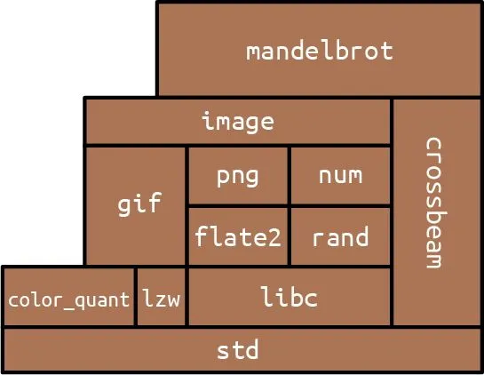

# 第8章crate与模块(1)

- 这是 Rust 主题下的小小理念之一：系统程序员也能享受美好。——Robert O'Callahan，“Random Thoughts on Rust: crates.io and IDEs”

假设你正在编写一个程序，用来模拟蕨类植物从单个细胞开始的生长过程。你的程序，也像蕨类植物一样，一开始会非常简单，所有的代码也许都在一个文件中——这只是想法的萌芽。随着成长，它将开始分化出内部结构，不同的部分会有不同的用途。然后它将分化成多个文件，可能遍布在各个目录中。随着时间的推移，它可能会成为整个软件生态系统的重要组成部分。对于任何超出几个数据结构或几百行代码的程序，进行适当的组织都是很有必要的。

本章介绍了 Rust 的一些特性（crate 与模块），这些特性有助于你的程序保持井井有条。我们还将涵盖其他与 Rust crate 的结构和分发有关的主题，包括如何记录与测试 Rust 代码、如何消除不必要的编译器警告、如何使用 Cargo 管理项目依赖项和版本控制、如何在 Rust 的公共crate 存储库 crates.io 上发布开源库、Rust 如何通过语言版本进行演进等。本章将使用蕨类模拟器作为运行示例。

## 8.1　crate

Rust 程序由 crate（板条箱）组成。每个 crate 都是既完整又内聚的单元，包括单个库或可执行程序的所有源代码，以及任何相关的测试、示例、工具、配置和其他杂项。对于蕨类植物模拟器，我们可以使用第三方库完成 3D 图形、生物信息学、并行计算等工作。这些库以 crate的形式分发，如图 8-1 所示。



- 图 8-1：一个 crate 及其依赖

```
弄清楚 crate 是什么以及它们如何协同工作的最简单途径是，使用带有 --verbose 标志的
cargo build 来构建具有某些依赖项的现有项目。我们以 2.6.6 节的“并发曼德博程序”为例
```

来执行此操作。结果如下所示：

```
$ cd mandelbrot
$ cargo clean    # 删除之前编译的代码
$ cargo build --verbose
   Updating registry `https://github.com/rust-lang/crates.io-index`
Downloading autocfg v1.0.0
Downloading semver-parser v0.7.0
Downloading gif v0.9.0
Downloading png v0.7.0
... (downloading and compiling many more crates)
Compiling jpeg-decoder v0.1.18
    Running `rustc
       --crate-name jpeg_decoder
       --crate-type lib
       ...
       --extern byteorder=.../libbyteorder-29efdd0b59c6f920.rmeta
       ...
  Compiling image v0.13.0
    Running `rustc
       --crate-name image
       --crate-type lib
       ...
       --extern byteorder=.../libbyteorder-29efdd0b59c6f920.rmeta
       --extern gif=.../libgif-a7006d35f1b58927.rmeta
       --extern jpeg_decoder=.../libjpeg_decoder-5c10558d0d57d300.rmeta
  Compiling mandelbrot v0.1.0 (/tmp/rustbook-test-files/mandelbrot)
    Running `rustc
       --edition=2021
       --crate-name mandelbrot
       --crate-type bin
       ...
       --extern crossbeam=.../libcrossbeam-f87b4b3d3284acc2.rlib
       --extern image=.../libimage-b5737c12bd641c43.rlib
       --extern num=.../libnum-1974e9a1dc582ba7.rlib -C link-arg=-fuse-ld=lld`
   Finished dev [unoptimized + debuginfo] target(s) in 16.94s
$
这里重新格式化了 rustc 命令行以提高可读性，我们删除了很多与本次讨论无关的编译器选
项，然后将它们替换成了省略号（...）。
```

你可能还记得，当“并发曼德博程序”的例子完成时，曼德博程序的 main.rs 包含几个来自其他

```
crate 的语法项的 use 声明：
use num::Complex;
// ...
use image::ColorType;
use image::png::PNGEncoder;
```

并且 Cargo.toml 文件中指定了我们想要的每个 crate 的版本：

```
[dependencies]
num = "0.4"
image = "0.13"
crossbeam = "0.8"
```

单词 dependencies 在这里是指这个项目使用的其他 crate，也就是我们所依赖的代码。我们在 crates.io（Rust 社区的开源 crate 站点）上找到了这些 crate。例如，通过访问 crates.io 我

```
们搜索并找到了 image 库。crates.io 上的每个 crate 页面都显示了其 README.md 文件及文
档和源代码的链接，以及像 image = "0.13" 这样的可以复制并添加到 Cargo.toml 中的配
```

置行。这里展示的版本号只是我们编写本程序时这 3 个包的最新版本。

```
Cargo 清单讲述了如何使用这些信息。运行 cargo build 时，Cargo 首先会从 crates.io 下
```

载这些 crate 的指定版本的源代码。然后，它会读取这些 crate 的 Cargo.toml 文件、下载它们

```
的依赖项，并递归地进行。例如，0.13.0 版的 image crate 的源代码包含一个 Cargo.toml
```

文件，其中列出了如下内容：

```
[dependencies]
byteorder = "1.0.0"
num-iter = "0.1.32"
num-rational = "0.1.32"
num-traits = "0.1.32"
enum_primitive = "0.1.0"
看到这个文件，Cargo 就知道在它使用 image 之前，必须先获取这些 crate。稍后你将看到如
```

何要求 Cargo 从 Git 存储库或本地文件系统而非 crates.io 获取源代码。

```
由于 mandelbrot 通过使用 image crate 间接依赖于这些 crate，因此我们称它们为
mandelbrot 的传递依赖。所有这些依赖关系的集合，会告诉 Cargo 关于要构建什么 crate
```

以及应该按什么顺序构建的全部知识，这叫作该 crate 的依赖图。Cargo 对依赖图和传递依赖的自动处理可以显著节省程序员的时间和精力。

一旦有了源代码，Cargo 就会编译所有的 crate。它会为项目依赖图中的每个 crate 都运行一

```
次 rustc（Rust 编译器）。编译库时，Cargo 会使用 --crate-type lib 选项。这会告诉
rustc 不要寻找 main() 函数，而是生成一个 .rlib 文件，其中包含一些已编译代码，可用于
```

创建二进制文件和其他 .rlib 文件。

```
编译程序时，Cargo 会使用 --crate-type bin，结果是目标平台的二进制可执行文件，比
```

如 Windows 上的 mandelbrot.exe。

```
对于每个 rustc 命令，Cargo 都会传入 --extern 选项，给出 crate 将使用的每个库的文件
名。这样，当 rustc 看到一行代码（如 use image::png::PNGEncoder）时，就可以确
定 image 是另一个 crate 的名称。感谢 Cargo，它知道在哪里可以找到磁盘上已编译的
```

crate。Rust 编译器需要访问这些 .rlib 文件，因为它们包含库的已编译代码。Rust 会将代码静态链接到最终的可执行文件中。.rlib 也包含一些类型信息，这样 Rust 就可以检查我们在代码中使用的库特性是否确实存在于 crate 中，以及我们是否正确使用了它们。.rlib 文件中还包含此 crate 的公共内联函数、泛型和宏这三者的副本，在 Rust 知道我们将如何使用它们之前，这些特性无法完全编译为机器码。

```
cargo build 支持各种选项，其中大部分超出了本书的范畴，我们在这里只提一个：cargo
build --release 会生成优化过的程序。这种程序运行得更快，但它们的编译时间更长、
运行期不会检查整数溢出、会跳过 debug_assert!() 断言，并且在 panic 时生成的调用栈
```

跟踪通常不太可靠。

### 8.1.1　版本

Rust 具有极强的兼容性保证。任何能在 Rust 1.0 上编译的代码在 Rust 1.50 或 Rust 1.900（如果已经发布的话）上都必然编译得一样好。

但有时会有一些必要的扩展提议加入语言中，这有可能导致旧代码无法再编译。例如，经过多

```
次讨论，Rust 确定了一种支持异步编程的语法，该语法将标识符 async 和 await 重新用作
关键字（参见第 20 章）。但是这种语言更改会破坏任何使用 async 或 await 作为变量名的
```

现有代码。

为了在不破坏现有代码的情况下继续演进，Rust 会使用版本。2015 版 Rust 会与 Rust 1.0 兼

```
容。2018 版 Rust 将 async 和 await 改为关键字并精简了模块系统，而 2021 版 Rust 则提
```

升了数组对人类的友好性，并默认让一些广泛使用的库定义随处可用。虽然这些都是对该语言的重要改进，但会破坏现有代码。为避免这种情况，每个 crate 都在其 Cargo.toml 文件顶部

```
的 [package] 部分使用下面这样的行来表明自己是用哪个版本的 Rust 编写的：
edition = "2021"
```

如果该关键字不存在，则假定为 2015 版，因此旧 crate 根本不必更改。但是如果你想使用异

```
步函数或新的模块系统，就要在 Cargo.toml 文件中添加一句“edition = "2018" 或更高版
```

本”。

Rust 承诺编译器将始终接受该语言的所有现存版本，并且程序可以自由混用以不同版本编写的 crate。2015 版的 crate 甚至可以依赖 2021 版的 crate。换句话说，crate 的版本只影响其源代码的解释方式，编译代码时，版本的差异已然消失。这意味着你无须为了继续参与到现代Rust 生态系统中而更新旧的 crate。同样，你也不必为了避免给用户带来不便而被迫使用旧的crate。当你想在自己的代码中使用新的语言特性时，只要更改版本就可以了。

Rust 项目组不会每年都发布新版本，只有认为确有必要时才会发布。例如，没有 2020 版

```
Rust。将 edition 设置为 "2020" 会导致错误。Rust 版本指南涵盖了每个版本中引入的更
```

改，并提供了有关版本体系的完善的背景知识。

```
使用最新版本几乎总是更好的做法，尤其是对于新代码。cargo new 默认会在最新版本上创
```

建新项目。本书全程使用 2021 版。

```
如果你有一个用旧版本的 Rust 编写的 crate，则 cargo fix 命令能帮助你自动将代码升级
到新版本。Rust 版本指南详细解释了 cargo fix 命令。
```

### 8.1.2　创建配置文件

```
你可以在 Cargo.toml 文件中放置几个配置设定区段，这些设定会影响 cargo 生成的 rustc
```

命令行，如表 8-1 所示。

表 8-1：Cargo.toml 的配置设定区段

- 使用的 Cargo.toml 区段

命令行

```
cargo build
[profile.dev]
cargo build --release
[profile.release]
cargo test
[profile.test]
```

通常情况下，默认设置是可以使用的，但当你想要使用剖析器（一种用来测量程序在哪些地方消耗了 CPU 时间的工具）时会出现例外情况。要从剖析器中获得最佳数据，需要同时启用优化（通常仅在发布构建中启用）和调试符号（通常仅在调试构建中启用）这两个选项。要同时启用它们，请将如下代码添加到你的 Cargo.toml 中：

```
[profile.release]
debug = true  # 在release构建中启用debug符号
debug 设定会控制 rustc 的 -g 选项。通过这个配置，当你键入 cargo build --
release 时，将获得带有调试符号的二进制文件。而优化设置未受影响。
```

Cargo 文档中列出了可以在 Cargo.toml 中调整的许多其他设定。

## 8.2　模块

crate 是关于项目间代码共享的，而模块是关于项目内代码组织的。它们扮演着 Rust 命名空间的角色，是构成 Rust 程序或库的函数、类型、常量等的容器。一个模块看起来是这样的：

```
mod spores {
   use cells::;
   /// 由成年蕨类植物产生的细胞。作为蕨类植物生命周期的一部分，细胞会随风
   /// 传播。一个孢子会长成原叶体（一个完整的独立有机体，最大直径达5毫米），
   /// 原叶体产生的受精卵会长成新的蕨类植物（植物的性别很复杂）
   pub struct Spore {
       ...
   }
   /// 模拟减数分裂产生孢子
   pub fn produce_spore(factory: &mut Sporangium) -> Spore {
       ...
   }
   /// 提取特定孢子中的基因
   pub(crate) fn genes(spore: &Spore) -> Vec<Gene> {
       ...
   }
   /// 混合基因以准备减数分裂（细胞分裂间期的一部分）
   fn recombine(parent: &mut Cell) {
       ...
   }
   ...
}
模块是一组语法项的集合，这些语法项具有命名的特性，比如此示例中的 Spore 结构体和 3
个函数。pub 关键字会使某个语法项声明为公共项，这样它就可以从模块外部访问了。
如果把一个函数标记为 pub(crate)，那么就意味着它可以在这个 crate 中的任何地方使用，
```

但不会作为外部接口的一部分公开。它不能被其他 crate 使用，也不会出现在这个 crate 的文档中。

```javascript
任何未标记为 pub 的内容都是私有的，只能在定义它的模块及其任意子模块中使用：
let s = spores::produce_spore(&mut factory);  // 正确
spores::recombine(&mut cell);  // 错误：`recombine`是私有的
将某个语法项标记为 pub 通常称为“导出”该语法项。
```

本节的其余部分涵盖了要想充分利用模块所需了解的详细信息。

- 我们会展示如何嵌套模块并在需要时将它们分散到不同的文件和目录中。

- 我们会解释 Rust 使用的路径语法，以引用来自其他模块的语法项，并展示如何导入这些语法项，以便你使用它们而不必写出其完整路径。

- 我们会触及 Rust 对结构体字段的细粒度控制。

- 我们会介绍预导入（prelude，原意为“序曲”）模块，它们通过收集几乎所有用户都需要的常用导入，减少了样板代码的编写。

- 为了提高代码的清晰性和一致性，我们还会介绍常量和静态变量这两种定义命名值的方法。

### 8.2.1　嵌套模块

模块可以嵌套，通常可以看到某个模块仅仅是一组子模块集合：

```
mod plant_structures {
   pub mod roots {
       ...
   }
   pub mod stems {
       ...
   }
   pub mod leaves {
       ...
   }
}
```

如果你希望嵌套模块中的语法项对其他 crate 可见，请务必将它和它所在的模块标记为公开的。否则可能会看到这样的警告：

```javascript
warning: function is never used: `is_square`
  |
23 | /         pub fn is_square(root: &Root) -> bool {
24 | |             root.cross_section_shape().is_square()
25 | |         }
  | |_________^
|
```

也许这个函数目前确实是无用的代码。但是，如果你打算在其他 crate 中使用它，那么 Rust

```
就会提示你这个函数对它们实际上是不可见的。你应该确保它所在的模块也是 pub 形式。
也可以指定 pub(super)，让语法项只对其父模块可见。还可以指定 pub(in <path>)，
```

让语法项在特定的父模块及其后代中可见。这对于深度嵌套的模块特别有用：

```
mod plant_structures {
   pub mod roots {
       pub mod products {
           pub(in crate::plant_structures::roots) struct Cytokinin {
               ...
           }
       }
       use products::Cytokinin; // 正确：在`roots`模块中可见
   }
   use roots::products::Cytokinin; // 错误：`Cytokinin`是私有的
}
// 错误：`Cytokinin`是私有的
use plant_structures::roots::products::Cytokinin;
```

通过这种方式，我们可以写出一个完整的程序，把大量代码和完整的模块层次结构以我们想要的任何方式关联起来，并放在同一个源文件中。

但实际上，以这种方式写代码相当痛苦，因此还有另一种选择。

### 8.2.2　单独文件中的模块

模块还可以这样写：

```
mod spores;
前面我们一直把 spores 模块的主体代码包裹在花括号中。在这里，我们告诉 Rust 编译器，
spores 模块保存在一个单独的名为 spores.rs 的文件中：
// spores.rs
/// 由成年蕨类植物产生的细胞……
pub struct Spore {
   ...
}
/// 模拟减数分裂产生孢子
pub fn produce_spore(factory: &mut Sporangium) -> Spore {
   ...
}
/// 提取特定孢子中的基因
pub(crate) fn genes(spore: &Spore) -> Vec<Gene> {
   ...
}
/// 混合基因以准备减数分裂（细胞分裂间期的一部分）
fn recombine(parent: &mut Cell) {
   ...
}
```

spores.rs 仅包含构成该模块的那些语法项，它不需要任何样板代码来声明自己是一个模块。

```
代码的位置是这个 spores 模块与 8.2.1 节中展示的版本之间的唯一区别。Rust 遵循同样的
```

规则，以决定什么是公共的以及什么是私有的。而且即便模块在单独的文件中，Rust 也永远不会分别编译它们，因为只要你构建 Rust crate，就会重新编译它的所有模块。

```
模块可以有自己的目录。当 Rust 看到 mod spore; 时，会同时检查 spores.rs 和
```

spores/mod.rs，如果两个文件都不存在，或者都存在，就会报错。对于这个例子，我们使用

```
了 spores.rs，因为 spores 模块没有任何子模块。但是考虑一下我们之前编写的
plant_structures 模块。如果将该模块及其 3 个子模块拆分到它们自己的文件中，则会生
```

成如下项目：

```
fern_sim/
├── Cargo.toml
└── src/
   ├── main.rs
   ├── spores.rs
   └── plant_structures/
       ├── mod.rs
       ├── leaves.rs
       ├── roots.rs
       └── stems.rs
在 main.rs 中，我们声明了 plant_structures 模块：
pub mod plant_structures;
```

这会导致 Rust 加载 plant_structures/mod.rs，该文件声明了 3 个子模块：

```
// 在plant_structures/mod.rs中
pub mod roots;
pub mod stems;
pub mod leaves;
```

这 3 个模块的内容存储在 leaves.rs、roots.rs 和 stems.rs 这 3 个单独的文件中，与 mod.rs 一样位于 plant_structures 目录下。

```
也可以使用同名的文件和目录来组成模块。如果 stems（茎）需要包含称为 xylem（木质
部）和 phloem（韧皮部）的模块，那么可以选择将 stems 保留在 plant_structures/stems.rs
```

中并添加一个 stems 目录：

```
fern_sim/
├── Cargo.toml
└── src/
   ├── main.rs
   ├── spores.rs
   └── plant_structures/
       ├── mod.rs
       ├── leaves.rs
       ├── roots.rs
       ├── stems/
       │   ├── phloem.rs
       │   └── xylem.rs
       └── stems.rs
```

然后，在 stems.rs 中，我们声明了两个新的子模块：

```
// 在plant_structures/stems.rs中
pub mod xylem;
pub mod phloem;
```

这 3 种选项（模块位于自己的文件中、模块位于自己的带有 mod.rs 的目录中，以及模块在自己的文件中，并带有包含子模块的补充目录）为模块系统提供了足够的灵活性，以支持你可能用到的几乎任何项目结构。

### 8.2.3　路径与导入

```
:: 运算符用于访问模块中的各项特性。项目中任何位置的代码都可以通过写出其路径来引用
```

标准库特性：

```
if s1 > s2 {
   std::mem::swap(&mut s1, &mut s2);
}
std 是标准库的名称。路径 std 指的是标准库的顶层模块。std::mem 是标准库中的子模
块，而 std::mem::swap 是该模块中的公共函数。
```

可以用这种方式编写所有代码：如果你想要一个圆或字典，就明确写出

```
std::f64::consts::PI 或 std::collections::HashMap::new。但这样做会很烦琐
```

并且难以阅读。另一种方法是将这些特性导入使用它们的模块中：

```
use std::mem;
if s1 > s2 {
   mem::swap(&mut s1, &mut s2);
}
这条 use 声明导致名称 mem 在整个封闭块或模块中成了 std::mem 的本地别名。
可以通过写 use std::mem::swap; 来导入 swap 函数本身，而不是 mem 模块。然而，我
们之前的编写风格通常被认为是最好的：导入类型、特型和模块（如 std::mem），然后使用
```

相对路径访问其中的函数、常量和其他成员。

可以一次导入多个名称：

```
use std::collections::;  // 同时导入两个模块
use std::fs::; // 同时导入`std::fs`和`std::fs::File`
use std::io::prelude::*;  // 导入所有语法项
```

上述代码只是对“明确写出所有单独导入”的简写：

```
use std::collections::HashMap;
use std::collections::HashSet;
use std::fs;
use std::fs::File;
// std::io::prelude中的全部公开语法项:
use std::io::prelude::Read;
use std::io::prelude::Write;
use std::io::prelude::BufRead;
use std::io::prelude::Seek;
可以使用 as 导入一个语法项，但在本地赋予它一个不同的名称：
use std::io::Result as IOResult;
// 这个返回类型只是`std::io::Result<()>`的另一种写法：
fn save_spore(spore: &Spore) -> IOResult<()>
...
```

模块不会自动从其父模块继承名称。假设 proteins/mod.rs 中有如下代码：

```
// proteins/mod.rs
pub enum AminoAcid { ... }
pub mod synthesis;
那么 synthesis.rs 中的代码不会自动“看到”类型 `AminoAcid`：
// proteins/synthesis.rs
pub fn synthesize(seq: &[AminoAcid])  // 错误：找不到类型AminoAcid
   ...
```

其实，每个模块都会以“白板”开头，并且必须导入它使用的名称：

```
// proteins/synthesis.rs
use super::AminoAcid;  // 从父模块显式导入
pub fn synthesize(seq: &[AminoAcid])  // 正确
   ...
```

默认情况下，路径是相对于当前模块的：

```
// in proteins/mod.rs
// 从某个子模块导入
use synthesis::synthesize;
self 也是当前模块的同义词，所以可以这样写：
// in proteins/mod.rs
// 从枚举中导入名称，因此可以把赖氨酸写成`Lys`，而不是`AminoAcid::Lys`
use self::AminoAcid::*;
```

或者简单地写成如下形式。

```
// 在proteins/mod.rs中
use AminoAcid::*;
（当然，这里的 AminoAcid 示例偏离了之前提到过的仅导入类型、特型和模块的样式规则。
```

如果我们的程序中包含长氨基酸序列，那么这种调整就符合奥威尔第六规则：“为了表达准确，宁可打破上述规则”。）

```
关键字 super 和 crate 在路径中有着特殊的含义：super 指的是父模块，crate 指的是当
```

前模块所在的 crate。

使用相对于 crate 根而不是当前模块的路径可以更容易地在项目中移动代码，因为如果当前模

```
块的路径发生了变化，则不会破坏任何导入。例如，我们可以使用 crate 编写
```

synthesis.rs：

```
// proteins/synthesis.rs
use crate::proteins::AminoAcid;  // 显式导入相对于crate根路径的语法项
pub fn synthesize(seq: &[AminoAcid])  // 正确
   ...
子模块可以使用 use super::* 访问其父模块中的私有语法项。
```

如果有一个与你正使用的 crate 同名的模块，那么引用它们的内容时有一些注意事项。如果你

```
的程序在其 Cargo.toml 文件中将 image crate 列为依赖项，但还有另一个名为 image 的模
块，那么以 image 开头的路径就是有歧义的：
mod image {
   pub struct Sampler {
       ...
   }
}
// 错误：它引用的是我们的`image`模块还是`image crate`？
use image::Pixels;
即使 image 模块中没有 Pixels 类型，这种歧义仍然是有问题的：如果模块中稍后添加了这
```

样的定义，则可能会默默地改变程序中其他地方引用到的路径，而这将给人带来困扰。

```
为了解决歧义，Rust 有一种特殊的路径，称为绝对路径，该路径以 :: 开头，总会引用外部
crate。要引用 image crate 中的 Pixels 类型，可以这样写：
use ::image::Pixels;        // `image crate`中的`Pixels`
要引用你自己模块中的 Sampler 类型，可以这样写：
use self::image::Sampler;   // `image`模块中的`Sampler`
模块与文件不是一回事，但模块与 Unix 文件系统中的目录和文件有些相似之处。use 关键字
会创建别名，就像用 ln 命令创建链接一样。路径和文件名一样，有绝对和相对两种形式。
self 和 super 类似于 . 和 .. 这样的特殊目录。
```

### 8.2.4　标准库预导入

我们刚才说过，就导入的名称而言，每个模块都以“白板”开头。但这个“白板”并不是完全空白的。

```
一方面，标准库 std 会自动链接到每个项目。这意味着你始终可以使用 use
std::whatever，或者就按名称引用 std 中的语法项，比如代码中内联的
std::mem::swap()。另一方面，还有一些特别的便捷名称（如 Vec 和 Result）会包含
```

在标准库预导入中并自动导入。Rust 的行为就好像每个模块（包括根模块）都用以下导入语句开头一样：

```
use std::prelude::v1::*;
```

标准库预导入包含几十个常用的特型和类型。

```
我们在第 2 章中提到的那些库有时会提供一些名为 prelude（预导入）的模块。但
std::prelude::v1 是唯一会自动导入的预导入。把一个模块命名为 prelude 只是一种约
定，旨在告诉用户应该使用 * 导入它。
```

### 8.2.5　公开 use 声明

```
虽然 use 声明只是个别名，但也可以公开它们：
// 在plant_structures/mod.rs中
...
pub use self::leaves::Leaf;
pub use self::roots::Root;
这意味着 Leaf 和 Root 是 plant_structures 模块的公共语法项。它们还是
plant_structures::leaves::Leaf 和 plant_structures::roots::Root 的简单
```

别名。

```
标准库预导入就是像这样编写的一系列 pub 导入。
```

### 8.2.6　公开结构体字段

```
模块可以包含用户定义的一些结构体类型（使用 struct 关键字引入）。第 9 章会详细介绍这
```

些内容，但现在可以简单讲讲模块与结构体字段的可见性之间是如何相互作用的。

一个简单的结构体如下所示：

```
pub struct Fern {
   pub roots: RootSet,
   pub stems: StemSet
}
```

结构体的字段，甚至是私有字段，都可以在声明该结构体的整个模块及其子模块中访问。在模块之外，只能访问公共字段。

事实证明，通过模块而不是像 Java 或 C++ 那样通过类来强制执行访问控制对软件设计非常有帮助。它减少了样板“getter”方法和“setter”方法，并且在很大程度上消除了对诸如 C++

```
friend（友元）声明等语法的需求。单个模块可以定义多个紧密协作的类型，例如
frond::LeafMap 和 frond::LeafMapIter，它们可以根据需要访问彼此的私有字段，同
```

时仍然对程序的其余部分隐藏这些实现细节。

### 8.2.7　静态变量与常量

除了函数、类型和嵌套模块，模块还可以定义常量和静态变量。

```javascript
关键字 const 用于引入常量，其语法和 let 一样，只是它可以标记为 pub，并且必须写明
类型。此外，常量的命名规约是 UPPERCASE_NAMES：
pub const ROOM_TEMPERATURE: f64 = 20.0;  // 摄氏度
static 关键字引入了一个静态语法项，跟常量几乎是一回事：
pub static ROOM_TEMPERATURE: f64 = 68.0;  // 华氏度
常量有点儿像 C++ 的 #define：该值在每个使用了它的地方都会编译到你的代码中。静态变
```

量是在程序开始运行之前设置并持续到程序退出的变量。在代码中对魔数和字符串要使用常量，而在处理大量的数据或需要借用常量值的引用时则要使用静态变量。

```
没有 mut 常量。静态变量可以标记为 mut，但正如第 5 章所述，Rust 没有办法强制执行其关
于 mut 静态变量的独占访问规则。因此，mut 静态变量本质上是非线程安全的，安全代码根
```

本不能使用它们：

```
static mut PACKETS_SERVED: usize = 0;
println!("{} served", PACKETS_SERVED);  // 错误：使用了mut静态变量
```

Rust 不鼓励使用全局可变状态。有关备选方案的讨论，请参阅 19.3.11 节。

## 8.3　将程序变成库

随着蕨类植物模拟器成功运行，你会发现你所需要的不仅仅是单个程序。假设你有一个运行此模拟并将结果保存在文件中的命令行程序。现在，你想编写其他程序对这些保存下来的结果进行科学分析、实时显示正在生长的植物的 3D 渲染图、渲染足以乱真的图片，等等。所有这些程序都需要共享基本的蕨类植物模拟代码。这时候你应该建立一个库。

第一步是将现有的项目分为两部分：一个库 crate，其中包含所有共享代码；一个可执行文件，其中只包含你现在的命令行程序才需要的代码。

为了展示如何做到这一点，要使用一个极度简化的示例程序：

```javascript
struct Fern {
   size: f64,
   growth_rate: f64
}
impl Fern {
   /// 模拟一株蕨类植物在一天内的生长
   fn grow(&mut self) {
       self.size *= 1.0 + self.growth_rate;
   }
}
/// 执行days天内某株蕨类植物的模拟
fn run_simulation(fern: &mut Fern, days: usize) {
   for _ in 0 .. days {
       fern.grow();
   }
}
fn main() {
   let mut fern = Fern {
       size: 1.0,
       growth_rate: 0.001
   };
   run_simulation(&mut fern, 1000);
   println!("final fern size: {}", fern.size);
}
```

假设这个程序有一个简单的 Cargo.toml 文件。

```
[package]
name = "fern_sim"
version = "0.1.0"
authors = ["You <you@example.com>"]
edition = "2021"
```

很容易将这个程序变成库，步骤如下。

1. 将文件 src/main.rs 重命名为 src/lib.rs。

```
将 pub 关键字添加到 src/lib.rs 中的语法项上，这些语法项将成为这个库的公共特性。
将 main 函数移动到某个临时文件中。（我们暂时不同管它。）
```

生成的 src/lib.rs 文件如下所示：

```
pub struct Fern {
   pub size: f64,
   pub growth_rate: f64
}
impl Fern {
   /// 模拟一株蕨类植物在一天内的生长
   pub fn grow(&mut self) {
       self.size *= 1.0 + self.growth_rate;
   }
}
/// 执行days天内某株蕨类植物的模拟
pub fn run_simulation(fern: &mut Fern, days: usize) {
   for _ in 0 .. days {
       fern.grow();
   }
}
```

请注意，不需要更改 Cargo.toml 中的任何内容。这是因为这个最小化的 Cargo.toml 文件只是

```
为了让 Cargo 保持默认行为而已。默认设定下，cargo build 会查看源目录中的文件并根
```

据文件名确定要构建的内容。当它发现存在文件 src/lib.rs 时，就知道要构建一个库。

src/lib.rs 中的代码构成了库的根模块。其他使用这个库的 crate 只能访问这个根模块的公共语法项。

## 8.4　src/bin 目录

```
要让原来的命令行程序 fern_sim 再次运行起来也很简单，因为 Cargo 对和库位于同一个
```

crate 中的小型程序有一些内置支持。

其实 Cargo 本身就是用这样的方式编写的。它的大部分代码在一个 Rust 库中。本书中一直使

```
用的 cargo 命令行程序只是一个很薄的包装程序，它会调用库来完成所有繁重的工作。库和
```

命令行程序都位于同一个源代码存储库中。

你也可以将自己的程序和库放在同一个 crate 中。请将下面这段代码放入名为 src/bin/efern.rs的文件中：

```javascript
use fern_sim::;
fn main() {
   let mut fern = Fern {
       size: 1.0,
       growth_rate: 0.001
   };
   run_simulation(&mut fern, 1000);
   println!("final fern size: {}", fern.size);
}
main 函数就是之前搁置的那个。我们为 fern_sim crate 中的一些语法项（Fern 和
run_simulation）添加了 use 声明。换句话说，我们在把这个 crate 当库来用。
因为我们已将这个文件放入了 src/bin 中，所以 Cargo 将在我们下次运行 cargo build 时同
时编译 fern_sim 库和这个程序。可以使用 cargo run --bin efern 来运行 efern 程
序。下面是它的输出，使用 --verbose 可以展示 Cargo 正在运行的命令：
$ cargo build --verbose
  Compiling fern_sim v0.1.0 (file:///.../fern_sim)
    Running `rustc src/lib.rs --crate-name fern_sim --crate-type lib ...`
    Running `rustc src/bin/efern.rs --crate-name efern --crate-type bin ...`
$ cargo run --bin efern --verbose
      Fresh fern_sim v0.1.0 (file:///.../fern_sim)
    Running `target/debug/efern`
final fern size: 2.7169239322355985
```

我们仍然不必对 Cargo.toml 进行任何修改，因为 Cargo 的默认设定就是查看你的源文件并自行决定做什么。Cargo 会自动将 src/bin 中的 .rs 文件视为应该构建的额外程序。

还可以利用子目录在 src/bin 目录中构建更大的程序。假设我们要提供第二个在屏幕上绘制蕨类植物的程序，但绘制代码规模很大而且是模块化的，因此它拥有自己的文件。我们可以给第二个程序建立它自己的子目录：

```
fern_sim/
├── Cargo.toml
└── src/
   └── bin/
       ├── efern.rs
       └── draw_fern/
           ├── main.rs
           └── draw.rs
```

这样做的好处是能让更大的二进制文件拥有自己的子模块，而不会弄乱库代码或 src/bin 目录。

```
不过，既然 fern_sim 现在是一个库，那么我们也就多了一种选择：把这个程序放在它自己
```

的独立项目中，再保存到一个完全独立的目录中，然后在它自己的 Cargo.toml 中将

```
fern_sim 列为依赖项：
[dependencies]
fern_sim = { path = "../fern_sim" }
也许这就是你以后要为其他蕨类植物模拟程序专门做的事。src/bin 目录只适合像 efern 和
draw_fern 这样的简单程序。
```

## 8.5　属性

Rust 程序中的任何语法项都可以用属性进行装饰。属性是 Rust 的通用语法，用于向编译器提供各种指令和建议。假设你收到了如下警告：

```
libgit2.rs: warning: type `git_revspec` should have a camel case name
   such as `GitRevspec`, #[warn(non_camel_case_types)] on by default
但是你选择这个名字是有特别原因的，只希望 Rust 对此“闭嘴”。那么通过在此类型上添加 #
[allow] 属性就可以禁用这条警告：
#[allow(non_camel_case_types)]
pub struct git_revspec {
   ...
}
条件编译是使用名为 #[cfg] 的属性编写的另一项特性：
// 只有当我们为Android构建时才在项目中包含此模块
#[cfg(target_os = "android")]
mod mobile;
#[cfg] 的完整语法可以到 Rust 参考手册中查看，表 8-2 列出了最常用的选项。
```

表 8-2：最常用的 #[cfg] 选项

```
#[cfg(...)] 选项
```

- 当启用时·····

```
启用测试（使用 cargo test 或 rustc --test
test
```

- 编译）

```
debug_assertions
```

- 启用调试断言（通常在非优化构建中）

```
unix
```

- 为 Unix（包括 macOS）编译

```
windows
```

- 为 Windows 编译

```bash
target_pointer_width = "64"
针对 64 位平台。另一个可能的值是 "32"
```

- 特别针对 x86-64。其他值

```bash
有："x86"、"arm"、"aarch64"、"powerpc"、
target_arch = "x86_64"
"powerpc64" 和 "mips"
```

- 为 macOS 编译。其他值

```bash
有："windows"、"ios"、"android"、"linux"
target_os = "macos"
、"freebsd"、"openbsd"、"netbsd" 和
"dragonfly"
启用名为 "robots" 的用户自定义特性（用 cargo
build --feature robots 或 rustc --cfg
feature = "robots"
feature='"robots"' 编译）。这些特性是在
Cargo toml 的[f
t
] 区段中声明的
```

有时，可能需要对函数的内联展开进行微观管理，但我们通常会把这种优化留给编译器。可以

```
使用 #[inline] 属性进行微观管理：
/// 由于相邻细胞之间存在渗透作用，因此需要调整它们的离子水平等
#[inline]
fn do_osmosis(c1: &mut Cell, c2: &mut Cell) {
   ...
}
在一种特定的情况下，如果没有 #[inline]，就不会发生内联。当在一个 crate 中定义的函
```

数或方法在另一个 crate 中被调用时，Rust 不会将其内联，除非它是泛型的（具有类型参数）

```
或明确标记为 #[inline]。
在其他情况下，编译器只会将 #[inline] 视为建议。Rust 还支持更坚定的 #
[inline(always)]（要求函数在每个调用点内联展开）和 #[inline(never)]（要求函
```

数永不内联）。

```
一些属性（如 #[cfg] 和 #[allow]）可以附着到整个模块上并对其中的所有内容生效。另
一些属性（如 #[test] 和 #[inline]）则必须附着到单个语法项上。正如你对这种包罗万
```

象的语法特性的预期一样，每个属性都是定制的，并且有自己所支持的一组参数。Rust 参考文档详细记录了它支持的全套属性。

要将属性附着到整个 crate 上，请将其添加到 main.rs 文件或 lib.rs 文件的顶部，放在任何语

```
法项之前，并写成 #!，而不是 #，就像这样：
// libgit2_sys/lib.rs
#![allow(non_camel_case_types)]
pub struct git_revspec {
   ...
}
pub struct git_error {
   ...
}
#! 要求 Rust 将一个属性附着到整个封闭区中的语法项而不只是紧邻其后的内容上：在这种
情况下，#![allow] 属性会附着到整个 libgit2_sys 包而不仅仅是 struct
git_revspec 上
#! 也可以在函数、结构体等内部使用（但 #! 通常只用在文件的开头，以将属性附着到整个
模块或 crate 上）。某些属性始终使用 #! 语法，因为它们只能应用于整个 crate。
例如，#![feature] 属性用于启用 Rust 语言和库的不稳定特性，这些特性是实验性的，因
```

此可能有 bug 或者未来可能会被更改或移除。例如，在我们撰写本章时，Rust 实验性地支持

```
跟踪像 assert! 这样的宏的展开。但由于此支持是实验性的，因此你只能通过两种方式来使
```

用：安装 Rust 的夜间构建版或明确声明你的 crate 使用宏跟踪。

```
#![feature(trace_macros)]
fn main() {
   // 我想知道这个使用assert_eq!的代码替换（展开）后会是什么样子！
   trace_macros!(true);
   assert_eq!(10*10*10 + 9*9*9, 12*12*12 + 1*1*1);
   trace_macros!(false);
}
```

随着时间的推移，Rust 团队有时会将实验性特性稳定下来，使其成为语言标准的一部分。那

```
时这个 #![feature] 属性就会变得多余，因此 Rust 会生成一个警告，建议你将其移除。
```
