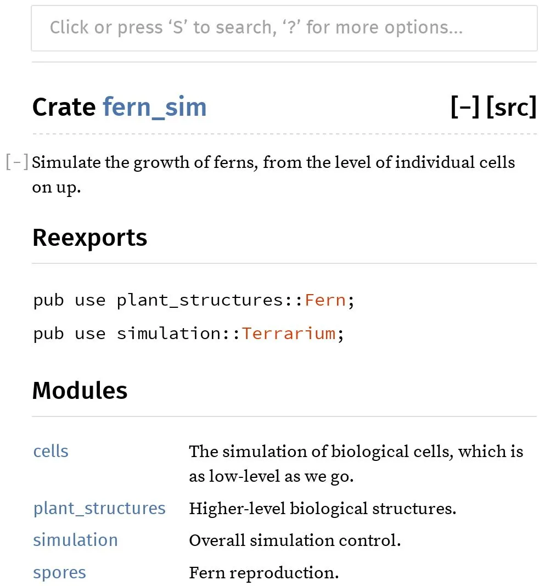
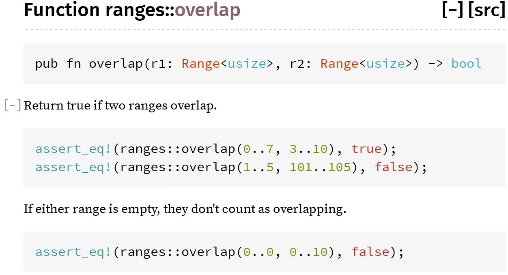

# 第8章crate与模块(2)

## 8.6　测试与文档

```
正如 2.3 节所述，Rust 中内置了一个简单的单元测试框架。测试是标有 #[test] 属性的普通
```

函数：

```javascript
#[test]
fn math_works() {
   let x: i32 = 1;
   assert!(x.is_positive());
   assert_eq!(x + 1, 2);
}
cargo test 会运行项目中的所有测试：
$ cargo test
  Compiling math_test v0.1.0 (file:///.../math_test)
    Running target/release/math_test-e31ed91ae51ebf22
running 1 test
test math_works ... ok
test result: ok. 1 passed; 0 failed; 0 ignored; 0 measured; 0 filtered out
```

（你还会看到一些关于“文档测试”的输出，我们稍后会讲到。）

无论你的 crate 是可执行文件还是库，你都可以通过将参数传给 Cargo 来运行特定测试：

```
cargo test math 会运行名称中包含 math 的所有测试。
测试通常会使用 assert! 和 assert_eq! 这两个来自 Rust 标准库的宏。如果 expr 为
真，那么 assert!(expr) 就会成功；否则，它会 panic，导致测试失败。assert_eq!
(v1, v2) 和 assert!(v1 == v2) 基本等效，但当断言失败时，其错误消息会展示两个
```

值。

```
你可以在普通代码中使用这些宏来检查不变条件，但请注意 assert! 和 assert_eq! 会包
含在发布构建中。因此，可以改用 debug_assert! 和 debug_assert_eq! 来编写仅在调
```

试构建中检查的断言。

```
要测试各种出错情况，请将 #[should_panic] 属性添加到你的测试中：
/// 正如我们在第7章中所讲的那样，只有当除以零导致panic时，这个测试才能通过
#[test]
#[allow(unconditional_panic, unused_must_use)]
#[should_panic(expected="divide by zero")]
fn test_divide_by_zero_error() {
   1 / 0;  // 应该panic！
}
在这个例子中，还需要添加一个 allow 属性，以让编译器允许我们做一些它本可以静态证明
```

而无法触发 panic 的事情，然后才能执行除法并丢弃答案，因为在正常情况下，它会试图阻止这种愚蠢行为。

```
还可以从测试中返回 Result<(), E>。只要错误变体实现了 Debug 特型（通常都实现
了），你就可以简单地使用 ? 抛弃 Ok 变体以返回 Result：
```

```
use std::num::ParseIntError;
/// 如果"1024"是一个有效的数值（这里正是如此），那么本测试就会通过
#[test]
fn explicit_radix() -> Result<(), ParseIntError> {
 i32::from_str_radix("1024", 10)?;
 Ok(())
}
标有 #[test] 的函数是有条件编译的。普通的 cargo build 或 cargo build --
release 会跳过测试代码。但是当你运行 cargo test 时，Cargo 会分两次来构建你的程
```

序：一次以普通方式，一次带着你的测试和已启用的测试工具。这意味着你的单元测试可以与它们所测试的代码一起使用，按需访问内部实现细节，而且没有运行期成本。但是，这可能会导致一些警告。

```javascript
fn roughly_equal(a: f64, b: f64) -> bool {
   (a - b).abs() < 1e-6
}
#[test]
fn trig_works() {
   use std::f64::consts::PI;
   assert!(roughly_equal(PI.sin(), 0.0));
}
在省略了测试代码的构建中，roughly_equal 似乎从未使用过，于是 Rust 会报错：
$ cargo build
  Compiling math_test v0.1.0 (file:///.../math_test)
warning: function is never used: `roughly_equal`
 |
7 | / fn roughly_equal(a: f64, b: f64) -> bool {
8 | |     (a - b).abs() < 1e-6
9 | | }
 | |_^
 |
  = note: #[warn(dead_code)] on by default
因此，当你的测试变得很庞大以至于需要支撑性代码时，应该按照惯例将它们放在 tests 模
块中，并使用 #[cfg] 属性声明整个模块仅用于测试：
#[cfg(test)]   // 只有在测试时才包含此模块
mod tests {
   fn roughly_equal(a: f64, b: f64) -> bool {
       (a - b).abs() < 1e-6
   }
   #[test]
   fn trig_works() {
       use std::f64::consts::PI;
       assert!(roughly_equal(PI.sin(), 0.0));
   }
}
```

Rust 的测试工具会使用多个线程同时运行好几个测试，这是 Rust 代码默认线程安全的附带好

```
处之一。要禁用此功能，请运行单个测试 cargo test <i>testname</i> 或运行 cargo
test -- --test-threads 1。（第一个 -- 确保 cargo test 将 --test-threads 选
```

项透传给实际执行测试的可执行文件。）这意味着，从严格意义上说，我们在第 2 章中展示的

```
曼德博程序不是该章中第二个而是第三个多线程程序。2.3 节的 cargo test 运行的才是第
```

一个多线程程序。

```
通常，测试工具只会显示失败测试的输出。如果也想展示成功测试的输出，请运行 cargo
test -- --nocapture。
```

### 8.6.1　集成测试

你的蕨类植物模拟器继续“成长”。你已决定将所有主要功能放入可供多个可执行文件使用的库中。如果能从最终使用者的视角编写一些测试，把 fern_sim.rlib 像外部 crate 那样链接进来，那仿真度就更高了。此外，你有一些测试是通过从二进制文件加载已保存的模拟记录开始的，同时把这些大型测试文件放在 src 目录中会很棘手。集成测试有助于解决这两个问题。

```
集成测试是 .rs 文件，位于项目的 src 目录旁边的 tests 目录中。当你运行 cargo test 时，
```

Cargo 会将每个集成测试编译为一个独立的 crate，与你的库和 Rust 测试工具链接在一起。下面是一个例子：

```javascript
// tests/unfurl.rs——蕨菜在阳光下舒展开
use fern_sim::Terrarium;
use std::time::Duration;
#[test]
fn test_fiddlehead_unfurling() {
   let mut world = Terrarium::load("tests/unfurl_files/fiddlehead.tm");
   assert!(world.fern(0).is_furled());
   let one_hour = Duration::from_secs(60 * 60);
   world.apply_sunlight(one_hour);
   assert!(world.fern(0).is_fully_unfurled());
}
```

集成测试之所以有价值，部分原因在于它们会从外部视角看待你的 crate，就像用户的做法一样。集成测试会测试你的 crate 的公共 API。

```
cargo test 会运行单元测试和集成测试。如果仅运行某个特定文件（如 tests/unfurl.rs）中
的集成测试，请使用命令 cargo test --test unfurl。
```

### 8.6.2　文档

```
命令 cargo doc 会为你的库创建 HTML 文档：
$ cargo doc --no-deps --open
Documenting fern_sim v0.1.0 (file:///.../fern_sim)
--no-deps 选项会要求 Cargo 只为 fern_sim 本身生成文档，而不会为它依赖的所有 crate
```

生成文档。

```
--open 选项会要求 Cargo 随后在浏览器中打开此文档。
```

你可以在图 8-2 中看到结果。Cargo 会将这个新文档文件保存在 target/doc 中。起始页是target/doc/fern_sim/index.html。



```
图 8-2：rustdoc 生成的文档示例
该文档是根据你库中的 pub 特性以及附加的所有文档型注释生成的。我们已经在本章中看到
```

了一些文档型注释。它们看起来很像注释：

```
/// 模拟减数分裂产生孢子
pub fn produce_spore(factory: &mut Sporangium) -> Spore {
   ...
}
但是当 Rust 看到以 3 个斜杠开头的注释时，会将它们视为 #[doc] 属性。如下代码的效果和
```

Rust 处理前面那个例子的效果完全一样：

```
#[doc = "模拟减数分裂产生孢子。"]
pub fn produce_spore(factory: &mut Sporangium) -> Spore {
   ...
}
```

当你编译一个库或二进制文件时，这些属性不会改变任何东西，但是当你生成文档时，关于公共特性的文档型注释会包含在其输出中。

```
同样，以 //! 开头的注释会被视为 #![doc] 属性并附着到封闭块一级的特性（通常是模块
```

或 crate）上。例如，你的 fern_sim/src/lib.rs 文件可能从这句话开始：

```
//! 模拟蕨类植物从单个细胞开始的生长过程
```

文档型注释的内容是 Markdown 格式的，这是一种等效于简单 HTML 格式的简写法。星号用

```
于表示 *斜体* 和 **粗体**，空行用于表示分段符，等等。你还可以使用 HTML 标记，这些
```

标记会原样复制到格式化后的文档中。

Rust 中文档型注释的一大特色是，Markdown 链接中可以使用 Rust 语法项路径（如

```
leaves::Leaf），而不是相对 URL，来指示它们所指的内容。Cargo 会查找路径所指的内
```

容，并在相应的文档页面中将其替换为正确的链接。例如，从如下代码生成的文档会链接到

```
VascularPath、Leaf 和 Root 的文档页面：
```

```
/// 创建并返回一个[`VascularPath`]，它表示从给定的[`Root`][r]到
/// 给定的[`Leaf`](leaves::Leaf)之间的营养路径
///
/// [r]: roots::Root
pub fn trace_path(leaf: &leaves::Leaf, root: &roots::Root) -> VascularPath {
   ...
}
```

你还可以添加搜索别名，以便使用内置搜索功能更轻松地查找内容。在此 crate 的文档中搜

```
索“path”或“route”都能找到 VascularPath：
#[doc(alias = "route")]
pub struct VascularPath {
   ...
}
```

为了处理较长的文档块或者简化工作流，还可以在文档中包含外部文件。如果存储库的README.md 文件中包含与准备用作 crate 的顶层文档相同的文本，那么可以将下面这句话放在 lib.rs 或 main.rs 的顶部：

```
#![doc = include_str!("../README.md")]
你可以使用反引号（`）来标出文本中的少量代码。在输出中，这些片段会格式化为等宽字
```

体。还可以通过“4 空格缩进”来添加更大的代码示例：

```
/// 文档型注释里的代码块：
///
///     if samples::everything().works() {
///         println!("ok");
///     }
也可以使用 Markdown 的三重反引号（```）来标记代码块。效果完全一样：
///  另一种代码片段，代码一样，但写法不同：
///
/// ```
/// if samples::everything().works() {
///     println!("ok");
/// }
/// ```
```

无论使用哪种格式，当你在文档型注释里包含一段代码时，都会发生一些有意思的事。Rust会自动将它转成一个测试。

### 8.6.3　文档测试

当你在 Rust 库 crate 中运行测试时，Rust 会检查文档中出现的所有代码是否真能如预期般工作。为此，Rust 会获取文档型注释中出现的每个代码块，然后将其编译为单独的可执行包，再与你的库链接在一起，最后运行。

```
这是一个独立的文档测试示例。通过运行 cargo new --lib ranges 创建一个新项目（--
lib 标志告诉 Cargo 我们正在创建一个库 crate，而不是一个可执行 crate）并将以下代码放
```

入 ranges/src/lib.rs 中：

```
use std::ops::Range;
/// 如果两个范围重叠，就返回true
///
///     assert_eq!(ranges::overlap(0..7, 3..10), true);
///     assert_eq!(ranges::overlap(1..5, 101..105), false);
///
/// 如果任何一个范围为空，则它们不会被看作是重叠的
///
///     assert_eq!(ranges::overlap(0..0, 0..10), false);
///
pub fn overlap(r1: Range<usize>, r2: Range<usize>) -> bool {
   r1.start < r1.end && r2.start < r2.end &&
       r1.start < r2.end && r2.start < r1.end
}
文档型注释中的这两小段代码会出现在 cargo doc 生成的文档中，如图 8-3 所示。
```



- 图 8-3：展示一些文档测试的文档

它们也会成为两个独立的测试：

```
$ cargo test
  Compiling ranges v0.1.0 (file:///.../ranges)
...
  Doc-tests ranges
running 2 tests
test overlap_0 ... ok
test overlap_1 ... ok
test result: ok. 2 passed; 0 failed; 0 ignored; 0 measured; 0 filtered out
```

```
如果将 --verbose 标志传给 Cargo，你会看到它正在使用 rustdoc --test 运行这两个测
试。rustdoc 会将每个代码示例存储在一个单独的文件中，并给它们添加几行样板代码，以
```

生成两个程序。这是第一个：

```
use ranges;
fn main() {
   assert_eq!(ranges::overlap(0..7, 3..10), true);
   assert_eq!(ranges::overlap(1..5, 101..105), false);
}
```

这是第二个：

```
use ranges;
fn main() {
   assert_eq!(ranges::overlap(0..0, 0..10), false);
}
```

如果这些程序能成功编译并运行，则测试通过。

这两个代码示例都包含一些断言，但这只是因为在这种情况下，断言构成了不错的文档。文档测试背后的理念并不是将所有测试都放入注释中。相反，你应该编写尽可能好的文档，Rust只会帮你确保文档中的代码示例能实际编译和运行。

通常，哪怕一个最小的工作示例都会包含一些细节，像导入或设置代码这样的细节是编译代码所必需的，只是还没重要到值得在文档中展示。要隐藏代码示例中的一行，请在该行的开头放

```javascript
置一个 #，后跟一个空格：
/// 让阳光照进来，并运行模拟器一段时间
///
///     # use fern_sim::Terrarium;
///     # use std::time::Duration;
///     # let mut tm = Terrarium::new();
///     tm.apply_sunlight(Duration::from_secs(60));
///
pub fn apply_sunlight(&mut self, time: Duration) {
   ...
}
有时在文档中展示完整的示例程序（包含 main 函数）会很有帮助。显然，如果这些代码片段
出现在代码示例中，你也不希望 rustdoc 自动添加包装代码，因为那样会导致编译无法通
过。因此，rustdoc 会将所有精确包含字符串 fn main 的代码块视为一个完整的程序，不
```

向其中添加任何代码。

可以针对特定的代码块禁用测试。要告诉 Rust 编译你的示例，但不实际运行它，请使用带有

```javascript
no_run 注释的多行代码块：
///  将本地玻璃栽培箱的所有照片上传到在线画廊
///
/// ```no_run
/// let mut session = fern_sim::connect();
/// session.upload_all();
/// ```
pub fn upload_all(&mut self) {
   ...
}
如果代码甚至都不希望编译，请改用 ignore 而不是 no_run。标记为 ignore 的块不会出
现在 cargo run 的输出中，但 no_run 测试如果编译了就会显示为已通过。如果代码块根
本不是 Rust 代码，请使用语言的名称，比如 c++ 或 sh，或用 text 表示纯文本。rustdoc
```

并不了解数百种编程语言的名称，相反，它将任何自己无法识别的注解都理解为该代码块不是Rust。这会禁用代码的高亮显示和文档测试功能。

## 8.7　指定依赖项

前面我们看到过告诉 Cargo 从哪里获取项目所依赖的 crate 源代码的一种方法：通过版本号。

```
image = "0.6.1"
```

还有几种指定依赖项的方法，以及一些关于要使用哪个版本的微妙细节，因此值得在这上面花一些时间来讲一下。

首先，你可能想要使用根本没发布在 crates.io 上的依赖项。一种方法是指定 Git 存储库 URL和修订号：

```
image = { git = "https://github.com/Piston/image.git", rev = "528f19c" }
```

这个特定的 crate 是开源的，托管在 GitHub 上，但你也可以轻松地指向托管在公司内网上的

```
私有 Git 存储库。如上述代码所示，你可以指定要使用的特定版本（rev）、标签（tag）或分
支名（branch）。（这些都是告诉 Git 要检出哪个源代码版本的方法。）
```

另一种方法是指定一个包含 crate 源代码的目录：

```
image = { path = "vendor/image" }
```

如果你的团队有个做版本控制的单一存储库，而且其中包含多个 crate 的源代码，或者可能包含整个依赖图，那么这种方法就很方便。每个 crate 都可以使用相对路径指定其依赖项。

对依赖项进行这种层级的控制是一项非常强大的特性。如果你要使用的任何开源 crate 都不完全符合你的喜好，那么可以简单地对其进行分叉：只需点击 GitHub 上的 Fork 按钮并更改

```
Cargo.toml 文件中的一行即可。你的下一次 cargo build 将自然使用此 crate 的分叉版本
```

而非官方版本。

### 8.7.1　版本

```
当你在 Cargo.toml 文件中写入类似 image = "0.13.0" 这样的内容时，Cargo 会相当宽松
地理解它。它会使用自认为与版本 0.13.0 兼容的最新版本的 image。
```

这些兼容性规则改编自语义化版本规范。

- 以 0.0 开头的版本号还非常原始，所以 Cargo 永远不会假定它能与任何其他版本兼容。

```
以 0.x（x 不为 0）开头的版本号，可认为与 0.x 系列的版本兼容。前面我们指定了 image
```

- 版本为 0.6.1，但如果可用，则 Cargo 会使用 0.6.3。（这跟语义化版本规范所说的 0.x 版本号规则不太一样，但事实证明这条规则太有用了，不能遗漏。）

- 一旦项目达到 1.0，只有出现新的主版本号时才会破坏兼容性。因此，如果你要求版本为2.0.1，那么 Cargo 可能会使用 2.17.99，但不会使用 3.0。

默认情况下版本号是灵活的，否则使用哪个版本的问题很快就会变成过度的束缚。假设一个库

```
libA 使用 num = "0.1.31"，而另一个库 libB 使用 num = "0.1.29"。如果版本号需
```

要完全匹配，则没有项目能够同时使用这两个库。允许 Cargo 使用任何兼容版本是一个更实用的默认设定。

不过，不同的项目在依赖性和版本控制方面有不同的需求。你可以使用一些运算符来指定确切的版本或版本范围，如表 8-3 所示。

表 8-3：在 Cargo.toml 文件中指定版本

Cargo.toml 行

- 含义

```
image = "=0.10.0"
```

- 仅使用确切的版本 0.10.0

```
image = ">=1.0.5"
```

- 使用 1.0.5 或更高版本（甚至 2.9，如果其可用的话）

```
image = ">1.0.5 <1.1.9"
```

- 使用高于 1.0.5 但低于 1.1.9 的版本

```
image = "<=2.7.10"
```

- 使用 2.7.10 或更早的任何版本

```
你偶尔会看到的另一种版本规范是使用通配符 *。它会告诉 Cargo 任何版本都可以。除非其
```

他 Cargo.toml 文件包含更具体的约束，否则 Cargo 将使用最新的可用版本。doc.crates.io 上的 Cargo 文档更详细地介绍了这些版本规范。

请注意，兼容性规则意味着不能纯粹出于营销目的而选择版本号。这实际上意味着它们是crate 的维护者与其用户之间的契约。如果你维护一个版本为 1.7 的 crate，并且决定移除一个函数或进行任何其他不完全向后兼容的更改，则必须将版本号提高到 2.0。如果你将其称为1.8，就相当于声称这个新版本与 1.7 兼容，而用户可能会发现构建失败了。

### 8.7.2　Cargo.lock

Cargo.toml 中的版本号是刻意保持灵活的，但我们不希望每次构建 Cargo 时都将其升级到最

```
新的库版本。想象一下，当你正处于紧张的调试过程中时，cargo build 突然升级到了新版
```

本的库。这可能带来难以估量的破坏性。调试过程中引入的任何变数都是坏事。事实上，对库而言，从来就没有什么好的时机进行意料之外的改变。

因此，Cargo 有一种内置机制来防止发生这种情况。当第一次构建项目时，Cargo 会输出一个Cargo.lock 文件，以记录它使用的每个 crate 的确切版本。以后的构建都将参考此文件并继续使用相同的版本。仅当你要求 Cargo 升级时它才会升级到更新版本，方法是手动增加

```sql
Cargo.toml 文件中的版本号或运行 cargo update：
$ cargo update
   Updating registry `https://github.com/rust-lang/crates.io-index`
   Updating libc v0.2.7 -> v0.2.11
   Updating png v0.4.2 -> v0.4.3
cargo update 只会升级到与你在 Cargo.toml 中指定的内容兼容的最新版本。如果你指定了
image = "0.6.1"，并且想要升级到版本 0.10.0，则必须自己在 Cargo.toml 中进行更改。
下次构建时，Cargo 会将 image 库更新到这个新版本并将新版本号存储在 Cargo.lock 中。
```

前面的示例展示 Cargo 更新了托管在 crates.io 上的两个 crate。存储在 Git 中的依赖项会发生非常相似的情况。假设 Cargo.toml 文件包含以下内容：

```sql
image = { git = "https://github.com/Piston/image.git", branch = "master" }
如果 cargo build 发现我们有一个 Cargo.lock 文件，那么它将不会从 Git 存储库中拉取新
的更改。相反，它会读取 Cargo.lock 并使用与上次相同的修订版。但是 cargo update 会
重新从 master 中拉取，以便我们的下一个构建使用最新版本。
```

Cargo.lock 是自动生成的，通常不用手动编辑。不过，如果此项目是可执行文件，那你就应该将 Cargo.lock 提交到版本控制。这样，构建项目的每个人总是会获得相同的版本。Cargo.lock文件的版本历史中会记录这些依赖项更新。

如果你的项目是一个普通的 Rust 库，请不要费心提交 Cargo.lock。你的库的下游用户拥有包含其整个依赖图版本信息的 Cargo.lock 文件，他们将忽略这个库的 Cargo.lock 文件。在极少数情况下，你的项目是一个共享库（比如输出是 .dll 文件、.dylib 文件或 .so 文件），它没有这

```
样的下游 cargo 用户，这时候就应该提交 Cargo.lock。
```

Cargo.toml 灵活的版本说明符使你可以轻松地在项目中使用 Rust 库，并最大限度地提高库之间的兼容性。Cargo.lock 中的这些详尽记录可以支持跨机器的一致且可重现的构建。它们会共同帮你避开“依赖地狱”的问题。

## 8.8　将 crate 发布到 crates.io

如果你已决定将这个蕨类植物模拟库作为开源软件发布，那么，恭喜！这部分很简单。

首先，确保 Cargo 可以为你打包 crate。

```
$ cargo package
warning: manifest has no description, license, license-file, documentation,
homepage or repository. See http://doc.crates.io/manifest.html#package-metadata
for more info.
  Packaging fern_sim v0.1.0 (file:///.../fern_sim)
  Verifying fern_sim v0.1.0 (file:///.../fern_sim)
  Compiling fern_sim v0.1.0 (file:///.../fern_sim/target/package/fern_sim-0.1.0)
cargo package 命令会创建一个文件（在本例中为 target/package/fern_sim-0.1.0.crate），
```

其中包含所有库的源文件（包括 Cargo.toml）。这是你要上传到 crates.io 以便与全世界分享的

```
文件。（可以使用 cargo package --list 来查看包含哪些文件。）然后 Cargo 会像最终用
```

户一样，从 .crate 文件构建这个库，以仔细检查其工作。

```
Cargo 会警告 Cargo.toml 的 [package] 部分缺少一些对下游用户很重要的信息，比如你分
```

发代码所依据的许可证。警告中给出的 URL 是一个很好的资源，因此我们不会在这里详细解释所有字段。简而言之，你可以通过向 Cargo.toml 添加几行代码来修复此警告。

```
[package]
name = "fern_sim"
version = "0.1.0"
edition = "2021"
authors = ["You <you@example.com>"]
license = "MIT"
homepage = "https://fernsim.example.com/"
repository = "https://gitlair.com/sporeador/fern_sim"
documentation = "http://fernsim.example.com/docs"
description = """
Fern simulation, from the cellular level up.
"""
```


- 一旦在 crates.io 上发布了这个 crate，任何下载你的 crate 的人都能看到此

```
Cargo.toml 文件。因此，如果 authors 字段包含你希望保密的电子邮件地址，那么现在
```

- 是更改它的时候了。

```
这个阶段有时会出现的另一个问题是你的 Cargo.toml 文件可能通过 path 指定其他 crate 的
```

位置，如 8.7 节所示：

```
image = { path = "vendor/image" }
对你和你的团队来说，这可能没什么问题。但当其他人下载 fern_sim 库时，他们的计算机
上可能不会有与你一样的文件和目录。因此，Cargo 会忽略自动下载的库中的 path 键，而这
```

可能会导致构建错误。解决方案一目了然：如果你的库要发布在 crates.io 上，那么它的依赖

```
项也应该在 crates.io 上。应该指定版本号而不是 path：
image = "0.13.0"
如果你愿意，可以同时指定一个 path（供你自己在本地构建时优先使用）和一个 version
```

（供所有其他用户使用）：

```
image = { path = "vendor/image", version = "0.13.0" }
```

当然，在这种情况下，你有责任确保两者保持同步。

最后，在发布 crate 之前，你需要登录 crates.io 并获取 API 密钥。这一步很简单：一旦你在

```
crates.io 上有了账户，其“账户设置”页面就会展示一条 cargo login 命令，就像这样：
$ cargo login 5j0dV54BjlXBpUUbfIj7G9DvNl1vsWW1
```

Cargo 会把密钥保存在配置文件中，API 密钥应该像密码一样保密。因此，你应该只在自己控制的计算机上运行此命令。

```
这些都完成后，最后一步是运行 cargo publish：
$ cargo publish
   Updating registry `https://github.com/rust-lang/crates.io-index`
  Uploading fern_sim v0.1.0 (file:///.../fern_sim)
```

做完这一步，你的库就成为 crates.io 中成千上万个库中的一员了。

## 8.9　工作空间

随着项目不断“成长”，你最终会写出很多 crate。它们并存于同一个源代码存储库中：

```
fernsoft/
├── .git/...
├── fern_sim/
│   ├── Cargo.toml
│   ├── Cargo.lock
│   ├── src/...
│   └── target/...
├── fern_img/
│   ├── Cargo.toml
│   ├── Cargo.lock
│   ├── src/...
│   └── target/...
└── fern_video/
   ├── Cargo.toml
   ├── Cargo.lock
   ├── src/...
   └── target/...
Cargo 的工作方式是，每个 crate 都有自己的构建目录 target，其中包含该 crate 的所有依
```

赖项的单独构建。这些构建目录是完全独立的。即使两个 crate 具有共同的依赖项，它们也不能共享任何已编译的代码。这好像有点儿浪费。

你可以使用 Cargo 工作空间来节省编译时间和磁盘空间。Cargo 工作空间是一组 crate，它们共享着公共构建目录和 Cargo.lock 文件。

你需要做的就是在存储库的根目录中创建一个 Cargo.toml 文件，并将下面这两行代码放入其中：

```
[workspace]
members = ["fern_sim", "fern_img", "fern_video"]
这里的 fern_sim 等是那些包含你的 crate 的子目录名。这些子目录中所有残存的
```

Cargo.lock 文件和 target 目录都需要删除。

```
完成此操作后，任何 crate 中的 cargo build 都会自动在根目录（在本例中为
fernsoft/target）下创建和使用共享构建目录。命令 cargo build --workspace 会构建当
前工作空间中的所有 crate。cargo test 和 cargo doc 也能接受 --workspace 选项。
```

## 8.10　更多好资源

如果你仍然意犹未尽，Rust 社区还准备了一些你可能感兴趣的资源。

- 当你在 crates.io 上发布一个开源 crate 时，你的文档会自动渲染并托管在 docs.rs 上，这要归功于 Onur Aslan。

- 如果你的项目在 GitHub 上，那么 Travis CI 可以在每次推送时构建和测试你的代码。设置起来非常容易，有关详细信息，请参阅 travis-ci.org。如果你已经熟悉 Travis，则可以从下面这个 .travis.yml 文件开始。

```
language: rust
1
rust:
2
 - stable
3
```

- 你可以从 crate 的顶层文档型注释生成 README.md 文件。此特性是由 Livio Ribeiro 作为

```
第三方 Cargo 插件提供的。运行 cargo install cargo-readme 来安装此插件，然后
运行 cargo readme --help 来学习如何使用它。
```

我们将继续前行。

虽然 Rust 是一门新语言，但它旨在支持大型、雄心勃勃的项目。它有很棒的工具和活跃的社区。系统程序员也能享受美好。
