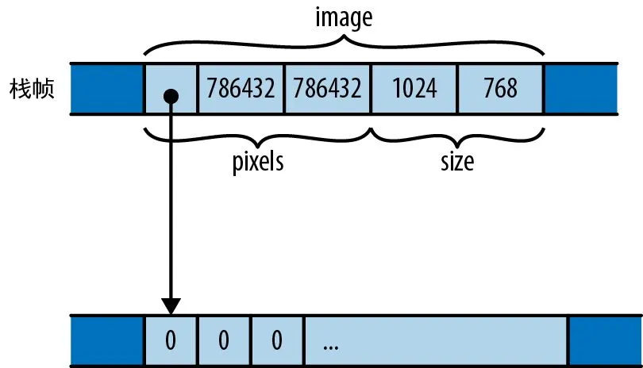

# 第9章结构体

- 很久以前，当牧羊人想要了解两个羊群是否相似时，会挨个对它们进行比对。——John C. Baez，James Dolan，“Categorification”

```
Rust 中的结构体（struct/structure）类似于 C 和 C++ 中的 struct 类型、Python 中的类和
```

JavaScript 中的对象。结构体会将多个不同类型的值组合成一个单一的值，以便你能把它们作为一个单元来处理。给定一个结构体，你可以读取和修改它的各个组件。结构体也可以具有关联的方法，以对其组件进行操作。

Rust 有 3 种结构体类型：具名字段型结构体、元组型结构体和单元型结构体。这 3 种结构体在引用组件的方式上有所不同：具名字段型结构体会为每个组件命名；元组型结构体会按组件出现的顺序标识它们；单元型结构体则根本没有组件。单元型结构体虽然不常见，但它们比你想象的更有用。

本章将详细解释每种类型并展示它们在内存中的样子；介绍如何向它们添加方法、如何定义适用于不同组件类型的泛型结构体类型，以及如何让 Rust 为你的结构体生成常见的便捷特型的实现。

## 9.1　具名字段型结构体

具名字段型结构体的定义如下所示：

```
/// 由8位灰度像素组成的矩形
struct GrayscaleMap {
   pixels: Vec<u8>,
   size: (usize, usize)
}
```

```
它声明了一个 GrayscaleMap 类型，其中包含两个给定类型的字段，分别名为 pixels 和
size。Rust 中的约定是，所有类型（包括结构体）的名称都将每个单词的第一个字母大写
（如 GrayscaleMap），这称为大驼峰格式（CamelCase 或 PascalCase）。字段和方法是小
```

写的，单词之间用下划线分隔，这称为蛇形格式（snake_case）。

你可以使用结构体表达式构造出此类型的值，如下所示：

```javascript
let width = 1024;
let height = 576;
let image = GrayscaleMap {
   pixels: vec![0; width * height],
   size: (width, height)
};
结构体表达式以类型名称（GrayscaleMap）开头，后跟一对花括号，其中列出了每个字段
```

的名称和值。还有用来从与字段同名的局部变量或参数填充字段的简写形式：

```
fn new_map(size: (usize, usize), pixels: Vec<u8>) -> GrayscaleMap {
   assert_eq!(pixels.len(), size.0 * size.1);
   GrayscaleMap { pixels, size }
}
结构体表达式 GrayscaleMap { pixels, size } 是 GrayscaleMap { pixels:
pixels, size: size } 的简写形式。你可以对某些字段使用 key: value 语法，而对同
```

一结构体表达式中的其他字段使用简写语法。

```
要访问结构体的字段，请使用我们熟悉的 . 运算符：
```

```
assert_eq!(image.size, (1024, 576));
assert_eq!(image.pixels.len(), 1024 * 576);
```

与所有其他语法项一样，结构体默认情况下是私有的，仅在声明它们的模块及其子模块中可

```
见。你可以通过在结构体的定义前加上 pub 来使结构体在其模块外部可见。结构体中的每个
```

字段默认情况下也是私有的：

```
/// 由8位灰度像素组成的矩形
pub struct GrayscaleMap {
   pub pixels: Vec<u8>,
   pub size: (usize, usize)
}
即使一个结构体声明为 pub，它的字段也可以是私有的：
/// 由8位灰度像素组成的矩形
pub struct GrayscaleMap {
   pixels: Vec<u8>,
   size: (usize, usize)
}
```

其他模块可以使用此结构体及其任何公共的关联函数，但不能按名称访问私有字段或使用结构

```
体表达式来创建新的 GrayscaleMap 值。也就是说，要创建结构体型的值，就需要结构体的
所有字段都可见。这就是为什么你不能编写结构体表达式来创建新的 String 或 Vec。这些
```

标准类型都是结构体，但它们的所有字段都是私有的。如果想创建一个值，就必须使用公共的

```
类型关联函数，比如 Vec::new()。
```

创建具名字段结构体的值时，可以使用另一个相同类型的结构体为省略的那些字段提供值。在

```
结构体表达式中，如果具名字段后面跟着 .. EXPR，则任何未提及的字段都会从 EXPR（必
```

须是相同结构体类型的另一个值）中获取它们的值。假设我们有一个代表游戏中怪物的结构体：

```
// 在这个游戏中，怪物是一些扫帚。你会看到：
struct Broom {
   name: String,
   height: u32,
   health: u32,
   position: (f32, f32, f32),
   intent: BroomIntent
}
/// `Broom`可以支持的两种用途
#[derive(Copy, Clone)]
enum BroomIntent { FetchWater, DumpWater }
```

对程序员来说，最好的童话故事是 The Sorcerer's Apprentice（《魔法师的学徒》）：一个新手魔法师对一把扫帚施了魔法，让它为自己工作，但工作完成后不知道如何让它停下来。于是，他用斧头将扫帚砍成了两半，结果一把扫帚变成了两把，虽然每把扫帚的大小只有原始扫帚的一半，但仍然具有和原始扫帚一样的“工作热情”。

```javascript
// 按值接收输入的Broom（扫帚），并获得所有权
fn chop(b: Broom) -> (Broom, Broom) {
   // 主要从`b`初始化`broom1`，只修改`height`。由于`String`
   // 不是`Copy`类型，因此`broom1`获得了`b`中`name`的所有权
   let mut broom1 = Broom { height: b.height / 2, .. b };
   // 主要从`broom1`初始化`broom2`。由于`String`不是`Copy`类型，
   // 因此我们显式克隆了`name`
   let mut broom2 = Broom { name: broom1.name.clone(), .. broom1 };
   // 为每一半扫帚分别起一个名字
   broom1.name.push_str(" I");
   broom2.name.push_str(" II");
   (broom1, broom2)
}
```

有了这个定义，我们就可以制作一把扫帚，把它一分为二，然后看看会得到什么：

```javascript
let hokey = Broom {
   name: "Hokey".to_string(),
   height: 60,
   health: 100,
   position: (100.0, 200.0, 0.0),
   intent: BroomIntent::FetchWater
};
let (hokey1, hokey2) = chop(hokey);
assert_eq!(hokey1.name, "Hokey I");
assert_eq!(hokey1.height, 30);
assert_eq!(hokey1.health, 100);
assert_eq!(hokey2.name, "Hokey II");
assert_eq!(hokey2.height, 30);
assert_eq!(hokey2.health, 100);
新的扫帚 hokey1 和 hokey2 获得了修改后的名字，长度只有原来的一半，但生命值都跟原
```

始扫帚一样。

## 9.2　元组型结构体

第二种结构体类型称为元组型结构体，因为它类似于元组：

```
struct Bounds(usize, usize);
```

构造此类型的值与构造元组非常相似，只是必须包含结构体名称：

```javascript
let image_bounds = Bounds(1024, 768);
```

元组型结构体保存的值称为元素，就像元组的值一样。你可以像访问元组一样访问它们：

```
assert_eq!(image_bounds.0 * image_bounds.1, 786432);
```

元组型结构体的单个元素可以是公共的，也可以不是：

```
pub struct Bounds(pub usize, pub usize);
表达式 Bounds(1024, 768) 看起来像一个函数调用，实际上它确实是，即定义这种类型时
```

也隐式定义了一个函数：

```
fn Bounds(elem0: usize, elem1: usize) -> Bounds { ... }
```

在最基本的层面上，具名字段型结构体和元组型结构体非常相似。选择使用哪一个需要考虑易

```
读性、无歧义性和简洁性。如果你喜欢用 . 运算符来获取值的各个组件，那么用名称来标识
```

字段就能为读者提供更多信息，并且更容易防范拼写错误。如果你通常使用模式匹配来查找这些元素，那么元组型结构体会更好用。

元组型结构体适用于创造新类型（newtype），即建立一个只包含单组件的结构体，以获得更严格的类型检查。如果你正在使用纯 ASCII 文本，那么可以像下面这样定义一个新类型：

```
struct Ascii(Vec<u8>);
```

```
将此类型用于 ASCII 字符串比简单地传递 Vec<u8> 缓冲区并在注释中解释它们的内容要好得
```

多。在将其他类型的字节缓冲区传给需要 ASCII 文本的函数时，这种新类型能帮 Rust 捕获错误。我们会在第 22 章中给出一个使用新类型进行高效类型转换的例子。

## 9.3　单元型结构体

第三种结构体有点儿晦涩难懂，因为它声明了一个根本没有元素的结构体类型：

```
struct Onesuch;
这种类型的值不占用内存，很像单元类型 ()。Rust 既不会在内存中实际存储单元型结构体的
```

值，也不会生成代码来对它们进行操作，因为仅通过值的类型它就能知道关于值的所有信息。但从逻辑上讲，空结构体是一种可以像其他任何类型一样有值的类型。或者更准确地说，空结构体是一种只有一个值的类型：

```javascript
let o = Onesuch;
在阅读 6.10 节中有关 .. 范围运算符的内容时，你已经遇到过单元型结构体。像 3..5 这样
的表达式是结构体值 Range { start: 3, end: 5 } 的简写形式，而表达式 ..（一个省
略两个端点的范围）是单元型结构体值 RangeFull 的简写形式。
```

单元型结构体在处理特型时也很有用，第 11 章会对此进行描述。

## 9.4　结构体布局

在内存中，具名字段型结构体和元组型结构体是一样的：值（可能是混合类型）的集合以特定方式在内存中布局。例如，在本章前面我们定义了下面这个结构体：

```
struct GrayscaleMap {
   pixels: Vec<u8>,
   size: (usize, usize)
}
GrayscaleMap 值在内存中的布局如图 9-1 所示。
```



```
图 9-1：内存中的 GrayscaleMap 结构体
```

与 C 和 C++ 不同，Rust 没有具体承诺它将如何在内存中对结构体的字段或元素进行排序，图9-1 仅展示了一种可能的安排。然而，Rust 确实承诺会将字段的值直接存储在结构体本身的内

```
存块中。JavaScript、Python 和 Java 会将 pixels 值和 size 值分别放在它们自己的分配在
堆上的块中，并让 GrayscaleMap 的字段指向它们，而 Rust 会将 pixels 值和 size 值直
接嵌入 GrayscaleMap 值中。只有由 pixels 向量拥有的在堆上分配的缓冲区才会留在它自
```

己的块中。

```
你可以使用 #[repr(C)] 属性要求 Rust 以兼容 C 和 C++ 的方式对结构体进行布局，第 23
```

章会对此进行详细介绍。

## 9.5　用 impl 定义方法

```
在本书中，我们一直在对各种值调用方法，比如使用 v.push(e) 将元素推送到向量上、使用
v.len() 获取向量的长度、使用 r.expect("msg") 检查 Result 值是否有错误，等等。
```

你也可以在自己的结构体类型上定义方法。Rust 方法不会像 C++ 或 Java 中的方法那样出现

```
在结构体定义中，而是会出现在单独的 impl 块中。
impl 块只是 fn 定义的集合，每个定义都会成为块顶部命名的结构体类型上的一个方法。例
如，这里我们定义了一个公共的 Queue 结构体，然后为它定义了 push 和 pop 这两个公共
```

方法：

```
/// 字符的先入先出队列
pub struct Queue {
   older: Vec<char>,   // 较旧的元素，最早进来的在后面
   younger: Vec<char>  // 较新的元素，最后进来的在后面
}
impl Queue {
   /// 把字符推入队列的最后
   pub fn push(&mut self, c: char) {
       self.younger.push(c);
   }
   /// 从队列的前面弹出一个字符。如果确实有要弹出的字符，
   /// 就返回`Some(c)`；如果队列为空，则返回`None`
   pub fn pop(&mut self) -> Option<char> {
       if self.older.is_empty() {
           if self.younger.is_empty() {
               return None;
           }
           // 将younger中的元素移到older中，并按照所承诺的顺序排列它们
           use std::mem::swap;
           swap(&mut self.older, &mut self.younger);
           self.older.reverse();
       }
       // 现在older能保证有值了。Vec的pop方法已经
       // 返回一个Option，所以可以放心使用了
       self.older.pop()
   }
}
在 impl 块中定义的函数称为关联函数，因为它们是与特定类型相关联的。与关联函数相对的
是自由函数，它是未定义在 impl 块中的语法项。
```

Rust 会将调用关联函数的结构体值作为第一个参数传给方法，该参数必须具有特殊名称

```
self。由于 self 的类型显然就是在 impl 块顶部命名的类型或对该类型的引用，因此 Rust
允许你省略类型，并以 self、&self 或 &mut self 作为 self: Queue、self:
&Queue 或 self: &mut Queue 的简写形式。如果你愿意，也可以使用完整形式，但如前
```

所述，几乎所有 Rust 代码都会使用简写形式。

```
在我们的示例中，push 方法和 pop 方法会通过 self.older 和 self.younger 来引用
Queue 的字段。在 C++ 和 Java 中，"this" 对象的成员可以在方法主体中直接可见，不用
加 this. 限定符，而 Rust 方法中则必须显式使用 self 来引用调用此方法的结构体值，这
类似于 Python 方法中使用 self 以及 JavaScript 方法中使用 this 的方式。
由于 push 和 pop 需要修改 Queue，因此它们都接受 &mut self 参数。然而，当调用一个
```

方法时，你不需要自己借用可变引用，常规的方法调用语法就已经隐式处理了这一点。因此，

```javascript
有了这些定义，你就可以像下面这样使用 Queue 了：
let mut q = Queue { older: Vec::new(), younger: Vec::new() };
q.push('0');
q.push('1');
assert_eq!(q.pop(), Some('0'));
q.push('∞');
assert_eq!(q.pop(), Some('1'));
assert_eq!(q.pop(), Some('∞'));
assert_eq!(q.pop(), None);
只需编写 q.push(...) 就可以借入对 q 的可变引用，就好像你写的是 (&mut
q).push(...) 一样，因为这是 push 方法的 self 参数所要求的。
如果一个方法不需要修改 self，那么可以将其定义为接受共享引用：
impl Queue {
   pub fn is_empty(&self) -> bool {
       self.older.is_empty() && self.younger.is_empty()
   }
}
```

同样，方法调用表达式知道要借用哪种引用：

```javascript
assert!(q.is_empty());
q.push('⊙');
assert!(!q.is_empty());
或者，如果一个方法想要获取 self 的所有权，就可以通过值来获取 self：
impl Queue {
   pub fn split(self) -> (Vec<char>, Vec<char>) {
       (self.older, self.younger)
   }
}
调用这个 split 方法看上去和调用其他方法是一样的：
let mut q = Queue { older: Vec::new(), younger: Vec::new() };
q.push('P');
q.push('D');
assert_eq!(q.pop(), Some('P'));
q.push('X');
let (older, younger) = q.split();
// q现在是未初始化状态
assert_eq!(older, vec!['D']);
assert_eq!(younger, vec!['X']);
但请注意，由于 split 通过值获取 self，因此这会将 Queue 从 q 中移动出去，使 q 变成
未初始化状态。由于 split 的 self 现在拥有此队列，因此它能够将这些单独的向量移出队
```

列并返回给调用者。

```
有时，像这样通过值或引用获取 self 还是不够的，因此 Rust 还允许通过智能指针类型传递
self。
```

### 9.5.1　以 Box、Rc 或 Arc 形式传入 self

```
方法的 self 参数也可以是 Box<Self> 类型、Rc<Self> 类型或 Arc<Self> 类型。这种
```

方法只能在给定的指针类型值上调用。调用该方法会将指针的所有权传给它。

```
你通常不需要这么做。如果一个方法期望通过引用接受 self，那它在任何指针类型上调用时
```

都可以正常工作：

```javascript
let mut bq = Box::new(Queue::new());
// `Queue::push`需要一个`&mut Queue`，但`bq`是一个`Box<Queue>`
// 这没问题：Rust在调用期间从`Box`借入了`&mut Queue`
bq.push('■');
对于方法调用和字段访问，Rust 会自动从 Box、Rc、Arc 等指针类型中借入引用，因此
&self 和 &mut self 几乎总是（偶尔也会用一下 self）方法签名里的正确选择。
但是如果某些方法确实需要获取指向 Self 的指针的所有权，并且其调用者手头恰好有这样一
个指针，那么 Rust 也允许你将它作为方法的 self 参数传入。为此，你必须明确写出 self
```

的类型，就好像它是普通参数一样。

```
impl Node {
   fn append_to(self: Rc<Self>, parent: &mut Node) {
       parent.children.push(self);
   }
}
```

### 9.5.2　类型关联函数

```
给定类型的 impl 块还可以定义根本不以 self 为参数的函数。这些函数仍然是关联函数，因
为它们在 impl 块中，但它们不是方法，因为它们不接受 self 参数。为了将它们与方法区分
```

开来，我们称其为类型关联函数。

它们通常用于提供构造函数，如下所示：

```
impl Queue {
   pub fn new() -> Queue {
       Queue { older: Vec::new(), younger: Vec::new() }
   }
}
要使用此函数，需要写成 Queue::new，即类型名称 + 双冒号 + 函数名称。现在我们的示例
```

代码简洁一点儿了：

```javascript
let mut q = Queue::new();
q.push('*');
...
在 Rust 中，构造函数通常按惯例命名为 new，我们已经见过 Vec::new、Box::new、
HashMap::new 等。但是 new 这个名字并没有什么特别之处，它不是关键字。类型通常还有
其他关联函数作为构造函数，比如 Vec::with_capacity。
虽然对于一个类型可以有许多独立的 impl 块，但它们必须都在定义该类型的同一个 crate
```

中。不过，Rust 确实允许你将自己的方法附加到其他类型中，第 11 章会解释具体做法。

如果你习惯了用 C++ 或 Java，那么将类型的方法与其定义分开可能看起来很不寻常，但这样做有几个优点。

- 找出一个类型的数据成员总是很容易。在大型 C++ 类定义中，你可能需要浏览数百行成员函数的定义才能确保没有遗漏该类的任何数据成员，而在 Rust 中，它们都在同一个地方。

- 尽管可以把方法放到具名字段型结构体中，但对元组型结构体和单元型结构体来说这看上去

```
不那么简洁。将方法提取到一个 impl 块中可以让所有这 3 种结构体使用同一套语法。事
实上，Rust 还使用相同的语法在根本不是结构体的类型（比如 enum 类型和像 i32 这样的
```

- 原始类型）上定义方法。（任何类型都可以有方法，这是 Rust 很少使用对象这个术语的原因之一，它更喜欢将所有东西都称为值。）

```
同样的 impl 语法也可以巧妙地用于实现特型，第 11 章会对此进行介绍。
```

## 9.6　关联常量

Rust 在其类型系统中的另一个特性也采用了类似于 C# 和 Java 的思想，有些值是与类型而不是该类型的特定实例关联起来的。在 Rust 中，这些叫作关联常量。

顾名思义，关联常量是常量值。它们通常用于表示指定类型下的常用值。例如，你可以定义一个用于线性代数的二维向量和一个关联的单位向量：

```javascript
pub struct Vector2 {
   x: f32,
   y: f32,
}
impl Vector2 {
   const ZERO: Vector2 = Vector2 { x: 0.0, y: 0.0 };
   const UNIT: Vector2 = Vector2 { x: 1.0, y: 0.0 };
}
这些值是和类型本身相关联的，你可以在不必引用 Vector2 的任一实例的情况下使用它们。
```

这与关联函数非常相似，使用的名字是与其关联的类型名，后面跟着它们自己的名字：

```javascript
let scaled = Vector2::UNIT.scaled_by(2.0);
```

关联常量的类型不必是其所关联的类型，我们可以使用此特性为类型添加 ID 或名称。如果有

```
多种类似于 Vector2 的类型需要写入文件然后加载到内存中，则可以使用关联常量来添加名
```

称或数值 ID，这些名称或数值 ID 可以写在数据旁边以标识其类型。

```javascript
impl Vector2 {
   const NAME: &'static str = "Vector2";
   const ID: u32 = 18;
}
```

## 9.7　泛型结构体

```
前面对 Queue 的定义并不令人满意：它是为存储字符而写的，但是它的结构体或方法根本没
有任何专门针对字符的内容。如果我们要定义另一个包含 String 值的结构体，那么除了将
char 替换为 String 外，其余代码可以完全相同。这纯属浪费时间。
```

幸运的是，Rust 结构体可以是泛型的，这意味着它们的定义是一个模板，你可以在其中插入

```
任何自己喜欢的类型。例如，下面是 Queue 的定义，它可以保存任意类型的值：
pub struct Queue<T> {
   older: Vec<T>,
   younger: Vec<T>
}
你可以把 Queue<T> 中的 <T> 读作“对于任意元素类型 T……”。所以上面的定义可以这样解
读：“对于任意元素类型 T，Queue<T> 有两个 Vec<T> 类型的字段。”例如，在
Queue<String> 中，T 是 String，所以 older 和 younger 的类型都是
Vec<String>。而在 Queue<char> 中，T 是 char，我们最终得到的结构体与最初那个针
对 char 定义的结构体是一样的。事实上，Vec 本身也是一个泛型结构体，它就是这样定义
```

的。

```
在泛型结构体定义中，尖括号（<>）中的类型名称叫作类型参数。泛型结构体的 impl 块如
```

下所示：

```
impl<T> Queue<T> {
   pub fn new() -> Queue<T> {
       Queue { older: Vec::new(), younger: Vec::new() }
   }
   pub fn push(&mut self, t: T) {
       self.younger.push(t);
   }
   pub fn is_empty(&self) -> bool {
       self.older.is_empty() && self.younger.is_empty()
   }
   ...
}
你可以将 impl<T> Queue<T> 这一行解读为“对于任意元素类型 T，这里有一些在
Queue<T> 上可用的关联函数。”然后，你可以使用类型参数 T 作为关联函数定义中的类型。
语法可能看起来有点儿累赘，但 impl<T> 可以清楚地表明 impl 块能涵盖任意类型 T，这便
能将它与为某种特定类型的 Queue 编写的 impl 块区分开来，如下所示：
impl Queue<f64> {
   fn sum(&self) -> f64 {
       ...
   }
}
这个 impl 块标头表明“这里有一些专门用于 Queue<f64> 的关联函数”。这为 Queue<f64>
提供了一个 sum 方法，不过该方法在其他类型的 Queue 上不可用。
我们在前面的代码中使用了 Rust 的 self 参数简写形式，如果到处都写成 Queue<T>，则让
人觉得拗口且容易分心。作为另一种简写形式，每个 impl 块，无论是不是泛型，都会将特殊
类型的参数 Self（注意这里是大驼峰 CamelCase）定义为我们要为其添加方法的任意类
型。对前面的代码来说，Self 就应该是 Queue<T>，因此我们可以进一步缩写
Queue::new 的定义：
pub fn new() -> Self {
   Queue { older: Vec::new(), younger: Vec::new() }
}
你可能注意到了，在 new 的函数体中，不需要在构造表达式中写入类型参数，简单地写
Queue { ... } 就足够了。这是 Rust 的类型推断在起作用：由于只有一种类型适用于该函
数的返回值（Queue<T>），因此 Rust 为我们补齐了该类型参数。但是，你始终都要在函数签
```

名和类型定义中提供类型参数。Rust 不会推断这些，相反，它会以这些显式类型为基础，推断函数体内的类型。

```
Self 也可以这样使用，我们可以改写成 Self { ... }。你觉得哪种写法最容易理解就写
```

成哪种。

```javascript
在调用关联函数时，可以使用 ::<>（比目鱼）表示法显式地提供类型参数：
let mut q = Queue::<char>::new();
```

但实际上，通常可以让 Rust 帮你推断出来：

```javascript
let mut q = Queue::new();
let mut r = Queue::new();
q.push("CAD");  // 显然是Queue<&'static str>
r.push(0.74);   // 显然是Queue<f64>
q.push("BTC");   // 2019年6月一比特币值多少美元
r.push(13764.0); // Rust可没能力检测出非理性繁荣
事实上，我们在本书中经常这样使用另一种泛型结构体类型 Vec。
```

不仅结构体可以是泛型的，枚举同样可以接受类型参数，而且语法也非常相似。10.1 节会详细介绍“枚举”。

## 9.8　带生命周期参数的泛型结构体

正如我们在 5.3.5 节中讨论的那样，如果结构体类型包含引用，则必须为这些引用的生命周期命名。例如，下面这个结构体可能包含对某个切片的最大元素和最小元素的引用：

```javascript
struct Extrema<'elt> {
   greatest: &'elt i32,
   least: &'elt i32
}
早些时候，我们建议你把像 struct Queue<T> 这样的声明理解为：给定任意类型 T，都可
以创建一个持有该类型的 Queue<T>。同样，可以将 struct Extrema<'elt> 理解为：给
定任意生命周期 'elt，都可以创建一个 Extrema<'elt> 来持有对该生命周期的引用。
下面这个函数会扫描切片并返回一个 Extrema 值，这个值的各个字段会引用其中的元素：
fn find_extrema<'s>(slice: &'s [i32]) -> Extrema<'s> {
   let mut greatest = &slice[0];
   let mut least = &slice[0];
   for i in 1..slice.len() {
       if slice[i] < *least    { least    = &slice[i]; }
       if slice[i] > *greatest { greatest = &slice[i]; }
   }
   Extrema { greatest, least }
}
在这里，由于 find_extrema 借用了 slice 的元素，而 slice 有生命周期 's，因此我们
返回的 Extrema 结构体也使用了 's 作为其引用的生命周期。Rust 总会为各种调用推断其生
命周期参数，所以调用 find_extrema 时不需要提及它们：
let a = [0, -3, 0, 15, 48];
let e = find_extrema(&a);
assert_eq!(*e.least, -3);
assert_eq!(*e.greatest, 48);
```

因为返回类型的生命周期与参数的生命周期相同是很常见的情况，所以如果有一个显而易见的

```
候选者，那么 Rust 就允许我们省略生命周期。因此也可以把 find_extrema 的签名写成如
```

下形式，意思不变：

```
fn find_extrema(slice: &[i32]) -> Extrema {
   ...
}
当然，我们的意思也可能是 Extrema<'static>，但这很不寻常。Rust 只为最常见的情况
```

提供了简写形式。

## 9.9　带常量参数的泛型结构体

泛型结构体也可以接受常量值作为参数。例如，你可以定义一个表示任意次数多项式的类型，如下所示：

```javascript
/// N - 1 次多项式
struct Polynomial<const N: usize> {
   ///  多项式的系数
   ///
   ///  对于多项式 a + bx + cx<sup>2</sup> + ... + zx<sup>n-1</sup>，其第`i`个元素是
   coefficients: [f64; N]
}
例如，根据这个定义，Polynomial<3> 是一个二次多项式。这里的 <const N: usize>
子句表示 Polynomial 类型需要一个 usize 值作为它的泛型参数，以此来决定要存储多少
```

个系数。

```javascript
与通过字段保存长度和容量而将元素存储在堆中的 Vec 不同，Polynomial 会将其系数
（coefficients）直接存储在值中，再无其他字段。长度直接由类型给出。（这里不需要容
量的概念，因为 Polynomial 不能动态增长。）
也可以在类型的关联函数中使用参数 N：
impl<const N: usize> Polynomial<N> {
   fn new(coefficients: [f64; N]) -> Polynomial<N> {
       Polynomial { coefficients }
   }
   ///  计算`x`处的多项式的值
   fn eval(&self, x: f64) -> f64 {
       //  秦九韶算法在数值计算上稳定、高效且简单：
       // c<sub>0</sub> + x(c<sub>1</sub> + x(c<sub>2</sub> + x(c<sub>3</sub> +
       let mut sum = 0.0;
       for i in (0..N).rev() {
           sum = self.coefficients[i] + x * sum;
       }
       sum
   }
}
```

```
这里，new 函数会接受一个长度为 N 的数组，并将其元素作为新 Polynomial 值的系数。
eval 方法将在 0..N 范围内迭代以找到给定点 x 处的多项式值。
```

与类型参数和生命周期参数一样，Rust 通常也能为常量参数推断出正确的值：

```javascript
use std::f64::consts::FRAC_PI_2;   // π/2
//  用近似法对`sin`函数求值：sin x ≅ x - 1/6 x³ + 1/120 x<sup>5</sup>
//  误差几乎为 0，相当精确！
let sine_poly = Polynomial::new([0.0, 1.0, 0.0, -1.0/6.0, 0.0,
                                1.0/120.0]);
assert_eq!(sine_poly.eval(0.0), 0.0);
assert!((sine_poly.eval(FRAC_PI_2) - 1.).abs() < 0.005);
由于我们向 Polynomial::new 传递了一个包含 6 个元素的数组，因此 Rust 知道必须构造
出一个 Polynomial<6>。eval 方法仅通过查询其 Self 类型就知道 for 循环应该运行多
```

少次迭代。由于长度在编译期是已知的，因此编译器可能会用一些顺序执行的代码完全替换循环。

```
常量泛型参数可以是任意整数类型、char 或 bool。不允许使用浮点数、枚举和其他类型。
```

如果结构体还接受其他种类的泛型参数，则生命周期参数必须排在第一位，然后是类型，接下

```javascript
来是任何 const 值。例如，一个包含引用数组的类型可以这样声明：
struct LumpOfReferences<'a, T, const N: usize> {
   the_lump: [&'a T; N]
}
```

常量泛型参数是 Rust 的一个相对较新的功能，目前它们的使用受到了一定的限制。例如，像

```javascript
下面这样定义 Polynomial 显然更好：
/// 一个N次多项式
struct Polynomial<const N: usize> {
   coefficients: [f64; N + 1]
}
```

然而，Rust 会拒绝这个定义：

```javascript
error: generic parameters may not be used in const operations
 |
6 |     coefficients: [f64; N + 1]
 |                         ^ cannot perform const operation using `N`
 |
 = help: const parameters may only be used as standalone arguments, i.e. `N`
虽然 [f64; N] 没问题，但像 [f64; N + 1] 这样的类型显然对 Rust 来说太过激进了。所
```

以 Rust 暂时施加了这个限制，以避免遇到像下面这样的问题：

```javascript
struct Ketchup<const N: usize> {
   tomayto: [i32; N & !31],
   tomahto: [i32; N - (N % 32)],
}
通过计算可知，不管 N 取何值，N & !31 和 N - (N % 32) 总是相等的，因此 tomayto
和 tomahto 始终具有相同的类型。例如，应该允许将任何一个赋值给另一个。但是，如果想
```

让 Rust 的类型检查器识别这种位运算，就需要把一些令人困惑的极端情况引入这种本已相当

```
复杂的语言中，而这会带来复杂度失控的风险。当然，支持像 N + 1 这样的简单表达式是没
```

问题的，并且也确实已经有人在努力教 Rust 顺利处理这些问题。

由于此处关注的是类型检查器的行为，因此这种限制仅适用于出现在类型中的常量参数，比如

```
数组的长度。在普通表达式中，可以随意使用 N：像 N + 1 和 N & !31 这样的写法是完全
```

可以的。

```javascript
如果要为 const 泛型参数提供的值不仅仅是字面量或单个标识符，那么就必须将其括在花括
号中，就像 Polynomial<> 这样。此规则能让 Rust 更准确地报告语法错误。
```

## 9.10　让结构体类型派生自某些公共特型

结构体很容易编写：

```
struct Point {
   x: f64,
   y: f64
}
但是，如果你要开始使用这种 Point 类型，很快就会发现它有点儿难用。像这样写的话，
Point 不可复制或克隆，不能用 println!("{:?}", point); 打印，而且不支持 == 运
算符和 != 运算符。
这些特性中的每一个在 Rust 中都有名称——Copy、Clone、Debug 和 PartialEq，它们
```

被称为特型。第 11 章会展示如何为自己的结构体手动实现特型。但是对于这些标准特型和其他一些特型，无须手动实现，除非你想要某种自定义行为。Rust 可以自动为你实现它们，而

```
且结果准确无误。只需将 #[derive] 属性添加到结构体上即可：
#[derive(Copy, Clone, Debug, PartialEq)]
struct Point {
   x: f64,
   y: f64
}
```

这些特型中的每一个都可以为结构体自动实现特型，但前提是结构体的每个字段都实现了该特

```
型。我们可以要求 Rust 为 Point 派生 PartialEq，因为它的两个字段都是 f64 类型，而
f64 类型已经实现了 PartialEq。
Rust 还可以派生 PartialOrd，这将增加对比较运算符 <、>、<= 和 >= 的支持。我们在这
```

里并没有这样做，因为比较两个点以了解一个点是否“小于”另一个点是一件很奇怪的事情。毕

```
竟点和点之间并没有任何常规意义上的顺序可言。所以我们选择不让 Point 值支持这些运算
符。这种特例就是 Rust 让我们自己编写 #[derive] 属性而不会自动为它派生每一个可能特
```

型的原因之一。而另一个原因是，只要实现某个特型就会自动让它成为公共特性，因此可复制性、可克隆性等都会成为该结构体的公共 API 的一部分，应该慎重选择。

```
第 13 章会详细描述 Rust 的标准特型并解释哪些可用于 #[derive]。
```

## 9.11　内部可变性

可变性与其他任何事物一样：过犹不及，而你通常只需要一点点就够了。假设你的蜘蛛机器人

```
控制系统有一个中心结构体 SpiderRobot，其中包含一些设置和 I/O 句柄。该结构体会在机
```

器人启动时设置好，并且值永不改变：

```
pub struct SpiderRobot {
   species: String,
   web_enabled: bool,
   leg_devices: [fd::FileDesc; 8],
   ...
}
机器人的每个主要系统由不同的结构体处理，它们都有一个指向 SpiderRobot 的指针：
```

```
use std::rc::Rc;
pub struct SpiderSenses {
   robot: Rc<SpiderRobot>,  // <--指向设置和I/O的指针
   eyes: [Camera; 32],
   motion: Accelerometer,
   ...
}
织网、捕食、毒液流量控制等结构体也都有一个 Rc<SpiderRobot> 智能指针。回想一下，
Rc 代表引用计数（reference counting），并且 Rc 指向的值始终是共享的，因此将始终不可
```

变。

```
现在假设你要使用标准 File 类型向 SpiderRobot 结构体添加一点儿日志记录。但有一个
问题：File 必须是可变的。所有用于写入的方法都需要一个可变引用。
这种情况经常发生。我们需要一个不可变值（SpiderRobot 结构体）中的一丁点儿可变数据
（一个 File）。这称为内部可变性。Rust 提供了多种可选方案，本节将讨论两种最直观的类
```

- 1

```
型，即 Cell<T> 和 RefCell<T>，它们都在 std::cell 模块中。
Cell<T> 是一个包含类型 T 的单个私有值的结构体。Cell 唯一的特殊之处在于，即使你对
Cell 本身没有 mut 访问权限，也可以获取和设置这个私有值字段。
Cell::new(value)（新建）
创建一个新的 Cell，将给定的 value 移动进去。
cell.get()（获取）
返回 cell 中值的副本。
cell.set(value)（设置）
将给定的 value 存储在 cell 中，丢弃先前存储的值。
此方法接受一个不可变引用型的 self。
fn set(&self, value: T)    // 注意：不是`&mut self`
当然，这对名为 set 的方法来说是相当不寻常的。迄今为止，Rust 一直在告诉我们如果想更
改数据，就需要 mut 型访问。但出于同样的原因，这个不寻常的细节正是 Cell 的全部意义
所在。Cell 只是改变不变性规则的一种安全方式——一丝不多，一毫不少。
cell 还有其他一些方法，你可以查阅其文档进行了解。
如果你想在 SpiderRobot 中添加一个简单的计数器，那么 Cell 是一个不错的工具。可以
```

写成如下形式：

```javascript
use std::cell::Cell;
pub struct SpiderRobot {
   ...
   hardware_error_count: Cell<u32>,
   ...
}
然后，即使 SpiderRobot 中的非 mut 方法也可以使用 .get() 方法和 .set() 方法访问
u32：
impl SpiderRobot {
   /// 把错误计数递增1
   pub fn add_hardware_error(&self) {
       let n = self.hardware_error_count.get();
       self.hardware_error_count.set(n + 1);
   }
   /// 如果报告过任何硬件错误，则为true
   pub fn has_hardware_errors(&self) -> bool {
       self.hardware_error_count.get() > 0
   }
}
这很容易，但它无法解决我们的日志记录问题。Cell 不允许在共享值上调用 mut 方
法。.get() 方法会返回 Cell 中值的副本，因此它仅在 T 实现了 Copy 特型时才有效。对
于日志记录，我们需要一个可变的 File，但 File 不是 Copy 类型。
在这种情况下，正确的工具是 RefCell。与 Cell<T> 一样，RefCell<T> 也是一种泛型类
型，它包含类型 T 的单个值。但与 Cell 不同，RefCell 支持借用对其 T 值的引用。
RefCell::new(value)（新建）
创建一个新的 RefCell，将 value 移动进去。
ref_cell.borrow()（借用）
返回一个 Ref<T>，它本质上只是对存储在 ref_cell 中值的共享引用。
```

如果该值已被以可变的方式借出，则此方法会 panic，详细信息稍后会解释。

```
ref_cell.borrow_mut()（可变借用）
返回一个 RefMut<T>，它本质上是对 ref_cell 中值的可变引用。
```

如果该值已被借出，则此方法会 panic，详细信息稍后会解释。

```
ref_cell.try_borrow()（尝试借用）和 ref_cell.try_borrow_mut()（尝试可
```

- 变借用）

```
行为与 borrow() 和 borrow_mut() 一样，但会返回一个 Result。如果该值已被以可变
的方式借出，那么这两个方法不会 panic，而是返回一个 Err 值。
同样，RefCell 也有一些其他的方法，你可以在其文档中进行查找。
仅当你试图打破“可变引用必须独占”的 Rust 规则时，这两个 borrow 方法才会 panic。例
```

如，以下代码会引起 panic：

```javascript
use std::cell::RefCell;
let ref_cell: RefCell<String> = RefCell::new("hello".to_string());
let r = ref_cell.borrow();      // 正确，返回Ref<String>
let count = r.len();            // 正确，返回"hello".len()
assert_eq!(count, 5);
let mut w = ref_cell.borrow_mut();  // panic：已被借出
w.push_str(" world");
为避免 panic，可以将这两个借用放入不同的块中。这样，在你尝试借用 w 之前，r 已经被丢
```

弃了。

这很像普通引用的工作方式。唯一的区别是，通常情况下，当你借用一个变量的引用时，Rust会在编译期进行检查，以确保你在安全地使用该引用。如果检查失败，则会出现编译错误。

```javascript
RefCell 会使用运行期检查强制执行相同的规则。因此，如果你违反了规则，就会收到
panic（对于 try_borrow 和 try_borrow_mut 则会显示 Err）。
现在我们已经准备好把 RefCell 用在 SpiderRobot 类型中了：
pub struct SpiderRobot {
   ...
   log_file: RefCell<File>,
   ...
}
impl SpiderRobot {
   /// 往日志文件中写一行消息
   pub fn log(&self, message: &str) {
       let mut file = self.log_file.borrow_mut();
       // `writeln!`很像`println!`，但会把输出发送到给定的文件中
       writeln!(file, "{}", message).unwrap();
   }
}
变量 file 的类型为 RefMut<File>，我们可以像使用 File 的可变引用一样使用它。有关
```

写入文件的详细信息，请参阅第 18 章。

```
Cell 很容易使用。虽然不得不调用 .get() 和 .set() 或 .borrow() 和
.borrow_mut() 略显尴尬，但这就是我们为违反规则而付出的代价。还有一个缺点虽不太
明显但更严重：Cell 以及包含它的任意类型都不是线程安全的。因此 Rust 不允许多个线程
```

同时访问它们。第 19 章会讲解内部可变性的线程安全风格，届时我们会讨

```
论“Mutex<T>”（参见 19.3.2 节）、“原子化类型”（参见 19.3.10 节）和“全局变量”（参见
```

19.3.11 节）这几项技术。

无论一个结构体是具名字段型的还是元组型的，它都是其他值的聚合：如果我有一个

```
SpiderSenses 结构体，那么就有了指向共享 SpiderRobot 结构体的 Rc 指针、有了眼
睛、有了陀螺仪，等等。所以结构体的本质是“和”这个字：我有 X 和 Y。但是如果围绕“或”这
个字构建另一种类型呢？也就是说，当你拥有这种类型的值时，你就拥有了 X 或 Y。这种类
```

型也非常有用，在 Rust 中无处不在，它们是第 10 章的主题。

[1]：cell 意思是“隔离室、单元格”，引申为“细胞”。——译者注
