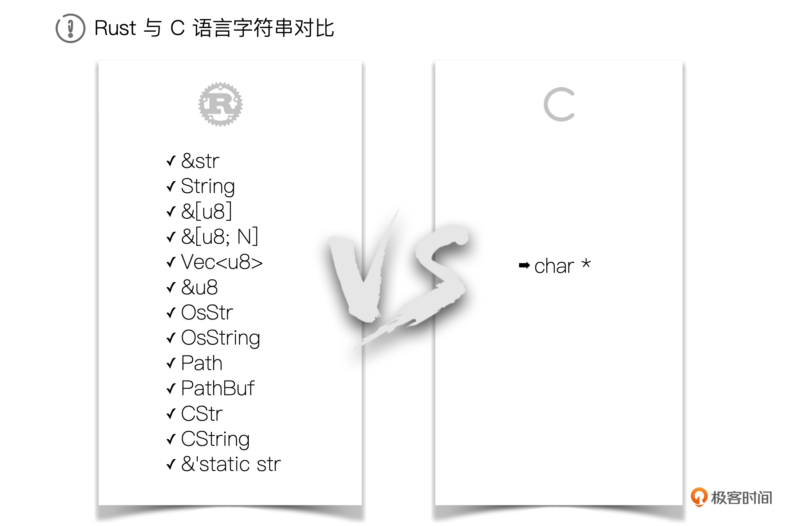
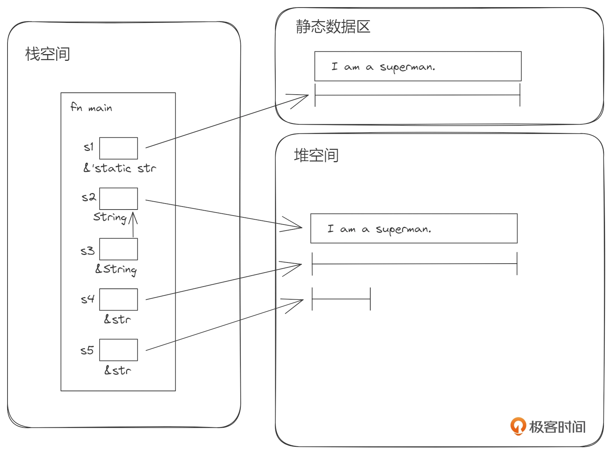
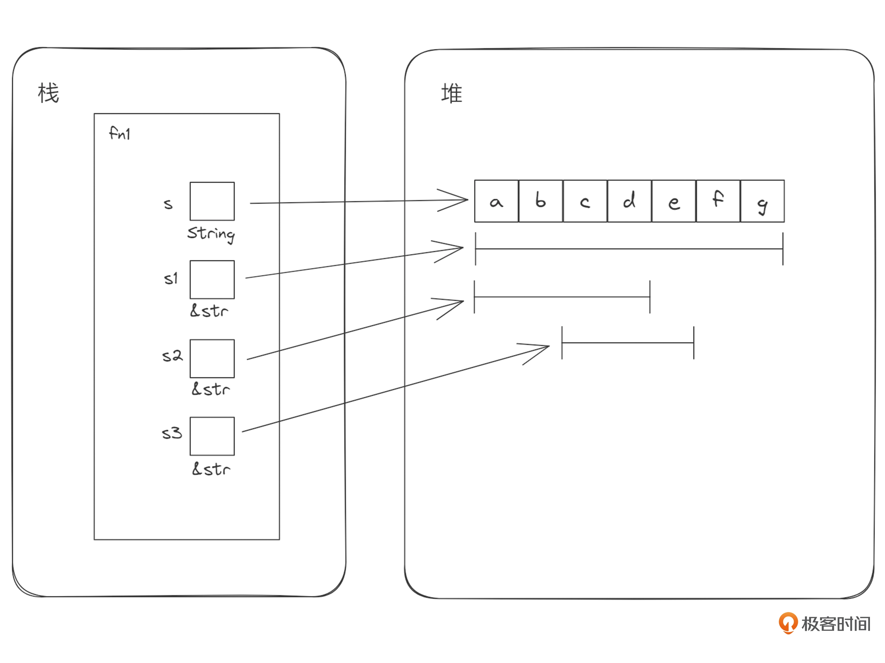
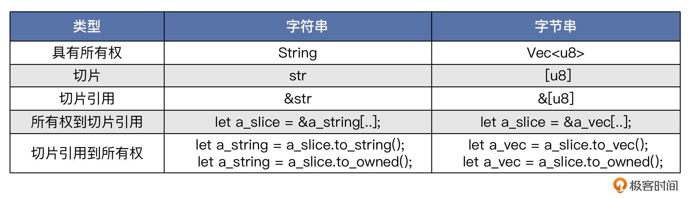
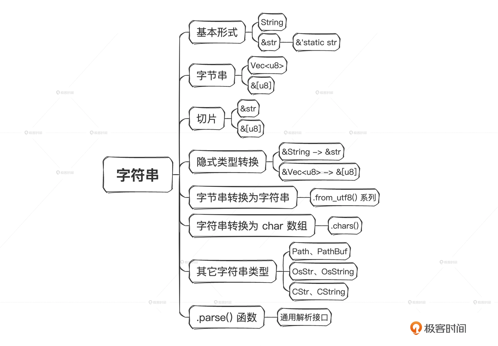

# 04 | 字符串：对号入座，字符串其实没那么可怕！

你好，我是 Mike，今天我们来认识一下 Rust 中和我们打交道最频繁的朋友——字符串。

这节课我们把字符串单独拿出来讲，是因为字符串太常见了，甚至有些应用的主要工作就是处理字符串。比如 Web 开发、解析器等。而 Rust 里的字符串内容相比于其他语言来说还要多一些。是否熟练掌握 Rust 的字符串的使用，对 Rust 代码开发效率有很大影响，所以这节课我们就来重点攻克它。

## 可怕的字符串？

我们在 Rust 里常常会见到一些字符串相关的内容，比如下面这些。

```
String, &String,
str, &str, &'static str
[u8], &[u8], &[u8; N], Vec<u8>
as_str(), as_bytes()
OsStr, OsString
Path, PathBuf
CStr, CString
```

我们用一张图形象地表达 Rust 语言里字符串的复杂性。



有没有被吓到？顿时不想学了，Rust 从入门到放弃，第一次 Rust 旅程到此结束。

且慢且慢，先不要盖棺定论。仔细想一想 Rust 中的字符串真的有这么复杂吗？这些眼花缭乱的符号到底是什么？我来给你好好分析一下。

```
首先，我们来看 C 语言里的字符串。图里显示，C 中的字符串统一叫做 char *，这确实很
```

简洁，相当于是统一的抽象。但是这个统一的抽象也付出了代价，就是丢失了很多额外的信息。

为什么会这样呢？我们从计算机结构说起。我们都知道，计算机 CPU 执行的指令都是二进制序列，所有语言写的程序最后执行时都会归结为二进制序列来执行。但是为什么不直接写二进制打孔开发，而是出现了几百上千种计算机语言呢？没错，就是因为抽象。

抽象是用来解决现实问题建模的工具。在 Rust 里也一样，之所以 Rust 有那么多看上去都是字符串的类型，就是因为 Rust 把字符串在各种场景下的使用给模型化、抽象化了。相比 C 语

```
言的 char *，多了建模的过程，在这个模型里面多了很多额外的信息。
```

下面我们就来看看前面提到的那些字符串类型各自有什么具体含义。

## 不同类型的字符串

示例：

```javascript
fn main() {
 let s1: &'static str = "I am a superman.";
 let s2: String = s1.to_string();
 let s3: &String = &s2;
 let s4: &str = &s2[..];
 let s5: &str = &s2[..6];
}
```

上述示例中，s1、s2、s3、s4、s5 看起来好像是 4 种不同类型的字符串表示。为了让你更容易理解，我画出它们在内存中的结构图。



- String、&String、str、&str、&'static str 之间的关系图

我来详细解释一下这张图片的意思。

```
"I am a superman." 这个用双引号括起来的部分是字符串的字面量，存放在静态数据
区。而 s1 是指向静态数据区中的这个字符串的切片引用，形式是 &'static str，这是静
```

态数据区中的字符串的表示方法。

```
通过执行 s1.to_string()，Rust 将静态数据区中的字符串字面量拷贝了一份到堆内存中，
通过 s2 指向，s2 具有这个堆内存字符串的所有权，String 在 Rust 中就代表具有所有权的
```

字符串。

```
s3 就是对 s2 的不可变引用，因此类型为 &String。
```

```
s4 是对 s2 的切片引用，类型是 &str。切片就是一块连续内存的某种视图，它可以提取目标
```

对象的全部或一部分。这里 s4 就是取的目标对象字符串的全部。

```
s5 是对 s2 的另一个切片引用，类型也是 &str。与 s4 不同的是，s5 是 s2 的部分视图。具
体来说，就是 "I am a" 这一部分。
```

相信你通过上面的例子对这几种不同类型的字符串已经有了一个简单直观的认识了，下面我来给你详细解释下。

```
String 是字符串的所有权形式，常常在堆中分配。String 字符串的内容大小是可以动态变
化的。而 str 是字符串的切片类型，通常以切片引用 &str 形式出现，是字符串的视图的借
```

用形式。

字符串字面量默认会存放在静态数据区里，而静态数据区中的字符串总是贯穿程序运行的整个生命期，直到程序结束的时候才会被释放。因此不需要某一个变量对其拥有所有权，也没有哪个变量能够拥有这个字符串的所有权（也就是这个资源的分配责任）。因此对于字符串字面量

```
这种数据类型，我们只能拿到它的借用形式 &'static str。这里 'static 表示这个引用
```

可以贯穿整个程序的生命期，直到这个程序运行结束。

```
&String 仅仅是对 String 类型的字符串的普通引用。
对 String 做字符串切片操作后，可以得到 &str。这里这个 &str 就是指向由 String 管
```

理的内存资源的切片引用，是目标字符串资源的借用形式，不会再把字符串内容复制一份。

```
从上面的图示里可以看到，&str 既可以引用堆中的字符串，也可以引用静态数据区中的字符
串（&'static str 是 &str 的一种特殊形式）。其实内存本来就是一个线性空间，一个指针
```

（引用是指针的一种）理论上来说可以指向这个线性空间中的任何地址。

```javascript
&str 也可转换为 String。你可以通过示例，看一下它们之间是如何转换的。
let s: String = "I am a superman.".to_string();
let a_slice: &str = &s[..];
let another_String: String = a_slice.to_string();
```

### 切片

上面提到了切片，这里我再补充一点关于切片（slice）的背景知识。切片是一段连续内存的一

```
个视图（view），在 Rust 中由 [T] 表示，T 为元素类型。这个视图可以是这块连续内存的全
```

部或一部分。切片一般通过切片的引用来访问，你可以看一下我给出的这个字符串示例。

```javascript
let s = String::from("abcdefg");
let s1 = &s[..];    // s1 内容是 "abcdefg"
let s2 = &s[0..4];  // s2 内容是 "abcd"
let s3 = &s[2..5];    // s3 内容是 "cde"
```

上面示例中，s 是堆内存中所有权型字符串类型。s1 作为 s 的一个切片引用，它也指向堆内存中那个字符串的头部，表示 s 的完整内容。s2 与 s1 指向的堆内存地址是相同的，但是内容不

```
同，s2 是 "abcd"，而 s1 是 "abcdefg"。s3 则是 s 的中间位置的一段切片引用，内容是
"cde"。s3 指向的地址与 s、s1、s2 不同。我画了一张图来表示它们之间的关系。
```



如果你拿到的是一个字符串切片引用，那么如何转换成所有权型字符串呢？有几种方法。

```javascript
let s: &str = "I am a superman.";
let s1: String = String::from(s);  // 使用 String 的from构造器
let s2: String = s.to_string();    // 使用 to_string() 方法
let s3: String = s.to_owned();     // 使用 to_owned() 方法
[u8]、&[u8]、&[u8; N]、Vec<u8>
```

这一块儿内容虽然不是直接与字符串相关，但具有类比性。有了前面的背景知识，我们可以轻松辨析这几种类型。

```javascript
[u8] 是字节串切片，大小是可以动态变化的。
&[u8] 是对字节串切片的引用，即切片引用，与 &str 是类似的。
&[u8; N] 是对 u8 数组（其长度为 N）的引用。
Vec<u8> 是 u8 类型的动态数组。与 String 类似，这是一种具有所有权的类型。
Vec<u8> 与 &[u8] 的关系如下：
let a_vec: Vec<u8> = vec![1,2,3,4,5,6,7,8];
// a_slice 是 [1,2,3,4,5]
let a_slice: &[u8] = &a_vec[0..5];
// 用 .to_vec() 方法将切片转换成Vec
let another_vec = a_slice.to_vec();
// 或者用 .to_owned() 方法
let another_vec = a_slice.to_owned();
```

我们可以整理出一个对比表格。



### as_str()、as_bytes()、as_slice()

```javascript
String 类型上有个方法是 as_str()。它返回 &str 类型。这个方法效果其实等价于
&a_string[..]，也就是包含完整的字符串内容的切片。
let s = String::from("foo");
assert_eq!("foo", s.as_str());
String 类型上还有个方法是 as_bytes()，它返回 &[u8] 类型。
let s = String::from("hello");
assert_eq!(&[104, 101, 108, 108, 111], s.as_bytes());
通过上面两个示例可以对比这两个方法的不同之处。 可以猜想 &str 其实也是可以转成 &
[u8] 的，我们查询标准库文档发现，用的正是同名方法。
let bytes = "bors".as_bytes();
assert_eq!(b"bors", bytes);
Vec 上有个 as_slice() 函数，与 String 上的 as_str() 对应，把完整内容转换成切片
引用 &[T]，等价于 &a_vec[..]。
let a_vec = vec![1, 2, 3, 5, 8];
assert_eq!(&[1, 2, 3, 5, 8], a_vec.as_slice());
```

### 隐式引用类型转换

```
前面我们看到，Rust 中 &String 与 &str 其实是不同的。这种细节的区分，在某些情况
```

下，会造成一些不方便，而且这些情况还比较常见。比如：

```javascript
fn foo(s: &String) {
}
fn main() {
 let s = String::from("I am a superman.");
 foo(&s);
 let s1 = "I am a superman.";
 foo(s1);
}
上面示例中，函数的参数类型我们定义成 &String。那么在函数调用时，这个函数只接受
&String 类型的参数传入。如果我们定义一个字符串字面量变量，想传进 foo 函数中，就发
```

现不行。

```javascript
error[E0308]: mismatched types
--> src/main.rs:8:7
 |
8 |   foo(s1);                        // error on this line
 |   --- ^^ expected `&String`, found `&str`
 |   |
 |   arguments to this function are incorrect
 |
 = note: expected reference `&String`
            found reference `&str`
```

这里体现了 Rust 严格的一面。

但是很明显，这种严格也导致了平时使用不方便，它强迫我们必须注意字符串处理时的各种细节问题，有时显得过于迂腐了。但是 Rust 也并不是那么死板，它在保持严格性的同时，通过一些精妙的机制，也可以实现一定程度上的灵活性。我们可以更改上述示例来体会一下。

```javascript
fn foo(s: &str) {      // 只需要把这里的参数改为 &str 类型
}
fn main() {
 let s = String::from("I am a superman.");
 foo(&s);
 let s1 = "I am a superman.";
 foo(s1);
}
```

```javascript
把 foo 参数的类型由 &String 改为 &str，上述示例就编译通过了。为什么呢？
实际上，在 Rust 中对 String 做引用操作时，可以告诉 Rust 编译器，我想把 &String 直
接转换到 &str 类型。只需要在代码中明确指定目标类型就可以了。
let s = String::from("I am a superman.");
let s1 = &s;
let s2: &str = &s;
上述代码，s1 不指定具体类型，对所有权字符串 s 的引用操作，只转换成 &String 类型。
而如果指定了目标类型为 &str，那么对所有权字符串 s 的引用操作，就进一步转换成了 &str
```

类型。

```
于是在上面的 foo() 函数中，我们只定义一种参数，就可以接收两种入参类型：&String
和 &str。这让函数的调用更符合直觉，使用更方便了。
```

具体是怎么做到的呢？需要用到后面的知识点：Deref。你可以查阅链接，学习 Deref 相关知识，在这里我们暂时先跳过，不做过多展开。

```
同样的原理，不仅可以作用在 String 上，也可以作用在 Vec<u8> 上 ，更进一步的话，还
可以作用在 Vec<T> 上。我们可以总结出一张表格。
```


```javascript
下面的示例表示同一个函数可以接受 &Vec<u32> 和 &[u32] 两种类型的传入。
fn foo(s: &[u32]) {
}
fn main() {
 let v: Vec<u32> = vec![1,2,3,4,5];
 foo(&v);
 let a_slice = v.as_slice();
 foo(a_slice);
}
```

### 字节串转换成字符串

```
前面我们看到可以通过 as_bytes() 方法将字符串转换成 &[u8]。相反的操作也是有的，就
是把 &[u8] 转换成字符串。
```

前面我们讲过，Rust 中的字符串实际是一个 UTF-8 序列，因此转换的过程也是与 UTF-8 编码相关的。哪些函数可用于转换呢？

```
String::from_utf8() 可以把 Vec<u8> 转换成 String，转换不一定成功，因为一个字节
```

- 序列不一定是有效的 UTF-8 编码序列。它返回的是 Result（关于 Result，我们后面会专题讲解，这里仅做了解），需要自行做错误处理。

```
String::from_utf8_unchecked() 可以把 Vec<u8> 转换成 String。不检查字节序列是不是
无效的 UTF-8 编码，直接返回 String 类型。但是这个函数是 unsafe 的，一般不推荐使
```

- 用。

```
str::from_utf8() 可以将 &[u8] 转换成 &str。它返回的是 Result，需要自行做错误处
```

- 理。

```
str::from_utf8_unchecked() 可以把 &[u8] 转换成 &str。它直接返回 &str 类型。但是这
```

- 个函数是 unsafe 的，一般不推荐使用。

```
注意 from_utf8 系列函数，返回的是 Result。有时候会让人觉得很繁琐，但是这种繁琐实
```

际是客观复杂性的体现，Rust 的严谨性要求对这种转换不成功的情况做严肃的自定义处理。反观其他语言，对于这种转换不成功的情况往往用一种内置的策略做处理，而无法自定义。

### 字符串切割成字符数组

```
&str 类型有个 chars() 函数，可以用来把字符串转换为一个迭代器，迭代器是一种通用的
```

抽象，就是用来按顺序安全迭代的，我们后面也会讲到这个概念。通过这个迭代器，就可以取

```javascript
出 char。你可以先了解它的用法。
fn main() {
   let s = String::from("中国你好");
   let char_vec: Vec<char> = s.chars().collect();
   println!("{:?}", char_vec);
   for ch in s.chars() {
       println!("{:?}", ch);
   }
}
```

输出：

```
['中', '国', '你', '好']
'中'
'国'
'你'
'好'
```

### 其他字符串相关类型

```
有了前面的知识背景。我们现在来看这些与字符串相关的类型：Path、PathBuf、OsStr、
OsString、CStr、CString。
前面我们讲过其实它们只是具体场景下的字符串而已。相对于普通的 String 或 &str，它们
```

只是包含了更多的特定场景的信息。比如 Path 类型，它就要处理跨平台的目录分隔符

```
（Unix 下是 /，Windows 下是\），以及一些其他信息。而 PathBuf 与 Path 的区别就对应于
String 与 str 的区别。
OsStr 的存在是因为各个操作系统平台上的原生字符串定义其实是不同的。比如 Unix 系统，
```

原生字符串是任意非 0 字节序列，不过常常解释为 UTF-8 编码；而在 Windows 上，原生字符串定义为任意非 0 字节 16 位序列，正常情况下解释为 UTF-16 编码序列。而 Rust 自带的标

```
准 str 定义和它们都不同，它是一个可以包含 0 这个字节的严格 UTF-8 编码序列。在开发平
台相关的应用时，往往需要处理这种类型转换的细节，于是就有了 OsStr 类型。而
OsString 与 OsStr 的关系对应于 String 与 str 的关系。
CStr 是 C 语言风格的字符串，字符串以 0 这个字节作结束符，在字符串中不能包含 0。因为
Rust 要无缝集成 C 的能力。所以这些类型出现在 Rust 中就很合理了。而 CString 与 CStr
的关系就对应于 String 与 str 的关系。
```

这些平台细节的处理相当繁琐和专业，Rust 把已处理好这些细节的类型提供给我们，我们直

```
接使用就好了。理解了这一点，你是否还觉得 C 语言中唯一的 char * 是更好的设计吗？
```

这些字符串类型你不一定要在现阶段全部掌握，这里你只需要理解 Rust 中为什么存在这些类型，还有这些类型之间的关系就可以了。后面我们在用到具体某个类型的时候再深入研究，那个时候相信你会掌握得更快、更透彻。

## Parse 方法

```
str 有一个 parse() 方法非常强大，可以从字符串转换到任意 Rust 类型，只要这个类型实
现了 FromStr 这个 Trait（Trait 是 Rust 中一个极其重要的概念，后面我们会讲述）即可。把
```

字符串解析成 Rust 类型，肯定有不成功的可能，所以这个方法返回的是一个 Result，需要自行处理解析错误的情况。下面的代码示例展示了字符串如何转换到各种类型，我们先了解，知道形式是怎样的就可以了。

```javascript
fn main() {
   let a = "10".parse::<u32>();
   let aa: u32 = "10".parse().unwrap(); // 这种写法也很常见
   println!("{:?}", a);
   let a = "10".parse::<f32>();
   println!("{:?}", a);
   let a = "4.2".parse::<f32>();
   println!("{:?}", a);
   let a = "true".parse::<bool>();
   println!("{:?}", a);
   let a = "a".parse::<char>();
   println!("{:?}", a);
   let a = "192.168.1.100".parse::<std::net::IpAddr>();
   println!("{:?}", a);
}
```

你可以看看哪些标准库类型已实现了 FromStr trait。

```
parse() 函数就相当于 Rust 语言内置的统一的解析器接口，如果你自己实现的类型需要与
```

字符串互相转换，就可以考虑实现这个接口，这样的话就比较能被整个 Rust 社区接受，这就是所谓的 Rust 地道风格的体现。

而对于更复杂和更通用的与字符串转换的场景，我们可能会更倾向于序列化和反序列化的方案。这块在 Rust 生态中也有标准的方案——serde，它作为序列化框架，可以支持各种数据格式协议，功能非常强大、统一。我们目前仅做了解。

## 小结

学习完这节课的内容，你有没有觉得 Rust 语言中的字符串内容确实很丰富？相比于 C 语言中的字符串，Rust 把字符串按场景划分成了不同的类型，每种类型都包含有不同的额外信息。通过将研究目标（字符串）按场景类型化，在代码中加入了更多的信息，给 Rust 编译器这个AI 助手喂了更多的料，从而可以让编译器为我们做更多的校验和推导的事情，来确保我们程序的正确性，并尽可能做性能优化。

这节课我们提到了一些新的概念，比如迭代器、Trait 等，你不需要现在就掌握，先知道有这么个东西就可以了，这节课你的主要任务有三个。

1. 熟悉 Rust 语言中的字符串的各种类型形式，以及它们之间的区别。

2. 知道 Rust 语言中字符串相关类型的基本转换方式有哪些。

3. 体会地道的 Rust 代码风格以及对称性。

字符串在 Rust 代码中使用广泛，几乎会贯穿整个课程。请你一定多加练习，牢牢掌握字符串相关类型在不同场景下的转换以及一些常用的方法。



## 思考题

```
chars 函数是定义在 str 上的，为什么 String 类型能直接调用 str 上定义的方法？实际
上 str 上的所有方法，String 都能调用，请问这是为什么呢？
```

欢迎你把思考后的结果分享到评论区，也欢迎你把这节课的内容分享给需要的朋友，我们下节课再见！
