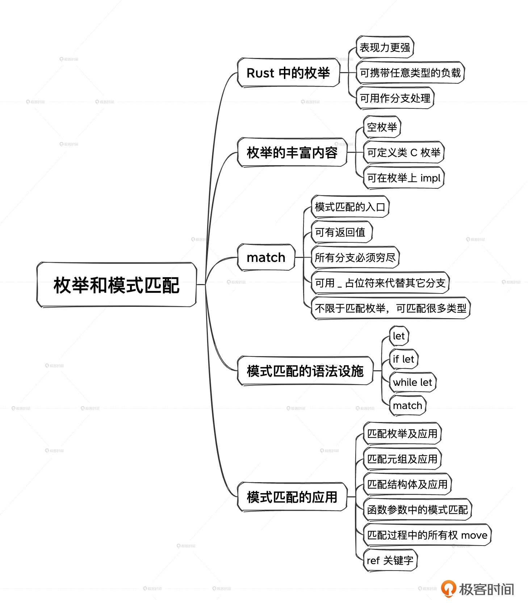

# 06 | 复合类型（下）：枚举与模式匹配

你好，我是 Mike。今天我们一起来学习 Rust 中的枚举（enum）和模式匹配（patternmatching）。

枚举是 Rust 中非常重要的复合类型，也是最强大的复合类型之一，广泛用于属性配置、错误处理、分支流程、类型聚合等场景中。学习完这节课后，你会对 Rust 的地道风格有新的认识。

## 枚举：强大的复合类型

枚举是这样一种类型，它容纳选项的可能性，每一种可能的选项都是一个变体（variant）。Rust 中的枚举使用关键字 enum 定义，这点与 Java、C++ 都是一样的。与它们不同的是，Rust 中的枚举具有更强大的表达能力。

在 Rust 中，枚举中的所有条目被叫做这个枚举的变体。比如：

```
enum Shape {
   Rectangle,
   Triangle,
   Circle,
}
```

定义了一个形状（Shape）枚举，它有三个变体：长方形 Rectangle、三角形 Triangle 和圆形Circle。

枚举与结构体不同，结构体的实例化需要所有字段一起起作用，而枚举的实例化只需要且只能是其中一个变体起作用。

### 负载

Rust 中枚举的强大之处在于，enum 中的变体可以挂载各种形式的类型。所有其他类型，比如字符串、元组、结构体等等，都可以作为 enum 的负载（payload）被挂载到其中一个变体上。比如，扩展一下上面的代码示例。

```
enum Shape {
   Rectangle { width: u32, height: u32},
   Triangle((u32, u32), (u32, u32), (u32, u32)),
   Circle { origin: (u32, u32), radius: u32 },
}
```

我们给 Shape 枚举的三个变体都挂载了不同的负载。Rectangle 挂载了一个结构体负载表示宽和高的属性。

```
{width: u32, height: u32}
```

为了看得更清楚，你也可以单独定义一个结构体，然后把它挂载到 Rectangle 变体上。

```
struct Rectangle {
 width: u32,
 height: u32
}
enum Shape {
 Rectangle(Rectangle),
 // ...
}
Triangle 变体挂载了一个元组负载 ((u32, u32), (u32, u32), (u32, u32))，表示三
```

个顶点。

```
Circle 变体挂载了一个结构体负载 { origin: (u32, u32), radius: u32 }，表示一
```

个原点加半径长度。

枚举的变体能够挂载各种类型的负载，是 Rust 中的枚举超强能力的来源，你可以通过上面例子来细细品味 Rust 的这种表达力。enum 就像一个筐，什么都能往里面装。

为了让你更熟悉 Rust 的枚举表达形式，我再举一个例子。下面的示例中 WebEvent 表示浏览器里面的 Web 事件。

```
enum WebEvent {
   PageLoad,
   PageUnload,
   KeyPress(char),
   Paste(String),
   Click { x: i64, y: i64 },
}
```

你可以表述出不同变体的意义，还有每个变体所挂载的负载类型吗？期待看到你的答案。

### 枚举的实例化

枚举的实例化实际是枚举变体的实例化。比如：

```javascript
let a = WebEvent::PageLoad;
let b = WebEvent::PageUnload;
let c = WebEvent::KeyPress('c');
let d = WebEvent::Paste(String::from("batman"));
let e = WebEvent::Click { x: 320, y: 240 };
```

可以看到，不带负载的变体实例化和带负载的变体实例化不一样。带负载的变体实例化要根据不同变体附带的类型做特定的实例化。

### 类 C 枚举

Rust 中也可以定义类似 C 语言中的枚举。

示例：

```
// 给枚举变体一个起始数字值
enum Number {
   Zero = 0,
   One,
   Two,
}
// 给枚举每个变体赋予不同的值
enum Color {
   Red = 0xff0000,
   Green = 0x00ff00,
   Blue = 0x0000ff,
}
fn main() {
   // 使用 as 进行类型的转化
   println!("zero is {}", Number::Zero as i32);
   println!("one is {}", Number::One as i32);
   println!("roses are #{:06x}", Color::Red as i32);
   println!("violets are #{:06x}", Color::Blue as i32);
}
// 输出
zero is 0
one is 1
roses are #ff0000
violets are #0000ff
```

可以看到，我们能够像 C 语言那样，在定义枚举变体的时候，指定具体的值。这在底层系统级开发、协议栈开发、嵌入式开发的场景会经常用到。

打印的时候，只需要使用 as 操作符将变体转换为具体的数值类型即可。

```
代码中的 println! 里的 {:06x} 是格式化参数，这里表示打印出值的 16 进制形式，占位
```

6 个宽度，不足的用 0 补齐。你可以顺便了解一下 println 打印语句中格式化参数的详细内容。格式化参数相当丰富，我们可以在以后不断地实践中去熟悉和掌握它。

### 空枚举

```
Rust 中也可以定义空枚举。比如 enum MyEnum {};。它其实与单元结构体一样，都表示一
```

个类型。但是它不能被实例化。目前看起来好像没什么作用，我们只需要了解这种表示形式就可以了。

```javascript
enum Foo {}
let a = Foo {}; // 错误的
// 提示
expected struct, variant or union type, found enum `Foo`
not a struct, variant or union type
```

### impl 枚举

- Rust 有个关键字 impl 可以用来给结构体或其他类型实现方法，也就是关联在某个类型上的函数。——第 5 讲

枚举同样能够被 impl。比如：

```javascript
enum MyEnum {
   Add,
   Subtract,
}
impl MyEnum {
   fn run(&self, x: i32, y: i32) -> i32 {
       match self {                  // match 语句
           Self::Add => x + y,
           Self::Subtract => x - y,
       }
   }
}
fn main() {
   // 实例化枚举
   let add = MyEnum::Add;
   // 实例化后执行枚举的方法
   add.run(100, 200);
}
```

但是不能对枚举的变体直接 impl。

```
enum Foo {
 AAA,
 BBB,
 CCC
}
impl Foo::AAA {   // 错误的
}
```

一般情况下，枚举会用来做配置，并结合 match 语句使用来做分支管理。如果要定义一个新类型，在 Rust 中主要还是使用结构体。

## match

接下来我们开始学习和枚举搭配使用的 match 语句。

### match + 枚举

其实在上面的示例中，就已经出现 match 关键字了。它的作用是判断或匹配值是哪一个枚举的变体。下面我们看一个例子。

```javascript
#[derive(Debug)]
enum Shape {
   Rectangle,
   Triangle,
   Circle,
}
fn main() {
   let shape_a = Shape::Rectangle;  // 创建实例
   match shape_a {                  // 匹配实例
       Shape::Rectangle => {
           println!("{:?}", Shape::Rectangle);  // 进了这个分支
       }
       Shape::Triangle => {
           println!("{:?}", Shape::Triangle);
       }
       Shape::Circle => {
           println!("{:?}", Shape::Circle);
       }
   }
}
// 输出
Rectangle
```

你可以试着改变实例为另外两种变体，看看打印出的信息有没有变化，然后判断上面的代码走了哪个分支。

### match 可返回值

就像大多数 Rust 语法一样，match 语法也是可以有返回值的，所以也叫做 match 表达式，我们来看一下示例。

```javascript
#[derive(Debug)]
enum Shape {
   Rectangle,
   Triangle,
   Circle,
}
fn main() {
   let shape_a = Shape::Rectangle;  // 创建实例
   let ret = match shape_a {        // 匹配实例，并返回结果给ret
       Shape::Rectangle => {
           1
       }
       Shape::Triangle => {
           2
       }
       Shape::Circle => {
           3
       }
   };
   println!("{}", ret);
}
// 输出
1
因为 shape_a 被赋值为 Shape::Rectangle，所以程序匹配到第一个分支并返回 1，变量
```

ret 的值为 1。

```javascript
let ret = match shape_a {
```

这种写法就是比较地道的 Rust 写法，可以让代码显得更紧凑。

注意，match 表达式中各个分支返回的值的类型必须相同。

### 所有分支都必须处理

match 表达式里所有的分支都必须处理，不然 Rustc 小助手会拦住你，不让你通过。这是怎么回事呢？你可以看一下示例代码。

```javascript
#[derive(Debug)]
enum Shape {
   Rectangle,
   Triangle,
   Circle,
}
fn main() {
   let shape_a = Shape::Rectangle;  // 创建实例
   let ret = match shape_a {        // 匹配实例
       Shape::Rectangle => {
           1
       }
       Shape::Triangle => {
           2
       }
       // Shape::Circle => {
       //     3
       // }
   };
   println!("{}", ret);
}
```

上面这段代码在编译的时候会出错。

```javascript
error[E0004]: non-exhaustive patterns: `Shape::Circle` not covered
 --> src/main.rs:10:19
  |
10 |   let ret = match shape_a {                  // 匹配实例
  |                   ^^^^^^^ pattern `Shape::Circle` not covered
  |
note: `Shape` defined here
 --> src/main.rs:5:3
  |
2  | enum Shape {
  |      -----
...
5  |   Circle,
  |   ^^^^^^ not covered
  = note: the matched value is of type `Shape`
help: ensure that all possible cases are being handled by adding a match arm with
  |
16 ~     },
17 +     Shape::Circle => todo!()
|
小助手提示说，Shape::Circle 分支没有覆盖到，不允许通过，然后直接贴心地给出了修
```

改建议！Rustc 小助手如此贴心，这种保姆级服务是你在 Java、C++ 等其他语言中感受不到的。

### _ 占位符

有时，你确实想测试一些东西，或者就是不想处理一些分支，可以用 _ 偷懒。

比如上面代码可以修改成这样：

```javascript
#[derive(Debug)]
enum Shape {
   Rectangle,
   Triangle,
   Circle,
}
fn main() {
   let shape_a = Shape::Rectangle;
   let ret = match shape_a {
       Shape::Rectangle => {
           1
       }
       _ => {
           10
       }
   };
   println!("{}", ret);
}
相当于除 Shape::Rectangle 之外的分支我们都统一用 _ 占位符进行处理了。
```

### 更广泛的分支

match 除了配合枚举进行分支管理外，还可以与其他基础类型结合进行分支分派。我们可以看一个 The Book 里的示例。

```javascript
fn main() {
   let number = 13;
   // 你可以试着修改上面的数字值，看看下面走哪个分支
   println!("Tell me about {}", number);
   match number {
       // 匹配单个数字
       1 => println!("One!"),
       // 匹配几个数字
       2 | 3 | 5 | 7 | 11 => println!("This is a prime"),
       // 匹配一个范围，左闭右闭区间
       13..=19 => println!("A teen"),
       // 处理剩下的情况
       _ => println!("Ain't special"),
   }
}
```

可以看到，match 可以用来匹配一个具体的数字、一个数字的列表，或者一个数字的区间等

```
等，非常灵活。在这点上，可比 C、C++，或者 Java 的 switch .. case 灵活多了。
```

## 模式匹配

match 实际是模式匹配的入口，从 match 表达式我们可引出模式匹配的概念。模式匹配就是按对象值的结构进行匹配，并且可以取出符合模式的值。下面我们通过一些示例来解释这句话。

模式匹配不限于在 match 中使用。除了 match 外，Rust 还给模式匹配提供了其他一些语法层面的设施。

### if let

当要匹配的分支只有两个或者在这个位置只想先处理一个分支的时候，可以直接用 if let。

比如下面这段代码就可以使用 if let。

```javascript
 let shape_a = Shape::Rectangle;
 match shape_a {
   Shape::Rectangle => {
     println!("1");
   }
   _ => {
     println!("10");
   }
 };
```

改写为：

```javascript
 let shape_a = Shape::Rectangle;
 if let Shape::Rectangle = shape_a {
   println!("1");
 } else {
   println!("10");
 }
```

是不是相比于 match，使用 if let 的代码量有所简化？

### while let

while 后面也可以跟 let，实现模式匹配。比如：

```javascript
#[derive(Debug)]
enum Shape {
   Rectangle,
   Triangle,
   Circle,
}
fn main() {
   let mut shape_a = Shape::Rectangle;
   let mut i = 0;
   while let Shape::Rectangle = shape_a {    // 注意这一句
       if i > 9 {
           println!("Greater than 9, quit!");
           shape_a = Shape::Circle;
       } else {
           println!("`i` is `{:?}`. Try again.", i);
           i += 1;
       }
   }
}
// 输出
`i` is `0`. Try again.
`i` is `1`. Try again.
`i` is `2`. Try again.
`i` is `3`. Try again.
`i` is `4`. Try again.
`i` is `5`. Try again.
`i` is `6`. Try again.
`i` is `7`. Try again.
`i` is `8`. Try again.
`i` is `9`. Try again.
Greater than 9, quit!
```

上面示例构造了一个 while 循环，手动维护计数器 i，递增到 9 之后，退出循环。

```
看起来，在条件判断语句那里用 while Shape::Rectangle == shape_a 也行，好像用
```

while let 的意义不大。我们来试一下，编译之后，报错了。

```
error[E0369]: binary operation `==` cannot be applied to type `Shape`
```

说 == 号不能作用在类型 Shape 上，你可以思考一下为什么。

如果一个枚举变体带负载，使用模式匹配可以把这个负载取出来，这点就比较方便了，下面我们使用带负载的枚举来举例。

### let

let 本身就支持模式匹配。其实前面的 if let、while let 本身使用的就是 let 模式匹配的能力。

```javascript
#[derive(Debug)]
enum Shape {
   Rectangle {width: u32, height: u32},
   Triangle,
   Circle,
}
fn main() {
   // 创建实例
   let shape_a = Shape::Rectangle {width: 10, height: 20};
   // 模式匹配出负载内容
   let Shape::Rectangle {width, height} = shape_a else {
       panic!("Can't extract rectangle.");
   };
   println!("width: {}, height: {}", width, height);
}
// 输出
width: 10, height: 20
```

在这个示例中，我们利用模式匹配解开了 shape_a 中带的负载（结构体负载），同时定义了width 和 height 两个局部变量，并初始化为枚举变体的实例负载的值。这两个局部变量在后续的代码块中可以使用。

注意第 12 行代码。

```javascript
let Shape::Rectangle {width, height} = shape_a else {
```

这种语法是匹配结构体负载，获取字段值的方式。

### 匹配元组

元组也可以被匹配，比如下面这个例子。

```javascript
fn main() {
   let a = (1,2,'a');
   let (b,c,d) = a;
   println!("{:?}", a);
   println!("{}", b);
   println!("{}", c);
   println!("{}", d);
}
```

这种用法叫做元组的析构，常用来从函数的多个返回值里取出数据。

```javascript
fn foo() -> (u32, u32, char) {
   (1,2,'a')
}
fn main() {
   let (b,c,d) = foo();
   println!("{}", b);
   println!("{}", c);
   println!("{}", d);
}
```

### 匹配枚举

前面已经讲过如何使用 let 把枚举里变体的负载解出来，这里我们再来看一个例子。

```javascript
struct Rectangle {
   width: u32,
   height: u32
}
enum Shape {
   Rectangle(Rectangle),
   Triangle((u32, u32), (u32, u32), (u32, u32)),
   Circle { origin: (u32, u32), radius: u32 },
}
fn main() {
   let a_rec = Rectangle {
       width: 10,
       height: 20,
   };
   // 请打开下面这一行进行实验
   //let shape_a = Shape::Rectangle(a_rec);
   // 请打开下面这一行进行实验
   //let shape_a = Shape::Triangle((0, 1), (3,4), (3, 0));
   let shape_a = Shape::Circle { origin: (0, 0), radius: 5 };
   // 这里演示了在模式匹配中将枚举的负载解出来的各种形式
   match shape_a {
       Shape::Rectangle(a_rec) => {  // 解出一个结构体
           println!("Rectangle {}, {}", a_rec.width, a_rec.height);
       }
       Shape::Triangle(x, y, z) => {  // 解出一个元组
           println!("Triangle {:?}, {:?}, {:?}", x, y, z);
       }
       Shape::Circle {origin, radius} => {  // 解出一个结构体的字段
           println!("Circle {:?}, {:?}", origin, radius);
       }
   }
}
// 输出
Circle (0, 0), 5
```

这个示例展示了如何将变体中的结构体整体、元组各部分、结构体各字段解析出来的方式。

用这种方式，我们可以在做分支处理的时候，顺便处理携带的信息，让代码变得相当紧凑而有意义（高内聚）。你需要熟悉并掌握这些写法，这样写起 Rust 代码来才会更加顺手。

### 匹配结构体

下面我们再看一个例子，了解结构体字段匹配过程中的一个细节。

```javascript
#[derive(Debug)]
struct User {
   name: String,
   age: u32,
   student: bool
}
fn main() {
   let a = User {
       name: String::from("mike"),
       age: 20,
       student: false,
   };
   let User {
       name,
       age,
       student,
   } = a;
   println!("{}", name);
   println!("{}", age);
   println!("{}", student);
   println!("{:?}", a);
}
```

编译输出：

```
error[E0382]: borrow of partially moved value: `a`
 --> src/main.rs:24:22
  |
16 |         name,
  |         ---- value partially moved here
...
24 |     println!("{:?}", a);
  |                      ^ value borrowed here after partial move
  |
  = note: partial move occurs because `a.name` has type `String`, which does not
  = note: this error originates in the macro `$crate::format_args_nl` which come
help: borrow this binding in the pattern to avoid moving the value
  |
16 |         ref name,
|
+++
```

编译提示出错了，在模式匹配的过程中发生了 partially moved。关于 partially moved 我们在上节课已经讲过。模式匹配过程中新定义的三个变量 name、age、student 分别得到了对应User 实例 a 的三个字段值的所有权。

age 和 student 采用了复制所有权的形式（参考第 2 讲移动还是复制部分），而 name 字符串值则是采用了移动所有权的形式。a.name 被部分移动到了新的变量 name ，所以接下来a.name 就无法直接使用了。

这个示例说明 Rust 中的模式匹配是一种释放原对象的所有权的方式。

从 Rust 小助手的建议里我们看到了一个关键字：ref。

### ref 关键字

Rustc AI 小助手建议我们添加一个关键字 ref，我们按它说的改改。

```javascript
#[derive(Debug)]
struct User {
   name: String,
   age: u32,
   student: bool
}
fn main() {
   let a = User {
       name: String::from("mike"),
       age: 20,
       student: false,
   };
   let User {
       ref name,    // 这里加了一个ref
       age,
       student,
   } = a;
   println!("{}", name);
   println!("{}", age);
   println!("{}", student);
   println!("{:?}", a);
}
// 输出
mike
20
false
User { name: "mike", age: 20, student: false }
```

可以看到，打印出了正确的值。

有些情况下，我们只是需要读取一下字段的值而已，不需要获得它的所有权，这时就可以通过ref 这个关键字修饰符告诉 Rust 编译器，我现在只需要获得那个字段的引用，不要给我所有权。这就是 ref 出现的原因，用来在模式匹配过程中提供一个额外的信息。

使用了 ref 后，新定义的 name 变量的值其实是 &a.name ，而不是 a.name，Rust 就不会再把所有权给 move 出来了，因此也不会发生 partially moved 这种事情，原来的 User 实例 a 还有效，因此就能被打印出来了。你可以体会一下其中的区别。

相应的，还有 ref mut 的形式。它是用于在模式匹配中获得目标的可变引用。

```javascript
let User {
   ref mut name,    // 这里加了一个ref mut
   age,
   student,
} = a;
```

你可以做做实验体会一下。

Rust 中强大的模式匹配这个概念并不是 Rust 原创的，它来自于函数式语言。你如果感兴趣的话，可以了解一下 Ocaml、Haskell 或 Scala 中模式匹配的相关概念。

### 函数参数中的模式匹配

函数参数其实就是定义局部变量，因此模式匹配的能力在这里也能得到体现。

示例 1：

```javascript
fn foo((a, b, c): (u32, u32, char)) {  // 注意这里的定义
   println!("{}", a);
   println!("{}", b);
   println!("{}", c);
}
fn main() {
   let a = (1,2, 'a');
   foo(a);
}
上例，我们把元组 a 传入了函数 foo()，foo() 的参数直接定义成模式匹配，解析出了 a、
```

b、c 三个元组元素的内容，并在函数中使用。

示例 2：

```javascript
#[derive(Debug)]
struct User {
   name: String,
   age: u32,
   student: bool
}
fn foo(User {        // 注意这里的定义
   name,
   age,
   student
}: User) {
   println!("{}", name);
   println!("{}", age);
   println!("{}", student);
}
fn main() {
   let a = User {
       name: String::from("mike"),
       age: 20,
       student: false,
   };
   foo(a);
}
上例，我们把结构体 a 传入了函数 foo()，foo() 的参数直接定义成对结构体的模式匹配，
```

解析出了 name、age、student 三个字段的内容，并在函数中使用。

## 小结

枚举是 Rust 中的重要概念，广泛用于属性配置、错误处理、分支流程、类型聚合等。在实际场景中，我们一般把结构体作为模型的主体承载，把枚举作为周边的辅助配置和逻辑分类。它们经常会搭配使用。

模式匹配是 Rust 里非常有特色的语言特性，我们在做分支逻辑处理的时候，可以通过模式匹配带上要处理的相关信息，还可以把这些信息解析出来，让代码的逻辑和数据内聚得更加紧密，让程序看起来更加赏心悦目。



## 思考题

match 表达式的各个分支中，如果有不同的返回类型的情况，应该如何处理？欢迎你在评论区留下自己的答案，也欢迎你把这节课的内容分享给其他朋友，我们下节课再见！

## 参考资料

- 格式化参数：https://shimo.im/outlink/gray?url=https%3A%2F%2Fdoc.rust-lang.org%2Fstd%2Ffmt%2Findex.html

- match 的语法规则：https://doc.rust-lang.org/reference/expressions/match-expr.html
