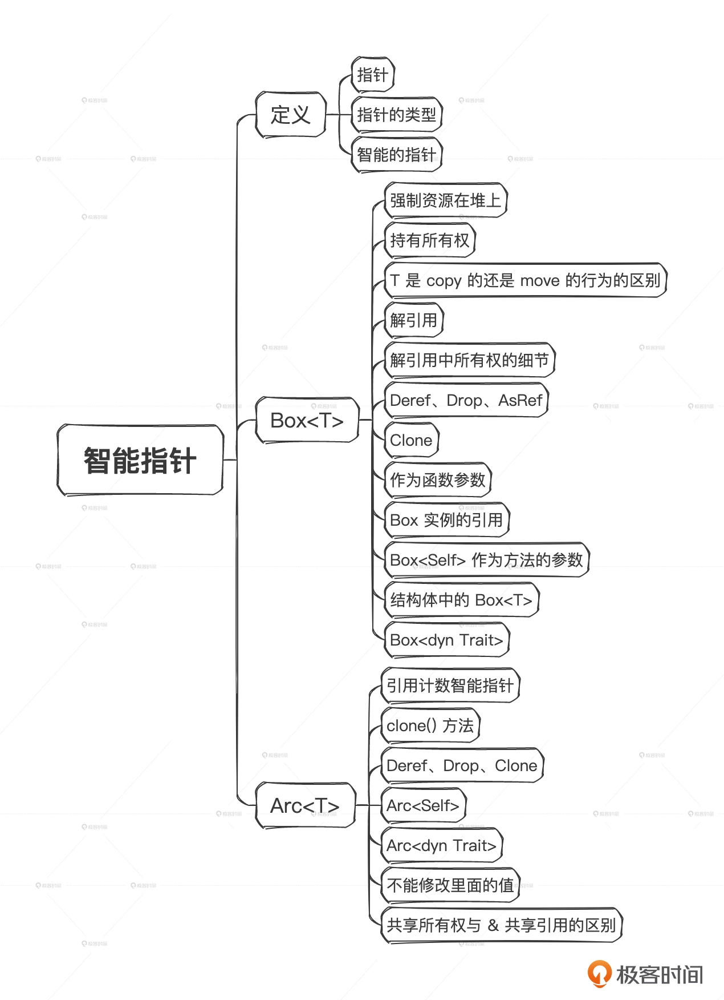

# 12 | 智能指针：从所有权看智能指针

你好，我是 Mike。从今天开始，我们进入 Rust 进阶篇。

相对于基础篇，进阶篇更像外功招式，主要是掌握一些实用的基础设施，提高编程效率。这节课我们就在所有权视角下来学习 Rust 中的智能指针。

## 智能指针


学习智能指针之前，我们先来了解一下指针是什么。


### 指针和指针的类型

如果一个变量，里面存的是另一个变量在内存里的地址值，那么这个变量就被叫做指针。而我们前面讲到的引用（用 & 号表示）就是一种指针。

引用是必定有效的指针，它一定指向一个目前有效（比如没有被释放掉）的类型实例。而指针不一定是引用。也就是说，在 Rust 中，还有一些其他类型的指针存在，我们这节课就来学习其中一些。

我们这里要再次明晰一下引用的类型。引用分为不同的类型，单独的 & 符号本身没有什么意义，但是它和其他类型组合起来就能形成各种各样的引用类型。比如：

- &str 是字符串切片引用类型。

- &String 是所有权字符串的引用类型。

- &u32 是 u32 的引用类型。

注：&str、&String、&u32 都是一个整体。

这三种都是引用类型，作为引用类型，它们之间是不同的。但是同一种引用类型的实例，比如&10u32 和 &20u32，它们的类型是相同的。

那么，指针其实也类似，指向不同类型实例的指针，它的类型也是有区别的，这叫做指针的类型。

### 智能指针

Rust 中指针的概念非常灵活，比如，它可以是一个结构体类型，只要其中的一个字段存储其他类型实例的地址，然后对这个结构体实现一些 Rust 标准库里提供的 trait，就可以把它变成指针类型。这种指针可以在传统指针的基础上添加一些额外信息，比如放在额外的一些字段中；也可以做一些额外操作，比如管理引用计数，资源自动回收等。从而显得更加智能，所以

被叫做智能指针。

```
其实，我们前面碰到的 String 和 Vec<T> 就是一种智能指针。我们来看标准库代码中
String  的定义和 Vec<T> 的定义。
pub struct String {
   vec: Vec<u8>,
}
pub struct Vec<T, #[unstable(feature = "allocator_api", issue = "32838")] A: Allo
   buf: RawVec<T, A>,
   len: usize,
}
通过代码我们可以看到，String 和 Vec<T> 实际都定义为结构体。
```

注：Rust 中智能指针的概念也直接来自于 C++。C++ 里面有unique_ptr、shared_ptr。

智能指针可以让代码的开发相对来说容易一些。经过前面的学习，我们知道 Rust 基于所有权出发，定义了一套完整的所有权和借用规则。很多我们习以为常的代码写法，在 Rust 中变成了“违法”，这导致很多人觉得学习 Rust 的门槛很高。而智能指针可以在某些方面降低这种门槛。

它如何能做到呢？我们稍后揭秘。

前面我们看到过这种代码：

```javascript
fn foo() -> u32 {
   let i = 100u32;
   i
```

```javascript
}
fn main() {
   let _i = foo();
```

```
}
我们看到，foo() 函数将 i 返回用的不是 move 行为，而是 copy 行为，将 100u32 这个值复
制了一份，返回给外面的 _i。foo() 函数调用结束后，foo() 里的局部变量 i 被销毁。
```

我们再回忆一下另一段代码。

```javascript
fn foo() -> String {
   let s = "abc".to_string();
   s
}
fn main() {
   let _s = foo();
}
上述代码可以在函数 foo() 里生成一个字符串实例，这个字符串实例资源在堆内存中分配，s
```

是 foo 函数里的局部变量，拥有字符串资源的所有权。在代码的最后一行，s 把所有权返回给

```
外部调用者并传递给 _s。foo() 调用完成后，栈上的局部变量 s 被销毁。
```

这种写法可行是因为返回了资源的所有权。如果我们把代码里的 String 换成 &String，把 s 换成 &s 就不行了。

```javascript
fn foo() -> &String {
   let s = "abc".to_string();
   &s
}
fn main() {
   let _s = foo();
}
```

你可能会问，既然 String 资源本身是在堆中，为什么我们不能拿到这个资源的引用而返回呢？

```
我们来看看为什么不行。在 foo() 函数里，其实我们返回的并不是那个堆里字符串资源的引
用，而是栈上局部变量 s 的引用。堆里的字符串资源由栈上的变量 s 管理，而 s 在 foo() 函
```

数调用完成后，就被销毁了，堆里的字符串资源也一并被回收了，所以刚刚那段代码当然行不通了。

同样的，下面这段代码也是不允许的。

```javascript
fn foo() -> &u32 {
   let i = 100u32;
   &i
}
fn main() {
   let _i = foo();
}
那么，我们有什么办法能让这种意图变得可行呢？其实是有的，比如使用 Box<T> 智能指
```

针。

## Box<T>

```
Box<T> 是一个类型整体，作为智能指针 Box<T> 可以把资源强行创建在堆上，并获得资源
```

的所有权，让资源的生命期得以被程序员精确地控制。

注：堆上的资源，默认与整个程序进程的存在时间一样久。

```javascript
我们来看使用 Box<T> 如何处理前面那个示例。
fn foo() -> Box<u32> {
   let i = 100u32;
   Box::new(i)
```

```javascript
}
fn main() {
   let _i = foo();
```

```
}
```

通过 Box，我们把栈上 i 的值，强行 copy 了一份并放在堆上某个地址，然后 Box 指针指向这个地址。

返回一个整数 i 的指针确实没多大用，如果我们定义了一个结构体，可以采用类似的办法从函数中返回结构体的 Box 指针。

```javascript
struct Point {
   x: u32,
   y: u32
}
fn foo() -> Box<Point> {
   let p = Point {x: 10, y: 20};  // 这个结构体的实例创建在栈上
   Box::new(p)
}
fn main() {
   let _p = foo();
}
```

这就很有用了。

```
我们看示例的第 7 行，Point 的实例 p 实际是创建在栈上的。通过 Box::new(p)，把 p 实例
强行按位复制了一份，并且放到了堆上，我们记为 p’。然后 foo() 函数返回，把 Box 指针实
```

例 move 给了 _p。之后，_p 拥有了对 p’ 的所有权。

### Box<T> 中的所有权分析

我们继续深入，回顾一下上面示例里讲到的，编译期间已知尺寸的类型实例会默认创建在栈上。Point 有两个字段：x、y，它们的尺寸是固定的，都是 4 个字节，所以 Point 的尺寸就是8 个字节，它的尺寸也是固定的。所以它的实例会被创建在栈上。第 7 行的 p 拥有这个 Point

实例的所有权。注意 Point 并没有默认实现 Copy，虽然它的尺寸是固定的。

```
在创建 Box<Point> 实例的时候会发生所有权转移：资源从栈上 move 到了堆上，原来栈上
```

的那片资源被置为无效状态，因此下面的代码编译不会通过。

```javascript
struct Point {
   x: u32,
   y: u32
}
fn foo() -> Box<Point> {
   let p = Point {x: 10, y: 20};
   let boxed = Box::new(p);  // 创建Box实例
   let q = p;                // 这一句用来检查p有没有被move走
   boxed
}
fn main() {
   let _p = foo();
}
```

编译提示：

```javascript
error[E0382]: use of moved value: `p`
--> src/main.rs:9:13
 |
7 |     let p = Point {x: 10, y: 20};
 |         - move occurs because `p` has type `Point`, which does not implement
8 |     let boxed = Box::new(p);     // 创建Box实例
 |                          - value moved here
9 |     let q = p;        // 这一句用来检查p有没有被move走
 |             ^ value used here after move
```

之所以会发生所有权这样的转移，是因为 Point 类型本身就是 move 语义的。作为对照，我们来看一个示例。

```javascript
fn foo() -> Box<u8> {
   let i = 5;
   let boxed = Box::new(i);  // 创建Box实例
   let q = i;                // 这一句用来检查i有没有被move走
   boxed
}
fn main() {
   let _i = foo();
}
这个示例就可以编译通过。也就是说，在执行 Box::new() 创建 Box 实例时，具有 copy 语
```

义的整数类型和具有 move 语义的 Point 类型行为不一样。整数会 copy 一份自己，Point 实例会把自己 move 到 Box 里面去。

一旦创建好 Box 实例后，这个实例就具有了对里面资源的所有权了，它是 move 语义的，你可以看一下示例。

```javascript
fn foo() -> Box<u8> {
   let i = 5;
   let boxed = Box::new(i);    // 创建Box实例
   let q = i;                  // 这一句用来检查i有没有被move走
   let boxed2 = boxed;         // 这一句检查boxed实例是不是move语义
   boxed
}
fn main() {
   let _i = foo();
```

```
}
```

不能编译通过，提示：

```javascript
error[E0382]: use of moved value: `boxed`
--> src/main.rs:6:5
 |
3 |     let boxed = Box::new(i);    // 创建Box实例
 |         ----- move occurs because `boxed` has type `Box<u8>`, which does not
4 |     let q = i;                  // 这一句用来检查i有没有被move走
5 |     let boxed2 = boxed;         // 这一句检查boxed实例是不是move语义
 |                  ----- value moved here
6 |     boxed
 |     ^^^^^ value used here after move
```

这个示例就验证了我们刚才的说法。

### Box<T> 的解引用

前面我们讲过，创建一个 Box 实例把栈上的内容包起来，可以把栈上的值移动到堆上，比如：

```javascript
let val: u8 = 5;
let boxed: Box<u8> = Box::new(val); // 这里 boxed 里面那个u8就是堆上的值
```

还可以在 Box 实例上使用解引用符号 *，把里面的堆上的值再次移动回栈上，比如：

```javascript
let boxed: Box<u8> = Box::new(5);
let val: u8 = *boxed;    // 这里这个val整数实例就是在栈上的值
解引用是 Box::new() 的逆操作，可以看到整个过程是相反的。
```

对于具有 copy 语义的 u8 类型来说，解引用回来后，boxed 还能使用，我们看下示例。

```javascript
fn main() {
   let boxed: Box<u8> = Box::new(5);
   let val: u8 = *boxed;
   println!("{:?}", val);
   println!("{:?}", boxed);  // 用于u8类型，解引用后，boxed实例还能用
}
// 输出
5
5
```

而对于具有 move 语义的类型来说，情况就不一样了，会发生所有权的转移。比如：

```javascript
#[derive(Debug)]
struct Point {
   x: u32,
   y: u32
}
fn main() {
   let p = Point {x: 10, y: 20};
   let boxed: Box<Point> = Box::new(p);
   let val: Point = *boxed;  // 这里做了解引用，Point实例回到栈上
   println!("{:?}", val);
   println!("{:?}", boxed);  // 解引用后想把boxed再打印出来
}
编译出错，提示 *boxed 已经 move 了。
error[E0382]: borrow of moved value: `boxed`
 --> src/main.rs:13:22
```

```javascript
  |
10 |     let val: Point = *boxed;
  |                      ------ value moved here
```

```
...
13 |     println!("{:?}", boxed);
  |                      ^^^^^ value borrowed here after move
```

```
因此 boxed 不能再使用。也就是说，如果 Box<T> 的 T 是 move 语义的，那么对这个 Box 实
```

例做解引用操作，会把这个 Box 实例的所有权释放。

关于这些细节，其实你不用太担心能不能一次性掌握好，因为你用错的时候，Rustc 小助手会贴心地准确提示你，所以不要有心理负担。

### Box<T> 实现了 trait

```
Box<T> 的好处在于它的明确性，它里面的资源一定在堆上，所以我们就不用再去关心资源是
在栈上还是堆上这种细节问题了。一种类型，被 Box<> 包起来的过程就叫作这个类型的盒化
```

（boxed）。

```
Rust 在标准库里为 Box<T> 实现了 Deref、Drop、AsRef<T> 等 trait，所以 Box<T> 可以
```

直接调用 T 实例的方法，访问 T 实例的值。

```javascript
#[derive(Debug)]
struct Point {
   x: u32,
   y: u32,
}
impl Point {
   fn play(&self) {
       println!("I'am a method of Point.");
   }
}
fn main() {
   let boxed: Box<Point> = Box::new(Point{x: 10, y: 20});
```

```
   boxed.play();    // 点操作符触发deref
   println!("{:?}", boxed);
}
```

```javascript
// 输出
I'am a method of Point.
Point { x: 10, y: 20 }
Box<T> 拥有对 T 实例的所有权，所以可以对 T 实例进行写操作。
#[derive(Debug)]
struct Point {
   x: u32,
   y: u32,
}
fn main() {
   let mut boxed: Box<Point> = Box::new(Point{x: 10, y: 20});
   *boxed = Point {    // 这一行，使用解引用操作更新值
       x: 100,
       y: 200
   };
   println!("{:?}", boxed);
}
// 输出
Point { x: 100, y: 200 }
```

### Box<T> 的 Clone

```
Box<T> 能否 Clone，需要看 T 是否实现了 Clone，因为我们也需要把 T 的资源克隆一份。你
```

可以看一下我给出的示例。

```
#[derive(Debug, Clone)]
struct Point {
   x: u32,
   y: u32,
}
impl Point {
   fn play(&self) {
```

```
       println!("I'am a method of Point.");
   }
}
```

```javascript
fn main() {
   let mut boxed: Box<Point> = Box::new(Point{x: 10, y: 20});
   let mut another_boxed = boxed.clone();   // 克隆
   *another_boxed = Point{x: 100, y: 200};  // 修改新的一份值
   println!("{:?}", boxed);                 // 打印原来一份值
   println!("{:?}", another_boxed);         // 打印新的一份值
}
// 输出
Point { x: 10, y: 20 }
Point { x: 100, y: 200 }
```

### Box<T> 作为函数参数

```
我们可以把 Box<T> 作为参数传入函数，这个我们前面已经见过了。
#[derive(Debug)]
struct Point {
   x: u32,
   y: u32,
}
fn foo(p: Box<Point>) {    // 这里参数类型是 Box<Point>
   println!("{:?}", p);
}
fn main() {
   foo(Box::new(Point {x: 10, y: 20}));
}
// 输出
Point { x: 10, y: 20 }
```

### &Box<T>

```
Box<T> 本身作为一种类型，对它做引用操作当然是可以的。
```

```
#[derive(Debug)]
struct Point {
```

```javascript
   x: u32,
   y: u32,
}
impl Point {
   fn play(&self) {
       println!("I'am a method of Point.");
   }
}
fn main() {
   let boxed: Box<Point> = Box::new(Point{x: 10, y: 20});
   boxed.play();        // 调用类型方法
   let y = &boxed;      // 取boxed实例的引用
   y.play();            // 调用类型方法
   println!("{:?}", y);
}
// 输出
I'am a method of Point.
I'am a method of Point.
Point { x: 10, y: 20 }
```

在示例中，boxed 是一个所有权型变量，y 是一个引用型变量。它们都能调用到 Point 类型上的方法。

对 Box 实例做可变引用（&mut）也是可以的，你可以看一下示例。

```javascript
#[derive(Debug)]
struct Point {
   x: u32,
   y: u32,
}
impl Point {
   fn play(&self) {
       println!("I'am a method of Point.");
   }
}
fn main() {
   let mut boxed: Box<Point> = Box::new(Point{x: 10, y: 20});
   let y = &mut boxed;     // 这里&mut Box<Point>
   y.play();               // 调用类型方法
   println!("{:?}", y);    // 修改前的值
   **y = Point {x: 100, y: 200};  // 注意这里用了二级解引用
   println!("{:?}", y);    // 修改后的值
}
// 输出
I'am a method of Point.
Point { x: 10, y: 20 }
Point { x: 100, y: 200 }
```

这个示例里值得注意的是第 18 行，做了两次解引用，第一次是对 &mut 做的，第二次是对

```
Box<T> 做的。
```

### Box<Self>

前面我们讲过，类型的方法可以用 self、&self、&mut self 三种形态传入 Self 参数。其中第一

```
种 self 形态还有一种变体 Box<Self>，你可以看一下示例。
```

```javascript
#[derive(Debug)]
struct Point {
   x: u32,
   y: u32,
}
impl Point {
   fn play_ref(&self) {
       println!("I'am play_ref of Point.");
   }
   fn play_mutref(&mut self) {
       println!("I'am play_mutref of Point.");
   }
   fn play_own(self) {
       println!("I'am play_own of Point.");
   }
   fn play_boxown(self: Box<Self>) {    // 注意这里
       println!("I'am play_boxown of Point.");
   }
}
fn main() {
   let mut boxed: Box<Point> = Box::new(Point{x: 10, y: 20});
   boxed.play_ref();
   boxed.play_mutref();
   boxed.play_boxown();
   // boxed.play_own();  // play_boxown()和 play_own() 只能同时打开一个
}
注意示例中，play_boxown() 和 play_own() 只能同时打开一个，这是为什么呢？你思考
```

一下。

### 结构体中的 Box

```
Box<T> 作为类型，当然是可以出现在 struct 里的，你可以看一下示例。
struct Point {
   x: u32,
```

```
   y: u32,
}
struct Triangle {
```

```javascript
   one: Box<Point>,    // 三个字段类型都是 Box<Point>
   two: Box<Point>,
   three: Box<Point>,
}
fn main() {
   let t = Triangle {
       one: Box::new(Point {
           x: 10,
           y: 10,
       }),
       two: Box::new(Point {
           x: 20,
           y: 20,
       }),
       three: Box::new(Point {
           x: 10,
           y: 20,
       }),
   };
}
```

### Box<dyn trait>

回忆第 10 讲的 trait object，它代表一种类型，这种类型可以代理一批其他的类型。但是dyn trait 本身的尺寸在编译期是未知的，所以 dyn trait 的出现总是要借助于引用或智能指针。

```
而 Box<dyn trait> 是最常见的，甚至比 &dyn trait 更常见。原因就是 Box<dyn
Trait> 拥有所有权，这就是 Box<T> 方便的地方，而 &dyn Trait  不拥有所有权，有的时
```

候就没那么方便。

```
我们来看使用 Box<dyn trait> 做函数参数的一个示例。
struct Atype;
struct Btype;
struct Ctype;
trait TraitA {}
impl TraitA for Atype {}
```

```
impl TraitA for Btype {}
impl TraitA for Ctype {}
```

```javascript
fn doit(x: Box<dyn TraitA>) {}
fn main() {
   let a = Atype;
   doit(Box::new(a));
   let b = Btype;
   doit(Box::new(b));
   let c = Ctype;
   doit(Box::new(c));
}
这个示例里的 doit() 函数能接收 Atype、Btype、Ctype 三种不同类型的实例。
如果 dyn trait 出现在结构体里，那么 Box<dyn trait> 形式就比 &dyn trait 形式要方便
得多。比如，下面示例里的结构体字段类型是 Box<dyn TraitA>，能正常编译。
struct Atype;
struct Btype;
struct Ctype;
trait TraitA {}
impl TraitA for Atype {}
impl TraitA for Btype {}
impl TraitA for Ctype {}
struct MyStruct {
   x: Box<dyn TraitA>  // 结构体的字段类型是 Box<dyn TraitA>
}
fn main() {
   let a = Atype;
   let t1 = MyStruct {x: Box::new(a)};
   let b = Btype;
   let t2 = MyStruct {x: Box::new(b)};
   let c = Ctype;
   let t3 = MyStruct {x: Box::new(c)};
}
```

```
而下面这个示例，结构体字段类型是 &dyn TraitA，就没办法通过编译。
struct Atype;
struct Btype;
struct Ctype;
trait TraitA {}
impl TraitA for Atype {}
impl TraitA for Btype {}
impl TraitA for Ctype {}
struct MyStruct {
   x: &dyn TraitA    // 结构体字段类型是 &dyn TraitA
}
```

报错如下：

```
error[E0106]: missing lifetime specifier
 --> src/lib.rs:12:8
  |
12 |     x: &dyn TraitA
  |        ^ expected named lifetime parameter
  |
help: consider introducing a named lifetime parameter
  |
11 ~ struct MyStruct<'a> {
12 ~     x: &'a dyn TraitA
  |
```

这个错误涉及到第 20 讲引用的生命期的概念，现在我们不去深究。

```
Box<T> 智能指针的内容就讲到这里，下面我们看另一种智能指针 Arc<T>。
```

## Arc<T>

```
Box<T> 是单所有权或独占所有权模型的智能指针，而 Arc<T> 是共享所有权模型的智能指
```

```
针，也就是多个变量可以同时拥有一个资源的所有权。和 Box<T> 一样，Arc<T> 也会保证
```

被包装的内容被分配在堆上。

### clone

```
Arc 的主要功能是和 clone() 配合使用。在 Arc 实例上每一次新的 clone() 操作，总是会
```

将资源的引用数 +1，而保持原来那一份资源不动，这个信息记录在 Arc 实例里面。每一个指向同一个资源的 Arc 实例走出作用域，就会给这个引用计数 -1。直到最后一个 Arc 实例消失，目标资源才会被销毁释放。你可以看一下示例。

```javascript
use std::sync::Arc;
#[derive(Debug)]    // 这里不需要目标type实现Clone trait
struct Point {
   x: u32,
   y: u32,
}
impl Point {
   fn play(&self) {
       println!("I'am a method of Point.");
   }
}
fn main() {
   let arced: Arc<Point> = Arc::new(Point{x: 10, y: 20});
   let another_arced = arced.clone();      // 克隆引用
   println!("{:?}", arced);                // 打印一份值
   println!("{:?}", another_arced);        // 打印同一份值
   arced.play();
   another_arced.play();
   let arc3_ref = &another_arced;
   arc3_ref.play();
}
// 输出
Point { x: 10, y: 20 }
Point { x: 10, y: 20 }
I'am a method of Point.
```

```
I'am a method of Point.
I'am a method of Point.
```

```
我们可以看到，相比于 Box<T>，Arc<T> 的 clone 不要求 T 实现了 Clone trait。Arc<T> 的
```

克隆行为只会改变 Arc 的引用计数，而不会克隆里面的内容。由于不需要克隆原始资源，所以性能是很高的。

```
类似于 Box<T>，Arc<T> 也实现了 Deref、Drop、Clone 等 trait。因此，Arc<T> 也可以符
合人类的习惯，访问到里面类型 T 的方法。Arc<T> 的不可变引用 &Arc<> 也可以顺利调用
```

到 T 上的方法。

### Arc

```
和 Box<T> 一样，Arc 也可以用在方法中的 self 参数上面，作为所有权 self 的一个变体形
```

式。

我们继续扩展上面的代码，你可以看一下扩展后的样子。

```
use std::sync::Arc;
#[derive(Debug)]
struct Point {
   x: u32,
   y: u32,
}
impl Point {
   fn play_ref(&self) {
       println!("I'am play_ref of Point.");
   }
   fn play_mutref(&mut self) {
       println!("I'am play_mutref of Point.");
   }
   fn play_own(self) {
       println!("I'am play_own of Point.");
   }
   fn play_boxown(self: Box<Self>) {    // 注意这里
       println!("I'am play_boxown of Point.");
```

```
   }
   fn play_arcown(self: Arc<Self>) {    // 注意这里
       println!("I'am play_arcown of Point.");
```

```javascript
   }
}
fn main() {
   let mut boxed: Box<Point> = Box::new(Point{x: 10, y: 20});
   boxed.play_ref();
   boxed.play_mutref();
   boxed.play_boxown();
   // boxed.play_own();  // play_boxown()和 play_own() 只能同时打开一个
   let arced: Arc<Point> = Arc::new(Point{x: 10, y: 20});
   arced.play_ref();
   // arced.play_mutref();  // 不能用
   // arced.play_own();     // 不能用，Arc<T> 中的T无法被移出
   arced.play_arcown();
}
// 输出
I'am play_ref of Point.
I'am play_mutref of Point.
I'am play_boxown of Point.
I'am play_ref of Point.
I'am play_arcown of Point.
通过这个示例我们可以看到，不能通过 Arc<> 直接修改里面类型的值，也不能像 Box<> 的
解引用操作那样，把里面的内容从 Arc<> 中移动出来。你可以试着打开示例里注释掉的几行
```

看看 Rustc 小助手的提示信息。

### Arc<dyn trait>

```
我们还可以把前面 Box<dyn trait> 的示例改编成 Arc<T> 的。
use std::sync::Arc;
struct Atype;
struct Btype;
struct Ctype;
trait TraitA {}
```

```
impl TraitA for Atype {}
impl TraitA for Btype {}
```

```javascript
impl TraitA for Ctype {}
struct MyStruct {
   x: Arc<dyn TraitA>
}
fn main() {
   let a = Atype;
   let t1 = MyStruct {x: Arc::new(a)};
   let b = Btype;
   let t2 = MyStruct {x: Arc::new(b)};
   let c = Ctype;
   let t3 = MyStruct {x: Arc::new(c)};
}
```

### 值的修改

```
多所有权条件下，怎么修改 Arc 里面的值呢？答案是不能修改。虽然 Arc<T> 是拥有所有权
的，但 Arc<T> 不提供修改 T 的能力，这也是 Arc<T> 和 Box<T> 不一样的地方。后面我们
```

在并发编程部分会讲到 Mutex、RwLock 等锁。想要修改 Arc 里面的内容，必须配合这些锁才

```
能完成，比如 Arc<Mutex<T>>。
```

其实很好理解，共享所有权的场景下，如果任意一方能随意修改被包裹的值，那就会影响其他所有权的持有者，整个就乱套了。所以要修改的话必须引入锁的机制。

### Arc<T> 与不可变引用 & 的区别

```
首先，它们都是共享对象的行为，本质上都是指针。但 Arc<T> 是共享了所有权模型，而 &
```

只是共享借用模型。共享借用模型就得遵循借用检查器的规则——借用的有效性依赖于被借用资源的 scope。对于这个的分析是非常复杂的。而所有权模型是由自己来管理资源的 scope，所以处理起来比较方便。

## 小结

```
这节课我们一起学习了最常用的两个智能指针：Box<T> 和 Arc<T>。其实 Rust 里还有很多
```

智能指针，比如 Rc、Cell、RefCell 等等，每一种智能指针类型都有自己的特点。但是不管怎

样，学习的方法都是一样的，那就是从所有权的视角去分析研究。你可以在后面遇到那些类型的时候，再根据这节课提供的方法去研究它们。

后面我们会看到，在智能指针的加持下，Rust 代码写起来会非常流畅，可以和 Java 不相上下。再结合 Rust 强大的类型系统建模能力，等你写得熟练之后，在中大项目中，使用 Rust甚至会有超越 Python 的开发效率。



## 思考题

你试着打开示例中的这两句，看看报错信息，然后分析一下是为什么？

```
   // arced.play_mutref();  // 不能用
   // arced.play_own();     // 不能用
```

欢迎你把自己的分析分享到评论区，也欢迎你把这节课的内容分享给其他朋友，我们下节课再见！
