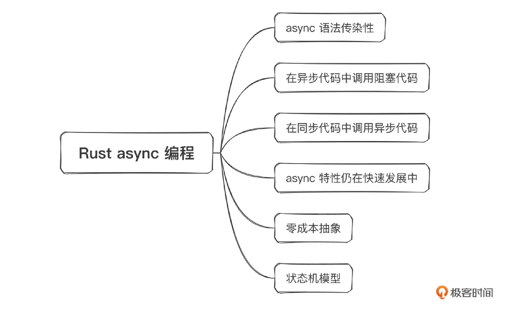

# 17 | tokio编程：Rust异步编程还有哪些需要注意的点？

你好，我是 Mike。前面几节课，我们学习了 Rust 异步编程和 tokio 的基础知识，我们先来简单回顾下。

```
async/.await 语法
```

2. tokio 基本概念和组件

3. 使用 tokio 编写一个网络并发应用

4. 使用 Arc 和 Mutex 在多个 task 之间共享数据

5. 在并发 task 之间使用 Channel 传递数据

通过学习这些内容，你应该已经能使用 tokio 开发 Rust 异步并发应用了。这节课，我们对Rust 异步并发相关的知识点来做一点补遗。

## async 其他知识点

Rust 代码中的 async 函数，其实和 Rust 的普通函数是不相容的。async Rust 就好像是 Rust语言里的一个独立王国。

### async 代码的传染性

```
Rust async 代码具有传染性。前面我们给出了使用 async/.await 的两条规则。
async 函数或 block 只有被 .await 后才被驱动。
.await 只能在 async 函数或 block 中使用。
```

这就导致在业务代码中（非 tokio 那个顶层 Runtime 代码），如果你需要调用一个 async 函数，那么你也需要让你现在这个调用者函数也是 async 的，你可以看我给出的这个例子。

```javascript
// 我们定义foo1为一个异步函数
async fn foo1() -> u32 {
 100u32
}
// 我需要在foo2函数中调用foo1，那么这个foo2也必需要是async函数
async fn foo2() -> u32 {
 foo1().await
}
// 我需要在foo3函数中调用foo2，那么这个foo3也必需要是async函数
async fn foo3() -> u32 {
 foo2().await
}
#[tokio::main]
async main() {
 let num = foo3().await;
 println!("{}", num);
}
```

这就叫作 async 代码的传染性。这种传染性是由 Rust 的 async 语法带来的。

- 注：Rust 中还有一个语法具有传染性——类型参数 T。

但是实际工作中，我们经常会遇到异步代码与同步代码混合使用的情况。这类情况应该怎么处理呢？下面我们分情况来分析。

### async 代码环境中的同步代码

```
常见的同步代码分两类，一类是直接在内存里的简单操作，比如 vec.push() 这种 API 接口
```

的调用。这类操作在 std Rust 里怎么使用在 async Rust 里就怎么使用，一样的。

```javascript
async fn foo1() -> u32 {
 let mut vec = Vec::new();
 vec.push(10);
}
```

另外有一类操作，要么是需要执行长时间的计算，要么是需要调用第三方已经写好的同步库的代码，你没有办法去修改它。对于这类函数的调用，你当然也可以直接调用：

```javascript
async fn foo1() -> u32 {
 let result = a_heavy_work();
}
```

这样写当然是可以运行的，但会有性能上的问题：它会阻塞当前正在跑这个异步代码的系统线程（OS Thread，由 tokio 来管理维护），所以当前的这个系统线程就会被卡住，而不能再跑其他异步代码了。

好消息是，tokio 专门给我们提供了另外的设施来处理这种情况，就是

```javascript
task::spawn_blocking() 函数。你可以看一下它的使用方法。
#[tokio::main]
async fn main() {
   // 此任务跑在一个单独的线程中
   let blocking_task = tokio::task::spawn_blocking(|| {
       // 在这里面可以执行阻塞线程的代码
   });
   // 像下面这样用同样的方式等待这种阻塞式任务的完成
   blocking_task.await.unwrap();
}
只需要把 CPU 计算密集型任务放到 task::spawn_blocking() 里就可以了，tokio 会帮我
```

们单独开一个新的系统线程，来专门跑这个 CPU 计算密集型的 task。然后和普通的 tokiotask 一样，可以通过 await 来获取它的结果，当然，也可以用 Oneshot channel 把结果返回回来。

给这种 CPU 计算密集型任务单独开一个系统线程运行，就能保证我们当前跑异步任务的系统线程不会被这个 CPU 计算密集型任务占据，导致异步并发能力下降，因此我们得到了一个比较好的方案。

一般来讲，主体是 async 代码，只有一些小部分是同步代码的时候，使用

```
task::spawn_blocking() 比较合适。
```

### 同步代码环境中的 async 代码

那如果主体代码是同步代码（或者叫 std Rust 代码），但是局部想调用一些 async 接口，比如db driver 只提供了 async 封装，像这种情况下该怎么办呢？

```
回想一下我们前面讲到的，展开 #[tokio::main]。
#[tokio::main]
async fn main() {
   println!("Hello world");
}
```

展开后，其实是下面这个样子：

```
fn main() {
   tokio::runtime::Builder::new_multi_thread()
       .enable_all()
       .build()
       .unwrap()
       .block_on(async {
           println!("Hello world");
       })
}
```

类似地，我们要在同步风格的代码中执行 async 代码，只需要手动 block_on 这段异步代码就可以了。除了默认的系统多线程 Runtime 之外，tokio 专门为这种临时的（以及测试的）场景

```
提供了另一种单系统线程的 runtime，就是 new_current_thread()。它的意思是就在当前
```

程序执行的线程中建立 tokio Runtime，异步任务就跑在当前这个线程中。比如：

```javascript
async fn foo1() -> u32 {
   10
}
fn foo() {
   let rt = tokio::runtime::Builder::new_current_thread()
         .enable_all()
         .build().unwrap();
   let num = rt.block_on(foo1());  // 注意这一句的 foo1()，调用了此异步函数
   // 或者像下面这样写
   //let num = rt.block_on(async {
   //    foo1().await
   //});
   println!("{}", num);
}
fn main() {
   foo();
}
// 输出
10
```

就通过这种方式，我们在主体为 std Rust 的代码中，成功地调用了局部的 async Rust 代码，并得到了这段局部异步代码的返回值。

## Rust async 实现原理

Rust 的 async 实现实际采用的是一种无栈协程（Stackless Coroutine）方案。它的实现是非常高效的，性能在所有支持异步语法的语言中属于最高的那一级，非常厉害。

### Rust async 的背后原理

Rust 语言实际会把 async 语法编译成 std Rust 中的状态机，然后通过运行时底层的 poll 机制

```
来轮询这个状态机的状态。所以本质上来讲，async/.await 语法只是语法糖。
```

简单来说，Rust 会把一个 async 函数转换成另一种东西，你可以看一下我给出的转换示例。

async 函数：

```
async fn foo1() -> u32 {
 10
}
```

转换后：

```
struct FutureA {
   ...
}
impl Future for FutureA {
   ...
}
```

具体的转换和实现细节我们现在不需要掌握，只需要知道，Rust 的这种实现并不是像 Go 或Java 那样，在系统级线程的基础上，单独实现了一层结合 GC 内存管理且具有完整屏蔽性的轻量级线程，它没有选择在 OS 应用之间引入一个层（layer），而是在结构体之上构建一个状态机，以零成本抽象（zero cost abstract）为原则，尽量少地引入额外的消耗，配合

```
async/.await 语法糖，来达到简化程序员开发难度的效果。
```

这种方案成功地让 Rust 的异步并发能力达到业界顶尖水平。Rust 异步语法从提案到稳定推出，前后经历了大量的讨论和修改，花了将近 5 年的时间，非常不容易，是整个 Rust 社区共同努力的结果，期间的故事称得上是全世界开源协作的典范。

### 其他一些要注意的问题

Rust async 编程也一直处于不断地发展过程中，比如目前在 trait 里，就不能定义 async 方法，比如：

```
trait MyTrait {
   async fn f() {}
}
// 编译错误
error[E0706]: trait fns cannot be declared `async`
--> src/main.rs:4:5
 |
4 |     async fn f() {}
|
为了解决这个问题，我们可以引入 async_trait crate 的 async_trait 宏来暂时过渡。
use async_trait::async_trait;
#[async_trait]    // 定义时加
trait MyTrait {
   async fn f() {}
}
struct Modal;
#[async_trait]    // impl 时也要加
impl MyTrait for Modal {}
请注意上述代码中，在定义 trait 和 impl trait 的时候，都需要添加 #[async_trait] 属性宏
```

来标注。添加了这个宏标注后，trait 里的 async fn 就可以像普通的 async fn 那样在异步代码中被调用了。

目前使用这个宏会有一点性能上的开销，好在 trait 中的 async fn 这个特性 Rust 官方也快稳定下来了，估计在 1.75 版本正式推出，到时候就可以去掉这个宏标注了。

## 小结

这节课我补充了 Rust 异步并发编程中剩下的一些需要注意的知识点。

我们一共花了 5 节课的时间来讲解 async Rust 和 tokio 的使用，这是因为异步并发编程对于一个场景，也就是高性能高并发服务来说，至关重要。在后面的 Web 后端服务开发实战部分，我们还会继续基于 tokio 进行讲解。



## 思考题

你是如何理解 “async Rust 是一个独立王国”这种说法的？欢迎你分享自己的见解，我们一起讨论，如果你觉得这节课的内容对你有帮助的话，也欢迎你把这节课的内容分享给其他朋友，我们下节课再见！

参考链接：https://tokio.rs/tokio/topics/bridging
