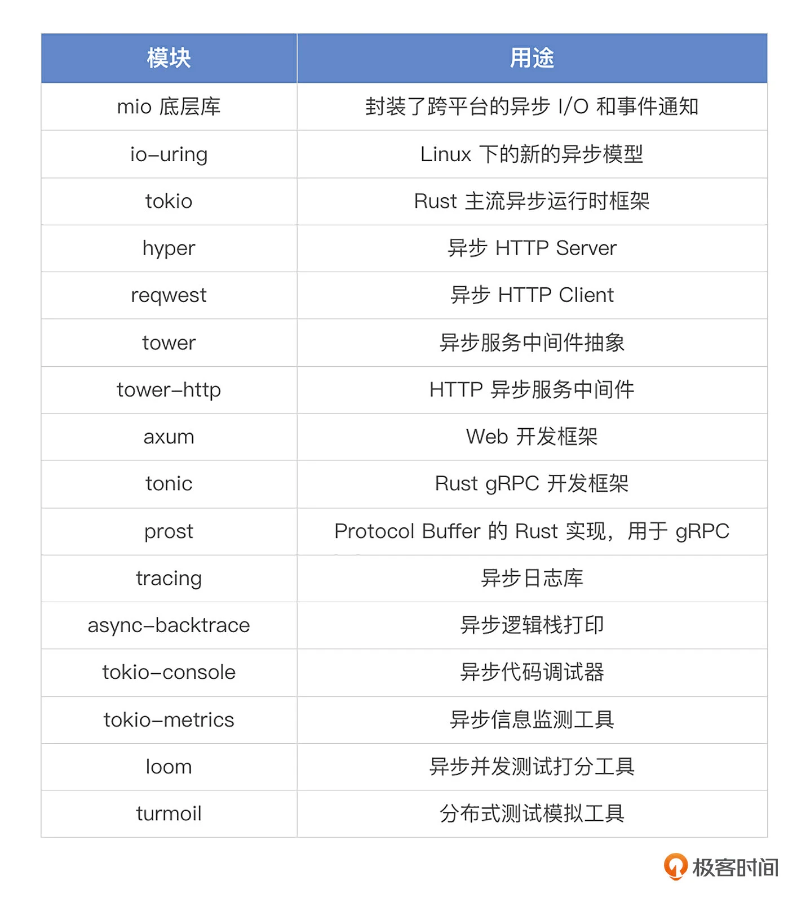
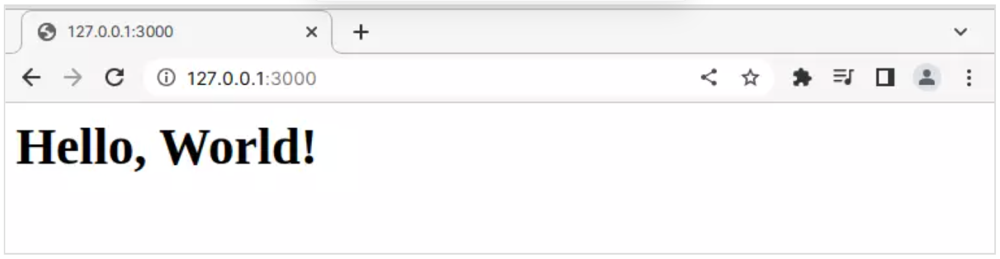

# 21 | Web开发（上）：如何使用Axum框架进行Web后端开发？

你好，我是 Mike, 今天我们来讲一讲如何用 Axum 框架进行 Web 服务器后端开发。

关于 Rust 是否适合做 Web 后端开发，很多人持怀疑态度。认为 Web 开发讲究的是敏捷，一种动态的、带运行时的、方便修改的语言可能更适合 Web 开发。

但有一些因素，其实决定了 Rust 非常适合 Web 开发。

1. 时代变化：芯片摩尔定律已失效，服务器成本逐渐占据相当大的比例，无脑堆服务器的时代已经过去。当前阶段，对于规模稍微大一些的公司来说，降本增效是一个很重要的任务。而Rust 的高性能和稳定可靠的表现非常适合帮助公司节省服务器成本。

2. 随着业务的成型，一些核心业务会趋于稳定，模型和流程抽象已经基本不会有大的改动。这时，使用 Rust 重写或部分重写这些业务，会带来更强的性能和更可靠稳定的服务表现。

3. Rust 非常适合用来做一些通用的中间件服务，目前开源社区已经出现了一些相当优秀的中间件产品。

4. Rust 的表达能力其实非常强，其强大的类型系统可帮助开发者轻松地对问题进行建模。一个中等熟练的 Rust 开发者做原型的速度不会比 Python 慢多少，在复杂问题场景下，甚至更快。

5. Rust 的语言层面的设计使它特别适合做重构。重构 Rust 工程特别快，重构完后，也不用担心出错的问题。相对于动态语言，对应的测试用例都可以少准备很多。

## Rust Web Backend 生态

Rust Web 后端开发生态目前处于一种欣欣向荣的局面。就 Web 开发框架来说，能叫得上名字的就有十几种，其中按 crates.io 最新下载量排名，排列靠前的是这几位。

1. Axum

2. Actix-web

3. Rocket

4. Poem

5. Rouille

6. Salvo

从最近下载的绝对数量来说，Axum 的下载量是第二名 Actix-web 的 3 倍多。因此，我们选择了下载量最多的框架——Axum。

### Tokio 技术栈介绍

Axum 有这么强劲的表现，得益于其本身优秀的设计，还有它无缝依赖的 Tokio 技术栈。Tokio从 2017 年发布 0.1 版本开始到现在，已经形成一套强大的技术栈。



这些可靠的工具链，为 Rust 在服务器端的发展打下了坚实的基础，越来越多的项目开始采用这一套技术栈。

## Axum 框架

- Axum 是一个专注于人体工程学和模块化的 Web 开发框架。——官方文档的 Slogan

从上层视角来看，Axum 具有以下特性：

1. 写 Router 和 Handler 的时候，不需要使用宏（非标注风格）。

2. 使用解包器进行声明式的请求解析。

3. 简单和可预测的错误处理模型。

4. 生成响应时只需用到最小的样板代码。

5. 充分利用 tower 和 tower-http 的中间件、服务和工具的生态系统。

特别是最后一点，让 Axum 显著不同于其他框架。Axum 自己不带中间件系统，而是使用tower 系的中间件。这样就能和生态里的其他项目，如 hyper 或 tonic 共享中间件系统。 这种设计太棒了。

### Tower 中间层服务

Tower 是一个模块化、可重用的组件系统，用于构建稳健的网络服务端和客户端应用。它对请求 / 响应模型做了一个统一的服务抽象，和具体的实现协议无关。你可以看一下 Service 的定义。

```
async fn(Request) -> Result<Response, Error>
```

Tower 包含 Service 和 Layer 两个抽象。一个 Service 是一个接受请求，做出响应的异步函数；而一个 Layer 接受一个 Service，处理并返回另一个 Service。Service 和 Layer 一起，就可以方便地构建中间件服务。而完全基于流（stream）的服务，并不适合使用 Tower。

### Tower-http 介绍

Tower-http 是一个专门用于提供 HTTP 相关的中间件和设施的库，里面罗列了二十多个中间件。

在 Axum 中，最常用的中间件是下面这几个。

- TracyLayer 中间件，用于提供高层日志或跟踪。

- CorsLayer 中间件，用于处理 CORS。

- CompressionLayer 中间件，用于自动压缩响应。

- RequestIdLayer 和 PropagateRequestIdLayer 中间件，用于设置和传播请求 ID。

- TimeoutLayer 中间件，用于设置超时。

- HandleErrorLayer 中间件，用于转换各种错误类型到响应。

而每个中间件都可以用在全局 Router、模块 Router 和 Handler 三个层次。

### Router

Router 用来定义 URL 到 handler 的映射，并用来构建模块化 URL 的层级，既能支持全局性路由，也能支持模块层级的路由。比如：

```javascript
let user_routes = Router::new().route("/:id", get(|| async {}));
let team_routes = Router::new().route("/", post(|| async {}));
let api_routes = Router::new()
   .nest("/users", user_routes)
   .nest("/teams", team_routes);
let app = Router::new().nest("/api", api_routes);
```

### Handler

在 Axum 里，Handler 是一个异步函数，这个异步函数接受一个或多个解包器作为参数，返回一个可以转换为响应（impl IntoResponse）的类型。

最简单的 handler 类似下面这个样子：

```
async fn string_handler() -> String {
   "Hello, World!".to_string()
}
```

## 使用 Axum 进行 Web 后端开发

现在话不多说，让我们开始 Axum 实战环节吧！

注：目前（2023 年 12 月）Axum 的最新版本是 v0.7 版，我们下面会基于这个版本来编写代码。

### 第一步：Hello world

我们先来看看 Axum 的 Hello World 是什么样子。

```javascript
use axum::{response::Html, routing::get, Router};
#[tokio::main]
async fn main() {
   // build our application with a route
   let app = Router::new().route("/", get(handler));
   // run it
   let listener = tokio::net::TcpListener::bind("127.0.0.1:3000")
       .await
       .unwrap();
   println!("listening on {}", listener.local_addr().unwrap());
   axum::serve(listener, app).await.unwrap();
}
async fn handler() -> Html<&'static str> {
   Html("<h1>Hello, World!</h1>")
}
```

这里我给出这个步骤的原始代码地址，你可以直接下载到本地运行。

从这个例子里，我们可以一窥 Axum 应用的基本结构。首先，一个 Axum 应用其实就是一个Tokio 应用，以标志性的 tokio::main 属性宏开头。

```
#[tokio::main]
async fn main() {
```

然后，创建一个 Router 实例，代表 App。在 Router 中，绑定 URL 与 handler。

```
然后使用 tokio::net::TcpListener::bind() 监听服务器地址，并将生成的 listener 传
入 axum::serve() 中使用，启动 axum 服务。而这个应用的 handler 参数里没有解包器
```

（extractor），是因为我们暂时不解析请求参数，所以参数部分留空。

```
async fn handler() -> Html<&'static str> {
   Html("<h1>Hello, World!</h1>")
}
然后，这个 handler 的返回值是 Html<&'static str> 类型，它已经实现了
```

IntoResponse，所以可以作为 Response 返回类型。下面我们来测试，打开终端在代码目录

```
下执行 cargo run。终端下输出 listening on 127.0.0.1:3000。
打开浏览器，输入 127.0.0.1:3000，可以看到下面这样的页面效果。
```



### 第二步：实现静态文件服务

静态文件服务非常有用，用于对服务器上的静态资源如图片、HTML、JS、CSS 等文件提供服务。下面我们来看看如何使用 Axum 实现一个简单的静态文件服务。我们只需要引入ServeDir 服务，然后在 Router 实例上使用 nest_service 挂载这个服务就可以了。

```
   Router::new().nest_service("/assets", ServeDir::new("assets"))
ServeDir::new() 的参数是资源目录的路径，上面一句表示把 /assets/* 的 URL 映射到
```

assets 目录下的哪些文件。

而如果需要配置获取默认文件，可以按照下面这样，在 ServeDir 里配置 not_found_service，传一个 ServeFile 实例进去，这个 ServeFile 实例就是默认获取的那个文件。然后在 Router 实例配置时，添加一个 fallback_service 挂载 serve_dir。

```javascript
let serve_dir =
   ServeDir::new("assets2")
   .not_found_service(ServeFile::new("assets2/index.html"));
let app = Router::new()
   .route("/foo", get(handler))
   .nest_service("/assets", ServeDir::new("assets"))
   .nest_service("/assets2", serve_dir.clone())
   .fallback_service(serve_dir);
```

上述示例里，即使我们访问一些不存在的 URL 地址，服务器也会返回 assets2 目录下的index.html 文件。这通常正是我们想要的。你可以根据示例源码自行测试，查看效果。

你可以尝试如下 URL 地址：

```
http://127.0.0.1:3000/
http://127.0.0.1:3000/foo
http://127.0.0.1:3000/bar
http://127.0.0.1:3000/assets/index.html
http://127.0.0.1:3000/assets/ferris.png
http://127.0.0.1:3000/assets/script.js
http://127.0.0.1:3000/assets2/index.html
http://127.0.0.1:3000/assets2/ferris2.png
http://127.0.0.1:3000/assets2/script.js
...
```

### 第三步：加入日志记录

日志系统是一个服务必不可少的组件，我们一起来看看如何为 Axum 应用添加日志。在 Axum中添加日志很简单。第一步，我们需要添加 tracing 和 tracing-subscriber 两个 crates。

```
cargo add tracing
cargo add tracing-subscriber
```

然后引入 TraceLayer。

```
use tower_http::trace::TraceLayer;
```

在 main 函数的开头添加代码：

```
   tracing_subscriber::fmt::init();
```

再在 Router 配置的时候，添加下面这行代码配置日志中间件服务就可以了。

```javascript
let app = Router::new()
   .route("/foo", get(handler))
   .nest_service("/assets", serve_dir.clone())
   .fallback_service(serve_dir)
   .layer(TraceLayer::new_for_http());  // 添加这行
```

使用时，需要按照下面这个方式来使用。

```
tracing::debug!("listening on {}", addr);
我们用上面一句替代了之前的 println!，在一个正经一点的应用中，我们都不会使用
println! 去打印日志的。
```

这里需要补充一点知识：Rust 中的日志标准。Rust 标准的 log 协议在链接里。这个 crate中定义了 5 个级别的日志打印语句。

- error!

- warn!

- info!

- debug!

- trace!

这 5 个级别从上到下警示程度为由高到低。也就是说，越往下会越详细。

但是这只是一套协议的定义，而不是具体实现。具体使用的时候，需要用另外的 crate 来实现。我们常用的 env_logger 就是其中一种实现，它把日志输出到标准终端里，用环境变量来控制打印的级别开关。而这里我们使用的 tracing 库也是这样一种实现。它是为 tokio 异步运行时专门设计的，适合在异步并发代码中使用。

你可以使用 RUST_LOG 来打开日志开关。比如：

```
RUST_LOG=trace cargo run
```

访问 http://127.0.0.1:3000/foo ，可以看到，TRACE 级别的和 DEBUG 级别的日志都打印出来了。

```
2023-12-11T05:36:39.240674Z TRACE mio::poll: registering event source with poller
2023-12-11T05:36:39.240718Z DEBUG axumapp03: listening on 127.0.0.1:3000
2023-12-11T05:36:50.029388Z TRACE mio::poll: registering event source with poller
2023-12-11T05:36:50.029678Z TRACE mio::poll: registering event source with poller
2023-12-11T05:36:50.030011Z DEBUG request{method=GET uri=/foo version=HTTP/1.1}:
2023-12-11T05:36:50.030127Z DEBUG request{method=GET uri=/foo version=HTTP/1.1}:
latency=0 ms status=200
```

用 debug 模式日志会少一些。

```
RUST_LOG=debug cargo run
```

访问 http://127.0.0.1:3000/foo ， 输出：

```
2023-12-11T05:43:45.223551Z DEBUG axumapp03: listening on 127.0.0.1:3000
2023-12-11T05:43:50.558174Z DEBUG request{method=GET uri=/foo version=HTTP/1.1}:
2023-12-11T05:43:50.558303Z DEBUG request{method=GET uri=/foo version=HTTP/1.1}:
latency=0 ms status=200
```

我们还可以指定只打印某些 crate 里的日志。

```
RUST_LOG=tower_http=debug,axumapp03=debug cargo run
```

访问 http://127.0.0.1:3000/foo ，输出：

```
2023-12-11T05:45:03.578294Z DEBUG axumapp03: listening on 127.0.0.1:3000
2023-12-11T05:45:08.036568Z DEBUG request{method=GET uri=/foo version=HTTP/1.1}:
2023-12-11T05:45:08.036696Z DEBUG request{method=GET uri=/foo version=HTTP/1.1}:
latency=0 ms status=200
```

你可以下载源码自行测试查看效果。

### 第四步：解析 Get 请求参数

一般一个 URL 是这样的：

```
https://rustcc.cn/article?id=8ba98036-e2fb-41cf-9dad-7cd874c397c4
最后面一段是 query，query 的格式为键值对列表，比如 x1=yyy&x2=zzz ，键值对之间使用
```

& 符号隔开。

Axum 采用一种解包器（extractor）的方式，直接从 HTTP Request 里提取出开发者关心的参数信息。这种设计有一些好处：

1. 减少样板重复代码，可以让代码更紧凑易读。

2. 类型化，充分利用 Rust 强大的类型能力。

3. 配置式开发，轻松惬意。

下面我们先来看如何从 GET 请求的 URL 中，取出 Query 参数。

在 Axum 中，我们只需要在 Handler 中这样配置解包器就可以。

```
#[derive(Debug, Deserialize)]
struct InputParams {
   foo: i32,
   bar: String,
   third: Option<i32>,
}
async fn query(Query(params): Query<InputParams>) -> impl IntoResponse {
   tracing::debug!("query params {:?}", params);
   Html("<h3>Test query</h3>")
}
```

这里这个 params 参数就是我们想要的 query 请求参数。可以看到，Axum 框架自动帮我们处理了解析工作，让我们直接得到了 Rust 结构体对象。减轻了我们处理具体协议的繁琐度，不易出错。请注意示例第 8 行的参数中使用了模式匹配，你可以回顾一下第 6 讲的模式匹配相关知识点。

```
我们可以继续折腾一下，InputParams 里定义了一个 third 字段，它是 Option<i32> 类型，
```

请你尝试在浏览器 URL 地址栏或插件中变换请求参数，查看及日志输出返回情况。可能的参数组合有下面这几种。

```
http://127.0.0.1:3000/query?foo=1&bar=2&third=3
http://127.0.0.1:3000/query?foo=1&bar=2
http://127.0.0.1:3000/query?foo=1
http://127.0.0.1:3000/query?bar=2
http://127.0.0.1:3000/query?foo=1&bar=2&third=3&another=4
```

本示例完整代码在这里。

## 小结

通过这节课的展示，你有没有体会到使用 Rust 进行 Web 开发的感觉？其实跟那些动态语言如 Python、JavaScript 等开发 Web 没太大区别，Axum 的代码也是比较精练的。请你一定要参考我给出的代码示例，对照源代码在你的本地跑起来。Web 开发一个非常方便的地方就是方便测试，易于看到渐进的效果正反馈，所以动手是非常重要而且高效的。

相比于动态语言来讲，Rust 的强类型更加能够保证 Web 后端服务的正确性和可靠性。性能自不用说，你选择了 Rust，就是选择了高起点。

同时你可以看到，这节课出现的 Axum 示例代码，一点都不复杂，甚至都没有用到 Rust 的所谓各种高级特性。其实就是这样，你用 Rust 做日常开发，特别是业务开发，根本不难，不要被那些所谓的高级特性吓到，先用现成的框架，快速捣鼓出自己的东西，后面再慢慢上难度就好了。

## 思考题

请你说一说 Request/Response 模型是什么，Axum 框架和其他 gRPC 框架（比如 Tonic）有什么区别。欢迎你把自己的思考分享到评论区，也欢迎你把这节课的内容分享给其他朋友，我们下节课再见！
