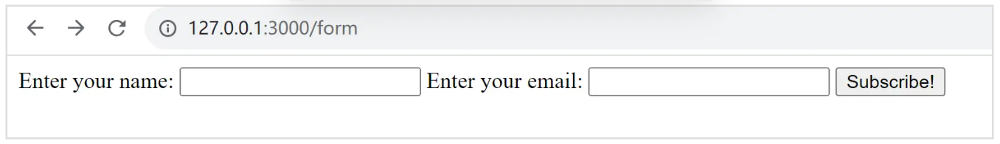
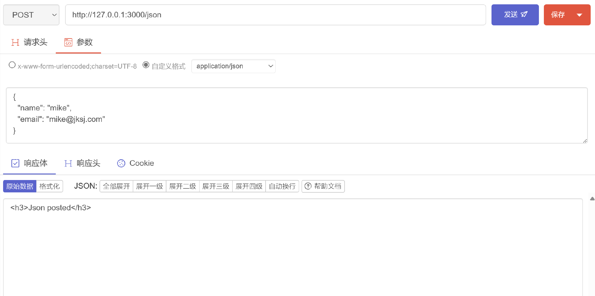
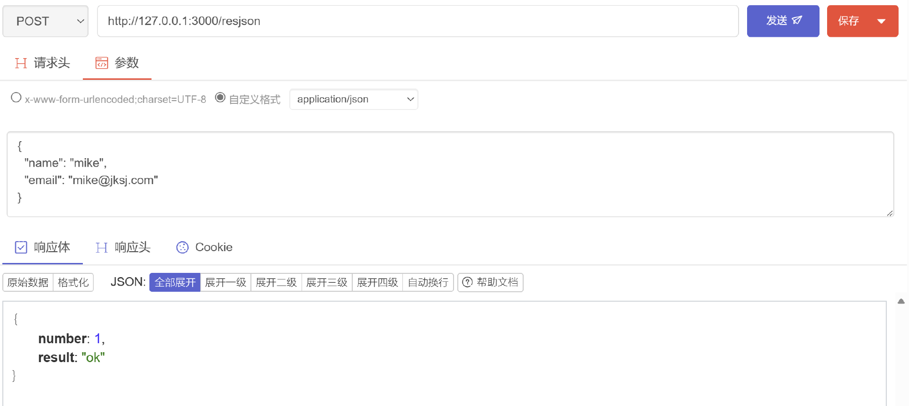
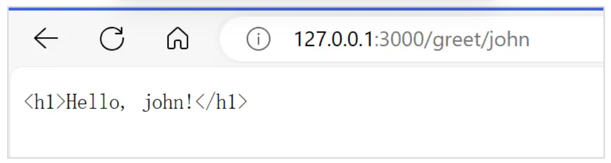
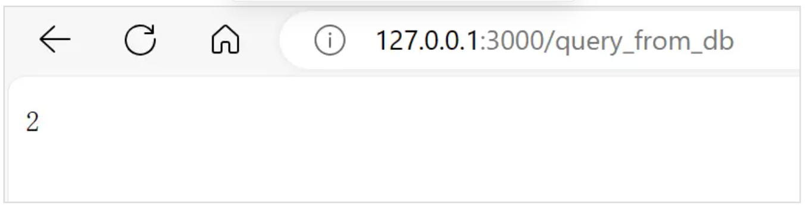
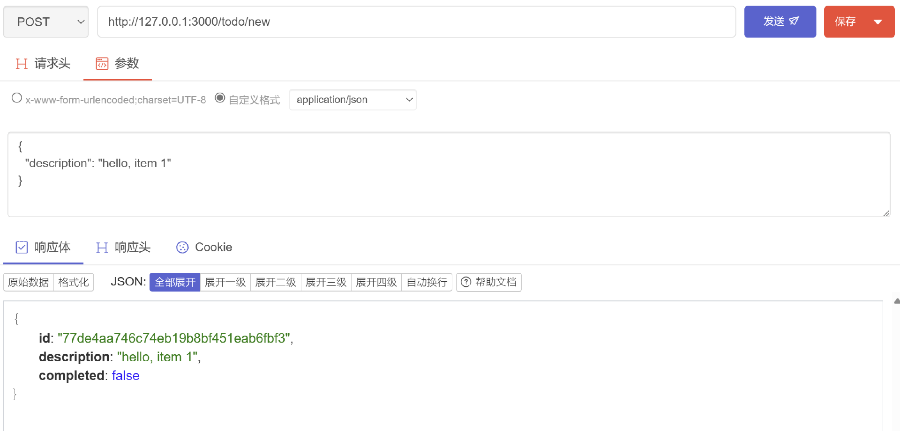
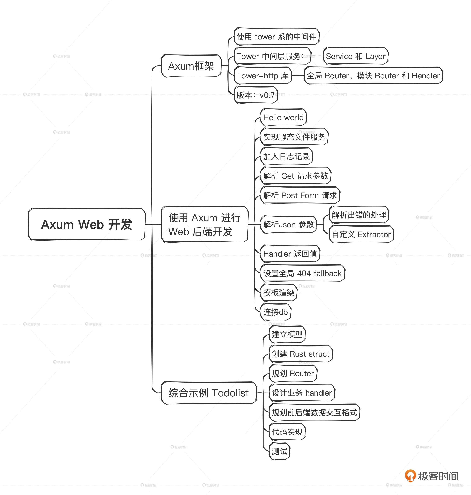

# 22 | Web开发（下）：如何实现一个TodoList应用？

你好，我是 Mike，今天我们继续讲如何使用 Axum 开发 Web 后端。学完这节课的内容后，你应该能使用 Axum 独立开发一个简单的 Web 后端应用了。

第 21 讲，我们已经讲到了第 4 步，处理 Get query 请求，拿到 query 中的参数。下面我们讲如何处理 Post 请求并拿到参数。

这节课的代码适用于 Axum v0.7 版本。

## 基本步骤

### 第五步：解析 Post 请求参数

当我们想向服务端提交一些数据的时候，一般使用 HTTP POST 方法。Post 的数据会放在HTTP 的 body 中，在 HTML 页面上，通常会使用表单 form 收集数据。

和前面的 Query 差不多，Axum 给我们提供了 Form 解包器，可以方便地取得 form 表单数据。你可以参考下面的示例。

```
#[derive(Deserialize, Debug)]
struct Input {
   name: String,
   email: String,
}
async fn accept_form(Form(input): Form<Input>) -> Html<&'static str> {
   tracing::debug!("form params {:?}", input);
   Html("<h3>Form posted</h3>")
}
```

可以看到，相比于前面的 Query 示例，form 示例代码结构完全一致，只是解包器由 Query 换成了 Form。这体现了 Axum 具有相当良好的人体工程学，让我们非常省力。

我们这里在结构体上 derive 了 Deserialize，它是 serde 库提供的反序列化宏。serde 库是Rust 生态中用得最广泛的序列化和反序列化框架。

要测试 Post 请求，你需要安装一个浏览器插件，比如 Postman，它可以让你在浏览器中方便地构建一个 Form 格式的 Post 请求。

```
完整代码示例在这里，这个示例运行后，访问 http://127.0.0.1:3000/form，会出现
```

一个表单。



在表单中填入数据后，可以观察到日志输出像下面这个样子：

```
2023-12-11T07:08:33.520071Z DEBUG axumapp05: listening on 127.0.0.1:3000
2023-12-11T07:08:33.720071Z DEBUG request{method=GET uri=/ version=HTTP/1.1}: tow
2023-12-11T07:08:33.720274Z DEBUG request{method=GET uri=/ version=HTTP/1.1}: tow
2023-12-11T07:08:33.833684Z DEBUG request{method=GET uri=/favicon.ico version=HTT
2023-12-11T07:08:33.833779Z DEBUG request{method=GET uri=/favicon.ico version=HTT
2023-12-11T07:09:09.309848Z DEBUG request{method=GET uri=/form version=HTTP/1.1}:
2023-12-11T07:09:09.309975Z DEBUG request{method=GET uri=/form version=HTTP/1.1}:
2023-12-11T07:09:13.964549Z DEBUG request{method=POST uri=/form version=HTTP/1.1}
2023-12-11T07:09:13.964713Z DEBUG request{method=POST uri=/form version=HTTP/1.1}
2023-12-11T07:09:13.964796Z DEBUG request{method=POST uri=/form version=HTTP/1.1}
```

我们可以看到，在日志的第 9 行 form 表单的数据已经解析出来了。

下一步我们研究如何处理传上来的 Json 格式的请求。

### 第六步：解析 Json 请求参数

在现代 Web 开发中，发 POST 请求更多的时候是提交 Json 数据，这时 HTTP 请求的content-type 是 application/json。这种情况 Axum 应该怎么处理呢？

还是一样的，非常简单。Axum 提供了解包器 Json，只需要把参数解包器修改一下就可以了，解析后的类型都不用变。你可以看一下修改后的代码。

```
#[derive(Deserialize, Debug)]
struct Input {
   name: String,
   email: String,
}
async fn accept_json(Json(input): Json<Input>) -> Html<&'static str> {
   tracing::debug!("json params {:?}", input);
   Html("<h3>Json posted</h3>")
}
```

完整代码示例在这里。这种 Post 请求在浏览器 URL 地址栏里面就不太好测试了。最好安装Postman 等工具来测试。我用的 Postwoman 插件操作界面如下：



控制台 log 输出为：

```
2023-12-11T07:37:02.093884Z DEBUG axumapp06: listening on 127.0.0.1:3000
2023-12-11T07:37:07.665064Z DEBUG request{method=POST uri=/json version=HTTP/1.1}
2023-12-11T07:37:07.665244Z DEBUG request{method=POST uri=/json version=HTTP/1.1}
2023-12-11T07:37:07.665309Z DEBUG request{method=POST uri=/json version=HTTP/1.1}
```

可以看到，我们成功解析出了 json 参数，并转换成了 Rust 结构体。

截止目前，我们接触到了三个解包器：Query、Form、Json。Axum 还内置很多高级解包器，感兴趣的话你可以点击这个链接了解一下。

### 解析出错了怎么办？

这里我们先暂停一下，回头想想。Axum 帮我们自动做了参数的解析，这点固然很好、很方便。但是，如果参数没有解析成功，Axum 就会自动返回一些信息，而这些信息我们根本没有接触到，好像也不能控制，这就一点也不灵活了。

Axum 的设计者其实考虑到了这个问题，也提供了相应的解决方案——Rejection。只需要在写解包器的时候，把参数类型改成使用 Result 包起来，Result 的错误类型为相应的解包器对应的 Rejection 类型就行了。比如 Json 解包器就对应 JsonRejection，Form 解包器就对应FormRejection。

```
async fn create_user(payload: Result<Json<Value>, JsonRejection>) {
```

用这种方式，我们能获得解析被驳回的详细错误原因，还可以根据这些原因来具体处理。比如我们可以返回自定义的错误信息模板。

比如：

```javascript
use axum::{
   extract::{Json, rejection::JsonRejection},
   routing::post,
   Router,
};
use serde_json::Value;
async fn create_user(payload: Result<Json<Value>, JsonRejection>) {
   match payload {
       Ok(payload) => {
           // We got a valid JSON payload
       }
       Err(JsonRejection::MissingJsonContentType(_)) => {
           // Request didn't have `Content-Type: application/json`
           // header
       }
       Err(JsonRejection::JsonDataError(_)) => {
           // Couldn't deserialize the body into the target type
       }
       Err(JsonRejection::JsonSyntaxError(_)) => {
           // Syntax error in the body
       }
       Err(JsonRejection::BytesRejection(_)) => {
           // Failed to extract the request body
       }
       Err(_) => {
           // `JsonRejection` is marked `#[non_exhaustive]` so match must
           // include a catch-all case.
       }
   }
}
let app = Router::new().route("/users", post(create_user));
```

更多详细的 Rejection 的信息，请参考这里。

### 自定义 Extractor

当然，面对业务的千变万化，Axum 还给了我们自定义解包器的能力。平时用得不多，但必要的时候你不会感觉被限制住。

这方面的内容属于扩展内容，有兴趣的话你可以自己研究一下。请参考这里。

### 第七步：Handler 返回值

Axum handler 的返回类型也很灵活。除了前面例子里提到的 HTML 类型的返回之外，常见的还有 String、Json、Redirect 等类型。实际上，只要实现了 IntoResponse 这个 trait 的类型，都能用作 handler 的返回值。Axum 会根据返回值的类型，对 Http Response 的 status code和 header 等进行自动配置，减少了开发者对细节的处理。

比如返回一个 HTML：

```
async fn query(Json(params): Json<InputParams>) -> impl IntoResponse {
   Html("<h3>Test json</h3>")
}
```

返回一个 String：

```
async fn query(Json(params): Json<InputParams>) -> impl IntoResponse {
   "Hello, world".
}
```

返回一个 Json：

```javascript
async fn query(Json(params): Json<InputParams>) -> impl IntoResponse {
   let ajson = ...;
   Json(ajson)
}
```

从上面代码中可以看到，在 Axum 里 Json 既是解包器，又可以用在 response 里面。

在 Rust 中，借助 serde_json 提供的 json! 宏，你可以像下面这样方便地构造 Json 对象：

```
async fn accept_json(Json(input): Json<Input>) -> impl IntoResponse {
   tracing::debug!("json params {:?}", input);
   Json(json!({
       "result": "ok",
       "number": 1,
   }))
}
```

你还可以返回一个 Redirect，自动重定向页面。

```
async fn query(Json(params): Json<InputParams>) -> impl IntoResponse {
   Redirect::to("/")
}
你甚至可以返回一个 (StatusCode, String)。
async fn query(Json(params): Json<InputParams>) -> impl IntoResponse {
   (StatusCode::Ok, "Hello, world!")
}
```

可以看到，形式变化多端，非常灵活。至于你可以返回哪些形式，可以在这里看到。

注意，如果一个 handler 里需要返回两个或多个不同的类型，那么需要调用 .into_response()转换一下。这里你可以回顾一下第 14 讲的知识点：impl trait 这种在函数中的写法，本质上仍然是编译期单态化，每次编译都会替换成一个具体的类型。

```javascript
async fn query(Json(params): Json<InputParams>) -> impl IntoResponse {
   if some_flag {
       let ajson = ...;
       Json(ajson).into_response()
   } else {
       Redirect::to("/").into_response()
   }
}
```

有没有感觉到一丝丝震撼。Rust 虽然是强类型语言，但是感觉 Axum 把它玩出了弱（动态）类型语言的效果。这固然是 Axum 的优秀之处，不过主要还是 Rust 太牛了。

关于返回 Json 的完整示例，请参考这里。

测试效果图：



### 第八步：全局 404 Fallback

有时，我们希望给全局的 Router 添加一个统一的 404 自定义页面，这在 Axum 中很简单，只需要一句话，像下面这样：

```javascript
   let app = Router::new()
       .route("/", get(handler))
       .route("/query", get(query))
       .route("/form", get(show_form).post(accept_form))
       .route("/json", post(accept_json));
   let app = app.fallback(handler_404);
```

上面第 7 行就给没有匹配到任何一个 url pattern 的情况配置了一个 fallback，给了一个 404handler，你自行在那个 handler 里面写你的处理逻辑就好了，比如直接返回一个 404 页面。

完整代码示例在这里。

### 第九步：模板渲染

这里的模板渲染指服务端渲染，一般是在服务端渲染 HTML 页面。在 Rust 生态中有非常多的模板渲染库。常见的有 Askama、Terra 等。这里我们以 Askama 为例来介绍一下。

Askama 是一种 Jinja-like 语法的模板渲染引擎，支持使用 Rust 语言在模板中写逻辑。作为模板渲染库，它很有 Rust 的味道，通过类型来保证写出的模板是正确的。如果模板中有任何非逻辑错误，在编译的时候就能发现问题。带来的直接效果就是，可以节约开发者大量调试页面模板的时间。凡是使用过的人，都体会到了其中的便利。

先引入 askama。

```
cargo add askama
```

使用的时候，也很简单，你可以参考下面的代码示例。

```
#[derive(Template)]
#[template(path = "hello.html")]
struct HelloTemplate {
   name: String,
}
async fn greet(Path(name): Path<String>) -> impl IntoResponse {
   HelloTemplate { name } .to_string()
}
```

模板中使用的是 Jinja 语法，这是一种很常见的模板语法，如果不了解的可查阅相关资料。Askama 的完整文档，请参考链接

本小节完整可运行示例，请参考这里。

运行效果：



### 第十步：使用连接池连接 PostgreSQL DB

一个真正的互联网应用大部分情况下都会用数据库来存储数据。因此，操作数据库是最常见的需求，而 Axum 就内置了这方面的支持。下面我们用 Postgres 来举例。

一般来讲，我们会定义一个全局应用状态，把所有需要全局共享的信息放进去。

```
struct AppState {
   // ...
}
```

全局状态能够被所有 handler、中间件 layer 访问到，是一种非常有效的设计模式。

在下面示例中，我们用 Pool::builder() 创建一个连接池对象，并传送到 AppState 的实例里。

```javascript
let manager = PostgresConnectionManager::new_from_stringlike(
       "host=localhost user=postgres dbname=postgres password=123456",
       NoTls,
   )
   .unwrap();
let pool = Pool::builder().build(manager).await.unwrap();
let app_state = AppState { dbpool: pool};
```

再使用 router 的 .with_state() 方法就可以把这个全局状态传递到每一个 handler 和中间件里了。

```
.with_state(app_state);
```

另一方面，在 handler 中使用 State 解包器来解出 app_state 。

```
async fn handler(
   State(app_state): State<AppState>,
) {
   // use `app_state`...
}
```

这里，取出来的这个 app_state 就是前面创建的 AppState 的实例，在 handler 里直接使用就可以了。

当然除了上面的这些知识，你还需要在本地环境安装 PostgreSQL，或使用 Docker Compose之类的工具快速构建依赖环境。这个步骤的完整可运行的代码在这里，你可以在安装好PostgreSQL 数据库后，设置好数据库的密码等配置，编译此代码连上去测试。

在 Ubuntu/Debian 下，安装配置 PostgreSQL 可能用到的指令有下面这几种。

```bash
sudo apt install postgresql
sudo su postgres
psql
postgres=# ALTER USER postgres WITH PASSWORD '123456'; # 配置默认用户密码
```

测试界面：



这个示例输出 log 类似如下：

```
2023-12-11T09:20:41.919226Z DEBUG axumapp10: listening on 127.0.0.1:3000
2023-12-11T09:20:50.224031Z DEBUG request{method=GET uri=/query_from_db version=H
2023-12-11T09:20:50.224099Z DEBUG request{method=GET uri=/query_from_db version=H
2023-12-11T09:20:50.255306Z DEBUG request{method=GET uri=/query_from_db version=H
2023-12-11T09:20:50.256060Z DEBUG request{method=GET uri=/query_from_db version=H
2023-12-11T09:20:50.256109Z DEBUG request{method=GET uri=/query_from_db version=H
2023-12-11T09:20:50.256134Z DEBUG request{method=GET uri=/query_from_db version=H
2023-12-11T09:20:50.256218Z DEBUG request{method=GET uri=/query_from_db version=H
```

跟我们预期一致，说明成功连上了数据库。

下面，我们通过一个综合示例，把这些工作整合起来，构建一个 Todo List 应用的后端服务。

## 综合示例：实现一个 Todo List 应用

TodoList 是最常见的 Web 应用示例，相当于前后端分离型 Web 应用领域中的 Helloworld。一般说来，我们要做一个简单的互联网应用，最基本的步骤有下面几个：

1. 设计准备 db schema。

2. 对应 db schema 生成对应的 Rust model types。

3. 规划 Router，加入需要的 http endpoints。

4. 规划 handlers。

5. 规划前后端数据交互方式，是用 form 格式还是 json 格式前后端交互数据，或者是否统一使用 Graphql 进行 query 和 mutation。

6. 代码实现。

7. 测试。

下面我们就按照这个流程一步步来实现。

### 第一步：建立模型

这一步需要你对 sql 数据库的基本操作有一些了解。这里我们要创建数据库和表。

创建数据库：

```sql
create database todolist;
在 psql 中 使用 \c todolist 连上刚创建的 todolist 数据库，然后创建表。
create table todo (
  id varchar not null,
  description varchar not null,
  completed bool not null);
然后在 psql 中使用  \d 指令查看已经创建好的 table。
```

```
todolist=# \d
       List of relations
Schema | Name | Type  |  Owner
--------+------+-------+----------
public | todo | table | postgres
(1 row)
```

如果你对 SQL 还不太熟悉，这里有一个简单的教程可供参考：PostgreSQL 教程 | 菜鸟教程(runoob.com)

### 第二步：创建对应的 Rust Struct

对应上面创建的 todo table，我们设计出如下结构体类型：

```
#[derive(Debug, Serialize, Clone)]
struct Todo {
   id: String,
   description: String,
   completed: bool,
}
```

### 第三步：规划 Router

Todolist 会有增删改查的操作，也就是 4 个基本的 url endpoints。另外，需要将数据库连接的全局状态传到各个 handler 中。

```sql
let app = Router::new()
   .route("/todos", get(todos_list))
   .route("/todo/new", post(todo_create))
   .route("/todo/update", post(todo_update))
   .route("/todo/delete/:id", post(todo_delete))
   .with_state(pool);
```

我们在这里添加了 4 个 URL，分别对应 query list、create、update、delete 四种操作。

### 第四步：设计业务对应的 handler

一个标准的 Todo List 的后端服务，只需要对 Todo 模型做基本的增删改查就可以了。

1. create 创建一个 Todo item。

2. update 更新一个 Todo item。

3. delete 删除一个 Todo item。

4. query list，加载一个 Todo item list。在这个 TodoList 应用里，我们不需要对一个具体的item 做 query。

于是对应的，我们会有 4 个 handlers。我们先把框架写出来。

```
async fn todo_create(
   State(pool): State<ConnectionPool>,
   Json(input): Json<CreateTodo>,
) -> Result<(StatusCode, Json<Todo>), (StatusCode, String)> {
async fn todo_update(
   State(pool): State<ConnectionPool>,
   Json(utodo): Json<UpdateTodo>,
) -> Result<(StatusCode, Json<String>), (StatusCode, String)> {
async fn todo_delete(
   Path(id): Path<String>,
   State(pool): State<ConnectionPool>,
) -> Result<(StatusCode, Json<String>), (StatusCode, String)> {
async fn todos_list(
   pagination: Option<Query<Pagination>>,
   State(pool): State<ConnectionPool>,
) -> Result<Json<Vec<Todo>>, (StatusCode, String)> {
```

上面我们设计好了 4 个 handler 的函数签名，这就相当于我们写了书的目录，后面要完成哪些东西就能心中有数了。函数签名里有一些信息还需要补充，比如 HTTP 请求上来后的入参类型。

下面定义了创建新 item 和更新 item 的入参 DTO（data transform object），用来在 Axum 里把 Http Request 的参数信息直接转化成 Rust 的 struct 类型。

```
#[derive(Debug, Deserialize)]
struct CreateTodo {
   description: String,
}
#[derive(Debug, Deserialize)]
struct UpdateTodo {
   id: String,
   description: Option<String>,
   completed: Option<bool>,
}
```

有了这些类型，Axum 会自动为我们做转换工作，我们在 handler 中拿到这些类型的实例，就可以直接写业务了。

### 第五步：规划前后端的数据交互方式

这一步需要做 4 件事情。

- query 参数放在 URL 里面，用 GET 指令提交。

- delete 操作的参数放在 path 里面，用 /todo/delete/:id 这种形式表达。

- create 和 update 参数是放在 body 里面，用 POST 指令提交，用 json 格式上传。

- 从服务端返回给前端的数据都是以 json 格式返回。

这一步定义好了，就可以重新审视一下 4 个 handler 的函数签名，看是否符合我们的要求。

### 第六步：代码实现

前面那些步骤设计规划好后，实现代码就是一件非常轻松的事情了。基本上就是按照 Axum 的要求，写出相应的部分就行了。

你可以看一下完整可运行的示例。在示例里，我们使用了 bb8 这个数据库连接池来连接 pg数据库。这样我们就不需要去担心连接断开、重连这些底层的琐事了。

### 第七步：测试

一般，测试后端服务有几种方式：

1. 框架的单元和集成测试方法，不同的框架有不同的实现和使用方式，Axum 里也有配套的设施。

2. Curl 命令行脚本测试。

3. Web 浏览器插件工具测试。

三种方式并不冲突，是相互补充的。第 3 种方式常见的有 Postman 这种浏览器插件，它们可以很方便地帮我们对 Web 应用进行测试。

测试创建一个 Item：



我们也可以多创建几个。

以下是创建了 5 个 item 的 list 返回，通过 Get 方法访问

```
http://127.0.0.1:3000/todos。
[
{
"id": "77de4aa746c74eb19b8bf451eab6fbf3",
"description": "hello, item 1",
"completed": false
},
{
"id": "3c158df02c724695ac67d4cbff180717",
"description": "hello, item 2",
"completed": false
},
{
"id": "0c687f7b4d4442dc9c3381cc4d0e4a1d",
"description": "hello, item 3",
"completed": false
},
{
"id": "df0bb07aa0f84696896ad86d8f13a61c",
"description": "hello, item 4",
"completed": false
},
{
"id": "3ec8f48f5fd34cf9afa299427066ef35",
"description": "hello, item 5",
"completed": false
}
]
```

其他的更新和删除操作，你可以自己动手测试一下。

你阅读代码时，有 3 个地方需要注意：

1. 注意参数传入中的可省参数 Option 的处理。

2. handler 的返回值用的 Result，请注意业务处理过程中的错误转换。

3. pg db 的操作，因为我们没有使用 ORM 这种东西，因此纯靠手动拼 sql 字符串，并且手动转换从 pg db 返回的 row 值的类型。这比较原始，也比较容易出错。但是对于我们学习来讲，是有好处的。后面你做 Web 应用的时候，可以选择一个 ORM，Rust 生态中比较出名的有 sqlx、SeaORM、Rbatis 等。

## 小结

这节课我们学会了如何使用 Axum 进行 Web 后端开发。Web 开发本身是一个庞大的领域，要精通需要花费大量的时间。我通过两节课的时间，抽出了里面的思路和重要步骤，快速带你体验了如何实现一个 todolist app。

这节课我们贯彻了循序渐进的学习方式。先对大目标进行分解，了解要完成一个目标之前，需要掌握多少基础的知识点。然后，就一点一点去掌握好，理解透。这样一步一步把积木搭上来，实际也花不了多少时间。这实际是一种似慢实快的方法。在 Rust 中，这种方法比那种先总体瞟一眼教程，直接动手做开发，不清楚的地方再去查阅相关资料的方式，效果要好一些，并且会扎实很多。

Axum 是一个相当强大灵活的框架，里面还有很多东西（比如：如何写一个中间件，自定义extractor，如何处理流文件上传等）值得你去探索。好在，我们已经掌握了 Axum 的基本使用方法了，Web 开发的特点让我们可以小步快跑，一点一点加功能，能立即看到效果。只要肯花时间，这些都不是问题。



## 思考题

当 Axum Handler 中有多个参数的时候，你可以试着改变一下参数的顺序，看看效果有没有变化。并在这个基础上说一说你对声明式参数概念的理解。

请你展开聊一聊，欢迎你留言和我分享、讨论，也欢迎你把这节课的内容分享给其他朋友，邀他一起学习，我们下节课再见！
