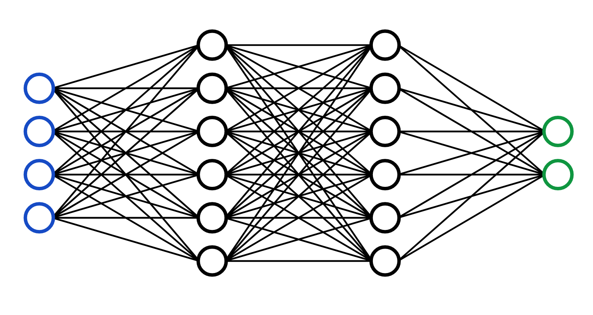
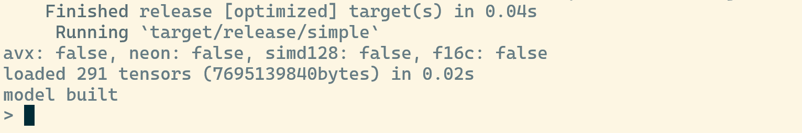
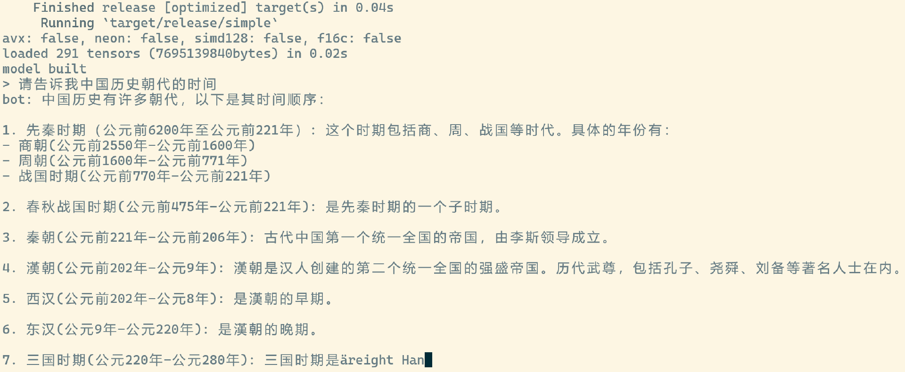

# 23 | Rust与大模型：用Candle做一个聊天机器人

你好，我是 Mike。今天我们来聊一聊如何用 Rust 做一个基于大语言模型的聊天机器人。

大语言模型（LLM）是 2023 年最火的领域，没有之一。这波热潮是由 OpenAI 的 ChatGPT在今年上半年发布后引起的，之后全世界的研究机构和科技公司都卷入了大模型的竞争中。目前业界应用大模型训练及推理的主要语言是 Python 和 C/C++。Python 一般用来实现上层框架，而 C/C++ 一般起底层高性能执行的作用，比如著名的框架 PyTorch，它的上层业务层面是用 Python 写的，下层执行层面由 C 执行，因为 GPU 加速的部分只能由 C/C++ 来调用。

看起来大语言模型好像和 Rust 没什么关系，必须承认，由于历史积累的原因，在 AI 这一块儿Rust 的影响力还非常小。但从另一方面来讲呢，Rust 是目前业界除 Python、C++ 外，唯一有潜力在未来 20 年的 AI 发展中发挥重要作用的语言了。为什么这么说呢？

首先 Rust 的性能与 C/C++ 一致，并且在调用 GPU 能力方面也同样方便；其次，Rust 强大的表达能力，不输于 Python，这让人们使用 Rust 做业务并不难；然后，Rust 的 cargo 编译成单文件的能力，以及对 WebAssembly 完善的支持，部署应用的时候非常方便，这比 Py +C/C++ 组合需要安装的一堆依赖和数 G 的库方便太多。

目前 Rust 生态中其实已经有很多 AI 相关的基础设施了，你可以从我给出的链接里找到。

世界上最大的机器学习模型仓库平台 HuggingFace（机器学习领域的 Github） 推出了 Rust机器学习框架 Candle。在这个官方代码仓库上，HuggingFace 上解释了为什么要做一个Rust 的机器学习框架。

1. Candle 上云端的 Serverless 推理可行。PyTorch 那一套体积太大，安装完得几个 G，而Candle 编译后的可执行文件才十几 M 到几十 M。

2. Candle 可以让你避免 Python 的 GIL，从而提高性能。

3. HuggingFace 已经用 Rust 写了不少基础工具了，比如 safetensors 和 tokenizers。

Elon Musk 的 x.ai 发布后，页面上也有一段对 Rust 的溢美之词：Rust 被证明是一个理想的选择，用于构建可扩展的、可靠的、可维护性的基础设施。它提供了高性能、丰富的生态系统，它能阻止大部分错误，这些错误在分布式系统中经常会碰到。由于我们的团队规模很小，基础设施的可靠性就显得至关重要，否则维护工作会浪费大量创新的时间。Rust 给我们提供了信心，任何的代码修改或重构都可以产出可工作的程序，并且在最小监管下可以持续运行好几个月（而不会出问题）。

Musk 甚至说 Rust 语言是未来构建 AGI 的语言。

在使用 Rust 尝试做聊天机器人之前，我们先来了解一下相关的背景知识。

## 大语言模型背景知识

这节课我们还是主要讲 Rust 及 Rust 的应用，所以相关的背景知识我们就简单概括一下。

机器学习（Machine Learning，ML）泛指用计算机对数据集按照一定的算法进行数据处理、分析、聚类、回归等。在执行前，人往往不知道结果是什么，所以叫机器学习。机器学习可以用于自动提取信息，自动或辅助人类做决策。

而神经网络（Neural Network）是机器学习的一类算法，它是模拟人的大脑神经元和连接的一种算法。目前整个业界投入资源最多的就是在这类算法上面，在这个类别中的创新也是最多的，有种观点认为神经网络算法是通向真正的 AI 最可能正确的路径。



- 图片来源：https://victorzhou.com/media/nn-series/network.svg

而深度学习（Deep Learning），其实就是层次很多很深的神经网络。你可以想象，层次越深，节点数（图里那些圈）越多，就越能模拟大脑。但是深度学习带来的问题就是，层次越深，节点数越多，则那些线（就是权重值）就会越多，呈指数级增长，那么计算量就会越来越大。其实之前十几、二十年 AI 进展不大，主要就是因为这个计算能力限制了。

通过无数人的探索，我们发现可以把深度学习的计算并行化，优化了很多工程上的算法。这样就能够在大家熟悉的主要用来玩游戏的 GPU 显卡上运行，大大提高了计算速度。这个视角，二十多年前 Nvidia 的老黄就看明白了，早早地提供好了基础设施，CUDA、CUDNN 等。所以现在你就看到了，一卡难求，已经严重影响到了游戏玩家的生存。

### ChatGPT 与 LLaMA

那么 ChatGPT 是什么呢？英文是 Chat Generative Pre-trained Transformer，是 OpenAI 提供的在线 AI 对话服务，具有令人惊叹的理解能力和回答能力。你可以把 ChatGPT 理解成一个为对话调优的预训练转换模型。GPT 3 有 1750 亿参数，有传言 GPT 4 有 1.76 万亿参数。参数是什么，就是图中节点之间的连线，你可以想象一下 1750 亿根线的场景。

OpenAI 搞出了 ChatGPT，让全世界惊掉了下巴，但是它是闭源的。于是 Meta 公司（前Facebook）的 Yann LeCun（图灵奖得主）团队，搞了一个开源版本的 GPT，叫 LLaMA。它也是在巨量的源数据集上进行的训练，生成了 70 亿（7B），130 亿（13B），650 亿（65B）三个版本参数的大模型文件，可以供业界做学习和研究使用。现在已推出 LLaMA 2，正在做LLaMA 3。

LLaMA 搞出来后，掀起了 LLM 界的狂欢。全世界的团队在 LLaMA 的基础上，继续调优，推出了各种各样的大模型。比如国内清华的 ChatGLM, 零一万物的 Yi。国外的 Mistral、OpenChat、Starling 等。这块儿非常卷，大家都在争相推出自己调优后的版本，每天早上睡醒起来，都发现又推出了几个新的 LLM。

这些训练好后的文件一般从几个 G 到几十 G 不等，也有几百 G 的。要运行它们，得有非常强大的机器才行。比如 7B 的 LLaMA 2 文件，每个权重为一个 f16 浮点数，占两个字节，所以可以估算出要运行 LLaMA 2 模型，起码得有 14G 的内存或显存。内存还好，显存超过 14G的个人用户真不多。并且，LLaMA2 的模型文件是 PyTorch 导出的，只能由 PyTorch 框架来运行。

### llama.cpp 与量子化方法

车到山前必有路，大神 Georgi Gerganov 搞了一个项目：llama.cpp。它是一个用 C/C++ 重新实现引擎的版本，不需要安装 PyTorch，就可以运行 LLaMA 2 模型文件。最关键的是，它提出了一种量子化（quantization）方法，可以将权重从 16 位量子化到 8 位、6 位、5 位、4位，甚至 2 位。这样，就相当于等比缩小了占用内存的规模。比如，一个 4 位量子化版本的LLaMA 2 7B 模型，就只需要不到 4G 的内存 / 显存就能运行。这样，就能适配大多数的个人计算机了。

这种量子化方法是个重大创新，它直接促进了 LLM 生态的进一步繁荣。现在 HuggingFace 上有大量量子化后的模型，比如 openchat_3.5.Q4_K_M.gguf 就是一个 OpenChat 的 4 位量子化的版本。我们下载的时候，直接下载这些量子化后的模型文件就可以了。

请注意，这些文件是训练后的成品，我们下载它是用来做推理（infer）的，而不是训练（train）的。当然，我们可以在这些成品模型上运行调优（fine tune）。

### 大模型文件格式

目前 HuggingFace 上有几种常见的 LLM 文件格式。

- bin 格式：Pytorch 导出的模型文件格式

- safetensors 格式：HuggingFace 定义的一种新的模型文件格式，有可能成为未来的主流格式。HuggingFace 用 Rust 实现 safetensors 格式的解析，并导出为 Py 接口，请参见链接。

- ggml 格式：llama.cpp 项目量子化模型的前期模型格式。

- gguf 格式：llama.cpp 项目量子化模型的后期模型格式，也是现在主流的量子化 LLM 格式。

### Rust 的机器学习框架

Rust 生态现在有几个比较不错的 ML 框架，最好的两个是：Candle 和 burn。后续，我们以 Candle 为例来介绍。

## Candle 介绍

据 Candle 官网介绍，它是一个极小主义机器学习框架，也就是没什么依赖，不像 Pytorch 那样装一堆东西，部署起来很麻烦。但其实它也能用来训练。

它有下面这些特性：

- HuggingFace 出品。近水楼台先得月，Candle 几乎能支持 HuggingFace 上所有的模型（有的需要经过转换）。

- 语法简单，跟 PyTorch 差不多。

- CPU、Cuda、Metal 的支持。

- 让 serverless 和快速部署成为可能。

- 模型训练。

- 分布式计算（通过 NCCL）。

- 开箱即用的模型支持，LLaMA、Whisper、 Falcon 等等。

Candle 不仅仅是大模型深度学习框架，它还是一个机器学习框架，因此它也支持其他的机器学习算法和强化学习（reinforcement learning）。下面我们就来看看如何利用 Candle 框架做一个聊天机器人。

注：这节课的代码适用于 candle_core v0.3 版本。

## 使用 Candle 做一个聊天机器人

### 下载模型文件

我对一些大模型进行了测试，发现 OpenChat 的对话效果比较好，所以下面我们用 OpenChatLLM 来进行展示。我们会用 quantized 8bit 的版本。其实 4bit 的版本也是可以的，效果也非常好。

Candle 官方的示例比较复杂，我为这个课程定制了一个更简单的独立运行的示例。你可以将这个仓库克隆下来，进入目录。在运行代码之前，下载模型文件和 tokenizer.json 文件。

- 与代码目录同级的位置，创建一个目录

```bash
mkdir hf_hub
```

- 进入这个目录，请下载

```
https://huggingface.co/TheBloke/openchat_3.5-GGUF/blob/main/openchat_3.5.Q8_0.ggu
```

- 和

```
https://huggingface.co/openchat/openchat_3.5/blob/main/tokenizer.json
将这个 tokenizer.json 重命名为 openchat_3.5_tokenizer.json
```

目录结构：

```
23-candle_chat/
   Cargo.toml
   src/
hf_hub/
   openchat_3.5_tokenizer.json
   openchat_3.5.Q8_0.gguf
```

### 运行演示

然后，进入 23-candle_chat/ 运行：

```
cargo run --release --bin simple
```

出现如下界面，就可以聊天了。



下面是我问的一个问题，bot 的回答好像有点问题，这个模型用英文问的效果会好一些。



### 代码讲解

你可以看一下代码。

```javascript
#![allow(unused)]
use std::fs::File;
use std::io::Write;
use std::path::PathBuf;
use tokenizers::Tokenizer;
use candle_core::quantized::gguf_file;
use candle_core::utils;
use candle_core::{Device, Tensor};
use candle_transformers::generation::LogitsProcessor;
use candle_transformers::models::quantized_llama as quantized_model;
use anyhow::Result;
mod token_output_stream;
use token_output_stream::TokenOutputStream;
struct Args {
   tokenizer: String,
   model: String,
   sample_len: usize,
   temperature: f64,
   seed: u64,
   repeat_penalty: f32,
   repeat_last_n: usize,
   gqa: usize,
}
impl Args {
   fn tokenizer(&self) -> Result<Tokenizer> {
       let tokenizer_path = PathBuf::from(&self.tokenizer);
       Tokenizer::from_file(tokenizer_path).map_err(anyhow::Error::msg)
   }
   fn model(&self) -> Result<PathBuf> {
       Ok(std::path::PathBuf::from(&self.model))
   }
}
fn main() -> anyhow::Result<()> {
   println!(
       "avx: {}, neon: {}, simd128: {}, f16c: {}",
       utils::with_avx(),
       utils::with_neon(),
       utils::with_simd128(),
       utils::with_f16c()
   );
   let args = Args {
       tokenizer: String::from("../hf_hub/openchat_3.5_tokenizer.json"),
       model: String::from("../hf_hub/openchat_3.5.Q8_0.gguf"),
       sample_len: 1000,
       temperature: 0.8,
       seed: 299792458,
       repeat_penalty: 1.1,
       repeat_last_n: 64,
       gqa: 8,
   };
   // load model
   let model_path = args.model()?;
   let mut file = File::open(&model_path)?;
   let start = std::time::Instant::now();
   // This is the model instance
   let model = gguf_file::Content::read(&mut file)?;
   let mut total_size_in_bytes = 0;
   for (_, tensor) in model.tensor_infos.iter() {
       let elem_count = tensor.shape.elem_count();
       total_size_in_bytes +=
           elem_count * tensor.ggml_dtype.type_size() / tensor.ggml_dtype.blck_s
   }
   println!(
       "loaded {:?} tensors ({}bytes) in {:.2}s",
       model.tensor_infos.len(),
       total_size_in_bytes,
       start.elapsed().as_secs_f32(),
   );
   let mut model = quantized_model::ModelWeights::from_gguf(model, &mut file)?;
   println!("model built");
   // load tokenizer
   let tokenizer = args.tokenizer()?;
   let mut tos = TokenOutputStream::new(tokenizer);
   // left for future improvement: interactive
   for prompt_index in 0.. {
       print!("> ");
       std::io::stdout().flush()?;
       let mut prompt = String::new();
       std::io::stdin().read_line(&mut prompt)?;
       if prompt.ends_with('\n') {
           prompt.pop();
           if prompt.ends_with('\r') {
               prompt.pop();
           }
       }
       let prompt_str = format!("User: {prompt} <|end_of_turn|> Assistant: ");
       print!("bot: ");
       let tokens = tos
           .tokenizer()
           .encode(prompt_str, true)
           .map_err(anyhow::Error::msg)?;
       let prompt_tokens = tokens.get_ids();
       let mut all_tokens = vec![];
       let mut logits_processor = LogitsProcessor::new(args.seed, Some(args.temp
       let start_prompt_processing = std::time::Instant::now();
       let mut next_token = {
           let input = Tensor::new(prompt_tokens, &Device::Cpu)?.unsqueeze(0)?;
           let logits = model.forward(&input, 0)?;
           let logits = logits.squeeze(0)?;
           logits_processor.sample(&logits)?
       };
       let prompt_dt = start_prompt_processing.elapsed();
       all_tokens.push(next_token);
       if let Some(t) = tos.next_token(next_token)? {
           print!("{t}");
           std::io::stdout().flush()?;
       }
       let eos_token = "<|end_of_turn|>";
       let eos_token = *tos.tokenizer().get_vocab(true).get(eos_token).unwrap();
       let start_post_prompt = std::time::Instant::now();
       let to_sample = args.sample_len.saturating_sub(1);
       let mut sampled = 0;
       for index in 0..to_sample {
           let input = Tensor::new(&[next_token], &Device::Cpu)?.unsqueeze(0)?;
           let logits = model.forward(&input, prompt_tokens.len() + index)?;
           let logits = logits.squeeze(0)?;
           let logits = if args.repeat_penalty == 1. {
               logits
           } else {
               let start_at = all_tokens.len().saturating_sub(args.repeat_last_n
               candle_transformers::utils::apply_repeat_penalty(
                   &logits,
                   args.repeat_penalty,
                   &all_tokens[start_at..],
               )?
           };
           next_token = logits_processor.sample(&logits)?;
           all_tokens.push(next_token);
           if let Some(t) = tos.next_token(next_token)? {
               print!("{t}");
               std::io::stdout().flush()?;
           }
           sampled += 1;
           if next_token == eos_token {
               break;
           };
       }
       if let Some(rest) = tos.decode_rest().map_err(candle_core::Error::msg)? {
           print!("{rest}");
       }
       std::io::stdout().flush()?;
       let dt = start_post_prompt.elapsed();
       println!(
           "\n\n{:4} prompt tokens processed: {:.2} token/s",
           prompt_tokens.len(),
           prompt_tokens.len() as f64 / prompt_dt.as_secs_f64(),
       );
       println!(
           "{sampled:4} tokens generated: {:.2} token/s",
           sampled as f64 / dt.as_secs_f64(),
       );
   }
   Ok(())
}
```

我们分段讲解这 100 多行代码。

第 19 行，定义了 Args 参数，这是模型必要的参数配置定义。第 42～48 行，看看有哪些CPU 特性支持。第 50～59 行，实例化 Args，这些参数都是硬编码进去的，除了两个文件的路径外，需要 LLM 相关知识才能理解。

第 62～81 行，加载大模型文件，并生成模型对象。我们这个模型是 GGUF 格式的，因此需要用 gguf_file 模块来读。Tensor 是 LLM 中的重要概念，它是一个多维数组，可以在 CPU 和GPU 上计算，在 GPU 上还可以并行计算。一个大模型由很多的 Tensor 组成。我们这个模型中，加载进来了 291 个 Tensor。

第 84 行，加载 tokenizer.json 文件，并生成 tokenizer 实例。tokenizer 用于将输入和输出的文本转化为 Tensor，变成大模型可理解的数据。第 85 行创建 token 输出流实例。第 89～99

```
行，建立问答界面，输入提示符为一个 > 号，输出为 bot: 开头。第 101～104 行将输入的问
```

答转化为 tokens。这个 tokens 就是 Tensor 实例。

第 106～122 行，是用于处理输入，大模型对输入的 token 做一处理，你可以理解成大模型对你的输入问题先要进行一下理解，然后后面才能做出对应的回答。

LogitsProcessor 是一个用于修改模型输出概率分布的工具。我们可以看到，这个过程中使用的设备写死了，用的 CPU。

```
第 124 行，"<|end_of_turn|>" 是 OpenChat 模式定义的一轮对话结束的标志。第 125～
```

156 行，就是对问题的回答。用的设备仍然为 CPU，我们可以猜测应该会很慢。它这里面还有对 penalty 机制的处理。细节也需要去查阅大模型 NLP 相关的知识。

第 158～167 行，是对本次处理性能的一个汇总。在我的电脑上，纯用 CPU 计算的话，只能达到 1 秒一个多 token 的速度，非常卡。有 GPU 加持的话，会快很多。

你可能发现了，第 87 行有个循环，它是用来实现 interactive 交互效果的，问完一句，回答完，还可以问下一句。

### 添加命令行参数

前面的 simple 示例，我们所有的参数都是写死在代码里面的。这样方便理解，但不方便使用。我们可以尝试为它添加命令行参数功能。

在 Rust 中，写一个命令行非常简单，直接用 clap，改几行代码就可以了。将上面示例中的

```
Args 结构体的定义变成下面这样就可以了，然后在调用的时候使用 Args::parse() 生成
```

Args 实例。

```javascript
#[derive(Parser, Debug)]
#[command(author, version, about, long_about = None)]
struct Args {
   #[arg(long, default_value = "../hf_hub/openchat_3.5_tokenizer.json")]
   tokenizer: String,
   #[arg(long, default_value = "../hf_hub/openchat_3.5.Q8_0.gguf")]
   model: String,
   #[arg(short = 'n', long, default_value_t = 1000)]
   sample_len: usize,
   #[arg(long, default_value_t = 0.8)]
   temperature: f64,
   #[arg(long, default_value_t = 299792458)]
   seed: u64,
   #[arg(long, default_value_t = 1.1)]
   repeat_penalty: f32,
   #[arg(long, default_value_t = 64)]
   repeat_last_n: usize,
   #[arg(long, default_value_t = 8)]
   gqa: usize,
}
fn main() {
   // ...
   let args = Args::parse();
   // ...
}
```

经过升级的命令有了下面这些参数：

```
$ cargo run --release --bin cli -- --help
   Finished release [optimized] target(s) in 0.04s
    Running `target/release/cli --help`
avx: false, neon: false, simd128: false, f16c: false
Usage: cli [OPTIONS]
Options:
     --tokenizer <TOKENIZER>            [default: ../hf_hub/openchat_3.5_tokeniz
     --model <MODEL>                    [default: ../hf_hub/openchat_3.5.Q8_0.gg
 -n, --sample-len <SAMPLE_LEN>          [default: 1000]
     --temperature <TEMPERATURE>        [default: 0.8]
     --seed <SEED>                      [default: 299792458]
     --repeat-penalty <REPEAT_PENALTY>  [default: 1.1]
     --repeat-last-n <REPEAT_LAST_N>    [default: 64]
     --gqa <GQA>                        [default: 8]
 -h, --help                             Print help
 -V, --version                          Print version
```

是不是很方便？谁说 Rust 生产力不行的！

点击这里可以找到源文件，你可以本地试试跑起一个大模型对话机器人。另外，Candle 官方仓库中的示例功能更强大，但也更复杂，你可以继续深入研究。

## 小结

这节课我们一起探索了使用 Rust 利用 Candle 机器学习框架开发一个大模型聊天机器人的应用。Rust 目前在 AI 界虽然还不够有影响力，但是未来是相当有潜力的，这也是为什么HuggingFace 带头出一个 Rust 机器学习框架的原因。

不过这节课我们只是讲了怎么用起来，而如果要深入下去的话，机器学习、深度学习的基础知识就必不可少了。如果你有时间精力的话，你可以深入下去好好补充一下这方面的学术知识，毕竟未来几十年，AI 是一个主要问题，也会是一个主要机会。目前 AI 发展速度太快了，有种学习跟不上业界发展速度的感觉。但是不管怎样，学好基础，永远不会过时。

另外，Rust AI 这块儿，虽然已经小有起色，但是作为生态来讲，空白处还很多。所以这也正是学好 Rust 的机会，Rust 可以在 AI 基建这块做大量的工作，这些工作可以服务于 Rust 社区，也可以服务于 Python 乃至整个 AI 社区。

## 思考题

你可以在我的示例上继续捣鼓，添加 GPU 的支持，在 Linux、Windows、macOS 多种平台上测试一下。欢迎你在评论区贴出你自己的代码，也欢迎你把这节课分享给其他朋友，我们下节课再见！
