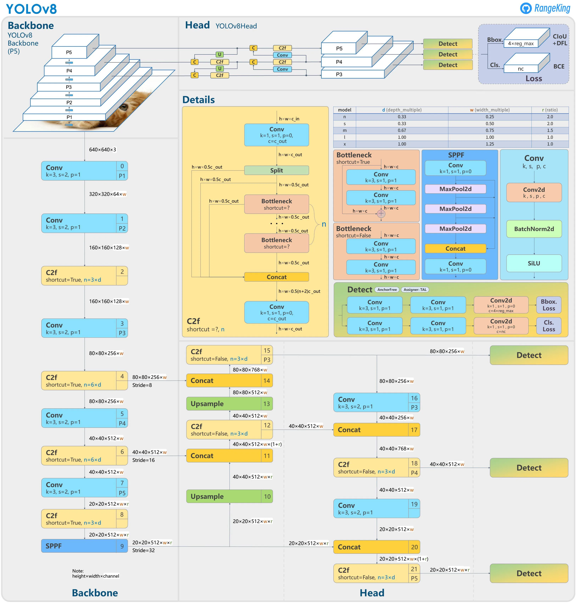
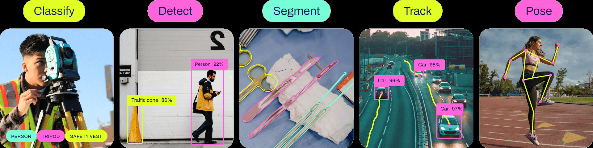
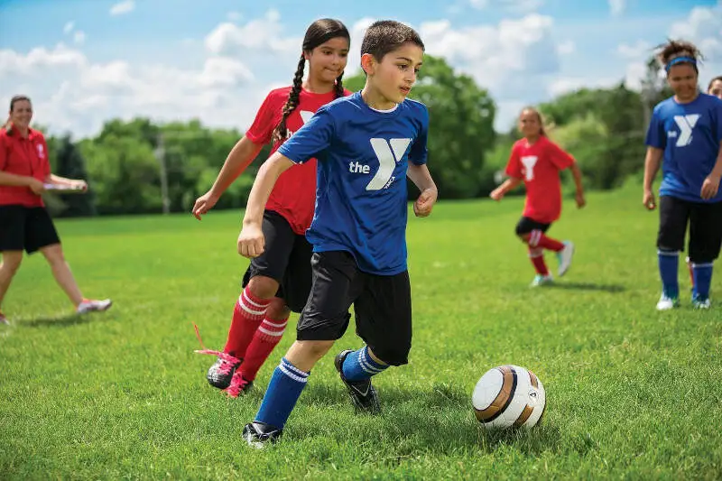
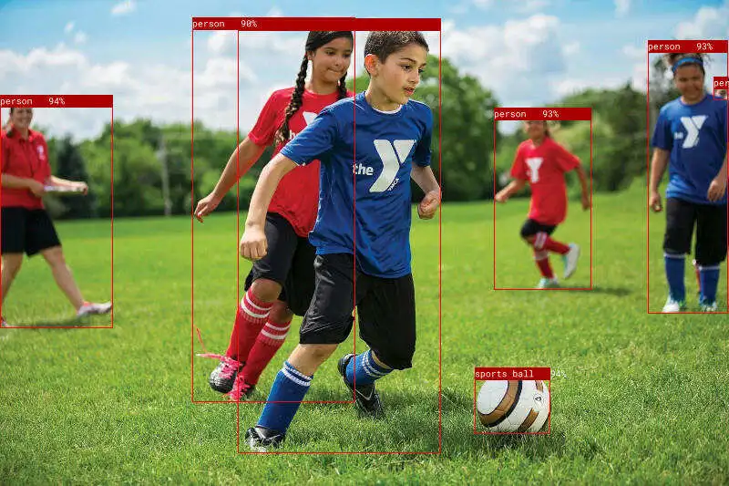
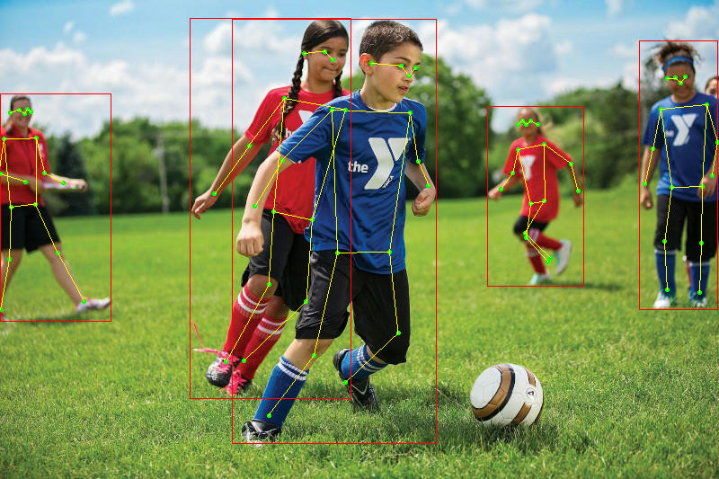

# 24 | Rust图像识别：利用YOLOv8识别对象

你好，我是 Mike。这节课我们来学习如何使用 Rust 对图片中的对象进行识别。

图像识别是计算机视觉领域中的重要课题，而计算机视觉又是 AI 的重要组成部分，相当于 AI的眼睛。目前图像识别领域使用最广泛的框架是 YOLO，现在已经迭代到了 v8 版本。而基于Rust 机器学习框架 Candle，可以方便地实现 YOLOv8 算法。因此，这节课我们继续使用Candle 框架来实现图片的识别。

Candle 框架有一个示例，演示了 YOLOv8 的一个简化实现。我在此基础上，将这个源码中的示例独立出来，做成了一个单独的项目，方便你学习（查看代码地址）。

注：这节课的代码适用于 candle_core v0.3 版本。

## YOLO 简介

YOLO（You Only Look Once）是一种目标检测算法，它可以在一次前向传递中检测出图像中的所有物体的位置和类别。因为只需要看一次，YOLO 被称为 Region-free 方法，相比于Region-based 方法，YOLO 不需要提前找到可能存在目标的区域（Region）。YOLO 在 2016年被提出，发表在计算机视觉顶会 CVPR（Computer Vision and Pattern Recognition）上。YOLO 对整个图片进行预测，并且它会一次性输出所有检测到的目标信息，包括类别和位置。

YOLO 也使用神经网络进行图像识别，一般来说，如果是推理的话，我们需要一个神经网络的预训练模型文件。下面你会看到，在运行示例的时候，会自动从 HuggingFace 下载对应的预训练模型。

YOLOv8 的模型结构比起之前的版本，会复杂一些，我们来看一下官方整理的图片。



- 图片来源：https://github.com/ultralytics/ultralytics/issues/189

这节课我们主要是去使用，不展开关于这个模型的讲解。目前官方的预训练模型分成 5 个。

- N：nano。模型最小。探测速度最快，精度最低。

- S：small，模型比 nano 大。

- M：middle，模型比 small 大。

- L：large，模型比 middle 大，比 x 小。

- X：extra large，模型最大。探测速度最慢，精度最高。

在下面的示例中，我们可以通过参数来指定选择哪个模型。

## YOLOv8 的能力

YOLO 发展到第 8 代已经很强大了。它可以对图像做分类、探测、分段、轨迹、姿势等。



- 图片来源：https://raw.githubusercontent.com/ultralytics/assets/main/im/banner-tasks.png

了解了 YOLO 的能力，下面我们开始实际用起来。

## 动手实验

下载源码：

```bash
git clone https://github.com/miketang84/jikeshijian
cd jikeshijian/24-candle_yolov8
```

### 物体探测

假设我们有这样一张图片。



编译运行下面这行代码。

```
cargo run --release -- assets/football.jpg --which m
```

请注意，这个运行过程中，会联网从 HuggingFace 上下载模型文件，需要科学上网环境。

运行输出：

```
$ cargo run --release -- assets/football.jpg --which m
ProxyChains-3.1 (http://proxychains.sf.net)
   Finished release [optimized] target(s) in 0.08s
    Running `target/release/candle_demo_yolov8 assets/football.jpg --which m`
Running on CPU, to run on GPU, build this example with `--features cuda`
model loaded
processing assets/football.jpg
generated predictions Tensor[dims 84, 5460; f32]
person: Bbox { xmin: 0.15629578, ymin: 81.735344, xmax: 99.46689, ymax: 281.7202,
person: Bbox { xmin: 433.88196, ymin: 92.59643, xmax: 520.25476, ymax: 248.76715,
person: Bbox { xmin: 569.20465, ymin: 34.737877, xmax: 639.8049, ymax: 269.4999,
person: Bbox { xmin: 209.33649, ymin: 16.313568, xmax: 388.09424, ymax: 388.7763,
person: Bbox { xmin: 169.212, ymin: 15.2717285, xmax: 312.59946, ymax: 345.16046,
person: Bbox { xmin: 626.709, ymin: 65.91608, xmax: 639.791, ymax: 86.72856, conf
sports ball: Bbox { xmin: 417.45734, ymin: 315.16333, xmax: 484.62384, ymax: 372.
writing "assets/football.pp.jpg"
```

在 assets 目录下生成 football.pp.jpg 文件，打开后效果如下：



可以看到，Yolo 正确识别了 6 个人，和一个运动球。

### 姿势探测

我们来看一下，对同一张图片，运行姿势探测的效果。

```
cargo run --release -- assets/football.jpg --which m --task pose
```

我们的工具在 assets 目录下生成 football.pp.jpg 文件，打开后效果如下：



效果是不是很 cool。下面我们详细解释一下这次实战的代码。

## 源码解释

YOLOv8 神经网络模型的原理比较复杂，这节课我们主要讲解这个示例中 Rust 的用法，从中可以学到不少 Rust 相关知识。

```javascript
// #[cfg(feature = "mkl")]
// extern crate intel_mkl_src;
// #[cfg(feature = "accelerate")]
// extern crate accelerate_src;
mod model;
use model::{Multiples, YoloV8, YoloV8Pose};
mod coco_classes;
use candle_core::utils::{cuda_is_available, metal_is_available};
use candle_core::{DType, Device, IndexOp, Result, Tensor};
use candle_nn::{Module, VarBuilder};
use candle_transformers::object_detection::{non_maximum_suppression, Bbox, KeyPoi
use clap::{Parser, ValueEnum};
use image::DynamicImage;
// Keypoints as reported by ChatGPT :)
// Nose
// Left Eye
// Right Eye
// Left Ear
// Right Ear
// Left Shoulder
// Right Shoulder
// Left Elbow
// Right Elbow
// Left Wrist
// Right Wrist
// Left Hip
// Right Hip
// Left Knee
// Right Knee
// Left Ankle
// Right Ankle
const KP_CONNECTIONS: [(usize, usize); 16] = [
   (0, 1),
   (0, 2),
   (1, 3),
   (2, 4),
   (5, 6),
   (5, 11),
   (6, 12),
   (11, 12),
   (5, 7),
   (6, 8),
   (7, 9),
   (8, 10),
   (11, 13),
   (12, 14),
   (13, 15),
   (14, 16),
];
// 获取设备，Cpu还是Cuda或Metal
pub fn get_device(cpu: bool) -> Result<Device> {
   if cpu {
       Ok(Device::Cpu)
   } else if cuda_is_available() {
       Ok(Device::new_cuda(0)?)
   } else if metal_is_available() {
       Ok(Device::new_metal(0)?)
   } else {
       #[cfg(all(target_os = "macos", target_arch = "aarch64"))]
       {
           println!(
               "Running on CPU, to run on GPU(metal), build this example with `-
           );
       }
       #[cfg(not(all(target_os = "macos", target_arch = "aarch64")))]
       {
           println!("Running on CPU, to run on GPU, build this example with `--f
       }
       Ok(Device::Cpu)
   }
}
// 报告对象探测的结果，以及用图像处理工具在图上画出来标注
pub fn report_detect(
   pred: &Tensor,
   img: DynamicImage,
   w: usize,
   h: usize,
   confidence_threshold: f32,
   nms_threshold: f32,
   legend_size: u32,
) -> Result<DynamicImage> {
   let pred = pred.to_device(&Device::Cpu)?;
   let (pred_size, npreds) = pred.dims2()?;
   let nclasses = pred_size - 4;
   let mut bboxes: Vec<Vec<Bbox<Vec<KeyPoint>>>> = (0..nclasses).map(|_| vec![])
   // 选出符合置信区间的结果
   for index in 0..npreds {
       let pred = Vec::<f32>::try_from(pred.i((.., index))?)?;
       let confidence = *pred[4..].iter().max_by(|x, y| x.total_cmp(y)).unwrap()
       if confidence > confidence_threshold {
           let mut class_index = 0;
           for i in 0..nclasses {
               if pred[4 + i] > pred[4 + class_index] {
                   class_index = i
               }
           }
           if pred[class_index + 4] > 0. {
               let bbox = Bbox {
                   xmin: pred[0] - pred[2] / 2.,
                   ymin: pred[1] - pred[3] / 2.,
                   xmax: pred[0] + pred[2] / 2.,
                   ymax: pred[1] + pred[3] / 2.,
                   confidence,
                   data: vec![],
               };
               bboxes[class_index].push(bbox)
           }
       }
   }
   non_maximum_suppression(&mut bboxes, nms_threshold);
   // 在原图上标注，并打印标注的框的信息
   let (initial_h, initial_w) = (img.height(), img.width());
   let w_ratio = initial_w as f32 / w as f32;
   let h_ratio = initial_h as f32 / h as f32;
   let mut img = img.to_rgb8();
   let font = Vec::from(include_bytes!("roboto-mono-stripped.ttf") as &[u8]);
   let font = rusttype::Font::try_from_vec(font);
   for (class_index, bboxes_for_class) in bboxes.iter().enumerate() {
       for b in bboxes_for_class.iter() {
           println!("{}: {:?}", coco_classes::NAMES[class_index], b);
           let xmin = (b.xmin * w_ratio) as i32;
           let ymin = (b.ymin * h_ratio) as i32;
           let dx = (b.xmax - b.xmin) * w_ratio;
           let dy = (b.ymax - b.ymin) * h_ratio;
           if dx >= 0. && dy >= 0. {
               imageproc::drawing::draw_hollow_rect_mut(
                   &mut img,
                   imageproc::rect::Rect::at(xmin, ymin).of_size(dx as u32, dy a
                   image::Rgb([255, 0, 0]),
               );
           }
           if legend_size > 0 {
               if let Some(font) = font.as_ref() {
                   imageproc::drawing::draw_filled_rect_mut(
                       &mut img,
                       imageproc::rect::Rect::at(xmin, ymin).of_size(dx as u32,
                       image::Rgb([170, 0, 0]),
                   );
                   let legend = format!(
                       "{}   {:.0}%",
                       coco_classes::NAMES[class_index],
                       100. * b.confidence
                   );
                   imageproc::drawing::draw_text_mut(
                       &mut img,
                       image::Rgb([255, 255, 255]),
                       xmin,
                       ymin,
                       rusttype::Scale::uniform(legend_size as f32 - 1.),
                       font,
                       &legend,
                   )
               }
           }
       }
   }
   Ok(DynamicImage::ImageRgb8(img))
}
// 报告姿态探测的结果，以及用图像处理工具在图上画出来标注
pub fn report_pose(
   pred: &Tensor,
   img: DynamicImage,
   w: usize,
   h: usize,
   confidence_threshold: f32,
   nms_threshold: f32,
) -> Result<DynamicImage> {
   let pred = pred.to_device(&Device::Cpu)?;
   let (pred_size, npreds) = pred.dims2()?;
   if pred_size != 17 * 3 + 4 + 1 {
       candle_core::bail!("unexpected pred-size {pred_size}");
   }
   let mut bboxes = vec![];
   // 选出符合置信区间的结果
   for index in 0..npreds {
       let pred = Vec::<f32>::try_from(pred.i((.., index))?)?;
       let confidence = pred[4];
       if confidence > confidence_threshold {
           let keypoints = (0..17)
               .map(|i| KeyPoint {
                   x: pred[3 * i + 5],
                   y: pred[3 * i + 6],
                   mask: pred[3 * i + 7],
               })
               .collect::<Vec<_>>();
           let bbox = Bbox {
               xmin: pred[0] - pred[2] / 2.,
               ymin: pred[1] - pred[3] / 2.,
               xmax: pred[0] + pred[2] / 2.,
               ymax: pred[1] + pred[3] / 2.,
               confidence,
               data: keypoints,
           };
           bboxes.push(bbox)
       }
   }
   let mut bboxes = vec![bboxes];
   non_maximum_suppression(&mut bboxes, nms_threshold);
   let bboxes = &bboxes[0];
   // 在原图上标注，并打印标注的框和姿势的信息
   let (initial_h, initial_w) = (img.height(), img.width());
   let w_ratio = initial_w as f32 / w as f32;
   let h_ratio = initial_h as f32 / h as f32;
   let mut img = img.to_rgb8();
   for b in bboxes.iter() {
       println!("{b:?}");
       let xmin = (b.xmin * w_ratio) as i32;
       let ymin = (b.ymin * h_ratio) as i32;
       let dx = (b.xmax - b.xmin) * w_ratio;
       let dy = (b.ymax - b.ymin) * h_ratio;
       if dx >= 0. && dy >= 0. {
           imageproc::drawing::draw_hollow_rect_mut(
               &mut img,
               imageproc::rect::Rect::at(xmin, ymin).of_size(dx as u32, dy as u3
               image::Rgb([255, 0, 0]),
           );
       }
       for kp in b.data.iter() {
           if kp.mask < 0.6 {
               continue;
           }
           let x = (kp.x * w_ratio) as i32;
           let y = (kp.y * h_ratio) as i32;
           imageproc::drawing::draw_filled_circle_mut(
               &mut img,
               (x, y),
               2,
               image::Rgb([0, 255, 0]),
           );
       }
       for &(idx1, idx2) in KP_CONNECTIONS.iter() {
           let kp1 = &b.data[idx1];
           let kp2 = &b.data[idx2];
           if kp1.mask < 0.6 || kp2.mask < 0.6 {
               continue;
           }
           imageproc::drawing::draw_line_segment_mut(
               &mut img,
               (kp1.x * w_ratio, kp1.y * h_ratio),
               (kp2.x * w_ratio, kp2.y * h_ratio),
               image::Rgb([255, 255, 0]),
           );
       }
   }
   Ok(DynamicImage::ImageRgb8(img))
}
// 选择模型尺寸
#[derive(Clone, Copy, ValueEnum, Debug)]
enum Which {
   N,
   S,
   M,
   L,
   X,
}
// 对象探测任务还是姿势探测任务
#[derive(Clone, Copy, ValueEnum, Debug)]
enum YoloTask {
   Detect,
   Pose,
}
// 命令行参数定义，基于Clap
#[derive(Parser, Debug)]
#[command(author, version, about, long_about = None)]
pub struct Args {
   /// 是否运行在CPU上面
   #[arg(long)]
   cpu: bool,
   /// 是否记录日志
   #[arg(long)]
   tracing: bool,
   /// 模型文件路径
   #[arg(long)]
   model: Option<String>,
   /// 用哪一个模型
   #[arg(long, value_enum, default_value_t = Which::S)]
   which: Which,
   images: Vec<String>,
   /// 模型置信门槛
   #[arg(long, default_value_t = 0.25)]
   confidence_threshold: f32,
   /// non-maximum suppression的阈值
   #[arg(long, default_value_t = 0.45)]
   nms_threshold: f32,
   /// 要执行的任务
   #[arg(long, default_value = "detect")]
   task: YoloTask,
   /// 标注的字体的大小
   #[arg(long, default_value_t = 14)]
   legend_size: u32,
}
impl Args {
   fn model(&self) -> anyhow::Result<std::path::PathBuf> {
       let path = match &self.model {
           Some(model) => std::path::PathBuf::from(model),
           None => {
               let api = hf_hub::api::sync::Api::new()?;
               let api = api.model("lmz/candle-yolo-v8".to_string());
               let size = match self.which {
                   Which::N => "n",
                   Which::S => "s",
                   Which::M => "m",
                   Which::L => "l",
                   Which::X => "x",
               };
               let task = match self.task {
                   YoloTask::Pose => "-pose",
                   YoloTask::Detect => "",
               };
               api.get(&format!("yolov8{size}{task}.safetensors"))?
           }
       };
       Ok(path)
   }
}
pub trait Task: Module + Sized {
   fn load(vb: VarBuilder, multiples: Multiples) -> Result<Self>;
   fn report(
       pred: &Tensor,
       img: DynamicImage,
       w: usize,
       h: usize,
       confidence_threshold: f32,
       nms_threshold: f32,
       legend_size: u32,
   ) -> Result<DynamicImage>;
}
// Yolov8为对象探测的类型载体
impl Task for YoloV8 {
   fn load(vb: VarBuilder, multiples: Multiples) -> Result<Self> {
       YoloV8::load(vb, multiples, /* num_classes=*/ 80)
   }
   fn report(
       pred: &Tensor,
       img: DynamicImage,
       w: usize,
       h: usize,
       confidence_threshold: f32,
       nms_threshold: f32,
       legend_size: u32,
   ) -> Result<DynamicImage> {
       report_detect(
           pred,
           img,
           w,
           h,
           confidence_threshold,
           nms_threshold,
           legend_size,
       )
   }
}
// YoloV8Pose为姿势探测的类型载体
impl Task for YoloV8Pose {
   fn load(vb: VarBuilder, multiples: Multiples) -> Result<Self> {
       YoloV8Pose::load(vb, multiples, /* num_classes=*/ 1, (17, 3))
   }
   fn report(
       pred: &Tensor,
       img: DynamicImage,
       w: usize,
       h: usize,
       confidence_threshold: f32,
       nms_threshold: f32,
       _legend_size: u32,
   ) -> Result<DynamicImage> {
       report_pose(pred, img, w, h, confidence_threshold, nms_threshold)
   }
}
// 主体运行逻辑
pub fn run<T: Task>(args: Args) -> anyhow::Result<()> {
   let device = get_device(args.cpu)?;
   // 选择模型尺寸，加载模型权重参数进来
   let multiples = match args.which {
       Which::N => Multiples::n(),
       Which::S => Multiples::s(),
       Which::M => Multiples::m(),
       Which::L => Multiples::l(),
       Which::X => Multiples::x(),
   };
   let model = args.model()?;
   let vb = unsafe { VarBuilder::from_mmaped_safetensors(&[model], DType::F32, &
   let model = T::load(vb, multiples)?;
   println!("model loaded");
   for image_name in args.images.iter() {
       println!("processing {image_name}");
       let mut image_name = std::path::PathBuf::from(image_name);
       let original_image = image::io::Reader::open(&image_name)?
           .decode()
           .map_err(candle_core::Error::wrap)?;
       let (width, height) = {
           let w = original_image.width() as usize;
           let h = original_image.height() as usize;
           if w < h {
               let w = w * 640 / h;
               //
               (w / 32 * 32, 640)
           } else {
               let h = h * 640 / w;
               (640, h / 32 * 32)
           }
       };
       let image_t = {
           let img = original_image.resize_exact(
               width as u32,
               height as u32,
               image::imageops::FilterType::CatmullRom,
           );
           let data = img.to_rgb8().into_raw();
           Tensor::from_vec(
               data,
               (img.height() as usize, img.width() as usize, 3),
               &device,
           )?
           .permute((2, 0, 1))?
       };
       let image_t = (image_t.unsqueeze(0)?.to_dtype(DType::F32)? * (1. / 255.))
       let predictions = model.forward(&image_t)?.squeeze(0)?;
       println!("generated predictions {predictions:?}");
       let image_t = T::report(
           &predictions,
           original_image,
           width,
           height,
           args.confidence_threshold,
           args.nms_threshold,
           args.legend_size,
       )?;
       image_name.set_extension("pp.jpg");
       println!("writing {image_name:?}");
       image_t.save(image_name)?
   }
   Ok(())
}
// 程序入口
pub fn main() -> anyhow::Result<()> {
   use tracing_chrome::ChromeLayerBuilder;
   use tracing_subscriber::prelude::*;
   let args = Args::parse();
   let _guard = if args.tracing {
       let (chrome_layer, guard) = ChromeLayerBuilder::new().build();
       tracing_subscriber::registry().with(chrome_layer).init();
       Some(guard)
   } else {
       None
   };
   match args.task {
       YoloTask::Detect => run::<YoloV8>(args)?,
       YoloTask::Pose => run::<YoloV8Pose>(args)?,
   }
Ok(())
```

我挑选里面一些重要的内容来讲解一下。

第 7～8 行，加载模型模块。YOLOv8 的模型实现都放在这里面，它在 Candle 的平台基础上实现了一个简易版本的 Darknet 神经网络引擎。第 9 行，加载 coco 数据集分类表。YOLOv8对数据分成 80 种类别。你可以打开 coco_classes.rs 文件查看。

第 11～14 行，引入 Candle 基础组件。第 15 行引用 clap 赋能命令行功能。这个在上一讲中已经讲过了。第 16 行引入 image crate。我们在这个例子里处理图片使用的是 image 和imageproc 两个 crate。

第 36～53 行是人体姿势的参数配置 ‎KP_CONNECTIONS。

第 57～77 行，是在 candle 中获取能使用的设备的函数。可以看到，Linux 和 Windows 下我们可以使用 CUDA，mac 下我们可以使用 Metal。

第 79～167 行，report_detect 是第一个任务，对象探测的业务代码。第 169～258 行，report_pose 是第二个任务，姿势探测的业务代码。这两个任务我们等会儿还会再说到。

第 260～267 行，定义选用哪个模型，分别对应前面讲到的 N、S、M、L、X。第 269～273行，定义对象探测和姿势探测两个不同的任务。第 275～311 行，定义命令行参数对象Args，你可以关注一下各个字段的默认值。第 313～336 行，定义 model 函数，实际是加载到模型的正确路径，如果本地没有，就会从 HuggingFace 上下载。

第 338～349 行，定义 Task trait，它依赖另外两个 trait：Module 和 Sized。Module 来自candle_nn crate，表示神经网络中的一个模块，有向前推理 forward 的功能。Sized 来自Rust std 标准库，表示被实现的类型是固定尺寸的。

第 351～375 行，为 YOLOv8 实现 Task trait，YOLOv8 就是我们用于目标探测的任务承载类型。第 377～393，为 YOLOv8Pose 实现 Task trait，YOLOv8Pose 就是我们用于姿势探测的任务承载类型。

第 395～459 行是业务内容。第 461～480 行是 main 函数，里面做了一些日志配置，并且根据任务类型分配到 YOLOv8 或 YOLOv8Pose 两个不同的任务去。

```
我们看到，这里使用了 run::<YoloV8>(args) 这种写法，再对照 run 的函数签名：
```

```
pub fn run<T: Task>(args: Args) -> anyhow::Result<()> {
```

这个函数签名中有一个类型参数 T，被 Task 约束。根据第 10 讲的内容，我们可以说类型 T

```
具有 Task 的能力。::<> 是 turbofish 语法，用来将具体的类型传递进函数的类型参数中。
进入 run() 函数中，我们继续看。第 405、406 行，根据指定的不同的模型，将预训练模型
的内容加载成 model 实例。第 407 行有个 T::load() 写法，实际就是 YOLOv8 和
YOLOv8Pose 上都实现了 load() 关联函数，它定义在 Task trait 中。
```

然后第 409 行可以批量对多个图片进行操作，这个需要你在命令行中传参数指定。我们前面的示例只处理一张图片。然后下面第 415～426 行，是对图片尺寸的规约化处理。因为YOLOV8 只能在 640px x 640px 的图片上进行检测，所以需要在代码中预处理一下。

第 427～440 行是将处理后的图片加载成 Tensor 对象。第 441～442 行，执行推理预测。第444～452 行，调用各自任务的汇报业务。第 453～455 行，生成处理后的图片，写入磁盘中。

```
第 444 行出现了 T::report()，解释跟前面一样，实际就是 YOLOv8 和 YOLOv8Pose 上
都实现了 report() 关联函数，它定义在 Task trait 中。然后这个 T::report() 会进一步
路由到 report_detect() 和 report_pose() 函数中，各自调用。
```

在各自的 report 函数中，会对上一步 YOLOv8 预测的边框值按置信区间进行筛选，然后对图片添加标注，也就是画那些线和框。这样就生成了我们看到的效果图的内存对象。

到这里为止，全部代码就讲解完成了。细节比较生硬，还是图片好玩！

## 小结

这节课我们使用 Rust 实现了 Yolov8 算法探测图像中的对象和人物的姿势。从实现过程来说，并不比 Python 版本的实现复杂多少。而且从部署上来讲，Rust 编译后就一个二进制可执行文件，对于做成一个软件（后面两讲我们会讲如何用 GUI 界面）要方便很多。

```
另一方面，代码中对于函数的返回值，使用了 anyhow::Result<T>。上节课我们讲过，使
```

用 anyhow 的返回类型能够大大减少我们的心智负担。

这个版本的 Yolov8 的算法，是实现在 Candle 框架这个平台上的，你可以研究一下 model.rs文件，可以看到，代码量非常少。因为有了 Candle 的基础设施，实现一个新的神经网络算法其实非常简单。

以前，当我们想学习图像识别的时候，我们就得求助于 Python 或 C++。以后你也可以使用Rust 玩起来了，我以后会持续地输出关于 Rust 在 AI 领域的应用，你可以持续关注，我们一起推进 Rust 在 AI 领域的影响力。

## 思考题

请你开启 cuda 或 metal 特性尝试一下，使用不同的预训练模型看一下效果差异。另外你还可以换用不同的图片来测试一下各种识别效果。

欢迎你把你实验的结果分享到评论区，也欢迎你把这节课的内容分享给其他朋友，邀他一起学习 Rust，我们下节课再见！
