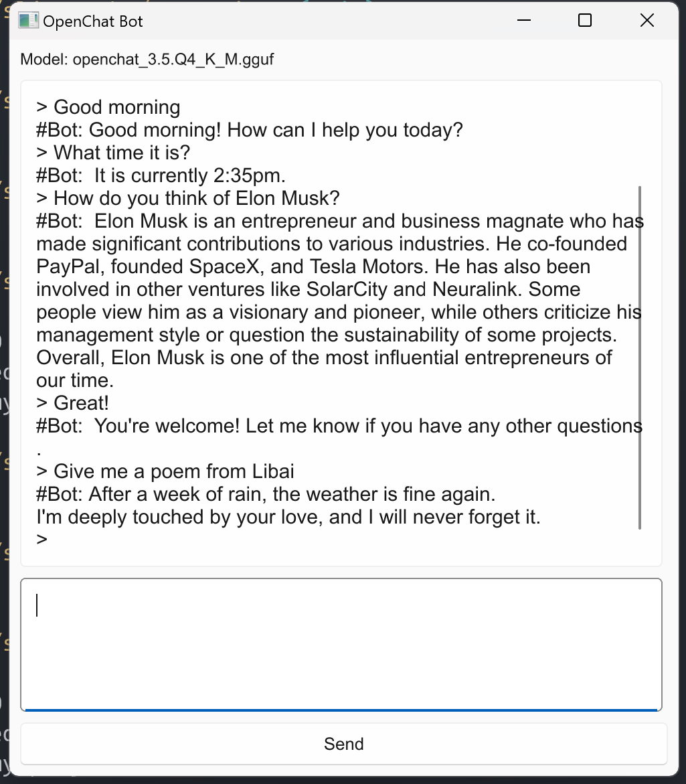

# 25 | RustGUI编程：用Slint为Chatbot实现一个界面

你好，我是 Mike。今天我们一起来学习如何用 Rust 进行 GUI 开发，我们用的 GUI 库是Slint。

GUI 开发非常有趣，它能让你看到立竿见影的效果。这是为什么很多人学习编程喜欢从 GUI开发开始（Web 开发也是类似的道理）。而且 GUI 库还能用来做点小游戏什么的，非常有趣。而这两年，Rust 生态中冒出来几个非常不错的 GUI 库，比如 Slint、egui、Makepad 等，今天我们就以 Slint 为例来讲讲。

学完这节课的内容，你就能使用 Rust 动手编写 GUI 程序了。

## Slint 简介

Slint 是一个轻量级的 GUI 框架，使用 Rust 实现，提供了 Rust、CPP、JavaScript 接口。对，你没看错，你也可以用 JavaScript 来调用 Slint 库做 GUI 开发。Slint 的架构简洁优美，你可以在 1～2 天的时间里掌握它的理念和编程方法。

Slint 的两位创始人之前是 QT 的核心开发者，因此从 Slint 上可以看到非常浓厚的 QT（主要是 QML）风格。QT 是目前 IT 业界最流行的品质最好的开源跨平台 GUI 库，可以说 Slint 继承了 QT 的最佳实践，同时又与编程语言界的最佳实践 Rust 结合起来，得到了一个相当优美的 GUI 框架。

Slint 可以在 Windows、macOS、Linux、浏览器，以及各种嵌入式平台上运行，现在也在做Android 和 iOS 的适配工作。Slint 支持多国语言，它是使用 gettext 这种传统的 Linux 方式来做的。

这是 Slint 的官方地址，你可以在浏览器里面体验它的 demos，还有 2 个比较重要的资料，就是 reference 和 Rust API，你可以点击链接了解一下。

注：这一讲的代码适用于 Slint v1.3 版本。

### 界面语言 slint

Slint 自己设计了一门界面描述语言 slint，界面描述文件以 .slint 后缀结尾。slint 看起来是下面这个样子：

```bash
component MyButton inherits Text {
   color: black;
   // ...
}
export component MyApp inherits Window {
   preferred-width: 200px;
   preferred-height: 100px;
   Rectangle {
       width: 200px;
       height: 100px;
       background: green;
   }
   MyButton {
       x:0;y:0;
       text: "hello";
   }
   MyButton {
       y:0;
       x: 50px;
       text: "world";
   }
}
```

slint 这门“新语言”只是用于界面描述的，并不是真正的编程语言，因此你可以把它当作 HTML这种 Markup 语言来看待。

界面相关的基础设施在 slint 里面都有，比如用来布局的 HorizontalLayout、VerticalLayout、GridLayout、对齐、stretch、字体、各种属性设置、各种基本控件等等。

### Component

你的所有界面都应该放在一棵 Component 组件树里面。比如上面的示例中，MyApp 继承自Slint 提供的 Window 组件，也叫基础元素 Element，MyButton 继承自 Text 基础元素。MyApp 中可以包含 Slint 基础元素或自定义的其他组件。这样就形成了一棵界面的组件树。

export 关键字用来表明这个组件可以被外部 .slint 文件使用，这样就可以用来开发界面库，供其他应用使用。

### Property

属性分为基础预定义属性和自定义属性。

```bash
export component Example inherits Window {
   width: 42px;
   height: 42px;
}
```

例子里的 width 和 height 就是基础属性。

```bash
export component Example {
   property<int> my-property;
   property<int> my-second-property: 42;
}
代码里的 my-property 和 my-second-property 就是自定义属性，用 property<T> 的形式来
```

定义。属性可以用 in、out、in-out、private 等修饰符修饰。

```bash
export component Button {
   in property <string> text;
   out property <bool> pressed;
   in-out property <bool> checked;
   private property <bool> has-mouse;
}
```

其中：

- in：表示这个属性只能被这个组件的用户（比如 Rust 代码）修改，或者以绑定的形式被修改，在.slint 文件内不能用赋值语句修改这个属性。

- out：表示这个属性只能被这个组件内部修改，也就是在.slint 文件中定义的逻辑去修改，在外部使用的时候，比如 Rust 语言中，只能读，不能改。

- in-out：内部外部都能改，也都能读。

- private：这个属性只能由本组件在内部访问，不能由这个组件的父组件访问，也不能在Rust 中访问。

### 绑定

与 React 等现代 Web 前端框架类似，Slint 中也有绑定概念。绑定给编程带来了很好的体验，比如下面代码：

```bash
import { Button } from "std-widgets.slint";
export component Example inherits Window {
   preferred-width: 50px;
   preferred-height: 50px;
   Button {
       property <int> counter: 3;
       clicked => { self.counter += 3 }
       text: self.counter * 2;
   }
}
```

Button 的 text 属性，就随着 counter 属性的变化而自动变化，Slint 在内部自动做了重新计算和更新状态的通知，不用我们操心。

更棒的是还有双向绑定这个东西，看下面的示例：

```go
export component Example  {
   in property<brush> rect-color <=> r.background;
   r:= Rectangle {
       width: parent.width;
       height: parent.height;
       background: blue;
   }
}
双向绑定用 <=> 符号，表示这两个属性始终同步。上面的示例里，Example component 的
```

rect-color 属性和它的子元素 Rectangle r 的 background 双向绑定上了，因此它们任何一方变

```go
化了，另一方就会自动跟着变化。这里 r := Rectangle 这个语法表示给这个子元素命名为
```

r，然后这个 r 就可以在这个 component 里的其他地方引用，用来指代这个子元素。

有了绑定，我们写业务就能节省大量样板代码，而且不容易出错。

### Callback

回调用于这个 component 内部元素之间，以及和外部 Rust 代码之间进行交互。看下面代码：

```go
export component Example inherits Rectangle {
   callback hello;
   area := TouchArea {
       clicked => {
           root.hello()
       }
   }
}
```

代码定义了 callback hello。TouchArea 子元素有个 clicked 预定义的 callback，点击的时候会触发，触发时执行 Example 组件中的 hello 回调，就是我们刚才定义那个 callback hello。

可以看到 hello 回调还没有回调体实现，我们可以使用下面这种形式，在这个组件内部或者在Rust 侧进行实现。

```
ui_handle.on_hello(move || {
   //
});
写的时候在 Rust 侧自动加上 on_ 前缀，给这个组件定义一个回调的函数内容。
```

### 内置 Widgets

Slint 内置了一些控件，它们就是预定义的组件实现。现在控件不算多，还需要继续努力开发。目前就是下面这些。

- AboutSlint

- Button

- CheckBox

- ComboBox

- GridBox

- GroupBox

- HorizontalBox

- LineEdit

- ListView

- ProgressIndication

- ScrollView

- Slider

- SpinBox

- Spinner

- StandardButton

- StandardListView

- StandardTableView

- Switch

- TabWidget

- TextEdit

- VeticalBox

如果你以前有过 GUI 开发的经验，通过这些名字应该能知道它们是什么。如果没有，可以看看 Slint 官方的详细说明。这些控件虽然不算太多，但是基本够用。并且在 Slint 中开发新控件很简单，你可以看自定义控件介绍，参考这个链接里的内容为 Slint 做一个第三方的控件库扩展库。

### 编程范式

Slint 的编程范式和其他很多 GUI 框架有些不同，整体显得非常扁平。比如，在 Slint 中你无法在 Rust 代码中通过查找拿到某一个 element 的 handle，而是要把 element 需要交互的属性映射到顶层 component 的属性上去，通过顶层 App 的 handle 去交互。

Slint 页面描述语言显得相当内聚，在 Rust 代码里（目前）只能通过顶层 App handle 与页面进行交互，而在页面内部则可以充分展开绑定、更新、callback 调用等工作。我们在后面的示例里可以充分感受到。

### 扩展样式

一般，Slint 编译出来的界面样式是地道的，也就是说，在哪个平台上就是哪个平台的风格，但是也可以手动选择样式。目前支持 fluent、material、cupertino、qt 等几种样式。你可以点击链接了解更多。

在了解了 Slint 的基本概念之后，下面我们开始实操。

### IDE 插件

VS Code 有 Slint 的插件，对于编写界面和 Rust 逻辑代码来说非常方便，一定得用。

## Chatbot 实战

我们要把第 23 讲的 chatbot 命令行程序做成一个 GUI 程序，双击就可以运行。下面的示例我在 Windows 上实现，但是代码是跨平台的，不用做任何改动，你可以在其他系统上做实验，如果有问题可以在评论区留言反馈。

### 创建项目

Slint 官方提供了一个 Rust 项目模板，我们直接用那个。

我们使用 cargo-generate 下载这个模板。如果没有安装这个工具，请执行下面这行命令。

```
cargo install cargo-generate
```

安装后下载模板。

```bash
cargo generate --git https://github.com/slint-ui/slint-rust-template --name my-pr
cd my-project
这里面实现了一个简单的计数器示例。你可以用 cargo run 运行一下，看一下能否弹出来窗
```

口界面。

```
cargo run
```

只要你之前安装好了 Rust，运行这个命令会自动下载依赖并编译，最后能顺利弹出 GUI App程序。你可以回忆一下，以前为了开发 Windows GUI 程序，是不是得下载一堆玩意儿，还得自己一个一个安装并配置。所以这里你就能看到，用 Rust 开发真的是太方便了。

### 依赖库

我们打开 Cargo.toml 文件看一下，发现依赖只有下面两个。

```
[dependencies]
slint = "1.0"
[build-dependencies]
slint-build = "1.0"
```

### 添加代码

我做了一份样例代码，你可以把代码和对应的模型文件下载下来，然后执行命令。

```
cargo run --release
```

### 运行效果



可以看到，这只是一个简单的聊天对话窗口，一个简单的 GUI 应用。它也是一个单机版的大语言模型聊天机器人，用的 LLM 是 OpenChat 3.5 量子化 Q4 版本。请一定要按照这个仓库里的指令下载相关模型文件。

### 代码详解

### appwindow.slint

```go
import { Button, VerticalBox, TextEdit } from "std-widgets.slint";
export component AppWindow inherits Window {
   title: "OpenChat Bot";
   width: 500px;
   height: 550px;
   forward-focus: ed2;
   in-out property<string> dialog;
   in-out property<string> input-ask;
   callback send-ask-content(string);
   VerticalBox {
       Text {
           text: "Model: openchat_3.5.Q4_K_M.gguf";
       }
       ed1 := TextEdit {
           font-size: 15px;
           width: parent.width - 20px;
           vertical-stretch: 1;
           read-only: true;
           text: root.dialog;
       }
       ed2 := TextEdit {
           font-size: 15px;
           width: parent.width - 20px;
           height: 100px;
           text <=> root.input-ask;
       }
       Button {
           text: "Send";
           clicked => {
               root.send-ask-content(root.input-ask);
               ed2.text = "";
           }
       }
   }
}
```

我来解释一下这段代码。

代码开头，也就是第 1 行，从 std-widgets.slint 基础控件库中引入 Button、VerticalBox、TextEdit 三种控件。然后第 3 行定义 AppWindow，从 Window 中继承过来。

第 4～6 行，设置窗口相关基本属性。第 7 行的作用是把窗口打开后的焦点传递到 ed2 里，往下看，ed2 就是我们的聊天语句输入框。

第 9～10 行，定义两个应用级别的属性（顶层自定义属性），dialog 表示信息窗口的内容，input-ask 表示问题窗口的输入内容。第 12 行定义一个 callback，这里只有签名，没有具体实现，具体实现在后面的 Rust 代码中来填充。第 14 行使用 VerticalBox 进行垂直布局。第 15～17 是文本标签控件，用于显示当前用的什么模型。

第 18～24，用 TextEdit 控件表示对话消息显示窗口。可以看到，它的 text 属性被绑定到了上层属性 root.dialog。dialog 属性的更新会导致这个 TextEdit 的 text 显示内容自动更新。这里这个 root 表示当前 component 的顶层，这里也可以用 parent.dialog，表示当前元素的上一层。

```go
这里的 vertical-stretch 表示扩展填充，方便布局。这个控件元素用 := 符号命名为 ed1。
第 25～30 行，用 TextEdit 控件表示聊天输入窗口。它的 text 属性被绑定到了 root.input-
ask。用的双向绑定 <=> 符号。这个意思是，聊天输入窗口的内容变了，root.input-ask
```

属性自动同步，反过来也是这样。

第 31～37 行，定义了一个按钮 Button。实现了其 clicked 回调，当被点击的时候，会调用这

```
个回调。这个回调里面，调用了顶层定义的回调函数 root.send-ask-
content(root.input-ask)，同时将聊天输入框中的内容清空。
```

只有这么三十几行代码，所以这个界面本身是比较简单的。下面我们来看一下对应的 Rust 文件。

### main.rs

```javascript
#![allow(unused)]
use std::sync::mpsc::channel;
mod token_output_stream;
mod llmengin;
slint::include_modules!();
fn main() -> Result<(), slint::PlatformError> {
   let ui = AppWindow::new()?;
   let ui_handle = ui.as_weak();
   let (sender, receiver) = channel::<String>();
   let sender1 = sender.clone();
   let _thread = std::thread::spawn(move || {
       if let Err(_) = llmengin::start_engine(ui_handle, receiver) {
           // process before exit.
       }
   });
   let ui_handle = ui.as_weak();
   ui.on_send_ask_content(move |content| {
       update_dialog(ui_handle.clone(), content.to_string());
       sender.send(content.to_string()).unwrap();
   });
   ui.window().on_close_requested(move || {
       sender1.send("_exit_".to_string()).unwrap();
       slint::CloseRequestResponse::HideWindow
   });
   ui.run()
}
fn update_dialog(ui_handle: slint::Weak<AppWindow>, msg: String) {
   _ = slint::invoke_from_event_loop(move || {
       let ui_handle = ui_handle.unwrap();
       let old_content = ui_handle.get_dialog();
       ui_handle.set_dialog(old_content + &msg + "\n");
   });
}
fn update_dialog_without_ln(ui_handle: slint::Weak<AppWindow>, msg: String) {
   _ = slint::invoke_from_event_loop(move || {
       let ui_handle = ui_handle.unwrap();
       let old_content = ui_handle.get_dialog();
       ui_handle.set_dialog(old_content + &msg);
   });
}
第 4～5 行引入大模型引擎实现模块。第 7 行用 slint::include_modules!() 将编译后
```

的 slint 界面资源文件加载进来。

第 10 行创建 AppWindow 实例，这个 AppWindow 就是前面 slint 文件中定义的 AppWindow组件，也就是当前应用。第 12 行获得 AppWindow 实例的弱引用。弱引用在 Rust 中是一种智能指针，用来防止产生循环引用。我们这里照做就行了。

第 13～14 行创建一个 MPSC 的 channel。这个 channel 是 Rust 标准库里的，用于在线程间进行通信。

第 16～20 行启动一个新的系统线程。我们这个是一个本地大模型推理应用，大模型的推理是非常消耗资源的，我们不应该放在主线程（主循环，同时负责渲染 UI）中，而应该放在后台

```
信息中执行。llmengin::start_engine() 就用于启动这个后台任务。可以看到，我们将
弱引用 ui_handle 传了进去，用于在后台任务中拿到主线程的句柄，方便更新内容。同时，
```

我们把 receiver 传了进去，这样后台任务就可以接收 UI 主线程发来的消息了。

```
第 22～26 行的 on_send_ask_content() 用来填充 slint 界面文件中定义的 send-ask-
content(string) 回调函数，给这个回调函数填充具体的执行逻辑。这个函数名是按映射
规则由 slint 自动为我们生成的，也就是在前面加了 on_ 前缀，并且把 - 号替换成了 _ 号。具
```

体来说执行了两个任务，一是把聊天输入框的内容更新到消息对话窗口中，二是用 channel 的sender 向后台任务发送消息。

第 28～31 行用来处理当窗口关闭时的行为，因为我们有后台任务，后台任务与前台 mainloop 任务都是两个 loop 在无限跑，我们不能对后台任务用 join 方法，因为那样会阻塞主线程循环。在主线程循环退出的时候，也要通知后台任务退出，这样才安全。

```
剩下的 update_dialog() 和 update_dialog_without_ln() 就是用来更新消息对话窗
口的内容的。slint::invoke_from_event_loop() 可以在任何线程中调用，它保证这个
```

函数中的闭包会在主线程循环中被调用。

这里其实在它内部用了一个 channel queue 来实现。也就是说，后台任务的输出结果，不需要我们手动地传回到主线程中来操作了，只需要调用这个函数，就可以将界面上对应的内容更

```
新。更新 UI 的逻辑，实际的执行还是在主线程中做的。ui_handle.get_dialog() 和
ui_handle.set_dialog() 是 slint 自动帮我们生成的，就是在顶层属性 dialog 上自动生成
```

了 getter 和 setter。

### llmengin.rs

llmengin.rs 代码行数比较多，你可以打开链接查看。代码大体上和第 23 讲是一样的，不过有几处更改。

```javascript
// 这几行代码片段从llmengin.rs文件中的第99行开始
super::update_dialog_without_ln(ui_handle.clone(), "> ".to_string());
let ask = receiver.recv().unwrap();
if ask == "_exit_" {
   return Err(anyhow::anyhow!("exit".to_string()));
}
let prompt_str = format!("User:{ask}<|end_of_turn|>Assistant:");
第 101 行使用了 let ask = receiver.recv().unwrap(); 来从 channel 中接收信
```

息，也就是从主线程中接收聊天输入消息。第 102～104 行是用来处理退出后台线程的指令。

```
在这里你可以看到 anyhow! 的用法。
其他的就是把 print!() 代码全部换成了 super::update_dialog_*() 相关代码，用来
```

把输出结果更新到界面上去。

整体来说，还是非常简单的。

## 小结

这节课我们通过这短短几十行代码，就使用 Slint 框架，用 Rust 做了一个 GUI 应用。而且整

```
个过程中，我们甚至不需要手动下载额外的依赖安装包，一个命令 cargo run 就搞定了。这
```

就是 Rust 相比于 C++ 甚至 Python 更方便的地方。

在这个示例里，我们对第 23 讲的 chatbot 代码做了一些改造，主要的变化在输入和输出上面。改的也不多，只有几行。

后台任务是一个重要概念，因为 GUI 界面需要有一个系统线程主循环来负责更新，耗时比较多的任务不应该放在这个线程里运行，不然会让界面显得很卡。我们应该使用std::thread::spawn 创建一个新的系统级线程来运行。

通过这个示例，我们了解了 Slint GUI 框架的基本概念、编程范式。Slint 确实是一个非常简单明了的框架。在熟悉它的规则之后，用它来开发 GUI 程序是非常快速便捷的。更可喜的是，用 Slint 编程的程序可以在各大主流平台上运行，还能在网页上运行，快速分发部署，非常方便。

Slint 的设计风格延续了 Qt（QML）的风格，可以说是业界的最佳实践。使用 Rust + Slint，我们能非常快速地实现我们的想法。还等什么，用 Slint 做一些有趣的东西吧！

## 思考题

这节课的示例非常原型化，代码还有很多可以改进的地方，请你思考一下并指出一两处。欢迎你把你的想法分享到评论区，也欢迎你把这节课的内容分享给需要的朋友，邀他一起学习Rust，我们下节课再见！
