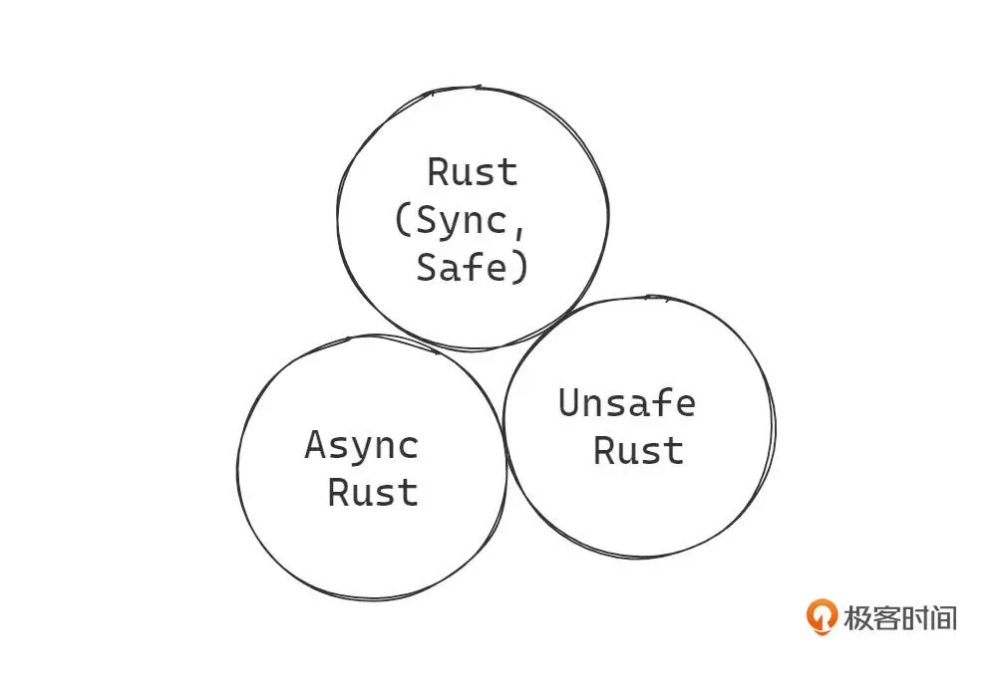
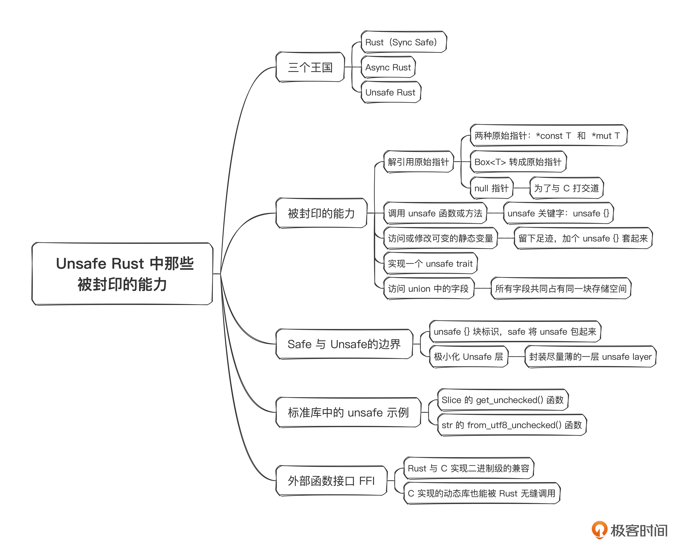

# 29 | Unsafe编程（上）：UnsafeRust中那些被封印的能力

你好，我是 Mike。

这门课目前已接近尾声，剩下的两节课我准备讲讲 Rust 中看起来有点黑魔法的部分——Unsafe Rust。这一节课我们先来聊聊相关的概念。

在前面课程的学习中，你有没有感觉到，Rust 编译器就像是一个严厉的大师傅，或者一个贴心的小助手，在你身边陪你结对编程，你写代码的时候，他盯着屏幕，时不时提醒你。如果某个时刻，这个大师傅或小助手突然离开了，你会不会慌？就像刚提车，第一次独自上路的那种感觉。

## 三个王国

Unsafe Rust 就是这样一个领域，进入这个领域，你突然拥有了几种必杀技能，但是身边已经没有大师傅同行了，只能靠你自己完全控制这几种技能的使用。使用得好，威力无穷。使用不好，对自己也会造成巨大伤害。Unsafe Rust 就是这样一个相对独立的领域。前面我们讲到过，Async Rust 也是相对独立的一个附属王国，现在又多了一个 Unsafe Rust 这样的附属王国。



Rust 语言可以看作是这三块疆域的合体，它们共同组成了一个联盟 Rust 王国。你甚至可以把Rust 语言看成包含上面三种编程语言的一种混合语言。所以很多人抱怨 Rust 难学，也是可以理解的。

现在让我们把注意力集中在 Unsafe Rust 这个王国里面。它到底是什么样的？简单地说，你可以把它理解成这个王国里面住着一个 C 语言族的国王。也就是说，C 语言能做的事情，Unsafe Rust 都能做。C 语言能做哪些事情呢？理论上来说，它能做计算机中的任何事情。因此，在 Unsafe Rust 中，你也能做计算机中的任何事情。C 的强大威力来源于它锋利的指针，而在 Unsafe Rust 中也提供了这种能力。

## 被封印的能力

Safe Rust 王国有些技能被封印了，而这些技能进入到 Unsafe Rust 王国后，就可以被揭开使用。具体来说，有 5 种技能。

1. 解引用原始指针

2. 调用 unsafe 函数或方法

3. 访问或修改可变的静态变量

4. 实现一个 unsafe trait

5. 访问 union 中的字段

这里我们简单提一下这 5 个方面，我们从第 5 点讲起。union 我们在课程里没有讲，这里我们简单了解下。它是一个类似于 C 中 union 的设计，也就是所有字段共同占有同一块存储空间。访问它的字段时，需要在 Unsafe Rust 中使用。

```javascript
union IntOrFloat {
   i: u32,
   f: f32,
}
let mut u = IntOrFloat { f: 1.0 };
// 读取union字段时需要用 unsafe {} 包起来
assert_eq!(unsafe { u.i }, 1065353216);
// 更新了i，结果f字段的值也变化了。
u.i = 1073741824;
assert_eq!(unsafe { u.f }, 2.0);
```

我们一般用不到 union，如果需要深入研究，可以查看我给出的链接。

第 4 点，我们可以给 trait 实现 unsafe，这块内容比较深，所以在我们这门初级课程里不要求了解，如果你有兴趣可以查看我给出的链接。

第 3 点也就是全局静态变量，前面我不提倡修改它，因为它是一种不太好的编程模型。但是如

```
果你非要改的话，也是有办法的，那就留下足迹，加个 unsafe {} 套起来，比如 the book
```

里的示例。

```
// 这里修饰为 mut
static mut COUNTER: u32 = 0;
fn add_to_count(inc: u32) {
   // 修改全局可变静态变量需要用 unsafe
   unsafe {
       COUNTER += inc;
   }
}
fn main() {
   add_to_count(3);
   // 访问全局可变静态变量也需要用 unsafe
   unsafe {
       println!("COUNTER: {}", COUNTER);
   }
}
// 输出
COUNTER: 3
```

下面我来重点讲解一下前 2 种场景。

### unsafe 关键字

Rust 中有一个 unsafe 关键字，用来显式地标明我们要进入 unsafe Rust 的领地。unsafe 关键字可以修饰 fn、trait，还可以在后面跟一个 {} 表明这是一个 unsafe 块，把可能不安全的逻辑包起来，像下面这样：

```
unsafe {
   //...
}
```

这里，需要说明一下，被 unsafe 标识或包起来的代码，并不是说一定有问题。它的准确意思是：Rustc 编译器不保证被 unsafe 标识的代码是安全的，你应该保证你写的代码是安全的。

也就是说，unsafe 这个标识符，在代码中留下了明确的足迹，将交由 Rustc 全权保证安全的代码，和不交由 Rustc 全权保证安全的代码，分隔开了。

请注意上面这句话的用词，“不交由 Rustc 全权保证安全的代码部分”并不是说 Rustc 编译器就完全不检查 unsafe 里的代码了，实际 Rustc 只是对上面提到的 5 种技能不加检查。对于 SafeRust 里的内容还是要做检查，跟之前一样。我们来看一个示例。

```javascript
fn main() {
   let v = [1,2,3];
   unsafe {
       println!("COUNTER: {}", v[3]);
   }
}
// 编译输出
warning: unnecessary `unsafe` block
--> src/main.rs:4:5
 |
4 |     unsafe {
 |     ^^^^^^ unnecessary `unsafe` block
 |
 = note: `#[warn(unused_unsafe)]` on by default
error: this operation will panic at runtime
--> src/main.rs:5:33
 |
5 |         println!("COUNTER: {}", v[3]);
 |                                 ^^^^ index out of bounds: the length is 3 but
```

示例中，我们需要重点关注 array 的下标索引越界的问题。我们在第 1 讲里已经讲过，array 的下标索引越界会在编译期被检查出来，可以看到，即使放在 unsafe block 中，它仍然执行了检查。这印证了我们上面的说法：被 unsafe 标识的代码，并不是让 Rustc 完全不管，而只是某几种技能让 Rustc 不管。Safe Rust 中的那些元素，Rustc 该管的还是要管。

所以即使是 Unsafe Rust，看上去也要比写 C 代码来得“安全”，犯错的风险更小一些。另外编译器指出这里 unsafe 块没什么用，可以去掉，我们确实没使用它。

### 原始指针

```javascript
Rust 中有两种原始指针（raw pointer），*const T 和 *mut T。用法如下：
fn main() {
   let my_num: i32 = 10;
   let my_num_ptr: *const i32 = &my_num;
   let mut my_speed: i32 = 88;
   let my_speed_ptr: *mut i32 = &mut my_speed;
   unsafe {
       println!("my_num is: {}", *my_num_ptr);
       println!("my_speed is: {}", *my_speed_ptr);
   }
}
// 输出
my_num is: 10
my_speed is: 88
也就是可以将不可变引用 &T 转换成 *const T 指针。将可变引用 &mut T 转换成 *mut T
```

指针。你也可以用 as 操作符来转换。

之前我们讲过，引用是必须有效的指针，而指针不一定是引用，在这里就得到了充分的体现。原始指针指向的数据不对的话，解引用有可能会导致段错误或其他未定义行为。因此引用转换为原始指针的时候，不需要包 unsafe，解引用原始指针的时候，要用 unsafe 包起来。这就是我们上面说的那 5 种被封印的能力中的第一种能力：在 unsafe Rust 中，可以解引用原始指针。

一旦接触到了原始指针，也就开启了计算机底层系统的大门。你可以看我放在这里的两个链接，感受一下原始指针的复杂性。

- https://doc.rust-lang.org/std/primitive.pointer.html

- https://doc.rust-lang.org/std/ptr/index.html

### Box<T> 转成原始指针

```
Box<T> 是带所有权的智能指针，它有一个 into_raw() 函数可以转换成原始指针。这个转
```

换对于内存里的资源没有影响。但是要再从 raw pointer 转回 Box 就要放在 unsafe 里包起

```javascript
来，Box::from_raw() 是 unsafe 的。
fn main() {
   let my_speed: Box<i32> = Box::new(88);
   let my_speed: *mut i32 = Box::into_raw(my_speed);
   unsafe {
       let _ = Box::from_raw(my_speed);
   }
}
```

这实际上也是对原始指针解引用的一个变形，所以要放在 unsafe 块里。

### null 指针

之前我们说过，Rust 中不存在 null/nil 值，所有的变量都必须初始化。这在 Safe Rust 里是正确的。但是在 Unsafe Rust 中，却提供了 null 指针的表示。

```javascript
可以用 std::ptr 里的 null() 和 null_mut() 生成两种原始空指针。
fn main() {
   use std::ptr;
   let p: *const i32 = ptr::null();
   assert!(p.is_null());
   let p: *mut i32 = ptr::null_mut();
   assert!(p.is_null());
}
```

Rust 中为什么会有空指针存在？有什么作用呢？那是因为 C 语言中有空指针这个东西。为了与 C 打交道，Rust 中要有对应的设计，好与 C 库或者 C 应用程序对接，毕竟在 Rust 出来之前，C/C++ 已经建成了这个软件世界的地基。

### Safe 与 Unsafe 的边界

```
在 Rust 中，unsafe 函数必须在 unsafe 函数中调用，或使用 unsafe {} 块包起来调用。因
```

此下面的代码是可以的：

```javascript
fn foo() {
   let my_num_ptr = &10 as *const i32;
   let my_speed_ptr = &mut 88 as *mut i32;
   unsafe {
       println!("my_num is: {}", *my_num_ptr);
       println!("my_speed is: {}", *my_speed_ptr);
   }
}
fn main() {
   foo();
}
可以看到，foo() 函数中包含了 unsafe 块的调用。但是从 main() 函数的角度来看，它调
用 foo() 时不需要在外面再套一层 unsafe {} 来调用了。这里实际体现了重要的一点，
Unsafe 与 Safe 的边界。示例代码里两者的边界就在 foo() 函数中。
从 main() 的视角来看，它调用的 foo() 有可能是第三方库暴露出来的接口，并不知道里面
具体的实现，只知道这个函数可以按 Safe Rust 的形式安全调用。这里的这个 foo() 就是对
```

unsafe 代码的 safe 封装。

我们再来看一个实际一点的例子。

```javascript
use std::slice;
fn split_at_mut(values: &mut [i32], mid: usize) -> (&mut [i32], &mut [i32]) {
   let len = values.len();
   let ptr = values.as_mut_ptr();
   assert!(mid <= len);
   unsafe {
       (
           slice::from_raw_parts_mut(ptr, mid),
           slice::from_raw_parts_mut(ptr.add(mid), len - mid),
       )
   }
}
fn main() {
   let mut vector = vec![1, 2, 3, 4, 5, 6];
   let (left, right) = split_at_mut(&mut vector, 3);
}
```

上面函数将一个 i32 数组的 slice 可变引用分成了前后两段 slice 可变引用。这在 Safe Rust 是做不到的，因为同时对原数组存在了两个可变引用，详情请看官方书。

```
在 Unsafe Rust 中可以做到，但是 slice::from_raw_parts_mut() 只能用 unsafe {}
包起来调用。而对业务开发者来说，在 main() 函数中以 Safe Rust 的形式直接使用
split_at_mut() 就行了，一切就好像 split_at_mut() 是真正 safe 的一样。在这里，
```

它确实是 safe 的，只不过这个 safe 不是由 Rustc 来保证的 safe，而是由我们程序员自己保证的 safe。我们知道我们在干什么，两个 slice 并不重叠，不会有问题。

如果打破砂锅问到底的话，是不是几乎所有的 Rust 底层都有这个问题？跟踪到最底层代码的话，是不是都是 unsafe 的？如果是，那么 Rust 所标榜的 safe，岂不是一个虚幻的空中楼阁？

你的猜测大体是正确的。

### 极小化 Unsafe 层

从本质来说，世界是建立在 unsafe 上面的。

从硬件来说，我们编写程序来操作各种设备，内存、硬盘、显卡、网络设备等等，对它们的操作完全有可能是不安全的，这个错误可能来自各种层次，比如电源波动引起的故障、线路老化故障、晶体管损坏故障，甚至是太阳黑子爆发引起的故障等等。

从软件指令来说，当代码编译成二进制后，这个二进制可执行序列的威力是无穷大的，理论上可以对计算机内存和设备地址做任意访问，这也是 hack 行为的源头。只要 hacker 找到了你程序中的漏洞，它就可能在你的计算机中做任何危险的事情。这就是 C 这种靠指针吃饭的语言强大且危险的原因。

不管是从硬件层面还是软件层面，你的一个操作完全可能会得到一个未知的行为或未定义行为Undefined Behaviour。从 Safe Rust 的观点来看，一个会产生未定义行为的操作，就是

```
Unsafe 的。而 unsafe 的操作，都必须明确地放在 unsafe {} 块中隔离。
```

因此，在 Safe Rust 看来，威力过大的技能，比如原始指针的解引用，可能访问到未初始化的地址，或者是已经释放后的地址，因此它是 Unsafe 的；外部的 C/C++ 代码，它们都得靠程序员自己来保证安全性，因此它们是不可信任的，把它们都归类到 Unsafe 中；对外部设备的操作，已经超过内存资源的管理权限了，Rust 自己鞭长莫及，因此把它归为不信任，归类到Unsafe 中。

于是我们可以看到，Rust 将所有代码分割成了 Safe 的和 Unsafe 的两块，两块之间就通过明

```
确的 unsafe {} 标识来隔离，这是 Rust 的基本世界观。
```

在这个世界观之上，基于 Rust 的软件体系还有一套抽象哲学——当需要 Unsafe 时，应该把它封装在一个极小层（minimalist layer），然后在它的上面建立上层建筑。

也就是说，如果不得不用 Unsafe 代码，那请封装尽量薄的一层 unsafe layer，而在其之上完全使用 safe rust 编写。这个时候就可以回答这个问题了：如果是，那么 Rust 所标榜的 safe，岂不是一个虚幻的空中楼阁？

Rust 通过这套方法学，让 Safe Rust 的代码部分可以自证安全，而 Unsafe Rust 的代码部分由程序员来保证安全。你可以想象一下，如果一个系统有 10 万行 Rust 代码，98% 的代码是Safe Rust，2% 的代码是 Unsafe Rust，那么需要由人来审计的代码就只有 2 千行。那我们就可以把所有精力集中在这 2 千行代码的审计上，确保它们不会出问题。或者说即使出了问题，也可以去这 2 千行代码中去找原因。

而如果同样的这套系统，由 10 万行 C/C++ 代码来实现，那么审计的时候，就必须审计 10 万行代码，也就是 50 倍的审计工作量。遇到问题，也是在 10 万行代码里面去找原因。这个成本完全不可比拟。

因此，Rust 所标榜的 safe，完全不是空中楼阁。不仅不是空中楼阁，还是非常切实可行的一套软件工程方法学。

## 标准库中的 unsafe 示例

Rust 标准库中有一些 unsafe 函数，我们来看两个。

### Slice 的 get_unchecked() 函数

```javascript
fn main() {
   let x = &[1, 2, 4];
   unsafe {
       assert_eq!(x.get_unchecked(1), &2);
   }
}
在有 get() 的情况下，Rust 标准库还提供这个 get_unchecked() 函数，原因其实也很简
单，因为get() 会进行边界检查，而 get_unchecked() 不会。在有些密集运算的情况下，
```

边界检查对性能影响比较大，因此提供一个不做边界检查的版本，用来追求极致的速度。毕竟，Rust 是一门与 C/C++ 在同一层次的语言，不应该给 Rust 人为呆板地设置障碍，比如必须使用边界检查的安全版本。

### str 的 from_utf8_unchecked() 函数

```javascript
fn main() {
   use std::str;
   // some bytes, in a vector
   let sparkle_heart = vec![240, 159, 146, 150];
   let sparkle_heart = unsafe { str::from_utf8_unchecked(&sparkle_heart) };
   assert_eq!("", sparkle_heart);
}
```

这个函数我们在第 4 讲聊字符串的时候提到过，它不检查字节序列为有效的 UTF8 编码，因此转出来可能不是有效的字符串。原因也很简单，还是为了性能。在有些场合下，绝对的性能就是绝对的王道，Rust 不给你设置天花板。

## 外部函数接口 FFI

这里我提出一个问题，你来想一下。一门编程语言如何与另一门编程语言在语言层面交互呢？这个问题还真不好办。

事实上，像 JavaScript 就不太可能直接与 Python 进行交互。大部分语言之间是没办法直接交互的。但是，历史却留下一个有趣且可贵的遗产——所有主流语言基本都能与 C 语言交互，因为它们都需要用 C 来写扩展，提升性能。当然 C++ 是在语言层面直接包含了 C，这个另当别论。

Rust 在设计之初，与 C 实现二进制级的兼容就是一项重要目标。二进制兼容的意思其实就是Rust 可以选择编译目标为符合 C 语言 ABI（Application Binary Interface）的二进制格式。

ABI 包含数据结构怎么对齐、存储，函数如何传参、返参、调用二进制格式信息等，而 Rust就支持编译到遵循 C ABI 的二进制库目标上。这意味着用 Rust 编写的共享动态库

```
.so、.dll 等在外界看来，与用 C 编译成的 .so、.dll 动态库没什么区别，你甚至不知道
```

是什么语言写成的。因此，Rust 编写的动态库也能被 Python、JavaScript、Go、Java 等其他语言调用，它们都支持 C ABI 动态库。

另一方面，C 实现的动态库也能被 Rust 无缝调用，因为 Rust 能识别 C ABI。一个 C 的库函数，在 C 应用中运行和在 Rust 应用中运行没什么区别，性能也没有损失，就好像没有跨语言一样，这就是 Rust 的魔法所在。

这点与其他动态语言如 Python、JavaScript 等就有很大差别。这些动态语言到 C 语言的 FFI边界会有不小的额外消耗。究其原因，就是因为入参与返参会有类型转换的工作，而在这些动态语言中，类型是被 GC 托管的，这里面就有很多细节要处理，会带来额外的消耗。而 Rust就不存在这个问题，前面我们提示，Unsafe Rust 里面住着一位 C 国王，就好像一家人一样，或者至少是关系很近的亲戚。

尽管如此，有关 Rust 与 C 的 FFI 的知识点还是非常多的，有许多要注意的地方，也不是一下子就能掌握的，需要在实际需求产生时抠各种细节。另外，Rust 中的 Unsafe 其实要求你考虑更多，因为它比传统的 C 语言工程更详尽地考虑了未定义行为的概念，它要求你尽可能地考虑周全，因为封装给 Safe Rust 的功能被要求不能产生任何未定义行为。所以 Rust 不仅是工程上的创新，在学术理论上也有一定程度的创新，目标就是写出更健壮的代码。

## 小结



这节课我们了解了有关 Rust 中 Unsafe 和 FFI 的基础概念。我们进入 Unsafe Rust 后，就可以使用一些必杀技能了。这些技能威力巨大，但是也充满风险，需要由程序员自己来保证使用上的安全性。

```
我们说 Rust 由三个王国组成，既然是王国，那么内容铁定不会少。从 unsafe {} 这个大门
```

进入 Unsafe Rust，实际就进入了计算机体系结构的底层，你会发现一片美丽新世界。这个世界中有 OS、内存结构、对齐、锁、ABI、调度、指令集、总线协议等等眼花缭乱的新东西。我们之前提到过一种观点，学习 Rust 就是学习 CS 计算机科学，Unsafe Rust 就是下沉之门。

Rust 与 C 有正统的血脉关系，可以实现真正的双向互通，而没有边界性能损失。这预示着未来在嵌入式、工业控制、航空航天、自动驾驶等领域，Rust 都有非常大的潜力成为主流选手。绝大部分的人写熟了 Rust 以后就再也不想写 C 了，编程体验完全不可同日而语。长期来看，C 语言的份额会逐渐缓慢地萎缩到一个比较小的范围，而 Rust 则会担当起 C 语言之前的重任。

我们要理解 Rust 将 Safe 建立在 Unsafe 的这套方法之上，这也是软件工业界几十年探索的一个重要成果。所以你会听到 NASA、微软等机构呼吁新的软件开发不要再使用 C/C++ 了，而应该用“安全编程”的语言来取代。从这个意义上来讲，Rust 是划时代的语言。以后的语言可能会这么分类：Rust 之后的语言与 Rust 之前的语言。

下节课我们会将 Rust 代码导出给 C 语言使用，并且进一步导出给 Python 使用，给 Python实现一个自定义扩展。

## 思考题

Unsafe Rust 比 C 语言更安全吗，为什么？欢迎你把自己的思考分享到评论区，也欢迎你把这节课的内容分享给需要的朋友，我们下节课再见！
