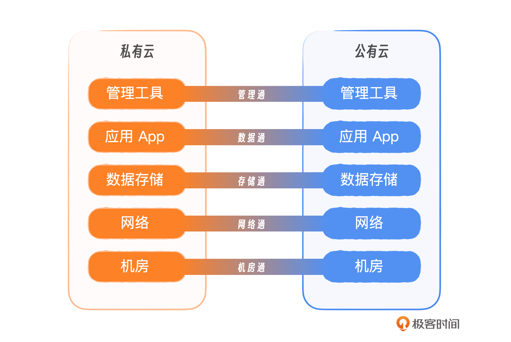
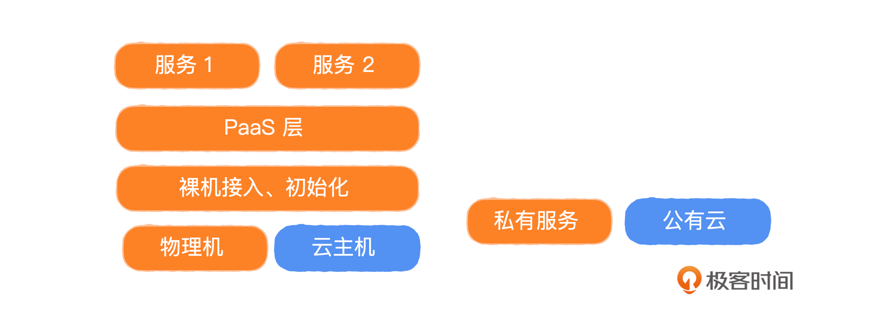
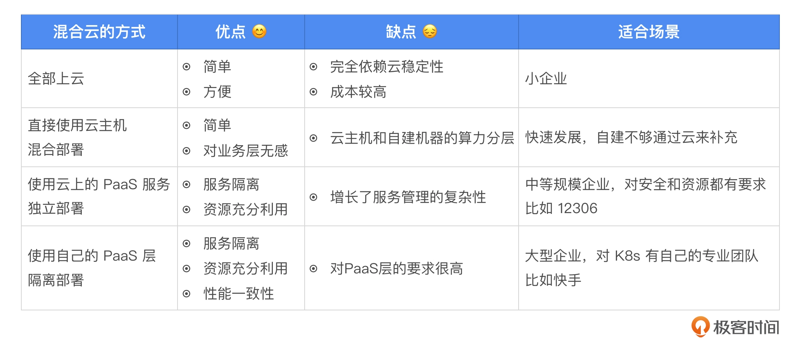

# 08 | 容量场景（一）：12306为什么现在能扛住春节抢票了？

你好，我是白园。

今天，我们来探讨 12306 网站在春运期间应对抢票高峰的策略，看看如何解决容量相关的问题。现在我们先把时间倒回到 2010 年 1 月 30 日，正值春运首日，12306 网站正式上线并启动试运行。然而，网站几乎在上线的瞬间就遭遇了崩溃，面对海量抢票用户的集中访问，系统几乎无法正常运作。

经过十余年的持续沉淀与技术革新，12306 网站在应对春运抢票高峰方面取得了显著进步。如今，关于 12306 崩溃的讨论已大幅减少。这个转变背后，12306 实施了哪些关键优化措施呢？

首先我们回顾一下容量的本质，容量本质上是资源消耗与资源补充之间的平衡。我们的目标是在确保系统可靠性的同时，尽可能地减少资源的使用。简而言之，我们寻求的是一个高效的容量管理策略，它能够在满足系统需求的同时，最小化资源投入。

这里其实就是要解决两个最关键的问题，是否能减少流量，是否能提供足够多的资源。

- 多级放票机制：通过实施分时段、分地区的放票策略，有效分散了购票请求的集中度，减轻了系统在特定时间点的压力。

- 服务上云：将服务迁移至云端，利用云计算的弹性和可扩展性，根据实时流量需求动态调整资源，提高了系统的承载能力和稳定性。

## 关键点一：业务削峰

在 12306 网站初期，所有的火车票在早上一个固定时间点统一放出，这种集中放票模式会给系统迅速造成巨大的访问压力，形成人为的流量高峰。为了解决这一问题，12306 网站在随后的运营中实施了多项优化措施。

- 分批次放票：改变原有的集中放票策略，将放票时间分散到一天中的不同时间段，如早晨、中午和晚上，以此平衡用户访问的分布。

- 利用非高峰时段：部分票额的放票时间安排在凌晨等用户活跃度较低的时段，这可以在不显著影响用户购票体验的同时，有效减轻系统在高峰时段的负载。

- 流量图示分析：从流量图可以看出，单点放票造成的流量峰值可能是多点放票的数十甚至数百倍。因此，通过产品设计来分散流量峰值，也是一种直接而有效的解决方案。

在解决容量问题时，我想强调的第一要务是始终从业务的角度出发进行思考。我们应该避免非必要的人为峰值，因为火车票系统的核心目的是销售车票，而非制造抢票现象。我们可以观察到，一些成功的电子商务平台，如淘宝的双十一购物节，已经采取了类似的策略。他们不再将所有的促销活动集中在一个特定的时间点，而是提前 2 到 3 天逐步启动，以此来平滑流量高峰。

这种从产品层面出发的策略，通过细微但关键的改进，往往能够在不增加太多技术和资源投入的情况下，带来显著的系统容量提升效果。这表明，通过深入理解用户需求和行为模式，我们可以在产品设计上做出更有针对性的优化，从而有效缓解系统压力，提升用户体验。

## 关键点二：服务上云

12306 网站在提升服务容量方面采取的第二个关键优化措施是与阿里云的合作。这一合作在2015 年春运期间发挥了重要作用，尤其是在 2014 年 12 月 19 日这一天，12306 网站达到了售票高峰。将余票查询功能从主服务器中分离出来，并在云端独立部署了一套余票查询系统。由于余票查询操作占据了 12306 网站流量的绝大部分，接近 90%，这一改进显著降低了网站拥堵的风险。

服务上云是应对峰值活动的有效手段之一。云计算环境提供的资源快速补充和扩容能力是其最大优势之一。具体来说，云计算主要带来了 2 个好处。

- 弹性和可扩展性：企业可以根据实际业务需求，快速调整计算资源的分配。这种按需分配的能力使得企业在面对业务增长或季节性波动时，可以避免前期的大量硬件投资，而是根据实时需求动态调整资源，实现成本效益的最大化。

- 快速部署：云服务允许企业迅速部署新的应用程序和服务。与传统 IT 环境相比，云环境大大简化了新服务的部署流程，从采购、配置到维护硬件的漫长周期，缩短至几分钟或几小时内完成，显著提升了企业的市场响应速度。

这里分为几种的上云策略和架构，我下面会一一解读。

### 服务全部上云

如果将服务完全迁移到公有云平台，可以带来一系列显著的优势：一是高度灵活性，企业能够根据业务需求的波动，快速调整所使用的云资源，实现敏捷的业务适应性。二是能够降低人工成本，由于云服务提供商负责基础设施的维护和升级，企业可以减少对 IT 运维人员的依赖，从而降低相关的人力成本。三是实现快速供给，云服务支持即时资源分配，这有助于加速新业务的上线和现有业务的扩展，提高市场响应速度。

然而，这种模式也存在一些潜在的劣势，首当其冲的就是成本问题，长期来看，持续使用云服务的费用可能会超过自建和维护基础设施的成本，尤其是在需要大量定制化服务的情况下。其次，也会增加企业对云服务提供商的依赖性，这可能会在服务提供商遇到问题时，导致企业服务中断或不稳定。

如果你可以选择用单一的云或者多个云的混合方案， 单一云会更加简单，但是稳定性会略差；多个云混合架构会更复杂，但是也会更加稳定。

那服务全部上云适用在哪些场景中呢？

对于业务规模相对较小、需要快速迭代产品和响应市场变化的企业，特别是初创和中小型企业，公有云提供了一种成本效益高、易于扩展的解决方案。对于创新和实验性项目，也就是那些需要快速启动和测试新想法的项目，公有云的即时资源分配和灵活性也是理想的选择。

### 部分服务上云

部分服务上云也就是我们说的自建和公有云的混合云模式。通过整合不同的云服务和本地基础设施，实现资源和服务的无缝对接。这种模式涉及多个层面的整合。

- 管理层：实现云服务和本地服务的统一管理，包括监控、维护和策略制定。

- 应用层：确保应用程序能够在云环境和本地环境之间无缝迁移和运行。

- 数据层：打通数据存储和访问，实现数据在云和本地之间的同步和共享。

- 网络层：建立稳定的网络连接，确保云服务和本地服务之间的数据传输高效安全。

- 机房层：优化物理基础设施，包括服务器、存储设备和网络设备的布局和管理。

打通这五个层面之后，混合云就能够提供灵活、高效且一致的服务体验了。它把私有云的安全性和定制性以及公有云的便利性和可扩展性结合在一起，适合需要同时利用本地和远程资源的企业。

在考虑云计算部署策略时，不同的方法有其独特的优缺点，适用于不同规模和需求的企业。我们来看一下各类部署方式的优势所在。

### 方式一：直接使用云主机混合部署

裸机接入是一种将公有云云主机无缝集成到企业现有 IT 架构中的策略。它允许企业把云主机当作本地物理服务器使用，而不用改变现有的操作和管理流程。我们看看这种方法的几个关键优势和考虑因素。

优势与问题

- 无缝集成：云主机与现有 IT 架构的无缝集成，避免了对现有管理工具和操作流程的调整。

- 普通机器体验：对于用户而言，云主机的使用体验与本地物理服务器一致，保持了操作的熟悉度。

- 简化管理：IT 团队能够使用现有知识和工具来管理云资源，减少了学习和适应新系统的成本。

当然，裸机接入的方式也并不是完美的，它还存在一些潜在挑战。技术方面，在 PaaS 和IaaS 层面可能需要进行大量工作，以确保服务的一致性和性能。还有资源方面，公有云和私有云之间可能存在的算力差异，可能导致资源分配不均。

那裸机接入的方式比较适合用在哪些场景中呢？

它很适合大型企业使用，特别是那些需要持续运营和高度灵活性的企业，它们可以在日常运营中充分利用混合云的优势。同时，这种方式也适用于希望最小化业务改造成本的企业，因为它提供了一种简单、透明且无需进行重大改变的云服务使用方式。

### 方式二：使用云上的 PaaS 服务独立部署

将部分服务剥离并部署到云端的方式可以充分利用公有云提供的平台即服务（PaaS）能力。这种策略允许企业根据自身业务需求，对服务进行改造并迁移到云平台，同时利用云的弹性扩容特性。我们来看看这种方法的详细优势和考虑因素。

优势与问题

- 资源充分利用：企业可以根据具体业务需求，有选择性地将服务迁移到云端，充分利用云平台的弹性扩容能力，不用在本地进行复杂的资源调度策略。

- 服务隔离：云端服务的独立性意味着即使发生故障，也不会对本地服务造成影响，从而提高了整体业务的稳定性和可靠性。

不过这种方式也存在一些问题，一是增加了管理的复杂性，企业需要同时维护本地和云端两套系统，这可能会增加管理和协调的复杂度。二是可能会增加成本，为了确保服务间的有效通信和数据同步，有时需要进行额外的投资。

那将部分服务剥离并部署到云端的方式又有哪些适用场景呢？

首先这种方式很适合中等规模的企业，这些企业可以在需求高峰时利用云服务的弹性进行快速扩容，而在需求较低的非高峰时段则可以依赖于成本效益更高的本地基础设施。并且，这种模式也特别适用于那些需要灵活应对市场变化和季节性波动的企业，例如 12306 网站就采用了这种模式来应对春运等高峰期的购票需求。

### 方式三：使用自己的 PaaS 层隔离部署

利用企业的 PaaS 平台将相关服务调度至云，这种方式结合了前两种方式的优势。

- 服务隔离：通过 PaaS 平台的调度，可以实现服务之间的隔离，从而提高系统的稳定性和容错性。

- 资源利用：充分利用云端的资源，根据需求动态调整服务的部署，以优化资源使用效率。

- 性能一致性：企业无需担心云主机和物理机之间的性能差异，因为 PaaS 平台会负责服务的平滑迁移和性能优化。

任何事物都是双刃剑，这种方式也会存在一些潜在的问题。首先是复杂调度需求会增加，PaaS 层面需要进行大量的服务调度工作，以确保服务的高效运行和资源的合理分配。其次是优先级管理的问题，业务可能需要实施一些优先级管理策略，来决定哪些服务应该优先调度到云端，这可能会增加管理的复杂性。

通过这种混合使用本地 PaaS 平台和云资源的方式，企业可以在确保服务隔离和稳定性的同时，灵活地利用云资源来应对不同的业务需求。这种方法适用于那些希望在保持对服务一定控制力的同时，又能享受云服务带来的灵活性和可扩展性的企业。

这里你可以参考针对某位大主播的直播服务快手与阿里云合作的一个案例。在这个案例中，快手实现了调度层和 PaaS 层的统一，对整条服务链路进行了隔离部署，并在阿里云上实施了流量和资源的智能调度。你可以参考下面这几个关键点。

- 网络互联互通：通过专线连接，实现了快手与阿里云之间的网络互联互通，利用阿里云的丰富产品能力和弹性优势，进行业务流量的“削峰填谷”。

- 资源扩展与优化：在扩展公有云资源时，快手会根据延时和容灾需求，将阿里云不同可用区的资源整合到快手内部的不同可用区。优先考虑将非高频访问的缓存类服务部署在公有云机房，以此优化业务性能。

- 故障恢复：在单个可用区发生故障时，快手能够通过快速地切换可用区级的流量来实现业务的快速恢复。

- 加速业务启动：为了减少业务启动的耗时，在公有云机房建立了镜像仓库缓存节点，并结合P2P 镜像下载机制，显著提高了公有云上容器实例的启动速度。

## 小结

12306 网站为应对春运期间的购票高峰，采取了业务错峰策略和混合云部署两项关键措施来提升用户体验和系统稳定性。可以看到时至今日 12306 不会再因为购票流量高峰而崩溃了。当然这只是其中两个比较关键的手段，其他的优化手段不是这节课的重点，我就不再详细分析了。

除了这 2 种方式，服务全部上云、部分上云的裸机接入以及利用企业 PaaS 平台将相关服务调度至云几种方式也是可以采用的。不过具体使用哪种策略还需要你根据你们企业的成本预算、对灵活性和稳定性的要求来决定。最后我把这几种方式的优势、潜在问题和使用场景汇总成了一张表格，你可以借此来复习一下前面学过的内容。

## 思考题

如果你的服务经常要搞大促，但是你们公司的资源不足，你想上云的话应该采用什么样的措施呢？欢迎你把你的应对之策分享到评论区，也欢迎你把这节课的内容分享给其他朋友，我们下节课再见！
