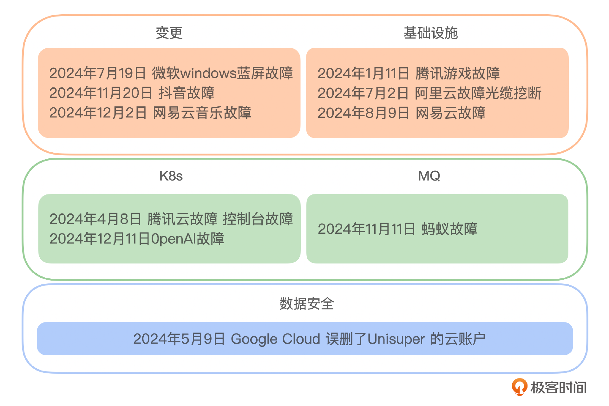
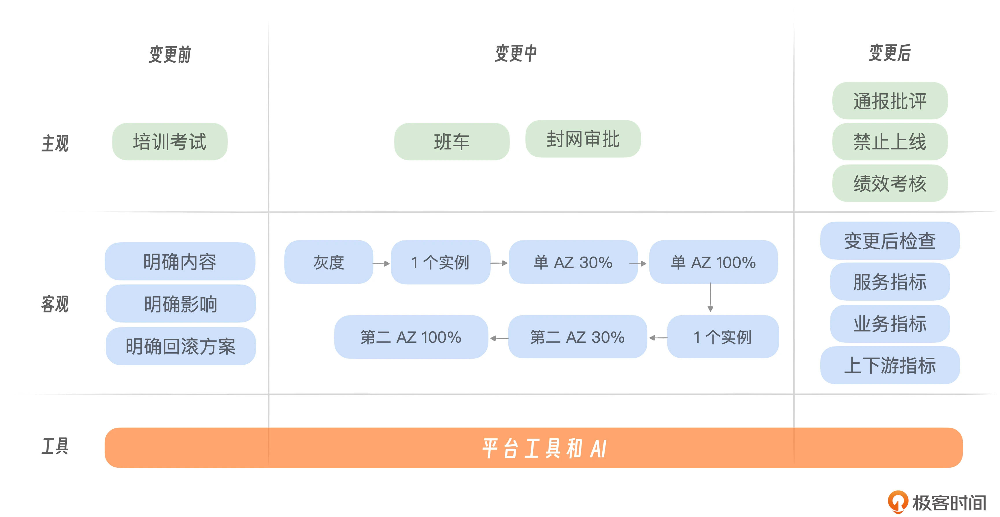
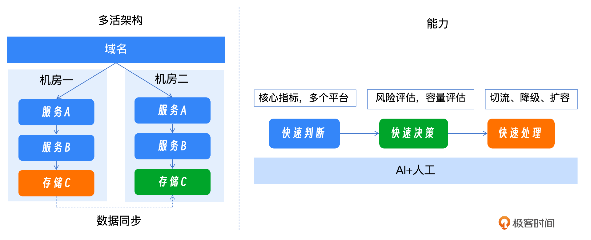
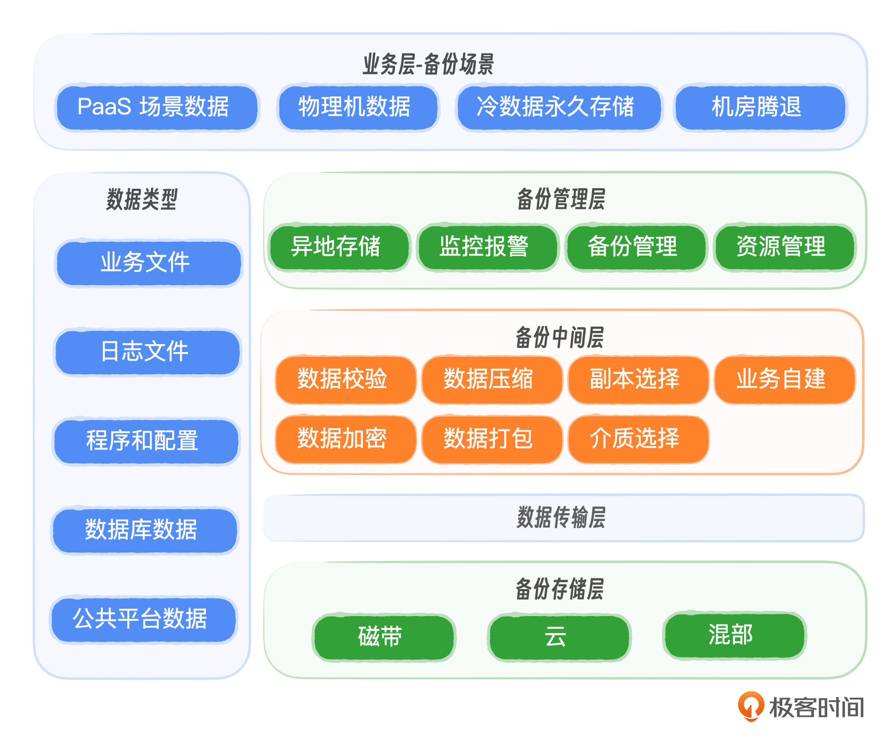
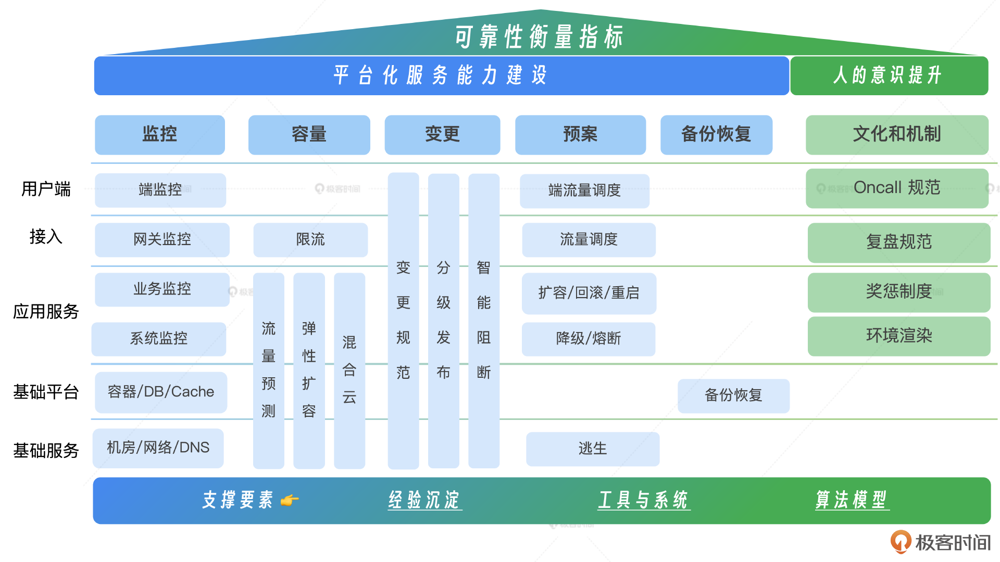

# 元旦加餐 | 2024年互联网大厂故障盘点

你好，我是白园。

2024 年马上就要接近尾声了，这节课我们来回顾一下 2024 年互联网大厂发生的一些重大故障，以及带给我们的启示。这节课我选取了 10 个经典的案例进行分析回顾。通过分析这些案例，我希望新的一年我们可以吸取教训，避免类似问题的发生。

## 故障回顾

### 2024 年 1 月 11 日腾讯游戏故障

故障描述：1 月 11 日晚，多位网友表示包括《英雄联盟》《王者荣耀》《和平精英》在内的多款腾讯旗下游戏出现服务器崩溃、掉线的问题。“腾讯游戏全部断开”登上热搜。

故障原因：腾讯游戏回应称：今夜 0 时许，因运营商线路故障导致网络波动，部分区域服务器的用户出现掉线和暂时无法登录的情况。

### 2024 年 4 月 8 日腾讯云：控制台故障

故障描述：2024 年 4 月 8 日 15 点 23 分，腾讯云团队通过告警系统监测到云 API 服务异常，并迅速收到大量客户反馈无法登录腾讯云控制台。故障持续了约 87 分钟，从 15:23 到17:00‌。此次故障导致部分公有云服务无法使用，包括云函数、文字识别、微服务平台等‌。

故障影响：故障主要影响了控制层面，导致云 API 服务出现异常。这一问题进一步影响了依赖云 API 的多个公有云产品，最终导致大量用户受到影响。

故障原因：确定故障根因是配置数据错误，并设计数据修复方案‌。版本兼容性与灰度机制‌：新版本 API 接口协议变化导致旧版本数据处理异常，灰度机制不足导致异常数据快速扩散‌。

### 2024 年 5 月 9 日 Google Cloud 误删了  UniSuper  的云账户

故障描述：2024 年 5 月 9 日，一个前所未有的事件震惊了全球金融科技界，由于谷歌云工程师操作失误，管理着 800 亿美元资产的投资公司 UniSuper 整个云环境被删除，数十万的用户数据和资产记录被清空。

故障原因：Google Cloud 方面承认，由于配置过程中的一个失误，导致 UniSuper 的私有云的账号和数据被意外删除。“前所未有的配置错误”不仅导致了服务的中断，同时也由于云账号的删除，导致两个位置的数据都被删除了。不过幸运的是，UniSuper 在另一家云服务商那里存有的备份，这成为了他们的救命稻草。在紧急恢复行动中，这些备份发挥了关键作用，最终帮助 UniSuper 恢复了服务。

### 2024 年 7 月 2 日阿里云故障：光缆挖断

故障描述：B 站（哔哩哔哩）崩了、小红书崩了、酷安网崩了相继上了微博热搜。阿里云官网显示，上海可用区 N 出现网络访问异常，阿里云售前客服称，10:04 阿里云监控发现上海地区可用区 N 网络访问异常。阿里云工程师紧急处理后，于 10:35 完成网络切流调度，10:42 访问异常问题恢复。

故障影响：阿里云健康看板显示，对象存储，云服务器云数据库、K8S 均出现了异常。这次故障并没有去年 11 月阿里云全球服务不可用那么严重，但半个小时的单可用区核心服务故障仍然称得上“显著故障”

故障原因：机房光缆中断是此次故障的根本原因，进而导致其他服务异常。

### 2024 年 7 月 19 日 微软 Windows 蓝屏故障

故障描述：‌2024 年 7 月 19 日微软 Windows 蓝屏故障的原因是由美国网络安全服务提供商CrowdStrike 的一次错误更新引起的。‌具体来说，CrowdStrike 的 Falcon 软件在一次内容更新中存在缺陷，导致运行该软件的 Windows 电脑出现蓝屏死机（BSOD）现象。这次故障影响了全球多个国家和地区的 IT 系统，包括航空、铁路、银行等关键基础设施‌。

故障影响：这次的蓝屏事件涉及全球几千万 Windows 用户，波及全球，银行、航空、超市等使用 Windows 并安装了 CrowdStrike 软件的企业。

故障原因：CrowdStrike 作为一款安全软件，在内核级别运行，这意味着它拥有与操作系统管理员相同的权限等级，能够执行更高级别的安全监控和防护措施。CrowdStrike 的 Falcon 软件在一次内容更新中存在缺陷，导致运行该软件的 Windows 电脑出现蓝屏死机（BSOD）现象。

### 2024 年 8 月 9 日 网易云故障

故障描述：8 月 19 日下午 2 点半左右，大量网友反馈「网易云音乐」App 无法正常使用，随后“网易云音乐崩了”词条迅速登顶微博热搜，引发了广泛关注与讨论。对于这一大面积的故障，网络上迅速出现各种猜测事故原因的传言，比如删库跑路、服务器迁移、机房起火等等。

故障原因：19 日下午 3 点，「网易云音乐」在官方微博做出回应，称因基础设施故障导致各端无法正常使用。同日下午 5 点左右，服务已基本恢复正常。5 点半，「网易云音乐」进一步澄清，否认了“删库跑路”的传言，并公布了针对这次事故的补偿权益。

19 日晚，「网易云音乐」在微博回复了媒体报道，称“今天下午在业务扩容中出现了技术事故”。一位来自网易内部的技术人员透露，此次事故可能与网易在贵州机房的迁移有关。网易二季度刚刚完成贵州机房的迁移，新机房的投入使用评估过程中就存在较高的风险。尽管前期内部评估认为迁移顺利，但实际上结果却令人担忧，搬迁完成后不久便发生了此次事故。

### 2024 年 11 月 11 日 蚂蚁故障

故障描述：11 月 11 日，支付宝遭遇服务中断，相关话题迅速登上微博热搜。众多用户报告称，当天上午支付宝出现服务异常，付款时频繁出现“支付失败”“交易创建失败”和“服务异常”等提示。此外，还有用户反映余额宝提现延迟到账、花呗还款虽扣款成功但账单未清等问题。

故障原因：支付宝官方在 11 时 25 分发布声明，解释称：“由于系统消息库出现局部故障，部分用户的支付功能受到影响。此故障不影响用户资金安全，截至上午 10 时 50 分，故障已得到修复。对于此次服务中断给用户带来的不便，我们深表歉意。”

### 2024 年 11 月 20 日抖音故障

故障描述：2024 年 11 月 20 日下午，抖音遭遇了技术故障，导致用户体验受到了显著影响。根据网友在社交媒体上的反馈，他们在使用抖音时遇到了多种问题，包括无法打开分享的视频，视频显示为“不见了”，以及无法查看收藏记录和浏览记录。此外，还有用户尝试卸载并重新安装抖音应用，以及误以为是自己网络出现问题。

对此，抖音客服迅速做出响应，表示已经注意到用户反馈的问题，并进行紧急排查。抖音客服还提到，由于当前进线量较大，服务繁忙，他们正在加速处理，并请用户耐心等待。目前，抖音已经恢复正常，视频可以正常浏览。

故障原因：关于抖音故障的原因，目前并没有官方的详细声明。根据网上传闻，大概率是内部系统变更导致的。

### 2024 年 12 月 2 日网易云音乐故障

故障描述：12 月 2 日网易云音乐今晚出现故障，App 页面数据加载失败。

故障原因：开发页面配置错误导致安卓端少量版本的用户首页报错，故障时间 20 分钟左右。目前相关问题已修复，重新进入网易云音乐即可正常使用。网易云音乐还称，将为受到影响的用户赠送 7 天网易云音乐黑胶 VIP。

### 2024 年 12 月 11 日 OpenAI 故障

故障描述：2024 年 12 月 11 日，OpenAI 遭遇了一场全球性的服务中断，影响了包括ChatGPT、API、Sora、Playground 和 Labs 在内的多项服务。此次中断从下午 3:16 开始，一直持续到晚上 7:38，总计超过四个小时，造成了显著的影响。

故障原因：根据 OpenAI 事后发布的故障报告，此次故障的直接原因是新部署的监控系统对Kubernetes 控制面造成了过大压力。由于控制面故障导致 DNS 服务依赖 Kubernetes，无法立即回滚新部署，从而加剧了故障影响，导致了长时间的服务不可用。

## 故障分析

从我们刚刚分析的 2024 年这 10 大故障中，我们可以看到很多故障都是变更导致的。从严格意义上来看，其他的一些故障也都或多或少地和变更有关系。而且越是底层的平台或者基础设施，发生故障之后的影响越大，K8s 和云技术作为目前的主流，一旦发生故障，影响将会是空前的。

## 反思和总结

反思一：变更是稳定性的最大威胁。要有效应对变更，我们不仅需要从客观角度出发，还必须考虑主观因素。我们可以利用平台、工具和人工智能技术来提升风险管理的效率和成效。然而，最关键的还是执行严格的流程控制，还要注意培养人的意识，人才是万物的尺度。你可以参考课程的第 3 课和第 6 课。

反思二：极端情况下最有效的应对手段还是多活架构和逃生能力，这个已经从多个重大故障中得到了证明。很多公司都在提多活的建设，多活建设最重要的是演练和使用，很多次故障都验证了如果日常的验证做得不够，是无法在故障时做出即时响应的。关于这一应对手段我在课程中的第 15 课有详细描述，你可以看一看。

反思三：绝不能忽视最后的安全网——备份和恢复机制。数据丢失可能导致灾难性后果，因此我们必须时刻关注备份的有效性。关于备份与恢复相关的策略你可以查看课程的第 5 课和第 16 课了解更多内容。

反思四：无论技术发展到何种地步，稳定性始终是核心议题。稳定性是那个至关重要的“1”，没有它，即便是如日中天的 OpenAI，一旦发生故障，再先进的技术也将变得毫无价值。

关于如何保障稳定性，我们的课程有系统性的讲解。我们可以从监控、容量、变更、应急预案、数据备份、人的意识六个层面的提升。

- 监控指标：关注召回率和时效性，确保能够迅速准确地识别问题。

- 报警系统：重视报警的准确率和数量，避免误报和漏报，同时控制报警的频率，以免造成警报疲劳。

- 变更管理：实施分级发布策略，提高覆盖率，确保变更的平滑过渡和风险控制。

- 容量规划：评估系统的容量水位能力，确保在高负载下仍能保持性能。

- 应急预案：提高预案的有效率，并通过定期演练来验证其有效性，确保在紧急情况下能够迅速响应。

- 数据备份：确保备份的覆盖率，保障数据的安全性和可恢复性。

- 人的意识：此外我们还要培养自身的可靠性意识，不仅仅停留在使用工具和技术解决问题的阶段，而是从意识层开始改变，提升对线上的敬畏心。

## 最后

我们必须始终保持对技术的敬畏之心，认识到每一个小的疏忽都可能导致严重的后果。我们需要不断加强系统安全性，提高故障预防和应对能力，以确保在面对潜在的技术挑战时能够迅速有效地响应。

展望未来，我衷心祝愿在新的一年里，每一位企业家、每一位互联网从业者都能够在事业上一帆风顺，实现稳健的发展。愿我们共同携手，以更加谨慎和专业的态度，迎接每一个挑战，确保我们的技术环境更加安全可靠。
