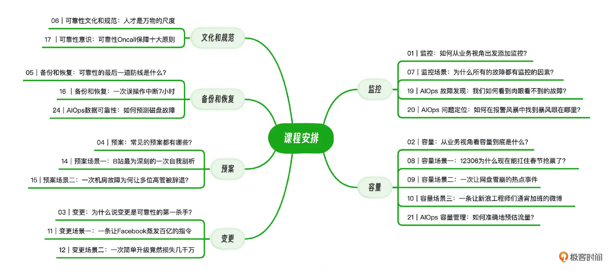

# 结束语 | 这里不是终点，而是一个起点

你好，我是白园。今天，我们共同走过的服务可靠性之旅正式画上了圆满的句号。在这段难忘的旅程中，我非常荣幸能与你同行。然而，这不仅仅是一个结束，更是一个新的开始。让我们携手迎接新的挑战，共同开启下一篇章的旅程。

## 课程回顾

在我们即将结束本系列课程之际，让我们来回顾一下所涵盖的内容。首先，在基础篇中，我们深入探讨了服务可靠性的六大核心要素：监控、容量规划、应急预案、变更管理、数据备份等，为理解这一领域打下了坚实的基础。接着，在第二章节中，我们通过一系列实际案例和场景，将理论知识与实践相结合，加深了对服务可靠性的理解。而在第三章节，我们进一步探索了 AIOps 技术在各个领域的应用和实现，展示了如何利用人工智能提升服务的可靠性和效率。

为了帮助你更系统地学习和理解这些知识点，我梳理了一份脑图作为你复习时的参考。如果你正专注于某一特定领域的深入研究，可以根据脑图中的布局来安排你的学习计划。本课程旨在为服务可靠性领域提供一个全面的入门视角，希望它能成为你探索这一领域的起点。

## 可靠性与大模型

如今，ChatGPT 无疑已经对工作流程产生了重大影响，但目前它在服务可靠性领域的发展还处于探索阶段。对于如何利用这一技术我也有一些思考。首先，我们需要保持开放的心态，积极接纳并尝试这些新兴技术。不要害怕或抗拒，而应该去探索它们的潜力和局限，了解它们能解决哪些问题，以及它们在哪些方面可能还不足以应对。

- 技术融合与创新：将 ChatGPT 等 AI 技术与现有的运维系统相结合，可以提高自动化水平，减少人为错误，提升响应速度。通过集成专业的运维知识库，可以使 AI 模型更加精准地理解运维场景和需求，提供更专业的建议和解决方案。

- 问题分类与智能决策：对问题进行有效分类是实现智能决策的关键。可以设置规则，让 AI模型根据问题的类型和复杂度，选择调用知识库还是进行自主分析。

- 持续学习和适应：运维和 SRE 领域不断进步，新技术层出不穷。保持学习和适应新技术的态度，是保持竞争力的关键。在日常工作中，不仅要深入专研现有技术，还要关注新兴技术的发展，以便在必要时迅速做出调整。

- 人机协作：人工智能是辅助工具，最终的决策和执行还需要人的参与。建立人机协作的模式，可以最大化地发挥 AI 的潜力，同时确保决策的合理性和安全性。

- 反馈循环：建立一个反馈机制，不断收集 AI 模型在实际运维中的表现和效果，以便持续优化和调整模型。

- 安全与合规性：在采用新技术时，要确保它们符合行业安全标准和法律法规，避免潜在的风险。

最重要的是我们要保持专注，深入研究我们的本职工作。无论是运维还是 SRE，都需要我们不断深化专业知识，打好基础。在保持现有工作的同时，我们也应该不断学习新知识，这样在需要时，我们就能够迅速适应并做出改变。

## 保持学习

在最近几年中，董宇辉对我产生了深远的影响。他展现出的特质包括深厚的知识底蕴、流畅的表达能力、在成功前的坚持和成功后的谦逊、对金钱的淡定态度。他拒绝了年薪过亿的工作机会和价值千万的广告邀约，选择参与央视的文化节目和高校演讲。这些选择体现了他对于什么是重要的、什么是次要的有着清晰的判断。保持坚定的意志和清晰的心智，是决定一个人能否走得长远的关键。

现在让我们假设一下，如果董宇辉没有一夜成名，他还会成功吗？我相信答案是肯定的。他拥有丰富的知识储备、坚定的意志和热情如火的投入。即使可能不会那么引人注目，但凭借这些品质，他至少会做得不错。

持续深入阅读和学习，时间会给出答案。尽管大学期间已经接触过相关知识，但我认为持续学习是非常必要的。今年，我投入了大量时间学习，包括机器学习、运筹学、概率论和数据可视化。这些学习让我在看待服务可靠性时，获得了全新的视角。

最后我分享几篇对我影响很大的文章：

董宇辉 5 月在传媒大学的演讲对我产生了深远的影响。他之所以能够在网络上迅速走红，背后是他对知识的深厚积累和不懈追求。他的成功给了我一个重要的启示：在正确的道路上，每天的微小进步都能汇聚成巨大的成就。

在周志华老师的演讲《从预测到决策》中，我获得了深刻的启发。这篇文章解答了我长期以来的困惑：为什么我们在基础学习中主要关注预测，而在智能运维等领域，决策却显得如此稀缺。如果我们要进行决策，应该如何去做？这篇文章无疑为我未来的工作提供了坚定的指导。

陆奇老师的演讲《我的大模型世界观》则给我带来了震撼。他对问题的独到见解和高瞻远瞩的视角，让我意识到问题还可以有这样不同的观察角度。此外，他 PPT 中的可视化技巧也给我留下了深刻印象，教会了我如何在一张幻灯片中清晰而全面地展示关键信息

路漫漫其修远兮，吾将上下而求索。服务可靠性之旅在这里正式起航！

听我说了这么多，最后我也想听一听你的声音，为此我准备了一份结课问卷，希望你画几分钟时间填写一下，期待听到你的意见和建议。

