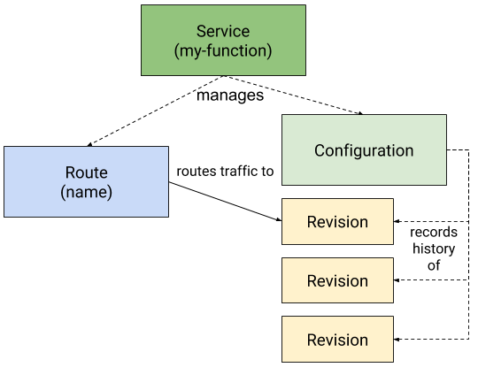
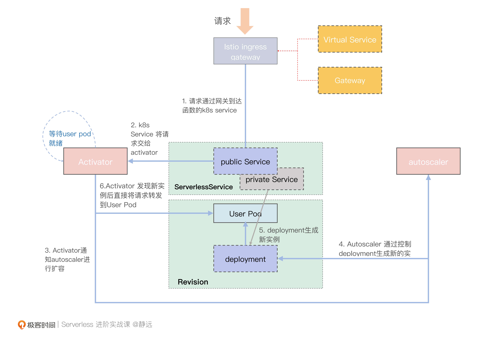
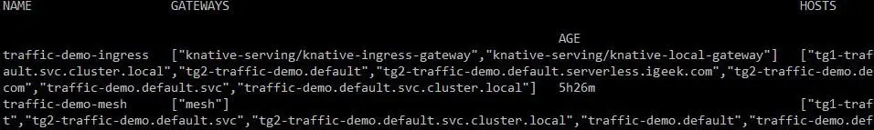
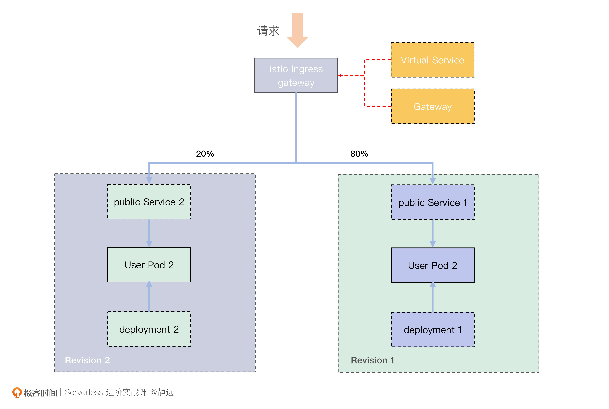
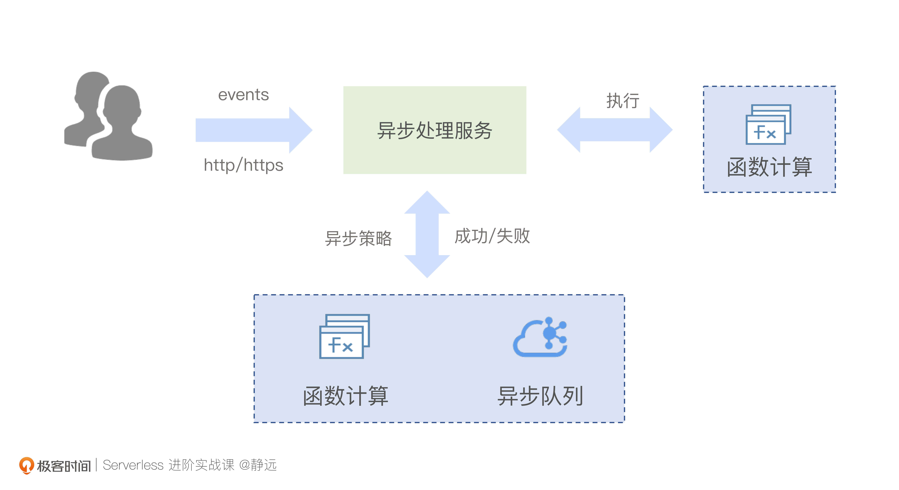
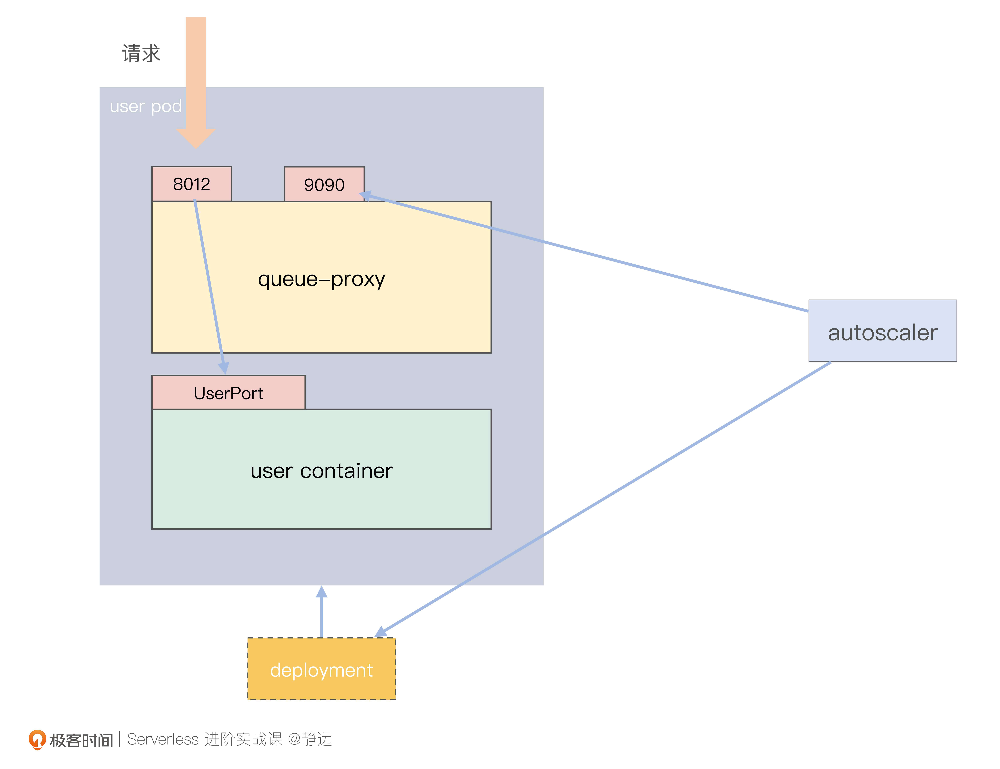

# 06-流量转发：函数在不同情形下是如何执行的？

你好，我是静远。

在前面的课程中，我跟你分享了函数实例的冷启动和扩缩容，这两个点是 Serverless 的核心特征。可以说，提到 Serverless 必然会提到冷启动和扩缩容。但你是否想过，是什么促使Serverless 的函数实例从 0 到 1，从 1 扩容到 N，又从 N 缩容到 0 的呢？

这正是我本节课程要跟你分享的主题——流量机制。确切地说，是流量在这些情形下的转发机制。希望通过这节课，你能够了解 Serverless 在冷热启动、常规流量升降、异步请求、多并发等不同情形下流量的转发过程，并在脑海中构筑出一幅 Serverless 的全链路流量转发拓扑图。

这节课，我选择了 Knative 作为开源的 Serverless 引擎框架，来介绍冷启动和分流机制的流量转发。至于详细的开源引擎的分析、以及开源引擎私有化整体解决方案，我会在第三模块实战进阶中跟你详细探讨。

## 知识储备

在讲流量转发之前，我们先来回顾一下 Knative，它主要包括 Eventing、Serving，Build 三大组件，其中 Build 现在已经被tektoncd/pipeline替代。这三大组件中，跟我们主题相关的主要是分管流量的 Serving 组件。

Knative Serving 定义了一组特定的对象，使用 Kubernetes CRD的方式来实现这些对象。我们看一张 Knative 官方简单示意图：



当用户创建一个 Knative Service 的时候，它的 Controller 会自动创建对应的 Route 和Configuration 资源，其中 Configuration 就对应了我们关于业务代码的镜像配置，每次Configuration 修改后，就会创建出对应的 Revision 版本。

Revision 则代表某一时刻的 Configuration 的快照，每个 Revision 会拥有一个自己的Deployment，如果流量策略定义了转发给不同的 Revision，那么实际上，就是转发给这些Revision 的 Deployment。

图中的 Route 继承了 Service 中的流量策略的相关配置，也会决定请求的流量转发走向。如果Service 中没有定义相关流量策略的话，那么就是默认所有流量转发给最新的 Revision。

## 流量转发

有了 Knative Serving 基本概念的知识储备，我们就可以开始从流量的入口说起了。

### 入口流量

入口的网关层面，Knative 从设计之初就考虑到了扩展性的问题，通过抽象出 Knative Ingress资源来对接不同的网络扩展。一般来说，我推荐使用 Kourier、Istio、Contour 这三种来做对接。如果我们的 Knative 使用了 Istio 作为网络组件，那么外部流量就会传给 istio-ingressgateway，它会根据 Knative Serving 创建的 VirtualService，并结合 Gateway 来决定把流量转发给哪个用户 Service。

那么 Gateway 和 VirtualService 具体的角色和协作方式是什么样子的呢？我们一起看一下。

- Gateway：用于暴露对外服务的端口和域名，决定了哪些流量是可以经过的。比如下面这个例子定义的是访问域名 jy.geekbang.com 且指定 80 端口的流量可以经过这个 Gateway。

```
apiVersion: networking.istio.io/v1alpha3
kind: Gateway
metadata:
 name: jy-gateway
spec:
 selector:
   app: istio-ingressgateway
 servers:
 - port:
     number: 80
     name: http
     protocol: HTTP
   hosts:
   - jy.geekbang.com
```

- VirtualService：用于配置流量的路由，类似 Nginx 的 Server 配置，通过和 Gateway 关联，来决定流量的最终去处。这里我也给你一个示例，结合上面的 Gateway，这里表示的是从上面网关过来的流量最终会发往 jy-demo-v1.default.svc.cluster.local。

```
apiVersion: networking.istio.io/v1alpha3
kind: VirtualService
metadata:
 name: jingyuan-vs
spec:
 hosts:
 - jy.geekbang.com
 gateways:
 - jy-gateway
 http:
 - route:
   - destination:
       host: jy-demo-v1.default.svc.cluster.local
```

### 冷启动的流量转发

下面我们来看一下 Knative 的冷启动情况下，流量是如何被处理的。



- Knative冷启动过程示意图

这里需要说明一下，为了方便你专注于冷启动的转发过程，我将一些不涉及到流量部分的交互暂时去掉了，比如 ServerlessService 的模式转变，AcutoScaler 指标上报等。

另外，图中我针对不同对象资源做了颜色和线条的区分。其中，所有的实线矩形都表示 Pod对象，也就是具体处理请求的进程，而虚线矩形则代表非 Pod 类型的其他资源对象。

这里，我们着重介绍图里的 Public Service 和 Private Service，它们是决定流量走向 Pod IP还是 Activator 的关键。我们来分别看一下。

- Public Service：由 Knative 管控，其 EndPoints 是可变的。如果当前的 Revision 存在User Pod，那么 Public Service 的 EndPoints 会与 Private Service 的保持一致，指向这些实例；而如果不存在 User Pod，那么冷启动流程时，其 EndPoints 将指向 Activator 的 IP地址。

- Private Service：通过 Label Selector 来筛选图中对应的 Deployment 产生的 User Pod，其他组件可以通过监听 Private Service 的 EndPoints 情况，来了解当前的 Revision 是否有User Pod 存在。因为其本身不做流量的转发，所以我在图中用灰色体现。

- Knative冷启动过程示意图

了解了冷启动流程图中每一个区块的含义，我们再来对照着图片了解一下冷启动的实际请求流向。

步骤 0：这里要完成的是准备工作。当你打包好函数镜像，创建好 Knative Service 之后，Knative 会根据定义来创建 Route、Configuration（cfg）资源，然后 cfg 会创建对应的Revision 版本。Revision 又会创建 Deployment 提供服务。

步骤 1：当请求到达 Istio Ingress Gateway 后，Istio Ingress Gateway 会根据 Gateway 和virtualService 配置信息，将请求转发给 Public Service。

步骤 2：由于此时集群中还没有 User Pod（图中的 User Pod 需要等到 AutoScaler 扩容后才有），而 Public Service 的 EndPoints 配置的是 Activator，所以请求接下来会交给 Activator 处理。

步骤 3：Activator 会将收到的请求暂存，同时统计请求对应 Revision 的实际流量并上报给AutoScaler。另外，Activator 还会不断监听 Private Service，检查是否已经存在 User Pod了。

步骤 4：AutoScaler 根据流量情况控制对应 Revision 的 Deployment 来实现 User Pod 的扩容。在冷启动过程中，会至少保证创建一个 Pod 出来。

步骤 5：Deployment 创建新的 User Pod，同时会更新 Private Service 的 EndPoints，将Private Service 的 EndPoints 指向新生成的 User Pod。

步骤 6：Activator 检测到 Private Service 关联的 EndPoints 后，会将请求直接转发到新的User Pod。User Pod 收到请求后，就会执行业务逻辑。

其实在从 0 到 1 的过程中，还有一点需要说明的，那就是在 User Pod 创建成功后，AutoScaler 会触发 SKS 的模式为 serve，同时将 Public Service 的 EndPoints 同步为 PrivateService 的 Endpoints，也就是切换回了常规流量的处理模式。而新的流量到来后，就会通过Public Service 直接到达 User Pod，不再走 Activator 代理。

但 Knative 本身引入了一个 TBC（Target Burst Capacity）来控制什么情况下 Activator 会从流量路径中摘除，这样做的好处是为了防止流量突然的增大，导致单个 Pod 失衡，进而影响到请求的丢失。

这就是 Knative 在冷启动下的流程机制，我们可以看出，Knative 针对流量从 0 到 1 的启动过程，考虑到了流量的突增的因素，在流量入口，考虑到了便捷的扩展能力，能够更好地复用网络组件。

那么，他又是怎么基于已有的网络组件快速做到流量的治理，做到小流量上线的呢？

### 流量分流机制

我们在知识储备中了解到，Service 负责创建 Route、Configuration 以及 Revision 资源，通过Service 可以将流量路由到指定的 Revision 中。而在指定的过程中，分流的核心是 Route，它负责把网络端点映射到一个或多个 Revision，可以通过多种方式管理流量，包括灰度流量和重命名路由。

首先来看一个普通的 Knative Service 定义，该 Knative Service 下有两个版本，分别是Revision traffic-demo-v1、traffic-demo-v2，流量策略按 80:20 的比例路由到不同 Revision，tag 分别是 tg1 和 tg2。其中流量策略定义如下所示：

```
traffic:
 - tag: tg1
   revisionName: traffic-demo-v1
   percent: 80
 - tag: tg2
   revisionName: traffic-demo-v2
   percent: 20
```

在 Knative Service 部署到 default namespace 后，Knative 就会创建 Route 对象，因为我们的 Knative 用了 Istio 作为网络组件，所以还会继续创建 Istio VirtualService（traffic-demo-ingress）。

在图中，你可以看到第一个 VirtualService 关联了 Knative 创建的两个 Gateway，第二个关联的 Gateway 是 “mesh”，这是 Istio 保留的一个关键字，意思是将 VirtualService 的规则应用到集群里所有的 sidecar，这里我们可以先忽略它。



我们看一下 traffic-demo-ingress 的路由生成，由于配置信息量比较大，我将 route 相关的部分列了出来，方便你更清晰地查阅：

```
route:
     - destination:
         host: traffic-demo-v1.default.svc.cluster.local
         port:
           number: 80
       headers:
         request:
           set:
             Knative-Serving-Namespace: default
             Knative-Serving-Revision: traffic-demo-v1
       weight: 80
     - destination:
         host: traffic-demo-v2.default.svc.cluster.local
         port:
           number: 80
       headers:
         request:
           set:
             Knative-Serving-Namespace: default
             Knative-Serving-Revision: traffic-demo-v2
       weight: 20
```

你可能会想，destination 的 host 格式为什么要命名为：traffic-demo-v1.default.svc.cluster.local。

这里我简单提一下，这种命名本身就是 Kubernetes Service 的 DNS 的名字，是 Kubernetes内部使用的名称。名称的组成规则是 <service 名字 >.<namespace 名字 >.svc.，zone 名字一般是 cluster.local。比如 namespace default 下部署了一个 traffic-demo-v1 service，那么它的DNS 名称就是 traffic-demo-v1.default.svc.cluster.local。

在 Knative 中，我们通常可以通过修改 config-domain 的配置来自定义一个域名后缀，使得外部请求的时候可以访问。再由 istio ingress gateway 根据 virtualService 中配置的这些策略实现分流，最终实现下图的效果。



在小流量 / 灰度的发布上，开源的引擎框架 Knative 就是这样做的了。但云厂商可能由于平台的完备性，具备专门的自研小流量实验基建的服务能力，一般也会基于流量的抽样落点来进行。

## 常用功能点

在上面的内容中，我们从流量入口着手，了解了 Serverless 引擎在冷启动和小流量下的流量转发机制。那么，云厂商在流量转发上还有哪些加持呢？我们可以聊聊平时常用的两个功能点：异步调用和单实例多并发下的流量转发机制。

### 异步下的流量调度

我们从前面已经了解到，同步的调用请求可以通过路由功能进行分流，那么异步和它有什么样的不同呢？

一些离线任务往往适合从同步流程中剥离出来，进行异步处理。比如像日志清洗、定时触发、音视频处理等等。目前主流的函数计算平台都提供了函数的异步处理能力。

用户通过异步接口的 API 主动发起，在异步调用函数时，你不需要等待函数代码的响应，只要把这次请求交给平台侧处理就可以了。当然，更多的场景通常是结合各类异步触发器来使用。比如我们之前学到的对象存储触发器，通过设置好存储桶 Bucket 和存储对象的匹配规则，就可以简单快捷地实现音视频转码以及 ETL 等业务逻辑的处理。



这里，我们可以简单说一下异步下的流量调度过程。

请求首先会到达异步处理模块，并按照顺序排队，这也是异步处理模块通常会结合消息队列实现的原因。当轮到你的请求被处理时，异步处理服务会再将请求发到对应的函数实例进行执行，并将执行结果反馈到你配的监控日志上。除此之外，像 AWS、阿里等主流的函数计算平台还会支持异步的执行策略，你可以根据每次异步执行的最终结果来配置“执行成功”和“执行失败”的下游服务。

总的来说，异步调用主要通过事件 / 消息队列的方式来缓冲一步，然后通过异步处理模块，按照同步请求的请求机制来处理。流量的转发除了在入口处不一样之外，后续的同步请求依然跟上面类似。

### 多并发下的流量转发

下面我们再来看请求在单实例多并发下的流量调度过程。

先看两个概念：

- QPS，函数实例 Pod 每秒可以响应的请求数；

- 并发数，同一时刻函数实例 Pod 接收的请求数。

从这两个概念中我们能够发现，并发数的增加并不一定会导致 QPS 增加。达成了这个共识之后，我们再来看一下函数计算的并发实现需要注意哪些要点。

首先，你需要是 HttpServer 的服务类型。

如果你是基于云厂商的标准运行时，就需要看一下他是否支持。我会在运行时这节课里给你分析关于 GoLang Runtime 的代码片段，当请求到来时，除了以 HttpServer 的形式运行之外，还会通过 go func 的形式进行处理，这种方式可以从一定程度上进一步提升函数的并发处理能力。

其次，你的服务需要能在框架中暴露端口，供流量转发进来。

第三，需要有一个组件来控制并发。由于云厂商没有公布实现，我们还是回到 Knative 中来看，它提供了 queue-proxy 和 AutoScaler 的搭配能力，完美解决了流量的并发问题。

queue-proxy 是 一个伴随着用户容器运行的 Sidecar 容器，跟用户容器运行在同一个 Pod中。每个请求到达业务容器 User Container 之前，都会经过 queue-proxy 容器。

它的主要作用是统计和限制到达 User Container 的请求并发量。当你对一个 Revision 设置了并发之后，比如设置了 10，那么 queue-proxy 就会确保不会有超过 10 个的请求达到 UserContainer。

那么，如果有超过 10 个请求到来，又该怎么办呢？它会先暂存在自己的队列 queue 里面，同时通过 9090 端口，统计当前 User Pod 的并发情况，提供给 AutoScaler 采集和扩缩容参考。



## 小结

最后我们来小结一下。今天我给你介绍了 Serverless 形态下的流量转发过程，包括冷启动、小流量、异步调用、多并发下几种场景的流量调度机制。

首先，我们选取了社区活跃度较高和经验客户使用较多的 Knative 作为切入点来展开，为了便于你理解流量的转发过程，我们先解释了 Knative 的关键资源对象及其作用。通过流量入口的介绍，我们可以发现 Knative 网关层面的扩展性是非常值得我们平时在设计云原生架构时参考的。

接着，我详细分析了容器实例在流量到来时，从 0 到 1 时请求的执行过程。这里面涉及到核心的 Activator 用来承载从 0 到 1 和从 N 到 0 的桥接，它能根据请求量来对请求进行缓存和负载。与它一起协作的资源有 Serverless Service（SKS）和 AutoScaler。

同时，我们可以通过在 Knative Service 中定义 Revision 的流量比例，通过创建 IstioVirtualService 来配置不同版本的分流策略。

在异步场景下，我们还可以通过队列的方式来做到削峰填谷，进一步完善 Serverless 平台的能力。

最后，我提到了实现并发响应的几个要素，HttpServer 服务和旁路的流量代理组件是一个不错的组合。通过流量的转发能力，使得你可以在 Serverless 下依然享受高并发的处理能力。

相信在学习过今天的课程之后，你已经能通过开源的引擎框架去学习，并且在查阅云厂商的介绍时更加的得心应手了。在进阶实战的板块里，我还会跟你一起来探讨基于开源引擎构建一个Serverless 平台的能力，可以期待一下。

## 思考题

好了，这节课到这里也就结束了，最后我给你留了一个思考题。

在遇到突发流量到来的时候，Knative 是如何应对的？有哪些参数控制？

欢迎在留言区写下你的思考和答案，我们一起交流讨论。感谢你的阅读，也欢迎你把这节课分享给更多的朋友一起交流学习。

## 延伸阅读

关于 Knative Serving 路由机制可以继续通过官方手册深入阅读一下。
