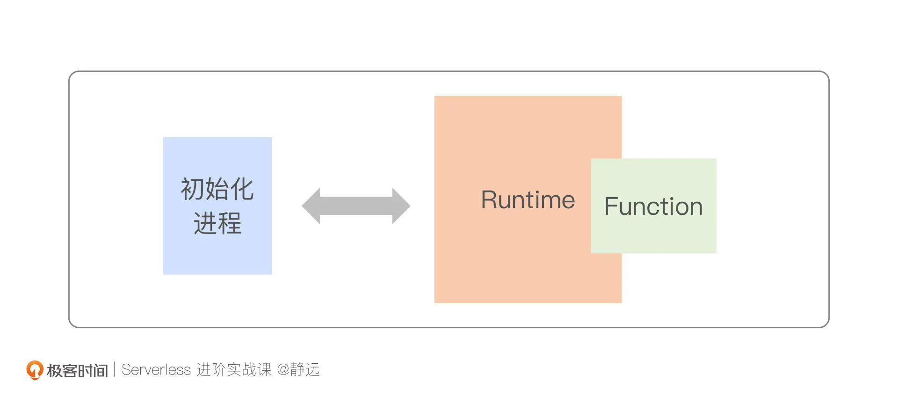
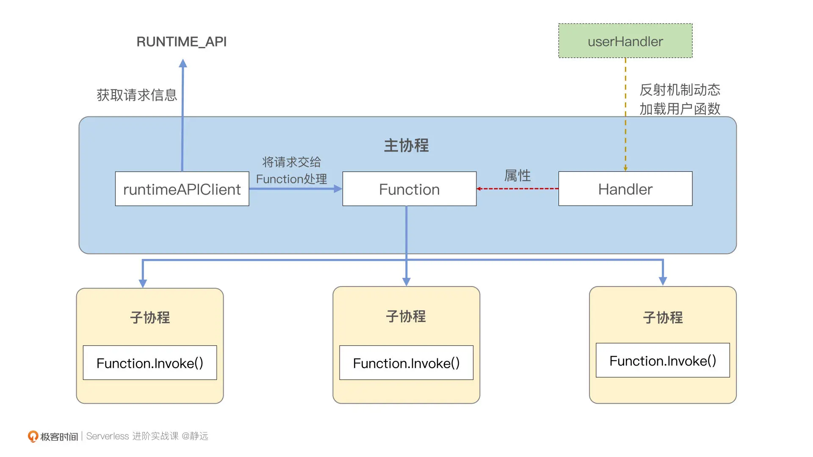
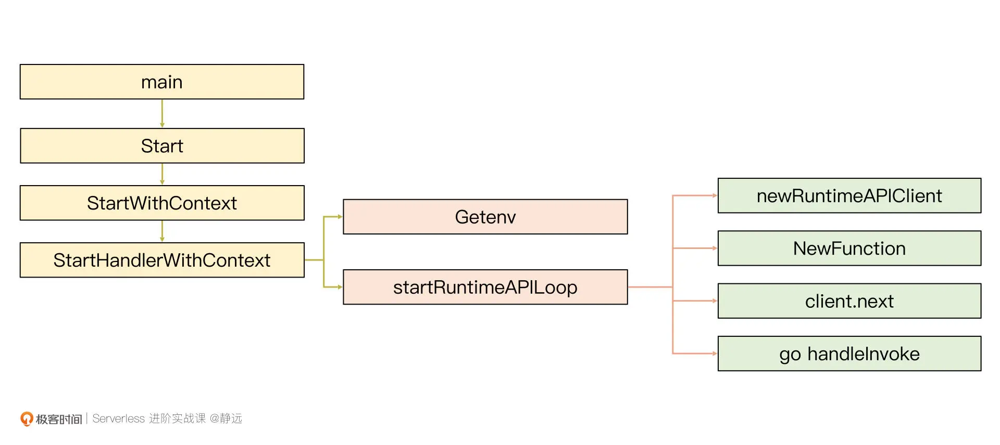

# 07-运行时（上）：不同语言形态下的函数在容器中是如何执行的？

你好，我是静远。

在生命周期这节课里，我和你提到了支撑函数运行起来的核心之一是运行时，而且我们还可以在函数计算的平台上选择不同语言的运行时来开发我们的函数，这其实也是函数的一大优势：多语言的运行时，可以极大降低开发者的语言门槛。

那么函数计算层面的运行时是什么呢？不同语言的运行时，它们的工作机制是一样的么？如果让你来自定义一个运行时，你打算怎么做呢？

带着这些问题，今天我们来聊聊这背后的实现。我会从源码的角度，以编译型语言 Golang、解释型语言 Python 为代表，来跟你层层分析函数计算运行时的机制，带你抽象出通用的思路，并体验如何构建一个自定义运行时。

希望通过这两节课，你能够对运行时的原理和特性有一定的理解，搞清楚函数计算平台究竟是如何打破编程语言技术栈的限制，为开发人员提供多种开发环境的。同时，相信这节课也会帮助你在后续的函数计算使用和开发中更加得心应手。

今天这节课，我将重点介绍运行时的基本特性和实现原理，并以编译型语言 Golang 为切入点来讲解它的运行流程，让你先有一个从 0 到 1 的认知过程。

## 运行时究竟是什么？

我们对“运行时”这个名词并不陌生，任何编程语言都有它自己的运行时。比如 Java 的运行时叫 Java Runtime，它能够让机器读懂这些 Java 的代码并且运行起来，换个说法，就是它让代码可以和机器“打交道”，进而实现你的业务逻辑。

那么，迁移过来理解，函数计算运行时（Runtime）就是能够让函数在机器或容器中执行起来，实现业务逻辑功能的执行环境，它通常由特定语言构建的框架构成。函数计算的运行时依赖语言的运行时存在。不过由于更贴近上层应用，分析它的工作原理要相对简单一些。



上面的示意图，展示的是运行时、函数的组合与初始化进程的关系。在函数实例初始化时，函数运行时一般会由一个初始化进程给加载起来，然后 Runtime 就可以进行服务请求的内部通信，正常接收、处理请求。当请求到达后，你的代码就会在对应的语言运行时中被加载起来的代码处理。

因此，我们可以简单地将 Runtime 理解为一个特定语言环境下的服务框架环境，这个服务将以一个进程的形态运行在用户容器中，并与用户代码相关联。当服务启动后，会一直等待请求的到来。一旦请求到达，运行时就会关联你的代码去执行，执行完成后，又会继续处理下一个请求。

这里我要强调的是，这个执行不一定是串行的，有的架构为了提升并发，也会采用协程或者线程的方式去执行。

这个流程看起来比较容易理解对不对？那么，我们再深入流程看一眼，想一想，不同的语言运行时的实现，是一样的吗？

## 实现原理

运行时，归根到底还是一个编程语言编写出来的具体程序，所以对于上面这个问题，我们先来看看编程语言本身有哪些区别。

### 语言类型

我们知道，计算机只能执行二进制指令，而我们根据不同编程语言转换为二进制指令的时机，将不同的编程语言分为了解释型语言和编译型语言。

编译型语言，比如 C、C++、GoLang，在编译时需要将所有用到的静态依赖、源码一起打包，编译完成后就可以直接执行。而像 Python、Node.js 这种解释型语言则只需要通过解释器执行，因此，完全可以做到业务代码与依赖分离的形式。

这里需要注意一点，我们常用的 Java，虽然需要经过编译，但是编译产生的机器码需要由JVM 再次转换为二进制指令，因此是具有解释型和编译型两种特性的。我个人更偏向将其定位为编译型语言，因为在你使用 Java 开发函数的时候也会发现，我们通常是将所有依赖包打包成一个 Jar 包或者 War 包的方式上传，比较符合编译语言的风格。

另外，如果你使用过不同云厂商的函数计算平台，你会发现，像 GoLang、Java 这类编译型语言，通常在开发过程中，都需要强依赖一个平台提供的包，而 Python、Node.js 则不需要，这是为什么呢？

在上面提到的语言类型的区别中我们提到，因为编译型语言需要将所有关联的静态代码依赖一起打包，所以在函数实例上具体的体现，就是你的业务代码和运行时会生成一个完整二进制文件、Jar 包或者 War 包。

了解完语言的不同，你应该也做好这两种函数计算运行时的实现也会不同的心理准备了。接下来，我会从从编译型和解释型两个角度来分别跟你聊一聊运行时的实现。

### Golang 运行时

上面我提到，对于编译型语言，用户代码通常需要和运行时一起编译，所以一般的云厂商都会将编译型语言的运行时开源。

这里我们以阿里云函数计算 FC 的GoLang Runtime运行时为例，一起看看它的实现原理。



GoLang Runtime 运行时主要做的事情有三点。

- 获取请求

在 GoLang Runtime 中，平台会提前将 RUNTIME API 写到环境变量里，Runtime 会通过初始化客户端对象 runtimeAPIClient，从这个接口中获取到请求。

- 关联用户的入口函数

用户入口函数，也就是图中的 UserHandler。在 Golang 的运行时中，其实是通过反射机制获取的，并将 UserHandler 封装到一个统一格式的结构体 Handler 中，再将 Handler 作为Function 结构体类型的一个属性进行赋值，这样做的好处是用户完全可以按照自己的编程习惯去定义，而不用对 UserHandler 的结构做出任何限制。

这里解释一下，在源代码中，作者沿用的是 handler，图中的 UserHandler 是我为了区分主进程中的 handler 而替换的一个名字，下文在用户侧定义的 handler，我们都统一用UserHandler 来做区分。

- 调用 UserHandler 对请求进行处理

在获取请求与 UserHandler（如：HandleRequest(ctx context.Context, event string)）后，就可以用第二步创建的 Function 对象去执行请求了。

接下来，我将从 GoLang 用户侧代码的入口函数（main 函数）开始 ，详细地梳理一遍上面的处理过程。

### 入口

当整个二进制被加载起来后，程序首先会进入 main 函数并将用户定义的函数入口方法userHandler 作为参数传入 Start 方法，并对 Start 方法进行调用。

Start 的入参为 interface{}，这样的传参方式可以让你的 userHandler 被定义为任何类型。

```go
/**
* base function type
* eventFunction functionType = 101
* httpFunction  functionType = 102
**/
func Start(userhandler interface{}) {
   log.SetFlags(log.LstdFlags | log.Lmicroseconds)
   log.Println("start")
   StartWithContext(context.Background(), userhandler, eventFunction)
}
func StartWithContext(ctx context.Context, userhandler interface{}, funcType func
   StartHandlerWithContext(ctx, userhandler, funcType)
}
```

进入 Start() 方法后，再深入下去，最终会调用 StartHandlerWithContext 这个方法。接着，会将全局变量 runtimeAPIStartFunction 赋值给 startFunction 这个局部变量。

关于 runtimeAPIStartFunction，我也列出了下方的代码。你可以发现，它包含了一个环境变量名 env 以及一个之后循环处理请求的方法 startRuntimeAPILoop。

```go
func StartHandlerWithContext(ctx context.Context,
    userhandler interface{}, funcType functionType) {
   startFunction := runtimeAPIStartFunction
   // 获取RUNTIMEAPI
   config := os.Getenv(startFunction.env)
   ...
   err := startFunction.f(ctx, config, handlerWrapper{userhandler, funcType}, li
   ...
}
// runtimeAPIStartFunction是提前定义好的全局变量
runtimeAPIStartFunction = &startFunction{
   env: "FC_RUNTIME_API",
   f:   startRuntimeAPILoop,
}
```

最后，在获取到 startFunction.env 的环境变量真实值后，你会发现前面我们传入的userHandler、上下文 Context 以及刚刚获取的环境变量，都传递给了startRuntimeAPILoop，并对它进行了调用，这些其实就是请求处理流程之前所需要的关键信息。

### 准备工作

拿到了函数请求需要的参数后，就需要拉取请求并对其进行处理了，你可以先通过代码来感知一下 startRuntimeAPILoop 是如何工作的：

```go
func startRuntimeAPILoop(ctx context.Context, api string, baseHandler handlerWrap
   ...
   // 创建连接RuntimeAPI接口的客户端，之后客户端会从这个接口获取请求信息
   client := newRuntimeAPIClient(api)
   // 根据传入的UserHandler转化为运行时中标准的Function结构体
   function := NewFunction(baseHandler.handler, baseHandler.funcType).withContex
   ...
   for {
       // 获取请求信息
       req, err := client.next()
       ...
       // 启动新的协程让function对请求进行处理
       go func(req *invoke, f *Function) {
           err = handleInvoke(req, function)
       ...
       }(req, function)
   }
}
```

首先，程序会根据前面获取到的 RUNTIMEAPI 创建一个客户端，这样就保证了请求的获取途径。接着，会根据之前传入的 userHandler 以及 userHandler 类型创建出一个 Function 类型的对象。

这个 Function 对象的创建，会根据 start 入口传递下来的 function type 的值来确定是创建event 类型的 handler 还是 http 类型的 handler，分别对应处理事件的请求和 Http 的请求。

这里我提供的代码中传输的是 eventFuntion，后文就通过这一条方法调用流来进行追踪。

```go
func NewFunction(handler interface{}, funcType functionType) *Function {
   f := &Function{
       funcType: funcType,
   }
   // 这里根据传入funcType来决定构造哪种类型的handler
   if f.funcType == eventFunction {
       f.handler = NewHandler(handler)
   } else {
       f.httpHandler = NewHttpHandler(handler)
   }
   return f
}
```

event 类型的 handler 会通过 NewHandler 获得，该函数的返回值要求返回一个 Handler 类型的接口，这个接口需要实现一个标准的 Invoke 方法。

```go
type Handler interface {
   Invoke(ctx context.Context, payload []byte) ([]byte, error)
}
func NewHandler(userhandler interface{}) Handler {
   ...
   // 获取userhandler的动态值
   handler := reflect.ValueOf(userhandler)
   // 获取userhandler的类型信息
   handlerType := reflect.TypeOf(userhandler)
   ...
   return fcHandler(func(ctx context.Context, payload []byte) (interface{}, erro
       ...
       // 通过动态值对userhandler进行调用
       response := handler.Call(args)
       ...
       return val, err
   })
}
```

在 NewHandler 中，也会利用 GoLang 中的反射机制，获取到 userhandler 的类型和动态值，并通过反射信息构造出一个有标准传参以及返回值的 fcHandler 类型的方法。在 fcHandler中，由于代码中的 handler 本身为 Value 类型，因此可以通过 Call 方法调用其本身所代表的函数。如果你对反射的细节感兴趣，也可以看看关于Go 语言反射的官方手册介绍。

fcHandler 是很特殊的，它本身是一个函数类型，并且已经实现了 Invoke 方法，因此也是一个Handler 类型，这就解释了上文为什么以 fcHandler 作为返回值。而 fcHandler 中的 Invoke 最后调用了自己本身对应函数对请求进行了处理。

当准备工作就绪后，程序就开始对请求进行处理了，通过上述代码分析不难得出，主协程在这个函数中主要做了三件事：

- 准备获取用户请求的客户端（newRuntimeAPIClient）以及 Funtion（对 Handler 封装）；

- 不断通过客户端获取新的请求，也就是代码中的 client.next() 方法；

- 分配一个新的协程，并让 Function 在新协程中处理获取到的请求。

### 执行流程

那么，进入新的协程以后，请求才会真正地被最初传入的 userHandler 所执行，我们深入到协程中的 handleInvoke 方法，会发现存在这样的调用关系：

```javascript
->handleInvoke  1
  ->function.Invoke   2
      ->function.invokeEventFunc  || function.invokeHttpFunc)   3
          ->function.handler.Invoke   4
```

在代码标号的第三步里，如果我们在入口 start 处传递的是 httpFunction 类型，这里就会调用function.invokeHttpFunc。当然，我们还是继续沿着上面提到的 event 事件请求来追踪，继续调用 function.invokeEventFunc，在这个函数里面，会调用 fn.handler.Invoke。

结合上面的函数调用关系来看，当执行到 f.handler.Invoke 时，实际上 Invoke 会对 fcHandler进行一次调用，最后 fcHandler 通过 handler.Call 完成了对 userHandler 的调用。

```go
type fcHandler func(context.Context, []byte) (interface{}, error)
func (handler fcHandler) Invoke(ctx context.Context, payload []byte) ([]byte, err
   response, err := handler(ctx, payload)
   if err != nil {
       return nil, err
   }
   responseBytes, err := json.Marshal(response)
   if err != nil {
       return nil, err
   }
   return responseBytes, nil
}
```

我将上面的流程梳理成了如下的示意图，你可以对照着再回溯一遍 GoLang 运行时的主流程：



这就是 GoLang Runtime 运行时在 event 调用的主流程，那么针对更细的流程和定义，你可以从 Github 上将代码下载下来，按照这个思路，逐一理解就可以了。

通过 GoLang Runtime 运行时的学习，相信你已经清楚了解了运行时需要完成的工作以及它整个的处理流程。

今天我们就先讲到这里，你可以先消化一下。解释型语言的运行时如何运行？在云厂商不开源情况下，我们又要如何剖析它？这些问题，我们下一节课再来继续讨论。

## 小结

最后，我来小结一下我们今天的内容。这节课，我给你介绍了以 Golang 为代表的编译型语言运行时在 Serverless 函数计算形态下的实现原理，函数计算运行时（Runtime），本质上就是一个让函数在容器中执行起来的代码框架。

运行时通常会由一个初始化进程加载起来，然后进行内部服务的通信，接收和处理该函数收到的请求。

根据编程语言类型的不同，运行时的实现上也会略微有所不同。编译型语言的运行时需要和用户代码一起打包成二进制文件或者其他特定语言类型的包（如 Jar 包、War 包），而解释型语言的运行时则可以与用户代码分离存在。所以，厂商一般都会将编译型运行时的代码进行开源，以 SDK 的形式提供给开发者使用。

从 Golang Runtime 的代码框架中，我们可以看出，运行时主要就是获取请求、关联用户的函数入口 Handler、执行用户的实现。

希望你通过今天的课程，能够对函数计算形态下的语言运行时有一定的了解，不仅会用，更知道它如何实现的，在后续遇到问题或者开发更复杂的功能时，能够做到心中有数。

## 思考题

好了，这节课到这里也就结束了，最后我给你留了一个思考题。

我们上一节课中讲了 Knative，那么 Knative 涉不涉及运行时一说呢？运行时只存在在云厂商的平台上么？

欢迎在留言区写下你的思考和答案，我们一起交流讨论。感谢你的阅读，也欢迎你把这节课分享给更多的朋友一起交流学习。
