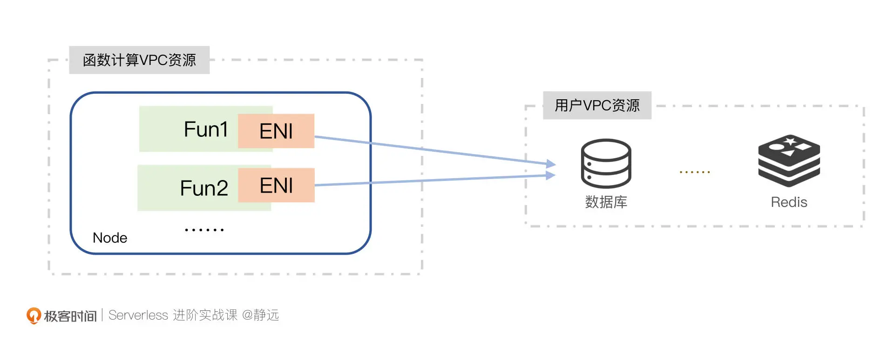
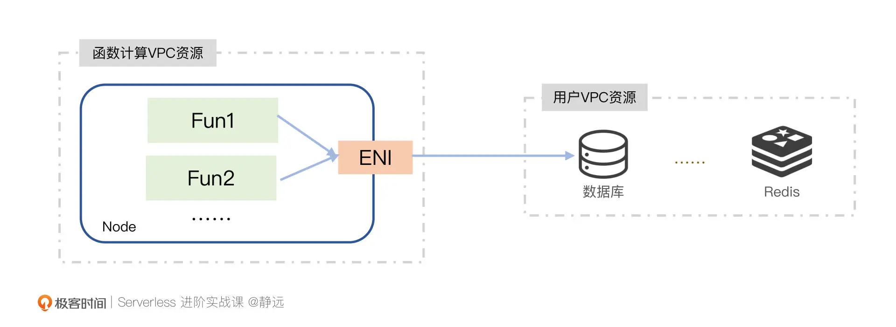
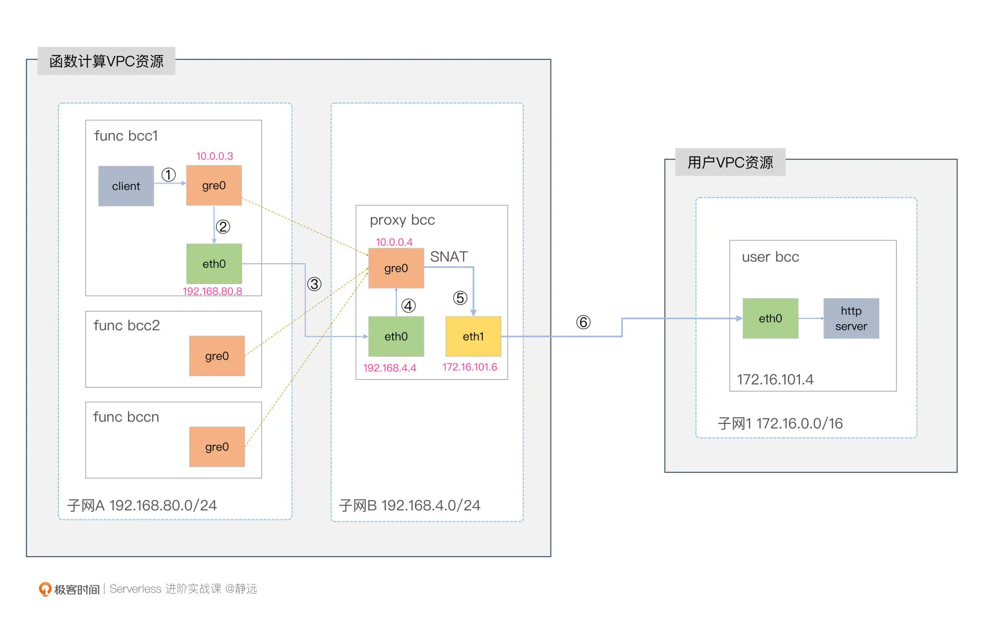
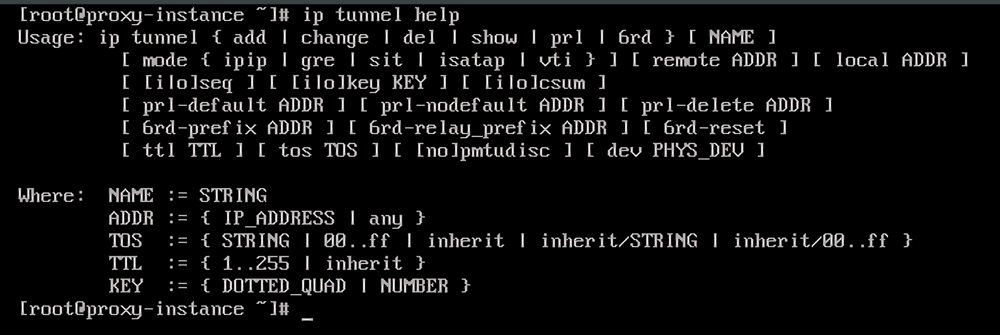
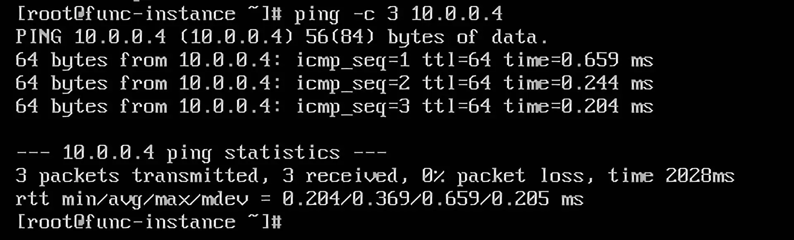
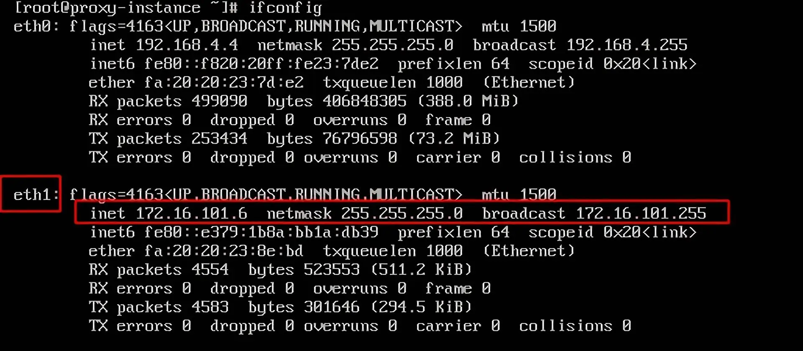
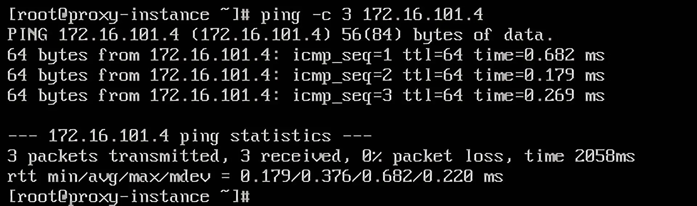
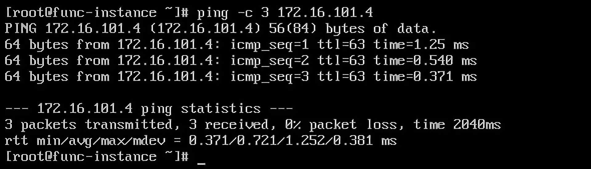
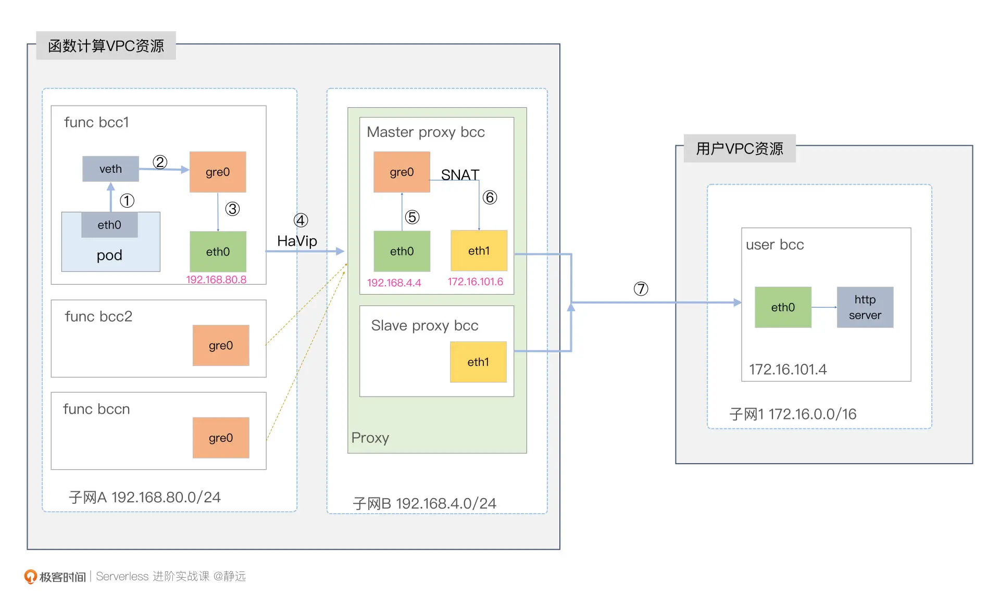

# 10 | 小试牛刀（二）：如何突破VPC网络的速度限制？

你好，我是静远。

在冷启动这节课里，我跟你聊到了影响函数第一次执行速度的因素有很多，其中一个关键因素就是：VPC 网络的建联时间。

我们知道，VPC 是云厂商提供给用户的一个安全隔离的网络环境，用户可以在 VPC 空间中部署自己的服务，如 Redis、数据库、MQ 等。而我们的函数通常是创建在函数专属的 VPC 中的。一个生产级别的函数服务应用，少不了需要和其他的资源和中间件打交道。那么，跨VPC 之间的通信效率就显得尤为重要了。

今天这节课，我就针对 VPC 之间的通信效率，通过案例实操的方式，为你剖析函数在跨 VPC上的技术要点。

希望通过这节课，能够让你得到一些在 Serverless 的实战和后续优化工作的启发，能举一反三地找到更多优化方法，进一步突破函数访问速度的上限。

## 跨 VPC 问题的演进

针对云上网络连接的方式，相信你已经了解到不少，如专线（高速通道）、VPN 网关、对等连接等方式。这些方式，有的用来解决 IDC 和 VPC 的连接，有的用来解决 VPC 与 VPC 之间的互通。

这其中，对等连接的确可以解决函数跨 VPC 的问题，但我们试想一下，如果每个用户都通过这种方式来解决这种问题，那么平台每次都需要搭建两端的连接，并且还可能会遇到 IP 网段冲突的问题。这样的做法显然不具备普适性，成本也过高。

为此，针对 Serverless 的函数计算场景，我们通常会通过弹性网卡（ENI）的方式来打通。弹性网卡是绑定在云主机或者容器实例上的，也就是说，我们是通过弹性网卡 ENI 来关联用户的 VPC 和用户的设备实例，使得设备和 VPC 互通的。



- 绑定容器实例的方式



- 绑定主机的方式

但实际上，我们暂且抛开这两者在网络速率上的差别，不论是在容器实例还是在主机上，他们都会面临同样的问题。

- 冷启动耗时较长：弹性网卡这种虚拟化的资源，它的创建时间是避免不了的；

- 资源受限：正因为资源虚拟化，也就意味着要依赖于硬件的基本参数，受限于内核、CPU等因素，为此，几乎所有的云厂商都会限制 VPC 内弹性网卡的数量，也就从一定程度上导致了此方法的局限性；

- 资源浪费：由于容器或者主机上要绑定弹性网卡，也就意味着多个实例就得占用多个网卡资源，造成资源浪费。

我们可以看出，它们虽然解决了跨 VPC 的问题，但还是会带来性能和资源成本上的压力。那么，我们是否可以不创建这么多弹性网卡，探索一种共用的方式呢？通常我们立马能想到的方式，就是出口代理了。

## 什么是代理？

如何代理呢？我们可以了解一下它的整体流程。

简单来说，就是我们在函数计算的集群与用户的 VPC 之间添加 Proxy Node，在 Proxy Node上构建网卡（如 eth1），网卡会提前在用户 VPC 所在的子网 Subnet 中创建，但租户的权限属于函数计算 VPC。

有了弹性网卡，接下来就需要解决函数到代理节点的打通问题了，也就是在函数的主机和代理主机之间构建一条链路，将数据包传递过去，且保证源 IP 和目的 IP 保持不变。

我们通常采用的是隧道技术。隧道打通后，我们还得注意两件事情。其一就是在 Proxy Node中多张网卡的转发处理；其二，由于函数通常以容器的方式运行，所以需要有一个容器网络转发的过程。

接下来，我将一步一步介绍它们是如何起作用的。

## 动手实操

这节课，我会通过一个打通跨 VPC 网络的实验案例，带你实现函数通过 Proxy 机器代理的方式访问用户 VPC 的资源的全过程。在这个案例中，我选取了百度智能云服务器 BCC 来进行实验。

在实验之前，我们需要准备两个 VPC 网段，模拟创建函数集群和用户集群，并在云上购买三台云服务器 BCC，其中 2 台 BCC 在 VPC1，另外 1 台在 VPC2。下面这个图可以清晰的描述部署的逻辑：



### 隧道技术

准备工作完成之后，我们来看隧道技术。

什么是隧道？在网络中，隧道是一种使用网络不支持的协议，构建网络之间高效和安全的链接，实现在网络中传输数据的方法。

内核中的 tunnel 可以通过 ip tunnel help 看到，当前有五个：IPIP、GRE、SIT、ISATAP 和VTI。



本节课，我们选择使用 GRE（Generic Routing Encapsulation），它是 IPIP（IP in IP）协议的更进一步版本，从官方的描述上来看，可以取代 IPIP。隧道技术本身的概念和区别不是本节的重点。不过，如果感兴趣的话，你也可以通过我文末给的延伸阅读深入了解。

接下来我们来创建隧道，使得 func bcc1 和 proxy bcc 能通过隧道打通连接。我们先在 funcbcc1 中执行如下命令来创建 GRE 隧道：

```bash
# 加载GRE模块
modprobe ip_gre
lsmod | grep gre
# 创建gre模式的通道tunnel，关联上IP并赋予虚拟本端IP为10.0.0.3
ip tunnel add gre0 mode gre local 192.168.80.8 remote 192.168.4.4  dev eth0
ip addr add 10.0.0.3 peer 10.0.0.4 dev mgre0
ip link set dev mgre0 up
```

在 proxy bcc 上执行如下命令来打通 GRE 隧道：

```bash
modprobe ip_gre
lsmod | grep gre
ip tunnel add mgre0 mode gre local 192.168.4.4 dev eth0
ip link set dev mgre0 up
ip address add 10.0.0.4/24 dev mgre0
ip neigh replace 10.0.0.3 lladdr 192.168.80.8 dev mgre0
```

最后，我们还可以通过 ping 命令来验证 proxy bcc 与 func bcc1 的 GRE 隧道是否打通。



到这里，我们隧道的打通任务已经完成一半了，下面，我们要看 proxy bcc 如何与 user bcc 打通。

### 转发技术

我们注意到，proxy bcc 和 user bcc 是不在一个 VPC 集群内的。那我们要怎么解决这个问题呢？

构建的逻辑就是在 user vpc 下构建一个虚拟网卡 eth1，而 eth1，又隶属于 proxy bcc 下。这个方法，和我们在上面“跨 VPC 的演进”中讲到的“动态创建网卡”的方法是一致的。

这里需要说明一点，如果你是一个业务函数的开发者，可能云厂商没有开放相应的特权账号，没有创建弹性网卡的能力，实操不了，那么，这里你只要了解过程即可。如果你是云平台维护工作者，可以体验一下这其中的操作方式。

弹性网卡创建并绑定好后，我们会发现，有 2 个网卡存在于 proxy bcc 中。



我们通过 ping 命令，可以验证是否能够和 user bcc 打通。这里要注意，proxy bcc 与 userbcc 可以互通是因为弹性网卡是基于 user bcc 所在的 VPC 的子网 Subnet 创建的，但租户还是属于 proxy bcc。



打通之后，我们就需要用到转发技术了，也就是将 func bcc1 的数据包通过 proxy bcc 的请求到达 user bcc。

首先，我们需要通过将 ip_forward 设置为 1，开启 proxy bcc 的转发能力。

```bash
echo 1 > /proc/sys/net/ipv4/ip_forward
```

这里需要说明一下，出于安全考虑，Linux 系统默认的是禁止数据包转发的。所谓转发，就是当主机拥有多于一块网卡时，其中一块收到数据包，根据数据包的目的 IP 地址将包发往本机的另一网卡，该网卡即会根据路由表继续发送数据包。

我们这里因为是 eth0 接收云主机的数据，通过 eth1 来发送出去，所以需要开启转发能力。当然，为了能让 func bcc1 的路由触达 user bcc，我们还需要继续完善路由规则。

我们在 func bcc1 中通过 ip route add 命令添加一条到 user bcc 子网 172.16.101.0/24 的路由：

```
ip route add 172.16.101.0/24 dev mgre0
```

此时 func bcc1 访问 user bcc 172.16.101.4 仍然访问不通，在 proxy bcc 侧监听 eth1 流量可以发现，eth1 发往用户 VPC 的包的源 IP 仍是 func1 bcc gre0 设备的 IP 10.0.0.3，这个 IP 实际只存在于我们 bcc 内部，因此用户 bcc 收到请求后，它的返回流量无法路由到这个 IP。

因此，我们这里需要在 proxy bcc 添加一条 iptables 规则，在 POSTROUTING 链里把从 eth1出口的流量的源 IP SNAT 设置为 eth1 的 IP 地址，即 172.16.101.4。

```
iptables -t nat -A POSTROUTING -o eth1 -j MASQUERADE
```

到这里，我们就可以在 func bcc1 中 ping 通 user bcc 了。



### 容器网络

在虚机上，我们已经操作体验一遍了，但通常我们的函数是在容器实例里面运行的 的，容器在访问用户 vpc 服务的时候，是存在一点差别的。我们也可以验证一下，会发现，pod 发起的请求正常路由到了 proxy bcc 下的 tunnel 设备，但是没有继续转发到 eth1 中。

为什么会出现这样的情况呢？通常是因为 Pod 的 IP 和我们在 proxy bcc 上构建的路由规则是不一致的。至于怎么解答，我先不做回答，你可以先思考一下。我们先来看一个概念：ip-masq-agent。

ip-masq-agent 是一个用来管理 IP 伪装的扩展，即管理 Kubernetes 集群节点中 IP 网段的SNAT 规则。它以 DaemonSet 形式部署在 Kubernetes 的集群中，在每个节点上启动一个代理程序。代理程序通过配置 iptables 规则，再将容器流量发送到集群节点的 IP 和集群 IP 范围之外的目标时，就可以选择以容器自己的 IP 地址或伪装成节点的 IP 地址作为出向流量的源地址。

看完 ip-masq-agent 的解说，相信你已经有答案了。解决办法，就是把 Pod IP SNAT 设置成gre0 设备的 IP，再转给 proxy bcc，再对 proxy bcc 隐藏 Pod 的 IP 即可。

ip-masq-agent 的配置来自于 configMap，可以通过 kubectl edit cm 命令来查看或修改配置。

到这里，我们在 Pod 中也能访问 user bcc 的服务了。

### 高可用

如果我们要上生产环境，你还需要考虑服务的高可用。在我们这节课反复提到的案例图中，我只画了一个 Proxy Node，用来实验还可以，但生产环境肯定是不够的。为此，我们需要为每个 VPC/Subnet 建立一对主备 Proxy。主备 Proxy 要使用 HaVip 进行容灾切换。

HaVip 是一种可以独立创建和释放的内网 IP，可以与高可用软件（例如，KeepAlived）配合使用，搭建高可用主备服务，提高业务的可用性。

另外，从 Serverless 的角度看，你还需要依据函数访问的流量对 Proxy Node 进行自动扩缩容。当流量增大时，需要自动对 Proxy Node 进行扩容；当流量降低时，需要自动对 ProxyNode 进行缩容。

我们继续在上面的架构图上进一步完善一下，增加主备 Proxy Node 和容器 Pod 之后的架构示意图如下所示。



## 小结

最后，我来小结一下我们今天的内容。

这节课主要围绕着优化函数在跨 VPC 场景的访问速度来做讲解。我们学习了跨 VPC 打通的演进过程以及代理的四大要素，最后，也结合一个案例的实操过程，了解了函数代理技术的实现过程。

在演进过程的回顾里，我们会发现，对等连接由于其在函数计算上的构建不具备普适性，只有在极少数大客户的场景下会使用。而弹性的网卡实时创建，虽然具备一定的通用能力，但由于其高延迟和对资源的浪费，我们也不太推荐使用。

这两个技术，给我们来带来的思考是，如果我们能提前准备好访问的通路且可复用，是不是就可以解决这样的问题了？是的。为此，我们提出了函数代理技术。

其实，代理技术需要解决的技术卡点还不少，主要包括我们提到的隧道通路、网卡转发、容器网络转发技术，以及最后在生产环境下，还需要考虑到的高可用的问题。我们可以通过高可用的虚拟 IP 和主备 Proxy 集群解决。同时，从弹性的角度，我也建议你引入扩缩容的能力，这个能力，你也可以贯穿在整个 Serverless 的学习生涯中，可以说，它就是 Serverless 的精髓所在。

最后，函数计算由于其胶水语言的特性，跨介质跨网络的访问是不可忽视的一件事情。虽然我们已经在不断的演进解决，但函数代理技术也有其缺点的，比如资源一定程度上的增加。因此，希望通过这节课的内容和思考的过程，能让你打开眼界，提出更多的优化手段，让Serverless 的技术积淀越来越深厚。

## 思考题

好了，这节课到这里也就结束了，最后我给你留了一个思考题。

如果我们在隧道打通那里，采用 IPIP 隧道协议，会有什么问题？

欢迎在留言区写下你的思考和答案，我们一起交流讨论。感谢你的阅读，也欢迎你把这节课分享给更多的朋友一起交流学习。

## 延伸阅读

- 你可以通过VPC 的对等链接，继续深入了解一下对等链接的概念。

- 这一篇隧道技术，可以帮助你进一步了解隧道的知识要点。

- 腾讯云的这一篇VPC 网络优化的文章，也是值得我们一看的。

- 文中提到的 ip-masq-agent，感兴趣的话，你可以继续看这一篇ip-mast-agent 指南，写得也是非常详细的。
