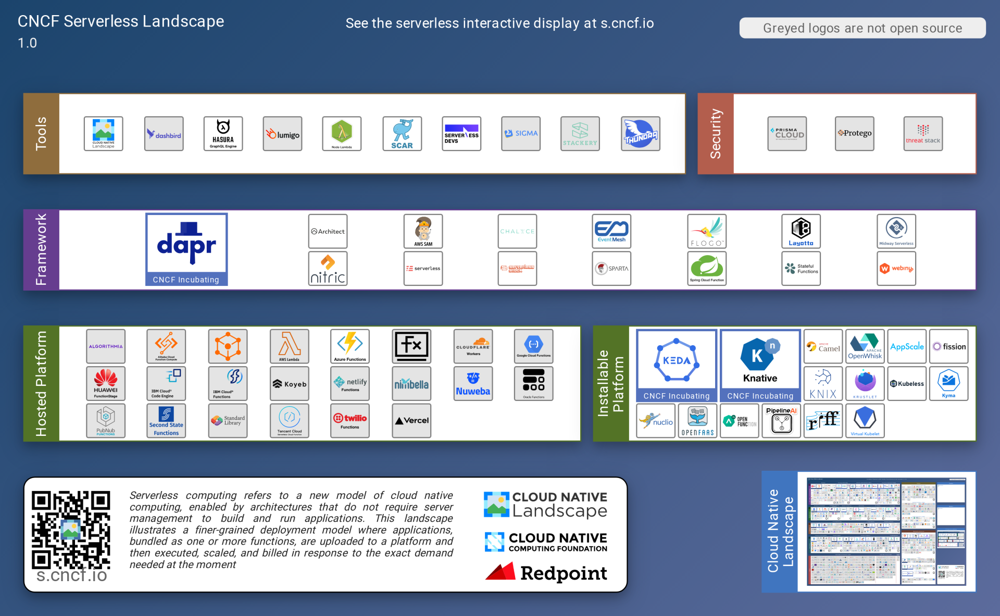
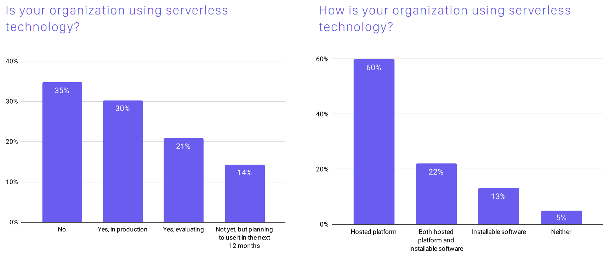
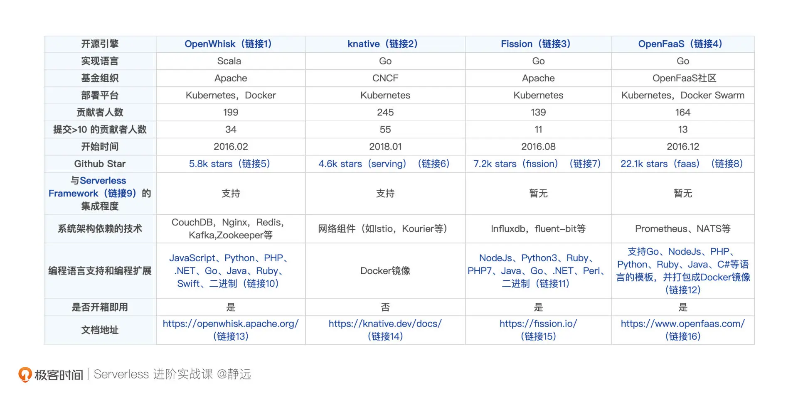

# 22 | 私有云：赛马时代的Serverless核心引擎谁能胜出？

你好，我是静远。

Serverless 平台的实现分为两个流派，分别为公有云和私有化。前面的几节实战课，我们主要基于公有云的 Serverless 平台来展开，从这节课开始，我将带你一起了解私有化部署领域的知识。

为什么要做私有化部署呢？相信你回答这个问题的时候一定是有些犹豫的。

我们知道，Serverless 由云厂商运维并提供服务，带来高效率开发的同时，也大大降低了成本。但就如我上一节课给你讲到的那样，我们享受这种“好处”的同时，也失去了对平台的掌控力，面临着数据的安全问题。

我的很多私有化客户也是基于这两个核心因素，找到我们来共建企业内的 Serverless 平台。这对于企业的业务团队来说，可以同样的享受 Serverless 带来的价值，只是这一层的维护工作由原来的云厂商交到了企业内部的基础平台运维团队。

那么，私有化的部署通常是怎么实现的，部署的方式都有哪些呢？希望这节课，能够让你对私有化部署的方法，开源引擎的发展现状以及选取一个开源引擎作为 Serverless 平台底座的方法有一个通盘的了解。

## 私有化部署的方法有哪些？

当前绝大多数的 Serverless 平台底座都是基于容器技术来实现的，而容器技术在近几年的日趋成熟和盛行，也使得云厂商自研的 Serverless 平台、开源的 Serverless 引擎在私有化企业的数据中心部署变得相对容易了。

不同的企业，在私有化这里一般有两种做法。

- 自研：一些基础设施团队能力很强的企业，一般会选择自己研发。有的企业会基于开源的Serverless 引擎做二次开发，有的直接基于已有的 IAAS 和 PAAS 资源自己研发，并配备专业的团队进行升级和维护。

- 购买：还有一些企业，会选择 ToB 的云厂商合作共建，基于云厂商售卖的 Serverless 标品来适配和升级。比如金融银行领域，你可以通过一些公布的文稿发现，类似中国工商银行、光大银行等公布的招标网站上，采用了百度智能云的 Serverless FaaS 产品来进行私有化部署升级。

目前来看，选择“购买”的企业是占大多数的。传统企业和 ToB 云厂商合作共建，传统企业有上云 Serverless 化的诉求，ToB 云厂商有丰富的实战经验和技术，两者形成合力。

但这并不代表购买方可以一劳永逸，不需要掌握 Serverless 的技术。

一方面，你需要提前了解云厂商是基于什么样的 Serverless 引擎开发的，这个是核心。因为云厂商除了自研平台外，基本上都是基于开源的 Serverless 引擎（Self-hosted Frameworks）

来进一步打造和适配的。另一方面，你还需要了解整套解决方案是如何围绕这个核心构建起来的。这节课，我们先说 Serverless 引擎的部分。

- 资料来源于网络

你可以从CNCF Serverless LandScape了解到引擎和平台的发展情况。左侧的“HostedPlatform（托管平台）”包括我们提及的 AWS、阿里云 FC、百度智能云 CFC、华为FunctionStage、Azure Functions、腾讯云 SCF 等企业的 Serverless 托管平台。而右侧“Installable Platform（可安装平台）”包括我们平时关注度比较高的 Knative、OpenWisk、Fission、OpenFaaS 等开源框架。

那么它们具体有什么特点，我们又该如何选择使用呢？

## 开源引擎现状与选择

我们先来看 2020 年 CNCF 的报告，感受一下开源 Serverless 的使用情况：

- 资料来源于网络

我们可以发现 35% 的调查对象有使用“installable software”，在使用“installable software”中有27% 使用 Knative、10% 使用 OpenFaaS、5% 使用 Kubeless。随着时间的推移，现在已经有一些开源平台没能经受得住时间的考验，比如 Fn、Iron Functions已经逐步退出历史舞台了，图中的 Kubeless 在今年年初也宣布停止维护了。

这里，我参考 CNCF Serverless LandScape 和 CNCF 调研报告，并基于受欢迎程度、稳定贡献、工具和易用性等方面，选取了 Knative、OpenFaaS、OpenWhisk、Fission 这四款开源的平台来跟你介绍。需要说明的是，Nuclio也是不错的开源框架，但它是专注于数据、I/O 和计算密集型的业务处理场景的，且自身不考虑缩容至零的问题。所以暂时不去探讨。

- OpenWhisk 也算元老级的开源 Serverless 框架了，目前代码库也有一定的 commit 提交，但发展速度并不如其他几款，在调研图中显示，仅有 3% 的 Serverless 用户选择了该款产品，远低于 Knative 和 OpenFaaS，而且自 2020 年 1 月以来到现在，它还没有发布过一个新版本。

- Knative 虽然是 2018 年发布的开源 Serverless 产品，但发展迅速，依托谷歌和Kubernetes 的紧密结合，短短几年间 Github 上 Star 的总量已经接近 1 万，图中显示已经有 27% 的 Serverless 用户选择了它。目前 Knative 也成为了 CNCF 的孵化项目。

- OpenFaaS 可以说是发展最稳定的一款了，到目前仍然有稳定的 commit 提交，并且 Star数是所有开源 Serverless 平台中最高的，总量接近 3 万。调研图显示有 10% 的用户支持。

- Fission 在调研报告中虽然仅有 2% 的用户支持，但它目前仍有稳定的贡献者和版本发布，依然很活跃。

这四个 Serverless 开源平台，我从实现语言、支持的编程语言、贡献人数等 12 个方面做了概览对比，方便你进一步查阅。

### 开源引擎的不同

从 CNCF 报告、各个开源 Serverless 平台的官方总结这些对比项之后，你可能很快就能抉择一个开源平台作为自己研究和构建的对象了。但这些数据终究是纸上谈兵，我们还可以再深入一点，我会从 Serverless 的核心特征“扩缩容机制”和相关使用限制上给你几点参考建议。

- Fission 的扩缩容机制及限制

Fission 有 Pool-based 和 New Deploy 两种执行模式，能够支持资源池以及从 0 到 1 两种扩容模式，官方更是宣称冷启动速度控制在了百毫秒以内，这对于一些延迟敏感型场景显然是不错的选择。而它的限制就在于只支持通过 CPU 指标来控制实例数量，这就导致很多 Web 场景下并不能很好地感知实际的资源用量。

- OpenWhisk 的扩缩容机制及限制

不同于 Fission，OpenWhisk 的扩缩容更加简单。每次请求到来后会由 invoker 创建一个业务容器，然后进行代码注入，执行，执行完毕后退出并销毁容器。整个流程并不会产生冗余的资源，但如果应对一些高并发场景效果可能并不会那么理想。

正如上面的表格所示，它的局限性在于依赖的组件较多，不管你是开发者还是使用者都需要有这些工具的储备知识，如果你希望做二次开发，那要先想一想是不是熟悉 Scala？否则的话，可以考虑其他三个以 Go 语言为主的开源框架。

- Knative 的扩缩容机制以及限制

我们之前在扩缩容这节课介绍过 Knative KPA。Knative 本身的 KPA 扩缩容逻辑比较复杂，除了 AutoScaler 和 Activator 这两个 Serving 组件外，还需要向用户 Pod 注入一个 queue-proxy 容器，以此来进行实时的请求量统计。基于这些组件，除了能够实现从 0 到 1、1 到N、N 到 0 的扩缩容，还能支持在 Stable 稳定模式和 Panic 恐慌模式两种模式下的扩缩容算法。

那么它有什么不足呢？Knative 完全依赖 Kubernetes，由于发版很快，高一点的版本就需要1.22 以上的 Kubernetes 版本，但有的企业升级没那么快，需要配套支持。除此之外，可扩展的网络组件，也是一把双刃剑，带来便利的同时也需要运维人员提前具备这一方面的知识，比如 Istio。可以发现，它对于企业、技术人员的要求都不低。

- OpenFaaS 的扩缩容机制以及限制

OpenFaaS Pro完全将扩缩容的发起交给了 Prometheus。OpenFaaS 通过 Prometheus 获取到监控的指标，再由 AlertManager 根据配置参数进行扩缩容请求，最终让资源达到预期的值。目前 OpenFaaS 支持 rps、capacity 和 cpu 三种扩缩容模式，并且可以通过com.openfaas.scale.zero 来控制是否可以缩容到 0。

然而，OpenFaaS 依赖 Promethues 和配置参数控制扩缩容到 0 的这两个特性，也可以算是它的限制。这两个特性导致它完全依赖 Promethues 的稳定性和负载，也默认关闭了缩容至 0 的功能，当然，你也可以打开，不过会带来一定的冷启动时间。

总得来说，目前 Knative、OpenWhisk 以及 OpenFaaS 都能够基于请求数量进行动态伸缩，而 Fission 目前只支持通过 CPU 指标来控制实例数量。相比于 Fission 和 OpenWhisk，OpenFaaS 与 Knative 的扩缩容模式就丰富了许多。

如果你的场景比较简单，可以快速体验一下 OpenWisk，如果对性能要求比较高，Fission 和Knaitve 都是不错的选择。它们之间的界限并不是不可逾越的，我们在选择的时候可以更灵活机动一些。

### 你的选择

有了上面这些分析，相信你选择的大方向已经有了，下面我再给你几点技术以外的经验参考：

- 考虑你公司或者团队的技术栈，如语言、现有的服务治理体系、中间件等；

- 考虑你的业务性质，是专门做数据计算、还是 Web 服务，还是都要兼顾等等；

- 考虑未来趋势，结合目前开源框架的成熟度和产品力来衡量，看产品的潜力。比如Knative，背靠 Google 和 CNCF，和 Kubernetes 紧密结合，随着时间的推移，未来可期。

## 购买 Serverless 产品需要注意什么？

最后，我们还可以说说在“购买”这个方式中，作为“甲方”或者“乙方”的你，应该分别具备哪些知识储备。

如果你是甲方，一定要有基础技术方面的储备，比如一定的云原生技术基础储备，包括Docker、Kubernetes、Service Mesh、可观测等，具备云原生的思维；在 Serverless 方面，了解竞标厂商的产品功能、成功案例和落地规模，知道在 POC 的环节需要验收哪些要点；最后，也要具备架构思维，明确哪些功能点在一期进行，哪些在二期进行，在合理的架构范围内有节奏地迭代。

具备上面的必要储备后，和产品方交流沟通起来就不会磕磕碰碰了。当然，积极上进的你如果能掌握招标、合同、损益评估和入场等注意事项，就能真正称得上这方面的“老手”了。

如果你是乙方，还记得我在思维构建这节课跟你提到的“升级打怪”的路径么？你必须达到“王者”阶段，达到产品和组件输出的能力，并且能够在 POC 环节胜出。我列了几个要点，方便你对照着来看。

- 技术知识：如我之前所说，“加入一个云原生 Serverless 团队，在里面打磨一万小时以上，扎扎实实搞清楚每个点”，只有这样，你才有可能解决掉在产品交付过程中遇到的问题。假如你有部署私有化产品的经历，你一定理解这句话的含义，甲方的环境有时确实不会那么“如你所愿”。

- 产品思维：对于基础服务类产品，闭门造车肯定是不行的。你必须要基于一个“标品”来打造一个 Serverless 产品方案，然后基于和甲方的交流，找到可适配的架构产品方案。比如，在 IAM 的适配上，完全可以独立一个模块单独构建认证鉴权的服务，通过配置化的方式来适配不同的企业。通过“独立标品”+“插拔适配”的方式构建产品，才更适合私有化部署。

- 软技能：甲方通常在尝试新技术落地的时候，自己也没有太多的经验，你需要有足够的耐心来帮助和引导他们交付和落地场景，这样才有后续的“二期”“三期”“周边产品”等再次合作。

其实，不管是自研还是二次开发，不少企业也借鉴了这些 Serverless 开源引擎的思想，所以，研究一款开源产品，就相当于研究一个云厂商的服务，不同的是云厂商还融入了一些自己专业的技术特性和底座服务。

希望这些我和私有化打交道的心得，能够帮助作为甲方或者乙方的你，也欢迎你在留言区进一步与我探讨。

## 小结

最后，我来小结下今天的内容。私有化部署的选择，主要是出于数据安全和平台掌控力两方面的考量。考虑到私有化部署的 Serverless 平台本身的门槛，一般会有“自研”和“购买”两种部署方式。一些基础设施团队能力很强的企业会选择前者，一些企业会选择较为方便的后者。

目前来看，选择“购买”的企业占比较大。那么，假如你是甲方，就需要储备适当的云原生知识，掌握 Serverless 的核心要点和架构思维，这会让你在沟通和选择合作厂商的时候更加游刃有余。假如你是乙方，就要在技术、产品和软技能上面都要过关，才有可能获得甲方的认可，拿到这一笔单子。

而我们了解私有化部署最关键的途径，就是去学习开源的 Serverless 平台，并基于此来构建和实操。因此，我们综合了 CNCF 的调研、热度、贡献度稳定性等多个指标，选取了四个开源框架 OpenWhisk、OpenFaaS、Fission、Knative 来做深入对比。Knative 作为后起之秀，依托谷歌和 CNCF，和 Kubernetes 的紧密结合，有“跨平台的函数计算平台”的响亮称号，可以说是未来可期。

一直以来，在了解一款产品特性的方面，我的建议都是多多动手实操，再回头看看官网最新的特性。如果再结合课程中的一些思路，找到一条自己学习新框架和新技能的道路，就说明你已经迈入一个新的台阶了。

下节课，我们就进入到动手实操的环节，以 Knative 为例，看看如何从 0 到 1 部署 Serverless核心引擎。

## 思考题

好了，这节课到这里也就结束了，最后我给你留了一个思考题。

针对上述提到的 Serverless 引擎框架，你在研究过程中最关心哪个点呢？你有什么新的发现吗？

感谢你的阅读，也欢迎你把这节课分享给更多的朋友一起阅读。

## 补充阅读

链接 1，OpenWhisk

链接 2，knative

链接 3，Fission

链接 4，OpenFaaS

链接 5，5.8k stars链接 6，4.6k stars

链接 7，7.2k stars

链接 8，22.1k stars

链接 9，Serverless Framework

链接 10，JavaScript、Python、PHP、.NET、Go、Java、Ruby、Swift、二进制

链接 11，NodeJs、Python3、Ruby、PHP7、Java、Go、.NET、Perl、二进制

链接 12，支持 Go、NodeJs、PHP、Python、Ruby、Java、C# 等语言的模板，并打包成Docker 镜像

链接 13，https://openwhisk.apache.org/

链接 14，https://knative.dev/docs/

链接 15，https://fission.io/

链接 16，https://www.openfaas.com/
