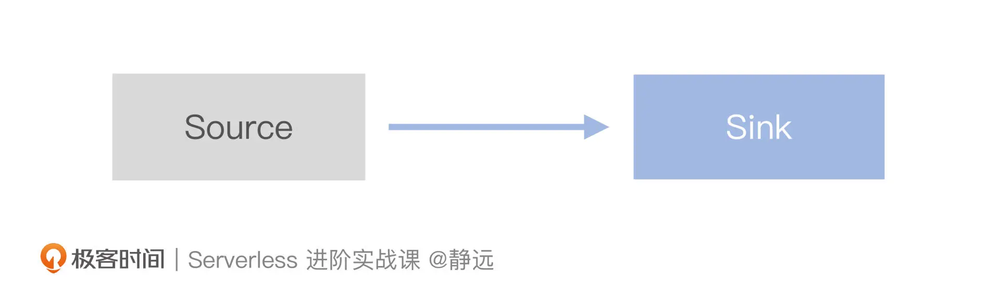

# 23 | 实战进阶（四）：如何从0到1进阶一个开源引擎？

你好，我是静远。

从这节课开始，我们就要完整体验一个 Serverless 平台的构建，学习其中的注意事项了。

今天的前半节课，我们会从环境准备、组件安装以及组件验证几个角度先重点演练一遍Knative 核心组件的部署和验证，后半节课，我们再去探讨一下，在面临一个开源 Serverless框架的时候应该怎么去学习。

在实战开始之前，你可以先复习一下扩缩容和流量转发这两节课中 Knative 的知识点，再来开始动手实操。

话不多说，我们现在就开始实操准备吧。

## 环境准备

由于 Knative 本身完全依赖于 Kubernetes，因此我们需要提前准备一个 Kubernetes 集群，对于集群的规格，官网也有建议，你可以参考最新版本来进行。

原型环境方面，如果只是搭建一个试用的原型 Knative 函数环境，那么至少需要一个单节点K8s 集群，并且这个节点的规格至少应该是 2 核 4GB。

如果想达到生产级别的Knative 函数环境，单节点集群的规格至少应该是 6 核 6G 以及 30G的磁盘空间，多节点环境的规格应该保证每个节点都是 2 核 4G 以及 20GB 的磁盘空间。另外，还有几个要点需要注意：

- 必须保证 K8s 集群版本应该至少是 1.22 以上；

- 必须安装 K8s 的命令行访问工具 kubectl；

- 必须保证 K8s 能够正常访问到镜像仓库。

这节课，我会按照生产级别环境搭建，其中 K8s 集群节点数量为 2，每个节点的规格为 4 核8G，同时配备 50GB 磁盘空间。我选择了百度智能云 CCE来构建 K8s 集群。

## 组件部署与验证

准备好 K8s 集群环境以后，我们就可以开始在集群上部署 Knative Serving 组件了。不要着急，我们一步步来。

### 部署 Serving 组件

首先，我们来部署 Serving 组件，按照官网命令即可：

```bash
kubectl apply -f https://github.com/knative/serving/releases/download/knative-v1.
kubectl apply -f https://github.com/knative/serving/releases/download/knative-v1.
```

部署之后，在 knative-serving 这个 namespace 下，所有的 Pod 都应该是 Running 状态：

```
$ kubectl get pod -n knative-serving
NAME                                     READY   STATUS    RESTARTS   AGE
activator-847d5df4bc-psd7k               1/1     Running   0          47h
autoscaler-65898c7fcf-wkkmc              1/1     Running   0          46h
controller-775b774844-fwm2k              1/1     Running   0          46h
domain-mapping-555ff9b9c8-8dtcw          1/1     Running   0          46h
domainmapping-webhook-57456fcb8c-x6frp   1/1     Running   0          46h
net-istio-controller-59b6b7765-z8w2g     1/1     Running   0          46h
net-istio-webhook-6b98fd5bd4-4pcdf       1/1     Running   0          46h
webhook-7f987868-5f8bg                   1/1     Running   0          46h
```

如果出现异常，那么可以通过 kubectl describe 查看 Pod 部署卡在哪一步了，你可以参考如下的命令查看：

```bash
kubectl describe pod controller-744577dddc-7jf5r -nknative-serving
```

注意，如果是网络问题，可能会出现下载镜像卡住的情况，这个时候通过 Google Cloud 虚机下载镜像，上传到可访问的镜像仓库上就可以，或者直接找到可供访问的镜像仓库，手工替换掉 gcr.io 的镜像包。

### 部署网络组件

完成 Serving 组件的部署，我们就需要部署 Knative 所依赖的网络组件了。官网推荐了三种，我们以 Isito 来部署。

```bash
kubectl apply -l knative.dev/crd-install=true -f https://github.com/knative/net-i
kubectl apply -f https://github.com/knative/net-istio/releases/download/knative-v
kubectl apply -f https://github.com/knative/net-istio/releases/download/knative-v
```

完成之后，我们需要检查一下 istio-system 的 namespace 下 pod 是否正常：

```
$ k get pod -nistio-system
NAME                                    READY   STATUS    RESTARTS   AGE
istio-ingressgateway-666588bf64-jpwgl   1/1     Running   0          46h
istiod-56967d8fcc-d6vmr                 1/1     Running   0          46h
istiod-56967d8fcc-f46kr                 1/1     Running   0          2d2h
istiod-56967d8fcc-mmfkd                 1/1     Running   0          46h
```

同时还需要检查一下是否能够获得 gateway 的 external-ip，用于后续的函数访问：

```
$ kubectl --namespace istio-system get service istio-ingressgateway
NAME                   TYPE           CLUSTER-IP     EXTERNAL-IP
istio-ingressgateway   LoadBalancer   10.0.142.236   182.61.144.199,192.168.0.2
```

这里需要说明一点，百度智能云 CCE里，如果用户创建类型是 LoadBalancer 的 Service，默认情况下，CCE 会联动的创建 BLB，并为此 BLB 绑定 EIP。所以你可以看到表格中显示的EIP 地址是 182.61.144.199。

### 部署 Eventing 组件

接着我们再来安装一下 Eventing 的相关组件。Eventing 的安装和 Serving 类似，包括两个yaml 文件：

```bash
kubectl apply -f https://github.com/knative/eventing/releases/download/knative-v1
kubectl apply -f https://github.com/knative/eventing/releases/download/knative-v1
```

执行完成后，我们来检查一下 knative-eventing 这个命名空间下的 pod 是否正常运行：

```
$ kubectl get pod -n knative-eventing
NAME                                  READY   STATUS    RESTARTS   AGE
eventing-controller-c7bdccd6d-ktnmc   1/1     Running   0          13m
eventing-webhook-7c49c58fcb-ng576     1/1     Running   0          13m
```

如果部署成功的话，应该可以看到这个命名空间下有两个 running 状态的 pod，如果出现Error，那么还是按照我们在小试牛刀这节课中讨论的方法，通过 kubectl 的 describe 命令查看错误原因，对症下药即可。

部署完 Serving 和 Eventing，你会发现，是不是还缺少 Tekton 组件？我把它作为课后作业留给你来进一步演练，你可以按照同样的方式进行部署。需要注意的是，Tekton 是从 Knative 的Building 组件孵化出来的，目前功能已经相当丰富，涉及的组件较多，因此最好根据官网的安装手册一步一步进行部署，避免遗漏。

到这里，你的 Knative 组件已经可以正常运行了，接下来我们尝试执行一个简单的 Demo 验证一下。

### 验证函数调用

我们先验证一下 Knative 最基本的函数调用功能，确保 Serving 组件能够正常运行。这里我使用的是官网给的helloworld-go的例子进行演示，我将 handler 中的响应内容改成了如下的打印语句“Hello Serverless!”：

```go
func handler(w http.ResponseWriter, r *http.Request) {
   log.Print("helloworld: received a request")
   fmt.Fprintf(w, "Hello Serverless!\n")
}
```

改完代码之后，我们接着进行镜像打包，这里需要注意下，如果你电脑是 mac 的 m1，需要加上 --platform linux/amd64 这个参数，如下所示：

```
$ docker --platform linux/amd64  build -t  jingyuan/hello:v1 .
```

然后，就可以将镜像推送到一个集群可以访问到的仓库中，这里我使用的是 CCR，具体使用可以参照他的说明文档，接着，我们替换一下 knative demo 中 service.yaml 的 image，然后执行 kubectl apply 就可以了。

```
apiVersion: serving.knative.dev/v1
kind: Service
metadata:
 name: helloworld-go
 namespace: default
spec:
 template:
   spec:
     containers:
     - image: jingyuan/hello:v1
       env:
       - name: TARGET
         value: "Go Sample v1"
```

我这里只使用了最简单的一些字段，你还可以在 Knative Service 中设置不同的 revision 以及流量比例。

最后会是什么样的效果呢？我们来一起看下：

```bash
curl  -H "Host: helloworld-go.default.example.com" http://182.61.144.199
```

- 返回：

```
Hello Serverless!
```

这一步，如果你观察仔细的话，会发现在 default 命名空间下，在调用之前是不存在helloworld-go 函数的相关 pod 的，而在调用之后产生了，这其实就是第一次调用产生的冷启动现象了。

### 验证事件触发

最后，我们再来验证一下 Knative 的事件触发功能，确保 Eventing 的组件确实能够正常工作。这里我们采用官网给出的PingSource模型进行验证，我们首先创建一个用于接收事件的服务，名为 event-display。这里采用的是官网的 Demo，它的 deployment 和 service 定义如下：

```bash
apiVersion: apps/v1
kind: Deployment
metadata:
 name: event-display
 namespace: default
spec:
 replicas: 1
 selector:
   matchLabels: &labels
     app: event-display
 template:
   metadata:
     labels: *labels
   spec:
     containers:
       - name: event-display
         image: gcr.io/knative-releases/knative.dev/eventing/cmd/event_display
---
kind: Service
apiVersion: v1
metadata:
 name: event-display
 namespace: default
spec:
 selector:
   app: event-display
 ports:
 - protocol: TCP
   port: 80
   targetPort: 8080
```

接着创建一个 PingSource 对应：

```
apiVersion: sources.knative.dev/v1
kind: PingSource
metadata:
 name: test-ping
 namespace: default
spec:
 schedule: "*/1 * * * *"
 contentType: "application/json"
 data: '{"message": "Hello geek!"}'
 sink:
   ref:
     apiVersion: v1
     kind: Service
     name: event-display
```

它的含义是根据 Schedule 定义的规则每分钟发送一次 data 指定的数据，发送的目的端是Sink.name 指定的服务 event-display ，即我们前一步定义的 Service。

接着，我们可以查看一下 knative-eventing 命名空间下的 deployment，会发现多了一个pingsource 的 deployment，这就是事件的生产者，会根据 PingSource 对象的定义，产生事件并发送给对应的服务。

```
$ kubectl get deploy -nknative-eventing
NAME                    READY   UP-TO-DATE   AVAILABLE   AGE
eventing-controller     1/1     1            1           3h36m
eventing-webhook        1/1     1            1           3h36m
pingsource-mt-adapter   1/1     1            1           3h36m
```

然后我们查看刚才部署在 default 命名空间下的 pod ，并查看他的日志，可以看到每分钟打印的消息：

```
$ kubectl logs event-display-685f8f46f4-k5dbw
2022/10/07 01:06:32 Failed to read tracing config, using the no-op default: empty
☁️  cloudevents.Event
Context Attributes,
 specversion: 1.0
 type: dev.knative.sources.ping
 source: /apis/v1/namespaces/default/pingsources/test-ping
 id: caa8d0f9-f3bb-4c4d-a777-749241a9cb32
 time: 2022-10-07T06:52:00.301997865Z
 datacontenttype: application/json
Data,
 {
   "message": "Hello geek!"
 }
☁️  cloudevents.Event
Context Attributes,
 specversion: 1.0
 type: dev.knative.sources.ping
 source: /apis/v1/namespaces/default/pingsources/test-ping
 id: a029df47-fd4b-4eb4-986d-75d6dd9814d0
 time: 2022-10-07T06:53:00.001908595Z
 datacontenttype: application/json
Data,
 {
   "message": "Hello geek!"
 }
☁️  cloudevents.Event
Context Attributes,
 specversion: 1.0
 type: dev.knative.sources.ping
 source: /apis/v1/namespaces/default/pingsources/test-ping
 id: b4331a71-031f-4b3a-93cb-8764a0c5830e
 time: 2022-10-07T06:54:00.309563083Z
 datacontenttype: application/json
Data,
 {
   "message": "Hello geek!"
 }
```

到这里，我们就完成了 Knative 最基本的函数调用以及事件触发功能的验证，我们来总结一下。Knative 的安装大致分为环境准备、组件部署以及功能验证三个部分，这也是安装任意一个 Serverless 框架的基本思路。

- 环境准备：你需要在安装之前就在官网的安装手册上了解清楚相关内容，尤其要注意对资源、操作系统、依赖版本的限制，一旦没有注意到，可能往往问题到安装的最后一步才会暴露出来，费时费力。比如我们这个版本的 Knative 就明确要求 K8s 的版本要达到 1.22 以上，并且多节点集群下，单节点的规格也至少是 2 核 4G。

- 组件部署：这里我建议直接参照官方的安装手册进行，因为网上的很多技术博客写的并不全面，并且版本可能和你计划安装的也有差别。同时也要注意一些镜像的访问问题，受限于网络问题，需要你自己去寻找国内的镜像源进行替换才能成功。

- 功能验证：完成组件安装后，最重要的还是进行功能验证，这一步我建议不要一上来就选用复杂的 case 测试，而是先用最简单的 demo 去验证，看看基本的功能有没有问题，保证基本的工作流程以后，再验证扩展功能，这样不仅可以让你在最短的时间内验证完组件的部署正确性，还能够降低问题的排查难度。

## 如何学习一个开源 serverless 引擎

结合之前的理论学习和本节课的实操，相信你对 Knative 已经有了一个比较全面的认识了，但我相信，在你之后搭建 Serverless 引擎的过程中，还会遇到 Knative 更多的特性。课程中，我们不可能面面俱到，不过像是 Knative 中 Triggers、Sinks、CLI 等知识点，你完全可以通过我们总结的方法举一反三的学习起来。

什么意思呢？

拿到一个开源框架，我的攻坚三步曲是“上手体验”“研究架构”“深入源码”，我们逐一探讨下。

### 上手体验

在接触到任何一个开源 Serverless 引擎时，我并不建议一开始就通过网上的资料去学习各种概念、架构原理以及源码分析，这对于刚接触到引擎框架的你来说几乎没有任何帮助，这些繁杂的概念反而会让你一头雾水。

相反，上手体验永远应该放在你学习一个框架的第一步。使用带来的直观感受能够帮助你更快地理解这个框架最基本的产品形态以及工作过程。

这节课我并没有上来就给你长篇介绍 Knative 的各种概念，而是直接手把手带你体验了从搭建Knative 到跑起来两个 demo 的整个过程，动手之后，你基本就清楚整个 Knative 运作需要哪些组件，同时也能观察到一些现象（比如冷启动、事件触发过程）了。这样的操作过程，会让你后续的学习更加高效。

另外，有一个小技巧。很多成熟的框架，在官网除了常规的搭建步骤，还提供了非生产线部署的 Quick Start 部署方式（比如我们这节课要学习的knative quick start），可以帮你更快地体验。

### 研究架构

在体验完简单的功能之后，我们再回过头来去学习基本的概念，就很容易结合前面的操作去理解了。在这个阶段，我建议你采用由全貌到细节的一个学习思路，先学习基本概念以及整体的架构，接着再深入到某一个具体的处理流程或者组件中去进行探究。

在体验过 Knative 之后，我们再去学习 Serving 中一些组件的交互过程，你就很容易理解了。就像这一块核心逻辑我之前已经提前带你学习过了，但在这节课实操之后再回过头看一看，是不是就更好理解了呢?

比如冷启动过程，我们通过动手操作发现了第一次请求函数时，实例会从无到有，并且隔一段时间不请求后，实例又会被释放，这就很容易让你明白 Activator 的作用，以及 AutoScaler 的扩缩容流程。

再来，Knative 中的事件驱动机制。我们部署了一个用于打印事件的服务以及一个定时产生事件的 PingSource 对象，接着，我们可以观察到定时事件的任务处理。这个时候我们再去从宏观的角度学习 Eventing，就可以明白为什么他是一套松耦合的事件驱动体系了。

在 Eventing 的事件驱动的体系中，你可以通过 API 进行事件的创建，而事件将由事件的生产者发起，由事件的消费者接收。系统学习过后，你也可以知道我们的 Demo 是多种事件驱动模式中最简单的一种——Source&Sink 模式。



其中，Source 声明的是事件源与事件接受者的一个关联关系，而 Sink 表示一个可以接收事件的对象。结合前面的实践过程，你一定可以理解，我们部署的 PingSource 对象就是一个Source 类型，event-display 就是一个事件接收的服务。再去细究 PingSource 的 yaml，可以看到 Shedule 定义的是定时触发的 cron 表达式，而 sink.name 表示事件将交由 event-display处理。

```
apiVersion: sources.knative.dev/v1
kind: PingSource
metadata:
 name: test-ping
 namespace: default
spec:
 schedule: "*/1 * * * *"
 contentType: "application/json"
 data: '{"message": "Hello geek!"}'
 sink:
   ref:
     apiVersion: v1
     kind: Service
     name: event-display
```

这样下来，理解起来是不是就很迅速了呢？学习了这种最基础的事件驱动模型，你还可以再进一步去学习Channel&Subscription 以及 Broker&Trigger 这两个较为复杂的模型，通过这样的动手实践，由浅入深，不仅可以让你学得更快，还能记得更牢。

### 深入源码

对整体的架构以及关健处理流程有了一个清晰的认知以后，就可以深入到源码当中去了，源码能够帮助你更好地理解引擎框架设计者的思路。这其实是一个更高的要求，需要你对框架开发语言以及代码编写风格都有一定的掌握，才能够更好的理解。

源码的阅读途径也比较丰富，除了官方文档以外，开源的框架代码基本都会放在 Github，对于一些较难理解的地方，也可以通过阅读博客以及社区留言等方式去解决。

以 Knative 为例，Github 包含了它全套的代码，除了Eventing和Serving这两个核心组件代码库，还包含客户端、一些使用文档等，对于一些像扩缩容一类的关键流程，有些Contributor 甚至还会专门给出详细的流程说明，可以说是非常全面了。遇到问题的时候，Issue也能给你一定程度的参考。除此之外，Knative 的官方也有一些不错的技术博客，这些都是能帮助你深入到源码的有效手段。

最后，在学习 Serverless 框架时，提前的知识储备也很重要，比如学习 Knative 之前你至少需要对 K8s 的基本概念有一些了解，而涉及到源码部分，还需要掌握 Golang 的基本语法等等。

这些学习经验其实并不局限于本节课 Knative 的学习，希望你更能够举一反三，灵活运用到之后遇到的每一个新框架的学习过程中去。

## 小结

今天这节课，你应该对 Knative 的核心组件有了更直观的了解：Serving 提供了管理整个Serverless 工作负载的能力，Knative Serving 通过自定义的一组特定对象，使用 KubernetesCRD（自定义资源）的方式，配合上 Activator 以及 AutoScaler 等关键组件，从而实现了整个流量控制和自动扩缩容能力。

Knative Eventing 实际上是一组 API，能够帮助你使用事件驱动的方式对函数进行调用。Source 与 Sink 模型是 Knative 中最简单的事件驱动模型，除此之外，还有Channel&Subscriptions 和 Broker&Trigger。前者提供了一种事件传输机制，能把事件分发给多个目的地或 Sink。后者跟前者类似，但不同的是后者更方便对事件进行过滤，适用于一个namespace 下的多个事件源，然后消费者根据事件的类型、属性挑选感兴趣的事件进行消费。

Tekton 组件主要负责从代码仓库获取源码并编译成镜像，推送到镜像仓库，所有这些操作都是在 Kubernetes Pod 中进行的。

整体而言，Tekton 补充的是 Knative 快速开发与集成的能力，提升了开发与部署的效率；Eventing 则通过松耦合的构造以及对 CloudEvents 的支持，极大地丰富了 Knative 的应用场景；Serving 组件贯穿到了整个 Serverless 容器的生命周期。

最后我想跟你说的是，Serverless 的技术是在不停更迭的，我们需要灵活地研究一个新发布的Serverless 引擎、框架、平台，你可以通过直接上手体验，再去研究架构原理，最后深入源码细节升华的方式进行学习。

## 课后作业

好了，这节课到这里也就结束了，最后我给你留了一个课后作业。

你可以继续尝试搭建一下 Knative Tekton，并且看看能否通过Trigger搭建一个完整的 CI/CD系统？如果有问题，欢迎你在留言区和我交流讨论。

感谢你的阅读，也欢迎你把这节课分享给更多的朋友一起阅读。
