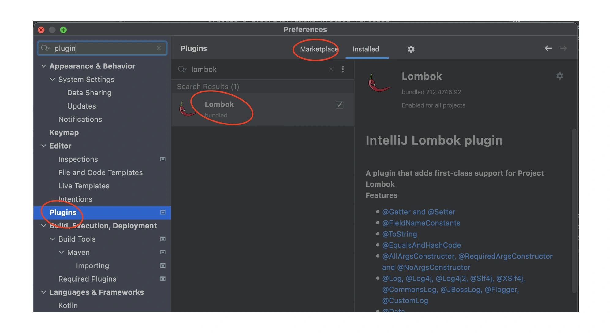
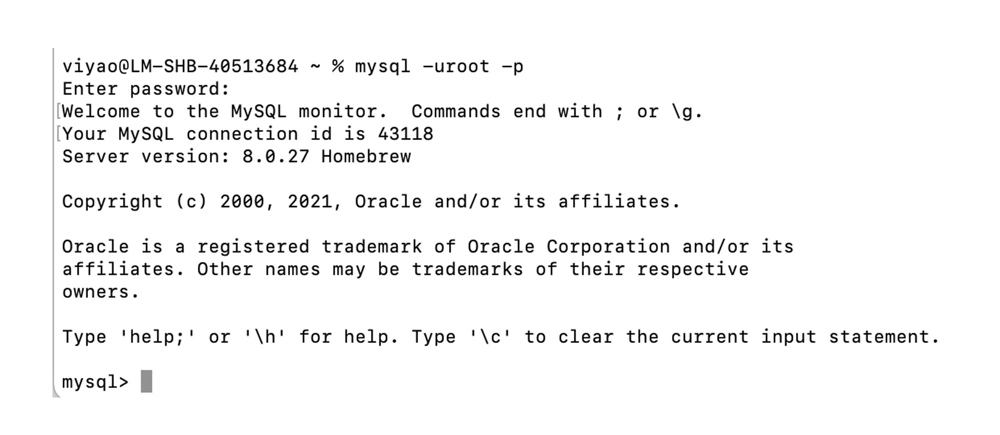
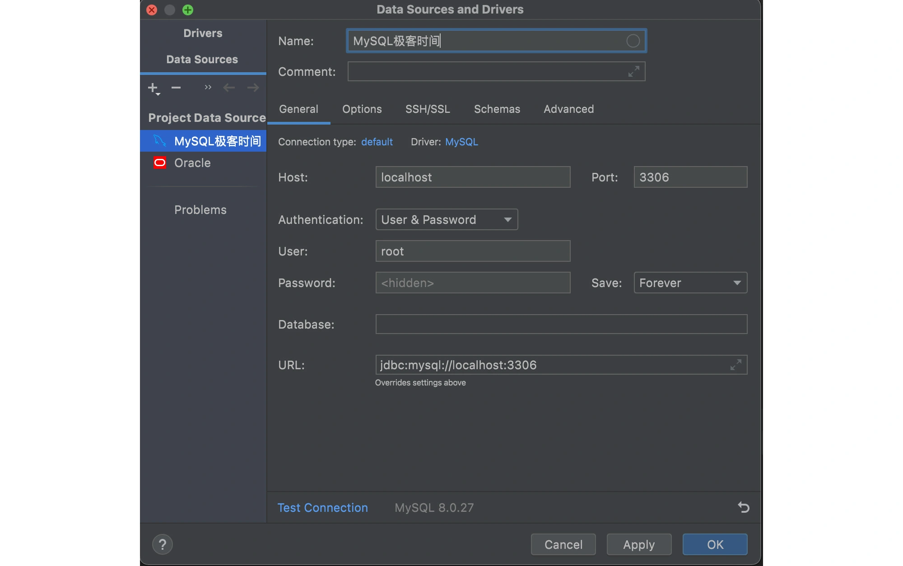
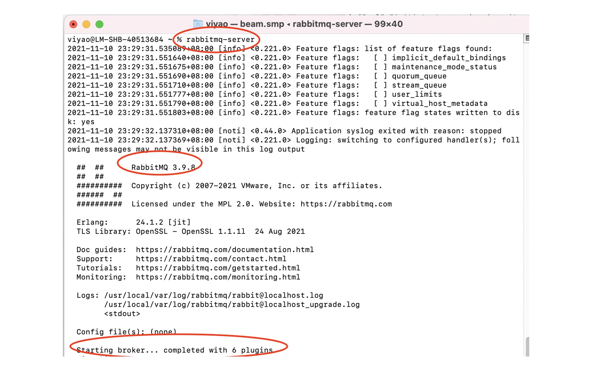
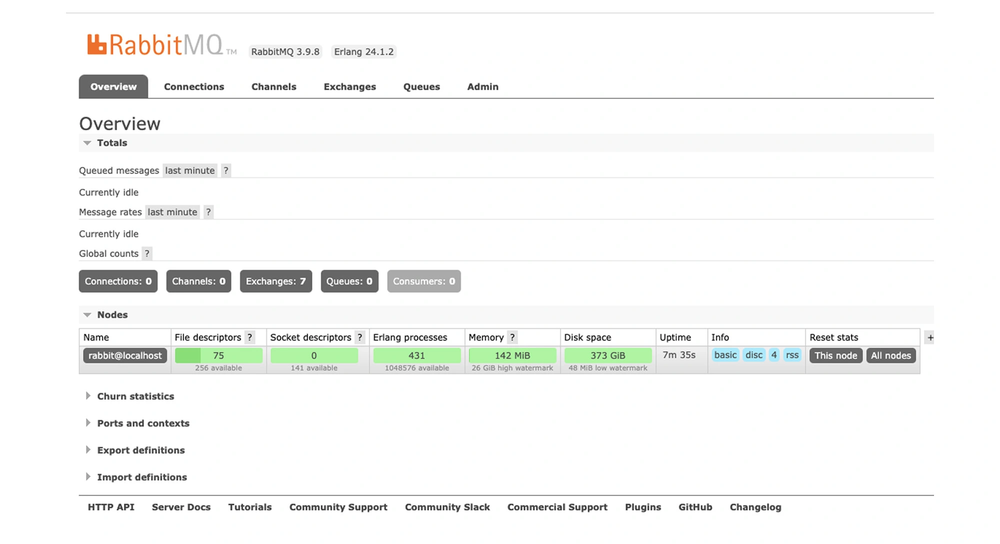
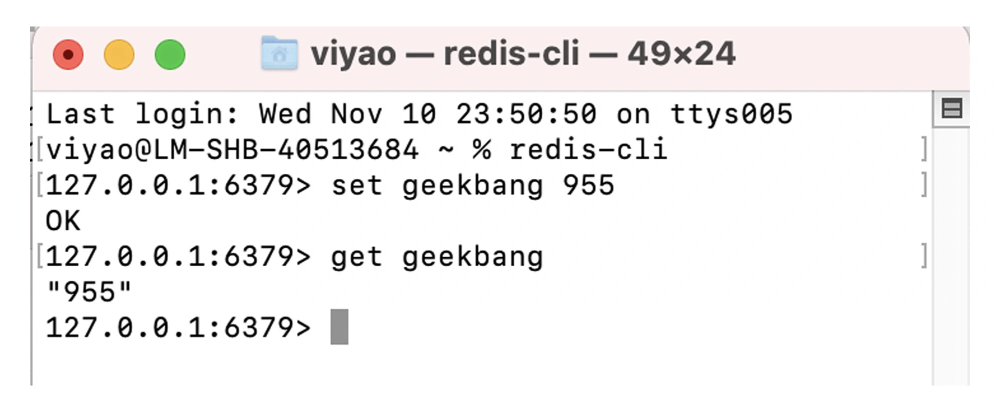

# 04-十八般兵器：如何搭建项目所需的开发环境？

你好，我是姚秋辰。

工欲善其事，必先利其器。在你跃跃欲试想要进入实战环节前，让我先带你把实战项目需要用到的十八般兵器准备好，也就是搭建好项目的开发环境。

为了避免在项目实战环节碰到一些棘手的兼容性问题，在你开始写代码前就要约定好各个组件的安装版本，包括 Java、Maven 和各个中间件的版本。

我们的微服务实战项目会用到很多中间件，其中也包括了 Spring Cloud 的中心化组件，如Nacos、Sentinel、Zipkin 和 Seata 等等，这些 Spring Cloud 组件我会放在后面的实战环节边讲解边搭建。

今天我们主要来看下集成开发环境的搭建、数据库的安装和 DB 脚本的导入，此外，我还会手把手带你安装几个通用的中间件。这节课要安装的工具比较多，你一定要耐心看完，不然后面的课程可能会卡壳哦。

闲话少叙，我们现在就开工吧。

## 环境准备

我推荐你使用 Mac 笔记本或者是 Linux 系统来编写、运行本课程的实战项目，如果你使用的是 Windows 系统，可以尝试做个双系统，或者用 Cygwin、Ubuntu 虚拟机等方式尽量模拟Linux 环境的开发。一来可以学习 Linux 命令，二来可以尽量保持本地开发环境与线上生产环境的一致，毕竟工作中你所开发的 Java 程序最终还是部署在 Linux 服务器环境。

以下是我在本地 Mac 系统上的安装方式，如果你使用的是 Windows 系统，我也提供了相关组件的官网下载地址，相信对于程序员来说，安装软件是小菜一碟。因为安装的工具比较多，所以我建议你按照课程中介绍的顺序来安装。

## Homebrew

Homebrew 是 Mac 系统上的一款非常便利的软件安装工具，可以帮你安装大部分开发工作所需的各种工具软件。这节课中的很多工具，我们也可以使用它来安装。你可以在Homebrew的官网查看 Homebrew 的详细安装方法。

你可能发现在国内网络下安装 Homebrew 比较缓慢，这里我给你提供两种解决办法：一种是使用 VPN 连接，也就是我们俗称的翻墙，可以大幅提高安装速度；另一种方式是将Homebrew 指向国内镜像获取安装脚本，替换镜像的命令可以在官方的安装文档中找到。

安装完成之后，你可以在命令行输入 brew -v 命令查看版本信息，来验证安装是否成功：

```
vincent@LM-SHB-40513998 ~ % brew -v
Homebrew 3.2.17
Homebrew/homebrew-core (git revision 5fbb5bcf8d9; last commit 2021-10-24)
Homebrew/homebrew-cask (git revision b08f2eff16; last commit 2021-10-24)
```

当 Homebrew 准备就绪，你就可以使用 brew install 命令安装所需要的软件了。在实际工作中，你可以使用清华大学或者中科大的国内镜像源，来大幅提高各软件的下载速度。

在你使用国内镜像源的时候，可能会碰到软件无法安装成功的问题，这往往是因为软件所依赖的某个工具包无法下载，你只要从日志信息中找到卡住安装流程的工具包叫什么，然后使用brew install xxx 命令（xxx 是工具名称）单独安装这个工具包，之后再重新安装你需要的软件就可以了。这个办法屡试不爽。

安装好 Homebrew 后，我们再来安装 Java 和 Maven。

## Java 和 Maven

这两样工具可是我们 Java 工程师吃饭的家伙，安装过程我就不唠叨了。为了避免兼容性的问题，你只要注意安装正确的版本就可以：

- Java：推荐使用 JDK8 最新小版本或者 OpenJDK16 的最新小版本（我本地安装的是OpenJDK 16.0.1）。

- Maven：推荐使用 Maven 3.6 或以上的版本（我本地使用 3.8.1 版本）。

由于国内网络访问 Maven 中央仓库比较慢，在编译项目的时候，你会发现下载 Maven 依赖项的时间会比较久，你可以修改 Maven 的 settings.xml 文件，将其默认镜像指向国内的镜像（比如阿里云镜像），这样可以大大加快依赖项下载速度。

安装完 Java 和 Maven 之后，我们再来安装集成开发工具。

## IntelliJ IDEA

IntelliJ IDEA 是 JetBrains 全家桶中的一款应用，它是目前公认最强大的 Java 语言开发集成环境。如果你已经受不了 Eclipse 的卡顿，那不妨借此机会转向 IDEA 的怀抱。

你可以在JetBrains 的官网下载 IntelliJ IDEA，IDEA 的免费社区版已经足够你完成复杂的开发任务了。如果你想体验更多的产品功能特性，也可以选择购买商业版 license。要是你有高校教育邮箱（edu 邮箱）就更方便了，你可以使用 edu 邮箱注册 JetBrains 账号，并免费申请商业版使用权用于教学和学习。

## Lombok

为了提高编程效率和代码可读性，我在实战项目中还使用了 Lomkok 插件自动生成代码。不过，你需要在自己的开发环境中安装 Lombok 插件，这样你的 IDE 才能识别 Lomkok 的注解。

在 IntelliJ IDEA 中安装 Lombok 非常简单，你只需要在 IDEA 的插件安装界面搜索 Lomkob 这款插件并安装即可，如下图所示：



如果你使用 Eclipse 作为开发工具，需要在 Plugins 界面安装 Lombok 插件，或者将 Lombok插件的安装文件复制到 Eclipse 安装路径下的 Plugin 文件夹。不管你使用的是 Eclipse 还是IntelliJ IDEA，记得在装完插件后重启开发环境。

下面，我们再来安装实战项目需要用到的数据库。

## MySQL 和 DB 可视化工具

我们的实战课程采用 MySQL 数据库，当然，如果你在本地已经安装了 MariaDB 也是可以的，因为 MariaDB 是 MySQL 的作者参与制作的开源版数据库，它可以全面兼容 MySQL 的功能。

我本地安装的 MySQL 服务器版本为 8.0.27，你可以使用 brew 命令安装最新版的 MySQL，具体命令为：

```
brew install mysql
```

当然，你也可以选择从MySQL 官方网站下载安装包，免费的社区版就足以满足我们实战项目的需要。

安装完成之后，我们再使用下面的命令来启动 MySQL：

```
mysql.server start
```

待 MySQL 成功安装并启动后，我们来验证一下是否可以登录数据库。在命令行输入：

```
mysql -uroot -p
```

然后，我们使用默认的 root 用户登录数据库（密码默认为空），如果你可以在命令行看到以下内容，就表示数据库安装成功。



如果你还没有安装可视化 DB 工具，那么我推荐你使用 DataGrip，它也是 JetBrains 全家桶的一款软件。你可以选择通过DataGrip 官网下载安装包。

下载 DataGrip 并安装成功后，你可以在 DataGrip 中添加一个 MySQL 数据源指向本地MySQL 数据库，用户名为默认的 root，密码为空，JDBC URL 是jdbc:mysql://localhost:3306。在添加数据源之前，我们还需要在弹窗界面上点击下载 MySQLDriver：



到这里，MySQL 和 DataGrip 就安装好了。

在开始项目实战之前，我们还需要在 MySQL 中执行数据库建表语句，将实战项目所需要用到的数据库表导入到 MySQL。建表语句所在的 SQL 文件，位于Gitee 项目源代码仓库下的“资源文件”目录中的“Coupon 项目建表语句.sql”文件里。

你可以在数据库命令行中执行 SQL 文件，或者将文件内容 copy 到 DataGrid 中执行。在建表语句的第一行中，我指定了数据库名称为 geekbang_coupon_db，我们在稍后的实战项目中会将这个数据库名称配置在 JDBC URL 中。

```
CREATE DATABASE IF NOT EXISTS geekbang_coupon_db;
```

当然，你也可以给这个数据库起一个更响亮的名字，替换掉 SQL 脚本中的名称geekbang_coupon_db。执行完数据库脚本后，我们再来安装实战项目所需要用到的消息中间件。

## 安装 RabbitMQ

RabbitMQ 是目前使用最广泛的消息组件之一，在后面的 Spring Cloud 课程中我会使用Stream 组件搭配 RabbitMQ 发送异步消息。

你可以直接使用下面这个命令安装 RabbitMQ，也可以在RabbitMQ 官网下载安装包。

```
brew install rabbitmq
```

我本地安装的 RabbitMQ 版本是 3.9.8，这里我推荐你直接安装 RabbitMQ 最新的稳定版本，因为某些 RabbitMQ 的早期版本缺少必要的插件支持，如果你已经安装了较早年代的RabbitMQ，可以趁这个机会替换成最新版。

如果你想了解 RabbitMQ 的更多功能特性，RabbitMQ 的官网上提供的技术文档是一个很好的学习途径，你可以去看看。

在安装完成之后，你可以直接通过在命令行执行下面这条代码来启动 RabbitMQ。

```
rabbitmq-server
```

如果你是使用安装包安装的话，那么你还需要将 RabbitMQ 的安装路径加入到 PATH 系统变量。成功启动后，你可以在命令行中看到 RabbitMQ 版本和启动成功的日志，这表示RabbitMQ 后台服务已处于运行状态。



接着，我们在浏览器中打开 RabbitMQ 的本地操作界面http://localhost:15672/，其中的“15672”是 RabbitMQ 启动时的默认窗口。你可以使用默认的内置用户登录系统，用户名和密码都是 guest。顺利登录后你会看到如下页面：



到这里，RabbitMQ 就算是安装好了。下面，我们再来安装最后一个软件，Redis。

## 安装 Redis

Redis 是一个 key-value 数据库，我们在学习微服务网关的时候将会用 Redis 实现网关层限流。安装 Redis 的方式非常简单，你可以选择使用下面这条命令安装最新版 Redis Brew。

```
brew install redis
```

当然，你也可以选择从Redis 官网下载源码并在本地完成编译和安装。

安装完成并成功启动 Redis 服务后，我们可以通过命令行验证 Redis 是否运行正常。在命令行直接执行这条命令：

```
redis-cli
```

执行完成后，默认情况下会连接到 Redis 的默认地址 localhost:6379，这样我们就来到了Redis 控制台。

在控制台中，你可以尝试通过 set 命令设置一个 key-value 键值对，并使用 get 命令读取 key对应的值，通过这种方式来验证 Redis 是否正常工作。在下面的图中，我通过 set 命令设置了一个 key=geekbang，value=955 的键值对，然后使用 get 命令去读取 geekbang 的值。



到这里，我们的工具安装就结束了，后续进入到 Spring Cloud 微服务实战环节的时候，我们还会用到更多的中间件，比如注册中心、微服务网关、链路追踪组件、ELK 日志查询系统、分布式事务协调器等等，到时候我再带你手把手安装这些软件。

## 总结

今天这节课，我带你安装了编译环境、本地开发环境、MySQL 数据库和一些常用的中间件，这些组件足够我们搭建起一个 Spring Boot 的单体应用了。

环境的安装看似简单，实则遍地是坑，很多兼容性问题就是由于组件版本导致的。我这里给你举两个兼容性问题的例子：

1. MySQL 版本：不同 MySQL 版本对 JDBC 连接串的要求是不一样的，有的版本需要你在JDBC URL 中额外指定 Timezone 等信息。你会发现，原先得得好好的应用，某一天升级了数据库之后很可能会挂掉；

2. Maven 版本：有些 Maven 插件要求高版本的 Maven 支持，有时你会发现在一台电脑上可以编译通过的源码，换了一台电脑可能就编译失败，这很有可能是 Maven 版本的问题。

这些兼容性问题往往都很隐蔽，不好排查。所以呢，才有了程序员圈子里的硬梗“一定是环境问题”。那么，当你碰到一些棘手的异常情况的时候，比如某个应用在没有代码改动的情况下突然不正常了，不妨先抱着怀疑的态度，去检查一下是否有外部环境的变化，比如中间件版本、编译环境等等。

下一讲我将带你体验 Spring Boot 急速落地的过程，和你手把手搭建一个 Spring Boot 实战项目，为后面的 Spring Cloud 章节的学习做好前置功课。

## 思考题

最后，请你思考两个问题：

1. 你在学习新技术、安装新的组件的过程中，通常都是通过什么途径来摸索的呢？在这个过程中你有哪些提升效率的小窍门（比如使用 homebrew 软件）可以分享吗？

2. 你曾经碰到过最棘手的线上 Bug 或者兼容性问题是什么？最后又是如何被发现并解决的？我们在留言区来一场疑难 Bug 大 Battle 吧！

好啦，这节课就结束啦。欢迎你把这节课分享给更多对 Spring Cloud 感兴趣的朋友。我是姚秋辰，我们下节课再见！
