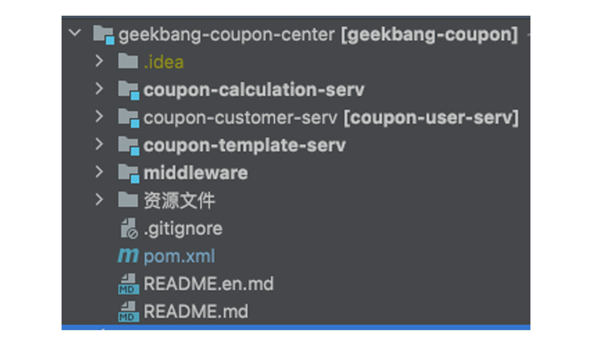

# 05-牛刀小试：如何搭建优惠券模板服务？

你好，我是姚秋辰。

今天我们来动手搭建优惠券平台的实战项目。为了让你体验从 0 到 1 的微服务改造过程，我们先使用 Spring Boot 搭建一个基础版的优惠券平台项目，等你学习到 Spring Cloud 的时候，我们就在这个项目之上做微服务化改造，将 Spring Cloud 的各个组件像添砖加瓦一样集成到项目里。

如果你没有太多 Spring Boot 的相关开发经验，通过今天的学习，你可以掌握如何通过 SpringBoot 组件快速落地一个项目。如果你之前了解过 Spring Boot，那么今天的学习不仅可以起到温故知新的作用，你还可以从我分享的开发经验里得到一些启发。

在03 讲中，我们介绍了优惠券平台的功能模块。我们说过，在用户领取优惠券的过程当中，优惠券是通过券模板来生成的，因此，优惠券模板服务是整个项目的底层基础服务。今天咱就直接上手搭建这个服务模块：coupon-template-serv。不过在此之前，我们先来看看整体的项目结构是怎样搭建的。

## 搭建项目结构

我把整个优惠券平台项目从 Maven 模块管理的角度划分为了多个模块。



在顶层项目 geekbang-coupon 之下有四个子模块，我先来分别解释下它们的功能：

- coupon-template-serv： 创建、查找、克隆、删除优惠券模板；

- coupon-calculation-serv：计算优惠后的订单价格、试算每个优惠券的优惠幅度；

- coupon-customer-serv：通过调用 template 和 calculation 服务，实现用户领取优惠券、模拟计算最优惠的券、删除优惠券、下订单等操作；

- middleware：存放一些与业务无关的平台类组件。

在大型的微服务项目里，每一个子模块通常都存放在独立的 Git 仓库中，为了方便你下载代码，我把所有模块的代码都打包放到了这个代码仓库里，你可以在这里找到课程各阶段对应的源代码。

在每一个以“-serv”结尾的业务子模块中，我从内部分层的角度对其做了进一步拆分，以我们今天要搭建的 coupon-template-serv 为例，它内部包含了三个子模块：

- coupon-template-api：存放公共 POJO 类或者对外接口的子模块；

- coupon-template-dao：存放数据库实体类和 Dao 层的子模块；

- coupon-template-impl：核心业务逻辑的实现层，对外提供 REST API。

你会发现，我把 coupon-template-api 作为一个单独的模块，这样做的好处是：当某个上游服务需要获取 coupon-template-serv 的接口参数时，只要导入轻量级的 coupon-template-api模块，就能够获取接口中定义的 Request 和 Response 的类模板，不需要引入多余的依赖项（比如 Dao 层或者 Service 层）。

这就是开闭原则的应用，它使各个模块间的职责和边界划分更加清晰，降低耦合的同时也更加利于依赖管理。

搭建好项目的结构之后，接下来我们借助 Maven 工具将需要的依赖包导入到项目中。

## 添加 Maven 依赖项

这里你要注意一下，添加 Maven 依赖项需要遵循“从上到下”的原则，也就是从顶层项目geekbang-coupon 开始，顺藤摸瓜直到 coupon-template-serv 下的子模块。首先，我们来看看顶层 geekbang-coupon 依赖项的编写。

### 编写 geekbang-coupon 依赖项

geekbang-coupon 是整个实战项目的顶层项目，它不用操心具体的业务逻辑，只用完成一个任务：管理子模块和定义 Maven 依赖项的版本。这就像一个公司的大 boss 一样，只用制定方向战略，琐碎的业务就交给下面人（子模块）来办就好了。

那么顶层战略在哪里制定？其实就在 pom.xml 文件里，我们看一下 geekbang-coupon 的 pom文件中都定义了哪些内容。

```xml
<!-- 已省略部分标签，完整内容请参考项目源代码 -->
<parent>
   <groupId>org.springframework.boot</groupId>
   <artifactId>spring-boot-starter-parent</artifactId>
   <version>2.4.2</version>
</parent>
<groupId>com.geekbang</groupId>
<artifactId>geekbang-coupon</artifactId>
<packaging>pom</packaging>
<version>1.0-SNAPSHOT</version>
<modules>
   <module>coupon-template-serv</module>
   <module>coupon-calculation-serv</module>
   <module>coupon-customer-serv</module>
   <module>middleware</module>
</modules>
<dependencyManagement>
   <dependencies>
      <dependency>
         <groupId>org.apache.commons</groupId>
         <artifactId>commons-lang3</artifactId>
         <version>3.0</version>
      </dependency>
   <!-- 省略部分依赖项 -->
   </dependencies>
</dependencyManagement>
```

在 pom 文件里有以下三个重点标签。

1. < parent > 标签

在 parent 标签中我们指定了 geekbang-coupon 项目的“父级依赖”为 spring-boot-starter-parent，这样一来，spring-boot-starter-parent 里定义的 Spring Boot 组件版本信息就会被自动带到子模块中。这种做法也是大多数 Spring Boot 项目的通用做法，不仅降低了依赖项管理的成本，也不需要担心各个组件间的兼容性问题。

2. < packaging > 标签

maven 的打包类型有三种：jar、war 和 pom。当我们指定 packaging 类型为 pom 时，意味着当前模块是一个“boss”，它只用关注顶层战略，即定义依赖项版本和整合子模块，不包含具体的业务实现。

3. < dependencymanagement > 标签

这个标签的作用和 < parent > 标签类似，两者都是将版本信息向下传递。dependencymanagement 是 boss 们定义顶层战略的地方，我们可以在这里定义各个依赖项的版本，当子项目需要引入这些依赖项的时候，只用指定 groupId 和 artifactId 即可，不用管version 里该写哪个版本。

完成了 geekbang-coupon 依赖项的编写，接下来我们看看 coupon-template-serv 依赖项的编写。

### 编写 coupon-template-serv 依赖项

coupon-template-serv 是大 boss 下面的一个小头目，和 geekbang-coupon 一样，它的packaging 类型也是 pom。我们说过 boss 只用管顶层战略，因此 coupon-temolate-serv 的pom 文件内容很简单，只是定义了父级项目和子模块。

```xml
<!-- 已省略部分标签，完整内容请参考项目源代码 -->
<parent>
   <artifactId>geekbang-coupon</artifactId>
   <groupId>com.geekbang</groupId>
   <version>1.0-SNAPSHOT</version>
   <relativePath>../pom.xml</relativePath>
</parent>
<modelVersion>4.0.0</modelVersion>
<artifactId>coupon-template-serv</artifactId>
<packaging>pom</packaging>
<modules>
   <module>coupon-template-api</module>
   <module>coupon-template-dao</module>
   <module>coupon-template-impl</module>
</modules>
```

我们已经把 geekbang-coupon 和 coupon-template-serv 两个父级项目的依赖项添加完毕，接下来就去搭建 coupon-template-serv 下面的三个子模块。

coupon-template-api 模块存放了接口 Request 和 Response 的类模板，是另两个子模块需要依赖的公共类库，所以我就先从 coupon-template-api 开始项目构建。

## 搭建 coupon-template-api 模块

coupon-template-api 模块是专门用来存放公共类的仓库，我把 REST API 接口的服务请求和服务返回对象的 POJO 类放到了里面。在微服务领域，将外部依赖的 POJO 类或者 API 接口层单独打包是一种通用做法，这样就可以给外部依赖方提供一个“干净”（不包含非必要依赖）的接口包，为远程服务调用（RPC）提供支持。

在 coupon-template-api 项目的 pom 文件中，我只添加了少量的“工具类”依赖，比如lombok、guava 和 validation-api 包等通用组件，这些工具类用来帮助我们自动生成代码并提供一些便捷的功能特性，具体的依赖项你可以参考项目源码。

首先，我们需要定义一个用来表示优惠券类型的 enum 对象，在com.geekbang.coupon.template.api.enum 包下创建一个名为 CouponType 的枚举类。

```java
@Getter
@AllArgsConstructor
public enum CouponType {
   UNKNOWN("unknown", "0"),
   MONEY_OFF("满减券", "1"),
   DISCOUNT("打折", "2"),
   RANDOM_DISCOUNT("随机减", "3")
   LONELY_NIGHT_MONEY_OFF("晚间双倍优惠券", "4");
   private String description;
   // 存在数据库里的最终code
   private String code;
   public static CouponType convert(String code) {
       return Stream.of(values())
               .filter(bean -> bean.code.equalsIgnoreCase(code))
               .findFirst()
               .orElse(UNKNOWN);
   }
}
```

CouponType 类定义了多个不同类型的优惠券，convert 方法可以根据优惠券的编码返回对应的枚举对象。这里还有一个“Unknown”类型的券，它专门用来对付故意输错 code 的恶意请求。

作为一个骨灰级程序员，我会认为所有需要用户输入的信息都是不可靠的，并且需要对各种意外输入做拦截、防范，这就是“防御性编程”的思维。工作的时间越久，人往往会变得越怂（都是被各种故障吓大的）。

接下来，我们创建两个用来定义优惠券模板规则的类，分别是 TemplateRule 和 Discount。我把它们放在 com.geekbang.coupon.template.api.beans.rules 包路径下。

TemplateRule 包含了两个规则，一是领券规则，包括每个用户可领取的数量和券模板的过期时间；二是券模板的计算规则。

```java
@Data
@NoArgsConstructor
@AllArgsConstructor
public class TemplateRule {
   // 可以享受的折扣
   private Discount discount;
   // 每个人最多可以领券数量
   private Integer limitation;
   // 过期时间
   private Long deadline;
}
```

这里我强烈推荐你使用一键三连的 lombok 注解自动生成基础代码，它们分别是 Data、NoArgsConstructor 和 AllArgsConstructor。其中，Data 注解自动生成 getter、setter、toString 等方法，后两个注解分别生成无参构造器和全参构造器，省时省力省地盘。

TemplateRule 中的 Discount 成员变量定义了使用优惠券的规则，代码如下。

```java
public class Discount {
   // 对于满减券 - quota是减掉的钱数，单位是分
   // 对于打折券 - quota是折扣(以100表示原价)，90就是打9折,  95就是95折
   // 对于随机立减券 - quota是最高的随机立减额
   // 对于晚间特别优惠券 - quota是日间优惠额，晚间优惠翻倍
   private Long quota;
   // 订单最低要达到多少钱才能用优惠券，单位为分
   private Long threshold;
}
```

从上面代码中可以看出，我使用 Long 来表示“金额”。对于境内电商行业来说，金额往往是以分为单位的，这样我们可以直接使用 Long 类型参与金额的计算，比如 100 就代表 100 分，也就是一块钱。这比使用 Double 到处转换 BigDecimal 省了很多事儿。

最后，我们在 com.geekbang.coupon.template.api.beans 包下创建一个名为CouponTemplateInfo 的类，用来创建优惠券模板，代码如下：

```java
// 已省略部分内容，完整内容请参考项目源代码
public class CouponTemplateInfo {
   private Long id;
   @NotNull
   private String name; // 优惠券名称
   @NotNull
   private String desc; // 优惠券描述
   @NotNull
   private String type;  // 优惠券类型(引用CouponType里的code)
   private Long shopId; // 优惠券适用门店 - 若无则为全店通用券
   @NotNull
   private TemplateRule rule; // 优惠券使用规则
   private Boolean available; // 当前模板是否为可用状态
}
```

在上面的代码中，我们应用了 jakarta.validate-api 组件的注解 @NotNull，对参数是否为 Null进行了校验。如果请求参数为空，那么接口会自动返回 Bad Request 异常。当然，jakarta 组件还有很多可以用来做判定验证的注解，合理使用可以节省大量编码工作，提高代码可读性。

此外，你还会发现，CouponTemplateInfo 内封装了优惠券模板的基本信息，我们可以把优惠券模板当做一个“模具”，每一张优惠券都经由模具来制造，被制造出来的优惠券则使用CouponInfo 对象来封装。

CouponInfo 对象包含了优惠券的模板信息、领券用户 ID、适用门店 ID 等属性。除此之外，我还在源码中定义了用来实现分页查找的对象，如果你特别感兴趣，可以到项目源码中查看完整的类定义。

到这里我们就完成了 coupon-template-api 项目的搭建，下面我们开始搭建 Dao 层模块：coupon-template-dao。它主要负责和数据库的对接、读取。

## 搭建 coupon-template-dao 模块

首先，我们把必要的依赖项添加到 coupon-template-dao 项目中，比较关键的 maven 依赖项有以下几个。

- coupon-template-api: 引入 api 包下的公共类；

- spring-boot-starter-data-jpa: 添加 spring-data-jpa 的功能进行 CRUD 操作；

- mysql-connector-java: 引入 mysql 驱动包，驱动版本尽量与 mysql 版本保持一致。

接下来，我们在 com.geekbang.coupon.template.dao.entity 目录下创建了一个数据库实体对象的 Java 类：CouponTemplate。

```java
// 完整内容请参考源代码
@Entity
@Builder
@EntityListeners(AuditingEntityListener.class)
@Table(name = "coupon_template")
public class CouponTemplate implements Serializable {
   @Id
   @GeneratedValue(strategy = GenerationType.IDENTITY)
   @Column(name = "id", nullable = false)
   private Long id;
   // 状态是否可用
   @Column(name = "available", nullable = false)
   private Boolean available;
   @Column(name = "name", nullable = false)
   private String name;
   @Column(name = "description", nullable = false)
   private String description;
   // 适用门店-如果为空，则为全店满减券
   @Column(name = "shop_id")
   private Long shopId;
   // 优惠券类型
   @Column(name = "type", nullable = false)
   @Convert(converter = CouponTypeConverter.class)
   private CouponType category;
   // 创建时间，通过@CreateDate注解自动填值（需要配合@JpaAuditing注解在启动类上生效）
   @CreatedDate
   @Column(name = "created_time", nullable = false)
   private Date createdTime;
   // 优惠券核算规则，平铺成JSON字段
   @Column(name = "rule", nullable = false)
   @Convert(converter = RuleConverter.class)
   private TemplateRule rule;
}
```

在 CouponTemplate 上，我们运用了 javax.persistence 包和 Spring JPA 包的标准注解，对数据库字段进行了映射，我挑几个关键注解说道一下。

- Entity：声明了“数据库实体”对象，它是数据库 Table 在程序中的映射对象；

- Table：指定了 CouponTemplate 对应的数据库表的名称；

- ID/GeneratedValue：ID 注解将某个字段定义为唯一主键，GeneratedValue 注解指定了主键生成策略；

- Column：指定了每个类属性和数据库字段的对应关系，该注解还支持非空检测、对 update和 create 语句进行限制等功能；

- CreatedDate：自动填充当前数据的创建时间；

- Convert：如果数据库中存放的是 code、string、数字等等标记化对象，可以使用 Convert注解指定一个继承自 AttributeConverter 的类，将 DB 里存的内容转化成一个 Java 对象。

这里我要补充一点，其实 JPA 也支持一对多、多对多的级联关系（ManyToOne、OneToOne等注解），但是你发现我并没有在项目中使用，原因是这些注解背后有很多隐患。过深的级联层级所带来的 DB 层压力可能会在洪峰流量下被急剧放大，而 DB 恰恰是最不抗压的一环。所以，我们很少在一些一二线大厂的超高并发项目中看到级联配置的身影。

我的经验是尽可能减少级联配置，用单表查询取而代之，如果一个查询需要 join 好几张表，最好的做法就通过重构业务逻辑来简化 DB 查询的复杂度。

最后，我们来到定义 DAO 的地方，借助 Spring Data 的强大功能，我们只通过接口名称就可以声明一系列的 DB 层操作。我们先来看一下 CouponTemplateDao 这个类的代码。

```java
public interface CouponTemplateDao
       extends JpaRepository<CouponTemplate, Long> {
   // 根据Shop ID查询出所有券模板
   List<CouponTemplate> findAllByShopId(Long shopId);
   // IN查询 + 分页支持的语法
   Page<CouponTemplate> findAllByIdIn(List<Long> Id, Pageable page);
   // 根据shop ID + 可用状态查询店铺有多少券模板
   Integer countByShopIdAndAvailable(Long shopId, Boolean available);
   /**
    * 将优惠券设置为不可用
    */
   @Modifying
   @Query("update CouponTemplate c set c.available = 0 where c.id = :id")
   int makeCouponUnavailable(@Param("id") Long id);
   // 完整方法请至源码查看
}
```

看了这段代码，你一定在想这里都是查询数据的场景，那么“增删改”的方法在哪里？

其实，这些方法都在 CouponTemplateDao 所继承的 JpaRepository 类中。这个父类就像一个百宝箱，内置了各种各样的数据操作方法。我们可以通过内置的 save 方法完成对象的创建和更新，也可以使用内置的 delete 方法删除数据。

此外，它还提供了对“查询场景”的丰富支持，除了通过 ID 查询以外，我们还可以使用三种不同的方式查询数据。

- 通过接口名查询：将查询语句写到接口的名称中；

- 通过 Example 对象查询：构造一个模板对象，使用 findAll 方法来查询；

- 自定义查询：通过 Query 注解自定义复杂查询语句。

在 CouponTemplateDao 中，第一个方法 findAllByShopId 就是通过接口名查询的例子，jpa使用了一种约定大于配置的思想，你只需要把要查询的字段定义在接口的方法名中，在你发起调用时后台就会自动转化成可执行的 SQL 语句。构造方法名的过程需要遵循 < 起手式 >By<查询字段 >< 连接词 > 的结构。

- 起手式：以 find 开头表示查询，以 count 开头表示计数；

- 查询字段：字段名要保持和 Entity 类中定义的字段名称一致；

- 连接词：每个字段之间可以用 And、Or、Before、After 等一些列丰富的连词串成一个查询语句。

以接口名查询的方式虽然很省事儿，但它面对复杂查询却力不从心，一来容易导致接口名称过长，二来维护起来也挺吃力的。所以，对于复杂查询，我们可以使用自定义 SQL、或者Example 对象查找的方式。

关于自定义 SQL，你可以参考 CouponTemplateDao 中的 makeCouponUnavailable 方法，我将 SQL 语句定义在了 Query 注解中，通过参数绑定的方式从接口入参处获取查询参数，这种方式是最接近 SQL 编码的 CRUD 方式。

Example 查询的方式也很简单，构造一个 CouponTemplate 的对象，将你想查询的字段值填入其中，做成一个查询模板，调用 Dao 层的 findAll 方法即可，这里留给你自己动手验证。

```
couponTemplate.setName("查询名称");
templateDao.findAll(Example.of(couponTemplate));
```

现在，API 和 Dao 层都已经准备就绪，万事俱备只差最后的业务逻辑层了，接下来我们去搭建 coupon-template-impl 模块。

## 搭建 coupon-template-impl 模块

coupon-template-impl 是 coupon-template-serv 下的一个子模块，也是实现业务逻辑的地方。从依赖管理的角度，它引入了 coupon-template-api 和 coupon-template-dao 两个内部依赖项到 pom.xml。

当然，我们也需要加入几个外部依赖项，你可以参考项目的 pom.xml 源代码获取完整的依赖项列表。

首先，我们先来定义 Service 层的接口类：CouponTemplateService。在这个接口中，我们定义了优惠券创建、查找优惠券和修改优惠券可用状态的方法。

```java
public interface CouponTemplateService {
   // 创建优惠券模板
   CouponTemplateInfo createTemplate(CouponTemplateInfo request);
   // 通过模板ID查询优惠券模板
   CouponTemplateInfo loadTemplateInfo(Long id);
   // 克隆券模板
   CouponTemplateInfo cloneTemplate(Long templateId);
   // 模板查询（分页）
   PagedCouponTemplateInfo search(TemplateSearchParams request);
   // 删除券模板
   void deleteTemplate(Long id);
   //批量读取模板
   Map<Long, CouponTemplateInfo> getTemplateInfoMap(Collection<Long> ids);
   // 完整方法列表请至源码查看
}
```

由于这部分比较简单，就是通过 CouponTemplateDao 层来实现优惠券模板的增删改查，这里我就不展开介绍实现层代码了，你可以参考源码中的 CouponTemplateServiceImpl 类。

不过，我建议你不要直接 copy 源码，先尝试自己实现这几个 Service 方法，写完之后再和我的源码做比较，看一看有哪些可以改进的地方。

接下来，我们创建 CouponTemplateController 类对外暴露 REST API，可以借助 spring-web注解来完成，具体代码如下。

```java
@Slf4j
@RestController
@RequestMapping("/template")
public class CouponTemplateController {
   @Autowired
   private CouponTemplateService couponTemplateService;
   // 创建优惠券
   @PostMapping("/addTemplate")
   public CouponTemplateInfo addTemplate(@Valid @RequestBody CouponTemplateInfo
       log.info("Create coupon template: data={}", request);
       return couponTemplateService.createTemplate(request);
   }
   // 克隆券模板
   @PostMapping("/cloneTemplate")
   public CouponTemplateInfo cloneTemplate(@RequestParam("id") Long templateId)
       log.info("Clone coupon template: data={}", templateId);
       return couponTemplateService.cloneTemplate(templateId);
   }
   // 读取优惠券
   @GetMapping("/getTemplate")
   public CouponTemplateInfo getTemplate(@RequestParam("id") Long id){
       log.info("Load template, id={}", id);
       return couponTemplateService.loadTemplateInfo(id);
   }
   // 搜索模板(支持分页查询)
   @PostMapping("/search")
   public PagedCouponTemplateInfo search(@Valid @RequestBody TemplateSearchParam
       log.info("search templates, payload={}", request);
       return couponTemplateService.search(request);
   }
   // ... 完整代码请至源码查看
}
```

在这里，Controller 类中的注解来自 spring-boot-starter-web 依赖项，通过这些注解将服务以RESTful 接口的方式对外暴露。现在，我们来了解下上述代码里，服务寻址过程中的三个重要注解：

- RestController：用来声明一个 Controller 类，加载到 Spring Boot 上下文；

- RequestMapping：指定当前类中所有方法在 URL 中的访问路径的前缀；

- Post/Get/PutMapping：定义当前方法的 HTTP Method 和访问路径。

项目启动类是最后的代码部分，我们在 com.geekbang.coupon.template 下创建一个Application 类作为启动程序的入口，并在这个类的头上安上 SpringBoot 的启动注解。

```java
@SpringBootApplication
@EnableJpaAuditing
@ComponentScan(basePackages = {"com.geekbang"})
public class Application {
   public static void main(String[] args) {
       SpringApplication.run(Application.class, args);
   }
}
```

SpringBootApplication 注解会自动开启包路径扫描，并启动一系列的自动装配流程（AutoConfig）。在默认情况下，Spring Boot 框架会扫描启动类所在 package 下的所有类，并在上下文中创建受托管的 Bean 对象，如果我们想加载额外的扫包路径，只用添加ComponentScan 注解并指定 path 即可。

所有代码环节全部完工后，我们还剩最后的画龙点睛之笔：创建配置文件 application.yml，它位于 src/main/resources 文件夹下。Spring Boot 支持多种格式的配置文件，这里我们顺应主流，使用 yml 格式。

```yaml
# 项目的启动端口
server:
 port: 20000
spring:
 application:
   # 定义项目名称
   name: coupon-template-serv
 datasource:
   # mysql数据源
   username: root
#    password: 这里写上你自己的密码
   url: jdbc:mysql://127.0.0.1:3306/geekbang_coupon_db?autoReconnect=true&useUni
   # 指定数据源DataSource类型
   type: com.zaxxer.hikari.HikariDataSource
   driver-class-name: com.mysql.cj.jdbc.Driver
   # 数据库连接池参数配置，比如池子大小、超时时间、是否自动提交等等
   hikari:
     pool-name: GeekbangCouponHikari
     connection-timeout: 5000
     idle-timeout: 30000
     maximum-pool-size: 10
     minimum-idle: 5
     max-lifetime: 60000
     auto-commit: true
 jpa:
   show-sql: true
   hibernate:
     # 在生产环境全部为none，防止ddl结构被自动执行，破坏生产数据
     ddl-auto: none
   # 在日志中打印经过格式化的SQL语句
   properties:
     hibernate.format_sql: true
     hibernate.show_sql: true
   open-in-view: false
```

在配置文件中，有一个地方需要你多加注意，那就是 jdbc 连接串（spring.datasource.url）。不同版本的 MySQL 对连接串中的参数有不同的要求。

如果你发现项目启动过程中抛出了 MySQL 连接报错，一定记得检查自己的 MySQL 版本，检查是否缺失了某些参数（比如 MySQL 8.x 版本下要求传入 serverTimezone 参数）。如果你本地安装的 MySQL 版本早于 8.x 系列，我推荐你重新安装和我一样的 MySQL 8.0.27 版本，这样就不会碰到兼容性问题了。

好，到这里，我们优惠券平台项目的第一个模块 coupon-template-serv 就搭建完成了，你可以在本地启动项目并通过 Postman 发起调用。我已经将 Postman API 集合上传到了这个Gitee 源码库中的“资源文件”目录下，文件名为“Spring Boot 阶段.postman_collection.json”，你可以导入到自己本地的 Postman 中使用。

现在，我们来回顾一下这节课的重点内容。

## 总结

今天我带你搭建了整个优惠券服务的整体项目结构，并且用 Spring Boot 快速落地了优惠券模板服务。如果你在自己的项目中还在使用繁琐的 sql 资源文件来操作数据库，不妨升级成coupon-template-dao 中使用的 spring-data-jpa 来简化 DB 操作。spring-data-jpa 的功能特性也折射出 Spring 框架的发展趋势：约定大于配置，且越来越轻量级。

在学习这节课的时候，我希望你不要只满足于把项目跑起来就万事大吉了，你还要做一些思考和总结沉淀，想一想如何能把课程中的一些技术点应用在自己的项目中。我在这节课分享了很多开发小技巧，比如防御性编程、代码自动生成、金额计算、如何简化数据校验、级联关系的误区等，这些都可以作为你的开发素材。

希望你能够动起手来，顺着这节课程的内容动手搭建整个服务，不要直接照搬源码本地执行一下就完事儿了，只有上手实际搭建项目我们才能了解技术细节、积累排查问题的经验。要知道，纸上得来终觉浅，绝知此事要躬行。

在下一节课中，我会带你搭建 coupon-calculation-ser 和 coupon-customer-serv，构建一个完整的优惠券平台 Spring Boot 项目。

## 思考题

最后，请你思考一个问题：

级联查询很容易引发性能问题，你在自己的项目中遇到最复杂的 SQL 是什么？然后，请你进一步做个思考：如果这条 SQL 的调用量激增，你该如何进行优化？欢迎你“显摆”出来，我在留言区等你。

好啦，这节课就结束啦。也欢迎你把这节课分享给更多对 Spring Cloud 感兴趣的朋友。我是姚秋辰，我们下节课再见！
