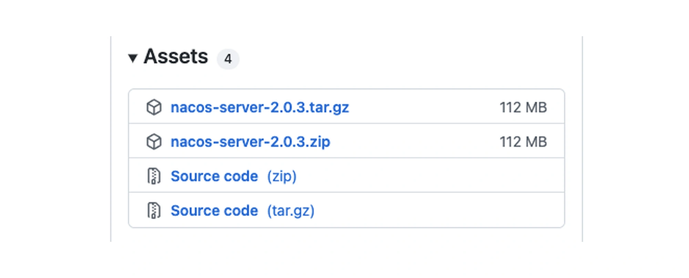
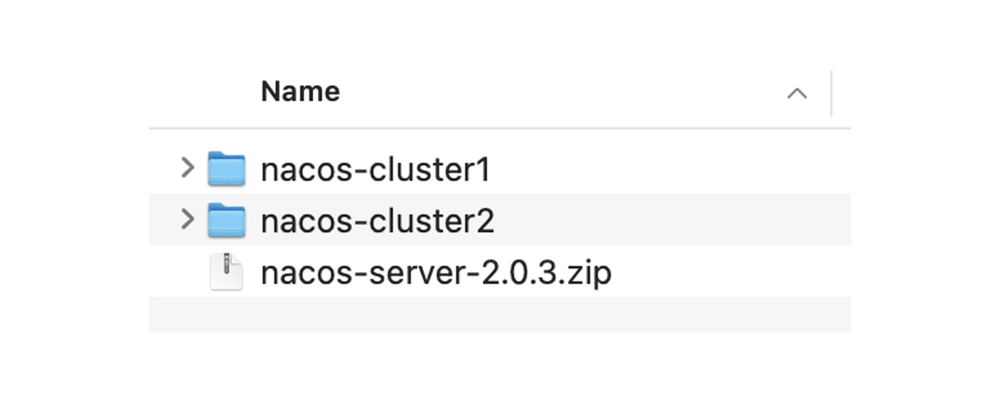
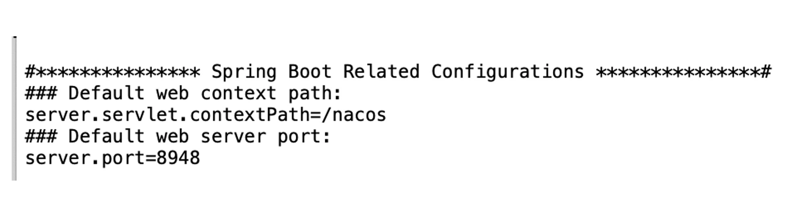
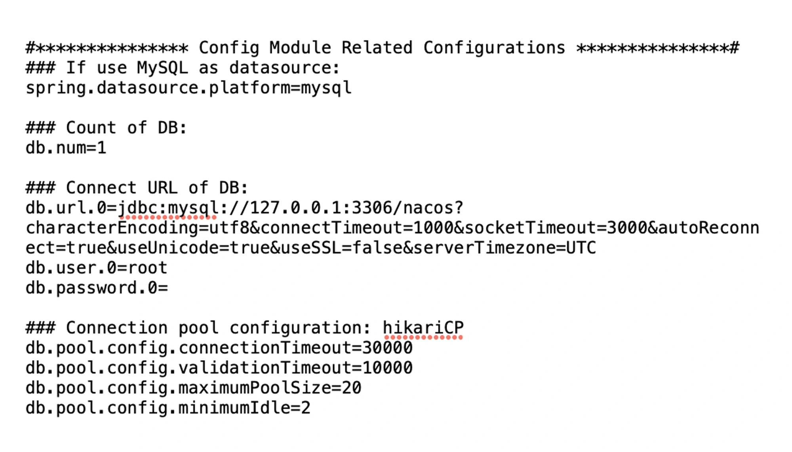
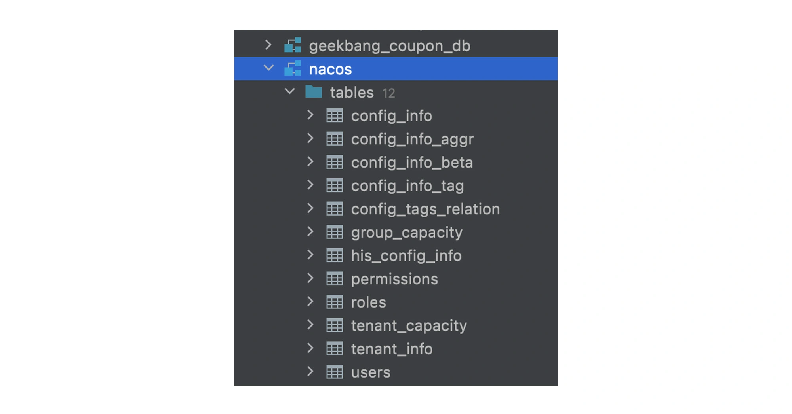
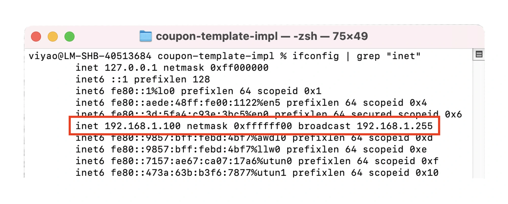
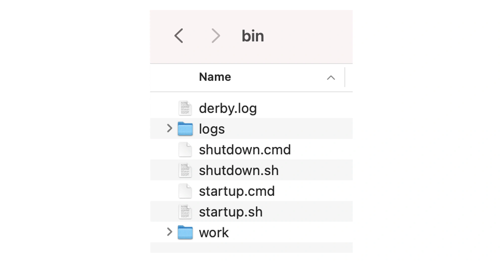
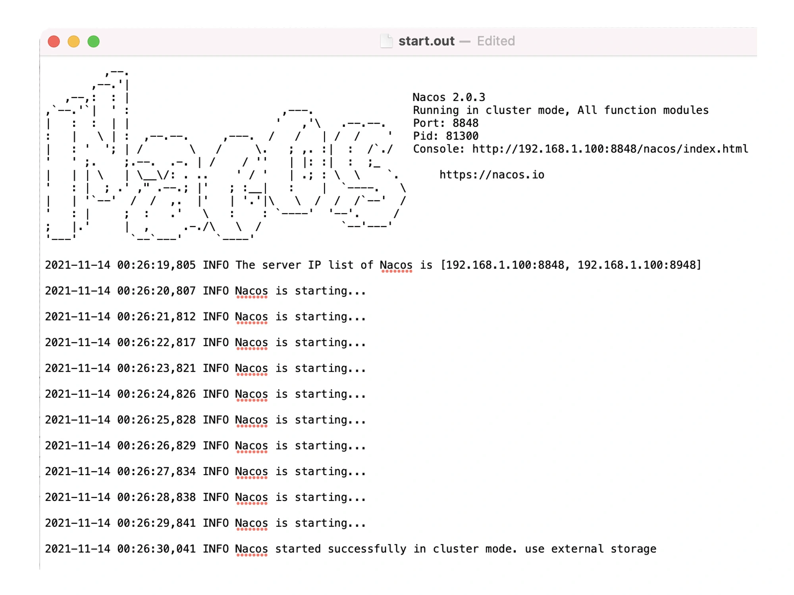
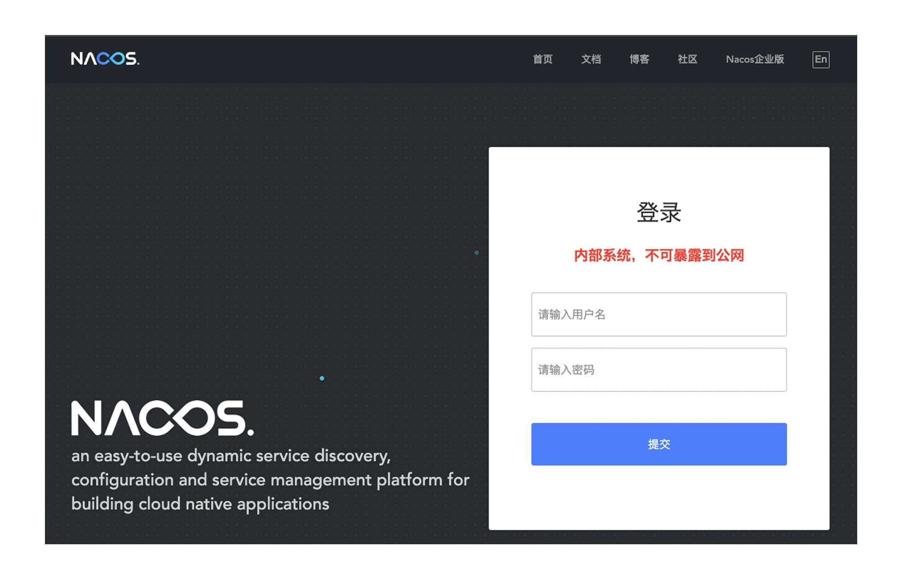
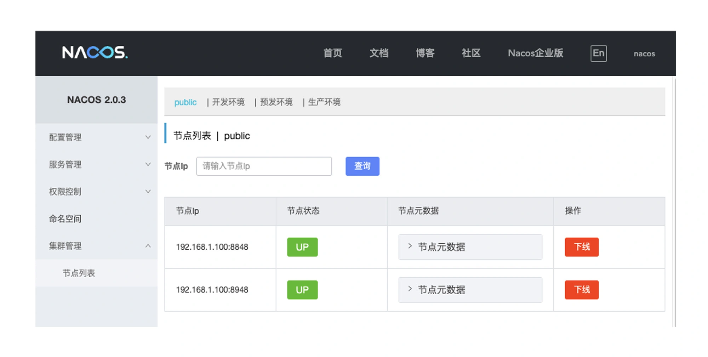

# 08-服务治理：Nacos集群环境搭建

你好，我是姚秋辰。

上节课我们对 Nacos 功能体系有了全面的认识。今天我们就来动手搭建 Nacos 服务注册中心。通过这节课，你可以知道如何搭建一个高可用的 Nacos 服务集群，以及如何使用 MySQL作为 Nacos 的底层数据存储方案。这些内容可以帮助你理解什么是“高可用架构”。

我们在做系统架构的时候，首要目标就是保障系统的高可用性。不管你的系统架构多么精妙，用的技术多么先进，如果系统的可用性无法得到保障，那么你做什么都是白忙活。

这就像我们的人生一样，事业、家庭、地位都是 0，健康才是一串 0 前面的那个 1，没有 1 则一切皆无。所以，系统的高可用性，就是系统架构层面的那个 1。

保障系统的高可用性有两个大道至简的方向。

- 避免单点故障：在做系统架构的时候，你应该假设任何服务器都有可能挂掉。如果某项任务依赖单一服务资源，那么这就会成为一个“单点”，一旦这个服务资源挂掉就表示整个功能变为不可用。所以你要尽可能消灭一切“单点”；

- 故障机器状态恢复：尽快将故障机器返回到故障前的状态。对于像 Nacos 这类中心化注册中心来说，因故障而下线的机器在重新上线后，应该有能力从某个地方获取故障发生前的服务注册列表。

那 Nacos 是如何解决上面这两个问题，来保证自己的高可用性的呢？很简单，就是构建服务集群。集群环境不仅可以有效规避单点故障引发的问题，同时对于故障恢复的场景来说，重新上线的机器也可以从集群中的其他节点同步数据信息，恢复到故障前的状态。

那么，接下来我就带你手把手搭建 Nacos Server 的集群环境。

## 下载 Nacos Server

Nacos Server 的安装包可以从 Alibaba 官方 GitHub 中的Release 页面下载。当前最新的稳定版本是 2.0.3，我们课程的实战项目也使用该版本的 Nacos 做为注册中心和配置中心。

在选择 Nacos 版本的时候你要注意，一定要选择稳定版使用，不要选择版本号中带有 BETA字样的版本（比如 2.0.0-BETA）。后者通常是重大版本更新前预发布的试用版，往往会有很多潜在的 Bug 或者兼容性问题。

Nacos 2.0.3 Release note 下方的 Assets 面板中包含了该版本的下载链接，你可以在 nacos-server-2.0.3.tar.gz 和 nacos-server-2.0.3.zip 这两个压缩包中任选一个下载。如果你对 Nacos的源码比较感兴趣，也可以下载 Source code 源码包来学习。



下载完成后，你可以在本地将 Nacos Server 压缩包解压，并将解压后的目录名改为“nacos-cluster1”，再复制一份同样的文件到 nacos-cluster2，我们以此来模拟一个由两台 NacosServer 组成的集群。



到这里，我们就完成了 Nacos 服务器的下载安装，接下来，我带你去修改 Nacos Server 的启动项参数。

## 修改启动项参数

Nacos Server 的启动项位于 conf 目录下的 application.properties 文件里，别看这个文件里的配置项密密麻麻一大串，但大部分都不用你操心，直接使用默认值就好。你只需要修改这里面的服务启动端口和数据库连接串就好了。

因为你需要在一台机器上同时启动两台 Nacos Server 来模拟一个集群环境，所以这两台Nacos Server 需要使用不同的端口，否则在启动阶段会报出端口冲突的异常信息。

Nacos Server 的启动端口由 server.port 属性指定，默认端口是 8848。我们在 nacos-cluster1中仍然使用 8848 作为默认端口，你只需要把 nacos-cluster2 中的端口号改掉就可以了，这里我把它改为 8948。



接下来，你需要对 Nacos Server 的 DB 连接串做一些修改。在默认情况下，Nacos Server 会使用 Derby 作为数据源，用于保存配置管理数据。Derby 是 Apache 基金会旗下的一款非常小巧的嵌入式数据库，可以随 Nacos Server 在本地启动。但从系统的可用性角度考虑，我们需要将 Nacos Server 的数据源迁移到更加稳定的 MySQL 数据库中。

你需要修改三处 Nacos Server 的数据库配置。

1. 指定数据源：spring.datasource.platform=mysql 这行配置默认情况下被注释掉了，它用来指定数据源为 mysql，你需要将这行注释放开；

2. 指定 DB 实例数：放开 db.num=1 这一行的注释；

3. 修改 JDBC 连接串：db.url.0 指定了数据库连接字符串，我指向了 localhost 3306 端口的nacos 数据库，稍后我将带你对这个数据库做初始化工作；db.user.0 和 db.password.0 分别指定了连接数据库的用户名和密码，我使用了默认的无密码 root 账户。

下面的图是完整的数据库配置项。



修改完数据库配置项之后，接下来我带你去 MySQL 中创建 Nacos Server 所需要用到的数据库 Schema 和数据库表。

## 创建 DB Schema 和 Table

Nacos Server 的数据库用来保存配置信息、Nacos Portal 登录用户、用户权限等数据，下面我们分两步来创建数据库。

第一步，创建 Schema。你可以通过数据库控制台或者 DataGrip 之类的可视化操作工具，执行下面这行 SQL 命令，创建一个名为 nacos 的 schema。

```
create schema nacos;
```

第二步，创建数据库表。Nacos 已经把建表语句准备好了，就放在你解压后的 Nacos Server安装目录中。打开 Nacos Server 安装路径下的 conf 文件夹，找到里面的 nacos-mysql.sql 文件，你所需要的数据库建表语句都在这了。你也可以直接到源码仓库的资源文件中获取Nacos 建表语句的 SQL 文件。

将文件中的 SQL 命令复制下来，在第一步中创建的 schema 下执行这些 SQL 命令。执行完之后，你就可以在在数据库中看到这些 tables 了，总共有 12 张数据库表。



数据库准备妥当之后，我们还剩最后一项任务：添加集群机器列表。添加成功后就可以完成集群搭建了。

## 添加集群机器列表

Nacos Server 可以从一个本地配置文件中获取所有的 Server 地址信息，从而实现服务器之间的数据同步。

所以现在我们要在 Nacos Server 的 conf 目录下创建 cluster.conf 文件，并将 nacos-cluster1和 nacos-cluster2 这两台服务器的 IP 地址 + 端口号添加到文件中。下面是我本地的cluster.conf 文件的内容。

```
## 注意，这里的IP不能是localhost或者127.0.0.1
192.168.1.100:8848
192.168.1.100:8948
```

这里需要注意的是，你不能在 cluster.conf 文件中使用 localhost 或者 127.0.0.1 作为服务器IP，否则各个服务器无法在集群环境下同步服务注册信息。这里的 IP 应该使用你本机分配到的内网 IP 地址。

如果你使用的是 mac 或者 linux 系统，可以在命令行使用 ifconfig | grep “inet” 命令来获取本机IP 地址，下图中红框标出的这行 inet 地址 192.168.1.100 就是本机的 IP 地址。



到这里，我们已经完成了所有集群环境的准备工作，接下来我带你去启动 Nacos Server 验证一下效果。

## 启动 Nacos Server

Nacos 的启动脚本位于安装目录下的 bin 文件夹，下图是 bin 目录下的启动脚本。其中Windows 操作系统对应的启动脚本和关闭脚本分别是 startup.cmd 和 shutdown.cmd，Mac 和Linux 系统对应的启动和关闭脚本是 startup.sh 和 shutdown.sh。



以 Mac 操作系统为例，如果你希望以单机模式（非集群模式）启动一台 Nacos 服务器，可以在 bin 目录下通过命令行执行下面这行命令：

```bash
sh startup.sh -m standalone
```

通过 -m standalone 参数，我指定了服务器以单机模式启动。Nacos Server 在单机模式下不会主动向其它服务器同步数据，因此这个模式只能用于开发和测试阶段，对于生产环境来说，我们必须以 Cluster 模式启动。

如果希望将 Nacos Server 以集群模式启动，只需要在命令行直接执行 sh startup.sh 命令就可以了。这时控制台会打印以下两行启动日志。

```
nacos is starting with cluster
nacos is starting，you can check the /Users/banxian/workspace/dev/middleware/naco
```

这两行启动日志没有告诉你 Nacos Server 最终是启动成功还是失败，不过你可以在第二行日志中找到一些蛛丝马迹。这行日志告诉了我们启动日志所在的位置是 nacos-cluster1/logs/start.out，在启动日志中你可以查看到一行成功消息“Nacos started successfullyin cluster mode”。当然了，如果启动失败，你也可以在这里看到具体的 Error Log。



我们用同样的方式先后启动 nacos-cluster1 和 nacos-cluster2，如上图所示，在启动日志中显示了成功消息“started successfully in cluster mode”，这代表服务器已经成功启动了，接下来你就可以登录 Nacos 控制台了。

## 登录 Nacos 控制台

在 Nacos 的控制台中，我们可以看到服务注册列表、配置项管理、集群服务列表等信息。在浏览器中打开nacos-cluster1或者nacos-cluster2的地址，注意这两台服务器的端口分别是8848 和 8948。你可以看到下面的 Nacos 的登录页面。



你可以使用 Nacos 默认创建好的用户 nacos 登录系统，用户名和密码都是 nacos。当然了，你也可以在登录后的权限控制 -> 用户列表页面新增系统用户。成功登录后，你就可以看到Nacos 控制台首页了。

为了验证集群环境处于正常状态，你可以在左侧导航栏中打开“集群管理”下的“节点列表”页面，在这个页面上显示了集群环境中所有的 Nacos Server 节点以及对应的状态，在下面的图中我们可以看到 192.168.1.100:8848 和 192.168.1.100:8948 两台服务器，并且它们的节点状态都是绿色的“UP”，这表示你搭建的集群环境一切正常。



好，到这里，我们的 Nacos 集群环境搭建就完成了。如果你在搭建环境的过程中发现 Nacos无法启动，只需要到启动日志 /logs/start.out 中就能找到具体的报错信息。如果你碰到了启动失败的问题，不妨先去检查以下两个地方：

1. 端口占用：即 server.port 所指定的端口已经被使用，你需要更换一个端口重新启动服务；

2. MySQL 连不上：你需要检查 application.properties 里配置的 MySQL 连接信息是否正确，并确认 MySQL 服务处于运行状态。

如果是其它的异常报错，欢迎发表到评论区，我和热心的同学们都会帮替你诊断的。

## 总结

现在，我们来回顾一下这节课的重点内容。今天我们了解了如何搭建高可用的 Nacos 集群，在这个过程中，我将底层存储切换成了 MySQL 数据源，实现了配置项的持久化。

在实际的项目中，如果某个微服务 Client 要连接到 Nacos 集群做服务注册，我们并不会把Nacos 集群中的所有服务器都配置在 Client 中，否则每次 Nacos 集群增加或删除了节点，我都要对所有 Client 做一次代码变更并重新发布。那么正确的做法是什么呢？

常见的一个做法是提供一个 VIP URL 给到 Client，VIP URL 是一个虚拟 IP 地址，我们可以把真实的 Nacos 服务器地址列表“隐藏”在虚拟 IP 后面，客户端只需要连接到虚 IP 即可，由提供虚 IP 的组件负责将请求转发给背后的服务器列表。这样一来，即便 Nacos 集群机器数量发生了变动，也不会对客户端造成任何感知。

提供虚 IP 的技术手段有很多，比如通过搭建 Nginx+LVS 或者 keepalived 技术实现高可用集群。如果你对这些技术感兴趣，我鼓励你尝试自己搭建一个虚 IP 的环境，锻炼一下技术调研能力。

## 思考题

在开始接下来的实战课之前，我们来做一些课前预习作业。请你从 Nacos 的官方文档中了解 Nacos 的功能特性以及集成方案，欢迎在评论区留下你的自学笔记。

好啦，这节课就结束啦。欢迎你把这节课分享给更多对 Spring Cloud 感兴趣的朋友。我是姚秋辰，我们下节课再见！
