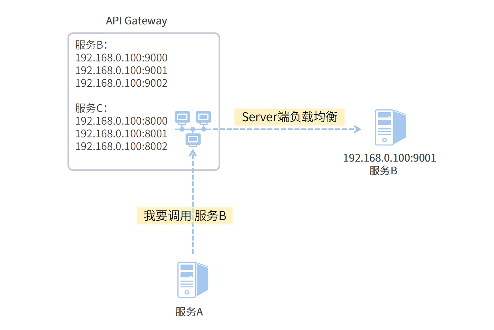
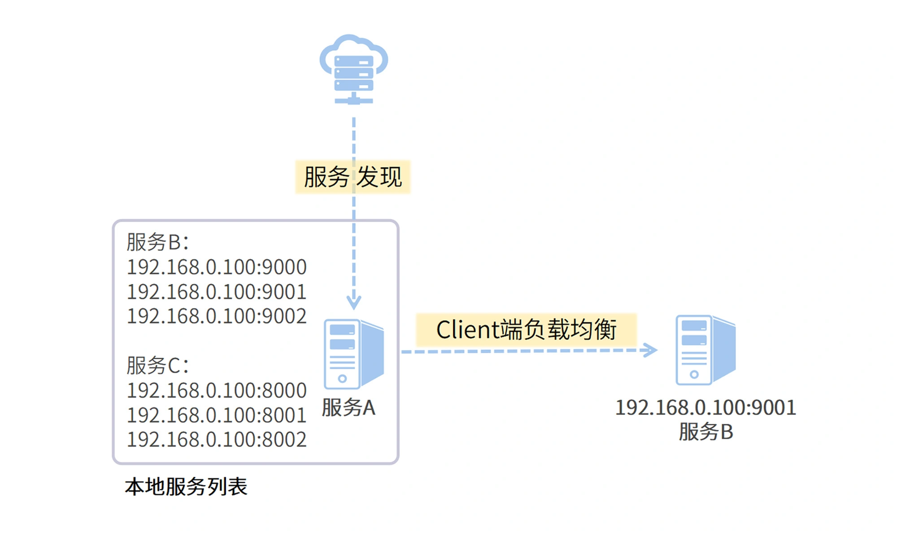
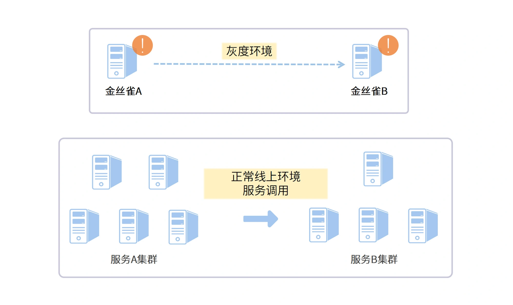
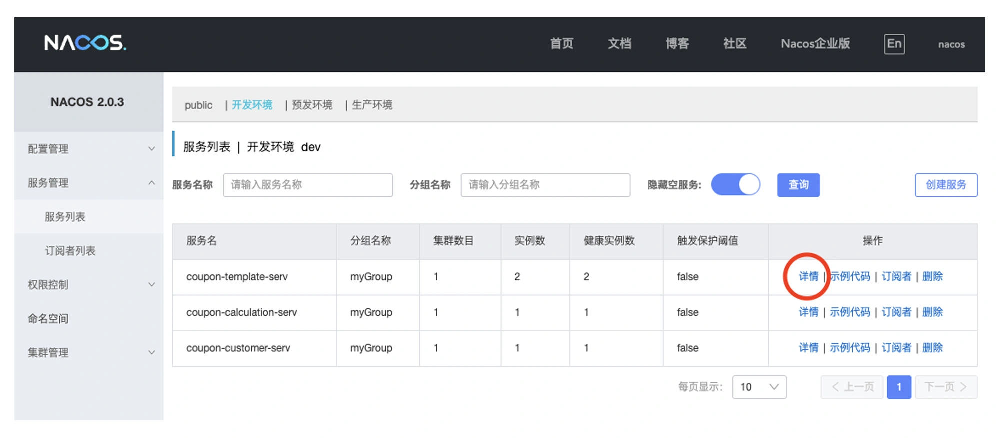
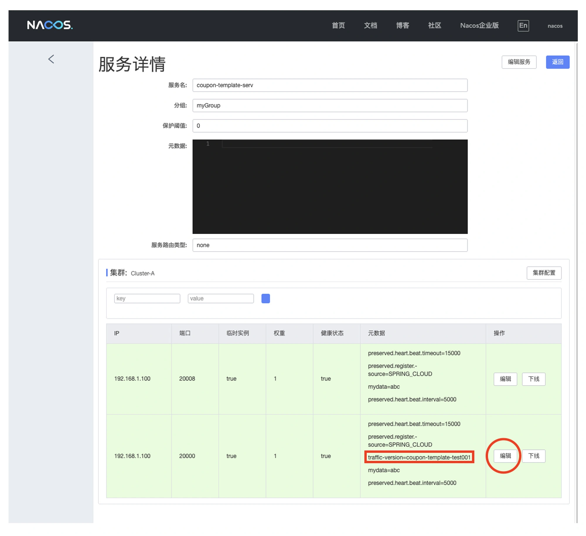

# 11-Loadbalancer实战：通过自定义负载均衡策略实现金丝雀测试

你好，我是姚秋辰。

上一课我们学习了如何借助 Nacos 的服务发现机制获取可用服务节点列表，并发起远程服务调用。在服务调用的环节里，还有一处细节需要你思考一下：Nacos 通过服务发现拿到了所有的可用服务节点列表，但服务请求只能发给一个节点，你知道服务调用是根据什么规则选择目标节点的吗？

“小孩子才做选择，大人全都要”，Nacos 就是这个全都要的大人。服务列表都被它拿到了手里，但如果要完成一次完整的服务调用，它还需要一个小孩子帮忙做选择，这个做选择题的小孩就是客户端负载均衡组件 Spring Cloud Loadbalancer，它根据负载均衡规则，从 Nacos 获取的服务列表中选取服务调用的目标地址。

那么，Loadbalancer 背后是如何工作的呢？今天我就带你了解 Spring Cloud 御用负载均衡器Loadbalancer 的原理。通过这节课，你可以收获以下内容。

1. 负载均衡的作用：了解负载均衡的两大门派，它们分别是网关层负载均衡和客户端负载均衡。你还会理解客户端负载均衡在微服务架构中的优势；

2. Loadbalancer 工作原理：了解 Loadbalancer 如何运用 @Loadbalanced 注解进行加载；

3. 自定义负载均衡策略：了解 Loadbalancer 的自定义扩展点，在实战项目中实现金丝雀测试。

接下来，我们先来看一下负载均衡在微服务中的作用。

## 为什么需要负载均衡

俗话说在生产队薅羊毛不能逮着一只羊薅，在微服务领域也是这个道理。面对一个庞大的微服务集群，如果你每次发起服务调用都只盯着那一两台服务器，在大用户访问量的情况下，这几台被薅羊毛的服务器一定会不堪重负。

因此，我们需要将访问流量分散到集群中的各个服务器上，实现雨露均沾，这就是所谓的“负载均衡技术”。

道理是这个道理，但实现起来就有两条不同的路径。负载均衡有两大门派，服务端负载均衡和客户端负载均衡。我们先来聊聊这两个不同门派的使用场景，再来看看本节课的主角Loadbalancer 属于哪门哪派。

### 网关层负载均衡

网关层负载均衡也被称为服务端负载均衡，就是在服务集群内设置一个中心化负载均衡器，比如 API Gateway 服务。发起服务间调用的时候，服务请求并不直接发向目标服务器，而是发给这个全局负载均衡器，它再根据配置的负载均衡策略将请求转发到目标服务。我把这个过程画成了下面这张流程图。



网关层负载均衡的应用范围非常广，它不依赖于服务发现技术，客户端并不需要拉取完整的服务列表；同时，发起服务调用的客户端也不用操心该使用什么负载均衡策略。

不过，网关层负载均衡的劣势也很明显。

1. 网络消耗：多了一次客户端请求网关层的网络开销，在线上高并发场景下这层调用会增加10ms～20ms 左右的服务响应时间。别小瞧了这十几毫秒的时间，在超高 QPS 的场景下，性能损耗也会被同步放大，降低系统的吞吐量；

2. 复杂度和故障率提升：需要额外搭建内部网关组件作为负载均衡器，增加了系统复杂度，而多出来的那一次的网络调用无疑也增加了请求失败率。

Spring Cloud Loadbalancer 可以很好地弥补上面的劣势，那么它是如何做到的呢？

### 客户端负载均衡

Spring Cloud Loadbalancer 采用了客户端负载均衡技术，每个发起服务调用的客户端都存有完整的目标服务地址列表，根据配置的负载均衡策略，由客户端自己决定向哪台服务器发起调用。



客户端负载均衡的优势很明显。

1. 网络开销小：由客户端直接发起点对点的服务调用，没有中间商赚差价；

2. 配置灵活：各个客户端可以根据自己的需要灵活定制负载均衡策略。

不过呢，如果想要应用客户端负载均衡，那么还需要满足一个前置条件，发起服务调用的客户端需要获取所有目标服务的地址，这样它才能使用负载均衡规则选取要调用的服务。也就是说，客户端负载均衡技术往往需要依赖服务发现技术来获取服务列表。

所以，Nacos 和 Loadbalancer 自然而然地走到了一起，一个通过服务发现获取服务列表，另一个使用负载均衡规则选出目标服务器。

了解了负载均衡的作用之后，我们来看看 Loadbalancer 的工作原理。

## Loadbalancer 工作原理

你一定还记得我们在 Nacos 实战部分使用 WebClient 发起服务调用的过程吧。我在 coupon-customer-serv 中声明 WebClient 的时候加了一个机关，那就是 @Loadbalanced 注解，这个注解就是开启负载均衡功能的玄机。

```
@Bean
@LoadBalanced
public WebClient.Builder register() {
   return WebClient.builder();
}
```

Loadbalancer 组件通过 @Loadbalanced 注解对 WebClient 动了一番手脚，在启动过程中利用了自动装配器机制，分三步偷偷摸摸地向 WebClient 中塞了一个特殊的 Filter（过滤器），通过过滤器实现了负载均衡功能。

```
Builder filter(ExchangeFilterFunction filter);
```

接下来，我们深入源码，看看 Loadbalancer 是如何通过注解将过滤器添加到 WebClient 对象中的，这个过程分为三步。

第一步，声明负载均衡过滤器。ReactorLoadBalancerClientAutoConfiguration 是一个自动装配器类，我们在项目中引入了 WebClient 和 ReactiveLoadBalancer 类之后，自动装配流程就开始忙活起来了。在这个过程中，它会初始化一个实现了 ExchangeFilterFunction 的实例，在后面的步骤中，该实例将作为过滤器被注入到 WebClient。

下面是自动装配器的源码。

```java
@Configuration(proxyBeanMethods = false)
// 只要Path路径上能加载到WebClient和ReactiveLoadBalancer
// 则开启自动装配流程
@ConditionalOnClass(WebClient.class)
@ConditionalOnBean(ReactiveLoadBalancer.Factory.class)
public class ReactorLoadBalancerClientAutoConfiguration {
  // 如果开启了Loadbalancer重试功能(默认开启）
  // 则初始化RetryableLoadBalancerExchangeFilterFunction
  @ConditionalOnMissingBean
  @ConditionalOnProperty(value = "spring.cloud.loadbalancer.retry.enabled", havi
  @Bean
  public RetryableLoadBalancerExchangeFilterFunction retryableLoadBalancerExchan
        ReactiveLoadBalancer.Factory<ServiceInstance> loadBalancerFactory, LoadB
        LoadBalancerRetryPolicy retryPolicy) {
     return new RetryableLoadBalancerExchangeFilterFunction(retryPolicy, loadBal
  }
   // 如果关闭了Loadbalancer的重试功能
   // 则初始化ReactorLoadBalancerExchangeFilterFunction对象
   @ConditionalOnMissingBean
   @ConditionalOnProperty(value = "spring.cloud.loadbalancer.retry.enabled", hav
       matchIfMissing = true)
   @Bean
   public ReactorLoadBalancerExchangeFilterFunction loadBalancerExchangeFilterFu
       ReactiveLoadBalancer.Factory<ServiceInstance> loadBalancerFactory, LoadBa
       return new ReactorLoadBalancerExchangeFilterFunction(loadBalancerFactory,
   }
  // ...省略部分代码
}
```

第二步，声明后置处理器。LoadBalancerBeanPostProcessorAutoConfiguration 是第二个登场的自动装配器，它的主要作用是将第一步中创建的 ExchangeFilterFunction 拦截器实例添加到一个后置处理器（LoadBalancerWebClientBuilderBeanPostProcessor）中。

```java
// 省略部分代码
public class LoadBalancerBeanPostProcessorAutoConfiguration {
  // 内部配置类
  @Configuration(proxyBeanMethods = false)
  @ConditionalOnBean(ReactiveLoadBalancer.Factory.class)
  protected static class ReactorDeferringLoadBalancerFilterConfig {
     // 将第一步中创建的ExchangeFilterFunction实例封装到另一个名为
     // DeferringLoadBalancerExchangeFilterFunction的过滤器中
     @Bean
     @Primary
     DeferringLoadBalancerExchangeFilterFunction<LoadBalancedExchangeFilterFunct
           ObjectProvider<LoadBalancedExchangeFilterFunction> exchangeFilterFunc
        return new DeferringLoadBalancerExchangeFilterFunction<>(exchangeFilterF
     }
  }
  // 将过滤器打包到后置处理器中
  @Bean
  public LoadBalancerWebClientBuilderBeanPostProcessor loadBalancerWebClientBuil
        DeferringLoadBalancerExchangeFilterFunction deferringExchangeFilterFunct
     return new LoadBalancerWebClientBuilderBeanPostProcessor(deferringExchangeF
  }
}
```

第三步，添加过滤器到 WebClient。LoadBalancerWebClientBuilderBeanPostProcessor 后置处理器开始发挥作用，将过滤器添加到 WebClient 中。注意不是所有的 WebClient 都会被注入过滤器，只有被 @Loadbalanced 注解修饰的 WebClient 实例才能享受这个待遇。

```java
public class LoadBalancerWebClientBuilderBeanPostProcessor implements BeanPostPro
  // ... 省略部分代码
  // 对过滤器动手脚
  @Override
  public Object postProcessBeforeInitialization(Object bean, String beanName) th
     // 如果满足以下条件，则将过滤器添加到WebClient中
     // 1) 当前Bean是WebClient.Builder实例
     // 2) WebClient被@LoadBalanced注解修饰
     if (bean instanceof WebClient.Builder) {
        if (context.findAnnotationOnBean(beanName, LoadBalanced.class) == null)
           return bean;
        }
        // 添加过滤器
        ((WebClient.Builder) bean).filter(exchangeFilterFunction);
     }
     return bean;
  }
}
```

好了，到这里 Loadbalancer 组件就完成了过滤器的注入。过滤器是一个搭建在 WebClient 和负载均衡策略之间的桥梁，在 WebClient 发出一个请求前，过滤器会横插一脚，召唤出负载均衡策略，决定这个请求要发配到哪一台服务器。如果你感兴趣，可以自己阅读过滤器的源码，深入了解它是如何从 LoadBalancerFactory 中获取到具体的负载均衡策略的。

了解了 Loadbalancer 的底层原理，接下来我带你深入了解 Loadbalancer 组件的负载均衡扩展点，看一看如何深度定制一个属于自己的负载均衡策略。

## 自定义负载均衡策略实现金丝雀测试

Loadbalancer 提供了两种内置负载均衡策略。

- RandomLoadBalancer：在服务列表中随机挑选一台服务器发起调用，属于拼人品系列；

- RoundRobinLoadBalancer：通过内部保存的一个 position 计数器，按照次序从上到下依次调用服务，每次调用后计数器 +1，属于排好队一个个来系列。

如果以上负载均衡策略无法满足你的要求，那么应该怎么实现自定义的负载均衡策略呢？

Loadbalancer 提供了一个顶层的抽象接口 ReactiveLoadBalancer，你可以通过继承这个接口，来实现自定义的负载均衡策略。现在我就带你沿着这个路子实现一个用于“金丝雀测试”的负载均衡策略，在动手之前，我先带你了解一下什么是“金丝雀测试”。

### 金丝雀测试

金丝雀测试是灰度测试的一种。

我们的线上应用平稳运行在一个集群中，当你想要上线一个涉及上下游代码改动的线上应用的时候，首先想到的是先要做一个线上测试。这个测试必须在极小规模的范围内进行，不能影响到整个集群。

我们可以把代码改动部署到极个别的几台机器上，这几台机器就叫做“金丝雀”。只有带着“测试流量标记”的请求会被发到这几台服务器上，而正常的流量只会打到集群中的其它机器上。下面的图解释了金丝雀测试的流程。



现在你了解了金丝雀测试，接下来我们就将它应用在用户领券这个场景中。

用户领券的接口位于 coupon-customer-serv 子模块中，它通过负载均衡策略调用了 coupon-template-serv 完成了领券操作。我把负载均衡策略定义在 coupon-customer-serv 中，把coupon-template-serv 作为金丝雀测试的目标服务，项目实战这就开始了！

首先我们需要在项目中编写自定义的负载均衡策略。

### 编写 CanaryRule 负载均衡

我在项目中创建了一个叫 CanaryRule 的负载均衡规则类，它继承自 Loadbalancer 项目的标准接口 ReactorServiceInstanceLoadBalancer。

CanaryRule 借助 Http Header 中的属性和 Nacos 服务节点的 metadata 完成测试流量的负载均衡。在这个过程里，它需要准确识别哪些请求是测试流量，并且把测试流量导向到正确的目标服务。

CanaryRule 如何识别测试流量：如果 WebClient 发出一个请求，其 Header 的 key-value 列表中包含了特定的流量 Key：traffic-version，那么这个请求就被识别为一个测试请求，只能发送到特定的金丝雀服务器上。

CanaryRule 如何对测试流量做负载均衡：包含了新的代码改动的服务器就是这个金丝雀，我会在这台服务器的 Nacos 元数据中插入同样的流量密码：traffic-version。如果 Nacos 元数据中的 traffic-version 值与测试流量 Header 中的一样，那么这个 Instance 就是我们要找的那只金丝雀。

我们先来看看 CanaryRule 的源码。

```java
// 可以将这个负载均衡策略单独拎出来，作为一个公共组件提供服务
@Slf4j
public class CanaryRule implements ReactorServiceInstanceLoadBalancer {
   private ObjectProvider<ServiceInstanceListSupplier> serviceInstanceListSuppli
   private String serviceId;
   // 定义一个轮询策略的种子
   final AtomicInteger position;
   // ...省略构造器代码
   // 这个服务是Loadbalancer的标准接口，也是负载均衡策略选择服务器的入口方法
   @Override
   public Mono<Response<ServiceInstance>> choose(Request request) {
       ServiceInstanceListSupplier supplier = serviceInstanceListSupplierProvide
               .getIfAvailable(NoopServiceInstanceListSupplier::new);
       return supplier.get(request).next()
               .map(serviceInstances -> processInstanceResponse(supplier, servic
   }
   // 省略该方法内容，本方法主要完成了对getInstanceResponse的调用
   private Response<ServiceInstance> processInstanceResponse(
   }
   // 根据金丝雀的规则返回目标节点
   Response<ServiceInstance> getInstanceResponse(List<ServiceInstance> instances
       // 注册中心无可用实例 返回空
       if (CollectionUtils.isEmpty(instances)) {
           log.warn("No instance available {}", serviceId);
           return new EmptyResponse();
       }
       // 从WebClient请求的Header中获取特定的流量打标值
       // 注意：以下代码仅适用于WebClient调用，使用RestTemplate或者Feign则需要额外适配
       DefaultRequestContext context = (DefaultRequestContext) request.getContex
       RequestData requestData = (RequestData) context.getClientRequest();
       HttpHeaders headers = requestData.getHeaders();
       // 获取到header中的流量标记
       String trafficVersion = headers.getFirst(TRAFFIC_VERSION);
       // 如果没有找到打标标记，或者标记为空，则使用RoundRobin规则进行查找
       if (StringUtils.isBlank(trafficVersion)) {
           // 过滤掉所有金丝雀测试的节点，即Nacos Metadaba中包含流量标记的节点
           // 从剩余的节点中进行RoundRobin查找
           List<ServiceInstance> noneCanaryInstances = instances.stream()
                   .filter(e -> !e.getMetadata().containsKey(TRAFFIC_VERSION))
                   .collect(Collectors.toList());
           return getRoundRobinInstance(noneCanaryInstances);
       }
       // 如果WelClient的Header里包含流量标记
       // 循环每个Nacos服务节点，过滤出metadata值相同的instance，再使用RoundRobin查找
       List<ServiceInstance> canaryInstances = instances.stream().filter(e -> {
           String trafficVersionInMetadata = e.getMetadata().get(TRAFFIC_VERSION
           return StringUtils.equalsIgnoreCase(trafficVersionInMetadata, traffic
       }).collect(Collectors.toList());
       return getRoundRobinInstance(canaryInstances);
   }
   // 使用RoundRobin机制获取节点
   private Response<ServiceInstance> getRoundRobinInstance(List<ServiceInstance>
       // 如果没有可用节点，则返回空
       if (instances.isEmpty()) {
           log.warn("No servers available for service: " + serviceId);
           return new EmptyResponse();
       }
       // 每一次计数器都自动+1，实现轮询的效果
       int pos = Math.abs(this.position.incrementAndGet());
       ServiceInstance instance = instances.get(pos % instances.size());
       return new DefaultResponse(instance);
   }
}
```

完成了负载均衡规则的编写之后，我们还要将这个负载均衡策略配置到方法调用过程中去。

### 配置负载均衡策略

CanaryRule 负载均衡规则位于 coupon-customer-serv 项目里，那么相对应的配置类也放到同一个项目中。我创建了一个名为 CanaryRuleConfiguration 的类，因为我不希望把这个负载均衡策略应用到全局，所以我没有为这个配置类添加 @Configuration 注解。

```java
// 注意这里不要写上@Configuration注解
public class CanaryRuleConfiguration {
   @Bean
   public ReactorLoadBalancer<ServiceInstance> reactorServiceInstanceLoadBalance
           Environment environment,
           LoadBalancerClientFactory loadBalancerClientFactory) {
       String name = environment.getProperty(LoadBalancerClientFactory.PROPERTY_
       // 在Spring上下文中声明了一个CanaryRule规则
       return new CanaryRule(loadBalancerClientFactory.getLazyProvider(name,
               ServiceInstanceListSupplier.class), name);
   }
}
```

写好配置类之后，我们需要在 coupon-customer-serv 的启动类上添加一个@LoadBalancerClient 注解，将 Configuration 类和目标服务关联起来。

```java
// 发到coupon-template-serv的调用，使用CanaryRuleConfiguration中定义的负载均衡Rule
@LoadBalancerClient(value = "coupon-template-serv", configuration = CanaryRuleCon
public class Application {
  // xxx省略方法
}
```

配置好负载均衡方案后，我们就要想办法将“测试流量标记”传入到 WebClient 的 header 里。

### 测试流量打标

测试流量打标的方法有很多种，比如添加一个特殊的 key-value 到 Http header，或者塞一个值到 RPC Context 中。为了方便演示，我这里采用了一种更为简单的方式，直接在用户领券接口的请求参数对象 RequestCoupon 中添加了一个 trafficVersion 成员变量，用来标识测试流量。

```java
public class RequestCoupon {
 //.. 省略其他成员变量
 // Loadbalancer - 用作测试流量打标
 private String trafficVersion;
}
```

同时，我对用户领券接口中调用 coupon-template-serv 的部分做了一个小改动。在构造WebClient 对象的时候，我将 RequestCoupon 中的流量标记放在了 WebClient 请求的header 中。这样一来，CanaryRule 负载均衡策略就可以根据 header 判断当前请求是否为测试流量。

```
@Override
public Coupon requestCoupon(RequestCoupon request) {
   CouponTemplateInfo templateInfo = webClientBuilder.build().get()
           .uri("http://coupon-template-serv/template/getTemplate?id=" + request
           // 将流量标记传入WebClient请求的Header中
           .header(TRAFFIC_VERSION, request.getTrafficVersion())
           .retrieve()
           .bodyToMono(CouponTemplateInfo.class)
           .block();
   // xxx 省略以下代码
}
```

一切配置妥当之后，我们还剩最后一步：借助 Nacos 元数据将 coupon-template-serv 标记为一只金丝雀。

### 添加 Nacos 元数据

我在本地启动了两个 coupon-template-serv 实例，接下来我将其中一个实例设置为金丝雀。

你可以打开 Nacos 的服务列表页面，点击 coupon-template-serv 服务右方的“详情”按钮，进入到服务详情页。



在服务详情页中，你可以看到本地启动的两个 coupon-template-serv 应用，然后选中其中的一个 instance，点击图中的“编辑”按钮，添加一个新的变量到元数据中：traffic-version=coupon-template-test001。



好，到这里，我们的金丝雀负载均衡策略的就已经完成了。

你可以在本地启动项目并调用 coupon-customer-serv 的用户领券接口做测试。如果你在请求参数中指定了 traffic-version=coupon-template-test001，那么这个请求将调用到金丝雀服务器；如果没有指定 traffic-version，那么请求会被转发到正常的服务节点；如果你乱填了一个错误的 traffic-version，那么方法会返回 503-Service Unavailable 的异常。

## 总结

现在，我们来回顾一下这节课的重点内容。今天我们了解了负载均衡技术在微服务领域的应用，深入理解了 Spring Cloud Loadbalancer 的底层原理和扩展点，并且通过一个“金丝雀测试”的例子，动手编写了一个自定义负载均衡策略。

这里需要注意的是，课程中编写的自定义负载均衡策略主要是针对 WebClient 方式的远程调用，如果你使用 RestTemplate 或者 Feign 发起调用，则需要在实现层面做一些额外的定制。希望这节课讲到的原理和方法能够起到一个授之以渔的作用，启发你向下深挖Loadbalancer 如何支持其它 HTTP 调用方式。

我还想和你聊一聊我的一个学习心得，很多技术人员都会以为只学习工作里用到的技术就够了，其实这个想法会极大程度限制他以后的职业发展。我举个例子，负载均衡技术Loadbalancer，它并不是一个日常工作里经常用到的技术，在大公司通常这类框架层面的组件都由 Framework 团队封装好给到开发人员直接使用就可以了，所以你可能会认为并不需要学习。

但我的经验告诉自己，技术人员的成长来源于两个方面，一个是工作中用到的新技术和高并发挑战，另一个就是自己主动的拓展。而越到后期，你会发现第二个方向对自己的提升逐渐占据了主导地位。为什么呢？当你工作积累到一定年限之后，很容易发现工作内的业务需求已经没有太多的技术挑战，你的技术积累也足以应付每天的工作。这时候如果没有自己由内向外的主动拓展，你很容易就陷入了一个原地踏步的境地。

所以，希望你不要在技术学习上给自己设界，多去了解更多技术框架的全貌，积累到一定程度之后，这些努力都会在未来某一个时刻给你回报。

## 思考题

你能设计一个自定义负载均衡策略，实现集群优先的负载均衡吗？即优先调用同一个 Cluster的服务器，如果同一个 Cluster 中没有可用服务，再调用其他 Cluster 的服务。

实现这个功能并不难，但是需要你仔细阅读 Nacos 和 Loadbalancer 的源码，找到获取当前服务和远程服务的 Cluster Name 的方法。

当然了，方法有很多，还要看你能否找到一个简单优雅的方式实现这个需求。如果你能够完成这个小挑战，那你的源码阅读能力一定是相当不错的，在评论区说出你的奇思妙想吧！

好啦，这节课就结束啦。欢迎你把这节课分享给更多对 Spring Cloud 感兴趣的朋友。我是姚秋辰，我们下节课再见！
