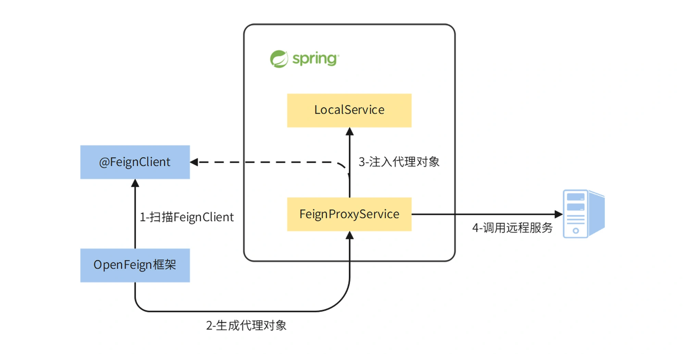
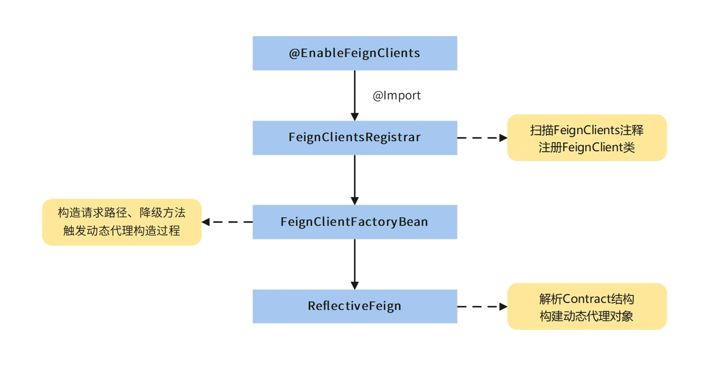

# 12-OpenFeign：服务间调用组件OpenFeign是怎么“隔空取物”的？

你好，我是姚秋辰。

在前面的课程中，我们借助 Nacos 的服务发现能力，使用 WebClient 实现了服务间调用。从功能层面上来讲，我们已经完美地实现了微服务架构下的远程服务调用，但是从易用性的角度来看，这种实现方式似乎对开发人员并不怎么友好。

我们来回顾一下，在前面的实战项目中，我是怎样使用 WebClient 发起远程调用的。

```
webClientBuilder.build()
   // 声明这是一个POST方法
   .post()
   // 声明服务名称和访问路径
   .uri("http://coupon-calculation-serv/calculator/simulate")
   // 传递请求参数的封装
   .bodyValue(order)
   .retrieve()
   // 声明请求返回值的封装类型
   .bodyToMono(SimulationResponse.class)
   // 使用阻塞模式来获取结果
   .block()
```

从上面的代码我们可以看出，为了发起一个服务请求，我把整个服务调用的所有信息都写在了代码中，从请求类型、请求路径、再到封装的参数和返回类型。编程体验相当麻烦不说，更关键的是这些代码没有很好地践行职责隔离的原则。

在业务层中我们应该关注具体的业务实现，而 WebClient 的远程调用引入了很多与业务无关的概念，比如请求地址、请求类型等等。从职责分离的角度来说，我们应该尽量把这些业务无关的逻辑，从业务代码中剥离出去。

那么，Spring Cloud 中有没有一个组件，在实现远程服务调用的同时，既能满足简单易用的接入要求，又能很好地将业务无关的代码与业务代码隔离开呢？

这个可以有，今天我就来带你了解 Spring Cloud 中的一个叫做 OpenFeign 的组件，看看它是如何简化远程服务调用的，除此之外，我还会为你详细讲解这背后的底层原理。

## 了解 OpenFeign

OpenFeign 组件的前身是 Netflix Feign 项目，它最早是作为 Netflix OSS 项目的一部分，由Netflix 公司开发。后来 Feign 项目被贡献给了开源组织，于是才有了我们今天使用的 SpringCloud OpenFeign 组件。

OpenFeign 提供了一种声明式的远程调用接口，它可以大幅简化远程调用的编程体验。在了解 OpenFeign 的原理之前，我们先来体验一下 OpenFeign 的最终疗效。我用了一个 HelloWorld 的小案例，带你看一下由 OpenFeign 发起的远程服务调用的代码风格是什么样的。

```
String response = helloWorldService.hello("Vincent Y.");
```

你可能会问，这不就是本地方法调用吗？没错！使用 OpenFeign 组件来实现远程调用非常简单，就像我们使用本地方法一样，只要一行代码就能实现 WebClient 组件好几行代码干的事情。而且这段代码不包含任何业务无关的信息，完美实现了调用逻辑和业务逻辑之间的职责分离。

那么，OpenFeign 组件在底层是如何实现远程调用的呢？接下来我就带你了解 OpenFeign 组件背后的工作流程。

OpenFeign 使用了一种“动态代理”技术来封装远程服务调用的过程，我们在上面的例子中看到的 helloWorldService 其实是一个特殊的接口，它是由 OpenFeign 组件中的 FeignClient 注解所声明的接口，接口中的代码如下所示。

```java
@FeignClient(value = "hello-world-serv")
public interface HelloWorldService {
   @PostMapping("/sayHello")
   String hello(String guestName);
}
```

到这里你一定恍然大悟了，原来远程服务调用的信息被写在了 FeignClient 接口中。在上面的代码里，你可以看到，服务的名称、接口类型、访问路径已经通过注解做了声明。OpenFeign通过解析这些注解标签生成一个“动态代理类”，这个代理类会将接口调用转化为一个远程服务调用的 Request，并发送给目标服务。

那么 OpenFeign 的动态代理是如何运作的呢？接下来，我就带你去深入了解这背后的流程。

## OpenFeign 的动态代理

在项目初始化阶段，OpenFeign 会生成一个代理类，对所有通过该接口发起的远程调用进行动态代理。我画了一个流程图，帮你理解 OpenFeign 的动态代理流程，你可以看一下。



上图中的步骤 1 到步骤 3 是在项目启动阶段加载完成的，只有第 4 步“调用远程服务”是发生在项目的运行阶段。

下面我来解释一下上图中的几个关键步骤。

首先，在项目启动阶段，OpenFeign 框架会发起一个主动的扫包流程，从指定的目录下扫描并加载所有被 @FeignClient 注解修饰的接口。

然后，OpenFeign 会针对每一个 FeignClient 接口生成一个动态代理对象，即图中的FeignProxyService，这个代理对象在继承关系上属于 FeignClient 注解所修饰的接口的实例。

接下来，这个动态代理对象会被添加到 Spring 上下文中，并注入到对应的服务里，也就是图中的 LocalService 服务。

最后，LocalService 会发起底层方法调用。实际上这个方法调用会被 OpenFeign 生成的代理对象接管，由代理对象发起一个远程服务调用，并将调用的结果返回给 LocalService。

我猜你一定很好奇：OpenFeign 是如何通过动态代理技术创建代理对象的？我画了一张流程图帮你梳理这个过程，你可以参考一下。



我把 OpenFeign 组件加载过程的重要阶段画在了上图中。接下来我带你梳理一下 OpenFeign动态代理类的创建过程。了解了这个过程，你就会更加理解下节课的实战内容。

1. 项目加载：在项目的启动阶段，EnableFeignClients 注解扮演了“启动开关”的角色，它使用 Spring 框架的 Import 注解导入了 FeignClientsRegistrar 类，开始了 OpenFeign 组件的加载过程。

2. 扫包：FeignClientsRegistrar 负责 FeignClient 接口的加载，它会在指定的包路径下扫描所有的 FeignClients 类，并构造 FeignClientFactoryBean 对象来解析 FeignClient 接口。

3. 解析 FeignClient 注解：FeignClientFactoryBean 有两个重要的功能，一个是解析FeignClient 接口中的请求路径和降级函数的配置信息；另一个是触发动态代理的构造过程。其中，动态代理构造是由更下一层的 ReflectiveFeign 完成的。

4. 构建动态代理对象：ReflectiveFeign 包含了 OpenFeign 动态代理的核心逻辑，它主要负责创建出 FeignClient 接口的动态代理对象。ReflectiveFeign 在这个过程中有两个重要任务，一个是解析 FeignClient 接口上各个方法级别的注解，将其中的远程接口 URL、接口类型（GET、POST 等）、各个请求参数等封装成元数据，并为每一个方法生成一个对应的MethodHandler 类作为方法级别的代理；另一个重要任务是将这些 MethodHandler 方法代理做进一步封装，通过 Java 标准的动态代理协议，构建一个实现了 InvocationHandler 接

- 口的动态代理对象，并将这个动态代理对象绑定到 FeignClient 接口上。这样一来，所有发生在 FeignClient 接口上的调用，最终都会由它背后的动态代理对象来承接。

MethodHandler 的构建过程涉及到了复杂的元数据解析，OpenFeign 组件将 FeignClient 接口上的各种注解封装成元数据，并利用这些元数据把一个方法调用“翻译”成一个远程调用的Request 请求。

那么上面说到的“元数据的解析”是如何完成的呢？它依赖于 OpenFeign 组件中的 Contract 协议解析功能。Contract 是 OpenFeign 组件中定义的顶层抽象接口，它有一系列的具体实现，其中和我们实战项目有关的是 SpringMvcContract 这个类，从这个类的名字中我们就能看出来，它是专门用来解析 Spring MVC 标签的。

SpringMvcContract 的继承结构是 SpringMvcContract->BaseContract->Contract。我这里拿一段 SpringMvcContract 的代码，帮助你深入理解它是如何将注解解析为元数据的。这段代码的主要功能是解析 FeignClient 方法级别上定义的 Spring MVC 注解。

```java
// 解析FeignClient接口方法级别上的RequestMapping注解
protected void processAnnotationOnMethod(MethodMetadata data, Annotation methodAn
  // 省略部分代码...
  // 如果方法上没有使用RequestMapping注解，则不进行解析
  // 其实GetMapping、PostMapping等注解都属于RequestMapping注解
  if (!RequestMapping.class.isInstance(methodAnnotation)
        && !methodAnnotation.annotationType().isAnnotationPresent(RequestMapping
     return;
  }
  // 获取RequestMapping注解实例
  RequestMapping methodMapping = findMergedAnnotation(method, RequestMapping.cla
  // 解析Http Method定义，即注解中的GET、POST、PUT、DELETE方法类型
  RequestMethod[] methods = methodMapping.method();
  // 如果没有定义methods属性则默认当前方法是个GET方法
  if (methods.length == 0) {
     methods = new RequestMethod[] { RequestMethod.GET };
  }
  checkOne(method, methods, "method");
  data.template().method(Request.HttpMethod.valueOf(methods[0].name()));
  // 解析Path属性，即方法上写明的请求路径
  checkAtMostOne(method, methodMapping.value(), "value");
  if (methodMapping.value().length > 0) {
     String pathValue = emptyToNull(methodMapping.value()[0]);
     if (pathValue != null) {
        pathValue = resolve(pathValue);
        // 如果path没有以斜杠开头，则补上/
        if (!pathValue.startsWith("/") && !data.template().path().endsWith("/"))
           pathValue = "/" + pathValue;
        }
        data.template().uri(pathValue, true);
        if (data.template().decodeSlash() != decodeSlash) {
           data.template().decodeSlash(decodeSlash);
        }
     }
  }
  // 解析RequestMapping中定义的produces属性
  parseProduces(data, method, methodMapping);
  // 解析RequestMapping中定义的consumer属性
  parseConsumes(data, method, methodMapping);
  // 解析RequestMapping中定义的headers属性
  parseHeaders(data, method, methodMapping);
  data.indexToExpander(new LinkedHashMap<>());
}
```

通过上面的方法，我们可以看到，OpenFeign 对 RequestMappings 注解的各个属性都做了解析。

如果你在项目中使用的是 GetMapping、PostMapping 之类的注解，没有使用RequestMapping，那么 OpenFeign 还能解析吗？当然可以。以 GetMapping 为例，它对RequestMapping 注解做了一层封装。如果你查看下面关于 GetMapping 注解的代码，你会发现这个注解头上也挂了一个 RequestMapping 注解。因此 OpenFeign 可以正确识别GetMapping 并完成加载。

```
@Target(ElementType.METHOD)
@Retention(RetentionPolicy.RUNTIME)
@Documented
@RequestMapping(method = RequestMethod.GET)
public @interface GetMapping {
// ...省略部分代码
}
```

到这里，相信你已经了解了 OpenFeign 的工作流程，下节课我将带你进行实战项目的改造，将 coupon-customer-serv 中的 WebClient 调用替换为基于 OpenFeign 的远程服务调用。

## 总结

现在，我们来回顾一下这节课的重点内容。

今天你清楚了 OpenFeign 要解决的问题，我还带你了解了 OpenFeign 的工作流程，这里面的重点是动态代理机制。OpenFeing 通过 Java 动态代理生成了一个“代理类”，这个代理类将接口调用转化成为了一个远程服务调用。

动态代理是各个框架经常用到的技术，也是面试中的一个核心考点。对于大多数技术人员来说，日常工作就是堆业务代码，似乎是用不上动态代理，这部分的知识点就是面试前突击一下。但如果你参与到框架类业务的研发，你会经常运用到动态代理技术。我建议你借着这次学习 OpenFeign 的机会，深入研究一下动态代理的应用。

如果你对 OpenFeign 的动态代理流程感兴趣，想要摸清楚这里面的门道，我推荐你一个很高效的学习途径：Debug。你可以在 OpenFeign 组件的 FeignClientsRegistrar 中打上一个断点，这是 OpenFeign 初始化的起点，然后你以 Debug 模式启动应用程序，当程序执行到断点处之后，你可以手动一步步跟着断点往下走，顺藤摸瓜了解 OpenFeign 的整个加载过程。

## 思考题

结合这两节课我给你讲的服务调用的知识，通过阅读OpenFeign 的源码，你能描述出OpenFeign 底层的实现吗？欢迎在留言区写下自己的思考，与我一起讨论。

好啦，这节课就结束啦。欢迎你把这节课分享给更多对 Spring Cloud 感兴趣的朋友。我是姚秋辰，我们下节课再见！
