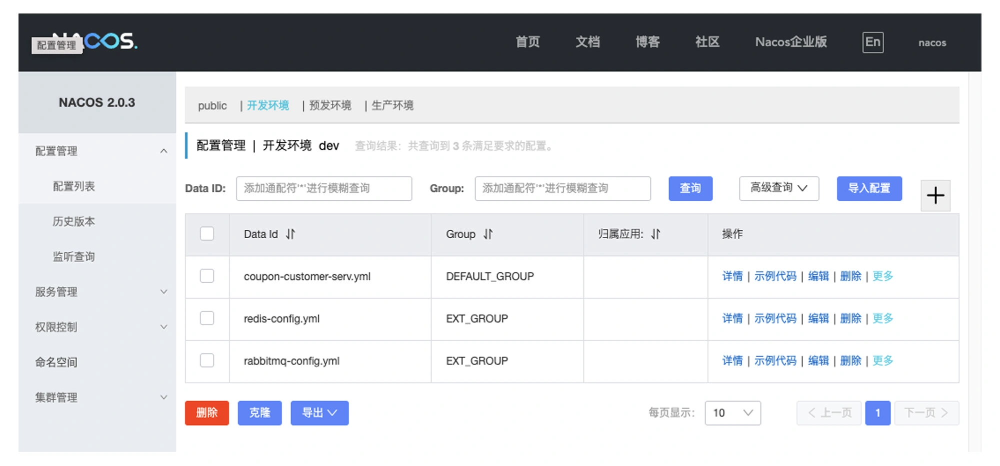
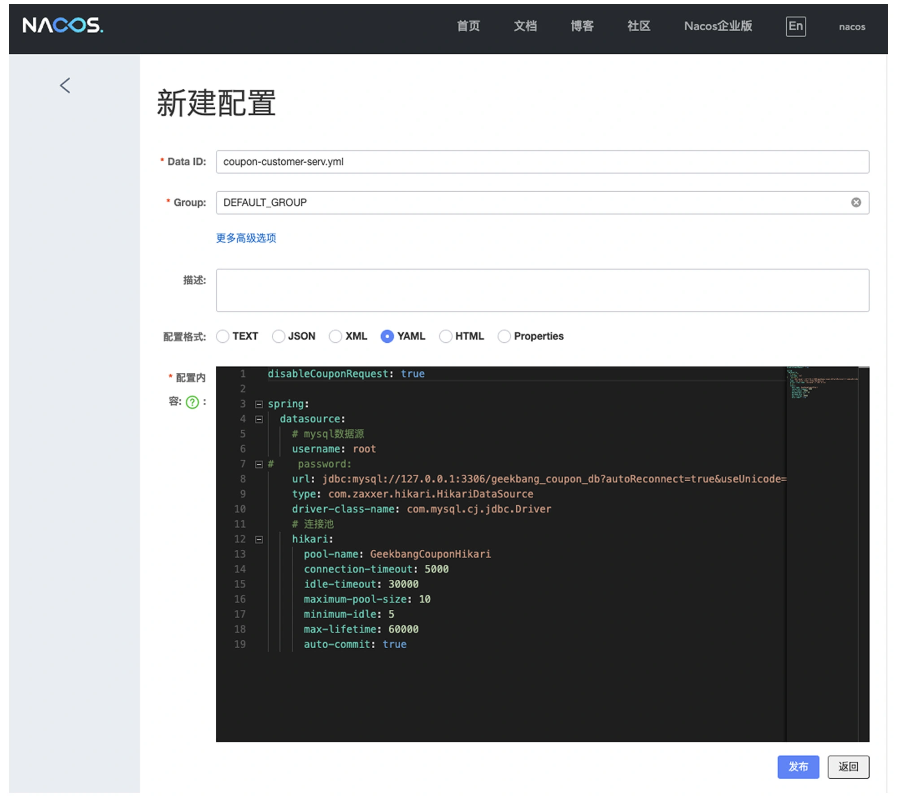
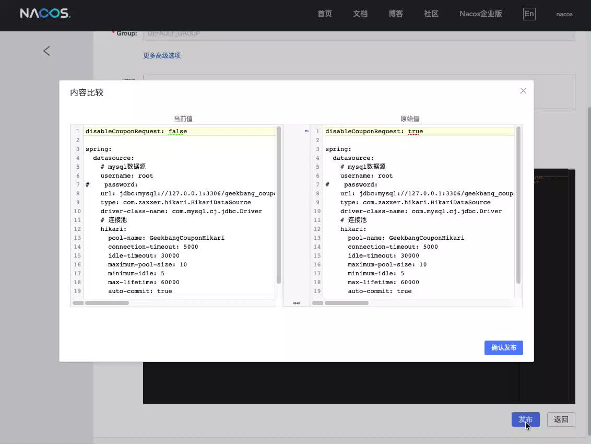

# 16-如何集成NacosConfig实现配置项动态刷新？

你好，我是姚秋辰。

在上一节课，你已经了解了配置中心在微服务架构中的作用和应用场景。今天我们就来学习如何让应用程序从 Nacos 分布式配置中心获取配置项。通过这节课的学习，你可以掌握微服务架构下的配置管理方式，知道如何通过动态配置推送来实现业务场景。

今天课程里将要介绍的动态推送是互联网公司应用非常广泛的一个玩法。我们都知道互联网行业比较卷，卷就意味着业务更新迭代特别频繁。

就拿我以前参与的新零售业务为例，运营团队三天两头就要对线上业务进行调整，为了降低需求变动带来的代码改动成本，很多时候我们会将一些业务抽离成可动态配置的模式，也就是通过动态配置改变线上业务的表现方式。比如手机 APP 上的商品资源位的布局和背景等，这些参数都可以通过线上的配置更新进行推送，不需要代码改动也不需要重启服务器。

接下来，我先来带你将应用程序接入到 Nacos 获取配置项，然后再来实现动态配置项刷新。本节课我选择 coupon-customer-serv 作为改造目标，因为 customer 服务的业务场景比较丰富，便于我们来演示各个不同的场景和用法。

接入 Nacos 配置中心的第一步，就是要添加 Nacos Config 和 Bootstrap 依赖项。

## 添加依赖项

我们打开 coupon-customer-serv 的 pom 文件，在 pom 中添加以下两个依赖项。

```xml
<!-- 添加Nacos Config配置项 -->
<dependency>
   <groupId>com.alibaba.cloud</groupId>
   <artifactId>spring-cloud-starter-alibaba-nacos-config</artifactId>
</dependency>
<!-- 读取bootstrap文件 -->
<dependency>
   <groupId>org.springframework.cloud</groupId>
   <artifactId>spring-cloud-starter-bootstrap</artifactId>
</dependency>
```

第一个依赖项是 Nacos 配置中心的依赖包。尽管我们在第 9 节课中已经在 customer 服务中添加过了 Nacos 的依赖项，但此依赖项非彼依赖项，初学者很容易搞混。Nacos 既能用作配置管理也能用作服务注册，如果你想要引入 Nacos 的服务发现功能，需要添加的是 nacos-discovery 包；而如果你想引入的是 Nacos 的配置管理功能，则需要添加 nacos-config 包。

第二个依赖项是为了让程序在启动时能够加载本地的 bootstrap 配置文件，因为 Nacos 配置中心的连接信息需要配置在 bootstrap 文件，而非 application.yml 文件中。在 Spring Cloud2020.0.0 版本之后，bootstrap 文件不会被自动加载，你需要主动添加 spring-cloud-starter-bootstrap 依赖项，来开启 bootstrap 的自动加载流程。

为什么集成 Nacos 配置中心必须用到 bootstrap 配置文件呢？这就要说到 Nacos Config 在项目启动过程中的优先级了。

如果你在 Nacos 配置中心里存放了访问 MySQL 数据库的 URL、用户名和密码，而这些数据库配置会被用于其它组件的初始化流程，比如数据库连接池的创建。为了保证应用能够正常启动，我们必须在其它组件初始化之前从 Nacos 读到所有配置项，之后再将获取到的配置项用于后续的初始化流程。

因此，在服务的启动阶段，你需要通过某种途径将 Nacos 配置项加载的优先级设置为最高。

而在 Spring Boot 规范中，bootstrap 文件通常被用于应用程序的上下文引导，bootstrap.yml文件的加载优先级是高于 application.yml 的。如果我们将 Nacos Config 的连接串和参数添加到 bootstrap 文件中，就能确保程序在启动阶段优先执行 Nacos Config 远程配置项的读取任务。这就是我们必须将 Nacos Config 连接串配置在 bootstrap 中的原因。

依赖项添加完成之后，我们就可以去配置 Nacos Config 的连接串了。

## 添加本地 Nacos Config 配置项

首先，我们需要在 coupon-customer-impl 项目的 resource 文件夹中创建 bootstrap.yml 配置文件。

接下来，你需要在 bootstrap.yml 文件中添加一些 Nacos Config 配置项，我把一些常用的配置项写到了这里，你可以参考一下。

```yaml
spring:
 # 必须把name属性从application.yml迁移过来，否则无法动态刷新
 application:
   name: coupon-customer-serv
 cloud:
   nacos:
     config:
       # nacos config服务器的地址
       server-addr: localhost:8848
       file-extension: yml
       # prefix: 文件名前缀，默认是spring.application.name
       # 如果没有指定命令空间，则默认命令空间为PUBLIC
       namespace: dev
       # 如果没有配置Group，则默认值为DEFAULT_GROUP
       group: DEFAULT_GROUP
       # 从Nacos读取配置项的超时时间
       timeout: 5000
       # 长轮询超时时间
       config-long-poll-timeout: 10000
       # 轮询的重试时间
       config-retry-time: 2000
       # 长轮询最大重试次数
       max-retry: 3
       # 开启监听和自动刷新
       refresh-enabled: true
       # Nacos的扩展配置项，数字越大优先级越高
       extension-configs:
         - dataId: redis-config.yml
           group: EXT_GROUP
           # 动态刷新
           refresh: true
         - dataId: rabbitmq-config.yml
           group: EXT_GROUP
           refresh: true
```

下面，我就带你了解一下代码中的的配置项，我把这些配置项分为了几大类，我们分别来看一下。

文件定位配置项：主要用于匹配 Nacos 服务器上的配置文件。

- namespace：Nacos Config 的 namespace 和 Nacos 服务发现阶段配置的 namespace 是同一个概念和用法。我们可以使用 namespace 做多租户（multi-tenant）隔离方案，或者隔离不同环境。我指定了 namespace=dev，应用程序只会去获取 dev 这个命名空间下的配置文件；

- group：概念和用法与 Nacos 服务发现中的 group 相同，如未指定则默认值为DEFAULT_GROUP，应用程序只会加载相同 group 下的配置文件；

- prefix：需要加载的文件名前缀，默认为当前应用的名称，即 spring.application.name，一般不需要特殊配置；

- file-extension：需要加载的文件扩展名，默认为 properties，我改成了 yml。你还可以选择xml、json、html 等格式。

超时和重试配置项

- timeout：从 Nacos 读取配置项的超时时间，单位是 ms，默认值 3000 毫秒；

- config-retry-time：获取配置项失败的重试时间；

- config-long-poll-timeout：长轮询超时时间，单位为 ms；

- max-retry：最大重试次数。

在这里，我想多跟你介绍一下超时和重试配置里提到的长轮询机制的工作原理。

当 Client 向 Nacos Config 服务端发起一个配置查询请求时，服务端并不会立即返回查询结果，而是会将这个请求 hold 一段时间。如果在这段时间内有配置项数据的变更，那么服务端会触发变更事件，客户端将会监听到该事件，并获取相关配置变更；如果这段时间内没有发生数据变更，那么在这段“hold 时间”结束后，服务端将释放请求。

采用长轮询机制可以降低多次请求带来的网络开销，并降低更新配置项的延迟。

通用配置

- server-addr：Nacos Config 服务器地址；

- refresh-enabled: 是否开启监听远程配置项变更的事件，默认为 true。

扩展配置

- extension-configs：如果你想要从多个配置文件中获取配置项，那么你可以使用 extension-configs 配置多源读取策略。extension-configs 是一个 List 的结构，每个节点都有 dataId、group 和 refresh 三个属性，分别代表了读取的文件名、所属分组、是否支持动态刷新。

在实际的应用中，我们经常需要将一个公共配置项分配给多个微服务使用，比如多个服务共享同一份 Redis、RabbitMQ 中间件连接信息。这时我们就可以在 Nacos Config 中添加一个配置文件，并通过 extension-configs 配置项将这个文件作为扩展配置源加到各个微服务中。这样一来，我们就不需要在每个微服务中单独管理通用配置了。

到这里，相信你已经了解了各个常用配置项的用途。那么接下来，让我们去 Nacos Config 中添加配置文件吧。

## 添加配置文件到 Nacos Config Server

首先，我们在本地启动 Nacos 服务器，打开配置管理模块下的“配置列表”页面，再切换到“开发环境”命名空间下（即 dev 环境）。



然后，我们点击页面右上角的符号创建三个配置文件，coupon-customer-serv.yml（默认分组）、redis-config.yml（EXT_GROUP 分组）和 rabbitmq-config.yml（EXT_GROUP 分组）。

接下来，你就可以将原本配置在本地 application.yml 中的配置项转移到 Nacos Config 中了，由于 Data ID 后缀是 yml，所以在编辑配置项的时候，你需要在页面上选择“YAML”作为配置格式。

以 coupon-customer-serv.yml 为例，在新建配置的页面中，我指定了 Data ID 为 coupon-customer-serv.yml、Group 为默认分组 DEFAULT_GROUP、配置格式为 YAML。在“配置内容”输入框中，我将 spring.datasource 的配置项添加了进去。除此之外，我还添加了一个特殊的业务属性：disableCouponRequest:true，待会儿你就会用到这个属性实现动态业务开关推送。



填好配置项的内容之后，你就可以点击“发布”按钮来创建配置文件了。redis-config.yml 和rabbitmq-config.yml 两个配置文件将在后面的章节中用到，我们目前还不需要向这两个文件中添加配置项。

一切配置妥当之后，我们就可以去启动应用程序来验证集成效果了。为了测试应用程序能否正确读取远程配置项，你可以打开 coupon-customer-impl 模块的 application.yml 文件，将其中的 datasource 相关配置注释掉，然后尝试重新启动服务。如果项目启动正常，你将会在日志文件看到配置文件的订阅通知。

```
INFO c.a.n.client.config.impl.ClientWorker    : [fixed-localhost_8848-dev] [subsc
INFO c.a.nacos.client.config.impl.CacheData   : [fixed-localhost_8848-dev] [add-l
// 省略其它配置文件的加载日志
```

接下来你可以尝试调用本地数据库的 CRUD 接口，如果业务正常运作，那么就说明你的程序可以从 Nacos Config 中获取到正确的数据库配置信息。

你可以使用同样的方法，将一些配置项信息迁移到 Nacos Config 中。当你需要更改配置项的时候，就不用每次都重新编译并发布应用了，只需要改动 Nacos Config 中的配置即可。这样一来，我们就实现了“配置管理”与“业务逻辑”的职责分离。

别忘了，前面我还在 Nacos Config 中添加了一个 disableCouponRequest 配置项，接下来我就用它做一个动态配置推送的场景，控制用户领券功能的打开和关闭。

## 动态配置推送

首先，我们打开 CouponCustomerController 类，声明一个布尔值的变量 disableCoupon，并使用 @Value 注解将 Nacos 配置中心里的 disableCouponRequest 属性注入进来。

```
@Value("${disableCouponRequest:false}")
private Boolean disableCoupon;
```

在上面的代码中，我们给 disableCouponRequest 属性设置了一个默认值“false”，这样做的目的是加一层容错机制。即便 Nacos Config 连接异常无法获取配置项，应用程序也可以使用默认值完成启动加载。

然后，我们找到用户领券接口 requestCoupon，在其中添加一段业务逻辑，根据disableCoupon 属性的值控制是否发放优惠券，如果值为“true”则暂停领券。

```
@PostMapping("requestCoupon")
public Coupon requestCoupon(@Valid @RequestBody RequestCoupon request) {
   if (disableCoupon) {
       log.info("暂停领取优惠券");
       return null;
   }
   return customerService.requestCoupon(request);
}
```

最后，别忘了在 CouponCustomerController 类头上添加一个 RefreshScope 注解，有了这个注解，Nacos Config 中的属性变动就会动态同步到当前类的变量中。如果不添加RefreshScope 注解，即便应用程序监听到了外部属性变更，那么类变量的值也不会被刷新。

```java
@RefreshScope
public class CouponCustomerController {
}
```

到这里，我们就完成了所有改造工作。你可以启动应用程序，然后登录 Nacos 控制台并打开coupon-customer-serv.yml 文件的编辑窗口，将 disableCouponRequest 的值由 true 改为false，并调用 requestCoupon 服务查看接口逻辑的变化。我录了一段在 Nacos Config 控制台动态编辑配置项的 video，你可以参考一下。



## 总结

现在，我们来回顾一下这节课的重点内容。今天我们使用 Nacos Config 作为配置中心，实现了配置项和业务逻辑的职责分离，然后落地了一个动态属性推送的场景。

配置中心还有一个重要功能是“配置回滚”。如果你错误地修改了某些业务项，引起了系统故障，这时候你可以执行一段 rollback 操作，将配置项改动退回到之前的某一个历史版本。在Nacos 控制台的“配置管理 -> 历史版本”菜单中，你可以查看某个配置项的历史修改记录，并指定回滚的版本。

除此之外，我们还可以在 Nacos 上查看某个文件的监听列表，了解目前有多少实例监听了指定配置文件的动态改动事件。你可以点击“配置管理 -> 监听查询”来访问这个功能。

上面两个功能的操作非常简单，就留给你来自己探索啦。

## 思考题

你知道 RefreshScope 动态刷新背后的实现原理吗？欢迎在留言区写下自己的思考，与我一起讨论。

好啦，这节课就结束啦。欢迎你把这节课分享给更多对 Spring Cloud 感兴趣的朋友。我是姚秋辰，我们下节课再见！
