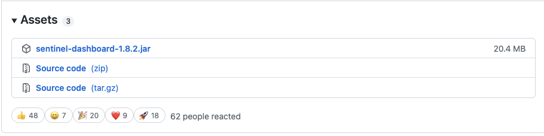
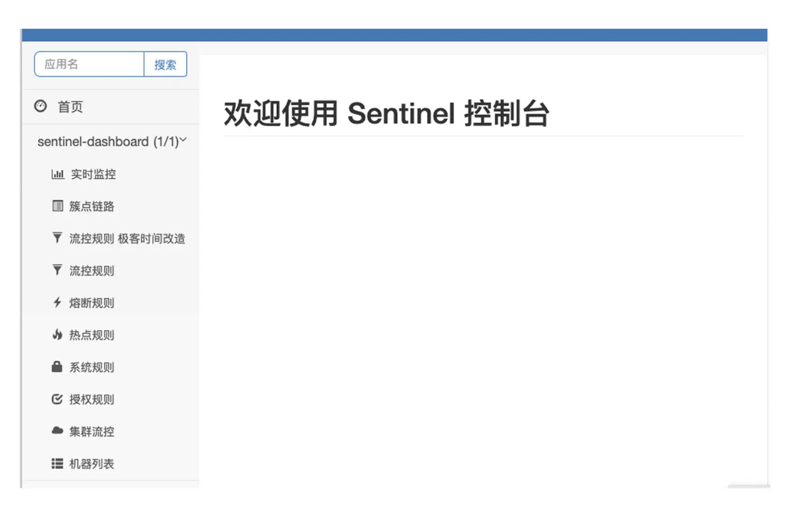
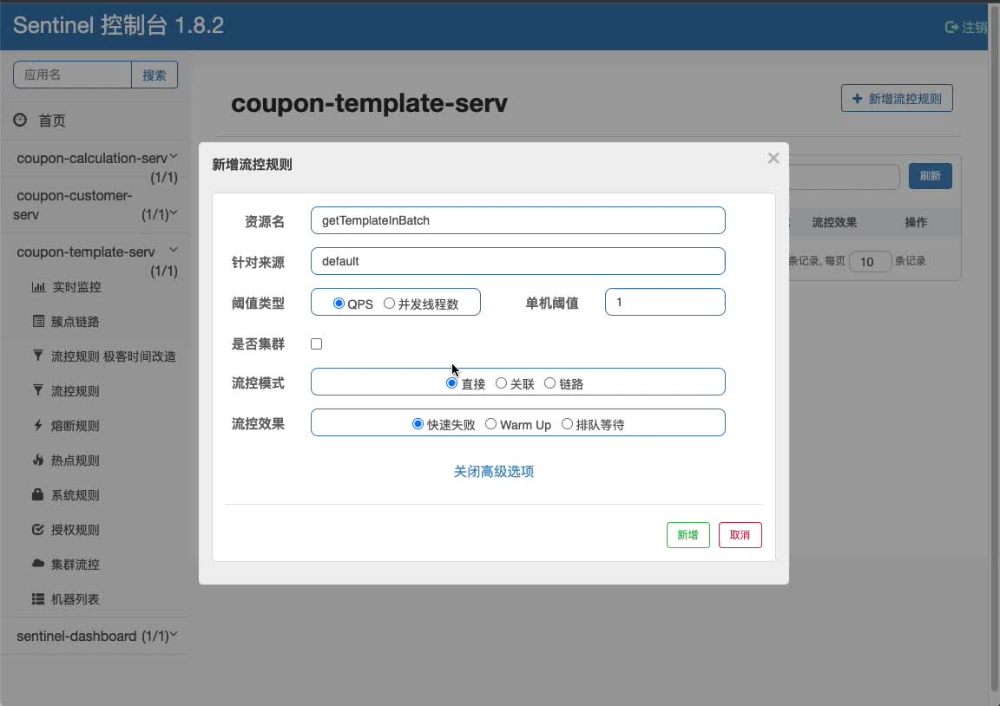
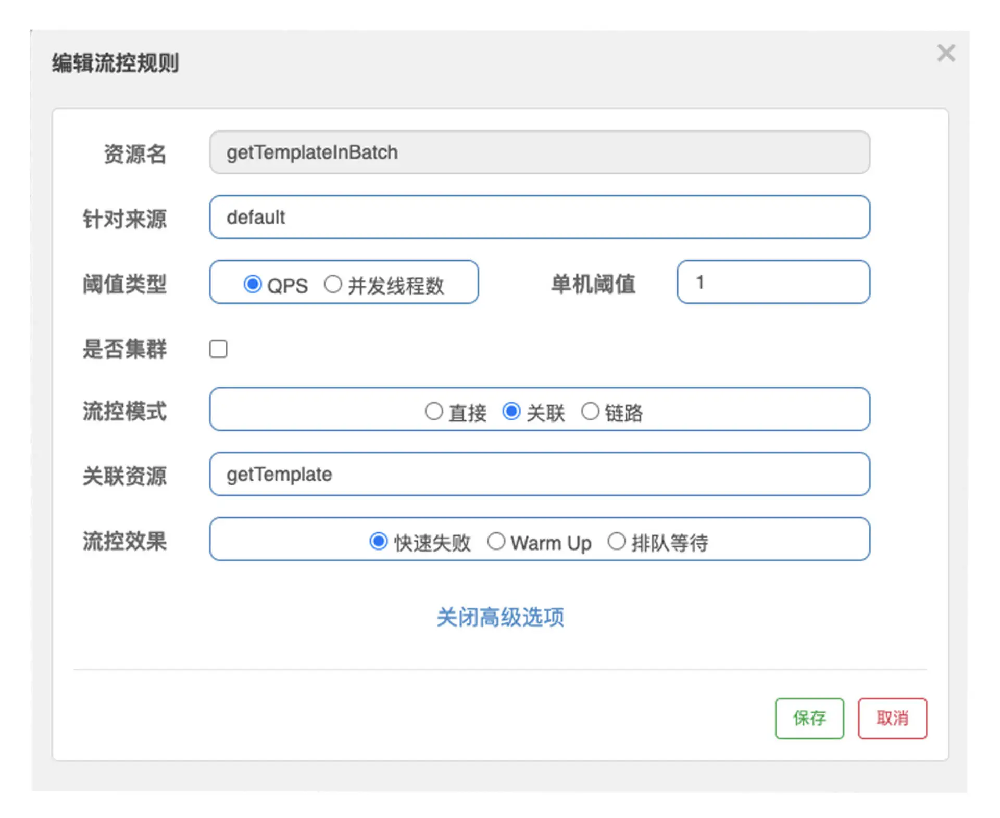
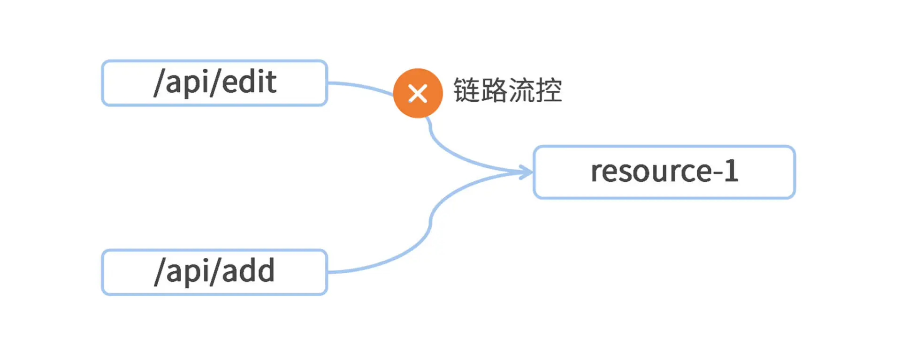
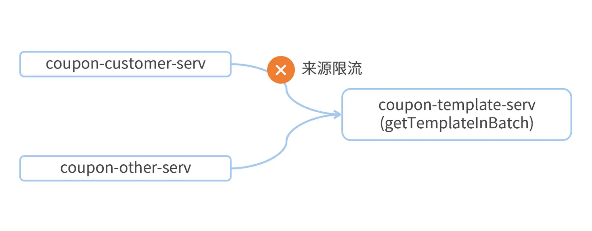
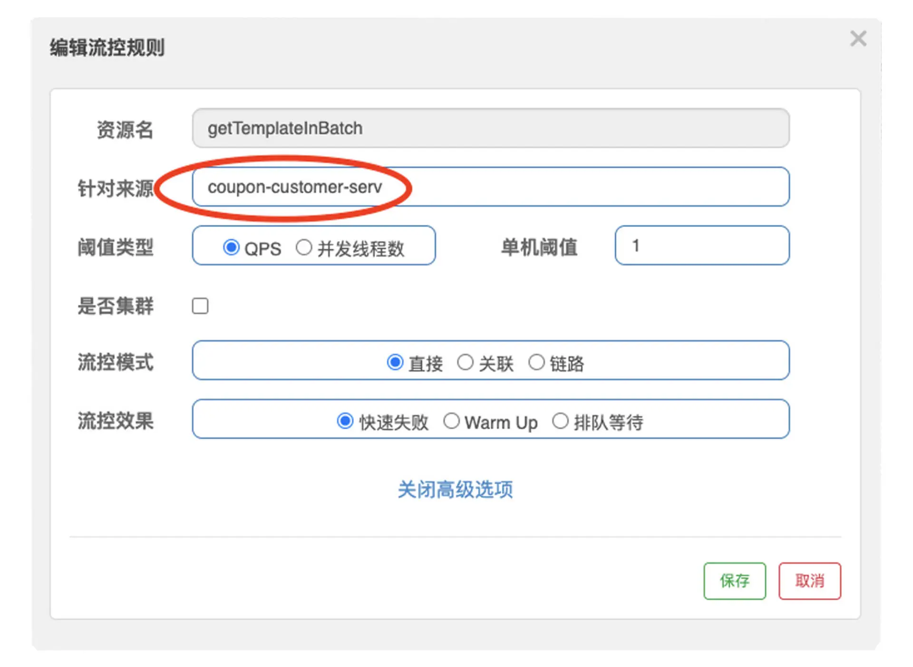
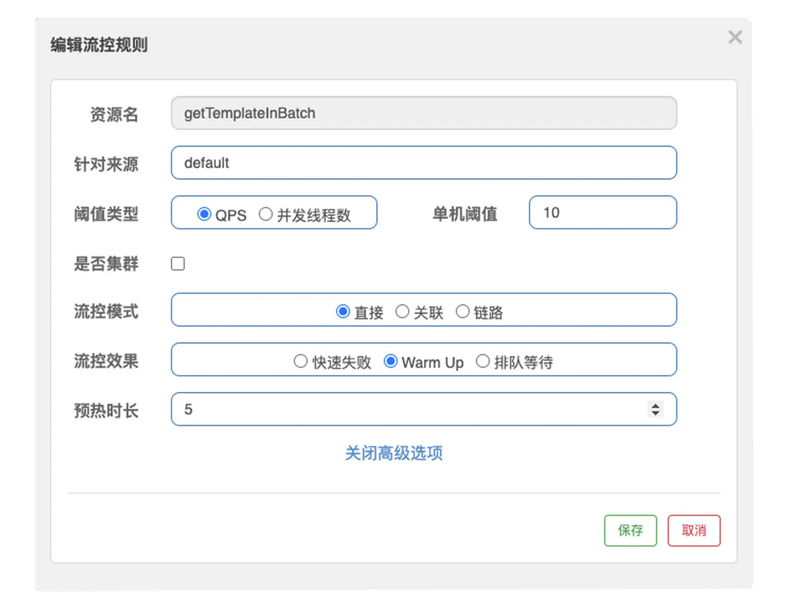
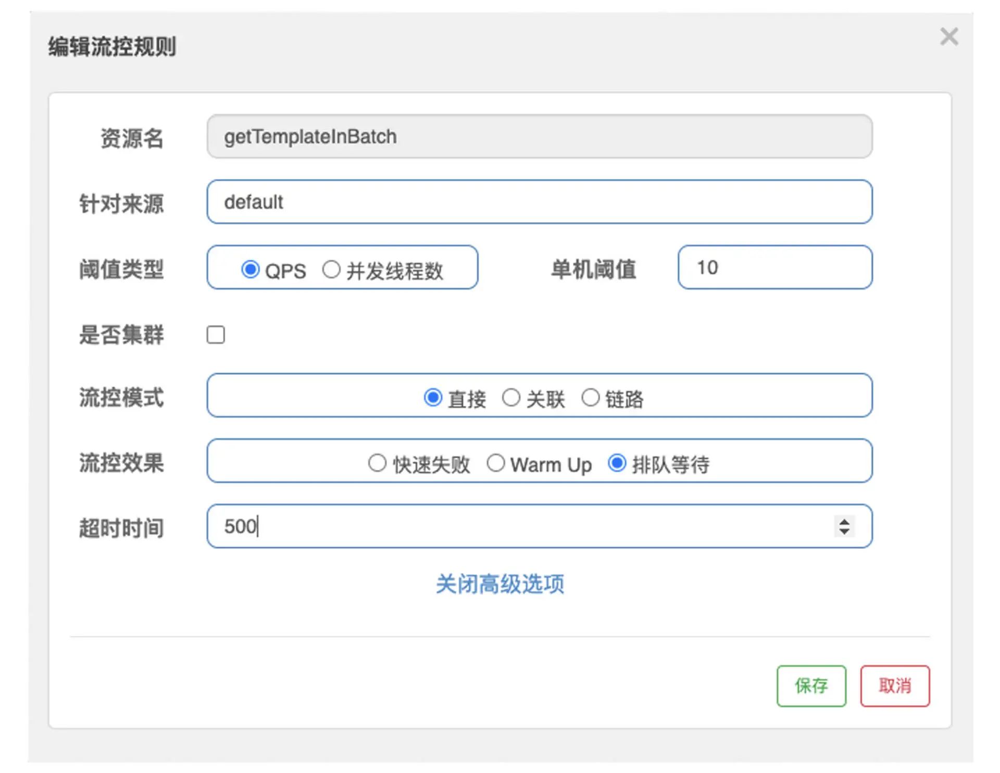

# 18-Sentinel实战：如何实施流量整形与限流策略？

你好，我是姚秋辰。

今天我们来学习 Sentinel 组件最为核心的功能：流量整形（也可以叫流控）。

在这节课，我会通过项目实战将优惠券系统集成到 Sentinel 中，对用户领券和查找优惠券两个场景添加流控规则。在这个过程中，我会带你了解 Sentinel 的三种流控模式，以及对应的流控效果。此外，我还会针对 Sentinel 框架做一个小扩展，对特定的调用来源做流控。掌握了这些内容之后，你就可以清楚如何用流控手段来降低高并发场景下的系统压力。

在进行实战项目之前，我需要带你搭建 Sentinel 控制台。你可以把它看作一个中心化的控制中心，所有的应用程序都会接入这个控制台，我们可以在这里设置各种流控规则，这些规则也会在应用程序中实时生效。

## 运行 Sentinel 控制台

我们可以从Sentinel 官方 GitHub的 Release 页面下载可供本地执行的 jar 文件，为了避免版本不一致导致的兼容性问题，我推荐你下载 1.8.2.Release 版本。在该版本下的 Assets 部分，你可以直接下载 sentinel-dashboard-1.8.2.jar 这个文件。



下载好文件之后，你可以使用命令行进入到这个 jar 包所在的目录，然后就可以直接执行下面这行命令启动 Sentinel 控制台了。

```
java -Dserver.port=8080 -Dcsp.sentinel.dashboard.server=localhost:8080 -Dproject.
```

这行命令以 8080 为端口启动了 Sentinel 控制台，启动成功后你可以在浏览器直接访问localhost:8080 地址。

当你看到登录界面，你就可以使用默认账号进行登录了，登录名和密码都是 sentinel。登陆成功之后你就可以进入到 Sentinel 控制台主页面，在左侧的导航栏会列出当前已经接入 Sentinel的所有应用，这里默认展示的 sentinal-dashboard 应用其实就是控制台程序本尊了。



到这里，我们的 Sentinel 控制台就已经搭建完成了，是不是非常简单呢？接下来，我带你将实战项目集成到 Sentinel 控制台中。

## 将微服务接入到 Sentinel 控制台

为了演示 Sentinel 的多种流控效果，我们需要将两个具有前后调用关系的模块集成到 Sentinel控制台，我这里选择的是模板微服务和用户微服务。

首先，你需要把 Sentinel 的依赖项引入到项目里。你只用将 spring-cloud-starter-alibaba-sentinel 组件分别加入到 template 和 customer 这两个服务的 pom 文件中就好了。

```xml
<dependency>
   <groupId>com.alibaba.cloud</groupId>
   <artifactId>spring-cloud-starter-alibaba-sentinel</artifactId>
</dependency>
```

然后，你需要做一些基本的配置，将应用直连到 Sentinel 控制台。这一步也非常简单，你只需要在项目的 application.yml 文件中加入下面的 sentinel 属性就可以了，具体代码在这里：

```yaml
spring:
 cloud:
   sentinel:
     transport:
       # sentinel api端口，默认8719
       port: 8719
       # dashboard地址
       dashboard: localhost:8080
```

在上面的代码中，port 属性是 Sentinal API 的默认端口，默认值是 8719；而 dashboard 属性则是指向了 Sentinel 控制台的地址，这里我们填写的是 localhost:8080。

最后，你还需要在代码中使用 Sentinel 注解对资源进行标记。在上一课里我讲到过，在Sentinel 的世界中，一切都是以“资源”的方式存在的。Controller 类里面写的 API 也是资源，这个资源便是 Sentinel 要守护的对象。

Sentinel 会为 Controller 中的 API 生成一个默认的资源名称，这个名称就是 URL 的路径，如/template/getTemplateInBatch。当然了，你也可以使用特定的注解为资源打上一个你自己指定的名称标记，以 CouponTemplateController 为例，你可以参考这段代码：

```
@GetMapping("/getTemplate")
@SentinelResource(value = "getTemplate")
public CouponTemplateInfo getTemplate(@RequestParam("id") Long id){
}
@GetMapping("/getBatch")
@SentinelResource(value = "getTemplateInBatch", blockHandler = "getTemplateInBatc
public Map<Long, CouponTemplateInfo> getTemplateInBatch(
       @RequestParam("ids") Collection<Long> ids) {
}
public Map<Long, CouponTemplateInfo> getTemplateInBatch_block(
       Collection<Long> ids, BlockException exception) {
   log.info("接口被限流");
   return Maps.newHashMap();
}
```

在上面的代码中，我使用 SentinelResource 注解对模板服务的 getTemplate 方法和getTemplateInBatch 方法做了标记，将它们的资源名称设置为方法名。除此之外，在getTemplateInBatch 方法中，我还使用了注解中的 blockHandler 属性为当前资源指定了限流后的降级方法，如果当前服务抛出了 BlockException，那么就会转而执行这段限流方法。

你同样可以使用 SentinelResource 注解，为 CouponCustoemrController 类中的用户领券和查找优惠券的接口做资源标记。你可以参考下面的代码。

```
@PostMapping("findCoupon")
@SentinelResource(value = "customer-findCoupon")
public List<CouponInfo> findCoupon(@Valid @RequestBody SearchCoupon request) {
}
@PostMapping("requestCoupon")
@SentinelResource(value = "requestCoupon")
public Coupon requestCoupon(@Valid @RequestBody RequestCoupon request) {
}
```

到这里，我们就成功地把微服务接入到了 Sentinel 控制台。那么接下来，我们就可以把Template 服务和 Customer 服务都启动起来，到 Sentinel 控制台去设置流控规则了。

## 设置流控规则

登录 Sentinel 控制台之后，你在左侧的导航栏是看不到我们刚注册的微服务的。这时你只要对Template 和 Customer 服务发起几个调用，触发服务信息的上报，再等上个几秒钟，你就可以在 Sentinel 里看到自己的微服务啦。

Sentinel 支持三种不同的流控模式，分别是直接流控、关联流控和链路流控。

- 直接流控：直接作用于当前资源，如果访问压力大于某个阈值，后续请求将被直接拦下来；

- 关联流控：当关联资源的访问量达到某个阈值时，对当前资源进行限流；

- 链路流控：当指定链路上的访问量大于某个阈值时，对当前资源进行限流，这里的“指定链路”是细化到 API 级别的限流维度。

接下来，我就带你了解这三种流控方式各自的使用场景，并带你上手为微服务添加流控规则。

### 直接流控

我们平时最常用的就是“直接流控”，所以我要带你去控制台操作一把，为 Template 服务添加一个直接流控规则。

打开 Sentinel 控制台，在左侧导航栏你会看到所有已经接入 Sentinel 的应用名称，如果没找到 Coupon 应用，你只需要在本地 Postman 发起一个 API 调用，触发一次信息上报，再等待十几秒后刷新页面，就可以看到自己的应用啦。

我录了一段设置“直接流控”的截屏，你可以参考一下。



在这段视频中，我为 Template 服务的 getTemplateInBatch 接口指定了一个直接限流规则，这里的资源名就是我在 SentinelResource 注解中指定的名称。我设置了以 QPS 为限定条件，如果单机 QPS 阈值大于 1（QPS=1 就是每秒一次请求），就触发限流。当然了，你也可以在页面中将阈值类型改为“并发连接数”。

设置完限流限定条件之后，你就可以尝试在本地直接调用这个接口了。不管你是通过Template 服务直接调用，还是通过 Customer 服务的 findCoupon 接口间接调用，只要超过了每秒 1 次的频率，请求就会被 Sentinel 阻断。这样一来，我们就在 Template 服务中实现了优惠券模板查找的限流规则。

### 关联流控

如果两个资源之间有竞争关系，比如说，它们共享同一个数据库连接池，这时候你就可以使用“关联流控”对低优先级的资源进行流控，让高优先级的资源获得竞争优势。

我们假设 Template 服务中的 getTemplateInBatch 接口和 getTemplate 接口之间就存在了竞争关系，而且前者的优先级低于后者，在这种情况下，我们应该尽可能地对低优先级的接口实施限流规则。

这里我将“关联流控”应用到了低优先级的 getTemplateInBatch 接口上。配置细节在下面的图里，你可以参考一下。



在流控规则设置页面里，我在“关联资源”一栏填了 getTemplate，写在这里的是高优先级资源的名称。同时，我设置了阈值判断条件为 QPS=1，它的意思是，如果高优先级资源的访问频率达到了每秒一次，那么低优先级资源就会被限流。

所以，这里需要你注意的一点是，关联限流的阈值判断是作用于高优先级资源之上的，但是流控效果是作用于低优先级资源之上。

### 链路流控

如果在一个应用中，对同一个资源有多条不同的访问链路，那么我们就可以应用“链路流控”，实现 API 级别的精细粒度限流。我画了一张图帮你理解链路流控的作用点。



在上面的图里，一个服务应用中有 /api/edit 和 /api/add 两个接口，这两个接口都调用了同一个资源 resource-1。如果我想只对 /api/edit 接口流进行限流，那么就可以将“链路流控”应用在resource-1 之上，同时指定当前流控规则的“入口资源”是 /api/edit。

现在，你已经了解了 Sentinel 的三种流控模式。接下来，我们再来看一看如何针对调用源进行限流。这里需要我们对 Sentinel 源代码做一些改造。

### 实现针对调用源的限流

在微服务架构中，一个服务可能被多个服务调用。比如说，Customer 服务会调用 Template服务的 getTemplateInBatch 资源，未来我们可能会研发一个新的服务叫 coupon-other-serv，它也会调用相同资源。

如果我想为 getTemplateInBatch 资源设置一个限流规则，并指定其只对来自 Customer 服务的调用起作用，应该怎么实现呢？



这个实现过程分为两步。第一步，你要想办法在服务请求中加上一个特殊标记，告诉Template 服务是谁调用了你；第二步，你需要在 Sentinel 控制台设置流控规则的针对来源。

我们先从第一步开始做起。

首先，你需要对 Customer 服务的 OpenFeign 组件做一点手脚，将调用源的应用名加入到由OpenFeign 组件构造的 Request 中。我们可以借助 OpenFeign 的 RequestInterceptor 扩展接口，编写一个自定义的拦截器，在服务请求发送出去之前，往 Request 的 Header 里写入一个特殊变量，你可以参考我这段代码。

```java
@Configuration
public class OpenfeignSentinelInterceptor implements RequestInterceptor {
   @Override
   public void apply(RequestTemplate template) {
       template.header("SentinelSource", "coupon-customer-serv");
   }
}
```

在上面的代码中，我在 Customer 服务中新建了一个 OpenfeignSentinelInterceptor 的类，继承自 RequestInterceptor 并实现了其中的 apply 方法。在这个方法里，我向服务请求的header 里加入了一个 SentinelSource 属性，对应的值是当前服务的名称 coupon-customer-serv。这就是我要传递给下游服务的“来源标记”。

接下来，你需要在 Template 服务中识别来自上游的标记，并将其加入到 Sentinel 的链路统计中。我们可以借助 Sentinel 提供的 RequestOriginParser 扩展接口，编写一个自定义的解析器。你可以参考我这里的代码实现。

```java
@Component
@Slf4j
public class SentinelOriginParser implements RequestOriginParser {
   @Override
   public String parseOrigin(HttpServletRequest request) {
       log.info("request {}, header={}", request.getParameterMap(), request.getH
       return request.getHeader("SentinelSource");
   }
}
```

在上面的代码中，我在 Template 服务中新建了一个 SentinelOriginParser 的类，它实现了RequestOriginParser 接口中的 parseOrigin 方法。在方法中，我们从服务请求的 Header 中获取 SentinelSource 变量的值，作为调用源的 name。

到这里第一步“来源标记传递”就完成了，接下来你还需要在 Sentinel 控制台设置流控规则的针对来源。

在流控规则的编辑页面，你可以在“针对来源”这一栏填上 coupon-customer-serv 并保存，这样一来，当前限流规则就只会针对来自 Customer 服务的请求生效了。



现在，相信你对 Sentinel 的流控模式都已经比较了解了，接下来我们再去学习一下 Sentinel所支持的流控效果吧。

## Sentinel 的流控效果

Sentinel 总共支持三种流控效果，分别是快速失败、Warm Up 和排队等待。

先来说说快速失败，Sentinel 默认的流控效果就是快速失败，前面做的实战改造都是采用了这种模式。这种流控效果非常好理解，在快速失败模式下，超过阈值设定的请求将会被立即阻拦住。

第二种流控效果 Warm Up 则实现了“预热模式的流控效果”，这种方式可以平缓拉高系统水位，避免突发流量对当前处于低水位的系统的可用性造成破坏。

举个例子，如果我们设置的系统阈值是 QPS=10，预热时间 =5，那么 Sentinel 会在这 5 秒的预热时间内，将限流阈值从 3 缓慢拉高到 10。为什么起始阈值是 3 呢？因为 Sentinel 内部有一个冷加载因子，它的值是 3，在预热模式下，起始阈值的计算公式是单机阈值 / 冷加载因子，也就是 10/3=3。

我截了一张图，你可以参考一下，看看 Warm Up 配置项是如何填写的。



话说回来，为什么我们要使用预热模型呢？我来举一个例子帮你理解好了。

我开发了一个接口用来查询商品详情信息，它采用了通用的缓存 +DB 读写的逻辑，即一次请求过来之后，先查询缓存，如果缓存未命中那么再查询 DB，同时把查到的数据写入缓存并设置一个缓存过期时间。

假如这个接口长期处于低水位状态，那么大部分缓存数据已经过期了，如果这时候发生了突发流量，比如双 11 的 0 点抢购开始了，由于缓存还未充分构建起来，突发流量就会对数据库形成一个峰值压力，很有可能就把 DB 层打穿。如果我们可以设置一个预热模型，给系统一段时间的缓冲，在缓慢拉高应用水位的过程中，缓存也逐渐地构建了起来。这样就大大降低了峰值流量对系统的冲击。

了解了 Warm Up 之后，我们再来看一下最后一个流控效果，那就是排队等待。

顾名思义，在排队等待模式下，超过阈值的请求不会立即失败，而是会被放入一个队列中，排好队等待被处理。当然了，每个请求的排队时间可不是永恒的，一旦请求在队列中等待的时间超过了我们设置的超时时间，那么请求就会被从队列中移除。

我截图了一张图，你可以参考一下图中是如何设置排队等待参数的。



到这里，相信你已经对 Sentinel 的各种流控效果有了比较全面的了解。现在，我们来回顾一下这节课的重点内容。

## 总结

今天我带你了解了 Sentinel 的三大流控模式，分别是直连流控、关联流控和链路流控。我们还了解了三种流控效果，分别是快速失败、预热和排队等待。如果你想要将流控规则应用到特定来源的服务，一定要记得在本地服务中做一些小改造，让 Sentinel 识别调用源，否则针对来源的限流方式是不会生效的。

从流控的角度来讲，Sentinel 还实现了基于热点规则的限流。热点限流也是互联网场景下的重要稳定性保障手段，比如电商业务的爆款商品、微博系统的明星出轨消息等等，这些都是发生热点数据宕机的常客。我建议你去通过网上的资料了解一下什么是热点数据，然后自己把玩一下 Sentinel 控制台的“热点规则”页面，尝试配置一个简单的热点规则到实战项目中。

在后面的课程中，我将带你了解 Sentinel 的另一个最常用的稳定性保障手段：降级熔断规则。

## 思考题

通过这节课的内容，你能深入说说流控效果的底层实现吗？最好能够从算法的角度来描述一下Sentinel 是如何判断一个请求可否被放行的。

好啦，这节课就结束啦。欢迎你把这节课分享给更多对 Spring Cloud 感兴趣的朋友。我是姚秋辰，我们下节课再见！
