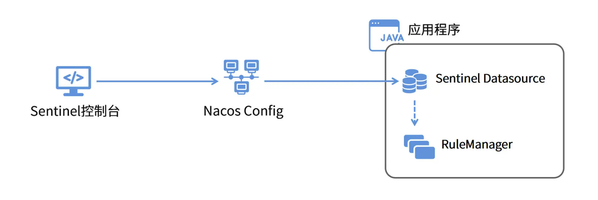
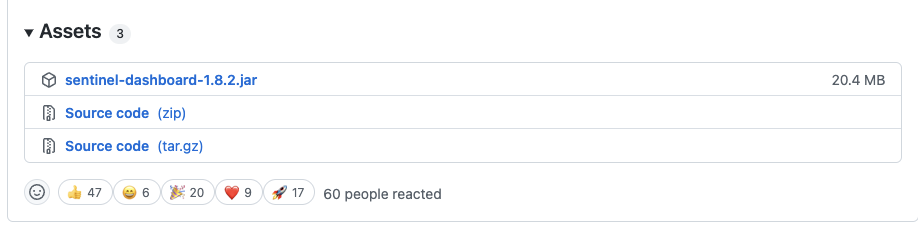
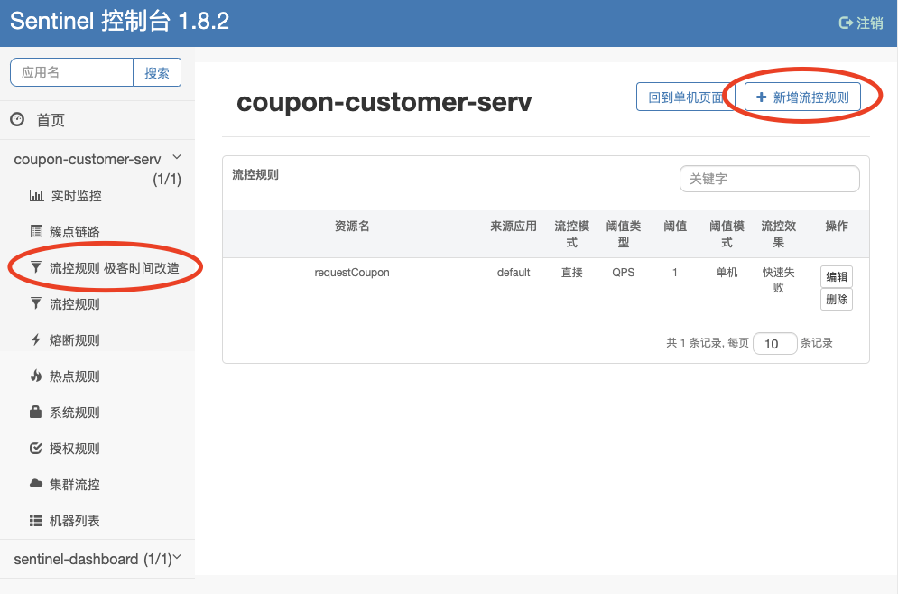
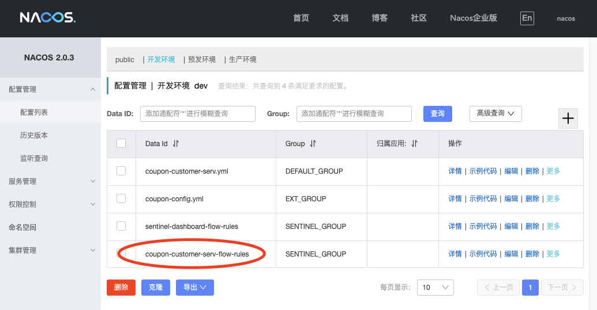

# 20-Sentinel实战：如何接入Nacos实现规则持久化？

你好，我是姚秋辰。

在前两节课里，我们已经知道了如何配置 Sentinel 的降级规则和流量整形规则。不过这套方案还有一个不完美的地方。因为我们配置的这些容错规则并没有被“保存”到某个存储介质中，所以，如果你重新启动 Sentinel 服务器或者重启应用程序，先前配置的所有规则就都消失不见了。那如何才能解决这个问题呢？

这节课，我将带你对 Sentinel 的源码做一下二次开发，我们将通过集成 Nacos Config 来实现一套持久化方案，把 Sentinel 中设置的限流规则保存到 Nacos 配置中心。这样一来，当应用服务或 Sentinel Dashboard 重新启动时，它们就可以自动把 Nacos 中的限流规则同步到本地，不管怎么重启服务都不会导致规则失效了。

在前两节课的实战环节，我们采取了一种“直连”的方式，将应用程序和 Sentinel 做了直接集成。在我们引入 Nacos Config 之后，现有的集成方式会发生些许的变化，我画了一幅图来帮你从架构层面理解新的对接方式。



从上面的图中，你会发现，Sentinel 控制台将限流规则同步到了 Nacos Config 服务器来实现持久化。同时，在应用程序中，我们配置了一个 Sentinel Datasource，从 Nacos Config 服务器获取具体配置信息。

在应用启动阶段，程序会主动从 Sentinel Datasource 获取限流规则配置。而在运行期，我们也可以在 Sentinel 控制台动态修改限流规则，应用程序会实时监听配置中心的数据变化，进而获取变更后的数据。

为了将 Sentinel 与 Nacos Config 集成，我们需要做两部分改造。

- Sentinel 组件二次开发：将限流规则同步到 Nacos Config 服务器。

- 微服务改造：从 Nacos Config 获取限流规则。接下来我们就开始第一步改造：对 Sentinel 组件进行二次开发吧。

## Sentinel 组件二次开发

在开始二次开发之前，我们需要将 Sentinel 的代码下载到本地。你可以从GitHub 的Releases 页面中找到 1.8.2 版本，在该版本下的 Assets 面板中下载 Source code 源文件。



我们把源码下载到本地并解压之后，你就可以将项目导入到开发工具中了。Sentinel 项目下有很多子模块，我们这次主要针对其中的 sentinel-dashboard 子模块做二次开发。整个改造过程按照先后顺序将分为三个步骤：

1. 修改 Nacos 依赖项的应用范围，将其打入 jar 包中；

2. 后端程序对接 Nacos，将 Sentinel 限流规则同步到 Nacos；

3. 开放单独的前端限流规则配置页面。接下来我就带你按照上面的步骤来对 Sentinel 源码做改造。

### 修改 Nacos 依赖项

首先，你需要打开 sentinel-dashboard 项目的 pom.xml 文件，找到其中的依赖项 sentinel-datasource-nacos，它是连接 Nacos Config 所依赖的必要组件。

但这里有一个问题。在 Sentinel 的源码中，sentinel-datasource-nacos 的 scope 是 test，意思是依赖项只在项目编译期的 test 阶段才会生效。

所以接下来，你需要将这个依赖项的标签注释掉。

```xml
<dependency>
   <groupId>com.alibaba.csp</groupId>
   <artifactId>sentinel-datasource-nacos</artifactId>
   <!-- 将scope注释掉，改为编译期打包 -->
   <!--<scope>test</scope>-->
</dependency>
```

我们将test这一行代码注释掉以后，sentinel-datasource-nacos 就将作为编译期的依赖项，被打包到最终的 sentinel-dashboard.jar 执行文件中。

依赖项就这么轻松地修改完毕了，接下来我们就可以在后端程序中实现 Nacos Config 的对接了。

### 后端程序对接 Nacos

首先，你需要打开 sentinel-dashboard 项目下的 src/test/java 目录（注意是 test 目录而不是main 目录），然后定位到 com.alibaba.csp.sentinel.dashboard.rule.nacos 包。在这个包下面，你会看到 4 个和 Nacos Config 有关的类，它们的功能描述如下。

- NacosConfig：初始化 Nacos Config 的连接；

- NacosConfigUtil：约定了 Nacos 配置文件所属的 Group 和文件命名后缀等常量字段；

- FlowRuleNacosProvider：从 Nacos Config 上获取限流规则；

- FlowRuleNacosPublisher：将限流规则发布到 Nacos Config。为了让这些类在 Sentinel 运行期可以发挥作用，你需要在 src/main/java 下创建同样的包路径，然后将这四个文件从 test 路径拷贝到 main 路径下。我在这节课的改造过程都将围绕 main 路径下的类展开。

接下来，我们要做两件事，一是在 NacosConfig 类中配置 Nacos 连接串，二是在 Controller层接入 Nacos 做限流规则持久化。

我们先从 Nacos 连接串改起。你需要打开 NacosConfig 类，找到其中的 nacosConfigService方法。这个方法创建了一个 ConfigService 类，它是 Nacos Config 定义的通用接口，提供了Nacos 配置项的读取和更新功能。FlowRuleNacosProvider 和 FlowRuleNacosPublisher 这两个类都是基于这个 ConfigService 类实现 Nacos 数据同步的。我们来看一下改造后的代码。

```
@Bean
public ConfigService nacosConfigService() throws Exception {
   // 将Nacos的注册地址引入进来
   Properties properties = new Properties();
   properties.setProperty("serverAddr", "localhost:8848");
   properties.setProperty("namespace", "dev");
   return ConfigFactory.createConfigService(properties);
}
```

在上面的代码中，我通过自定义的 Properties 属性构造了一个 ConfigService 对象，将ConfigService 背后的 Nacos 数据源地址指向了 localhost:8848，并指定了命名空间为 dev。这里我采用了硬编码的方式，你也可以对上面的实现过程做进一步改造，通过配置文件来注入serverAddr 和 namespace 等属性。

这样，我们就完成了第一件事：在 NacosConfig 类中配置了 Nacos 连接串。别忘了还有第二件事，你需要在 Controller 层接入 Nacos 来实现限流规则持久化。

接下来，我们就在 FlowControllerV2 中正式接入 Nacos 吧。FlowControllerV2 对外暴露了REST API，用来创建和修改限流规则。在这个类的源代码中，你需要修改两个变量的Qualifier 注解值。你可以参考下面的代码。

```
@Autowired
// 指向刚才我们从test包中迁移过来的FlowRuleNacosProvider类
@Qualifier("flowRuleNacosProvider")
private DynamicRuleProvider<List<FlowRuleEntity>> ruleProvider;
@Autowired
// 指向刚才我们从test包中迁移过来的FlowRuleNacosPublisher类
@Qualifier("flowRuleNacosPublisher")
private DynamicRulePublisher<List<FlowRuleEntity>> rulePublisher;
```

在代码中，我通过 Qualifier 标签将 FlowRuleNacosProvider 注入到了 ruleProvier 变量中，又采用同样的方式将 FlowRuleNacosPublisher 注入到了 rulePublisher 变量中。FlowRuleNacosProvider 和 FlowRuleNacosPublisher 就是上一步我们刚从 test 目录 Copy 到main 目录下的两个类。

修改完成之后，FlowControllerV2 底层的限流规则改动就会被同步到 Nacos 服务器了。这个同步工作是由 FlowRuleNacosPublisher 执行的，它会发送一个 POST 请求到 Nacos 服务器来修改配置项。我来带你看一下 FlowRuleNacosPublisher 类的源码。

```java
@Component("flowRuleNacosPublisher")
public class FlowRuleNacosPublisher implements DynamicRulePublisher<List<FlowRule
   // 底层借助configService与Nacos进行通信
   @Autowired
   private ConfigService configService;
   @Autowired
   private Converter<List<FlowRuleEntity>, String> converter;
   @Override
   public void publish(String app, List<FlowRuleEntity> rules) throws Exception
       AssertUtil.notEmpty(app, "app name cannot be empty");
       if (rules == null) {
           return;
       }
       // 发布到Nacos上的配置文件名是：
       // app + NacosConfigUtil.FLOW_DATA_ID_POSTFIX
       //
       // 所属的Nacos group是NacosConfigUtil.GROUP_ID的值
       configService.publishConfig(app + NacosConfigUtil.FLOW_DATA_ID_POSTFIX,
           NacosConfigUtil.GROUP_ID, converter.convert(rules));
   }
}
```

在上面的代码中，FlowRuleNacosPublisher 会在 Nacos Config 上创建一个用来保存限流规则的配置文件，这个配置文件以“application.name”开头，以“-flow-rules”结尾，而且它所属的Group 为“SENTINEL_GROUP”。这里用到的文件命名规则和 Group 都是通过NacosConfigUtil 类中的常量指定的，我把这段代码贴在了下面，你可以参考一下。

```java
public final class NacosConfigUtil {
   // 这个是Sentinel注册的配置项所在的分组
   public static final String GROUP_ID = "SENTINEL_GROUP";
   // 流量整形规则的后缀
   public static final String FLOW_DATA_ID_POSTFIX = "-flow-rules";
```

到这里，我们就完成了对后端程序的改造，将 Sentinel 限流规则同步到了 Nacos。接下来我们需要对前端页面稍加修改，开放一个独立的页面，用来维护那些被同步到 Nacos 上的限流规则。

### 前端页面改造

首先，我们打开 sentinel-dashboard 模块下的 webapp 目录，该目录存放了 Sentinel 控制台的前端页面资源。我们需要改造的文件是 sidebar.html，这个 html 文件定义了控制台的左侧导航栏。

接下来，我们在导航列表中加入下面这段代码，增加一个导航选项，这个选项指向一个全新的限流页面。

```xml
<li ui-sref-active="active">
 <a ui-sref="dashboard.flow({app: entry.app})">
   <i class="glyphicon glyphicon-filter"></i>&nbsp;&nbsp;流控规则 极客时间改造</a>
</li>
```

如果你点击这个新加入的导航选项，就会定向到一个全新的限流页面，你在这个页面上做的所有修改，都会同步到 Nacos Config。同时，当 Sentinel Dashboard 启动的时候，它也会主动从 Nacos Config 获取上一次配置的限流规则。

到这里，我们的 Sentinel 二次开发就完成了。接下来，我来带你对微服务模块做一番改造，将微服务程序接入 Nacos Config，获取 Sentinel 限流规则。

## 微服务改造

微服务端的改造非常简单，我们不需要对代码做任何改动，只需要添加一个新的依赖项，并在配置文件中添加 sentinel datasource 连接信息就可以了。

在前面的课程中，我们已经将 coupon-customer-impl 接入了 Sentinel 控制台，所以这节课我们就继续基于 customer 服务来做改造吧。

首先，我们需要往 coupon-customer-serv 的 pom 文件中添加 sentinel-datasource-nacos 的依赖项，这个组件用来对接 Sentinel 和 Nacos Config：

```xml
<dependency>
   <groupId>com.alibaba.csp</groupId>
   <artifactId>sentinel-datasource-nacos</artifactId>
</dependency>
```

然后，我们在 application.yml 配置文件中找到 spring.cloud.sentinel 节点，在这个节点下添加一段 Nacos 数据源的配置。

```yaml
spring:
cloud:
 sentinel:
   datasource:
     # 数据源的key，可以自由命名
     geekbang-flow:
       # 指定当前数据源是nacos
       nacos:
         # 设置Nacos的连接地址、命名空间和Group ID
         server-addr: localhost:8848
         namespace: dev
         groupId: SENTINEL_GROUP
         # 设置Nacos中配置文件的命名规则
         dataId: ${spring.application.name}-flow-rules
         # 必填的重要字段，指定当前规则类型是"限流"
         rule-type: flow
```

在上面的配置项中，有几个重要的点需要强调一下。

1. 我们在微服务端的 sentinal 数据源中配置的 namespace 和 groupID，一定要和 SentinalDashoboard 二次改造中的中的配置相同，否则将无法正常同步限流规则。SentinalDashboard 中 namespace 是在 NacosConfig 类中指定的，而 groupID 是在NacosConfigUtil 类中指定的。

2. dataId 的文件命名规则，需要和 Sentinel 二次改造中的 FlowRuleNacosPublisher 类保持一致，如果你修改了 FlowRuleNacosPublisher 中的命名规则，那么也要在每个微服务端做相应的变更。到这里，我们所有的改造工作就已经完成了，接下来我们就启动程序来验证改造效果吧。

## 验证限流规则同步效果

首先，你需要整体编译 Sentinel 源代码，编译完成之后从命令行进入到 sentinel-dashboard子模块下的 target 目录，你会看到一个 sentinel-dashboard.jar 文件。你可以在命令行执行以下命令，以 8080 为端口启动 Sentinel Dashboard 应用：

```
java -Dserver.port=8080 -Dcsp.sentinel.dashboard.server=localhost:8080 -Dproject.
```

然后，你需要启动 coupon-customer-serv 服务，并通过 postman 工具发送一个服务请求，调用 requestCoupon 服务领取优惠券。

接下来，你可以登录 Sentinel Dashboard 服务。这时你会看到左侧的导航栏多了一个“流控规则 极客时间改造”的选项。你可以点击这个选项，并手动在当前页面右上方点击“新增流控规则”，为 requestCoupon 添加一条“QPS=1 快速失败”的流控规则。



最后，打开 Nacos Config 的配置列表页，你就可以看到一个 coupon-customer-serv-flow-rules 的配置文件被创建了出来，它的 Group 是“SENTINEL_GROUP”。

这时，如果我们在 Sentinel Dashboard 改动这条限流规则，那么改动后的数据会同步到Nacos Config，微服务端将通过监听配置中心的数据变化来实时获取变更后数据。



到这里，我们的限流规则持久化改造就完成了。这里有三个容易踩坑的环节，需要你注意一下。

1. 如果 Sentinel 控制台的左侧导航栏没有显示 coupon-customer-serv 服务，你需要通过postman 对 coupon-customer-serv 发起一次调用，触发信息上报之后就能看到这个选项了；

2. 只有在“流控规则 极客时间改造”这个 Tab 下手动创建的限流规则会持久化到 Nacos 服务器，而在“流控规则”这个 Tab 下创建的规则并不会做持久化。

3. 如果 Dashboard 在启动环节报出“端口被占用”的错，你可以 kill 掉占用 8080 端口的进程，或者换一个端口启动 Dashboard 应用。

## 总结

现在，我们来回顾一下这节课的重点内容。今天我们对 Sentinel 源代码做了二次改造，将限流规则同步到了 Nacos Config。在这个环节里，你需要特别注意“配置一致性”，也就是说控制台中的 Nacos 连接配置一定要和微服务端保持一致，这是最容易出错的环节。

我们今天的持久化改造主要围绕“限流规则”展开，如果你想继续深入学习 Sentinel 持久化方案，我建议你结合今天讲的源码二次改造过程，对熔断规则、热点规则等模块做进一步改造，实现多项规则的 Nacos 数据同步。这个任务相当考验你的源码阅读能力，以及对 Sentinel 的理解程度，你可以挑战一下。

## 思考题

结合我今天的源码改造过程，请你想一想，如果要改造“熔断规则”，你知道有哪些改动点吗？

好啦，这节课就结束啦。欢迎你把这节课分享给更多对 Spring Cloud 感兴趣的朋友。我是姚秋辰，我们下节课再见！
