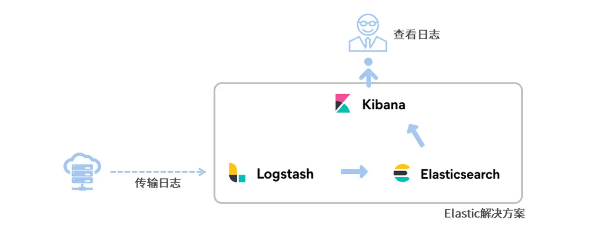
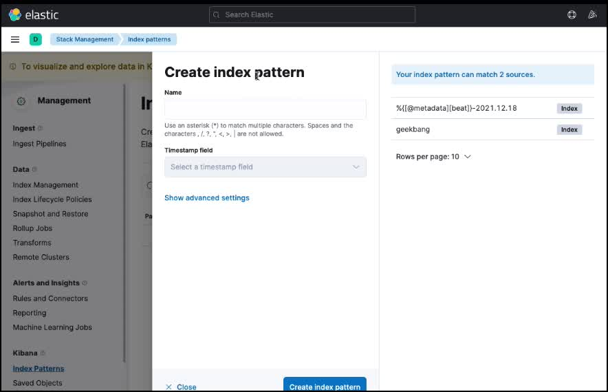
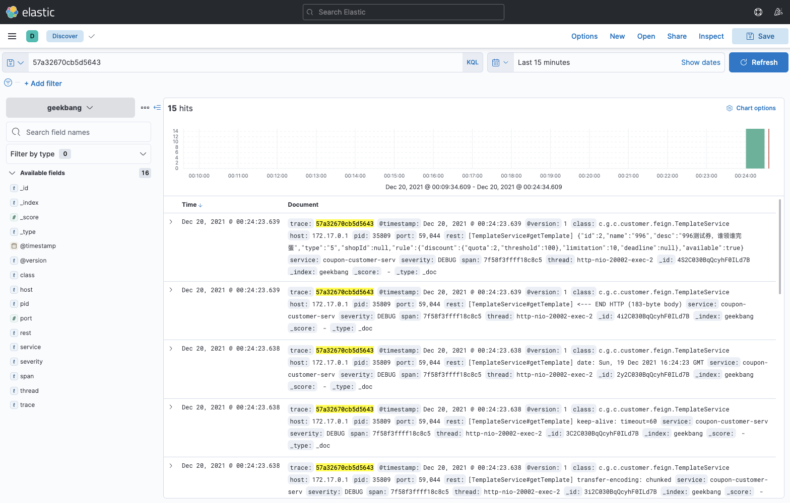

# 23-调用链追踪：如何通过ELK实现日志检索？

你好，我是姚秋辰。

在上节课中，我们借助 Sleuth 和 Zikpin 的合力，搭建了一套调用链追踪系统，它可以帮助我们串联调用链中的上下游访问单元，快速定位线上异常出现在哪个环节。不过呢，光有Tracing 能力似乎还不够，如果我们想要更深一步调查异常背后的原因，那必须完整还原这个异常问题的案发现场。

在线上环境中，我们无法像操作本地开发环境一样去打断点一步步调试问题，服务器的Remote Debug 端口通常也是被禁用的，我们唯一能重现案发现场的途径就是日志信息。因此，我们还要去构建一套日志检索系统，作为线上异常排查的辅助工具。

今天，我就来带你通过 ELK 组件来搭建日志检索系统，完成整个调用链追踪方案的最后一块拼图。在这个过程中，你会知道如何使用 Docker 搭建 ELK 镜像，以及如何把应用程序对接到Logstash 日志收集器，当然了，还有如何在 UI 界面查询日志。

在开始之前，我们先来看看什么是 ELK 吧。

## 什么是 ELK？

ELK 并不是一个技术框架的名称，它其实是一个三位一体的技术名词，ELK 的每个字母都来自一个技术组件，它们分别是 Elasticsearch（简称 ES）、Logstash 和 Kibana。取这三个组件各自的首字母，就组成了所谓的 ELK。

那么这三个技术组件在日志检索平台中分别起到了什么作用呢？我用一幅图来表达一下它们之间的关系。



在 Elastic 解决方案中，Logstash 扮演了一个日志收集器的角色。它可以从多个数据源对数据进行采集，也可以对数据做初步过滤和清洗，比如将数据转换成通用格式、隐匿敏感数据等。

而 Elasticsearch 呢，它是一个分布式的搜索和数据分析引擎。它在整套方案中扮演了日志存储和分词器的角色。Elasticsearch 会收到来自 Logstash 的日志信息，并将这些日志信息集中存储起来。同时，Elasticserch 还对外提供了多种 RESTful 风格的接口，上层应用可以通过这些接口完成数据查找和分析的任务。

Kibana 在整个 Elastic 方案中扮演了一个“花瓶”的角色。它提供了一套 UI 界面，让我们可以对 Elasticsearch 中存储的数据进行查找。同时，它还提供了各种统计报表的功能，如柱状图、饼图、时序统计分析、图谱关联分析等等。当然了，报表数据都来自于 Elasticsearch。

现在，你已经了解了 Elasticsearch、Logstash 和 Kibana 的用途和三者间的关系。接下来，我们就来动手搭建 ELK 环境吧。

## 搭建 ELK 环境

我们有两种搭建 ELK 环境的方法，一种是分别搭建 Elasticsearch、Logstash 和 Kibana 的集群，并将这些组件相互集成起来。就算我们可以通过 Docker 技术分别搭建三者的镜像环境，环境配置和启动异常排查还是有些麻烦的，很容易劝退初学者。

因此，我这里推荐你使用一种更简单的搭建方式，那就是直接下载 sebp/elk 镜像。因为sebp/elk 镜像已经为我们集成了完整的 ELK 环境，只需要稍加配置就能迅速构建 ELK 环境，而且异常排查也比较方便。

为了安装 sebp/elk 镜像，你要先确保本地电脑上已经安装了 Docker 环境。如果你对 Docker已经比较熟悉，那么可以直接使用 Docker 的命令行程序来操作镜像；如果你之前没有使用过Docker，那么可以下载 Docker 桌面版简化操作流程。我在课程里将使用命令行程序来操作Docker 容器和镜像。

### 下载 ELK 镜像

搭建 ELK 环境的第一步，就是下载 sebp/elk 镜像。你可以在命令行运行以下命令，来下载7.16.1 标签的镜像文件。因为镜像文件相当庞大，所以这个下载过程是非常漫长的，请你拿出对待初恋女友的耐心独自等待。

```bash
docker pull sebp/elk:7.16.1
```

为什么需要你选择 7.16.1 标签呢？因为默认情况下，docker 会尝试获取 LASTEST 标签也就是最新版本的镜像文件，而 Elastic 的版本一直处于不断更新发布的过程中。为了保证你能获得和本节课一致的集成体验，我推荐你和我使用同样的镜像版本。

在这里我要重点提醒你两个点。

第一，一定要记得尽可能多给 Docker 容器分配一些内存。否则，Elasticsearch 很容易启动失败，要知道 ES 可是一个非常吃内存的组件。我本地为 Docker 分配的运行期内存是 10G（顶配 Mac 就是豪横），我推荐你为 Docker 分配不低于 5G 的内存。

第二，低配电脑可以降低 ELK 镜像版本。如果你的电脑配置比较吃紧，无法分配高内存，那么你可以尝试获取更低版本的 ELK 组件，因为版本越高对系统的资源要求越高。你可以在Docker Hub网站上查看 sebp/elk 镜像的版本信息，再选择适合自己电脑配置的进行下载。

镜像下载完成之后，就可以创建一个 ELK 容器了。

### 创建 ELK 容器

你可以在命令行使用如下命令创建并启动一个 ELK 容器，在这段命令中，我为Elasticsearch、Logstash 和 Kibana 指定的启动端口分别为 9200、5044 和 5601。命令中的–name elk 参数指定了新创建的 Container 的名称为“elk”，当然了，这里你可以更换成自己喜欢的名称。

```bash
sudo docker run -p 5601:5601 -p 9200:9200 -p 5044:5044 -it --name elk sebp/elk
```

这里要注意的是，以上命令只用在容器创建的时候执行一次即可。一旦容器被创建完成，后续你就可以使用 docker 的标准命令来启动、关闭和重启容器了。

上面这行命令不光会创建容器，还会尝试启动 ELK 的组件，这个过程可能会花费几分钟。

你可以在浏览器中访问“localhost:9200”来验证 ES 是否成功被启动，正常情况下，你应该能在浏览器中看到 ES 集群的版本号等信息，这就说明 ES 启动成功了。

而 Kibana 的启动时间会更长一些，你可以在浏览器中访问“localhost:5601”来访问 Kibana 的网页。

如果启动过程中出现异常，你可以从启动日志中找到异常原因。首先你需要执行下面的命令，进入到 Container 内部。然后，使用 cd 命令进入到 /var/log 文件夹，在这里你可以找到 ES、Logstash 和 Kibana 的启动日志，查看具体的报错。

```bash
docker exec -it elk /bin/bash
```

接下来，我们需要对 Logstash 配置项做一些修改，定义数据传输方式。

### 配置 Logstash

我们使用 docker exec 命令进入到 elk 容器之后，需要使用编辑器打开/etc/logstash/conf.d/02-beats-input.conf 文件，它是用来配置 Logstash 的输入输出源的文件。你可以使用 vi 命令或者 vim 命令进入文件编辑模式，接下来你需要将文件中的内容替换为以下配置项。

```
input {
   tcp {
       port => 5044
       codec => json_lines
   }
}
output {
   elasticsearch {
       hosts => ["localhost:9200"]
       index => "geekbang"
   }
}
```

在上面的文件中，我指定 Logstash 使用 TCP 插件作为数据输入源，并从 5044 端口收集数据，格式为 JSON，你可以通过这个链接访问 TCP 插件的完整参数列表。

同时，我还通过 output 参数将处理过后的日志数据输出到了 ES 组件中，这里我配置了 ES 的地址和数据索引，你可以点击这里的链接获取 ES 插件的详细信息。修改完成之后记得一定要保存文件。

Logstash 支持多种类型的输入和输出源，你可以结合自己的项目架构，选择适合的数据源。如果你对这部分内容感兴趣，可以分别参考以下的两个配置文档：

- Logstash Input 插件列表

- Logstash Output 插件列表

接下来，你还需要在容器外部执行下面这行命令，通过重启 ELK 容器，让 Logstash 重新加载最新的配置项。

```bash
docker restart elk
```

到这里，ELK 容器就配置完成了，接下来我们需要将微服务生成的日志发送到 ELK 容器中。

## 对接 ELK 容器

应用程序对接 ELK 的过程很简单，只有两处改动，一处是添加依赖项，另一处是添加 logback配置文件。

首先，你需要为三个微服务项目添加 logstash-logback-encoder 依赖项，它提供了对接Logstash 的日志输出组件，这里我使用了 7.0.1 的稳定版本。

```xml
<dependency>
   <groupId>net.logstash.logback</groupId>
   <artifactId>logstash-logback-encoder</artifactId>
   <version>7.0.1</version>
</dependency>
```

接下来，你需要在每个项目的 src/main/resources 路径下创建 logback-spring.xml 组件，在这个文件中，我们定义了两个 Appender 用来输出日志信息。

第一个是 ConsoleAppender，它可以将日志信息打印到控制台上。这里我使用了 SpringBoot 默认的日志格式。

```xml
<appender name="console" class="ch.qos.logback.core.ConsoleAppender">
   <filter class="ch.qos.logback.classic.filter.ThresholdFilter">
       <level>DEBUG</level>
   </filter>
   <!-- 日志输出编码 -->
   <encoder>
       <pattern>${CONSOLE_LOG_PATTERN}</pattern>
       <charset>utf8</charset>
   </encoder>
</appender>
```

第二个是 LogstashTcpSocketAppender，由于我们在 ELK 容器中指定了使用 TCP 的方式接收日志信息，所以这个 Appender 对象专门用来构建 JSON 格式化数据发送到 Logstash。在下面的代码中，你可以看到我将日志的主体信息，以及 Span、Trace 等链路追踪信息作为了 JSON 数据的一部分。

```xml
<appender name="logstash"
         class="net.logstash.logback.appender.LogstashTcpSocketAppender">
   <!-- 这是Logstash的连接方式 -->
   <destination>127.0.0.1:5044</destination>
   <!-- 日志输出的JSON格式 -->
   <encoder class="net.logstash.logback.encoder.LoggingEventCompositeJsonEncoder
       <providers>
           <timestamp>
               <timeZone>UTC</timeZone>
           </timestamp>
           <pattern>
               <pattern>
                   {
                   "severity": "%level",
                   "service": "${applicationName:-}",
                   "trace": "%X{traceId:-}",
                   "span": "%X{spanId:-}",
                   "pid": "${PID:-}",
                   "thread": "%thread",
                   "class": "%logger{40}",
                   "rest": "%message"
                   }
               </pattern>
           </pattern>
       </providers>
   </encoder>
</appender>
```

我这里贴出的只是 logback-spring.xml 文件的一部分，你可以到代码仓库查看完整的代码。

到这里，我们就完成了所有的对接工作。接下来，你只要在本地启动微服务项目，然后发起几个服务调用，生成一些 Log 文件，我们就能够在 Kibana 中查看到日志信息了。

## 查看 Kibana 日志信息

当 ELK 容器处于运行状态时，你可以在浏览器中打开“localhost:5601”地址访问 Kibana 系统。不过，在使用 Kibana 做日志查询之前，你还需要添加一个 Index。这里所说的 Index 其实是 ES 中的一个查询参数。

在这节课前半部分，我在 ELK 容器的 Logstash 配置项中指定了 Index=geekbang，这个值会作为 Index 参数，Logstash 向 ES 传输日志信息的时候，会将“geekbang”写入 ES。

为了简化配置，我将所有的日志信息都归在了 geekbang 这个索引之下，当然了，你也可以在Logstash 配置文件中通过表达式动态生成 Index 的值。

我录了一段 Video 来演示如何在 Kibana 中创建 Index，并查询日志内容，你可以参考一下。



如果你有了一个 Trace ID 或者 Span ID，那么你可以直接在 Kibana 的 Discover 页面查询这个 ID 对应的所有详细日志信息。当然了，根据 ES 对日志的分词结果，你还可以借助 Kibana的 KQL 表达式构造复杂查询条件，你可以访问 Kibana 的Kuery-query 页面学习如何使用KQL 查询。



到这里，我们就完成了线上日志查询系统的搭建，现在让我们来回顾一下这节课的重点内容吧。

## 总结

今天我们通过 ELK 镜像搭建了一套完整的日志查询系统，这个过程中的重点是配置 Logstash的输入输出数据源。出于简化课程难度的目的，我并没有使用 filebeat 或者 kafka 之类的输入源，而是使用了 TCP Socket 方式，让业务系统直接把日志信息传输到 Logstash。

从高可用的角度出发，我们通常并不会将业务系统与 Logstash 直连，取而代之的是将日志写入本地文件，然后通过 Filebeat 之类的工具收集本地 log 文件，并传输给 Logstash。

这样做的好处是，无论 Logstash 和应用服务器之间的连接通路是否顺畅，日志文件都会落盘保存，并不会因网络异常而丢失。另一方面，Filebeat 使用了一种“背压敏感协议”技术，用来应对海量数据访问的压力，它会根据 Logstash 的处理速率调整文件读取速度，如果 Logstash正忙，Filebeat 就会降低读取文件的速度。

## 思考题

结合这节课的内容，请你想一想，如果要将 Filebeat 添加到 ELK 体系中，实现日志归集的功能，你打算怎么做？这个作业稍微有一点挑战性，先别搜索网上现成的方案，你可以尝试通过阅读官方文档来搞定这个问题。

好啦，这节课就结束啦。欢迎你把这节课分享给更多对 Spring Cloud 感兴趣的朋友。我是姚秋辰，我们下节课再见！
