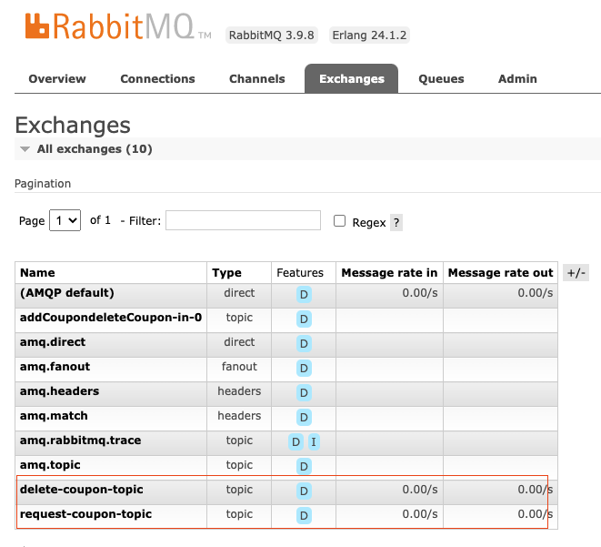
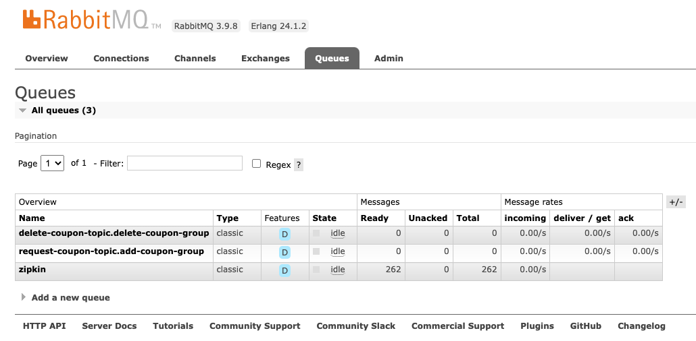

# 29-消息驱动：如何集成Stream实现消息驱动？

你好，我是姚秋辰。

在上节课中，我们通过一些实际案例了解到了消息驱动技术的应用场景，这节课我们就使用Spring Cloud Stream 技术来一场演练，基于 RabbitMQ 消息中间件来落地实践场景。

以往我们在项目中使用 Stream 时，大都是使用经典的 @Input、@Output 和@StreamListener 等注解来注册消息生产者和消费者，而 Stream 在 3.1 版本之后在这几个注解上打了一个 @Deprecated 标记，意思是这种对接方式已经被淘汰了，不推荐继续使用。取而代之的是更为流行的 Functional Programming 风格，也就是我们俗称的函数式编程。

从近几年的技术发展趋势就可以看出来，函数式编程成了一种技术演进的趋势，它能让你以更少的代码和精简化的配置实现自己的业务逻辑。函数式编程和约定大于配置相结合的编程风格比较放飞自我，在接下来的实战环节中，你就会体会到这种 less code style 的快感了。

因为函数式消息驱动在同一个应用包含多个 Event Topic 的情况下有一些特殊配置，所以为了方便演示这个场景，我选择了 Customer 服务中的两个具有关联性的业务，分别是用户领取优惠券和删除优惠券，这节课我们就将这两个服务改造成基于消息驱动的实现方式。

## 实现消息驱动

我把业务场景里的消息生产者和消费者都定义在了 Customer 服务中，可能你会以为，在真实项目里，生产者和消费者应该分别定义在不同的应用中，大多数情况下确实如此。比如在上节课的消息广播场景里，一个订单完成之后，通过广播消息触发下游各个服务的业务流程，这里的生产者和消费者是分在不同应用中的。

但是呢，我们也有把生产者和消费者定义在同一个应用中的场景，我叫它自产自销。比如在一些削峰填谷的例子中，为了平滑处理用户流量并降低负载，我们可以将高 QPS 但时效性要求不高的请求堆积到消息组件里，让当前应用的消费者慢慢去处理。比如我曾经实现的批量发布商品就是这么个自产自销的例子，商品服务接收请求后丢到 MQ，让同一个应用内部的消费者慢慢消化。

我们接下来就分三步走，用这个自产自销的路子来实现消息驱动业务。先添加生产者代码，再定义消费者逻辑，最后添加配置文件。

按照惯例，集成之前你需要先把下面这个 Stream 依赖项添加到 coupon-customer-impl 项目的 pom 文件中。由于我们底层使用的中间件是 RabbitMQ，所以我们引入的是 stream-rabbit组件，如果你使用的是不同的中间件，那么需要引入对口的依赖项。

```xml
<dependency>
   <groupId>org.springframework.cloud</groupId>
   <artifactId>spring-cloud-starter-stream-rabbit</artifactId>
</dependency>
```

添加好依赖项之后，我们先来动手编写生产者逻辑。

### 添加生产者

生产者只做一件事，就是生产一个消息事件，并将这个事件发送到 RabbitMQ。我在Customer 服务下创建了一个叫做 CouponProducer 的类，添加了 sendCoupon 和deleteCoupon 这两个生产者方法，分别对应了领取优惠券和删除优惠券。在这两个方法内，我使用了 StreamBridge 这个 Stream 的原生组件，将信息发送给 RabbitMQ。

```java
@Service
@Slf4j
public class CouponProducer {
   @Autowired
   private StreamBridge streamBridge;
   public void sendCoupon(RequestCoupon coupon) {
       log.info("sent: {}", coupon);
       streamBridge.send(EventConstant.ADD_COUPON_EVENT, coupon);
   }
   public void deleteCoupon(Long userId, Long couponId) {
       log.info("sent delete coupon event: userId={}, couponId={}", userId, coup
       streamBridge.send(EventConstant.DELETE_COUPON_EVENT, userId + "," + coupo
   }
}
```

在这段代码里，streamBridge.send 方法的第一个参数是 Binding Name，它指定了这条消息要被发到哪一个信道中，其中 ADD_COUPON_EVENT=addCoupon-out-0，而deleteCoupon=deleteCoupon-out-0。你先不要管这两个奇怪的值是什么，你只要把 BindingName 理解成一条消息从 Stream 到达 RabbitMQ 之间的“通道”，待会儿看到配置文件的时候，你就会清楚这条通道是怎么与 RabbitMQ 中定义的消息队列名称关联起来的了。

消息的生产者已经定义好了，接下来我在 CouponCustomerController 中新添加了两个方法，单独用来测试我们定义的两个生产者服务。这两个 Controller 方法接收的参数和现有的领券、删除券的接口是一致的，唯二的区别是请求路径后面多了个 Event，以及方法的返回值变成了void。

```java
@PostMapping("requestCouponEvent")
public void requestCouponEvent(@Valid @RequestBody RequestCoupon request) {
   couponProducer.sendCoupon(request);
}
// 用户删除优惠券
@DeleteMapping("deleteCouponEvent")
public void deleteCouponEvent(@RequestParam("userId") Long userId,
                        @RequestParam("couponId") Long couponId) {
   couponProducer.deleteCoupon(userId, couponId);
}
```

到这里，我们生产者端的配置就完成了，接下来我们就去编写消息的消费者。

### 添加消息消费者

我在 CouponProducer 的同级目录下创建了一个 CouponConsumer 类，它作为消息的消费者，从 RabbitMQ 处消费由生产者发布的消息事件，方法底层仍然是调用 CustomerService服务来完成业务逻辑。

在这段代码中，有一个“约定大于配置”的规矩你一定要遵守，那就是不要乱起方法名。我这里定义的 addCoupon、deleteCoupon 两个方法名是有来头的，你要确保消费者方法的名称和配置文件中所定义的 Function Name 以及 Binding Name 保持一致，这是 function event 的一条潜规则。因为在默认情况下，框架会使用消费者方法的 method name 作为当前消费者的标识，如果消费者标识和配置文件中的名称不一致，那么 Spring 应用就不知道该把当前的消费者绑定到哪一个 Stream 信道上去。

另外有一点需要提醒你，我在代码中采用了 Consumer 的实现方式，它是函数式编程的一种方式，你也可以根据自己的编程习惯，采用其它函数式编程方式来编写这段逻辑。

```java
@Slf4j
@Service
public class CouponConsumer {
   @Autowired
   private CouponCustomerService customerService;
   @Bean
   public Consumer<RequestCoupon> addCoupon() {
       return request -> {
           log.info("received: {}", request);
           customerService.requestCoupon(request);
       };
   }
   @Bean
   public Consumer<String> deleteCoupon() {
       return request -> {
           log.info("received: {}", request);
           List<Long> params = Arrays.stream(request.split(","))
                   .map(Long::valueOf)
                   .collect(Collectors.toList());
           customerService.deleteCoupon(params.get(0), params.get(1));
       };
   }
}
```

到这里消费者的定义也完成了。在定义生产者和消费者的过程中我多次提到了配置文件，下面我们就来看一下 Stream 的配置项都有哪些内容。

### 添加配置文件

Stream 的配置项比较多，我打算分 Binder 和 Binding 两部分来讲。我们先来看 Binder 部分，Binder 中配置了对接外部消息中间件所需要的连接信息。如果你的程序中只使用了单一的中间件，比如只接入了 RabbitMQ，那么你可以直接在 spring.rabbitmq 节点下配置连接串，不需要特别指定 binders 配置。

如果你在 Stream 中需要同时对接多个不同类型，或多个同类型但地址端口各不相同的消息中间件，那么你可以把这些中间件的信息配置在 spring.cloud.stream.binders 节点下。其中 type属性指定了当前消息中间件的类型，而 environment 则指定了连接信息。

```yaml
spring:
 cloud:
   stream:
     # 如果你项目里只对接一个中间件，那么不用定义binders
     # 当系统要定义多个不同消息中间件的时候，使用binders定义
     binders:
       my-rabbit:
         type: rabbit # 消息中间件类型
         environment: # 连接信息
           spring:
             rabbitmq:
               host: localhost
               port: 5672
               username: guest
               password: guest
```

配置完了 binders，我们接下来看看如何定义 spring.cloud.stream.bindings 节点，这个节点保存了生产者、消费者、binder 和 RabbitMQ 四方的关联关系。

```sql
spring:
 cloud:
   stream:
     bindings:
       # 添加coupon - Producer
       addCoupon-out-0:
         destination: request-coupon-topic
         content-type: application/json
         binder: my-rabbit
       # 添加coupon - Consumer
       addCoupon-in-0:
         destination: request-coupon-topic
         content-type: application/json
         # 消费组，同一个组内只能被消费一次
         group: add-coupon-group
         binder: my-rabbit
       # 删除coupon - Producer
       deleteCoupon-out-0:
         destination: delete-coupon-topic
         content-type: text/plain
         binder: my-rabbit
       # 删除coupon - Consumer
       deleteCoupon-in-0:
         destination: delete-coupon-topic
         content-type: text/plain
         group: delete-coupon-group
         binder: my-rabbit
     function:
       definition: addCoupon;deleteCoupon
```

我们以 addCoupon 为例，你会看到我定义了 addCoupon-out-0 和 addCoupon-in-0 这两个节点，节点名称中的 out 代表当前配置的是一个生产者，而 in 则代表这是一个消费者，这便是spring-function 中约定的命名关系：

Input 信道（消费者）：< functionName > - in - < index >；

Output 信道（生产者）：< functionName > - out - < index >。

你可能注意到了，在命名规则的最后还有一个 index，它是 input 和 output 的序列，如果同一个 function name 只有一个 output 和一个 input，那么这个 index 永远都是 0。而如果你需要为一个 function 添加多个 input 和 output，就需要使用 index 变量来区分每个生产者消费者了。如果你对 index 的使用场景感兴趣，可以参考文稿中的官方社区文档。

现在你已经了解了生产者和消费者的信道是如何定义的，但是，至于这个信道和 RabbitMQ 里定义的消息队列之间的关系，你知道是怎么指定的吗？

信道和 RabbitMQ 的绑定关系是通过 binder 属性指定的。如果当前配置文件的上下文中只有一个消息中间件（比如使用默认的 MQ），你并不需要声明 binder 属性。但如果你配置了多个binder，那就需要为每个信道声明对应的 binder 是谁。addCoupon-out-0 对应的 binder 名称是 my-rabbit，这个 binder 就是我刚才在 spring.cloud.stream.binders 里声明的配置。通过这种方式，生产者消费者信道到消息中间件（binder）的联系就建立起来了。

信道和消息队列的关系是通过 destination 属性指定的。以 addCoupon 为例，我在addCoupon-out-0 生产者配置项中指定了 destination=request-coupon-topic，意思是将消息发送到名为 request-coupon-topic 的 Topic 中。我又在 addCoupon-in-0 消费者里添加了同样的配置，意思是让当前消费者从 request-coupon-topic 消费新的消息。

RabbitMQ 消息组件内部是通过交换机（Exchange）和队列（Queue）来做消息投递的，如果你登录 RabbitMQ 的控制台，就可以在 Exchanges 下看到我声明的 delete-coupon-topic 和request-coupon-topic。



切换到 Queues 面板，你还会看到这两个交换机所绑定的队列名称。这里的队列名称后面还跟了一个 group name，这就是我在消费者这一侧设置的消息分组，我在配置项中为 add-coupon-in 设置了 group=add-coupon-group，即当前分组内只有一台机器可以去消费队列中的消息，这就是所谓的“消息分组单播”的场景。如果你不设置 group 属性，那么这个消息就会成为一条“广播消息”。



最后的最后，有一个最为重要的配置项，我专门把它放到最后来讲，那就是spring.cloud.stream.function。如果你的项目中只有一组消费者，那么你完全不用搭理这个配置项，只要确保消费者代码中的 method name 和 bindings 下声明的消费者信道名称相对应就好了；如果你的项目中有多组消费者（比如我声明了 addCoupon 和 deleteCoupon 两个消费者），在这种情况下，你需要将消费者所对应的 function name 添加到spring.cloud.stream.function，否则消费者无法被绑定到正确的信道。

```yaml
spring:
 cloud:
   stream:
     function:
       definition: addCoupon;deleteCoupon
```

到这里，我们就完整搭建了一套消息驱动的方案。下面让我来带你回顾下本节重点吧。

## 总结

在今天的课程里，我们使用了 Stream 在新版本中推荐的 functional event 风格实现了用户领券和删除券。在这个环节里，你需要注意的是遵循 spring function 的约定，在下面的几个地方使用一致的命名规则。

1. 生产者端代码中的 binding name（addCoupon-out-0）和配置文件中的生产者名称一致；

2. 同一对生产者和消费者，在配置文件中要使用一样的 Topic Name；

3. 如果项目中存在多个消费者，使用 spring.cloud.stream.function 或者 spring.cloud.function把所有消费者的 function name 写出来。

约定大于配置这种风格，对初学者来说，是需要一些上手门槛的，但当你熟悉了这里面的门道之后，你就能利用这种 less code 开发风格大幅提高开发效率。

## 思考题

如果 Consumer 在消费消息的时候发生了异常，你知道有哪些异常处理的方式吗？

好啦，这节课就结束啦。欢迎你把这节课分享给更多对 Spring Cloud 感兴趣的朋友。我是姚秋辰，我们下节课再见！
