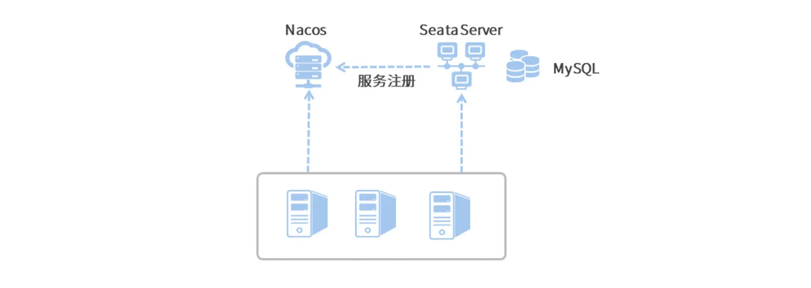
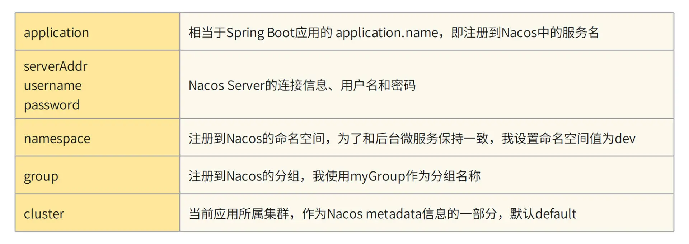
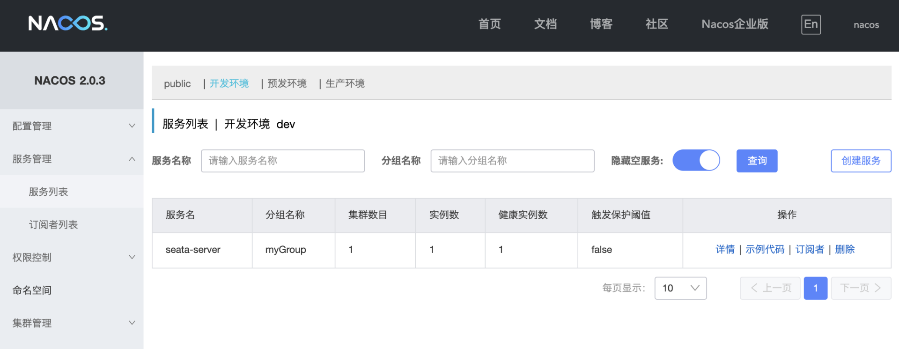

# 33-分布式事务：搭建Seata服务器

你好，我是姚秋辰。

在上节课中，我提到过一个叫 Transaction Coordinator 的组件，它在分布式事务中扮演了一个协调者的角色，用来保证事务的最终一致性。这个昨日配角摇身一变就成了今天的主角，还有了一个新的名字：Seata Server。这节课我就带你了解 Seata Server 的交互模型，再手把手带你搭建一个 Seata Server。

但凡名字里带个 Server 的组件，不用想就知道这一定又是一个“中间件”，Seata Server 就是这么一个中心化的、单独部署的事务管理中间件。在开始搭建 Seata Server 之前，我们先来了解一下 Seata Server 在整个分布式事务方案中是如何跟各个应用交互的吧。



在上面的图里，除了微服务和 Seata 以外，还多了 Nacos 和 MySQL 的影子，它俩来凑什么数呢？

在分布式事务的执行过程中，各个微服务都要向 Seata 汇报自己的分支事务状态，亦或是接收来自 Seata 的 Commit/Rollback 决议，这些微服务是如何勾搭上 Seata Server 的呢？答案就是服务发现。Seata Server 把自己作为了一个微服务注册到了 Nacos，各个微服务利用Nacos 的服务发现能力获取到 Seata Server 的地址。如此一来，微服务到 Seata Server 的通信链路就构建起来了。

咱前面说过 Seata Server 做的是事务管理的活，那么一个分布式事务从开始到结束的整个生命周期中，你总得记录些分支事务 / 全局事务的执行状态吧？数据持久化的工作，咱就交给Seata 背后的 MySQL 数据源了。

好，我们已经大致了解了 Seata Server 和微服务组件之间的交互方式，估摸着你迫不及待想要了解 Seata 的底层原理了。咱不着急，这些个原理啥的，现在讲得越多你就越迷糊。这节课我们来点轻松的，我先带你把 Seata 服务器搭建起来，等这块整明白之后，后面课程里再学习Seata 的底层原理。

## 搭建 Seata 服务器

Seata 官方已经给我们备好了可执行的安装文件，你可以到 Seata Github 地址的Release页面下载。为了避免各种兼容性问题，我推荐你下载seata-server-1.4.2这个版本，和我用的版本保持一致。下载好之后在本地解压，然后我们需要对其中的配置文件做一番更改。

### 更改持久化配置

我们打开 Seata 安装目录下的 conf 文件夹，找到 file.conf.example 文件，把里面的内容复制一下并且 Copy 到 file.conf 里。我们需要在 file.conf 文件里更改两个地方。

第一个改动点是持久化模式。Seata 支持本地文件和数据库两种持久化模式，前者只能用在本地开发阶段，因为基于本地文件的持久化方案并不具备高可用能力。我们这里需要把 store 节点下的 mode 属性改成“db”。

```
## transaction log store, only used in server side
store {
 ## store mode: file、db
 ## 【改动点01】 - 替换成db类型
 mode = "db"
```

第二个改动点就是 DB 的连接方式。我们需要把本地的 connection 配置到 store 节点下的 db节点里。你可以参考下面的代码。

```
store {
 mode = "db"
 ## 【改动点02】 - 更改参数
 ## database store property
 db {
   ## the implement of javax.sql.DataSource, such as DruidDataSource(druid)/Basi
   datasource = "druid"
   ## mysql/oracle/postgresql/h2/oceanbase etc.
   dbType = "mysql"
   driverClassName = "com.mysql.jdbc.Driver"
   ## if using mysql to store the data, recommend add rewriteBatchedStatements=t
   url = "jdbc:mysql://127.0.0.1:3306/seata?rewriteBatchedStatements=true"
   user = "root"
   password = ""
   minConn = 5
   maxConn = 30
   globalTable = "global_table"
   branchTable = "branch_table"
   lockTable = "lock_table"
   queryLimit = 100
 }
}
```

在这段代码中，url 参数指定了 Seata Server 的本地数据库，我这里把 DB Schema 命名为seata，待会儿我会带你去创建对应的数据库表。除了 url 以外，你还要指定 user 和password，虽然我偷懒使用了 root 用户，不过我还是推荐你为 Seata Server 创建一个独立的DB 访问账号。

这段配置里还有三个和数据库表名称相关的属性，globalTable、branchTable 和 lockTable，这是 Seata Server 用来保存全局事务、分支事务还有事务锁定状态的表，Seata 正是用这三个 Table 来记录分布式事务执行状态，并控制最终一致性的。

接下来我们就需要打开 MySQL 控制台，分别创建这几个 Table 了，建表语句我已经上传到了Gitee 项目下的资源文件目录下。

### 创建数据库表

我在 file.conf 中的 url 里指定了 DB Schema 名称为 seata，所以你需要在 MySQL 中创建一个同名 Schema，作为 Seata Server 独享的 Schema。

接下来我要在这个 Schema 下面执行一段 Server 端的 SQL 脚本，脚本的文件名称是server.sql，里面包含了 global_table、branch_table 和 lock_table 三张表的创建语句。

Server 端的 DB tables 创建完成之后，你还得为每个微服务背后的数据库创建一个特殊的表，叫做 undo_log，这个表是做什么用的呢？在 Seata 的 AT 模式下（下节课你就会学到 AT 的技术细节了），Seata Server 发起一个 Rollback 指令后，微服务作为 Client 端要负责执行一段Rollback 脚本，这个脚本所要执行的回滚逻辑就保存在 undo_log 中。

undo_log 的建表语句可以从资源文件目录下的 client.sql 文件中找到，从 undo_log 的表字段中你可以看出，这里记录了全局事务和分支事务的 ID 信息，回滚内容和执行状态等等。这里你需要特别注意的是，undo_log 并不是创建在 Seata Server 的 schema 下，而是要创建在微服务项目自个儿的数据库（geekbang_coupon_db）之下的。

```sql
CREATE TABLE IF NOT EXISTS `undo_log`
(
   `id`            BIGINT(20)   NOT NULL AUTO_INCREMENT COMMENT 'increment id',
   `branch_id`     BIGINT(20)   NOT NULL COMMENT 'branch transaction id',
   `xid`           VARCHAR(100) NOT NULL COMMENT 'global transaction id',
   `context`       VARCHAR(128) NOT NULL COMMENT 'undo_log context,such as seria
   `rollback_info` LONGBLOB     NOT NULL COMMENT 'rollback info',
   `log_status`    INT(11)      NOT NULL COMMENT '0:normal status,1:defense stat
   `log_created`   DATETIME     NOT NULL COMMENT 'create datetime',
   `log_modified`  DATETIME     NOT NULL COMMENT 'modify datetime',
   PRIMARY KEY (`id`),
   UNIQUE KEY `ux_undo_log` (`xid`, `branch_id`)
) ENGINE = InnoDB
 AUTO_INCREMENT = 1
 DEFAULT CHARSET = utf8 COMMENT ='AT transaction mode undo table';
```

创建完数据库表，你还需要对 Seata 的 JDBC driver 做一番调整。

在 seata-server-1.4.2 的安装目录下有一个 lib 目录，里面包含了 Seata Server 运行期所需要用到的 jar 文件，这其中就包括了 JDBC driver。进入到 lib 目录下的 jdbc 文件夹，你会看到两个内置的 JDBC driver 的 jar 包，分别是 mysql-connector-java-5.1.35.jar 和 mysql-connector-java-8.0.19.jar。

你需要把这两个 jar 连同 jdbc 文件夹一并删掉，另外，我在 Gitee 代码仓库下的“资源文件>Seata”里放了一个 mysql-connector-java-8.0.21.jar 文件，你需要把这个文件 Copy 到 lib 目录下，这样做的目的是确保 Seata 的 jdbc diver 和你的本地 MySQL 安装版本之间的兼容性。如果你本地安装了不同版本的 MySQL，记得要把对应版本的 JDBC driver jar 包复制到 lib 下面。

### 开启服务发现

Seata Server 的搭建只剩下最后一步了，那就是将 Seata Server 作为一个微服务注册到Nacos 中。

打开 Seata 安装目录下的 conf/registry.conf 文件，找到 registry 节点，这就是用来配置服务注册的地方了。

```
registry {
 # 【改动点01】 - type变成nacos
 type = "nacos"
 # 【改动点02】 - 更换
 nacos {
   application = "seata-server"
   serverAddr = "127.0.0.1:8848"
   group = "myGroup"
   namespace = "dev"
   cluster = "default"
   username = ""
   password = ""
 }
}
```

在 registry 节点下有一个 type 属性，它表示服务注册的类型。Seata 支持的注册类型有 file 、nacos 、eureka、redis、zk、consul、etcd3、sofa，可见大部分主流的注册中心都在支持列表中，默认情况下注册类型为 file（即本地文件），我们这里需要将其改为“nacos”。

接下来，你还需要修改 registry.nacos 里的内容，我把主要的几个配置信息整理成了一个表格，你可以对照表格了解一下代码中配置项背后的含义。



现在我们已经万事俱备了，你只要直接运行 bin 目录的下的 seata-server.sh 或者 seata-server.bat，就可以启动 Seata Server 了。如果一切正常，你会看到命令行打印出 Serverstarted 和监听端口 8091。

```
i.s.core.rpc.netty.NettyServerBootstrap  : Server started, listen port: 8091
```

Seata Server 启动完成之后，我们再顺带验证一把 Seata 到 Nacos 的注册流程是否完成。我们打开 Nacos 的服务列表页，切换到 dev 命名空间下，正常情况下你会看到一个名为 seata-server 的服务，分组是 myGroup。



## 小结

搭建 Seata Server 的过程看似麻烦，实际上只要遵循三步走就行了。第一步配置 DB 连接串，第二步创建数据库表，最后一步开启服务发现功能。在这个过程里，有三个需要你特别留意的地方。

- JDBC 版本：必须得使用本地数据库对应的正确 JDBC 版本，否则很容易出现各种兼容性问题。

- undo_log 表：undo_log 是下一节课要讲到的 Seata AT 模式的核心表，必须要创建在Client 端（微服务端）使用的数据库中，而不是 Seata Server 端的数据库中。

- 服务注册：要确保 registry.conf 中配置的 nacos 命名空间、group 等信息和微服务中的配置保持一致。Seata 本身支持很多种分布式方案，包括传统的 XA 协议、无侵入式的 AT、巨麻烦的 TCC以及适合长链路业务的 Saga。在接下来的两节课里，我将重点介绍 AT 和 TCC。借这个机会，我推荐你去 Seata 官网中阅读一些开源文档，了解一下这几种方案的基本概念和适用场景，这会帮助你更加全面地理解分布式事务。

## 思考题

你能分享一下在自己的项目中是如何解决数据一致性问题的吗？

好啦，这节课就结束啦。欢迎你把这节课分享给更多对 Spring Cloud 感兴趣的朋友。我是姚秋辰，我们下节课再见！
