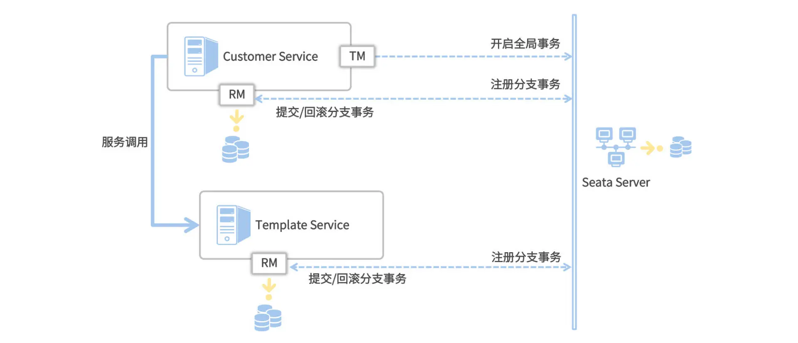

# 34-分布式事务：使用Nacos+Seata实现AT模式

你好，我是姚秋辰。

在上一节中我们已经搭建了 Seata Server，这节课我们就来动手落地一套 Seata AT 方案。Seata AT 不仅是官方最推荐的一套分布式事务解决方案，也是大多数 Seata 使用者选用的方案。AT 方案备受推崇，一个最主要的原因就在于省心。

Seata AT 可以给你带来一种“无侵入”式的编程体验，你不需要改动任何业务代码，只需要一个注解和少量的配置信息，就可以实现分布式事务。这似乎听上去有那么点玄幻，如果一个分布式方案既不依赖 XA 协议的长事务方案，又不依赖代码补偿逻辑，那碰到 Rollback 的时候它怎么知道该回滚哪些内容呢？

下面我就通过一个实际的业务模型，带你了解一下 AT 方案的底层原理。

## Seata AT 底层原理

我们以“删除券模板”作为落地案例，它需要 Customer 和 Template 两个服务的共同参与。其中Customer 服务是整个业务的起点，它先是调用了 Template 服务注销券模板，然后再调用本地方法注销了由该模板生成的优惠券。说白了，我们就是在两个不同的微服务中，分别使用Update SQL 语句修改了底层数据。

我们接下来就基于“删除券模板”场景，看一下 Seata AT 背后的业务流程。在开始之前，我需要先花点时间带你认识下 Seata 框架的三个重要角色，TC、TM 和 RM。

TC 全称是 Transaction Coordinator，你一定非常熟悉了，它就是上节课我们介绍过的 SeataServer。TC 扮演了一个中心化的事务协调者的角色，负责协调全局事务的提交和回滚，并维护全局和分支事务的状态。

TM 全称是 Transaction Manager，它是事务管理器，主要作用是发起一个全局事务，对全局事务的提交和回滚做出决议。在 AT 方案中，TM 通常是由发起全局事务的那个微服务所扮演的，比如在“删除券模板”这个场景里，TM 的扮演者就是 Customer 服务。

RM 全称是 Resource Manager，它是资源管理器，向 TC 注册分支事务并上报事务状态，同时负责对当前分支事务进行提交和回滚。每一个分支事务都是全局事务的参与者，这些分支事务的所属应用扮演了 RM 的角色。

介绍完了这三个重要角色之后，让我们结合下面这张图来看看 Seata AT 的业务流程吧。



Seata AT 的业务流程分为两个阶段来执行。

- 一阶段：执行核心业务逻辑（即代码中的 CRUD 操作）。Seata 会根据 DB 操作自动生成相应的回滚日志，并将回滚日志添加到 RM 对应的 undo_log 表中。执行业务代码和添加回滚日志这两步都是在同一个本地事务中提交的。

- 二阶段：如果全局事务的最终决议是 Commit，则更新分支事务状态并清空回滚日志；如果最终决议是 Rollback，则根据 undo_log 中的回滚日志进行 rollback 操作。二阶段是以异步化的方式来执行的。

从这两个阶段可以看出，Seata AT 方案的核心在于这个 undo_log。正是有了这个记录回滚日志的 undo_log 表，我们才能将一阶段和二阶段剥离成两个独立的本地事务来执行。而 SeataAT 之所以执行效率高，主要原因有两个。一是核心业务逻辑可以在一阶段得到快速提交，DB资源被快速释放；二是全局事务的 Commit 和 Rollback 是异步执行。

首先，Customer 服务作为分布式事务的起点，扮演了一个 TM 的角色，它会向 TC 注册并发起一个全局事务。全局事务会生成一个 XID，它是全局唯一的 ID 标识，所有分支事务都会和这个 XID 进行绑定。XID 在服务内部（非跨服务调用）的传播机制是基于 ThreadLocal 构建的，即 XID 在当前线程的上下文中进行透传，对于跨服务调用来说，则依赖 seata-all 组件内置的各个适配器（如 Interceptor 和 Filter）将 XID 传递给对象服务。

然后，Customer 服务调用了 Template 服务进行模板注销流程，Template 服务的 RM 开启了一个分支事务，并注册到 TC。在执行分支事务的过程中，RM 还会生成回滚日志并提交到undo_log 表中。除此之外，RM 还需要获取到两个特殊的 Lock。其中一个是 Local Lock（本地锁），另一个是 Global Lock（全局锁）。

Lock 信息存放在 lock_table 这张表里，它会记录待修改的资源 ID 以及它的全局事务和分支事务 ID 等信息。无论是一阶段提交还是二阶段回滚，RM 都需要获取待修改记录的本地锁，然后才会去执行 CRUD 操作。而在 RM 提交一阶段事务之前，它还会尝试获取 Global Lock（全局锁），目的是防止多个分布式事务对同一条记录进行修改。假设有两个不同的分布式事务想要修改记录 A，那么只有同时获取到 Local Lock 和 Global Lock 的事务才能正常提交一阶段事务。

本地锁会随一阶段事务的提交 / 回滚而释放，而全局锁只有等到全局事务提交 / 回滚之后才会被释放。在一阶段中，如果某一个事务在一定的尝试次数后仍然无法获取全局锁，它会知难而退，执行本地事务回滚操作。而如果在二阶段回滚的时候，RM 无法获取本地锁，它会原地打转不停重试，直到成功获取本地锁并完成重试。

接下来，Template 服务调用成功，Customer 服务开始执行自己的本地事务，流程都大同小异就不说了。TM 端根据业务的执行情况，最终做出二阶段决议，Commit 或 Rollback。

最后，TC 向各个分支下达了二阶段决议。如果最终决议是 Commit，那么各个 RM 会执行一段异步操作，删除 undo_log；如果最终决议是 Rollback，那么 RM 端会根据 undo_log 中记录的回滚日志做反向补偿。

到这里，整个全局事务就结束了。下面让我们通过代码实战，落地一套 Seata AT 的解决方案吧。

## 微服务项目改造

我们这次的改造涉及到 Customer 和 Template 这两个服务，所以接下来你需要在这两个微服务中提交同样的配置项和代码改动。

在这个环节，你就能体会到什么叫“无感知”的分布式事务了。我们并不需要对业务代码做任何的改动，只需要在分布式事务开始的方法上做一点手脚，添加一个简单的注解，就能为本地事务赋予分布式一致性的能力，用互联网行业的黑话这就叫“赋能”。

按照惯例我们先从添加依赖项开始。

### 添加依赖项

你需要为 Customer 和 Template 两个服务添加以下依赖项，它是 Seata 框架的 starter 组件。在以往的老版本里，Seata 和 Spring Cloud 的兼容性并不是那么好，我们经常要在 starter 依赖项中使用 exclude 标签排除 seata-all 组件，再单独引入一个不同版本的 seata-all。但在新版本中，这个兼容性问题已经不复存在，我们只需要一个依赖就够了。

```xml
<dependency>
   <groupId>com.alibaba.cloud</groupId>
   <artifactId>spring-cloud-starter-alibaba-seata</artifactId>
</dependency>
```

添加好了依赖项，接下来我们需要到代码中声明一个数据源代理类。

### 声明数据源代理

Seata AT 之所以能够实现无感知的编程体验，其中的一个秘诀就在这个数据源代理上了。

我们在项目中使用的数据源通常是 JDBC driver 的底层 DataSource，或者是 hikari 之类的连接池。但在分布式事务的场景上，为了能够在分支事务开启 / 提交等关键节点上做一番手脚（比如向 Seata 注册分支事务、生成 undo_log 等），我们需要用 Seata 特有的数据源“接管”项目原有的数据源。

我在项目中创建了一个 SeataConfiguration 的类，用来声明一个 Seata 特有的数据源，作为当前项目的 DataSrouce 代理。

```java
@Configuration
public class SeataConfiguration {
   @Bean
   @ConfigurationProperties(prefix = "spring.datasource")
   public DruidDataSource druidDataSource() {
       return new DruidDataSource();
   }
   @Bean("dataSource")
   @Primary
   public DataSource dataSourceDelegation(DruidDataSource druidDataSource) {
       return new DataSourceProxy(druidDataSource);
   }
}
```

在上面的代码中，我先是创建了一个 DruidDataSource 作为数据源连接池，并指定其读取spring.datasoource 下的数据库连接信息。Druid 也是 alibaba 出品的一个开源数据库连接池方案，在阿里系内部应用也非常广泛。

在 dataSourceDelegation 方法中，我声明了一个 DataSourceProxy 的类，并接收DruidDataSource 作为构造器初始化参数。DataSourceProxy 是由 Seata 框架提供的一个数据源代理类，为了确保 Spring 上下文使用 DataSourceProxy 而不是其它三方数据源，我在dataSourceDelegation 方法上添加了 @Primary 注解，将其作为 javax.sql.DataSource 的默认代理类。

数据源代理改造完成之后，我们可以去添加 seata 的配置项了。

### 添加 Seata 配置项

Seata 的配置项定义在 application.yml 文件中，分为上下两部分，一部分在spring.cloud.alibaba 节点下面，它指定了当前应用的事务分组；另一部分在根节点 seata 下面，定义了连接 Seata Server 的方式。

```yaml
spring:
 cloud:
   alibaba:
     seata:
       tx-service-group: seata-server-group
seata:
 application-id: coupon-customer-serv
 registry:
   type: nacos
   nacos:
     application: seata-server
     server-addr: localhost:8848
     namespace: dev
     group: myGroup
     cluster: default
 service:
   vgroup-mapping:
     seata-server-group: default
```

在 seata.registry 节点下，我通过 type 属性指定了本地服务和 Seata Server 之间基于 Nacos服务发现来获取地址信息，而且我还在 seata.registry.nacos 节点下配置了 Nacos 的地址、命名空间、group 等信息。

spring.cloud.alibaba.seata.tx-service-group 节点定义了事务服务的分组名称，你可以随意写一个名称，比如我这里写的是 seata-server-group。唯一要注意的一点是，tx-service-group 中的分组名称一定要和 seata.service.vgroup-mapping 中定义的分组名称一致，我为 seata-server-group 分组所指定的值是 default，这个值会被用来获取 Seata Server 地址。

在项目启动的时候，Seata 框架会尝试从 Nacos 获取 Seata Server 的地址信息，执行这个操作的类是 NacosRegistryServiceImpl。在这个类的 lookup 方法中，Seata 使用了下面这行代码查找 seata-server 服务，其中 clusters 参数的值就来自于 seata.service.vgroup-mapping.seata-server-group 所对应的值。

```
List<Instance> firstAllInstances = getNamingInstance()
   .getAllInstances(getServiceName(), getServiceGroup(), clusters);
```

关于 Seata AT 的所有准备工作到这里就完成了，接下来我们就去写一段分布式事务的方法。

### 实现删除模板

删除券模板是一个非常合适的分布式事务用例，全局事务分别在 Template 服务和 Customer服务两个地方进行了 Write 操作。全局事务是从 Customer 服务开启的，在 Customer 服务中我们先调用 Template 服务将模板设置为 Inactive 状态，然后在 Customer 服务本地将用户所领取到的相关优惠券全部注销。

首先，我们在 Customer 服务中声明一个新的 Controller 方法 deleteTemplate，它作为整个链路的调用起点，入参是一个 TemplateID。

```java
@DeleteMapping("template")
@GlobalTransactional(name = "coupon-customer-serv", rollbackFor = Exception.class
public void deleteCoupon(@RequestParam("templateId") Long templateId) {
   customerService.deleteCouponTemplate(templateId);
}
```

在这个方法上，我使用了一个特殊的注解 @GlobalTransactional，它是 Seata 用来开启分布式事务的顶层注解。你只要在全局事务“开始”的地方把这个注解添加上去就好了，并不需要在每个分支事务中都声明它。全局事务碰到任何 Exception 异常，都会触发全局事务回滚操作，这个行为是通过 GlobalTransactional 注解的 rollbackFor 方法指定的。

删除模板的业务逻辑定义在了 CustomerService 类中，你可以参考下面的代码。

```java
@Override
@Transactional
public void deleteCouponTemplate(Long templateId) {
   templateService.deleteTemplate(templateId);
   couponDao.deleteCouponInBatch(templateId, CouponStatus.INACTIVE);
   // 模拟分布式异常
   throw new RuntimeException("AT分布式事务挂球了");
}
```

我先是借助 templateService 这个 Openfeign 接口，间接调用了 Template 服务注销模板，再通过一个本地 DAO 方法注销了用户已经领取的优惠券。为了验证分布式事务是否能正常回滚，我在方法的最后一行抛出了一个 RuntimeException。

在开启 Seata 分布式事务的时候，你必须把异常抛出到全局事务的发起方，让@GlobalTransactional 注解的方法能够感知到这个异常，才能顺利触发事务的回滚。如果你开发了统一的异常处理拦截器，记得千万不要把异常吞掉。

在非分布式事务的模式下，即便有异常抛出，也顶多只能触发本地事务的回滚，而 Template远程服务调用对应的 DB 改动是不会被回滚的。接下来我们一起见证一下 Seata AT 方案能否把 Template 的改动也一块回滚。

让我们通过下面这几步操作构造一个测试用例：

1. 启动 Nacos 和 Seata Server；

2. 本地运行 Template 和 Customer 服务；

3. 调用 Template 服务生成一个新的券模板；

4. 调用 Customer 服务领券接口，获取一张该模板的优惠券；

5. 调用 Customer 的 deleteTemplate 接口。

此时切换到 Template 服务的控制台页面，你会看到 Seata 框架输出的几行关键日志（加粗部分）。

- rm handle branch rollback process：本地资源管理器开始执行回滚流程。

- Branch Rollbacking：分支事务正在回滚。

- Branch Rollbacked result: PhaseTwo_Rollbacked：分支事务回滚完成。

再检查一下数据库表，你会发现 Template 表中的模板数据并没有被注销，这表示我们二阶段回滚逻辑执行成功。到这里，我们就完整搭建了一套 Seata AT 无侵入式的分布式事务方案。

## 总结

如果从编写代码的角度来看，Seata AT 方案应该是一致性解决方案中的 Easy 模式了，既没有XA 方案的 DB 性能瓶颈，也不用编写任何跑批补偿的业务。但尽管如此，我还是坚持一个观点：非必要就别上分布式事务。

Seata 分布式事务是个双刃剑，当我们给项目引入 Seata 的时候，无形中也增加了架构层面的复杂程度，说白了，就是增加了一个 failure point。你需要考虑 Seata Server 不可用的情况，制定降级预案保证业务正常运转。同时在大促等环节的压测端，你也要对 Seata Server 的高可用做好充足的功课。

如果你的本地业务非常简单，那么没必要上 Seata，这纯属用大炮打苍蝇。我推荐你使用传统的事务型消息 + 日志补偿 + 跑批补偿的方式，用最经济实惠的技术手段搞定简单业务。

## 思考题

你能深入 Seata Client 端的源码，了解 GlobalTransactional 注解是如何接收二阶段提交 / 回滚的指令的吗？一个方向是顺着 GlobalTransactional 注解找对应的拦截器逻辑，再往下深挖；另一个方向是从代码中的 Rollback/Commit 日志中找到对应的类，反向摸排。

好啦，这节课就结束啦。欢迎你把这节课分享给更多对 Spring Cloud 感兴趣的朋友。我是姚秋辰，我们下节课再见！
