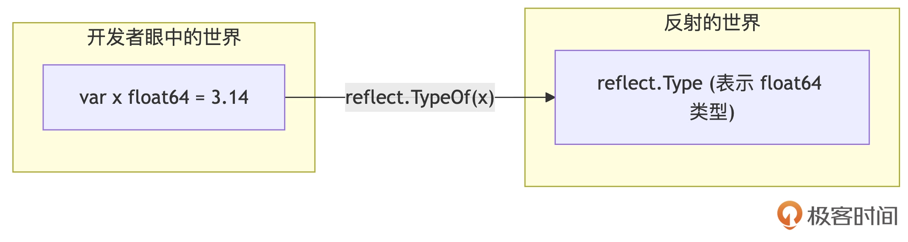
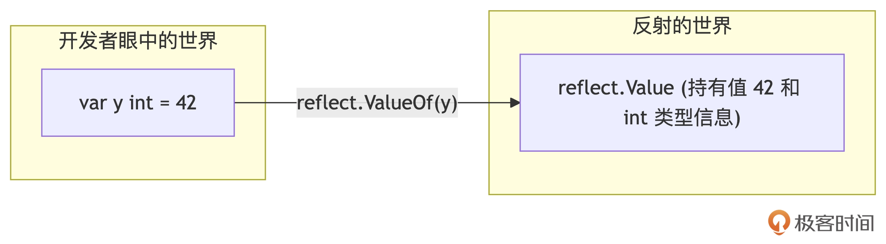

# 13-深入Go底层：驾驭反射（Reflection）与unsafe的双刃剑

你好！我是 Tony Bai。

在 Go 语言简洁、静态类型和内存安全的“舒适区”之下，隐藏着两把威力巨大但也极其危险的

```
“瑞士军刀”——反射（Reflection）和 unsafe 包。它们允许我们在某种程度上突破 Go 的常
```

规限制：反射让我们能在运行时动态地操作类型和值；unsafe 则让我们能直接操作内存、绕过类型系统的检查。

通常情况下，我们编写的 Go 代码都应该遵循语言提供的类型安全和内存安全保证。但总有一些特殊场景，比如：

- 需要编写能处理任意类型的通用框架（如 JSON 序列化、格式化输出、ORM 等）。

- 需要与 C 语言或其他底层系统进行低级别交互。

- 在性能极端敏感的场景下，需要进行手动内存布局优化或避免某些运行时开销。

```
这时，反射和 unsafe 就可能进入我们的视野。然而，它们就像双刃剑：
```

- 威力：提供了强大的灵活性和底层操作能力，能实现常规 Go 代码难以完成的功能。

- 风险：使用不当极易导致代码难以理解、性能低下、类型不安全、甚至程序崩溃。

```
不理解反射和 unsafe 的原理、适用场景和风险，就可能在项目中误用或滥用它们，引入难
```

以排查的 Bug 和性能问题。对于进阶开发者而言，掌握这两把“双刃剑”的正确用法和安全边界至关重要。

这节课，我们将深入 Go 的底层地带，一起探索：

1. 反射（Reflection）：它是如何在运行时赋予我们动态操作类型和值的能力？核心概念是什么？

```
unsafe 包：它提供了哪些“不安全”的操作？我们能用它来做什么，比如探索内存布局？
双刃剑的代价：使用反射和 unsafe 分别会带来哪些性能影响和安全风险？
```

4. 实践红线：明确何时以及如何（在保证安全的前提下）审慎地使用这两种高级特性。

接下来，就让我们一起学习如何驾驭这两把强大的底层工具吧。

## 反射：运行时动态操作类型与值

反射，简单来说就是程序在运行时检查自身结构（特别是类型信息）并进行操作的能力。Go

```
的 reflect 包提供了这种能力。想象一下标准库的 fmt.Println 或
encoding/json.Marshal 函数，它们如何能接受任何类型的参数并正确处理？答案就是反
```

射。反射在 Go 中主要用于编写需要处理未知类型数据的通用代码。

要理解 Go 反射，最重要的是掌握 reflect 中的 Type 和 Value 两个核心概念。

### 核心概念：reflect.Type 与 reflect.Value

```
Go 语言的反射能力主要由标准库 reflect 包提供。要进入反射的世界，我们需要了解两个
最核心的概念（也是 reflect 包中最重要的两个类型）：reflect.Type 和
reflect.Value。它们就像是我们在运行时观察和操作 Go 程序内部结构的“透镜”和“机械
```

臂”。

### 如何进入反射世界？

```
reflect 包提供了两个入口函数，让我们能够从普通的 Go 值（通常是 interface{} 类
```

型，因为任何类型都可以赋值给它）得到对应的反射对象，并进入一个以反射对象为中心进行操作的世界——反射世界。

1. reflect.TypeOf：获取类型信息

在 Go 语言中，我们可以使用 reflect 包的 TypeOf 函数来获取一个值的类型信息。TypeOf 函数的签名如下：

```go
func TypeOf(i any) Type
我们看到这个函数接收任何类型的值 i，并返回其动态类型的 reflect.Type 表示。通过
```

TypeOf 进入反射世界的过程如下图所示：



TypeOf 专注于揭示值的类型信息。下面是一个通过 TypeOf 函数获取一个 float64 类型值的类型信息的示例：

```go
import (
   "fmt"
   "reflect"
)
func main() {
   var x float64 = 3.14
   t := reflect.TypeOf(x) // 获取 x 的类型信息
   fmt.Println("Type:", t)            // 输出: float64
   fmt.Println("Name:", t.Name())     // 输出: float64 (类型名称)
   fmt.Println("Kind:", t.Kind())     // 输出: float64 (类型种类)
   fmt.Println("Size:", t.Size())     // 输出: 8 (占用的字节数)
}
```

可以看到，一旦通过 TypeOf 进入反射世界（拿到 reflect.Type 信息），我们就能掌握值的类型的很多重要信息，包括名称、种类以及大小等。

2. reflect.ValueOf：获取值信息

在 Go 语言中，我们可以使用 reflect 包的 ValueOf 函数来获取一个值的 Value 信息。ValueOf函数的签名如下：

```go
func ValueOf(i any) Value
```

我们看到，ValueOf 函数接受一个任意类型的值作为参数，并返回该值的 Value 信息，即interface{}接口类型变量中存储的动态类型的值的信息，用 reflect.Value 表示。通过 ValueOf进入反射世界的过程如下图所示：



reflect.Value 不仅包含了值本身，还包含了值的类型信息，并提供了操作这个值的方法。下面是一个通过 ValueOf 函数获取一个 int 值的反射值信息示例：

```go
import (
   "fmt"
   "reflect"
)
func main() {
   var y int = 42
   v := reflect.ValueOf(y) // 获取 y 的值信息
   fmt.Println("Value:", v)           // 输出: 42
   fmt.Println("Type:", v.Type())     // 输出: int (Value 对象包含 Type 信息)
   fmt.Println("Kind:", v.Kind())     // 输出: int
   fmt.Println("Value as int:", v.Int()) // 输出: 42 (获取具体 int 值)
}
TypeOf 和 ValueOf 是我们从常规 Go 代码通往反射世界的两扇大门。一旦进入，我们主要
就与 reflect.Type 和 reflect.Value 这两种反射对象打交道了。
```

### reflect.Type：探索类型的静态信息

```
reflect.Type 对象就像一面镜子，可以照出任意 Go 值背后的类型信息。通过
reflect.TypeOf(x) 得到它之后，我们可以问它很多关于这个类型本身的问题。
```

最常用的就是询问它的种类（Kind）和名称（Name）：

```go
package main
import (
   "fmt"
   "reflect"
)
type MyInt int
type Person struct { Name string; Age int }
func main() {
   var i int = 10
   var mi MyInt = 20
   var p Person
   var s []string
   var m map[string]bool
   ti := reflect.TypeOf(i)
   tmi := reflect.TypeOf(mi)
   tp := reflect.TypeOf(p)
   ts := reflect.TypeOf(s)
   tm := reflect.TypeOf(m)
   fmt.Printf("Type: %s, Kind: %s\n", ti.Name(), ti.Kind())   // 输出: Type: int,
   fmt.Printf("Type: %s, Kind: %s\n", tmi.Name(), tmi.Kind()) // 输出: Type: MyIn
   fmt.Printf("Type: %s, Kind: %s\n", tp.Name(), tp.Kind())   // 输出: Type: Pers
   fmt.Printf("Type: %s, Kind: %s\n", ts.Name(), ts.Kind())   // 输出: Type: , Ki
   fmt.Printf("Type: %s, Kind: %s\n", tm.Name(), tm.Kind())   // 输出: Type: , Ki
}
Kind() 返回的是类型的基础分类（如 int、struct、slice、map、ptr、func、interface 等），
这对于编写通用的反射代码非常重要，因为很多操作依赖于 Kind。而 Name() 返回的是类型
```

的显式名称（如果它是已命名的类型）。

对于复合类型，我们可以进一步探索其内部结构：

```go
// 对于 Struct
fmt.Println("Person NumField:", tp.NumField()) // 输出: 2
nameField, _ := tp.FieldByName("Name")
fmt.Printf("  Field Name: %s, Type: %s, Tag: '%s'\n", nameField.Name, nameField.T
// 输出: Field Name: Name, Type: string, Tag: '' (这里没加 tag)
// 对于 Slice, Array, Map, Chan, Ptr
fmt.Println("Slice Element Type:", ts.Elem()) // 输出: string
fmt.Println("Map Key Type:", tm.Key(), ", Map Value Type:", tm.Elem()) // 输出: st
// 对于 Func
fnType := reflect.TypeOf(func(a int, b string) bool { return false })
fmt.Println("Func Kind:", fnType.Kind())      // 输出: func
fmt.Println("Func NumIn:", fnType.NumIn())    // 输出: 2
fmt.Println("Func In(0):", fnType.In(0))      // 输出: int
fmt.Println("Func NumOut:", fnType.NumOut())  // 输出: 1
fmt.Println("Func Out(0):", fnType.Out(0))    // 输出: bool
Type 还提供了判断类型能力的方法，比如 Comparable()（是否可比较）、
Implements()（是否实现某接口）、AssignableTo()（是否可赋值给某类型）等，这些
```

在需要进行类型兼容性判断时很有用。

```
总的来说，reflect.Type 让我们能够在运行时静态地检视类型的定义和结构，它不关心具
```

体的值是什么。

### reflect.Value：持有值并与之交互

```
与 Type 不同，reflect.Value 代表的是一个具体的运行时值。它像一个万能容器，可以
```

装下任何类型的值，并且提供了一套 API 来与这个值进行交互。

```go
当然，Value 对象同样可以告诉我们它持有值的类型信息：
var pi float64 = 3.14159
vpi := reflect.ValueOf(pi)
fmt.Println("Value holds type:", vpi.Type()) // 输出: float64
fmt.Println("Value holds kind:", vpi.Kind()) // 输出: float64
更重要的是，Value 允许我们获取和设置（如果允许的话）它所持有的值。下面是获取值的
```

示例：

```go
// 获取值
fmt.Println("Value as float:", vpi.Float()) // 输出: 3.14159
// 还有 Int(), Uint(), String(), Bool(), Bytes(), Complex() 等对应 Kind 的方法
// 将 Value 转换回 interface{}
genericValue := vpi.Interface()
originalValue := genericValue.(float64) // 通过类型断言获取原始值
fmt.Println("Original value:", originalValue)
而通过 Value 对象来修改值，需要该值具有“可设置性（Settability）”。这是反射中最容易出错
的地方之一。你不能直接修改通过 reflect.ValueOf(x) 得到的 Value，因为它持有的是
x 的一个副本。要想通过反射修改原始变量 x，必须：
获取 x 的指针的 reflect.Value。
调用 .Elem() 方法获取指针指向的那个值的 reflect.Value。
这个通过 .Elem() 得到的 Value 才是可设置（Settable）的。
```

我们看下面的示例：

```go
var count int = 10
vCount := reflect.ValueOf(count)
// vCount.SetInt(20) // 直接修改副本会 panic! panic: reflect: reflect.Value.SetInt
vpCount := reflect.ValueOf(&count) // 1. 获取指针的 Value
veCount := vpCount.Elem()          // 2. 获取指针指向的元素的 Value
fmt.Println("Is settable?", veCount.CanSet()) // 输出: true
veCount.SetInt(20) // 3. 修改成功
fmt.Println("New count:", count)       // 输出: 20
从上述示例可以看出：判断是否可设置非常重要，我们可以通过 CanSet() 方法检查。而对
```

于结构体字段的设置，还需要该字段是可导出的（首字母大写）。下面我们再通过一个示例看一下通过 Value 操作结构体、数组、切片、map 等复合类型内部值的方法：

```go
type User struct {
   ID       int
   Name     string
   Email    string
   IsActive bool
   Tags     []string
   Props    map[string]string
}
func main() {
   user := User{
       ID:       1,
       Name:     "Test",
       Email:    "test@example.com",
       IsActive: true,
       Tags:     make([]string, 10),
       Props:    make(map[string]string),
   }
   vUser := reflect.ValueOf(&user).Elem() // 获取可设置的 User Value
   // 访问和修改结构体字段
   nameField := vUser.FieldByName("Name")
   if nameField.IsValid() && nameField.CanSet() {
       nameField.SetString("Updated Name")
   }
   fmt.Println("Updated User Name:", user.Name) // 输出: Updated Name
   // 操作切片
   tagsField := vUser.FieldByName("Tags")
   tagsField.SetLen(3)                // 设置长度
   tagsField.Index(0).SetString("go") // 设置元素
   fmt.Println("Tag 0:", tagsField.Index(0).String())
   // 操作 Map
   propsField := vUser.FieldByName("Props")
   propsField.SetMapIndex(reflect.ValueOf("city"), reflect.ValueOf("London")) //
   cityVal := propsField.MapIndex(reflect.ValueOf("city"))
   if cityVal.IsValid() {
       fmt.Println("City:", cityVal.String())
   }
   fmt.Println(user) // {1 Updated Name test@example.com true [go  ] map[city:Lo
}
```

反射还可以动态地调用一个值的方法：

```go
type Greeter struct{ Greeting string }
func (g Greeter) Greet(name string) string {
   return g.Greeting + ", " + name + "!"
}
func main() {
   g := Greeter{Greeting: "Hello"}
   vg := reflect.ValueOf(g)
   method := vg.MethodByName("Greet") // 获取 Greet 方法的 Value
   if method.IsValid() {
       args := []reflect.Value{reflect.ValueOf("World")} // 准备参数
       results := method.Call(args)                      // 调用方法
       if len(results) > 0 {
           fmt.Println("Method result:", results[0].String()) // 输出: Hello, Wor
       }
   }
}
```

我们看到，在反射世界里通过 Value 对象动态调用值的方法，方法的参数也需要使用“反射世界”的 Value 类型值（如上例中的 args）。

```
reflect.Value 是反射机制中进行动态操作的核心。它像一个功能强大的通用“操作杆”，可
```

以让你在运行时与几乎任何 Go 值进行交互，但前提是你必须小心翼翼地检查类型、种类和可设置性，以避免运行时错误。

### 反射三大定律

```
掌握了 reflect.Type 和 reflect.Value 这两个核心工具后，我们还需要理解它们之间
```

相互作用的基本规则。Go 语言官方博客上有一篇由 Rob Pike 撰写的著名文章，提出了“反射三大定律”，这三条定律清晰地阐述了 Go 反射机制的边界和核心交互方式，是安全、正确使用反射的基石。让我们来逐一理解它们。

```
这三条定律描述了普通类型值、reflect.Type、reflect.Value 以及 interface{} 之
```

间的相互转换关系以及要遵循的原则。

### 定律一：反射可以将“接口类型变量”转换为“反射对象”（Type 或 Value）

```
任何一个 Go 值，都可以被赋给一个空接口 interface{}（或 any）类型的变量。上面已经
详细介绍了 reflect 包提供的 TypeOf 和 ValueOf 函数，可以从这个接口值中提取出其底
层包含的动态类型信息（reflect.Type）和动态值信息（reflect.Value），相信你已经
```

理解了，我就不再举例赘述。

这条定律让我们能够探知任意变量在运行时的实际类型和值，并且规定了我们进入反射世界的入口。

### 定律二：反射可以将“反射对象”转换回“接口类型变量”

```
这是我们从反射世界“出来”的通道。当你拥有一个 reflect.Value 对象时，可以调用它的
Interface() 方法，将其转换回一个 interface{} 类型的值。这个接口值会持有反射对
```

象所代表的那个原始的动态类型和动态值。

```go
func main() {
   vInt := reflect.ValueOf(123)   // 得到 int 值的 Value
   iFace := vInt.Interface()      // 将 Value 转回 interface{}
   // 现在 iFace 持有的是 int 类型的 123
   fmt.Printf("Interface value: %v, type: %T\n", iFace, iFace) // 输出: Interface
   // 可以通过类型断言获取原始值
   originalInt := iFace.(int)
   fmt.Println("Original int:", originalInt) // 输出: 123
}
这条定律允许我们将通过反射获得或操作的值，传递给需要 interface{} 参数的函数，或
```

者通过类型断言恢复其原始类型。

### 定律三：要修改反射对象（reflect.Value），其值必须是“可设置的”

这是使用反射进行修改操作时最重要的规则，也是最容易出错的地方。并非所有的

```
reflect.Value 都允许你修改它所持有的值。一个 reflect.Value 是可设置的，必须满
```

足两个条件：

```
可寻址（Addressable）：这个 Value 必须代表一个内存中可以获取地址的值。通常，通
过获取一个变量的指针，再调用 .Elem() 得到的 Value 才是可寻址的。直接对一个普通
变量（非指针）调用 reflect.ValueOf() 得到的是该变量值的副本，这个副本是不可寻
```

- 址的。

2. 非只读（Not Read-only）：如果是结构体字段，该字段必须是可导出的（Exported，即首字母大写）。

```
前面介绍过，可以通过 reflect.Value 的 CanSet() 方法来检查一个值是否可设置，这里
```

通过下面示例再强调一下这一点：

```go
func main() {
   var x float64 = 1.0
   v := reflect.ValueOf(x)        // v 持有 x 的副本，不可设置
   fmt.Println("v CanSet:", v.CanSet()) // 输出: false
   // v.SetFloat(2.0) // 直接修改会 panic: reflect: reflect.Value.SetFloat using u
   p := reflect.ValueOf(&x)       // p 持有 x 的地址 (*float64)
   fmt.Println("p CanSet:", p.CanSet()) // 输出: false (指针本身不可被设置成指向别处，
   e := p.Elem()                  // e 是 p 指向的值 (x)，它是可寻址的
   fmt.Println("e CanSet:", e.CanSet()) // 输出: true
   e.SetFloat(2.5)               // 修改成功
   fmt.Println("x is now:", x)     // 输出: 2.5
   // 结构体字段示例
   type MyData struct { Public int; private int }
   data := MyData{}
   vData := reflect.ValueOf(&data).Elem()
   fmt.Println("Public CanSet:", vData.FieldByName("Public").CanSet())   // 输出:
   // fmt.Println("private CanSet:", vData.FieldByName("private").CanSet()) // 输
   vData.FieldByName("Public").SetInt(100)
   // vData.FieldByName("private").SetInt(200) // 会 panic
   fmt.Println("data is now:", data) // 输出: {100 0}
}
```

定律三强调了反射操作的边界：你可以检视几乎任何东西，但只能修改那些被允许修改的东西（可寻址且非只读）。理解并遵守这三大定律，是安全、有效地使用 Go 反射的前提。

### 反射的应用场景举例

虽然我们强调要谨慎使用反射，但它在某些场景下确实是不可或缺的利器。以下是一些典型的应用场景，我们来看一下。

### 序列化和反序列化（Serialization/Deserialization）

这是反射最广泛的应用之一。我们需要编写通用的代码，将任意结构体转换为某种格式（如JSON、XML、Gob）或从这些格式恢复成结构体，而无需为每种结构体编写特定的转换逻辑。

以下是简化版 JSON Marshal（仅处理简单结构体和基本类型）示例：

```go
import (
   "encoding/json" // 标准库 json 就大量使用了反射
   "fmt"
   "reflect"
   "strings"
)
type Product struct {
   Name      string  `json:"product_name"` // 使用 tag 指定 JSON 字段名
   Price     float64 `json:"price"`
   Available bool    `json:"-"`            // tag 为 "-" 表示忽略此字段
   secret    string  // 非导出字段，json 包默认会忽略
}
func simpleMarshal(v interface{}) (string, error) {
   val := reflect.ValueOf(v)
   // 如果是指针，获取其指向的元素
   if val.Kind() == reflect.Ptr {
       val = val.Elem()
   }
   // 必须是结构体
   if val.Kind() != reflect.Struct {
       return "", fmt.Errorf("only structs are supported")
   }
   typ := val.Type()
   var parts []string
   for i := 0; i < val.NumField(); i++ {
       fieldVal := val.Field(i)
       fieldTyp := typ.Field(i)
       // 检查字段是否可导出
       if !fieldVal.CanInterface() { // 另一种检查可导出的方式
           continue
       }
       // 读取 json tag
       jsonTag := fieldTyp.Tag.Get("json")
       if jsonTag == "-" { // 忽略 tag 为 "-" 的字段
           continue
       }
       fieldName := jsonTag
       if fieldName == "" { // 如果没有 tag，使用字段名
           fieldName = fieldTyp.Name
       }
       // 将字段值序列化为 JSON 字符串 (这里简化，只处理 string 和 float64)
       var fieldStr string
       switch fieldVal.Kind() {
       case reflect.String:
           fieldStr = fmt.Sprintf(`"%s": "%s"`, fieldName, fieldVal.String())
       case reflect.Float64:
           fieldStr = fmt.Sprintf(`"%s": %f`, fieldName, fieldVal.Float())
       // ... 可以添加更多类型处理
       default:
           // 忽略不支持的类型
           continue
       }
       parts = append(parts, fieldStr)
   }
   return "{" + strings.Join(parts, ", ") + "}", nil
}
func main() {
   p := Product{Name: "Go Book", Price: 29.99, Available: true, secret: "hidden"
   jsonStr, err := simpleMarshal(&p) // 传入指针通常更好
   if err != nil {
       fmt.Println("Error:", err)
   } else {
       fmt.Println("Simple Marshal:", jsonStr)
       // 输出: Simple Marshal: {"product_name": "Go Book", "price": 29.990000}
       // 注意 Available 和 secret 被忽略了
   }
   // 对比标准库
   stdJson, _ := json.Marshal(&p)
   fmt.Println("Standard Marshal:", string(stdJson))
   // 输出: Standard Marshal: {"product_name":"Go Book","price":29.99}
}
这个例子展示了如何使用反射遍历结构体字段、读取字段 tag、获取字段类型和值，并根据
```

这些信息动态构建 JSON 字符串。标准库的实现远比这复杂，但核心原理是相似的。

### 格式化输出

```
标准库 fmt 包（如 fmt.Println、fmt.Printf）能打印任意类型的值，也是基于反射实
```

现的。它使用反射来探知传入参数的类型和内部结构，然后选择合适的格式进行输出。下面是一个使用反射进行简单地自定义格式化输出的示例：

```go
import (
   "fmt"
   "reflect"
)
type Coordinates struct{ Lat, Lon float64 }
func main() {
   c := Coordinates{Lat: 34.05, Lon: -118.24}
   i := 123
   s := "hello"
   fmt.Println("--- Using fmt (relies on reflection) ---")
   fmt.Printf("Default (%%v): %v, %v, %v\n", c, i, s)
   // 输出: Default (%v): {34.05 -118.24}, 123, hello
   fmt.Printf("With Fields (%%+v): %+v\n", c)
   // 输出: With Fields (%+v): {Lat:34.05 Lon:-118.24}
   fmt.Printf("Go Syntax (%%#v): %#v, %#v, %#v\n", c, i, s)
   // 输出: Go Syntax (%#v): main.Coordinates{Lat:34.05, Lon:-118.24}, 123, "hell
   fmt.Println("\n--- Manual reflection for similar info ---")
   printReflectInfo(c)
   printReflectInfo(i)
   printReflectInfo(s)
}
func printReflectInfo(x interface{}) {
   v := reflect.ValueOf(x)
   t := v.Type()
   fmt.Printf("Value: %v, Type: %s, Kind: %s\n", v.Interface(), t.Name(), t.Kind
   if t.Kind() == reflect.Struct {
       fmt.Printf("  Fields (%d):\n", t.NumField())
       for i := 0; i < t.NumField(); i++ {
           fieldT := t.Field(i)
           fieldV := v.Field(i)
           fmt.Printf("    - %s (%s): %v\n", fieldT.Name, fieldT.Type, fieldV.In
       }
   }
}
这个例子对比了 fmt 的输出和我们手动用反射获取类似信息的过程，也可以帮助我们理解
fmt 内部的工作方式。
```

### 对象关系映射（ORM）

ORM 框架需要将程序中的结构体映射到数据库表，并将结构体字段映射到表列。它使用反射来：

- 获取结构体名称（推断表名）。

```sql
遍历结构体字段，获取字段名、类型和 db 等 tag（推断列名、类型、约束）。
动态地读取结构体字段的值，用于生成 INSERT 或 UPDATE 语句的参数。
```

- 动态地将数据库查询结果（行数据）设置回结构体实例的字段中。

```go
下面是一个基于反射实现的简化版 INSERT 语句生成的示例：
import (
   "fmt"
   "reflect"
   "strings"
)
type Order struct {
   OrderID   int     `db:"order_id,pk"` // pk 表示主键 (假设)
   Customer  string  `db:"customer_name"`
   Total     float64 `db:"total_amount"`
   Status    string  // 没有 db tag，可能会被忽略或按字段名映射
   createdAt time.Time `db:"-"` // 忽略此字段
}
func generateInsertSQL(obj interface{}) (string, []interface{}, error) {
   val := reflect.ValueOf(obj)
   if val.Kind() == reflect.Ptr { val = val.Elem() }
   if val.Kind() != reflect.Struct { return "", nil, fmt.Errorf("expected a stru
   typ := val.Type()
   tableName := strings.ToLower(typ.Name()) // 简单推断表名
   var fields []string
   var placeholders []string
   var values []interface{}
   for i := 0; i < val.NumField(); i++ {
       fieldTyp := typ.Field(i)
       fieldVal := val.Field(i)
       if !fieldVal.CanInterface() { continue } // 跳过非导出字段
       dbTag := fieldTyp.Tag.Get("db")
       if dbTag == "-" { continue } // 跳过忽略的字段
       parts := strings.Split(dbTag, ",")
       colName := parts[0]
       if colName == "" { colName = strings.ToLower(fieldTyp.Name) } // 默认用字段
       // 简单处理，假设非主键都需要插入
       isPK := false
       for _, part := range parts[1:] {
           if part == "pk" { isPK = true; break }
       }
       if !isPK { // 假设主键通常是自增或其他方式生成，不在 INSERT 中提供
           fields = append(fields, colName)
           placeholders = append(placeholders, "?") // 使用 ? 作为占位符
           values = append(values, fieldVal.Interface())
       }
   }
   if len(fields) == 0 { return "", nil, fmt.Errorf("no fields to insert for tab
   query := fmt.Sprintf("INSERT INTO %s (%s) VALUES (%s)",
       tableName,
       strings.Join(fields, ", "),
       strings.Join(placeholders, ", "),
   )
   return query, values, nil
}
func main() {
   order := Order{OrderID: 101, Customer: "ACME Corp", Total: 199.99, Status: "P
   sql, args, err := generateInsertSQL(&order)
   if err != nil {
       fmt.Println("Error:", err)
   } else {
       fmt.Println("Generated SQL:", sql)
       fmt.Println("Arguments:", args)
       // 输出:
       // Generated SQL: INSERT INTO order (customer_name, total_amount, status)
       // Arguments: [ACME Corp 199.99 Pending]
   }
}
```

这个例子展示了 ORM 框架如何利用反射来检查结构体、读取 tag，并动态生成 SQL 语句和参数列表。

以上这些场景充分体现了反射的强大之处，它使得编写能够适应不同数据类型和结构的通用代码成为可能。但同时，这种能力是以牺牲部分编译期安全性和性能为代价的，这个我们后面会有讲到。

反射允许我们在运行时与 Go 的类型系统进行交互，但在某些更极端的情况下，开发者可能需要完全绕过类型系统和内存安全保证，直接触及内存的底层。这时，我们就需要了解 Go 语言

```
提供的另一把更锋利、也更危险的“双刃剑”—— unsafe 包。
```

## unsafe 包：探索内存布局，打破类型系统约束的场景

```
unsafe 包是 Go 标准库中一个非常特殊的存在。正如其名，它提供的功能是不安全的，它允
```

许我们执行一些打破 Go 语言常规类型检查和内存安全保障的操作。Go 官方文档明确指出：

```
“导入 unsafe 的包可能在可移植性上无法保证”。
```

为什么 Go 会提供这样一个“危险”的包呢？主要是为了满足一些非常底层的需求，这些需求通常由 Go 运行时自身、需要与 C 语言交互的代码（cgo），或者需要进行极致性能优化的库来

```
承担。普通应用程序开发者极少需要直接使用 unsafe 包。
unsafe 包的核心在于提供了与内存地址和指针进行底层交互的能力，其中最关键的是
unsafe.Pointer 这个类型，它是 unsafe 包“危险”的主要来源！
```

### unsafe.Pointer：通用指针，类型转换的桥梁

```
unsafe.Pointer 是一种特殊的指针类型，它可以指向任意类型的数据，类似于 C 语言中的
void*。它的存在主要是为了在不同类型的指针之间进行转换，这是它最核心也最常用的功
```

能，同时也是最“危险”的功能。

```
当然 unsafe.Pointer 本身也有着严格的使用限制，比如你不能对 unsafe.Pointer 进行
算术运算（比如 p + 1），也不能直接引用 unsafe.Pointer 来获取它指向的数据。它遵循
```

以下四条转换规则：

```
任何类型的指针 *T 都可以转换为 unsafe.Pointer。
unsafe.Pointer 可以转换回任何类型的指针 *T2。
uintptr 类型的值可以转换为 unsafe.Pointer。
unsafe.Pointer 可以转换为 uintptr 类型的值。
```

我们在第一节课类型系统中曾提到过 uintptr，它是一个无符号整数类型，其大小足以容纳一个内存地址（在 32 位系统上是 4 字节，64 位系统上是 8 字节）。它的唯一目的是用于指针的算术运算。

```
由于 unsafe.Pointer 不能直接进行加减运算，所以当我们需要根据内存偏移量访问数据时
```

（比如访问结构体字段或数组元素），需要经历以下步骤：

```
*T1 -> unsafe.Pointer -> uintptr -> (进行加减运算得到新的地址整数) -> unsafe.Pointer -
下面就是一个结合 unsafe.Pointer 和 uintptr 访问结构体字段的示例。假设我们有一个
```

结构体，并想通过计算偏移量来访问其字段（注意：这是非常不推荐的实践，仅作原理演示）：

```go
package main
import (
   "fmt"
   "unsafe"
)
type Data struct {
   Flag    bool    // 1 byte + 7 padding (on 64-bit)
   Value   float64 // 8 bytes
   Counter int32   // 4 bytes + 4 padding
   Label   string  // 16 bytes (pointer + length)
}
func main() {
   d := Data{Flag: true, Value: 3.14, Counter: 10, Label: "example"}
   // 1. 获取结构体实例的指针
   ptrD := unsafe.Pointer(&d)
   // 2. 计算 Value 字段的地址
   //    将 ptrD 转为 uintptr 进行运算
   //    加上 Flag 字段的偏移量 Offsetof(d.Flag) (通常是0)
   //    再加上 Value 字段相对于 Flag 字段的偏移 （需要考虑对齐）
   //    更可靠的方式是直接用 Offsetof(d.Value)
   ptrValue := unsafe.Pointer(uintptr(ptrD) + unsafe.Offsetof(d.Value))
   // 3. 将计算得到的通用指针转换为具体类型指针 *float64
   valueField := (*float64)(ptrValue)
   // 4. 访问或修改值
   fmt.Println("Value field via unsafe:", *valueField) // 输出 3.14
   *valueField = 2.71
   fmt.Println("Value field after modification:", d.Value) // 输出 2.71
   // 同样可以访问 Counter 字段
   ptrCounter := unsafe.Pointer(uintptr(ptrD) + unsafe.Offsetof(d.Counter))
   counterField := (*int32)(ptrCounter)
   fmt.Println("Counter field via unsafe:", *counterField) // 输出10
}
这个例子展示了如何组合使用 unsafe.Pointer, uintptr 和 Offsetof 来访问结构体内
部字段。再次强调，直接依赖 Offsetof 进行字段访问是极其脆弱和危险的，因为字段偏移
```

量可能因编译器优化、Go 版本更新、平台差异等因素而改变。

并且，unsafe.Pointer 与 uintptr 联合使用进行指针算术运算，也是最容易导致误用并引发安全

```
问题的场景。因为 uintptr 只是一个整数，它持有的是某个时刻内存地址的数值。Go 的垃
圾回收器不会跟踪 uintptr 值，持有 uintptr 并不能保证其指向的内存对象不被 GC 回收
或移动！这意味着，将 unsafe.Pointer 转换为 uintptr 后，不应长期持有这个
uintptr 值。它通常只在临时的、一系列转换和运算的中间步骤中使用，并且最终必须转换
回 unsafe.Pointer 才能安全地访问内存。
为此，Go 官方文档（特别是在 unsafe 包的注释中）明确指出了使用 unsafe.Pointer 的
```

六种被认为是合法的模式。任何超出这些模式的使用都可能导致不可移植或不安全的行为。理

```
解这些模式是安全使用 unsafe 的前提。下面我们就来看一下这些安全模式！
```

### unsafe 的安全使用模式

```
Go 官方文档明确规定了 unsafe.Pointer 的几种合法使用模式。理解并严格遵守这些模
```

式，是避免未定义行为、保证代码（相对）安全的关键。

```
模式 1：将 *T1 转换为 unsafe.Pointer，再转换为 *T2。这种模式允许在不同类型的指
针间转换，前提是你确信这种转换在内存层面是合理的（比如 T2 的大小不超过 T1，或者你
知道如何正确解释 T1 的内存作为 T2）。
```

正确模式:

```go
var f float64 = 3.14
// 将 float64 的地址解释为 uint64 的地址 (假设知道底层比特位含义)
bits := *(*uint64)(unsafe.Pointer(&f))
fmt.Printf("Float bits: 0x%x\n", bits)
```

错误 / 危险模式:

```go
type MyStructSmall struct { a int32 }
type MyStructLarge struct { x, y, z int64 }
var small MyStructSmall
// 将小结构的指针强转为大结构的指针
// largePtr := (*MyStructLarge)(unsafe.Pointer(&small))
// *largePtr = MyStructLarge{1, 2, 3} // 写入会越界，破坏small变量之外的内存！错误！
模式 2：将 unsafe.Pointer 转换为 uintptr。这种模式会返回指向该值的内存地址，并
```

以整数形式表示。uintptr 类型的通常用途是打印它。并且，一般来说，将 uintptr 转换回指针是无效的。即使 uintptr 保存了某个对象的地址，垃圾回收器也不会在该对象移动时更新该uintptr 的值，也不会阻止该对象被回收。

正确模式:

```go
var x int
ptrX := unsafe.Pointer(&x)
fmt.Println("Address as uintptr:", uintptr(ptrX)) // 仅做打印值
```

错误模式:

```go
addrInt := uintptr(ptrX) // 错误：保存 uintptr 供后续使用
// ... 中间可能发生 GC，x 可能被移动 ...
// runtime.GC() // 模拟 GC
// ptrX_later := unsafe.Pointer(addrInt) // addrInt 可能已失效！错误！
// *(*int)(ptrX_later) = 10 // 可能访问无效内存
模式 3：将 unsafe.Pointer 转为 uintptr 并进行算术运算，然后立即转回
unsafe.Pointer。这是进行指针运算的标准模式。整个转换、运算、再转换的过程必须在
```

一个表达式中完成，且它们之间只能存在算术运算。

正确模式：

```go
type DataPoint struct { timestamp int64; value float64 }
dp := DataPoint{1678886400, 98.6}
ptrDP := unsafe.Pointer(&dp)
offsetValue := unsafe.Offsetof(dp.value)
// 在单一语句中完成计算和转换
ptrValue := unsafe.Pointer(uintptr(ptrDP) + offsetValue)
value := *(*float64)(ptrValue)
fmt.Println("Value via offset:", value) // 输出 98.6
```

错误模式：

```go
// 分解操作，中间保存 uintptr
addrDP_int := uintptr(ptrDP)
addrValue_int := addrDP_int + offsetValue
// ... 中间可能发生 GC ...
// runtime.GC() // 模拟 GC
ptrValue_invalid := unsafe.Pointer(addrValue_int) // addrValue_int 可能失效！错误！
// *(*float64)(ptrValue_invalid) = 100.0 // 危险操作
```

```
模式 4：将 unsafe.Pointer 转换为 uintptr 以作为特定函数的参数。某些特殊的底层函
数（主要是 syscall 包中的函数）被设计为接收 uintptr 类型的参数来代表内存地址。将
unsafe.Pointer 转换为 uintptr 以便调用这些特定函数是合法的。但如果必须将指针参
```

数转换为 uintptr 才能用作参数，则该转换必须出现在调用表达式本身当中。

```go
import (
   "syscall"
   "unsafe"
   // "reflect" // 如果要用 reflect.Value.SetPointer 等
)
var data [10]byte
func main() {
   // 正确模式: unsafe.Pointer转为uintptr出现在syscall.Write的调用表达式本身当中
   // 注意：这里 syscall.Write 的 fd 和 buf 参数类型都是 uintptr
   // 这是一个简化示例，实际系统调用更复杂
   syscall.Write(1 /* stdout fd */, uintptr(unsafe.Pointer(&data[0])), len(data)
   // 错误模式 (同规则2): 将 uintptr 保存起来用于非特定函数调用或没有出现在调用表达式本身当中
   // addrInt := uintptr(ptr)
   // // ... 可能 GC ...
   // someOtherFunc(addrInt) // 除非 someOtherFunc 明确设计处理 uintptr，否则危险
}
模式 5：将 reflect.Value 的 Pointer() 或 UnsafeAddr() 方法返回的 uintptr 转换
为 unsafe.Pointer 。reflect.Value 提供了 Pointer()（用于指针、
unsafe.Pointer、chan、map、func）和 UnsafeAddr()（用于获取变量地址，即使它不是指
针类型，但必须可寻址）方法，它们都返回 uintptr 类型的值。这意味着结果很脆弱，必须
```

在调用后立即转换为 Pointer 类型。

正确模式:

```go
p := (*int)(unsafe.Pointer(reflect.ValueOf(new(int)).Pointer()))
```

错误模式:

```go
u := reflect.ValueOf(new(int)).Pointer() // uintptr不应该被存储在临时变量里
p := (*int)(unsafe.Pointer(u))
模式 6：unsafe.Pointer 与 reflect.SliceHeader 或 reflect.StringHeader 的
Data 字段（uintptr 类型）的相互转换。这条规则是实现 string 和 []byte（或其他切
片类型）之间底层数据访问和零拷贝转换的基础。reflect 包定义的  SliceHeader 和
StringHeader 结构体，它们的 Data 字段被声明为 uintptr 类型。这主要是为了防止用
户在不导入 unsafe 包的情况下，就能轻易地将这个字段转换为任意指针类型。
这个 Data 字段（uintptr）应被视为字符串或切片内部指针的另一种表示形式，而不是一
个独立的、可以长期持有的整数地址。因此，SliceHeader 和 StringHeader 结构体只应
```

在它们指向一个实际存在的、有效的字符串或切片值时才有意义。

正确模式：

```go
获取底层数据指针：获取一个实际的字符串或切片的 Header 指针，然后将其 Data 字段
（uintptr）转换为 unsafe.Pointer，以访问底层字节数据。
s := "hello"
hdr := (*reflect.StringHeader)(unsafe.Pointer(&s)) // 获取指向实际 s 的 Header 指针
dataPtr := unsafe.Pointer(hdr.Data)                // 将 Data (uintptr) 转为 unsaf
// firstByte := *(*byte)(dataPtr)                  // 合法地访问第一个字节
构建（或修改）Header 以创建新的字符串或切片：用一个有效的 unsafe.Pointer（指
向你想引用的字节数据）转换为 uintptr，并赋给一个指向实际字符串或切片变量的
Header 的 Data 字段。
var s string // 准备一个 string 变量来接收结果
var p unsafe.Pointer = unsafe.Pointer(&someByteArray[0]) // p 指向某字节数据
n := len(someByteArray)
hdr := (*reflect.StringHeader)(unsafe.Pointer(&s)) // 获取 s 的 Header 指针
hdr.Data = uintptr(p)                             // 将 p 的地址赋给 Data
hdr.Len = n                                       // 设置长度
// 现在 s 就引用了 someByteArray 的数据 (零拷贝)
```

错误模式:

```go
直接声明或分配 Header 结构体：永远不要声明或分配一个独立的 SliceHeader 或
StringHeader 结构体变量，然后试图填充它的字段来创建一个字符串或切片。因为这个
独立的 Header 结构体变量本身与任何实际的字符串或切片值没有关联，其 Data 字段的
uintptr 不会像在实际的字符串 / 切片内部那样被 GC 正确跟踪。
// 错误模式: 直接声明 Header 变量
var hdr reflect.StringHeader // 无效：没有指向实际的 string 变量
var p unsafe.Pointer = unsafe.Pointer(&someData[0])
n := len(someData)
hdr.Data = uintptr(p) // 赋值给一个独立的 uintptr 字段
hdr.Len = n
// ... 在这里 p 指向的 someData 可能已经被 GC 回收 ...
// s := *(*string)(unsafe.Pointer(&hdr)) // 极其危险！hdr.Data 此时可能无效！
将从 Header 获取的 Data（uintptr）长期持有: 与规则 2、3 一样，从 SliceHeader
或 StringHeader 中取出的 Data 字段（uintptr）也不能保证其指向的对象存活。它
```

- 只应在原字符串 / 切片仍然有效的情况下，用于临时的转换和访问。

```
严格遵循这六种模式是底线。任何试图“创造性”地使用 unsafe 的行为都极有可能引入难以发
```

现的、与平台或版本相关的严重 Bug。

```
我们已经看到，unsafe 包提供了直接操作内存的终极能力，它允许我们打破 Go 语言精心设
```

计的类型和内存安全壁垒。这种能力在某些底层场景下是必要的，但其代价是巨大的安全风险

```
和可移植性问题。与 unsafe 类似，反射虽然不直接操作原始内存地址，但它也在运行时层
```

面绕过了编译期的静态类型检查，同样带来了性能和安全上的权衡。接下来，我们就来系统地

```
审视一下使用反射和 unsafe 这两把“双刃剑”所需要付出的具体代价。
```

## 双刃剑的代价

```
选择使用反射或 unsafe，就如同选择挥舞一把双刃剑，它们在赋予我们强大能力的同时，也
```

必然伴随着需要付出的代价，主要体现在性能和安全两个维度。

反射（Reflection）的代价，更多地体现在性能损耗和类型安全的延迟上。由于反射操作是在运行时进行的，获取类型信息、查找字段或方法、动态调用函数以及进行值的转换和设置，都比直接的静态代码要慢得多，通常有数量级的差距。这意味着在性能敏感的代码路径（如热点循环或高频函数）中滥用反射会显著拖慢程序。同时，反射将本应在编译期完成的类型检查推

```
迟到了运行时，类型错误（如错误的类型断言或不匹配的参数）直到运行时才会以 panic 的
```

形式暴露出来，这无疑增加了调试的难度和线上风险。此外，充斥着类型检查、接口转换和动态调用的反射代码，往往也比结构清晰的静态代码更难阅读和维护。

```
而 unsafe 包的代价则更为根本和危险，它直接触及了 Go 语言赖以生存的内存安全基石。使
用 unsafe，你将直面悬空指针（uintptr 不保证对象存活）、非法内存访问（指针计算错误
导致越界或访问未对齐地址）、数据竞争（unsafe 操作非原子性，并发访问需手动同步）以
及破坏类型系统（强制类型转换导致数据解释混乱，修改不可变数据如 string 则可能引发
```

灾难）等严重风险。这些问题一旦发生，往往导致程序崩溃或出现极其诡异、难以复现的数据损坏。

```
更糟糕的是，unsafe 代码通常严重依赖特定平台的内存布局、大小和对齐方式，这使得代码
```

可移植性极差，在不同的操作系统、CPU 架构或 Go 版本之间可能完全失效，尤其是那些试

```
图访问私有字段的技巧，更是极其脆弱。最后，由于绕过了编译器的保护，unsafe 代码的错
```

误往往难以调试，其晦涩的意图也给代码维护带来了巨大挑战。

简单来说，反射牺牲了相当一部分性能和编译期安全，换来了运行时的动态灵活性；而

```
unsafe 则几乎是彻底放弃了 Go 的安全保障，以换取最底层的内存操作能力和（理论上可能
```

的）极致性能，但风险极高。

认识到这两把“双刃剑”的沉重代价，我们才能更加清醒地判断，在何种情况下值得去承担这些风险，以及如何在使用时将风险降至最低。这正是我们接下来要讨论的实践红线。

## 实践红线：如何审慎地使用这两种高级特性

```
掌握了反射和 unsafe 的能力与风险后，一个关键问题摆在我们面前：在实际开发中，我们
```

应该在什么情况下考虑使用它们？又该如何确保在使用时能最大限度地发挥其优势，同时将风险控制在最低水平呢？这需要我们划定清晰的“实践红线”。

对于反射（Reflection）而言，它的用武之地在于那些确实需要在运行时处理未知类型的场景。当你需要编写真正通用的代码，比如开发序列化 / 反序列化框架（像

```
encoding/json）、数据库 ORM、通用的打印或比较工具（如 fmt 包、
reflect.DeepEqual），或者构建依赖注入容器、插件系统这类需要动态发现和组装组件的
```

系统时，反射往往是不可或缺的。然而，即便在这些场景下，我们也应始终将反射视为最后的选择。如果问题可以通过接口、泛型（Go 1.18+）或其他静态类型机制解决，那么这些静态方案通常更安全、性能更好、代码也更易于理解和维护，应当优先采用。

决定使用反射后，务必遵循几条核心原则。

首先，绝对要避免在性能敏感的热点路径（如核心计算逻辑、高频调用的函数或紧密循环）中使用反射，因为它的性能开销相对较大。

其次，最好能将反射的复杂性封装起来，将其隐藏在特定的库或辅助函数内部，对上层调用者提供类型安全的、清晰的接口。

```
再者，由于反射操作可能在运行时引发 panic（例如类型断言失败、尝试修改不可设置的
值），因此必须做好充分的错误处理和有效性检查（利用 recover 捕获 panic，或在使用
Value 的方法前检查 IsValid、CanSet、CanAddr 等）。
最后，如果你的公共 API 接受 interface{} 参数并内部使用了反射，清晰的文档至关重
要，务必说明其行为、限制以及可能抛出的 panic。
相比之下，unsafe 包的使用场景要罕见得多，门槛也高得多。它几乎是为 Go 语言的“引擎
室”准备的工具。考虑使用 unsafe 的情况通常只有以下几种：
与非 Go 代码（如 C 语言）进行底层交互（cgo）时，可能需要用 unsafe.Pointer 进行
```

- 类型转换。

- 需要直接与操作系统或硬件打交道，比如操作内存映射文件或访问特定硬件地址时（这通常

```
发生在 syscall 或运行时内部）。
或者是在实现标准库、运行时级别的底层数据结构（如 sync.Pool、sync.Map、
reflect 包自身）时，为了性能或特殊需求而使用。
```

- 最后一种可能的情况是，在进行了严格的性能剖析和基准测试，证明常规 Go 代码确实无法满足性能要求，且瓶颈明确指向内存布局或某些运行时开销之后，经验极其丰富的开发者

```
可能会考虑使用 unsafe 进行高度针对性、局部化的极致优化（如实现零拷贝转换或手动
```

- 内存布局）。

```
如果确实遇到了必须使用 unsafe 的极少数情况，那么必须遵循一系列严格的安全红线。使
```

用的范围必须绝对最小化，仅限于别无选择的核心代码点。操作时必须严格遵守官方文档定义的六种合法转换模式，任何“自创”的用法都可能导致灾难。

```
同时，unsafe 代码必须被彻底地封装和隔离在最小的包或函数内部，绝不能让
unsafe.Pointer 或 uintptr 泄露到公共 API 中，上层必须通过类型安全的接口来调用。
详尽的注释和文档必不可少，需要解释清楚为何使用 unsafe 以及代码依赖的所有底层假设
```

（内存布局、对齐、Go 版本等）。

```
此外，大量的、各种形式的测试（单元、集成、并发、跨平台）是必须的，并且 unsafe 代
码必须经过团队中最有经验的成员进行严格的代码审查。最后，要时刻准备好，依赖 unsafe
```

的代码是脆弱的，Go 版本更新或环境变化都可能导致其失效，需要持续维护甚至重写。

```
总而言之，反射是“运行时”的工具，而 unsafe 则是“绕过运行时”的工具。它们都属于高级特
```

性，绝非日常编码的常规选择。我们应始终优先寻求静态类型、接口、泛型等更安全、更清晰的解决方案。只有在这些方法确实无法满足需求，并且我们完全理解并能够控制其风险与代价

```
时，才应审慎地、有节制地考虑使用反射，并极度谨慎地、在严格约束下考虑使用 unsafe。
```

驾驭它们需要深厚的知识和高度的责任感。

## 小结

```
这节课，我们深入 Go 语言的底层机制，探讨了反射（Reflection）和 unsafe 这两把强
```

大，但必须审慎使用的“双刃剑”。

```
我们首先学习了反射。它赋予了我们在运行时检视类型（reflect.Type）、获取并操作值
（reflect.Value）的动态能力。这种能力是构建通用框架（如序列化、ORM、依赖注入）
```

的基石，使得代码可以处理在编译时未知的类型。然而，我们也清楚地认识到反射的代价：它

```
牺牲了编译期的类型安全，将错误暴露推迟到运行时（可能导致 panic），带来了显著的性能
```

开销，并且往往使代码变得更复杂、更难理解和维护。掌握反射的三大定律和核心 API 是基础，但更重要的是理解其适用边界，并始终优先考虑接口、泛型等静态类型方案，将反射作为最后的选择。

```
接着，我们探索了更为底层的 unsafe 包。它允许我们彻底绕过 Go 的类型系统和内存安全保
障，通过 unsafe.Pointer（通用指针桥梁）和 uintptr（用于地址计算的整数）直接操
```

作内存。这使得与 C 代码交互、进行极底层的系统操作或实现运行时内部机制成为可能，甚至在极少数情况下可用于压榨极致性能。但这种能力伴随着极高的风险：内存安全问题（悬空指针、越界访问）、数据竞争、类型系统破坏、极差的可移植性，以及极其困难的调试与维

```
护。我们强调了必须严格遵守官方定义的六种安全使用模式，并将 unsafe 的使用严格限制
```

在绝对必要的、最小化的范围内，由经验丰富的开发者在充分测试、封装隔离和详尽文档的前提下极度谨慎地应用。

```
总结来说，反射和 unsafe 都提供了超越 Go 常规类型和安全边界的能力，但它们付出的代价
也十分高昂。反射是以性能和部分编译期安全换取运行时的动态性；而 unsafe 几乎是以牺
```

牲所有安全保障来换取最底层的控制力和理论上的性能极限。两者都绝非日常编码的常规武器。

理解这两种高级特性的能力边界、风险所在，以及安全使用的准则，是 Go 进阶开发者的重要一课。不仅仅要学习如何使用它们，更重要的是学会判断何时应该使用，以及更常见的——何时应该坚决避免使用，转而寻求 Go 提供的更安全、更清晰、更易于维护的解决方案。驾驭好这两把“双刃剑”的关键，在于深刻理解其代价，并始终保持敬畏之心。

## 思考题

```
标准库的 encoding/json 包在进行 Marshal（编码）和 Unmarshal（解码）时大量使用
```

了反射。

请思考：

```
为什么反射是实现通用 json.Marshal/Unmarshal 功能的理想（甚至是必需）选择？
```

2. 既然反射有性能开销，那么对于性能要求极高的场景，如果需要处理 JSON，有没有可以替代反射的方法？（提示：想想代码生成）

欢迎在评论区分享你的看法！我是 Tony Bai，我们下节课见。
