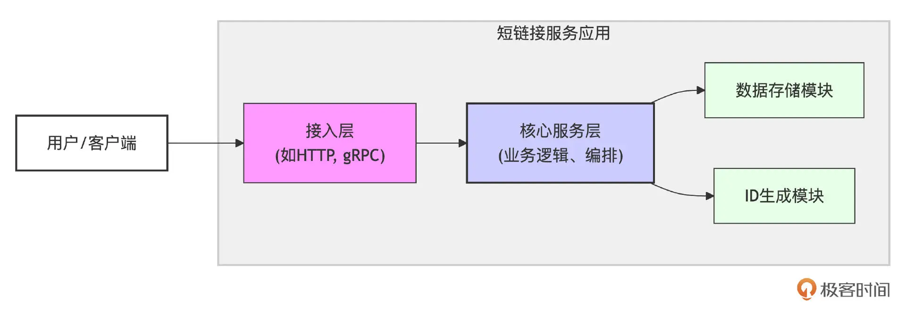
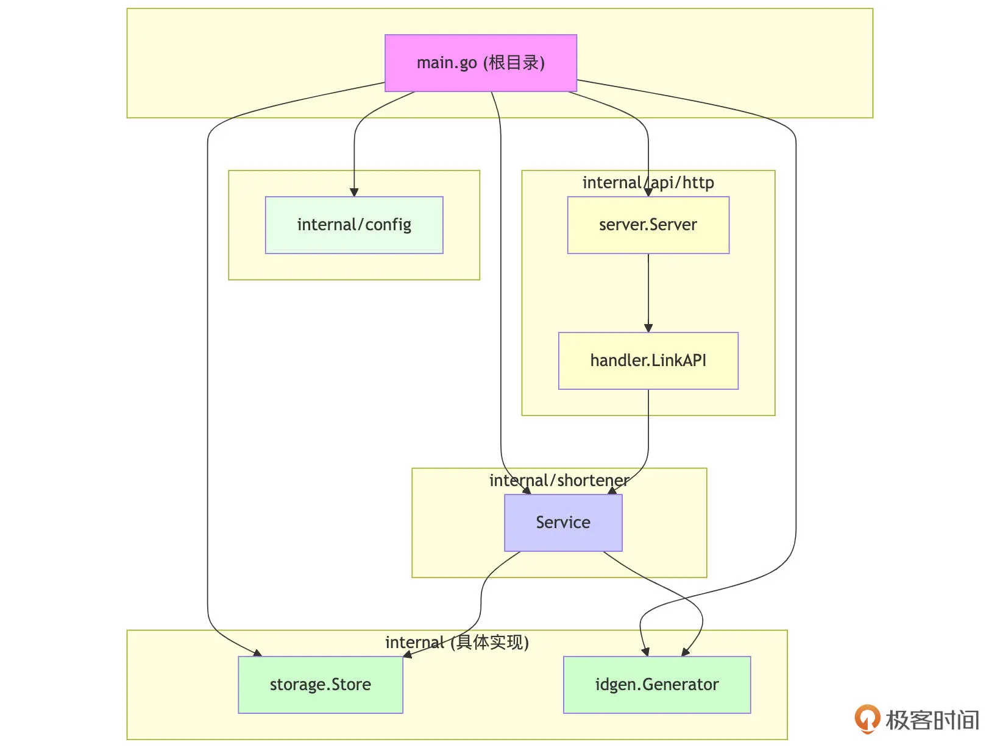
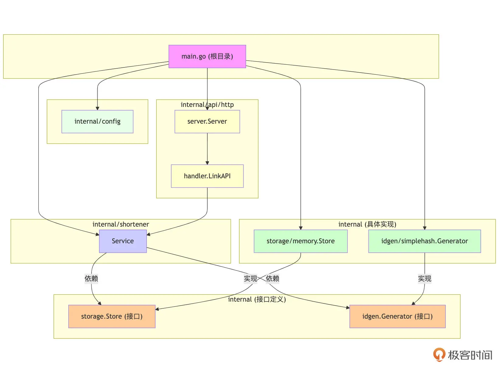

# 20-实战串讲（设计篇）：设计高内聚低耦合的“短链接服务”(上)

你好，我是 Tony Bai！欢迎来到我们设计先行模块的第一次实战串讲。

在前面的几节课（第 14～19 节）中，我们系统地学习了 Go 项目的设计原则，涵盖了项目布局、包设计、并发模型选择、接口设计、错误处理策略以及 Go 包 API 设计规范。理论知识我们已经掌握了不少，但设计能力的提升，最终还是要落到实践中去。

很多时候，我们拿到一个需求，最容易产生的冲动就是“撸起袖子就是干”，直接开始编写代码。但没有经过深思熟虑的设计，往往会导致项目后期举步维艰：代码耦合严重、难以测试、不易扩展、维护成本高昂，甚至需要推倒重来。

接下来的两节课，我们将通过一个具体的案例——“短链接服务”，来完整地走一遍设计的流程。目的不是要实现一个功能完备、性能极致的系统，而是要演示如何将前面学到的设计原则应用到实际问题中，让你看到理论是如何指导实践的，并体会设计决策背后的思考过程。

在这节课中，我们将重点关注：

1. 需求解读：明确我们要构建什么。

2. 架构草图与分层思想：勾勒系统的核心组件。

3. 核心功能模块的识别与初步职责定义：从需求和架构出发，识别出关键的逻辑单元并初步映射到包。

4. 项目结构规划（第一版）：将逻辑模块映射到初步的物理目录划分。

5. 核心包的具体实现与接口的“发现”：实践高内聚、低耦合原则，并演示接口是如何从具体需求中“自然涌现”的，同时展示引入接口后的结构演变。

通过这节课，你将看到一个简单的想法是如何逐步转化为一个结构清晰、职责分明的设计蓝图的。

## 需求解读与技术选型考量

任何软件设计的起点都是理解并明确需求。只有搞清楚了我们要解决什么问题，为谁解决，才能为后续的架构和技术选型奠定坚实的基础。

我们的目标是设计一个 “短链接服务”（Short Link Service）。它的核心功能很简单，首先是生成短链接（Create Short Link）：接收一个原始的长 URL，生成一个唯一的、较短的标识码

```
（比如 aBcDeF），并将长 URL 与短码的映射关系存储起来。返回生成的短码。然后是获取长
```

链接（Get Long URL）：接收一个短码，查找对应的原始长 URL 并返回。

为了让设计更完整一些，我们再考虑一个常见的扩展需求，也就是点击统计（Analytics - 轻量）：记录每个短链接被访问的次数（我们暂时不设计复杂的统计后台，只考虑记录次数）。

非功能性需求（简单考虑）：

```
性能：短链接的查找（GetLongURL）需要非常快。
```

- 可扩展性：系统未来可能需要支持更多的链接，存储和处理能力需要能水平扩展（设计阶段重点是逻辑结构）。

- 可靠性：服务需要稳定可靠。

技术选型（初步设想，聚焦内部逻辑）：

- 短码生成:

- 初步想法：我们可以先尝试一种简单的策略，比如对长 URL 进行哈希，然后截取一部分作为短码。

- 未来考量：这种简单哈希可能会有冲突，也可能不够“短”或不够“友好”。未来我们可能需要更复杂的策略，如自增 ID 转特定进制、专门的发号器服务，或者需要处理自定义短码的需求。这种“未来可能变化”的意识是关键。

- 数据存储:

- 初步想法：为了快速原型开发和测试，我们可以先考虑将短链接映射关系存储在内存中。

- 未来考量：内存存储在服务重启后会丢失数据，不适用于生产。生产环境通常需要持久化存储，如关系型数据库（MySQL、PostgreSQL）、NoSQL 数据库（Redis、Cassandra）或分布式键值存储。我们还需要考虑数据备份、扩展性和查询性能。这里也存在“未来可能替换或有多种实现”的情况。

- 对外暴露的核心能力：根据我们定义的核心功能，这个“短链接服务”至少需要对外提供以下几种核心能力，以便用户或其他系统能够与之交互：

- 创建短链接的能力：用户需要一种方式提交一个长 URL，并获取到一个对应的短码。

- 通过短码访问长链接的能力：用户或其浏览器需要能通过短码请求服务，并被引导（通常是重定向）到原始的长 URL。

- （可选）获取短链接统计信息的能力：如果我们实现了点击统计，可能还需要一种方式（也许是内部或管理员接口）来查询某个短链接的访问次数。

这些能力是服务必须提供的功能性入口点。至于这些入口点最终是以 HTTP API 的形式（比如

```
POST /links 和 GET /{short_code}）、gRPC 服务接口，还是作为一个 Go 库直接被其
```

他 Go 程序调用的函数 / 方法来实现，这是我们后续在详细设计 API 和传输层时需要具体化的技术决策。在当前需求分析阶段，我们重点是识别出这些必须对外提供的核心服务能力。

明确了需求和初步的技术方向后，我们需要从一个更高的视角来审视整个系统，勾勒出它的核心组成部分以及它们之间大致的协作关系。这就是架构设计的初步草图，它能帮助我们建立对系统全局的认知。

## 架构草图与分层思想

根据需求，我们可以初步勾勒出系统的核心逻辑分层和它们之间的交互关系：



如图所示，整个“短链接服务应用”分为 4 个核心模块。

1. 接入层：负责处理具体的协议（如 HTTP）和外部世界的通信。

2. 核心服务层（核心业务逻辑）：封装了短链接服务的核心业务规则。

3. 数据存储模块：负责短链接映射和统计数据的持久化。

4. ID 生成模块：负责生成唯一的短码。

这种分层结构使得每一层都可以专注于自己的核心职责。有了高层的架构设想，接下来就需要将这些抽象的“层”和“模块”具体化。首先，我们要识别出构成“短链接服务”应用核心的关键功能单元，并初步为它们划定职责范围，这直接关系到后续代码的组织和包的设计。

## 核心功能模块识别与初步的包设计考量

在明确了高层架构和分层思想后，我们可以进一步识别出实现“短链接服务”所需的核心功能模块，并为它们初步定义职责。这个阶段，我们不仅在逻辑层面思考，也开始将这些逻辑单元初步映射到 Go 的包（package）结构上，思考如何组织这些包以实现高内聚。

```
短码生成模块 -> idgen 包:
```

- a. 核心职责：负责根据输入（如长 URL），生成一个符合要求的、唯一的短码。所有与短码生成算法、策略、唯一性保证相关的逻辑都应内聚在此。

```
b. 初步包考量：我们可以创建一个 idgen 包来封装所有 ID 生成相关的逻辑。初期，这个
```

- 包内将直接包含我们选择的第一种具体实现（例如，基于简单哈希的生成器）。将所有 ID生成相关的代码放在一个包内，符合高内聚原则。

```
数据存储模块 -> storage 包:
```

- a. 核心职责：持久化短码与长 URL 的映射关系，以及相关的元数据（如访问计数、创建时间）。提供统一的数据保存、查找和更新接口。所有与数据存取、数据库交互（或内存模拟）相关的逻辑都应内聚在此。

```
b. 初步包考量：创建一个 storage 包来封装所有数据持久化逻辑。初期，这个包内将直接
```

- 包含我们选择的第一个具体实现（例如，基于内存的存储），将所有存储相关代码放在一起，职责清晰。

```
业务编排服务模块 -> shortener 包:
a. 核心职责：作为核心业务逻辑的封装者和协调者。它将使用 idgen 包的功能来创建短
码，并使用 storage 包的功能来保存和检索链接信息。它还负责处理核心业务规则，如输
```

- 入校验、冲突处理逻辑（如果 ID 生成与存储有冲突）、访问统计的触发等。

```
b. 初步包考量：创建一个 shortener 包，它是连接其他底层模块（如 idgen、
storage）并实现核心业务流程的地方。这个包的内聚性体现在它专注于“短链接服务”本身
```

- 的核心业务，而不关心 ID 具体怎么生成、数据具体怎么存储。

```
配置管理模块 -> config 包:
```

- a. 核心职责：负责加载和管理应用程序的配置信息（如服务器端口、日志级别、数据库连接字符串等）。

```
b. 初步包考量：这是一个相对独立且通用的功能，适合放在一个专门的 config 包中。
外部交互模块 -> api 包:
```

- a. 核心职责：处理与外部世界的交互，如接收 HTTP 请求、解析参数、调用业务编排服务、返回响应。

```
b. 初步包考量：我们将创建一个 api 包，并在其下根据具体协议创建子包，如
api/http。它将依赖 shortener 包。此外，万一未来真的需要支持 gRPC 或其他某种
```

- IPC 机制，有一个 api 目录作为统一的入口点，组织结构会更清晰。例如，可以添加api/grpc。

通过这样的初步识别和包设计考量，我们已经有了一组逻辑上相对独立且职责明确的候选包。这些包的划分遵循了高内聚的原则——每个包都聚焦于一个特定的功能领域。

将逻辑模块映射到具体的 Go 包之后，我们还需要为这些包在文件系统中找到一个合适的“家”。这就是项目结构规划的任务，它要确保我们的代码库既符合 Go 的组织习惯，又能清晰地反映我们对模块和职责的划分。

## 项目结构规划（第一版——映射已识别的包）

基于上述识别出的核心功能模块及其对应的包，并结合我们在第 14 节学习到的项目布局知识，可以规划出项目的第一版项目目录结构如下：

```
demo1/shortlink/
├── go.mod               # Go 模块文件
├── internal/            # 内部代码，项目核心逻辑所在地
│   ├── api/
│   │   └── http/
│   │       ├── handler/
│   │       │   └── handler.go
│   │       └── server/
│   │           └── server.go
│   ├── config/             # 配置管理包
│   │   └── config.go
│   ├── idgen/             # 短码生成包 (初期直接包含简单哈希实现)
│   │   └── simple_hash_generator.go
│   ├── shortener/       # 业务编排服务包
│   │   └── service.go
│   └── storage/         # 数据存储包 (初期直接包含内存实现)
│       └── memory_store.go
└── main.go              # 应用主入口
```

设计决策说明：

```
main.go：放在根目录，作为应用的启动入口，负责初始化依赖并将它们组装起来。此外
由于短链接服务就一个可执行程序，我们没有必要建立一个 cmd/ 目录。
/internal/：所有核心的功能包都放在这里，因为它们是特定于这个短链接服务的。
config/: 实现配置加载逻辑。
shortener/：这是我们的核心业务逻辑层。service.go 将定义 Service 类型，它
会直接依赖于我们接下来要具体实现的 idgen/simplehash 和 storage/memory 包
```

- 中的类型。

```
storage/：这是“数据存储模块”的统一入口包。初期，我们将在
storage/memory_store.go 文件中直接定义和实现基于内存的存储逻辑，例如
memory.Store 类型及其方法。此时，storage 包本身就提供了第一个具体的存储实
```

- 现。

```
idgen/：这是“短码生成模块”的统一入口包。初期，我们将在
idgen/simple_hash_generator.go文件中直接定义和实现基于简单哈希的 ID 生成
器逻辑，例如 idgen.Generator 类型及其方法。idgen 包本身就提供了第一个具体
```

- 的生成器实现。

```
api/http/：实现 HTTP API 的 Server 和 Handler，它将依赖
shortener.Service。
这个结构将我们识别出的逻辑模块映射到了具体的包路径。storage 和 idgen 包内部直接
```

包含了它们的第一个具体实现。

项目结构和初步的包划分已经完成，现在是时候深入到每个核心包内部，开始编写具体的实现代码了。正是在这个从抽象到具体，再从具体反思抽象的过程中，接口的真正价值和必要性才会逐渐显现出来。

## 核心包的具体实现与接口的“发现”

现在，我们开始在规划好的包目录下编写核心功能模块的具体实现。在这个过程中，我们将分析它们之间的依赖关系，并根据可替换性、可测试性和关注点分离等原则，自然地“发现”并提取出接口。

```
首先是idgen 包——短码生成机制（具体实现）。
```

- 职责：负责生成唯一的短码，使用一种简单的哈希策略。

- 内聚性：包内所有代码都围绕“简单哈希生成短码”这一核心功能。

```go
对外 API（初期）：idgen.NewGenerator() 构造函数和 (*Generator)
GenerateShortCode(...) 方法。
// ch20/demo1/shortlink/internal/idgen/simple_hash_generator.go
... ...
const defaultCodeLength = 7
type Generator struct {
}
func NewGenerator() *Generator {
   rand.Seed(time.Now().UnixNano())
   return &Generator{}
}
func (g *Generator) GenerateShortCode(ctx context.Context, longURL string) (strin
   if longURL == "" {
       return "", errors.New("idgen: longURL cannot be empty for code generation
   }
   hasher := sha256.New()
   hasher.Write([]byte(longURL))
   hasher.Write([]byte(time.Now().Format(time.RFC3339Nano)))
   hasher.Write([]byte(fmt.Sprintf("%d", rand.Int63())))
   hashBytes := hasher.Sum(nil)
   encoded := base64.URLEncoding.EncodeToString(hashBytes)
   if len(encoded) < defaultCodeLength {
       return encoded, nil
   }
   return encoded[:defaultCodeLength], nil
}
然后是storage 包——数据持久化机制（具体实现）。
```

- 职责：负责短链接映射和访问计数的持久化。

- 内聚性：所有代码都围绕“内存存储短链接数据”这一功能。

```go
对外 API（初期）：storage.NewStore() 构造函数和 (*Store) Save(...)、
(*Store) FindByShortCode(...)、(*Store) IncrementVisitCount(...) 等
方法。Link 类型暂时也定义在此包内。
// ch20/demo1/shortlink/internal/storage/memory_store.go
package storage
import (
   "context"
   "errors"
   "sync"
   "time"
)
type Link struct {
   ShortCode  string
   LongURL    string
   VisitCount int64
   CreatedAt  time.Time
}
var ErrNotFound = errors.New("storage: link not found")
var ErrShortCodeExists = errors.New("storage: short code already exists")
// 初期，这个 Store 就是我们的内存存储具体实现
type Store struct {
   mu    sync.RWMutex
   links map[string]Link
}
func NewStore() *Store { // 构造函数返回具体类型
   return &Store{links: make(map[string]Link)}
}
func (s *Store) Save(ctx context.Context, link Link) error { /* ... */ return nil
func (s *Store) FindByShortCode(ctx context.Context, shortCode string) (*Link, er
func (s *Store) IncrementVisitCount(ctx context.Context, shortCode string) error
func (s *Store) Close() error { return nil }
思考点：Link 类型现在是 storage 包的。如果 shortener.Service 要操作 Link，就
需要导入 storage 包并使用 storage.Link。这会产生一个从业务核心到具体存储实现的
```

依赖，不太理想。这是后续接口抽象要解决的问题之一。

```
接着来看 shortener 包——核心业务逻辑（Service 层，依赖具体实现）。
职责：实现创建短链接、获取长链接等核心业务流程，编排对 idgen.Generator 和
storage.Store 的调用。
```

- 内聚性：聚焦核心短链接业务逻辑。

```
对外 API（初期）：shortener.NewService(...) 构造函数和 (*Service)
CreateShortLink(...)、(*Service) GetAndTrackLongURL(...) 方法。
```

- SOLID 原则初步体现:

```
SRP（单一职责）：shortener 包专注于业务编排，将 ID 生成和存储的具体实现委托
```

- 给其他包。

```
DIP（依赖倒置原则）——尚未完全体现：目前 shortener.Service 直接依赖具体实
现类型 *idgen.Generator 和 *storage.Store。这在初期可以接受，但不利于扩
```

- 展和测试。我们将在下一阶段通过引入接口来改进这一点。

```go
// ch20/demo1/shortlink/internal/shortener/service.go
... ...
// Config for Service, allowing dependencies to be passed in.
type Config struct {
   Store          *storage.Store   // Concrete type for demo1
   Generator      *idgen.Generator // Concrete type for demo1
   MaxGenAttempts int
}
type Service struct {
   store          *storage.Store
   generator      *idgen.Generator
   maxGenAttempts int
}
func NewService(cfg Config) *Service { // Removed error return for simplicity in
   if cfg.Store == nil || cfg.Generator == nil {
       log.Fatalln("Store and Generator must not be nil for Shortener Service")
   }
   if cfg.MaxGenAttempts <= 0 {
       cfg.MaxGenAttempts = 3
   }
   return &Service{
       store:          cfg.Store,
       generator:      cfg.Generator,
       maxGenAttempts: cfg.MaxGenAttempts,
   }
}
func (s *Service) CreateShortLink(ctx context.Context, longURL string) (string, e
   if longURL == "" {
       return "", fmt.Errorf("%w: longURL cannot be empty", ErrInvalidInput)
   }
   var shortCode string
   for attempt := 0; attempt < s.maxGenAttempts; attempt++ {
       log.Printf("DEBUG: Attempting to generate short code, attempt %d, longURL
       code, genErr := s.generator.GenerateShortCode(ctx, longURL)
       if genErr != nil {
           return "", fmt.Errorf("attempt %d: failed to generate short code: %w"
       }
       shortCode = code
       linkToSave := storage.Link{
           ShortCode: shortCode,
           LongURL:   longURL,
           CreatedAt: time.Now().UTC(),
       }
       saveErr := s.store.Save(ctx, linkToSave)
       if saveErr == nil {
           log.Printf("INFO: Successfully created short link. ShortCode: %s, Lon
           return shortCode, nil
       }
       if errors.Is(saveErr, storage.ErrShortCodeExists) && attempt < s.maxGenAt
           log.Printf("WARN: Short code collision, retrying. Code: %s, Attempt:
           continue
       }
       log.Printf("ERROR: Failed to save link. LongURL: %s, ShortCode: %s, Attem
       return "", fmt.Errorf("%w: after %d attempts for input %s: %w", ErrConfli
   }
   return "", ErrServiceInternal
}
func (s *Service) GetAndTrackLongURL(ctx context.Context, shortCode string) (stri
   if shortCode == "" {
       return "", fmt.Errorf("%w: short code cannot be empty", ErrInvalidInput)
   }
   link, findErr := s.store.FindByShortCode(ctx, shortCode)
   if findErr != nil {
       if errors.Is(findErr, storage.ErrNotFound) {
           log.Printf("WARN: Short code not found. ShortCode: %s\n", shortCode)
           return "", fmt.Errorf("short link for code '%s' not found: %w", short
       }
       log.Printf("ERROR: Failed to find link by short code. ShortCode: %s, Erro
       return "", fmt.Errorf("failed to find link for code '%s': %w", shortCode,
   }
   go func(sc string, currentCount int64) {
       bgCtx := context.Background()
       if err := s.store.IncrementVisitCount(bgCtx, sc); err != nil {
           log.Printf("ERROR: Failed to increment visit count (async). ShortCode
       } else {
           log.Printf("DEBUG: Incremented visit count (async). ShortCode: %s, Ne
       }
   }(shortCode, link.VisitCount)
   log.Printf("INFO: Redirecting to long URL. ShortCode: %s, LongURL: %s\n", sho
   return link.LongURL, nil
}
```

internal/api/http 下的 server 和 handler 则是常规的 http server（封装路由）以及请求的处理器，这里就不贴代码了。最后补充一下 main.go 对各个包和服务的组装环节：

```go
// ch20/demo1/shortlink/main.go
package main
import (
   "context"
   "errors"
   "log"
   "net/http"
   "os"
   "os/signal"
   "syscall"
   "time"
   "github.com/your_org/shortlink/internal/api/http/server"
   "github.com/your_org/shortlink/internal/config"
   "github.com/your_org/shortlink/internal/idgen"
   "github.com/your_org/shortlink/internal/shortener"
   "github.com/your_org/shortlink/internal/storage"
)
func main() {
   // 1. 简化配置处理 (硬编码)
   c, _ := config.LoadConfig()
   // 2. 使用标准库 log
   log.SetFlags(log.LstdFlags | log.Lshortfile)
   log.Println("Starting shortlink service", "version", "shortlink-demo1")
   // 3. 初始化依赖 (具体类型)
   storeImpl := storage.NewStore()
   defer func() {
       if err := storeImpl.Close(); err != nil {
           log.Printf("Error closing store: %v\n", err)
       }
   }()
   idGenImpl := idgen.NewGenerator()
   // 假设 NewService 接受具体类型，并且可能返回错误（如果依赖为nil）
   // shortenerService, err := shortener.NewService(storeImpl, idGenImpl) // 如果
   shortenerService := shortener.NewService(shortener.Config{
       Store:          storeImpl,
       Generator:      idGenImpl,
       MaxGenAttempts: 3}) // 使用Config结构
   if shortenerService == nil {
       log.Fatalln("Failed to create shortener service due to nil dependencies")
   }
   // 4. 创建并启动 HTTP 服务器 (由 api/http/server.go 负责)
   httpServer := server.New(c.Server.Port, shortenerService) // 将 service 注入
   go func() {
       log.Printf("HTTP server starting on :%s\n", c.Server.Port)
       if err := httpServer.Start(); err != nil && !errors.Is(err, http.ErrServe
           log.Fatalf("HTTP server ListenAndServe error: %v\n", err)
       }
   }()
   // 5. 优雅退出
   ... ...
}
```

第一版设计后的包依赖层次图（依赖具体实现）：



从图中我们看到：

```
main.go：作为应用的入口，负责创建和组装所有核心组件。它直接创建了 config、
shortener.Service（并将具体的 storage.Store 和 idgen.Generator 实例注入
其中），以及 api/http/server.Server 的实例。
api/http/server.Server：负责 HTTP 服务器的启动和路由注册。它会创建一个
api/http/handler.LinkAPI 的实例。
api/http/handler.LinkAPI：包含具体的 HTTP 请求处理逻辑。它依赖于
shortener.Service 来执行业务操作。
shortener.Service：核心业务逻辑层。在第一版设计中，它直接依赖于
internal/storage.Store（此时是内存存储的具体类型）和
internal/idgen.Generator（此时是简单哈希生成的具体类型）。
internal/storage.Store 和 internal/idgen.Generator：在此版本中，它们是
```

- 各自功能域下的具体实现类型。

这个阶段，我们的设计优先考虑了功能的快速实现，包之间的依赖是具体的。这为我们接下来的“发现”接口过程奠定了基础。更多关于第一版的代码，请访问本专栏代码仓库并下载查看。

```
至此，我们的 shortener.Service 直接依赖了 storage.Store 和 idgen.Generator
```

的具体实现。这在项目初期为了快速验证功能是可行的。但随着思考的深入，我们会发现几个关键问题（正如我们第 17 讲讨论接口设计时提到的），这些问题将自然地引导我们“发现”接口的必要性。

首先是可替换性与扩展性。

```
我们的“技术选型考量”中已经预见到，simplehash 可能不是最终的 ID 生成方案，
memory.Store 也肯定不是生产环境的存储方案。如果未来我们要引入基于数据库的存储
（PostgresStore），或者一种基于雪花算法的 ID 生成器（SnowflakeGenerator），那
么 shortener.Service 将被迫修改其字段类型（store、generator）和构造函数
NewService 的参数类型。每次增加新的实现或替换旧的实现，都需要改动核心业务逻辑代
码，这显然违反了开放 - 关闭原则。我们希望 shortener.Service 的核心逻辑能够稳定，
```

不随具体依赖的实现变化而变化。

其次是关注点分离与依赖倒置。

```
shortener.Service 的核心职责是编排业务流程。它不应该强耦合于 ID 是如何生成的（哈
```

希还是发号器？），或者数据是存在内存里还是数据库里。它应该只关心它所依赖的组件能提供哪些行为契约。例如，它需要一个“能生成短码的东西”和一个“能保存和查找链接的东西”。这种对“东西”能力的抽象，正是接口的用武之地，也是依赖倒置原则的体现——高层模块（shortener.Service）不应依赖底层模块（具体实现），两者都应依赖抽象（接口）。

最后是可测试性（作为上述好处的自然结果）。

```
一旦 shortener.Service 依赖于抽象接口，而不是具体实现，那么在对
shortener.Service 进行单元测试时，我们就可以轻松地传入这些接口的测试替身（Test
Doubles），如 Fake objects 或 Mocks。这样就能隔离测试 Service 本身的业务逻辑，而不
```

受真实存储或 ID 生成器的复杂性和不确定性（如网络、磁盘 I/O、随机性）的影响。

```
基于这些更贴近实际设计演进的理由，我们决定引入接口。shortener.Service 作为消费
```

者，它定义了它对依赖组件的行为期望。

引入接口后的项目结构规划（第二版 - 带接口定义）如下所示。注意，这里只展示结构变化，具体接口定义下一节课会讲。

```
└── demo2/shortlink/
   ├── go.mod
   ├── internal/
   │   ├── api/
   │   │   └── http/
   │   │       ├── handler/
   │   │       │   └── handler.go
   │   │       └── server/
   │   │           └── server.go
   │   ├── config/
   │   │   └── config.go
   │   ├── idgen/
   │   │   ├── interface.go  # <--- 新增接口定义文件
   │   │   └── simplehash/   # 基于简单哈希的具体实现
   │   │       └── generator.go
   │   ├── shortener/
   │   │   └── service.go
   │   └── storage/
   │       ├── interface.go  # <--- 新增接口定义文件
   │       └── memory/       # 内存存储的具体实现
   │           └── memory.go
   └── main.go
我们为 storage 和 idgen 包分别增加了 interface.go 文件，用于定义它们对外暴露的
抽象接口。storage.Link 结构体现在也定义在 storage/interface.go 中，作为接口
契约的一部分。具体的实现包（如 memory 和 simplehash）将去实现这些接口，并使用通
用的 storage.Link。
```

引入接口后的包依赖层次图如下（概念性）：



```
在第二版设计中，main 仍然负责创建具体实现，但现在它将这些实现（它们满足接口）注入
到 shortener.Service。Service 层现在依赖于 storage.Store 和
idgen.Generator 接口（暂定的接口名），实现了与具体实现的解耦。
```

通过这个演化过程可以知道，我们不是一开始就“发明”接口，而是在编写了具体实现并分析其

```
局限性后，从消费者的需求（shortener.Service 的需求）出发，“发现”并提取出了必要
```

的接口抽象。这种方式创建的接口通常更实用、更聚焦，也更符合 Go 语言的设计哲学。具体的接口方法签名和更细致的 API 设计，将是我们下节课的重点。

## 小结

在这节课中，我们通过“短链接服务”这个具体案例，迈出了从需求到初步设计蓝图的关键一步，重点体验了设计的演进过程。

1. 需求解读与技术选型考量：我们明确了服务的核心功能和初步的技术思考方向，并对未来可能的变化点（如短码生成策略、数据存储方式）保持了开放性。

2. 架构草图与分层思想：我们勾勒了应用的核心逻辑分层（接入层、核心服务层、数据存储、ID 生成），为后续的模块划分和职责定义奠定了基础。

```
核心功能模块识别与包设计考量：我们将逻辑功能映射到初步的 Go 包（如 shortener、
storage、idgen、config、api/http），并强调了在包设计初期就应考虑高内聚原
```

- 则。

4. 项目结构规划（第一版）：我们基于识别出的包，规划了第一版的物理目录结构，此时

```
main.go 位于根目录，核心业务逻辑在 /internal 下，并且 shortener.Service 直
```

- 接依赖具体实现的存储和 ID 生成包。

5. 核心包的具体实现与接口的“发现”：我们编写了这些核心包的初步具体实现。然后，通过分析直接依赖具体实现所带来的问题（如可替换性差、可测试性差、违反开放 - 关闭原则和依赖倒置原则），我们演示了接口是如何从这些实际的设计痛点中“自然涌现”的。最后，我们

```
展示了引入接口定义（在各自功能域的根包下，如 storage/interface.go）后，项目
```

- 结构和包依赖关系图的演变，实现了核心业务逻辑与具体实现的解耦。

这节课的核心在于理解设计是一个迭代和演进的过程。我们从具体的需求和初步实现出发，逐步识别出抽象的必要性，让接口成为解决耦合、提升灵活性的自然选择，而不是一开始就进行过度设计。这个过程为我们详细打磨这些 Go 包 API 和错误处理策略做了充分的铺垫。

```
下节课我们将重点详细设计和打磨在本节末尾引入的 storage.Store 和
idgen.Generator 接口，以及 shortener.Service 自身对外暴露的 Go API。应用第 19
```

讲的 Go 包 API 设计五要素，让它们更易用、安全、兼容、高效和符合 Go 惯例。同时，细化错误处理策略，定义业务错误类型，并规划错误在各层之间的传递与包装，以及简单讨论核心流程中可能涉及的内部并发考量。

这第一部分的实战关键在于体会设计先行的重要性，以及如何将抽象的设计原则应用到具体的项目中，从需求一步步推导出清晰的模块和接口。

## 思考题

```
在我们的第一版设计中，shortener.Service 直接依赖了 storage.Store 和
idgen.Generator 的具体类型。在“发现接口的必要性”部分，我们论述了引入接口的好处，
```

如可替换性、可测试性和依赖倒置。

那从团队协作的角度来看，在项目初期（甚至在只有一个具体实现的情况下）就着手定义清晰

```
的接口（比如 storage.Store 和 idgen.Generator 接口），而不是等到多个实现出现时
```

再提取，可能会带来哪些额外的好处或便利？

欢迎在留言区分享你的想法！我是 Tony Bai，我们下节课将继续完善“短链接服务”的设计。
