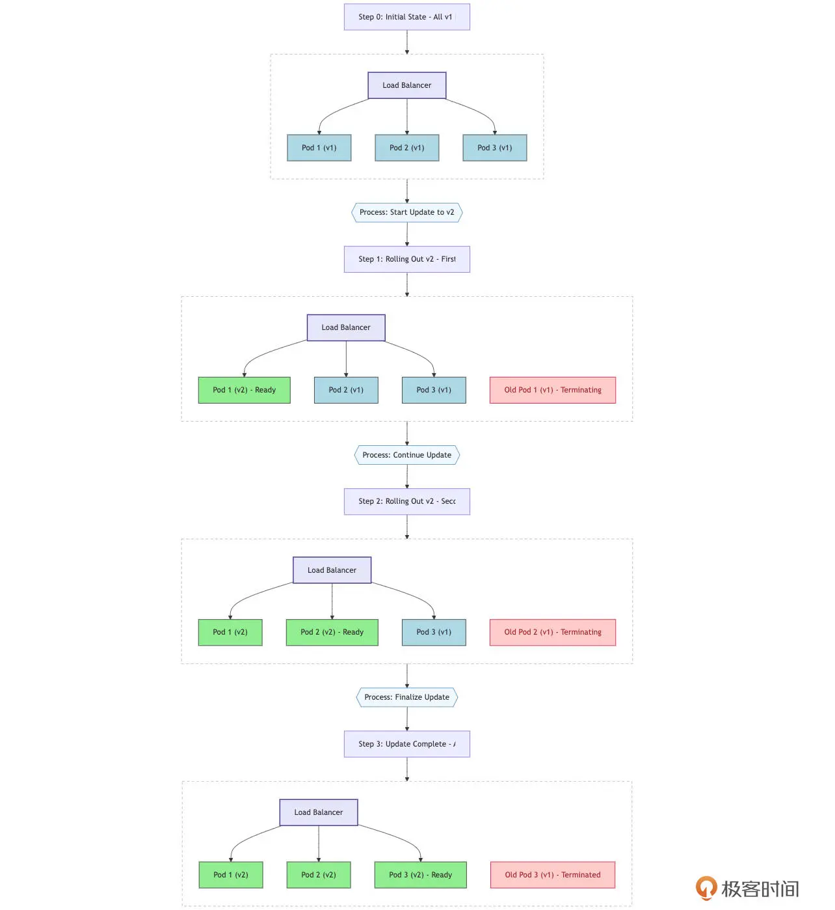
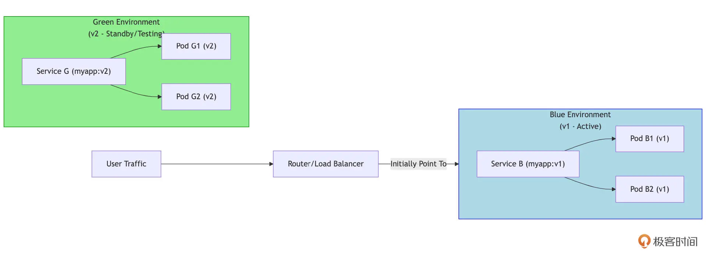
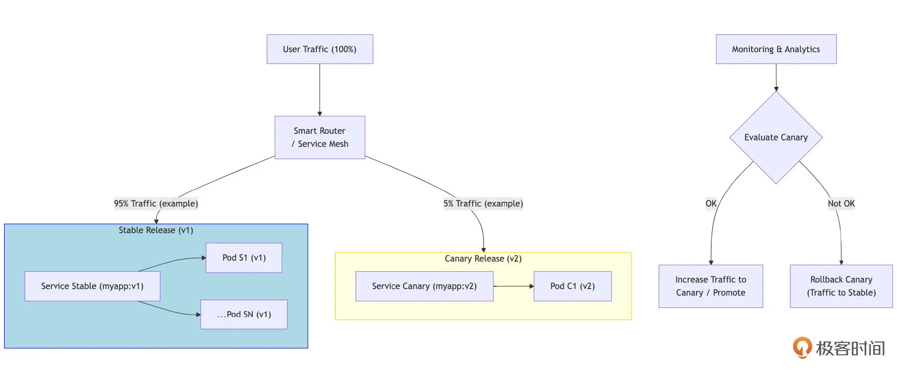

# 33-部署与升级：拥抱云原生，实现Go应用持续交付（下）

你好，我是 Tony Bai。

这节课，我们将一起入门 Kubernetes 的核心概念，并重点讨论在 K8s 中部署 Go 服务的典型模式，包括配置管理、健康检查和资源管理。最后，我们将深入剖析主流的平滑发布策略——滚动更新、蓝绿部署与金丝雀发布，理解它们的原理、优缺点，以及 Go 应用如何配合这些策略实现无缝升级。

这两节课学完，你将能够为你的 Go 应用插上云原生的翅膀，使其部署更简单、升级更平滑、运行更稳健。

## Kubernetes 部署：Go 服务在云原生时代的“标准舞台”

我们的 Go 应用已经容器化，并且在 Docker Compose 环境中能够与依赖服务协同工作了。但是，如何在生产环境中大规模地管理、伸缩、容错并自动化这些容器化应用呢？ 答案在当前的云原生时代几乎是唯一的，那就是 Kubernetes（K8s）。Kubernetes 已经成为容器编排领域的事实标准，它提供了一个健壮、可扩展、声明式的框架，用于自动化容器化应用的部署、扩展和管理。对于我们精心构建的 Go 服务来说，Kubernetes 正是那个能让它们在生产环境中大放异彩的“标准舞台”。

理解 Kubernetes 的核心概念，并掌握如何在其中部署和管理我们的 Go 服务，是 Go 工程师迈向云原生运维的关键一步。更重要的是，Kubernetes 提供的环境和能力，也为我们后续要讨论的平滑发布策略（如滚动更新、蓝绿部署、金丝雀发布）奠定了基础。没有 Kubernetes这样的编排平台，许多高级的发布和运维技术将难以实现。

### Kubernetes 核心概念入门

要理解 Kubernetes，就要从其核心概念开始。下面是 Kubernetes 这个平台的一些核心概念，我们逐一来看一下。

- Pod：K8s 中可以创建和管理的最小部署单元。一个 Pod 代表集群中一个运行的进程。它可以包含一个或多个紧密协作的容器，这些容器共享同一个网络命名空间、存储卷，并且可以在同一节点上被共同调度。

- Service（服务）：K8s Service 为一组逻辑上相关的 Pod 提供一个稳定的网络入口点。它会给这组 Pod 分配一个唯一的、虚拟的 IP 地址（ClusterIP）和一个 DNS 名称，集群内的其他应用可以通过这个 ClusterIP 或 DNS 名称来访问这些 Pod，Service 会自动进行负载均衡。

- Deployment（部署）：Deployment 是 K8s 中用于声明式地管理应用副本和更新的一种控制器。你可以在 Deployment 中定义期望的应用状态，Deployment 控制器会持续工作以确保集群的实际状态与期望状态一致。它支持滚动更新和回滚等发布策略。

- ReplicaSet（副本集）：ReplicaSet 确保在任何给定时间都有指定数量的 Pod 副本在运行。它通常不直接使用，而是由 Deployment 在内部创建和管理。

- Namespace（命名空间）：Namespace 用于在同一个物理集群内创建多个虚拟的、逻辑隔离的集群环境，可以用来隔离不同团队、项目或环境的资源。

- ConfigMap（配置映射）与 Secret（保密字典）：

- ConfigMap：用于存储应用的非敏感配置数据，并将其以环境变量、命令行参数或挂载卷的形式注入到 Pod 的容器中。

- Secret：专门用于存储敏感数据，如密码、API 密钥、TLS 证书等。

- Ingress（入口）：（可选）定义了从集群外部访问集群内部 Service 的规则，通常是 HTTP和 HTTPS 路由，需要 Ingress Controller 配合。

理解这些核心概念，是我们后续讨论如何在 K8s 中部署 Go 服务的基础。它们就像Kubernetes 这座复杂城市的“街道”、“建筑”和“基础设施”，为我们的 Go 应用容器提供了运行的场所和交互的规则。

熟悉了这些基本构件之后，我们自然会问：如何将这些概念组合起来，形成一套行之有效的方案，真正把我们的 Go 服务部署到 Kubernetes 集群中，并让它稳定、高效地运行起来呢？这就引出了我们在 K8s 中部署 Go 服务的典型模式。

### 在 Kubernetes 中部署 Go 服务的典型模式

在 Kubernetes 中部署一个 Go 服务（或其他任何类型的服务），通常不是简单地运行一个 Pod那么简单。为了实现高可用、可伸缩、易于管理和配置的目标，我们需要将前面介绍的多个核心概念（如 Deployment、Service、ConfigMap、Secret、Health Probes 等）有机地组合起来，形成一套标准的、可重复的部署模式。

掌握这种典型模式至关重要，因为它不仅是生产环境中部署 Go 服务的最佳实践，也是后续实现自动化运维、持续集成 / 持续交付（CI/CD）以及高级发布策略（如滚动更新、蓝绿部署）的基础。一个精心设计的部署模式，能够让你的 Go 服务在 Kubernetes 这个强大的平台上充分发挥其潜力，同时显著降低运维的复杂度和风险。

接下来，我们将通过编写 YAML 声明式配置文件的方式，来具体展示这个典型模式是如何构成的，以及 Go 应用自身需要如何配合。一个最小但能体现核心思想的生产级 Go 服务部署，通常至少会涉及 Deployment 和 Service 这两个关键的 Kubernetes 资源对象。

### 编写 Deployment YAML

Deployment 是 Kubernetes 中用于声明式地管理应用副本（Pod）和更新策略的核心对象。它确保了我们期望数量的 Go 应用实例始终在运行，并能在版本更新时进行平滑的滚动升级。

```
下面是一个部署简单 Go Web 服务的 myapp-deployment.yaml 文件示例：
# myapp-deployment.yaml
apiVersion: apps/v1 # 1. 指定API版本，apps/v1是当前稳定版本
kind: Deployment    # 2. 声明资源类型为Deployment
metadata:           # 3. 元数据，用于标识和组织资源
 name: my-go-app-deployment # Deployment的名称，在Namespace内唯一
 labels:                    # 标签，用于选择和组织资源
   app: my-go-app           # 例如，app=my-go-app 可以被Service用来选择此Deployment管
   version: v1.0.0          # 可以加上版本标签，便于管理
spec:                        # 4. 规格，定义Deployment的期望状态
 replicas: 3                # 期望运行3个Pod副本，K8s会努力维持这个数量
 selector:                  # 5. 选择器，定义此Deployment管理哪些Pod
   matchLabels:
     app: my-go-app       # 它必须与下面template.metadata.labels中的标签匹配
                          # (注意：通常版本标签不放在selector中，以便Service可以同时选择
 template:                  # 6. Pod模板，描述如何创建每个Pod实例
   metadata:
     labels:                # Pod自身的标签，必须包含selector中定义的标签
       app: my-go-app
       version: v1.0.0      # Pod也带上版本标签
   spec:                    # Pod的规格
     containers:            # 定义Pod中运行的容器列表（通常Go服务只有一个主容器）
     - name: my-go-app-container # 容器名称，在Pod内唯一
       image: your-registry/my-go-app:v1.0.0 # 7. 指定Go应用的Docker镜像及其版本标签
       imagePullPolicy: IfNotPresent # (可选) 镜像拉取策略，IfNotPresent表示如果本地已
       ports:
       - name: http         # (可选) 为端口命名，便于引用
         containerPort: 8080 # 8. 应用在容器内部监听的端口号
         protocol: TCP      # (可选) 默认为TCP
       # --- 9. 通过环境变量传递配置 ---
       env:
       - name: APP_DATABASE_URL # 环境变量名
         valueFrom:             # 值从其他地方获取
           secretKeyRef:        # 从一个Secret对象中获取
             name: db-credentials-secret # Secret对象的名称
             key: database_url         # Secret中对应的键 (key)
       - name: LOG_LEVEL
         valueFrom:
           configMapKeyRef:     # 从一个ConfigMap对象中获取
             name: app-configmap      # ConfigMap对象的名称
             key: log.level           # ConfigMap中对应的键
       # 也可以直接设置固定值的环境变量:
       # - name: GIN_MODE
       #   value: "release"
       # --- 10. 健康检查 (Health Probes) ---
       livenessProbe: # 存活探针：判断容器是否仍在运行且健康
         httpGet:     # 通过HTTP GET请求检查
           path: /healthz # Go应用需要提供这个HTTP端点
           port: 8080     # 对应containerPort
           scheme: HTTP   # (可选) 默认为HTTP
         initialDelaySeconds: 15 # 容器启动后15秒开始第一次探测
         periodSeconds: 20     # 每20秒探测一次
         timeoutSeconds: 5       # 探测超时时间 (默认1s)
         successThreshold: 1   # (可选) 连续1次成功即认为健康 (默认1)
         failureThreshold: 3   # 连续3次失败后认为不健康 (K8s会重启容器)
       readinessProbe: # 就绪探针：判断容器是否准备好接收流量
         httpGet:
           path: /readyz # Go应用需要提供这个HTTP端点
           port: 8080
         initialDelaySeconds: 5  # 容器启动后5秒开始探测
         periodSeconds: 10
         timeoutSeconds: 5
         failureThreshold: 3   # 连续3次失败后认为未就绪 (Service会将其从负载均衡中移除
       # startupProbe: (K8s 1.18+) # 启动探针，用于启动时间较长的应用 (可选)
       #   httpGet:
       #     path: /startupz
       #     port: 8080
       #   failureThreshold: 30 # 允许较多次失败，给足启动时间
       #   periodSeconds: 10    # 探测间隔
       # --- 11. 资源请求与限制 (Resource Requests and Limits) ---
       resources:
         requests: # Pod调度时，节点必须能满足这些最小资源请求
           memory: "64Mi"  # 请求64兆字节内存
           cpu: "100m"     # 请求0.1 CPU核心 (100 millicores)
         limits:   # 容器使用的资源不能超过这些硬性限制
           memory: "128Mi" # 内存上限128Mi
           cpu: "500m"     # CPU上限0.5核心
     # (可选) terminationGracePeriodSeconds: 30 # Pod停止时，给容器优雅退出的宽限时间
     # (可选) imagePullSecrets: # 如果镜像是私有的，需要指定拉取凭证
     # - name: my-registry-secret
```

下面，我们针对这份 Deployment 文件的几个关键点简单说明一下：

```
apiVersion 和 kind：标准 K8s 对象头，指明 API 版本和资源类型。
metadata：包含 name（Deployment 的唯一标识）和 labels（用于组织和选择）。
labels 非常重要，Service 会用它来找到这个 Deployment 管理的 Pod。
spec：定义了 Deployment 的期望状态。
replicas：期望运行的 Pod 副本数量。K8s 会自动维护这个数量，如果某个 Pod 挂了，
```

- 会自动创建一个新的。

```
selector：告诉 Deployment 它应该管理哪些 Pod。matchLabels 必须与下面
template.metadata.labels 中的标签一致。
template：这是 Pod 的模板，Deployment 会根据这个模板来创建新的 Pod。
image：指定你的 Go 应用打包好的 Docker 镜像地址和版本标签。
containerPort：声明容器内部应用监听的端口。这本身不暴露端口到外部，但 Service
```

- 会用到它。

```
env：通过环境变量向 Go 应用注入配置。这里演示了从 Secret（用于敏感数据如 DB
URL）和 ConfigMap（用于非敏感数据如日志级别）中获取值。Go 应用需要能从环境变
量中读取这些配置（例如，使用 os.Getenv() 或 Viper 等库的 AutomaticEnv() 功
```

- 能）。

10. Health Probes（健康检查）：这是让 Kubernetes 能够感知你的 Go 应用健康状况的关键机制。Deployment 中可以配置三种探针：

```
livenessProbe（存活探针）：用于判断容器是否“活着”。如果探测失败，Kubernetes
```

- 1.会重启容器。

```
readinessProbe（就绪探针）：用于判断容器是否“准备好”接收流量。如果探测失败，
```

- 2.Pod 的 IP 地址会从所有匹配的 Service 的端点列表中移除。

```
startupProbe（启动探针, K8s 1.18+）：（可选）用于那些启动过程可能比较耗时的应
```

- 3.用。在启动探针成功之前，存活探针和就绪探针不会开始。这可以防止应用因启动慢而被存活探针过早杀死。

这些探针可以通过 HTTP GET、TCP Socket 连接或在容器内执行命令等方式进行。对于 GoWeb 服务，HTTP GET 是最常用的方式。Go 应用自身需要如何实现这些探针端点，我们稍后会详细讨论。

```
resources（资源请求与限制）：
requests：Pod 在被调度到某个 Node 上时，Node 必须拥有足够的可用资源来满足这
```

- 1.些请求。它也影响 Pod 的服务质量等级（QoS）。

```
limits：容器可以使用的资源硬上限。如果内存使用超过 limit，容器可能会被
```

- 2.OOMKilled；如果 CPU 使用时长超过 limit，可能会被节流。为 Go 应用设置合理的资源请求和限制非常重要，以保证集群的稳定性和资源的有效利用。

### Go 应用如何配合 Deployment 的定义

为了让我们的 Go 应用能够良好地在上述 Deployment 的管理下运行，应用本身需要做一些适配。

首先是读取配置。Go 应用需要能够从环境变量中读取配置（如使用标准库的

```
os.Getenv()，或者像 spf13/viper 这样的库可以通过 AutomaticEnv() 功能自动绑定
```

环境变量）。如果 Deployment 中配置是通过文件卷（Volume Mounts fromConfigMap/Secret）挂载的，那么 Go 应用就需要从指定的挂载路径读取这些配置文件。

其次是实现健康检查端点。这是至关重要的一环，直接关系到应用在 Kubernetes 中的稳定性

```
和可用性。Go 应用（通常是 Web 服务）需要实现 Deployment 中 livenessProbe、
readinessProbe（以及可能的 startupProbe）通过 httpGet 指定的 HTTP 路径和端
```

口。

```
/healthz (Liveness Probe 端点实现)：这个端点的实现逻辑应该非常简单和轻量。它的
```

- 核心目标是确认应用进程本身是否还在运行，并且其内部核心循环（例如 HTTP 服务器的监听循环）没有僵死。存活探针不应该检查外部依赖（如数据库连接状态、下游服务是否可达等）的健康状况。如果仅仅因为一个外部依赖暂时抖动或不可用，就导致 Kubernetes 重启你的应用容器，这往往是不必要的，甚至可能加剧问题（例如，所有实例同时重启去冲击

```
一个本已不堪重负的数据库）。一个好的存活探针可能仅仅是简单地返回 http.StatusOK
```

- （状态码 200）。如果应用内部有可以快速检测到的致命的、不可恢复的内部错误状态，也可以在此反映。

```
// 示例：Go应用中简单的Liveness Probe Handler
// http.HandleFunc("/healthz", func(w http.ResponseWriter, r *http.Request) {
//  w.WriteHeader(http.StatusOK)
//  fmt.Fprintln(w, "ok")
// })
/readyz (Readiness Probe 端点实现)：就绪探针的逻辑应该比存活探针更全面和严格。
```

- 它的目标是告诉 Kubernetes，当前这个 Pod 实例是否真正准备好处理生产流量。应用在

```
完成所有关键的初始化工作之前，不应该让 /readyz 返回成功。这些初始化工作可能包
```

- 括：

- 成功连接到所有必需的数据库和缓存服务。

- 加载完必要的配置和数据到内存中。

- 所有内部的核心模块和 goroutine 已正常启动并准备就绪。

- 依赖的关键下游服务（如果这些服务的不可用会导致本服务也无法正常提供核心功能）

```
初步可达。一旦 /readyz 返回成功（通常是 http.StatusOK），Kubernetes 就会认
```

- 为这个 Pod 实例已经就绪，并会将其加入到对应 Service 的负载均衡池中，开始接收流量。在应用运行期间，如果检测到自身某个关键的、使其无法正常提供核心服务的状态

```
（例如，与主数据库的连接断开且无法恢复，或者某个核心内部组件故障），/readyz
应该开始返回失败状态码（如 http.StatusServiceUnavailable (503)）。这样，
```

- Kubernetes 就能将其从负载均衡中暂时移除，避免将新的用户请求导入到这个有问题的实例，直到它恢复正常。

```go
// 示例：Go应用中稍复杂的Readiness Probe Handler (概念性)
// var isAppReady bool // 由应用初始化逻辑和状态监控更新
// var readinessMux sync.RWMutex // 保护isAppReady的并发访问
//
// func setReadyStatus(ready bool) {
//  readinessMux.Lock()
//  isAppReady = ready
//  readinessMux.Unlock()
// }
//
// func readinessHandler(w http.ResponseWriter, r *http.Request) {
//  readinessMux.RLock()
//  currentReadyStatus := isAppReady
//  readinessMux.RUnlock()
//
//  if currentReadyStatus /* && checkCriticalDependencies() */ {
//      w.WriteHeader(http.StatusOK)
//      fmt.Fprintln(w, "ready")
//  } else {
//      w.WriteHeader(http.StatusServiceUnavailable)
//      fmt.Fprintln(w, "not ready")
//  }
// }
// http.HandleFunc("/readyz", readinessHandler)
/startupz（Startup Probe 端点实现, K8s 1.18+）：（可选）如果应用启动过程确实非常
```

- 耗时（例如，需要几分钟来预热大量缓存数据或建立复杂的外部连接），可以使用启动探针。其实现逻辑可以与就绪探针类似，或者是一个更简单的、仅表示“主要启动流程已完成”的信号。一旦启动探针成功，其职责就完全移交给了后续的存活探针和就绪探针。

通过精心设计和实现这些健康检查端点，Go 应用就能与 Kubernetes 的生命周期管理机制良好协作，从而实现更高的可用性和稳定性。

### 编写 Service YAML

Service 为一组具有相同标签的 Pod（由 Deployment 管理）提供一个统一的、稳定的访问入口（ClusterIP 和 DNS 名称），并在这组 Pod 之间进行负载均衡。下面是一个将上述

```bash
Deployment 暴露为集群内部服务的 myapp-service.yaml 示例：
# myapp-service.yaml
apiVersion: v1 # Service属于核心API组 (core/v1)
kind: Service
metadata:
 name: my-go-app-service # Service的名称
 labels:
   app: my-go-app # (可选) Service也可以有自己的标签
spec:
 selector:        # 1. 选择器，关键！它必须匹配你希望此Service代理的Pod的标签
   app: my-go-app # 这里选择了所有带有 app=my-go-app 标签的Pod
 ports:
 - name: http     # (可选) 端口名称
   protocol: TCP  # (可选) 默认为TCP
   port: 80       # 2. Service自身暴露给集群内部其他Pod访问的端口号
   targetPort: 8080 # 3. 流量将被转发到后端Pod容器的哪个端口 (必须与Pod模板中定义的conta
 type: ClusterIP   # 4. Service类型 (默认为ClusterIP)
                   # ClusterIP: 只在集群内部可见，通过一个内部IP地址访问。
                   # NodePort: 在每个集群节点的某个静态端口上暴露服务 (通常用于测试或特定场
                   # LoadBalancer: (通常在云环境中如AWS, GCP, Azure) 会自动创建一个外部
                   #             将外部流量导入到此Service。
                   # ExternalName: 将Service映射到一个外部的DNS名称 (通过CNAME记录)。
```

我们针对这份 Service 文件的几个关键点简单说明一下：

```bash
selector：这是 Service 与 Pod 关联的核心。Service 会持续监控集群中所有带有匹配标
签（这里是 app: my-go-app）的 Pod，并将它们作为自己的后端端点（Endpoints）。
port：Service 监听的端口。集群内的其他应用如果想访问 my-go-app 服务，就会连接
到这个 Service 的 ClusterIP 和这个 port（例如，http://my-go-app-
service:80）。
targetPort：Service 接收到流量后，会将流量转发到后端某个 Pod 的这个端口上。这
个值必须与 Deployment 中 Pod 模板里定义的 containerPort 一致。它可以是一个数字
端口，也可以是 Pod 端口的命名引用（如果 Deployment 的 ports 中定义了 name）。
type：决定了 Service 如何被访问。ClusterIP 是最常见的类型，用于集群内部服务间
```

- 的通信。

### 应用 YAML 到集群

```
当你编写好这些 YAML 文件后，可以使用 kubectl apply -f <filename.yaml> 命令将
```

它们提交给 Kubernetes 集群的 API Server。

```bash
kubectl apply -f myapp-configmap.yaml  # 假设你还有ConfigMap和Secret的YAML文件
kubectl apply -f myapp-secret.yaml
kubectl apply -f myapp-deployment.yaml
kubectl apply -f myapp-service.yaml
```

以下是上述命令的执行效果：

```
Kubernetes 会根据 myapp-deployment.yaml 的定义，创建 Deployment 对象。
Deployment 控制器会根据 replicas: 3 和 Pod 模板，创建 3 个 Pod 的 ReplicaSet，并
确保 3 个 Pod 实例被调度到集群节点上运行。每个 Pod 会拉取 your-registry/my-
go-app:v1.0.0 镜像，并根据定义的 env、ports、probes、resources 来启动容
```

- 器。

```
同时，根据 myapp-service.yaml，Kubernetes 会创建 Service 对象。Service 会分配
一个集群内部的 IP 地址（ClusterIP），并开始监控所有带有 app: my-go-app 标签的
```

- Pod。当这些 Pod 的 Readiness Probe 成功后，Service 会将它们加入到自己的负载均衡池中。

```
此后，集群内的其他应用就可以通过 my-go-app-service 的 DNS 名称（或 ClusterIP）
和 Service 定义的 port（如 80）来访问你的 Go 应用了，Service 会自动将请求轮询（或
其他负载均衡策略）到后端健康的 3 个 Pod 实例的 targetPort（如 8080）上。
你可以通过 kubectl get deployments、kubectl get pods、kubectl get
services、kubectl describe pod <pod-name>、kubectl logs <pod-name>
-c <container-name> 等命令来查看部署状态和应用日志。
```

通过这种方式，我们就将 Go 应用以一种声明式的、可重复的、可扩展的方式部署到了Kubernetes 中。

### Go 应用在 Kubernetes 环境下的日志与可观测性集成

虽然我们已经详细探讨过 Go 应用自身如何设计和实现可观测性，但在这里，我们还是要再从Kubernetes 部署的角度简要说明一下集成方式。

- 日志（Logging）：

```
Go 应用侧：关键在于将所有日志（结构化的，如使用 log/slog）输出到标准输出
```

- （stdout）和标准错误（stderr）。这是云原生应用日志处理的最佳实践。

- Kubernetes 侧：Kubernetes 集群通常会配置一个日志收集方案（例如，节点上运行Fluentd 或 Fluent Bit 作为日志代理）。这些代理会自动收集所有容器的标准输出流，并将它们转发到集中的日志存储和分析系统（如 Elasticsearch + Kibana、Grafana Loki、VictoriaLogs 或云服务商提供的日志服务）。

- 开发者应避免让 Go 应用直接写入本地日志文件并自行管理轮转，因为这会与 K8s 的日志架构冲突，并使日志管理复杂化。

- 监控（Metrics & Tracing）：

- Go 应用侧：

```
Metrics：Go 应用应通过 HTTP 端点（通常是 /metrics）以 Prometheus 格式暴露
```

- 其内部的关键性能指标和业务指标。

- Tracing：Go 应用应集成分布式追踪库（如 OpenTelemetry），生成和传播 Trace 信息。

- Kubernetes 侧：

- Metrics：Prometheus（通常通过 Prometheus Operator 部署在 K8s 中）可以配置为

```
自动发现并抓取（scrape）集群内带有特定注解（如 prometheus.io/scrape:
'true'）的 Pod 或 Service 暴露的 /metrics 端点。
```

- Tracing：追踪数据通常由应用直接或通过 Agent（如 OpenTelemetry Collector 部署为 DaemonSet 或 Sidecar）发送到集中的追踪后端（如 Jaeger、Zipkin、GrafanaTempo）。

通过这种方式，Go 应用自身的日志和可观测性数据能够无缝地融入到 Kubernetes 集群的整体监控和日志管理体系中，为后续的故障排查、性能分析和告警打下基础。

我们已经成功地将 Go 应用容器化，并通过 Kubernetes 的 Deployment 和 Service 将其稳定地部署到了集群中，实现了配置管理、健康检查和基本的日志监控集成。这为我们的应用提供了一个健壮的运行环境。但是，软件开发是一个持续迭代的过程，新功能、Bug 修复、性能优化层出不穷。当我们的 Go 应用需要发布新版本时，又将面临新的挑战：如何才能在升级过程中最大限度地减少甚至避免服务中断，保证用户体验的平滑过渡，并有效控制发布带来的风险呢？

## 平滑发布：实现 Go 应用的无缝升级与迭代

在快速迭代的现代软件开发中，频繁地发布新版本是常态。然而，每一次发布都如同一次“心脏搭桥手术”，操作不当就可能对“病人”（我们的线上服务）造成冲击：新版本可能引入未被发现的 Bug，升级过程可能导致服务短暂中断或性能抖动，用户体验可能因此受到影响。因此，仅仅能够“部署”是不够的，我们还需要掌握“如何优雅地升级”，这就是平滑发布（也常被称为渐进式交付或零停机部署）所要解决的核心问题。

平滑发布的核心目标非常明确：

- 最大限度减少或避免服务中断（Zero Downtime Deployment / Near Zero Downtime）：在从旧版本切换到新版本的过程中，用户应尽可能感受不到服务的停顿或不可用。

- 降低发布风险：通过逐步引入新版本并持续、密切地监控其在真实生产环境（或部分生产流量）下的表现，我们可以在问题影响范围扩大之前及时发现并处理。

- 具备快速回滚能力：如果新版本在线上暴露出严重问题，我们必须能够迅速、安全地将服务状态回退到上一个已知的稳定版本，将损失降到最低。

- 验证新版本在真实环境下的表现：在受控的、小范围的真实流量下观察新版本的功能、性能和稳定性，这比任何模拟环境的测试都更具说服力。

幸运的是，Kubernetes 作为强大的容器编排平台，其 Deployment 对象本身就内置了对滚动更新（Rolling Update）这种基础平滑发布策略的支持。而对于更复杂、更精细的发布需求，Kubernetes 生态（例如通过 Service、Ingress 以及 Service Mesh 工具如 Istio、Linkerd，或渐进式交付工具如 Argo Rollouts、Flagger）也为我们实现更高级的发布策略（如蓝绿部署、金丝雀发布）提供了强大的基础设施。

### 主流平滑发布策略详解

在理解了平滑发布的必要性和核心目标之后，现在让我们具体来看一看在 Kubernetes 生态中，有哪些主流的发布策略可以帮助我们实现这一目标（以 Kubernetes Deployment 或相关机制为例）。每种策略都有其独特的运作方式、优势和适用场景。我们将重点关注滚动更新、蓝绿部署和金丝雀发布这三种最常用且具有代表性的方法。

### 滚动更新（Rolling Update）

```
这是 Kubernetes Deployment 默认的更新策略（strategy: type: RollingUpdate)。它
```

通过逐步地、分批次地用新版本的 Pod 替换旧版本的 Pod 来实现更新。在整个更新过程中，新旧版本的 Pod 会同时存在并共同处理流量。



- 滚动更新示意图

```
Kubernetes Deployment 通过 spec.strategy.rollingUpdate 字段下的 maxSurge 和
maxUnavailable 参数来精细控制更新过程：
maxSurge：在更新过程中，允许创建的超出期望副本数的 Pod 数量（或百分比）。例如，
如果 replicas: 3，maxSurge: 1，则在更新时最多可以有 4 个 Pod 运行。
maxUnavailable：在更新过程中，允许的最大不可用 Pod 数量（或百分比）。例如，如
果 replicas: 3，maxUnavailable: 1，则在更新时至少要有 2 个 Pod 是可用的。
```

Kubernetes 在更新 Pod 时，采用了一种先启动新版本 Pod、等待其就绪（通过 ReadinessProbe），再停止旧版本 Pod 的策略。这种方法具有多个优点。

首先，它是 Kubernetes 的默认行为，实现相对简单且自动化程度高。在更新过程中，只要合

```
理控制 maxUnavailable，服务基本可以保持不中断。
```

此外，该策略的资源利用率较高，因为不需要额外的完整环境。同时，它还支持版本回滚，用

```
户可以通过命令 kubectl rollout undo deployment/... 轻松回退到之前的版本。
```

然而，这种更新方式也存在一些缺点。由于新旧版本的实例会在更新过程中同时存在并处理请求，如果新旧版本之间存在不兼容的 API 或数据格式变更，可能会引发问题。此外，尽管回滚操作相对直接，但回滚过程本身也可能对已经使用新版本的用户造成影响，尤其是在新版本涉及数据变更的情况下。因此，在进行版本更新时，需要综合考虑这些因素，以确保服务的稳定性和用户体验。

在这种模式下，Go 应用与 Kubernetes 配合实现优雅退出（Graceful Shutdown）就显得至关重要了。

```
当 Kubernetes 停止旧版本的 Pod 时，会首先发送 SIGTERM 信号。为了确保应用能够妥善处
```

理这一信号，Go 应用必须能够捕获它，停止接受新请求，并在

```
terminationGracePeriodSeconds 的时间内处理完所有已有请求，释放资源后再正常退
```

出。这种机制能够有效避免正在处理的请求被粗暴中断，从而提升用户体验。

此外，在新旧版本同时服务的情况下，API 版本的兼容性也是一个重要考量。为了确保平稳过渡，新旧版本所提供的外部 API 及其内部交互接口必须向后兼容，或者可以通过 API 网关等机制进行适配，从而避免因接口不兼容而导致的问题。

最后，如果新版本涉及数据库 Schema 的变更，开发团队需要仔细规划迁移策略，以确保在过渡期间新旧版本的代码都能正确处理数据状态。这种周密的设计与实现，可以有效降低版本更新过程中可能出现的风险，确保服务的稳定性和可靠性。

### 蓝绿部署（Blue/Green Deployment）

蓝绿部署的前提是需要同时准备两套完全相同（硬件资源、网络配置等）但独立的生产环境：“蓝色”环境（Blue Environment）运行当前稳定的生产版本（v1），“绿色”环境（GreenEnvironment）部署新版本（v2）。

开始时，所有生产流量都指向蓝色环境。当绿色环境部署完成并通过所有测试（包括在真实流量的子集下进行测试，如果可能）后，通过负载均衡器或 DNS 切换，将所有流量瞬间从蓝色环境切换到绿色环境。绿色环境成为新的生产环境，蓝色环境则作为热备份，如果绿色环境出现问题，可以快速将流量切回蓝色环境。



- 蓝绿部署示意图

Kubernetes 本身并没有一个名为“蓝绿部署”的直接控制器，但可以通过手动操作或借助工具来实现这一策略。

```
通常的做法是为蓝色版本和绿色版本分别创建独立的 Deployment（例如，myapp-blue-
deployment 和 myapp-green-deployment）以及相应的 Service（例如，myapp-
blue-service 和 myapp-green-service）。
此外，一个“主” Service（或 Ingress 规则）负责接收外部流量，它通过修改其 selector 来
指向蓝色或绿色 Service，从而实现流量的切换。例如，主 Service myapp-production-
service 的 selector 最初可能是 version: blue，切换时则修改为 version:
green，同时确保 Pod 的 labels 也相应更新。借助 Service Mesh 工具（如 Istio、Linkerd）
```

或更高级的交付工具（如 Argo Rollouts、Flagger），可以更方便地管理蓝绿部署流程及流量切换。

蓝绿部署的优点在于其发布和回滚的速度非常快且风险低，几乎实现零停机时间，因为流量的切换是瞬间完成的。新版本可以在隔离的环境中进行充分测试，包括压力测试和集成测试，而不会影响到现有的生产流量。一旦需要回滚，只需将流量指向旧环境，这一过程非常可靠。

然而，蓝绿部署也存在一些缺点。首先，资源成本较高，因为在切换期间需要维护两套完整的生产环境，导致资源需求翻倍。对于有状态服务，特别是涉及数据库的 Schema 变更和数据同步，情况会变得相当复杂。必须确保两个环境能够操作同一个（或同步的）数据存储，或者在切换时妥善处理数据迁移。

在 Go 应用的设计中，最好采用无状态的架构，或者将状态管理交给外部存储（如 Redis 或数据库），这样在切换环境时就不会丢失会话信息。此外，如果新旧版本共用同一数据库，则需要确保新版本的代码及其 Schema 变更（如果有）对旧版本是向后兼容的，或者在切换前后制定明确的数据迁移和同步步骤，以确保数据的一致性和完整性。

### 金丝雀发布 (Canary Release)

这是一种更渐进、更谨慎的发布策略。首先，将新版本（v2）部署到一小部分服务器或用户（这些被称为“金丝雀”实例或“金丝雀”群体）。然后，让这部分用户开始使用新版本，同时密切监控新版本的表现（例如，错误率、响应时间、CPU/ 内存使用、业务指标、用户反馈等）。如果金丝雀版本表现稳定且符合预期，就逐步扩大其部署范围（例如，从 1% 用户到 5%，再到20%，以此类推），直到最终所有流量都切换到新版本，旧版本被完全替换。如果在任何阶段金丝雀版本出现问题，可以立即将其流量切回旧版本，并将影响控制在最小范围。



- 金丝雀发布示意图

在 Kubernetes 中实现金丝雀发布通常比滚动更新和蓝绿部署更复杂，但也提供了更大的灵活性。

金丝雀发布的基本策略是手动管理多个 Deployment，维护一个主版本的 Deployment（例

```
如，myapp-stable-deployment）和一个金丝雀版本的 Deployment（myapp-canary-
deployment）。通过调整它们的 replicas 数量，并让同一个 Service 通过标签选择器同时
```

选中这两个 Deployment 的 Pod，可以粗略控制流量比例，例如分配 90% 的流量给稳定版本，10% 给金丝雀版本。然而，这种方法的精确度有限。

为了实现更精确的流量切分，可以使用 Ingress Controller，支持基于权重或 HTTP Header 的流量切分（例如 Nginx Ingress 的金丝雀注解）。此外，使用 Service Mesh 工具（如 Istio 或Linkerd）是实现复杂金丝雀发布和 A/B 测试的推荐方式。Service Mesh 提供了细粒度的流量路由控制能力，能够基于权重、HTTP 头部（如 User-Agent、特定 cookie、地理位置）以及gRPC 方法等，将特定比例或特定用户的流量精确导向金丝雀版本。这些工具通常还集成了遥测数据收集，便于监控金丝雀版本的表现。

渐进式交付工具（如 Argo Rollouts和 Flagger）专门用于自动化和管理金丝雀发布及蓝绿部署等高级发布策略。这些工具构建在 Kubernetes 之上，并通常与 Service Mesh 和监控系统（如 Prometheus）集成，根据预设的分析规则（例如，错误率不超过 X%，延迟不高于 Y毫秒）自动判断是否逐步推进发布或进行回滚。

金丝雀发布的主要优点是风险最低，因为新版本仅暴露给一小部分用户，这使得在真实生产流量下对其功能、性能和稳定性进行小范围验证成为可能。此外，这种方式能够收集真实用户对新版本的反馈，一旦出现问题，影响范围极小，且可以快速回滚。

然而，金丝雀发布的缺点在于实现和管理相对复杂，特别是在流量切分和金丝雀版本监控方面。整个发布周期可能较长，因为需要逐步增加流量并观察效果。此外，对强大的监控、日志和告警能力的要求也很高，以便及时、准确地评估金丝雀版本的表现。

在 Go 应用的设计中，强大的可观测性至关重要。应用必须暴露详细的 Metrics（使用

```
Prometheus 等工具）、结构化日志（如使用 slog 输出到集中式日志系统），以及分布式追踪
```

信息，这些都是评估金丝雀版本健康状况的重要依据。同时，可以通过特性开关（FeatureFlags）与金丝雀发布配合使用，即使代码已经部署，也可以在运行时控制新功能的开启范围，从而进一步细化风险。此外，由于新旧版本会长时间共存，确保 API 和数据格式的兼容性设计尤为重要，以避免在切换过程中出现问题。

### 选择合适的发布策略

没有一种发布策略是万能的。选择哪种策略，通常需要根据以下因素进行权衡：

- 业务风险承受能力：应用的核心程度如何？一次发布失败可能造成的业务损失有多大？风险承受能力低的应用更适合金丝雀发布或蓝绿部署。

- 应用复杂度和特性：应用是有状态还是无状态？新版本是否涉及破坏性的数据或 API 变更？这些都会影响策略的选择。

- 团队的运维能力和工具支持：团队是否熟悉 Kubernetes 的高级特性？是否有 ServiceMesh 或渐进式交付工具的支持？运维能力强的团队更能驾驭复杂的发布策略。

- 资源成本：蓝绿部署需要双倍资源，这是否在预算之内？

- 发布频率和速度要求：如果需要非常频繁和快速地发布，滚动更新可能更敏捷，而金丝雀发布周期较长。

在实践中，团队也可能组合使用这些策略。例如，先进行小范围的金丝雀发布，验证核心功能后，再通过滚动更新或蓝绿部署全面铺开。

Go 语言本身编译出的高效、轻量的二进制文件，以及其强大的并发处理能力和完善的生态（如 Prometheus 监控、优雅退出支持），使其非常适合在 Kubernetes 这样的云原生环境中采用这些先进的平滑发布策略，从而实现真正意义上的持续交付和快速迭代。

## 小结

这节课，我们入门了 Kubernetes 的核心概念（如 Pod、Service、Deployment、ConfigMap、Secret），并重点讨论了在 K8s 中部署 Go 服务的典型模式。这包括如何编写Deployment 和 Service 的 YAML 文件，如何通过环境变量或挂载卷管理配置，如何为 Go 应用实现有效的健康检查（Liveness、Readiness、Startup Probes），以及如何设置资源请求与限制。我们还简要提及了日志和监控的集成思路。

最后，也是非常关键的一环，我们详细剖析了主流的平滑发布策略：滚动更新、蓝绿部署与金丝雀发布。我们分析了每种策略的原理、优缺点、在 Kubernetes 中的实现思路，以及 Go 应用如何配合这些策略来实现无缝升级。

这两节课，我们深入探讨了 Go 应用从代码完成到生产环境部署和持续升级的关键环节，重点拥抱了云原生的理念和实践。你不仅掌握了将 Go 应用部署到生产环境并实现平滑升级的核心技术和策略，更对 Go 在云原生时代如何大放异彩有了更深的理解。这将是你构建和运维大规模、高可用 Go 服务的重要一步。

## 思考题

1. 你的团队目前正在为一个包含 Go 后端、PostgreSQL 数据库和 Redis 缓存的 Web 应用进

```
行开发。请简要描述你会如何使用 docker-compose.yml 来搭建本地开发环境，特别是
```

- 如何处理 Go 应用的代码热重载和与数据库 / 缓存的连接（例如，服务名如何解析，配置如何传递）。

2. 当这个应用准备上生产时，从你设计的 Docker Compose 环境迁移到 Kubernetes 部署，你会主要关注哪些配置和管理上的关键差异点需要适配和调整（例如，在服务发现、配置管理方式、持久化存储方案、健康检查实现、以及资源管理等方面，K8s 与 Compose 有何不同，你的 Go 应用需要如何适应这些变化）？

欢迎在留言区分享你的思考和方案！我是 Tony Bai，我们下节课见。
