# 第10章双端Diff算法

```
上一章，我们介绍了简单 Diff 算法的实现原理。简单 Diff 算法利用虚拟节点的 key 属性，尽
```

可能地复用 DOM 元素，并通过移动 DOM 的方式来完成更新，从而减少不断地创建和销毁DOM 元素带来的性能开销。但是，简单 Diff 算法仍然存在很多缺陷，这些缺陷可以通过本章将要介绍的双端 Diff 算法解决。

## 10.1　双端比较的原理

简单 Diff 算法的问题在于，它对 DOM 的移动操作并不是最优的。我们拿上一章的例子来看，如图 10-1 所示。

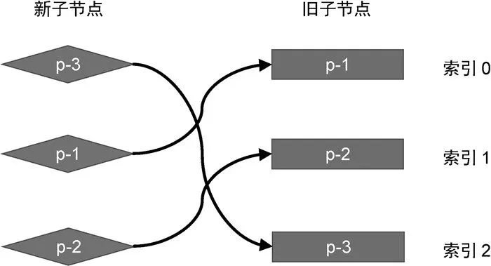

- 图 10-1　新旧两组子节点及索引

在这个例子中，如果使用简单 Diff 算法来更新它，则会发生两次 DOM 移动操作，如图 10-2所示。

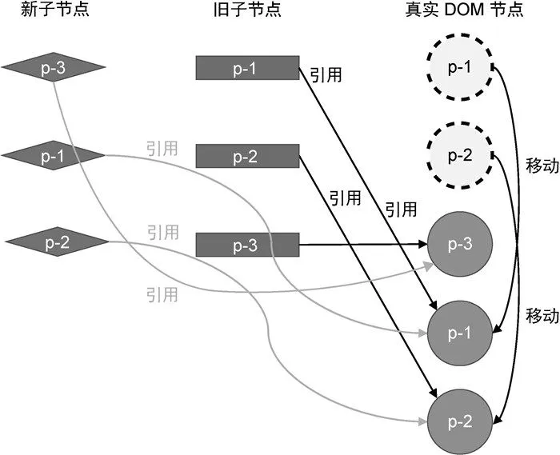

- 图 10-2　两次 DOM 移动操作完成更新

```
第一次 DOM 移动操作会将真实 DOM 节点 p-1 移动到真实 DOM 节点 p-3 后面。第二次移
动操作会将真实 DOM 节点 p-2 移动到真实 DOM 节点 p-1 后面。最终，真实 DOM 节点的
顺序与新的一组子节点顺序一致：p-3、p-1、p-2。
```

然而，上述更新过程并非最优解。在这个例子中，其实只需要通过一步 DOM 节点的移动操作

```
即可完成更新，即只需要把真实 DOM 节点 p-3 移动到真实 DOM 节点 p-1 前面，如图 10-3
```

所示。

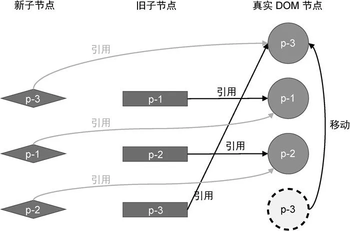

```
图 10-3　把真实 DOM 节点 p-3 移动到真实 DOM 节点 p-1 前面
```

可以看到，理论上只需要一次 DOM 移动操作即可完成更新。但简单 Diff 算法做不到这一点，不过本章我们要介绍的双端 Diff 算法可以做到。接下来，我们就来讨论双端 Diff 算法的原理。

顾名思义，双端 Diff 算法是一种同时对新旧两组子节点的两个端点进行比较的算法。因此，我们需要四个索引值，分别指向新旧两组子节点的端点，如图 10-4 所示。

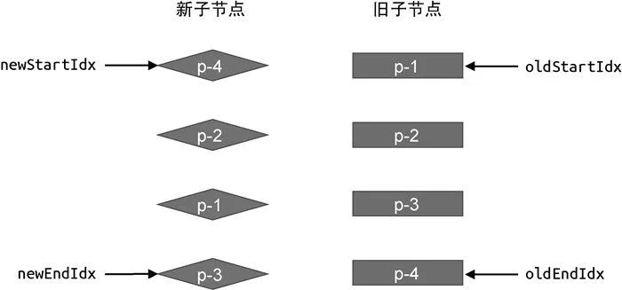

- 图 10-4　四个索引值，分别指向新旧两组子节点的端点

```
用代码来表达四个端点，如下面 patchChildren 和 patchKeyedChildren 函数的代码所
```

示：

```javascript
function patchChildren(n1, n2, container) {
  if (typeof n2.children === 'string') {
    // 省略部分代码
  } else if (Array.isArray(n2.children)) {
    // 封装 patchKeyedChildren 函数处理两组子节点
    patchKeyedChildren(n1, n2, container)
  } else {
    // 省略部分代码
  }
}
function patchKeyedChildren(n1, n2, container) {
const oldChildren = n1.children
const newChildren = n2.children
// 四个索引值
let oldStartIdx = 0
let oldEndIdx = oldChildren.length - 1
let newStartIdx = 0
let newEndIdx = newChildren.length - 1
}
在上面这段代码中，我们将两组子节点的打补丁工作封装到了 patchKeyedChildren 函数
中。在该函数内，首先获取新旧两组子节点 oldChildren 和 newChildren，接着创建四
个索引值，分别指向新旧两组子节点的头和尾，即 oldStartIdx、oldEndIdx、
newStartIdx 和 newEndIdx。有了索引后，就可以找到它所指向的虚拟节点了，如下面的
```

代码所示：

```javascript
function patchKeyedChildren(n1, n2, container) {
  const oldChildren = n1.children
  const newChildren = n2.children
  // 四个索引值
  let oldStartIdx = 0
  let oldEndIdx = oldChildren.length - 1
  let newStartIdx = 0
  let newEndIdx = newChildren.length - 1
  // 四个索引指向的 vnode 节点
  let oldStartVNode = oldChildren[oldStartIdx]
  let oldEndVNode = oldChildren[oldEndIdx]
  let newStartVNode = newChildren[newStartIdx]
  let newEndVNode = newChildren[newEndIdx]
}
其中，oldStartVNode 和 oldEndVNode 是旧的一组子节点中的第一个节点和最后一个节
点，newStartVNode 和 newEndVNode 则是新的一组子节点的第一个节点和最后一个节
```

点。有了这些信息之后，我们就可以开始进行双端比较了。怎么比较呢？如图 10-5 所示。

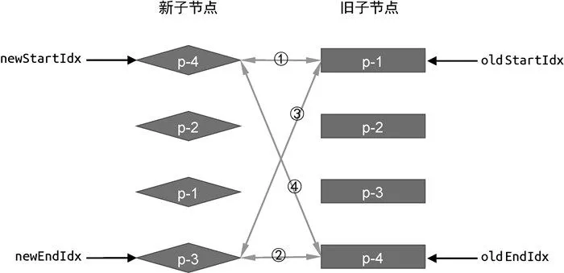

- 图 10-5　双端比较的方式

在双端比较中，每一轮比较都分为四个步骤，如图 10-5 中的连线所示。

```
第一步：比较旧的一组子节点中的第一个子节点 p-1 与新的一组子节点中的第一个子节点
p-4，看看它们是否相同。由于两者的 key 值不同，因此不相同，不可复用，于是什么都
```

- 不做。

```
第二步：比较旧的一组子节点中的最后一个子节点 p-4 与新的一组子节点中的最后一个子
节点 p-3，看看它们是否相同。由于两者的 key 值不同，因此不相同，不可复用，于是什
```

- 么都不做。

```
第三步：比较旧的一组子节点中的第一个子节点 p-1 与新的一组子节点中的最后一个子节
点 p-3，看看它们是否相同。由于两者的 key 值不同，因此不相同，不可复用，于是什么
```

- 都不做。

```
第四步：比较旧的一组子节点中的最后一个子节点 p-4 与新的一组子节点中的第一个子节
点 p-4。由于它们的 key 值相同，因此可以进行 DOM 复用。
```

可以看到，我们在第四步时找到了相同的节点，这说明它们对应的真实 DOM 节点可以复用。对于可复用的 DOM 节点，我们只需要通过 DOM 移动操作完成更新即可。那么应该如何移动DOM 元素呢？为了搞清楚这个问题，我们需要分析第四步比较过程中的细节。我们注意到，第四步是比较旧的一组子节点的最后一个子节点与新的一组子节点的第一个子节点，发现两者

```
相同。这说明：节点 p-4 原本是最后一个子节点，但在新的顺序中，它变成了第一个子节
点。换句话说，节点 p-4 在更新之后应该是第一个子节点。对应到程序的逻辑，可以将其翻
译为：将索引 oldEndIdx 指向的虚拟节点所对应的真实 DOM 移动到索引 oldStartIdx
```

指向的虚拟节点所对应的真实 DOM 前面。如下面的代码所示：

```sql
function patchKeyedChildren(n1, n2, container) {
  const oldChildren = n1.children
  const newChildren = n2.children
  // 四个索引值
  let oldStartIdx = 0
  let oldEndIdx = oldChildren.length - 1
  let newStartIdx = 0
  let newEndIdx = newChildren.length - 1
  // 四个索引指向的 vnode 节点
  let oldStartVNode = oldChildren[oldStartIdx]
  let oldEndVNode = oldChildren[oldEndIdx]
  let newStartVNode = newChildren[newStartIdx]
  let newEndVNode = newChildren[newEndIdx]
<p>if (oldStartVNode.key === newStartVNode.key) {
// 第一步：oldStartVNode 和 newStartVNode 比较
} else if (oldEndVNode.key === newEndVNode.key) {
// 第二步：oldEndVNode 和 newEndVNode 比较
} else if (oldStartVNode.key === newEndVNode.key) {
// 第三步：oldStartVNode 和 newEndVNode 比较
} else if (oldEndVNode.key === newStartVNode.key) {
// 第四步：oldEndVNode 和 newStartVNode 比较
// 仍然需要调用 patch 函数进行打补丁
patch(oldEndVNode, newStartVNode, container)
// 移动 DOM 操作
// oldEndVNode.el 移动到 oldStartVNode.el 前面
insert(oldEndVNode.el, container, oldStartVNode.el)</p>
<pre><code> // 移动 DOM 完成后，更新索引值，并指向下一个位置
oldEndVNode = oldChildren[--oldEndIdx]
newStartVNode = newChildren[++newStartIdx]
</code></pre> // 移动 DOM 完成后，更新索引值，并指向下一个位置
oldEndVNode = oldChildren[--oldEndIdx]
newStartVNode = newChildren[++newStartIdx]
}
}
在这段代码中，我们增加了一系列的 if...else if... 语句，用来实现四个索引指向的虚
拟节点之间的比较。拿上例来说，在第四步中，我们找到了具有相同 key 值的节点。这说
```

明，原来处于尾部的节点在新的顺序中应该处于头部。于是，我们只需要以头部元素

```
oldStartVNode.el 作为锚点，将尾部元素 oldEndVNode.el 移动到锚点前面即可。但需
要注意的是，在进行 DOM 的移动操作之前，仍然需要调用 patch 函数在新旧虚拟节点之间
```

打补丁。

在这一步 DOM 的移动操作完成后，接下来是比较关键的步骤，即更新索引值。由于第四步中

```
涉及的两个索引分别是 oldEndIdx 和 newStartIdx，所以我们需要更新两者的值，让它们
```

各自朝正确的方向前进一步，并指向下一个节点。图 10-6 给出了更新前新旧两组子节点以及真实 DOM 节点的状态。

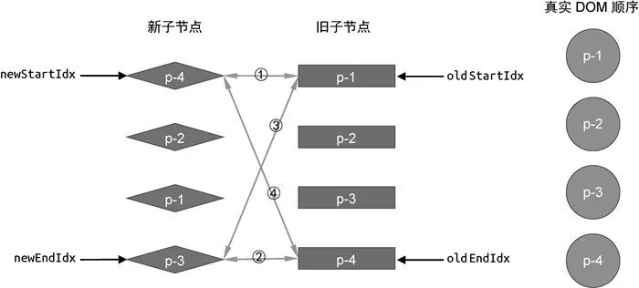

- 图 10-6　新旧两组子节点以及真实 DOM 节点的状态

图 10-7 给出了在第四步的比较中，第一步 DOM 移动操作完成后，新旧两组子节点以及真实DOM 节点的状态。

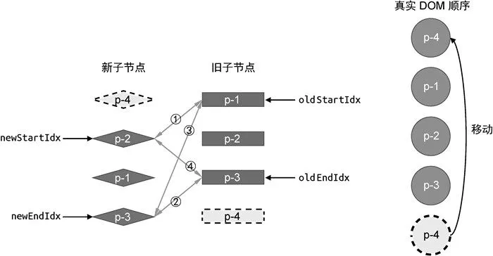

- 图 10-7　新旧两组子节点以及真实 DOM 节点的状态

```
此时，真实 DOM 节点顺序为 p-4、p-1、p-2、p-3，这与新的一组子节点顺序不一致。这
```

是因为 Diff 算法还没有结束，还需要进行下一轮更新。因此，我们需要将更新逻辑封装到一个

```sql
while 循环中，如下面的代码所示：
while (oldStartIdx <= oldEndIdx && newStartIdx <= newEndIdx) {
  if (oldStartVNode.key === newStartVNode.key) {
    // 步骤一：oldStartVNode 和 newStartVNode 比较
  } else if (oldEndVNode.key === newEndVNode.key) {
    // 步骤二：oldEndVNode 和 newEndVNode 比较
  } else if (oldStartVNode.key === newEndVNode.key) {
    // 步骤三：oldStartVNode 和 newEndVNode 比较
  } else if (oldEndVNode.key === newStartVNode.key) {
    // 步骤四：oldEndVNode 和 newStartVNode 比较
    // 仍然需要调用 patch 函数进行打补丁
    patch(oldEndVNode, newStartVNode, container)
    // 移动 DOM 操作
    // oldEndVNode.el 移动到 oldStartVNode.el 前面
    insert(oldEndVNode.el, container, oldStartVNode.el)
<pre><code> // 移动 DOM 完成后，更新索引值，指向下一个位置
oldEndVNode = oldChildren[--oldEndIdx]
newStartVNode = newChildren[++newStartIdx]
</code></pre> // 移动 DOM 完成后，更新索引值，指向下一个位置
oldEndVNode = oldChildren[--oldEndIdx]
newStartVNode = newChildren[++newStartIdx]
}
}
```

由于在每一轮更新完成之后，紧接着都会更新四个索引中与当前更新轮次相关联的索引，所以

```
整个 while 循环执行的条件是：头部索引值要小于等于尾部索引值。
```

在第一轮更新结束后循环条件仍然成立，因此需要进行下一轮的比较，如图 10-7 所示。

```
第一步：比较旧的一组子节点中的头部节点 p-1 与新的一组子节点中的头部节点 p-2，看
看它们是否相同。由于两者的 key 值不同，不可复用，所以什么都不做。
这里，我们使用了新的名词：头部节点。它指的是头部索引 oldStartIdx 和
newStartIdx 所指向的节点。
第二步：比较旧的一组子节点中的尾部节点 p-3 与新的一组子节点中的尾部节点 p-3，两
者的 key 值相同，可以复用。另外，由于两者都处于尾部，因此不需要对真实 DOM 进行
```

- 移动操作，只需要打补丁即可，如下面的代码所示：

```sql
while (oldStartIdx <= oldEndIdx && newStartIdx <= newEndIdx) {
1
  if (oldStartVNode.key === newStartVNode.key) {
2
    // 步骤一：oldStartVNode 和 newStartVNode 比较
3
  } else if (oldEndVNode.key === newEndVNode.key) {
4
    // 步骤二：oldEndVNode 和 newEndVNode 比较
5
    // 节点在新的顺序中仍然处于尾部，不需要移动，但仍需打补丁
6
    patch(oldEndVNode, newEndVNode, container)
7
    // 更新索引和头尾部节点变量
8
    oldEndVNode = oldChildren[--oldEndIdx]
9
    newEndVNode = newChildren[--newEndIdx]
10
  } else if (oldStartVNode.key === newEndVNode.key) {
11
    // 步骤三：oldStartVNode 和 newEndVNode 比较
12
  } else if (oldEndVNode.key === newStartVNode.key) {
13
    // 步骤四：oldEndVNode 和 newStartVNode 比较
14
    patch(oldEndVNode, newStartVNode, container)
15
    insert(oldEndVNode.el, container, oldStartVNode.el)
16
    oldEndVNode = oldChildren[--oldEndIdx]
17
    newStartVNode = newChildren[++newStartIdx]
18
  }
19
}
20
```

在这一轮更新完成之后，新旧两组子节点与真实 DOM 节点的状态如图 10-8 所示。

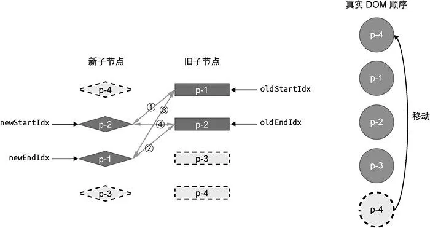

- 图 10-8　新旧两组子节点以及真实 DOM 节点的状态

真实 DOM 的顺序相比上一轮没有变化，因为在这一轮的比较中没有对 DOM 节点进行移动，

```
只是对 p-3 节点打补丁。接下来，我们再根据图 10-8 所示的状态执行下一轮的比较。
第一步：比较旧的一组子节点中的头部节点 p-1 与新的一组子节点中的头部节点 p-2，看
看它们是否相同。由于两者的 key 值不同，不可复用，因此什么都不做。
第二步：比较旧的一组子节点中的尾部节点 p-2 与新的一组子节点中的尾部节点 p-1，看
看它们是否相同，由于两者的 key 值不同，不可复用，因此什么都不做。
第三步：比较旧的一组子节点中的头部节点 p-1 与新的一组子节点中的尾部节点 p-1。两
者的 key 值相同，可以复用。
在第三步的比较中，我们找到了相同的节点，这说明：节点 p-1 原本是头部节点，但在新的
顺序中，它变成了尾部节点。因此，我们需要将节点 p-1 对应的真实 DOM 移动到旧的一组
子节点的尾部节点 p-2 所对应的真实 DOM 后面，同时还需要更新相应的索引到下一个位
```

置，如图 10-9 所示。

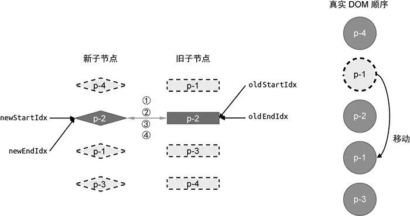

- 图 10-9　新旧两组子节点以及真实 DOM 节点的状态

这一步的代码实现如下：

```sql
while (oldStartIdx <= oldEndIdx && newStartIdx <= newEndIdx) {
  if (oldStartVNode.key === newStartVNode.key) {
  } else if (oldEndVNode.key === newEndVNode.key) {
    patch(oldEndVNode, newEndVNode, container)
    oldEndVNode = oldChildren[--oldEndIdx]
    newEndVNode = newChildren[--newEndIdx]
  } else if (oldStartVNode.key === newEndVNode.key) {
    // 调用 patch 函数在 oldStartVNode 和 newEndVNode 之间打补丁
    patch(oldStartVNode, newEndVNode, container)
    // 将旧的一组子节点的头部节点对应的真实 DOM 节点 oldStartVNode.el 移动到
    // 旧的一组子节点的尾部节点对应的真实 DOM 节点后面
    insert(oldStartVNode.el, container, oldEndVNode.el.nextSibling)
    // 更新相关索引到下一个位置
    oldStartVNode = oldChildren[++oldStartIdx]
    newEndVNode = newChildren[--newEndIdx]
  } else if (oldEndVNode.key === newStartVNode.key) {
    patch(oldEndVNode, newStartVNode, container)
    insert(oldEndVNode.el, container, oldStartVNode.el)
<pre><code> oldEndVNode = oldChildren[--oldEndIdx]
newStartVNode = newChildren[++newStartIdx]
</code></pre> oldEndVNode = oldChildren[--oldEndIdx]
newStartVNode = newChildren[++newStartIdx]
}
}
```

如上面的代码所示，如果旧的一组子节点的头部节点与新的一组子节点的尾部节点匹配，则说明该旧节点所对应的真实 DOM 节点需要移动到尾部。因此，我们需要获取当前尾部节点的下

```
一个兄弟节点作为锚点，即 oldEndVNode.el.nextSibling。最后，更新相关索引到下一
```

个位置。

通过图 10-9 可知，此时，新旧两组子节点的头部索引和尾部索引发生重合，但仍然满足循环的条件，所以还会进行下一轮的更新。而在接下来的这一轮的更新中，更新步骤也发生了重合。

```
第一步：比较旧的一组子节点中的头部节点 p-2 与新的一组子节点中的头部节点 p-2。发
现两者 key 值相同，可以复用。但两者在新旧两组子节点中都是头部节点，因此不需要移
动，只需要调用 patch 函数进行打补丁即可。
```

代码实现如下：

```sql
while (oldStartIdx <= oldEndIdx && newStartIdx <= newEndIdx) {
  if (oldStartVNode.key === newStartVNode.key) {
    // 调用 patch 函数在 oldStartVNode 与 newStartVNode 之间打补丁
    patch(oldStartVNode, newStartVNode, container)
    // 更新相关索引，指向下一个位置
    oldStartVNode = oldChildren[++oldStartIdx]
    newStartVNode = newChildren[++newStartIdx]
  } else if (oldEndVNode.key === newEndVNode.key) {
    patch(oldEndVNode, newEndVNode, container)
    oldEndVNode = oldChildren[--oldEndIdx]
    newEndVNode = newChildren[--newEndIdx]
  } else if (oldStartVNode.key === newEndVNode.key) {
    patch(oldStartVNode, newEndVNode, container)
    insert(oldStartVNode.el, container, oldEndVNode.el.nextSibling)
<pre><code> oldStartVNode = oldChildren[++oldStartIdx]
newEndVNode = newChildren[--newEndIdx]
</code></pre><p>} else if (oldEndVNode.key === newStartVNode.key) {
patch(oldEndVNode, newStartVNode, container)
insert(oldEndVNode.el, container, oldStartVNode.el)</p><pre><code> oldEndVNode =
newStartVNode = newChildren[++newStartIdx]
</code></pre> oldStartVNode = oldChildren[++oldStartIdx]
newEndVNode = newChildren[--newEndIdx]
oldEndVNode = oldChildren[--oldEndIdx]
newStartVNode = newChildren[++newStartIdx]
}
}
```

在这一轮更新之后，新旧两组子节点与真实 DOM 节点的状态如图 10-10 所示。

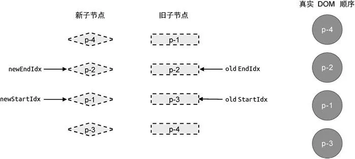

- 图 10-10　新旧两组子节点以及真实 DOM 节点的状态

```
此时，真实 DOM 节点的顺序与新的一组子节点的顺序相同了：p-4、p-2、p-1、p-3。另
外，在这一轮更新完成之后，索引 newStartIdx 和索引 oldStartIdx 的值都小于
newEndIdx 和 oldEndIdx，所以循环终止，双端 Diff 算法执行完毕。
```

## 10.2　双端比较的优势

理解了双端比较的原理之后，我们来看看与简单 Diff 算法相比，双端 Diff 算法具有怎样的优势。我们拿第 9 章的例子来看，如图 10-11 所示。

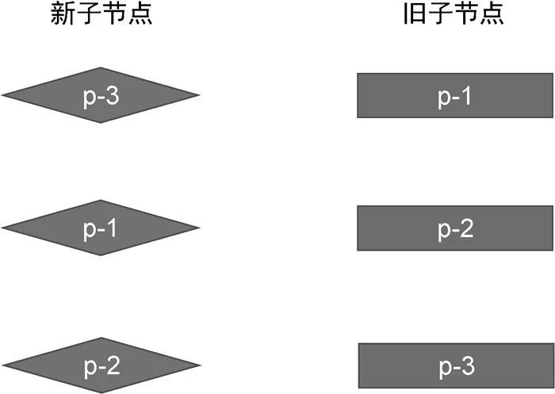

- 图 10-11　新旧两组子节点

图 10-11 给出了新旧两组子节点的节点顺序。当使用简单 Diff 算法对此例进行更新时，会发生两次 DOM 移动操作，如图 10-12 所示。

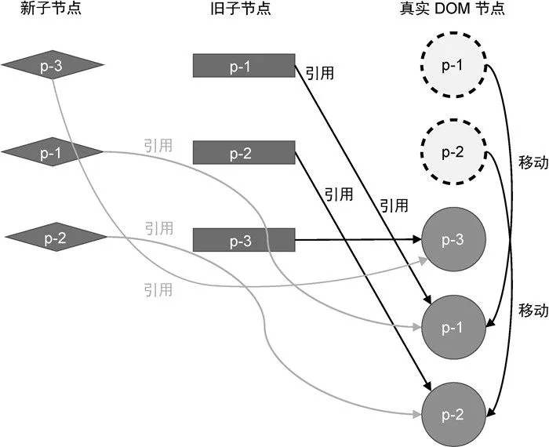

- 图 10-12　两次 DOM 移动

如果使用双端 Diff 算法对此例进行更新，会有怎样的表现呢？接下来，我们就以双端比较的思路来完成此例的更新，看一看双端 Diff 算法能否减少 DOM 移动操作次数。

图 10-13 给出了算法执行之前新旧两组子节点与真实 DOM 节点的状态。

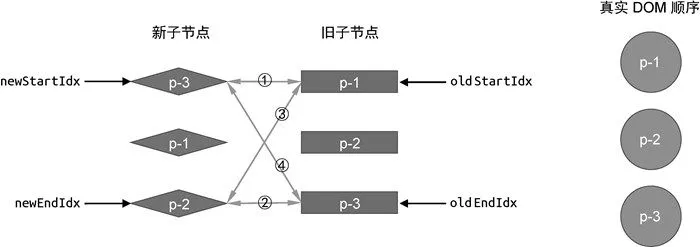

- 图 10-13　新旧两组子节点与真实 DOM 节点的状态

接下来，我们按照双端比较的步骤执行更新。

```
第一步：比较旧的一组子节点中的头部节点 p-1 与新的一组子节点中的头部节点 p-3，两
者 key 值不同，不可复用。
第二步：比较旧的一组子节点中的尾部节点 p-3 与新的一组子节点中的尾部节点 p-2，两
者 key 值不同，不可复用。
第三步：比较旧的一组子节点中的头部节点 p-1 与新的一组子节点中的尾部节点 p-2，两
者 key 值不同，不可复用。
第四步：比较旧的一组子节点中的尾部节点 p-3 与新的一组子节点中的头部节点 p-3，发
```

- 现可以进行复用。

```
可以看到，在第四步的比较中，我们找到了可复用的节点 p-3。该节点原本处于所有子节点
的尾部，但在新的一组子节点中它处于头部。因此，只需要让节点 p-3 对应的真实 DOM 变
```

成新的头部节点即可。在这一步移动操作之后，新旧两组子节点以及真实 DOM 节点的状态如图 10-14 所示。

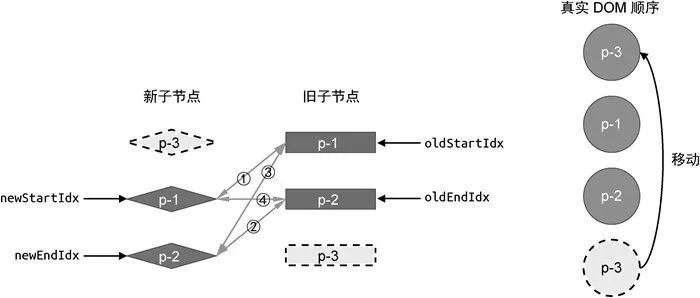

- 图 10-14　新旧两组子节点与真实 DOM 节点的状态

观察图 10-14 能够发现，在这一轮比较过后，真实 DOM 节点的顺序已经与新的一组子节点的顺序一致了。换句话说，我们完成了更新，不过算法仍然会继续执行。开始下一轮的比较。

```
第一步：比较旧的一组子节点中的头部节点 p-1 与新的一组子节点中的头部节点 p-1，两
者的 key 值相同，可以复用。但由于两者都处于头部，因此不需要移动，只需要打补丁即
```

- 可。

在这一轮比较过后，新旧两组子节点与真实 DOM 节点的状态如图 10-15 所示。

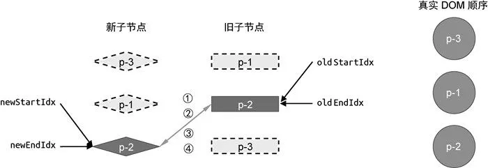

- 图 10-15　新旧两组子节点与真实 DOM 节点的状态

此时，双端 Diff 算法仍然没有停止，开始新一轮的比较。

```
第一步：比较旧的一组子节点中的头部节点 p-2 与新的一组子节点中的头部节点 p-2，两
者的 key 值相同，可以复用。但由于两者都处于头部，因此不需要移动，只需要打补丁即
```

- 可。

在这一轮比较过后，新旧两组子节点与真实 DOM 节点的状态如图 10-16 所示。

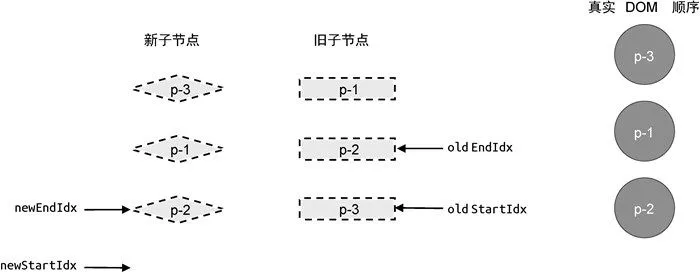

- 图 10-16　新旧两组子节点与真实 DOM 节点的状态

```
到这一步后，索引 newStartIdx 和 oldStartIdx 的值比索引 newEndIdx 和
oldEndIdx 的值大，于是更新结束。可以看到，对于同样的例子，采用简单 Diff 算法需要两
```

次 DOM 移动操作才能完成更新，而使用双端 Diff 算法只需要一次 DOM 移动操作即可完成更新。

## 10.3　非理想状况的处理方式

在上一节的讲解中，我们用了一个比较理想的例子。我们知道，双端 Diff 算法的每一轮比较的过程都分为四个步骤。在上一节的例子中，每一轮比较都会命中四个步骤中的一个，这是非常理想的情况。但实际上，并非所有情况都这么理想，如图 10-17 所示。

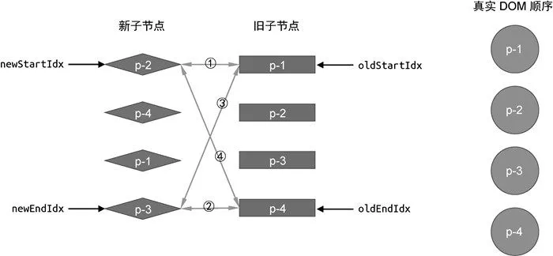

- 图 10-17　第一轮比较都无法命中

在这个例子中，新旧两组子节点的顺序如下。

```
旧的一组子节点：p-1、p-2、p-3、p-4。
新的一组子节点：p-2、p-4、p-1、p-3。
```

当我们尝试按照双端 Diff 算法的思路进行第一轮比较时，会发现无法命中四个步骤中的任何一步。

```
第一步：比较旧的一组子节点中的头部节点 p-1 与新的一组子节点中的头部节点 p-2，不
```

- 可复用。

```
第二步：比较旧的一组子节点中的尾部节点 p-4 与新的一组子节点中的尾部节点 p-3，不
```

- 可复用。

```
第三步：比较旧的一组子节点中的头部节点 p-1 与新的一组子节点中的尾部节点 p-3，不
```

- 可复用。

```
第四步：比较旧的一组子节点中的尾部节点 p-4 与新的一组子节点中的头部节点 p-2，不
```

- 可复用。

在四个步骤的比较过程中，都无法找到可复用的节点，应该怎么办呢？这时，我们只能通过增加额外的处理步骤来处理这种非理想情况。既然两个头部和两个尾部的四个节点中都没有可复用的节点，那么我们就尝试看看非头部、非尾部的节点能否复用。具体做法是，拿新的一组子节点中的头部节点去旧的一组子节点中寻找，如下面的代码所示：

```javascript
while (oldStartIdx <= oldEndIdx && newStartIdx <= newEndIdx) {
  if (oldStartVNode.key === newStartVNode.key) {
    // 省略部分代码
  } else if (oldEndVNode.key === newEndVNode.key) {
    // 省略部分代码
  } else if (oldStartVNode.key === newEndVNode.key) {
    // 省略部分代码
  } else if (oldEndVNode.key === newStartVNode.key) {
    // 省略部分代码
  } else {
    // 遍历旧的一组子节点，试图寻找与 newStartVNode 拥有相同 key 值的节点
    // idxInOld 就是新的一组子节点的头部节点在旧的一组子节点中的索引
    const idxInOld = oldChildren.findIndex(
      node => node.key === newStartVNode.key
    )
  }
}
```

在上面这段代码中，我们遍历旧的一组子节点，尝试在其中寻找与新的一组子节点的头部节点

```
具有相同 key 值的节点，并将该节点在旧的一组子节点中的索引存储到变量 idxInOld 中。
```

这么做的目的是什么呢？想要搞清楚这个问题，本质上需要我们先搞清楚：在旧的一组子节点

```
中，找到与新的一组子节点的头部节点具有相同 key 值的节点意味着什么？如图 10-18 所
```

示。

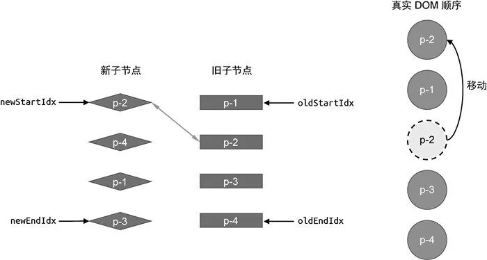

- 图 10-18　在旧子节点中寻找可复用节点

```sql
观察图 10-18，当我们拿新的一组子节点的头部节点 p-2 去旧的一组子节点中查找时，会在
索引为 1 的位置找到可复用的节点。这意味着，节点 p-2 原本不是头部节点，但在更新之
后，它应该变成头部节点。所以我们需要将节点 p-2 对应的真实 DOM 节点移动到当前旧的
一组子节点的头部节点 p-1 所对应的真实 DOM 节点之前。具体实现如下：
while (oldStartIdx <= oldEndIdx && newStartIdx <= newEndIdx) {
  if (oldStartVNode.key === newStartVNode.key) {
    // 省略部分代码
  } else if (oldEndVNode.key === newEndVNode.key) {
    // 省略部分代码
  } else if (oldStartVNode.key === newEndVNode.key) {
    // 省略部分代码
  } else if (oldEndVNode.key === newStartVNode.key) {
    // 省略部分代码
  } else {
    // 遍历旧 children，试图寻找与 newStartVNode 拥有相同 key 值的元素
    const idxInOld = oldChildren.findIndex(
      node => node.key === newStartVNode.key
    )
    // idxInOld 大于 0，说明找到了可复用的节点，并且需要将其对应的真实 DOM 移动到头部
    if (idxInOld > 0) {
      // idxInOld 位置对应的 vnode 就是需要移动的节点
      const vnodeToMove = oldChildren[idxInOld]
      // 不要忘记除移动操作外还应该打补丁
      patch(vnodeToMove, newStartVNode, container)
      // 将 vnodeToMove.el 移动到头部节点 oldStartVNode.el 之前，因此使用后者作为锚点
      insert(vnodeToMove.el, container, oldStartVNode.el)
      // 由于位置 idxInOld 处的节点所对应的真实 DOM 已经移动到了别处，因此将其设置为 undef
      oldChildren[idxInOld] = undefined
      // 最后更新 newStartIdx 到下一个位置
      newStartVNode = newChildren[++newStartIdx]
    }
  }
}
在上面这段代码中，首先判断 idxInOld 是否大于 0。如果条件成立，则说明找到了可复用
```

的节点，然后将该节点对应的真实 DOM 移动到头部。为此，我们先要获取需要移动的节点，

```sql
这里的 oldChildren[idxInOld] 所指向的节点就是需要移动的节点。在移动节点之前，
不要忘记调用 patch 函数进行打补丁。接着，调用 insert 函数，并以现在的头部节点对应
的真实 DOM 节点 oldStartVNode.el 作为锚点参数来完成节点的移动操作。当节点移动完
```

成后，还有两步工作需要做。

```
由于处于 idxInOld 处的节点已经处理过了（对应的真实 DOM 移到了别处），因此我们应
该将 oldChildren[idxInOld] 设置为 undefined。
新的一组子节点中的头部节点已经处理完毕，因此将 newStartIdx 前进到下一个位置。
```

经过上述两个步骤的操作后，新旧两组子节点以及真实 DOM 节点的状态如图 10-19 所示。

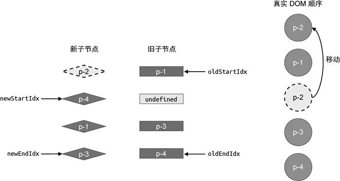

- 图 10-19　新旧两组子节点以及真实 DOM 节点的状态

```
此时，真实 DOM 的顺序为：p-2、p-1、p-3、p-4。接着，双端 Diff 算法会继续进行，如
```

图 10-20 所示。

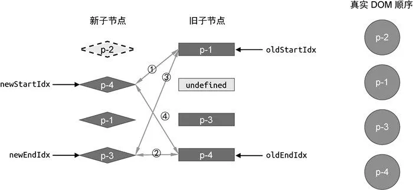

- 图 10-20　新旧两组子节点以及真实 DOM 节点的状态

```
第一步：比较旧的一组子节点中的头部节点 p-1 与新的一组子节点中的头部节点 p-4，两
者 key 值不同，不可复用。
第二步：比较旧的一组子节点中的尾部节点 p-4 与新的一组子节点中的尾部节点 p-3，两
者 key 值不同，不可复用。
第三步：比较旧的一组子节点中的头部节点 p-1 与新的一组子节点中的尾部节点 p-3，两
者 key 值不同，不可复用。
第四步：比较旧的一组子节点中的尾部节点 p-4 与新的一组子节点中的头部节点 p-4，两
者的 key 值相同，可以复用。
```

在这一轮比较的第四步中，我们找到了可复用的节点。因此，按照双端 Diff 算法的逻辑移动真

```
实 DOM，即把节点 p-4 对应的真实 DOM 移动到旧的一组子节点中头部节点 p-1 所对应的
```

真实 DOM 前面，如图 10-21 所示。

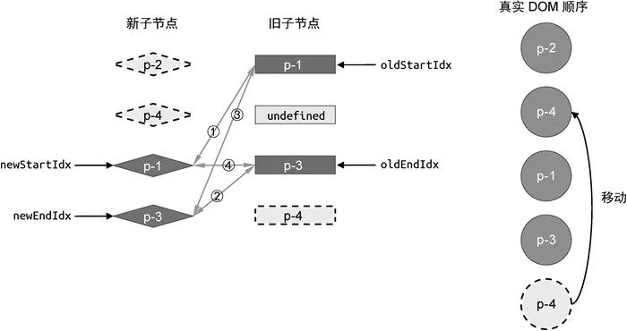

```
图 10-21　移动节点 p-4
此时，真实 DOM 节点的顺序是：p-2、p-4、p-1、p-3。接着，开始下一轮的比较。
第一步：比较旧的一组子节点中的头部节点 p-1 与新的一组子节点中的头部节点 p-1，两
者的 key 值相同，可以复用。
```

在这一轮比较中，第一步就找到了可复用的节点。由于两者都处于头部，所以不需要对真实DOM 进行移动，只需要打补丁即可。在这一步操作过后，新旧两组子节点与真实 DOM 节点的状态如图 10-22 所示。

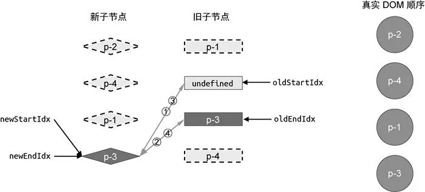

- 图 10-22　新旧两组子节点与真实 DOM 节点的状态

```
此时，真实 DOM 节点的顺序是：p-2、p-4、p-1、p-3。接着，进行下一轮的比较。需要
注意的一点是，此时旧的一组子节点的头部节点是 undefined。这说明该节点已经被处理过
```

了，因此不需要再处理它了，直接跳过即可。为此，我们需要补充这部分逻辑的代码，具体实现如下：

```sql
while (oldStartIdx <= oldEndIdx && newStartIdx <= newEndIdx) {
  // 增加两个判断分支，如果头尾部节点为 undefined，则说明该节点已经被处理过了，直接跳到下一个
  if (!oldStartVNode) {
    oldStartVNode = oldChildren[++oldStartIdx]
  } else if (!oldEndVNode) {
    oldEndVNode = oldChildren[--oldEndIdx]
  } else if (oldStartVNode.key === newStartVNode.key) {
    // 省略部分代码
  } else if (oldEndVNode.key === newEndVNode.key) {
    // 省略部分代码
  } else if (oldStartVNode.key === newEndVNode.key) {
    // 省略部分代码
  } else if (oldEndVNode.key === newStartVNode.key) {
    // 省略部分代码
  } else {
    const idxInOld = oldChildren.findIndex(
      node => node.key === newStartVNode.key
    )
    if (idxInOld > 0) {
      const vnodeToMove = oldChildren[idxInOld]
      patch(vnodeToMove, newStartVNode, container)
      insert(vnodeToMove.el, container, oldStartVNode.el)
      oldChildren[idxInOld] = undefined
      newStartVNode = newChildren[++newStartIdx]
    }
}
}
```

观察上面的代码，在循环开始时，我们优先判断头部节点和尾部节点是否存在。如果不存在，则说明它们已经被处理过了，直接跳到下一个位置即可。在这一轮比较过后，新旧两组子节点与真实 DOM 节点的状态如图 10-23 所示。

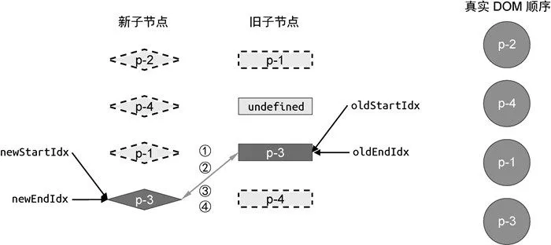

- 图 10-23　新旧两组子节点与真实 DOM 节点的状态

现在，四个步骤又重合了，接着进行最后一轮的比较。

```
第一步：比较旧的一组子节点中的头部节点 p-3 与新的一组子节点中的头部节点 p-3，两
者的 key 值相同，可以复用。
```

在第一步中找到了可复用的节点。由于两者都是头部节点，因此不需要进行 DOM 移动操作，直接打补丁即可。在这一轮比较过后，最终状态如图 10-24 所示。

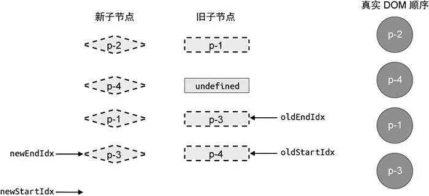

- 图 10-24　新旧两组子节点与真实 DOM 节点的状态

这时，满足循环停止的条件，于是更新完成。最终，真实 DOM 节点的顺序与新的一组子节点

```
的顺序一致，都是：p-2、p-4、p-1、p-3。
```

## 10.4　添加新元素

在 10.3 节中，我们讲解了非理想情况的处理，即在一轮比较过程中，不会命中四个步骤中的任何一步。这时，我们会拿新的一组子节点中的头部节点去旧的一组子节点中寻找可复用的节点，然而并非总能找得到，如图 10-25 的例子所示。

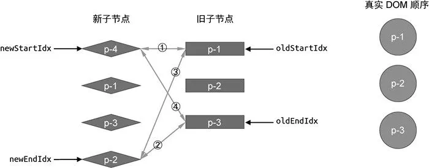

- 图 10-25　新增节点的情况

在这个例子中，新旧两组子节点的顺序如下。

```
旧的一组子节点：p-1、p-2、p-3。
新的一组子节点：p-4、p-1、p-3、p-2。
```

首先，我们尝试进行第一轮比较，发现在四个步骤的比较中都找不到可复用的节点。于是我们

```
尝试拿新的一组子节点中的头部节点 p-4 去旧的一组子节点中寻找具有相同 key 值的节点，
但在旧的一组子节点中根本就没有 p-4 节点，如图 10-26 所示。
```

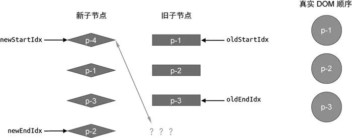

- 图 10-26　在旧的一组子节点中找不到可复用的节点

```
这说明节点 p-4 是一个新增节点，我们应该将它挂载到正确的位置。那么应该挂载到哪里
呢？很简单，因为节点 p-4 是新的一组子节点中的头部节点，所以只需要将它挂载到当前头
```

部节点之前即可。“当前”头部节点指的是，旧的一组子节点中的头部节点所对应的真实 DOM

```sql
节点 p-1。下面是用来完成挂载操作的代码：
while (oldStartIdx <= oldEndIdx && newStartIdx <= newEndIdx) {
  // 增加两个判断分支，如果头尾部节点为 undefined，则说明该节点已经被处理过了，直接跳到下一个
  if (!oldStartVNode) {
    oldStartVNode = oldChildren[++oldStartIdx]
  } else if (!oldEndVNode) {
    oldEndVNode = newChildren[--oldEndIdx]
  } else if (oldStartVNode.key === newStartVNode.key) {
    // 省略部分代码
  } else if (oldEndVNode.key === newEndVNode.key) {
    // 省略部分代码
  } else if (oldStartVNode.key === newEndVNode.key) {
    // 省略部分代码
  } else if (oldEndVNode.key === newStartVNode.key) {
    // 省略部分代码
  } else {
    const idxInOld = oldChildren.findIndex(
      node => node.key === newStartVNode.key
    )
    if (idxInOld > 0) {
      const vnodeToMove = oldChildren[idxInOld]
      patch(vnodeToMove, newStartVNode, container)
      insert(vnodeToMove.el, container, oldStartVNode.el)
      oldChildren[idxInOld] = undefined
    } else {
      // 将 newStartVNode 作为新节点挂载到头部，使用当前头部节点 oldStartVNode.el 作为锚
      patch(null, newStartVNode, container, oldStartVNode.el)
    }
    newStartVNode = newChildren[++newStartIdx]
  }
}
如上面的代码所示，当条件 idxInOld > 0 不成立时，说明 newStartVNode 节点是全新
的节点。又由于 newStartVNode 节点是头部节点，因此我们应该将其作为新的头部节点进
行挂载。所以，在调用 patch 函数挂载节点时，我们使用 oldStartVNode.el 作为锚点。
```

在这一步操作完成之后，新旧两组子节点以及真实 DOM 节点的状态如图 10-27 所示。

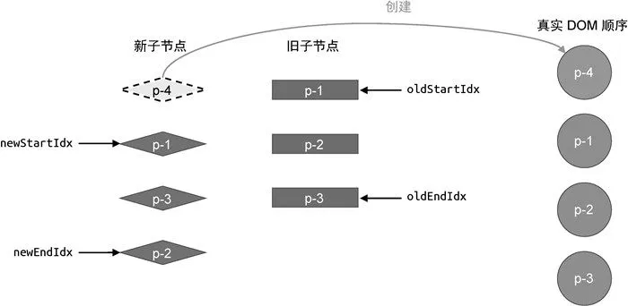

- 图 10-27　新旧两组子节点以及真实 DOM 节点的状态

```
当新节点 p-4 挂载完成后，会进行后续的更新，直到全部更新完成为止。但这样就完美了
```

吗？答案是否定的，我们再来看另外一个例子，如图 10-28 所示。


- 图 10-28　新旧两组子节点以及真实 DOM 节点的状态

```
这个例子与上一个的例子的不同之处在于，我们调整了新的一组子节点的顺序：p-4、p-1、
p-2、p-3。下面我们按照双端 Diff 算法的思路来执行更新，看看会发生什么。
第一步：比较旧的一组子节点中的头部节点 p-1 与新的一组子节点中的头部节点 p-4，两
者的 key 值不同，不可以复用。
第二步：比较旧的一组子节点中的尾部节点 p-3 与新的一组子节点中的尾部节点 p-3，两
者的 key 值相同，可以复用。
```

在第二步中找到了可复用的节点，因此进行更新。更新后的新旧两组子节点以及真实 DOM 节点的状态如图 10-29 所示。

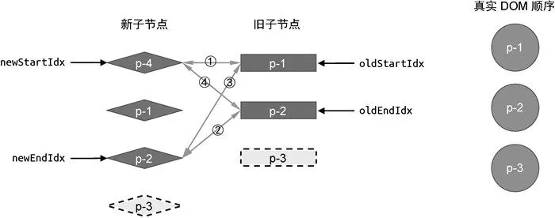

- 图 10-29　新旧两组子节点以及真实 DOM 节点的状态

接着进行下一轮的比较。

```
第一步：比较旧的一组子节点中的头部节点 p-1 与新的一组子节点中的头部节点 p-4，两
者的 key 值不同，不可以复用。
第二步：比较旧的一组子节点中的尾部节点 p-2 与新的一组子节点中的尾部节点 p-2，两
者的 key 值相同，可以复用。
```

我们又在第二步找到了可复用的节点，于是再次进行更新。更新后的新旧两组子节点以及真实DOM 节点的状态如图 10-30 所示。

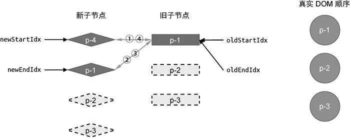

- 图 10-30　新旧两组子节点以及真实 DOM 节点的状态

接着，进行下一轮的更新。

```
第一步：比较旧的一组子节点中的头部节点 p-1 与新的一组子节点中的头部节点 p-4，两
者的 key 值不同，不可以复用。
第二步：比较旧的一组子节点中的尾部节点 p-1 与新的一组子节点中的尾部节点 p-1，两
者的 key 值相同，可以复用。
```

还是在第二步找到了可复用的节点，再次进行更新。更新后的新旧两组子节点以及真实 DOM节点的状态如图 10-31 所示。

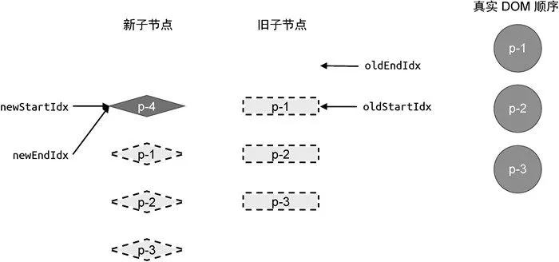

- 图 10-31　新旧两组子节点以及真实 DOM 节点的状态

```
当这一轮更新完毕后，由于变量 oldStartIdx 的值大于 oldEndIdx 的值，满足更新停止
的条件，因此更新停止。但通过观察可知，节点 p-4 在整个更新过程中被遗漏了，没有得到
```

任何处理，这说明我们的算法是有缺陷的。为了弥补这个缺陷，我们需要添加额外的处理代码，如下所示：

```javascript
while (oldStartIdx <= oldEndIdx && newStartIdx <= newEndIdx) {
  // 省略部分代码
}
// 循环结束后检查索引值的情况，
if (oldEndIdx < oldStartIdx && newStartIdx <= newEndIdx) {
// 如果满足条件，则说明有新的节点遗留，需要挂载它们
for (let i = newStartIdx; i <= newEndIdx; i++) {
const anchor = newChildren[newEndIdx + 1] ? newChildren[newEndIdx + 1].el : null;
patch(null, newChildren[i], container, anchor);
}
}
我们在 while 循环结束后增加了一个 if 条件语句，检查四个索引值的情况。根据图 10-31
可知，如果条件 oldEndIdx < oldStartIdx && newStartIdx <= newEndIdx 成
```

立，说明新的一组子节点中有遗留的节点需要作为新节点挂载。哪些节点是新节点呢？索引值

```
位于 newStartIdx 和 newEndIdx 这个区间内的节点都是新节点。于是我们开启一个 for
```

循环来遍历这个区间内的节点并逐一挂载。挂载时的锚点仍然使用当前的头部节点

```
oldStartVNode.el，这样就完成了对新增元素的处理。
```

## 10.5　移除不存在的元素

解决了新增节点的问题后，我们再来讨论关于移除元素的情况，如图 10-32 的例子所示。

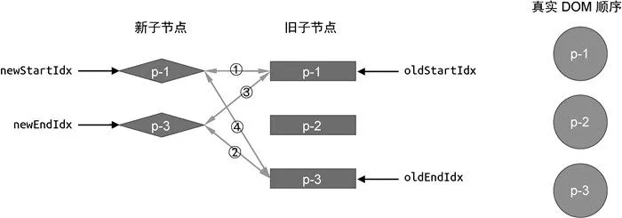

- 图 10-32　移除节点的情况

在这个例子中，新旧两组子节点的顺序如下。

```
旧的一组子节点：p-1、p-2、p-3。
新的一组子节点：p-1、p-3。
可以看到，在新的一组子节点中 p-2 节点已经不存在了。为了搞清楚应该如何处理节点被移
```

除的情况，我们还是按照双端 Diff 算法的思路执行更新。

```
第一步：比较旧的一组子节点中的头部节点 p-1 与新的一组子节点中的头部节点 p-1，两
者的 key 值相同，可以复用。
```

在第一步的比较中找到了可复用的节点，于是执行更新。在这一轮比较过后，新旧两组子节点以及真实 DOM 节点的状态如图 10-33 所示。

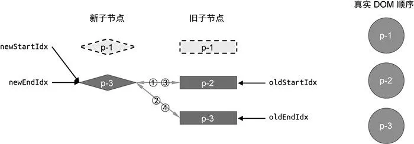

- 图 10-33　新旧两组子节点以及真实 DOM 节点的状态

接着，执行下一轮更新。

```
第一步：比较旧的一组子节点中的头部节点 p-2 与新的一组子节点中的头部节点 p-3，两
者的 key 值不同，不可以复用。
第二步：比较旧的一组子节点中的尾部节点 p-3 与新的一组子节点中的尾部节点 p-3，两
者的 key 值相同，可以复用。
```

在第二步中找到了可复用的节点，于是进行更新。更新后的新旧两组子节点以及真实 DOM 节点的状态如图 10-34 所示。

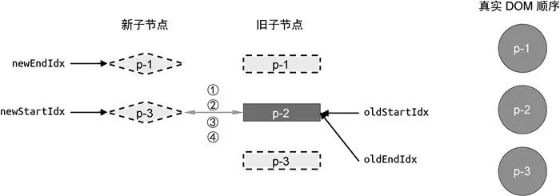

- 图 10-34　新旧两组子节点以及真实 DOM 节点的状态

```
此时变量 newStartIdx 的值大于变量 newEndIdx 的值，满足更新停止的条件，于是更新
```

结束。但观察图 10-34 可知，旧的一组子节点中存在未被处理的节点，应该将其移除。因此，我们需要增加额外的代码来处理它，如下所示：

```javascript
while (oldStartIdx <= oldEndIdx && newStartIdx <= newEndIdx) {
  // 省略部分代码
}
if (oldEndIdx < oldStartIdx && newStartIdx <= newEndIdx) {
// 添加新节点
// 省略部分代码
} else if (newEndIdx < newStartIdx && oldStartIdx <= oldEndIdx) {
// 移除操作
for (let i = oldStartIdx; i <= oldEndIdx; i++) {
unmount(oldChildren[i])
}
}
与处理新增节点类似，我们在 while 循环结束后又增加了一个 else...if 分支，用于卸载
已经不存在的节点。由图 10-34 可知，索引值位于 oldStartIdx 和 oldEndIdx 这个区间
内的节点都应该被卸载，于是我们开启一个 for 循环将它们逐一卸载。
```

## 10.6　总结

本章我们介绍了双端 Diff 算法的原理及其优势。顾名思义，双端 Diff 算法指的是，在新旧两组子节点的四个端点之间分别进行比较，并试图找到可复用的节点。相比简单 Diff 算法，双端Diff 算法的优势在于，对于同样的更新场景，执行的 DOM 移动操作次数更少。
