# 第11章快速Diff算法

本章我们将讨论第三种用于比较新旧两组子节点的方式：快速 Diff 算法。正如其名，该算法的

```
实测速度非常快。该算法最早应用于 ivi 和 inferno 这两个框架，Vue.js 3 借鉴并扩展了
它。图 11-1 比较了 ivi、inferno 以及 Vue.js 2 的性能。
```

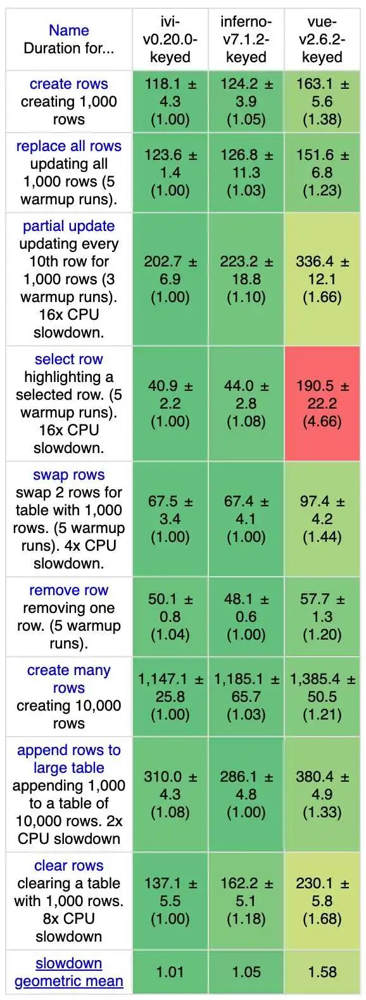

- 图 11-1　性能比较

```
图 11-1 来自 js-framework-benchmark，从中可以看出，在 DOM 操作的各个方面，ivi 和
inferno 所采用的快速 Diff 算法的性能都要稍优于 Vue.js 2 所采用的双端 Diff 算法。既然快
```

速 Diff 算法如此高效，我们有必要了解它的思路。接下来，我们就着重讨论快速 Diff 算法的实现原理。

## 11.1　相同的前置元素和后置元素

不同于简单 Diff 算法和双端 Diff 算法，快速 Diff 算法包含预处理步骤，这其实是借鉴了纯文本Diff 算法的思路。在纯文本 Diff 算法中，存在对两段文本进行预处理的过程。例如，在对两段文本进行 Diff 之前，可以先对它们进行全等比较：

```
if (text1 === text2) return
```

这也称为快捷路径。如果两段文本全等，那么就无须进入核心 Diff 算法的步骤了。除此之外，预处理过程还会处理两段文本相同的前缀和后缀。假设有如下两段文本：

```
TEXT1: I use vue for app development
TEXT2: I use react for app development
```

通过肉眼可以很容易发现，这两段文本的头部和尾部分别有一段相同的内容，如图 11-2 所示。

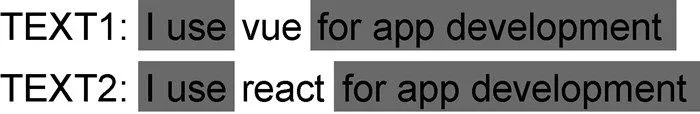

- 图 11-2　文本预处理

```
图 11-2 突出显示了 TEXT1 和 TEXT2 中相同的内容。对于内容相同的问题，是不需要进行核
心 Diff 操作的。因此，对于 TEXT1 和  TEXT2 来说，真正需要进行 Diff 操作的部分是：
```

```
TEXT1: vue
TEXT2: react
```

这实际上是简化问题的一种方式。这么做的好处是，在特定情况下我们能够轻松地判断文本的插入和删除，例如：

```
TEXT1: I like you
TEXT2: I like you too
```

经过预处理，去掉这两段文本中相同的前缀内容和后缀内容之后，它将变成：

```
TEXT1:
TEXT2: too
可以看到，经过预处理后，TEXT1 的内容为空。这说明 TEXT2 在 TEXT1 的基础上增加了字
符串 too。相反，我们还可以将这两段文本的位置互换：
TEXT1: I like you too
TEXT2: I like you
```

这两段文本经过预处理后将变成：

```
TEXT1: too
TEXT2:
由此可知，TEXT2 是在 TEXT1 的基础上删除了字符串 too。
```

快速 Diff 算法借鉴了纯文本 Diff 算法中预处理的步骤。以图 11-3 给出的两组子节点为例。

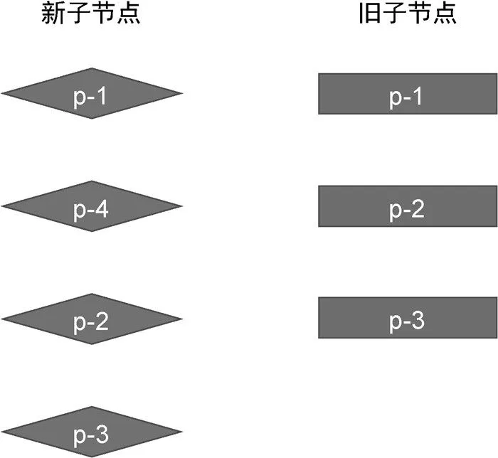

- 图 11-3　新旧两组子节点

这两组子节点的顺序如下。

```
旧的一组子节点：p-1、p-2、p-3。
新的一组子节点：p-1、p-4、p-2、p-3。
通过观察可以发现，两组子节点具有相同的前置节点 p-1，以及相同的后置节点 p-2 和 p-
3，如图 11-4 所示。
```

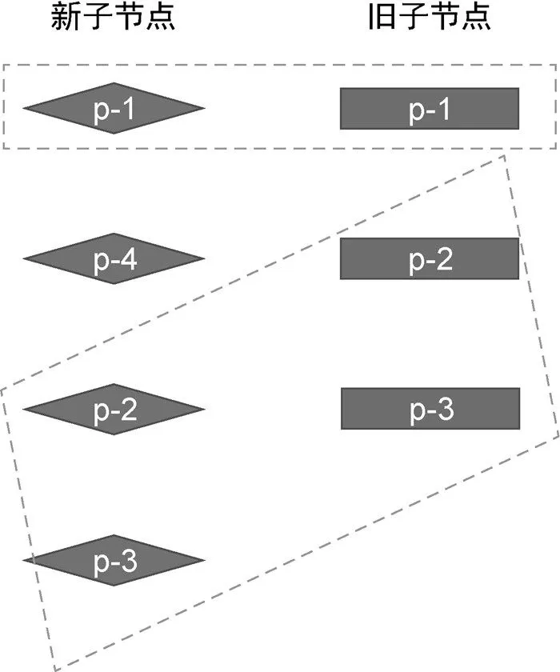

- 图 11-4　相同的前置节点和后置节点

对于相同的前置节点和后置节点，由于它们在新旧两组子节点中的相对位置不变，所以我们无须移动它们，但仍然需要在它们之间打补丁。

```
对于前置节点，我们可以建立索引 j，其初始值为 0，用来指向两组子节点的开头，如图 11-
```

5 所示。

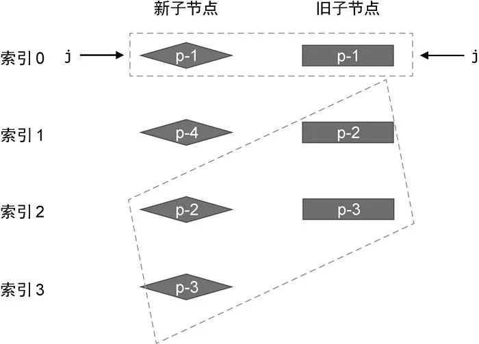

- 图 11-5　建立索引 j，指向两组子节点的开头

```javascript
然后开启一个 while 循环，让索引 j 递增，直到遇到不相同的节点为止，如下面
patchKeyedChildren 函数的代码所示：
function patchKeyedChildren(n1, n2, container) {
  const newChildren = n2.children
  const oldChildren = n1.children
  // 处理相同的前置节点
  // 索引 j 指向新旧两组子节点的开头
  let j = 0
  let oldVNode = oldChildren[j]
  let newVNode = newChildren[j]
  // while 循环向后遍历，直到遇到拥有不同 key 值的节点为止
  while (oldVNode.key === newVNode.key) {
    // 调用 patch 函数进行更新
    patch(oldVNode, newVNode, container)
    // 更新索引 j，让其递增
    j++
    oldVNode = oldChildren[j]
    newVNode = newChildren[j]
  }
}
在上面这段代码中，我们使用 while 循环查找所有相同的前置节点，并调用 patch 函数进
行打补丁，直到遇到 key 值不同的节点为止。这样，我们就完成了对前置节点的更新。在这
```

一步更新操作过后，新旧两组子节点的状态如图 11-6 所示。

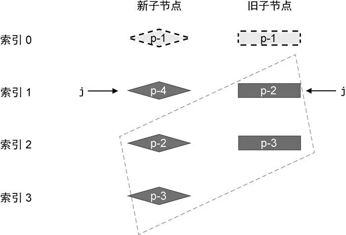

- 图 11-6　处理完前置节点后的状态

```
这里需要注意的是，当 while 循环终止时，索引 j 的值为 1。接下来，我们需要处理相同的
后置节点。由于新旧两组子节点的数量可能不同，所以我们需要两个索引 newEnd 和
oldEnd，分别指向新旧两组子节点中的最后一个节点，如图 11-7 所示。
```

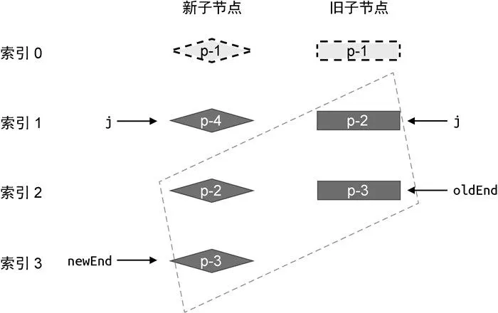

- 图 11-7　建立索引，指向两组子节点的最后一个节点

```
然后，再开启一个 while 循环，并从后向前遍历这两组子节点，直到遇到 key 值不同的节点
```

为止，如下面的代码所示：

```xml
function patchKeyedChildren(n1, n2, container) {
  const newChildren = n2.children
  const oldChildren = n1.children
  // 更新相同的前置节点
  let j = 0
  let oldVNode = oldChildren[j]
  let newVNode = newChildren[j]
  while (oldVNode.key === newVNode.key) {
    patch(oldVNode, newVNode, container)
    j++
    oldVNode = oldChildren[j]
    newVNode = newChildren[j]
  }
<p>// 更新相同的后置节点
// 索引 oldEnd 指向旧的一组子节点的最后一个节点
let oldEnd = oldChildren.length - 1
// 索引 newEnd 指向新的一组子节点的最后一个节点
let newEnd = newChildren.length - 1</p>
<p>oldVNode = oldChildren[oldEnd]
newVNode = newChildren[newEnd]</p>
<p>// while 循环从后向前遍历，直到遇到拥有不同 key 值的节点为止
while (oldVNode.key === newVNode.key) {
// 调用 patch 函数进行更新
patch(oldVNode, newVNode, container)
// 递减 oldEnd 和 nextEnd
oldEnd–
newEnd–
oldVNode = oldChildren[oldEnd]
newVNode = newChildren[newEnd]
}</p>
}
与处理相同的前置节点一样，在 while 循环内，需要调用 patch 函数进行打补丁，然后递
减两个索引 oldEnd、newEnd 的值。在这一步更新操作过后，新旧两组子节点的状态如图
```

11-8 所示。

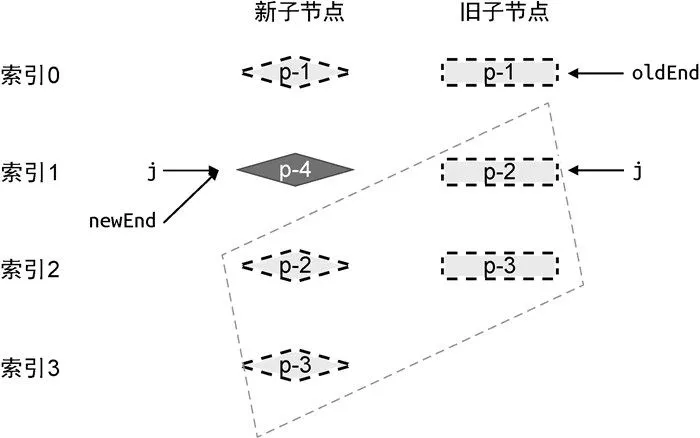

- 图 11-8　处理完后置节点后的状态

由图 11-8 可知，当相同的前置节点和后置节点被处理完毕后，旧的一组子节点已经全部被处

```
理了，而在新的一组子节点中，还遗留了一个未被处理的节点 p-4。其实不难发现，节点 p-
4 是一个新增节点。那么，如何用程序得出“节点 p-4 是新增节点”这个结论呢？这需要我们观
察三个索引 j、newEnd 和 oldEnd 之间的关系。
条件一 oldEnd < j 成立：说明在预处理过程中，所有旧子节点都处理完毕了。
条件二 newEnd >= j 成立：说明在预处理过后，在新的一组子节点中，仍然有未被处理
```

- 的节点，而这些遗留的节点将被视作新增节点。

如果条件一和条件二同时成立，说明在新的一组子节点中，存在遗留节点，且这些节点都是新增节点。因此我们需要将它们挂载到正确的位置，如图 11-9 所示。

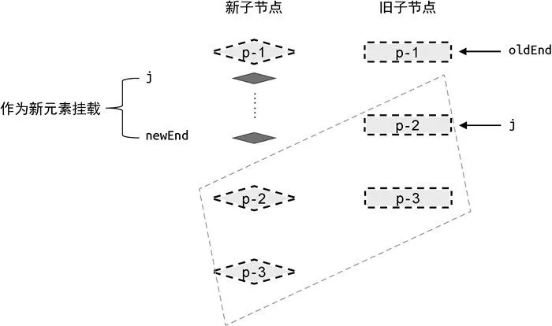

- 图 11-9　新增节点的情况

```
在新的一组子节点中，索引值处于 j 和 newEnd 之间的任何节点都需要作为新的子节点进行
```

挂载。那么，应该怎样将这些节点挂载到正确位置呢？这就要求我们必须找到正确的锚点元

```
素。观察图 11-9 中新的一组子节点可知，新增节点应该挂载到节点 p-2 所对应的真实 DOM
前面。所以，节点 p-2 对应的真实 DOM 节点就是挂载操作的锚点元素。有了这些信息，我
```

们就可以给出具体的代码实现了，如下所示：

```xml
function patchKeyedChildren(n1, n2, container) {
  const newChildren = n2.children
  const oldChildren = n1.children
  // 更新相同的前置节点
  // 省略部分代码
<p>// 更新相同的后置节点
// 省略部分代码</p>
<p>// 预处理完毕后，如果满足如下条件，则说明从 j --> newEnd 之间的节点应作为新节点插入
if (j > oldEnd && j <= newEnd) {
// 锚点的索引
const anchorIndex = newEnd + 1
// 锚点元素
const anchor = anchorIndex < newChildren.length ? newChildren[anchorIndex].el : n
// 采用 while 循环，调用 patch 函数逐个挂载新增节点
while (j <= newEnd) {
patch(null, newChildren[j++], container, anchor)
}
}</p>
}
在上面这段代码中，首先计算锚点的索引值（即 anchorIndex）为 newEnd + 1。如果小
```

于新的一组子节点的数量，则说明锚点元素在新的一组子节点中，所以直接使用

```
newChildren[anchorIndex].el 作为锚点元素；否则说明索引 newEnd 对应的节点已经
是尾部节点了，这时无须提供锚点元素。有了锚点元素之后，我们开启了一个 while 循环，
用来遍历索引 j 和索引 newEnd 之间的节点，并调用 patch 函数挂载它们。
```

上面的案例展示了新增节点的情况，我们再来看看删除节点的情况，如图 11-10 所示。

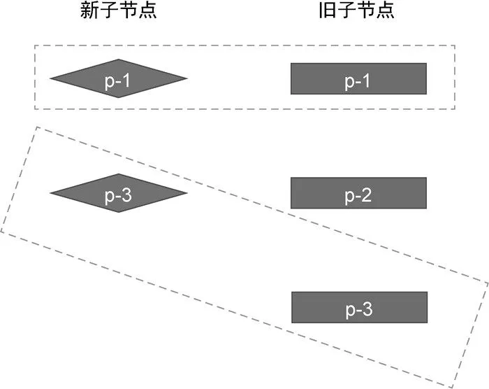

- 图 11-10　删除节点的情况

在这个例子中，新旧两组子节点的顺序如下。

```
旧的一组子节点：p-1、p-2、p-3。
新的一组子节点：p-1、p-3。
我们同样使用索引 j、oldEnd 和 newEnd 进行标记，如图 11-11 所示。
```

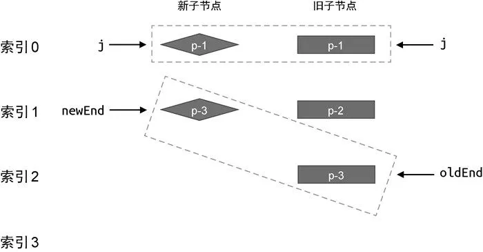

- 图 11-11　在删除节点的情况下，各个索引的关系

接着，对相同的前置节点进行预处理，处理后的状态如图 11-12 所示。

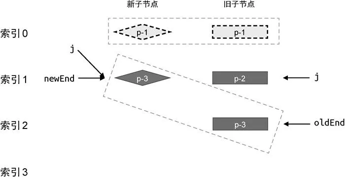

- 图 11-12　处理完前置节点后，各个索引的关系

然后，对相同的后置节点进行预处理，处理后的状态如图 11-13 所示。

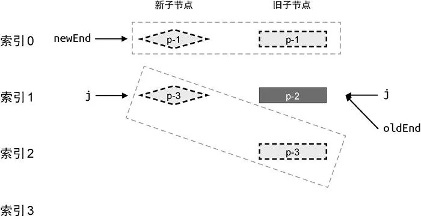

- 图 11-13　处理完后置节点后，各个索引的关系

由图 11-13 可知，当相同的前置节点和后置节点全部被处理完毕后，新的一组子节点已经全部

```
被处理完毕了，而旧的一组子节点中遗留了一个节点 p-2。这说明，应该卸载节点 p-2。实
```

际上，遗留的节点可能有多个，如图 11-14 所示。

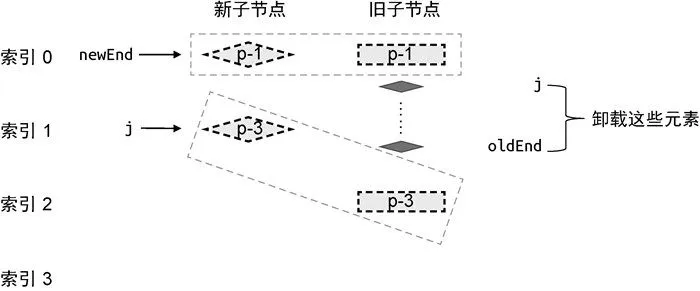

- 图 11-14　遗留的节点可能有多个

```xml
索引 j 和索引 oldEnd 之间的任何节点都应该被卸载，具体实现如下：
function patchKeyedChildren(n1, n2, container) {
  const newChildren = n2.children
  const oldChildren = n1.children
  // 更新相同的前置节点
  // 省略部分代码
<p>// 更新相同的后置节点
// 省略部分代码</p>
<p>if (j > oldEnd && j <= newEnd) {
// 省略部分代码
} else if (j > newEnd && j <= oldEnd) {
// j -> oldEnd 之间的节点应该被卸载
while (j <= oldEnd) {
unmount(oldChildren[j++])
}
}</p>
}
在上面这段代码中，我们新增了一个 else...if 分支。当满足条件 j > newEnd && j
<= oldEnd 时，则开启一个 while 循环，并调用 unmount 函数逐个卸载这些遗留节点。
```

## 11.2　判断是否需要进行 DOM 移动操作

在上一节中，我们讲解了快速 Diff 算法的预处理过程，即处理相同的前置节点和后置节点。但是，上一节给出的例子比较理想化，当处理完相同的前置节点或后置节点后，新旧两组子节点中总会有一组子节点全部被处理完毕。在这种情况下，只需要简单地挂载、卸载节点即可。但有时情况会比较复杂，如图 11-15 中给出的例子。

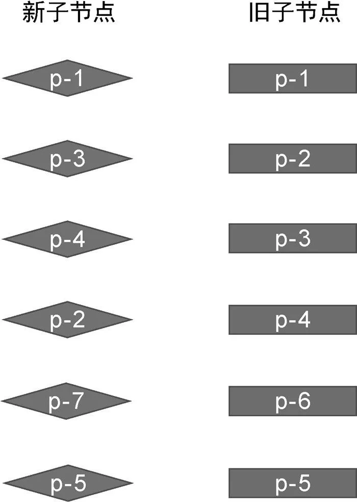

- 图 11-15　复杂情况下的新旧两组子节点

在这个例子中，新旧两组子节点的顺序如下。

```
旧的一组子节点：p-1、p-2、p-3、p-4、p-6、p-5。
新的一组子节点：p-1、p-3、p-4、p-2、p-7、p-5。
可以看到，与旧的一组子节点相比，新的一组子节点多出了一个新节点 p-7，少了一个节点
p-6。这个例子并不像上一节给出的例子那样理想化，我们无法简单地通过预处理过程完成更
新。在这个例子中，相同的前置节点只有 p-1，而相同的后置节点只有 p-5，如图 11-16 所
```

示。

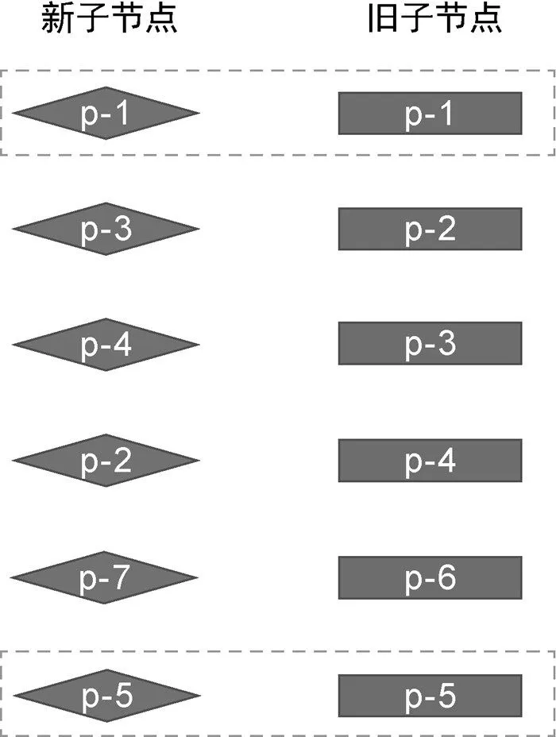

- 图 11-16　复杂情况下仅有少量相同的前置节点和后置节点

图 11-17 给出了经过预处理后两组子节点的状态。

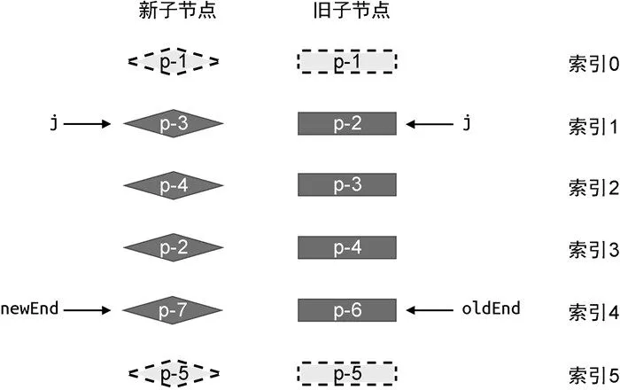

- 图 11-17　处理完前置节点和后置节点后的状态

可以看到，经过预处理后，无论是新的一组子节点，还是旧的一组子节点，都有部分节点未经处理。这时就需要我们进一步处理。怎么处理呢？其实无论是简单 Diff 算法，还是双端 Diff 算法，抑或本章介绍的快速 Diff 算法，它们都遵循同样的处理规则：

- 判断是否有节点需要移动，以及应该如何移动；

- 找出那些需要被添加或移除的节点。

所以接下来我们的任务就是，判断哪些节点需要移动，以及应该如何移动。观察图 11-17 可

```
知，在这种非理想的情况下，当相同的前置节点和后置节点被处理完毕后，索引 j、newEnd
和 oldEnd 不满足下面两个条件中的任何一个：
```

- j > oldEnd && j <= newEnd

- j > newEnd && j <= oldEnd

```xml
因此，我们需要增加新的 else 分支来处理图 11-17 所示的情况，如下面的代码所示：
function patchKeyedChildren(n1, n2, container) {
  const newChildren = n2.children
  const oldChildren = n1.children
  // 更新相同的前置节点
  // 省略部分代码
<p>// 更新相同的后置节点
// 省略部分代码</p>
<p>if (j > oldEnd && j <= newEnd) {
// 省略部分代码
} else if (j > newEnd && j <= oldEnd) {
// 省略部分代码
} else {
// 增加 else 分支来处理非理想情况
}</p>
}
后续的处理逻辑将会编写在这个 else 分支内。知道了在哪里编写处理代码，接下来我们讲解
具体的处理思路。首先，我们需要构造一个数组 source，它的长度等于新的一组子节点在经
过预处理之后剩余未处理节点的数量，并且 source 中每个元素的初始值都是 -1，如图 11-
```

18 所示。

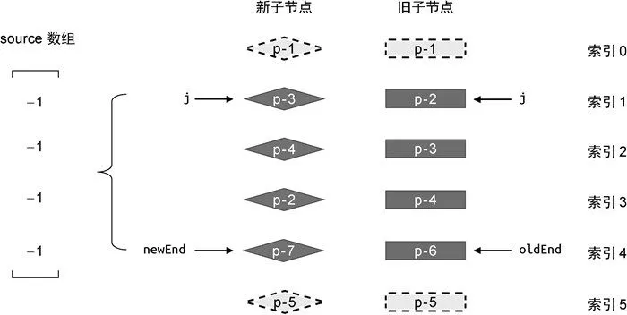

```javascript
图 11-18　构造 source 数组
我们可以通过下面的代码完成 source 数组的构造：
if (j > oldEnd && j <= newEnd) {
  // 省略部分代码
} else if (j > newEnd && j <= oldEnd) {
  // 省略部分代码
} else {
  // 构造 source 数组
  // 新的一组子节点中剩余未处理节点的数量
  const count = newEnd - j + 1
  const source = new Array(count)
  source.fill(-1)
}
```

如上面的代码所示。首先，我们需要计算新的一组子节点中剩余未处理节点的数量，即

```
newEnd - j + 1，然后创建一个长度与之相同的数组 source，最后使用 fill 函数完成
数组的填充。那么，数组 source 的作用是什么呢？观察图 11-18 可以发现，数组 source
中的每一个元素分别与新的一组子节点中剩余未处理节点对应。实际上，source 数组将用来
```

存储新的一组子节点中的节点在旧的一组子节点中的位置索引，后面将会使用它计算出一个最长递增子序列，并用于辅助完成 DOM 移动的操作，如图 11-19 所示。

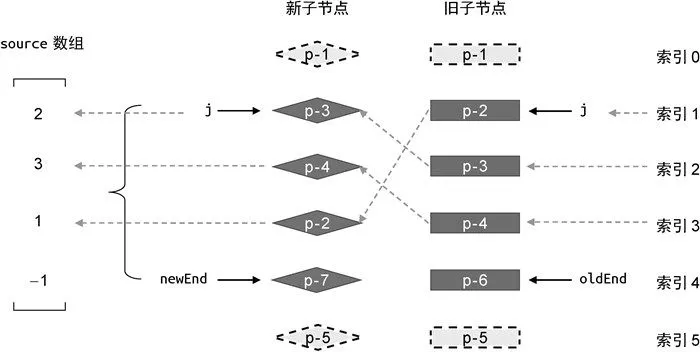

```
图 11-19　填充 source 数组
图 11-19 展示了填充 source 数组的过程。由于 source 数组存储的是新子节点在旧的一组
```

子节点中的位置索引，所以有：

```
新的一组子节点中的节点 p-3 在旧的一组子节点中的索引为 2，因此 source 数组的第一
个元素值为 2；
新的一组子节点中的节点 p-4 在旧的一组子节点中的索引为 3，因此 source 数组的第二
个元素值为 3；
新的一组子节点中的节点 p-2 在旧的一组子节点中的索引为 1，因此 source 数组的第三
个元素值为 1；
新的一组子节点中的节点 p-7 比较特殊，因为在旧的一组子节点中没有与其 key 值相等的
节点，所以 source 数组的第四个元素值保留原来的 -1。
我们可以通过两层 for 循环来完成 source 数组的填充工作，外层循环用于遍历旧的一组子
```

节点，内层循环用于遍历新的一组子节点：

```javascript
if (j > oldEnd && j <= newEnd) {
  // 省略部分代码
} else if (j > newEnd && j <= oldEnd) {
  // 省略部分代码
} else {
  const count = newEnd - j + 1
  const source = new Array(count)
  source.fill(-1)
// oldStart 和 newStart 分别为起始索引，即 j
const oldStart = j
const newStart = j
// 遍历旧的一组子节点
for (let i = oldStart; i <= oldEnd; i++) {
const oldVNode = oldChildren[i]
// 遍历新的一组子节点
for (let k = newStart; k <= newEnd; k++) {
const newVNode = newChildren[k]
// 找到拥有相同 key 值的可复用节点
if (oldVNode.key === newVNode.key) {
// 调用 patch 进行更新
patch(oldVNode, newVNode, container)
// 最后填充 source 数组
source[k - newStart] = i
}
}
}
}
```

```
这里需要注意的是，由于数组 source 的索引是从 0 开始的，而未处理节点的索引未必从 0
开始，所以在填充数组时需要使用表达式 k - newStart 的值作为数组的索引值。外层循环
的变量 i 就是当前节点在旧的一组子节点中的位置索引，因此直接将变量 i 的值赋给
source[k - newStart] 即可。
现在，source 数组已经填充完毕，我们后面会用到它。不过在进一步讲解之前，我们需要回
头思考一下上面那段用于填充 source 数组的代码存在怎样的问题。这段代码中我们采用了
两层嵌套的循环，其时间复杂度为 O(n1 * n2)，其中 n1 和 n2 为新旧两组子节点的数量，
我们也可以使用 O(n^2) 来表示。当新旧两组子节点的数量较多时，两层嵌套的循环会带来
```

性能问题。出于优化的目的，我们可以为新的一组子节点构建一张索引表，用来存储节点的

```
key 和节点位置索引之间的映射，如图 11-20 所示。
```

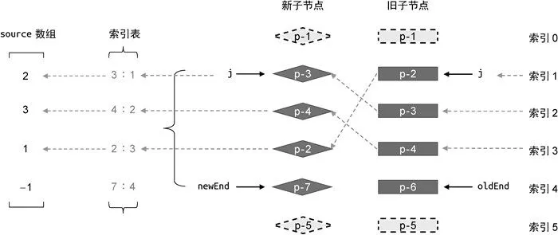

```xml
图 11-20　使用索引表填充 source 数组
有了索引表，我们就可以利用它快速地填充 source 数组，如下面的代码所示：
if (j > oldEnd && j <= newEnd) {
  // 省略部分代码
} else if (j > newEnd && j <= oldEnd) {
  // 省略部分代码
} else {
  const count = newEnd - j + 1
  const source = new Array(count)
  source.fill(-1)
<p>// oldStart 和 newStart 分别为起始索引，即 j
const oldStart = j
const newStart = j
// 构建索引表
const keyIndex = {}
for(let i = newStart; i <= newEnd; i++) {
keyIndex[newChildren[i].key] = i
}
// 遍历旧的一组子节点中剩余未处理的节点
for(let i = oldStart; i <= oldEnd; i++) {
oldVNode = oldChildren[i]
// 通过索引表快速找到新的一组子节点中具有相同 key 值的节点位置
const k = keyIndex[oldVNode.key]</p>
<pre><code> if (typeof k !== 'undefined') {
  newVNode = newChildren[k]
  // 调用 patch 函数完成更新
  patch(oldVNode, newVNode, container)
  // 填充 source 数组
  source[k - newStart] = i
} else {
  // 没找到
  unmount(oldVNode)
}
</code></pre> if (typeof k !== 'undefined') {
  newVNode = newChildren[k]
  // 调用 patch 函数完成更新
  patch(oldVNode, newVNode, container)
  // 填充 source 数组
  source[k - newStart] = i
} else {
  // 没找到
  unmount(oldVNode)
}
}
}
```

```
在上面这段代码中，同样使用了两个 for 循环，不过它们不再是嵌套的关系，所以能够将代
码的时间复杂度降至 O(n)。其中，第一个 for 循环用来构建索引表，索引表存储的是节点
的 key 值与节点在新的一组子节点中位置索引之间的映射，第二个 for 循环用来遍历旧的一
组子节点。可以看到，我们拿旧子节点的 key 值去索引表 keyIndex 中查找该节点在新的一
组子节点中的位置，并将查找结果存储到变量 k 中。如果 k 存在，说明该节点是可复用的，
所以我们调用 patch 函数进行打补丁，并填充 source 数组；否则说明该节点已经不存在于
新的一组子节点中了，这时我们需要调用 unmount 函数卸载它。
上述流程执行完毕后，source 数组已经填充完毕了。接下来我们应该思考的是，如何判断节
```

点是否需要移动。实际上，快速 Diff 算法判断节点是否需要移动的方法与简单 Diff 算法类似，如下面的代码所示：

```xml
if (j > oldEnd && j <= newEnd) {
  // 省略部分代码
} else if (j > newEnd && j <= oldEnd) {
  // 省略部分代码
} else {
  // 构造 source 数组
  const count = newEnd - j + 1  // 新的一组子节点中剩余未处理节点的数量
  const source = new Array(count)
  source.fill(-1)
<p>const oldStart = j
const newStart = j
// 新增两个变量，moved 和 pos
let moved = false
let pos = 0</p>
<p>const keyIndex = {}
for(let i = newStart; i <= newEnd; i++) {
keyIndex[newChildren[i].key] = i
}
for(let i = oldStart; i <= oldEnd; i++) {
oldVNode = oldChildren[i]
const k = keyIndex[oldVNode.key]</p>
<pre><code> if (typeof k !== 'undefined') {
  newVNode = newChildren[k]
  patch(oldVNode, newVNode, container)
  source[k - newStart] = i
  // 判断节点是否需要移动
  if (k &lt; pos) {
    moved = true
  } else {
    pos = k
  }
} else {
  unmount(oldVNode)
}
</code></pre> if (typeof k !== 'undefined') {
  newVNode = newChildren[k]
  patch(oldVNode, newVNode, container)
  source[k - newStart] = i
  // 判断节点是否需要移动
  if (k &lt; pos) {
    moved = true
  } else {
    pos = k
  }
} else {
  unmount(oldVNode)
}
}
}
在上面这段代码中，我们新增了两个变量 moved 和 pos。前者的初始值为 false，代表是
否需要移动节点，后者的初始值为 0，代表遍历旧的一组子节点的过程中遇到的最大索引值
k。我们在讲解简单 Diff 算法时曾提到，如果在遍历过程中遇到的索引值呈现递增趋势，则说
明不需要移动节点，反之则需要。所以在第二个 for 循环内，我们通过比较变量 k 与变量
pos 的值来判断是否需要移动节点。
```

除此之外，我们还需要一个数量标识，代表已经更新过的节点数量。我们知道，已经更新过的节点数量应该小于新的一组子节点中需要更新的节点数量。一旦前者超过后者，则说明有多余的节点，我们应该将它们卸载，如下面的代码所示：

```javascript
if (j > oldEnd && j <= newEnd) {
  // 省略部分代码
} else if (j > newEnd && j <= oldEnd) {
  // 省略部分代码
} else {
  // 构造 source 数组
  const count = newEnd - j + 1
  const source = new Array(count)
  source.fill(-1)
const oldStart = j
const newStart = j
let moved = false
let pos = 0
const keyIndex = {}
for(let i = newStart; i <= newEnd; i++) {
keyIndex[newChildren[i].key] = i
}
// 新增 patched 变量，代表更新过的节点数量
let patched = 0
for(let i = oldStart; i <= oldEnd; i++) {
oldVNode = oldChildren[i]
// 如果更新过的节点数量小于等于需要更新的节点数量，则执行更新
if (patched <= count) {
const k = keyIndex[oldVNode.key]
if (typeof k !== ‘undefined’) {
newVNode = newChildren[k]
patch(oldVNode, newVNode, container)
// 每更新一个节点，都将 patched 变量 +1
patched++
source[k - newStart] = i
if (k < pos) {
moved = true
} else {
pos = k
}
} else {
// 没找到
unmount(oldVNode)
}
} else {
// 如果更新过的节点数量大于需要更新的节点数量，则卸载多余的节点
unmount(oldVNode)
}
}
}
在上面这段代码中，我们增加了 patched 变量，其初始值为 0，代表更新过的节点数量。接
着，在第二个 for 循环中增加了判断 patched <= count，如果此条件成立，则正常执行
更新，并且每次更新后都让变量 patched 自增；否则说明剩余的节点都是多余的，于是调用
unmount 函数将它们卸载。
现在，我们通过判断变量 moved 的值，已经能够知道是否需要移动节点，同时也处理了很多
```

边界条件。接下来我们讨论如何移动节点。

## 11.3　如何移动元素

在上一节中，我们实现了两个目标。

```
判断是否需要进行 DOM 移动操作。我们创建了变量 moved 作为标识，当它的值为 true
```

- 时，说明需要进行 DOM 移动操作。

```
构建 source 数组。该数组的长度等于新的一组子节点去掉相同的前置 / 后置节点后，剩
余未处理节点的数量。source 数组中存储着新的一组子节点中的节点在旧的一组子节点中
的位置，后面我们会根据 source 数组计算出一个最长递增子序列，用于 DOM 移动操
```

- 作。

接下来，我们讨论如何进行 DOM 移动操作，如下面的代码所示：

```javascript
if (j > oldEnd && j <= newEnd) {
  // 省略部分代码
} else if (j > newEnd && j <= oldEnd) {
  // 省略部分代码
} else {
  // 省略部分代码
  for(let i = oldStart; i <= oldEnd; i++) {
    // 省略部分代码
  }
if (moved) {
// 如果 moved 为真，则需要进行 DOM 移动操作
}
}
```

```
在上面这段代码中，我们在 for 循环后增加了一个 if 判断分支。如果变量 moved 的值为
true，则说明需要进行 DOM 移动操作，所以用于 DOM 移动操作的逻辑将编写在该 if 语句
```

块内。

```
为了进行 DOM 移动操作，我们首先要根据 source 数组计算出它的最长递增子序列。
source 数组仍然取用在 11.2 节中给出的例子，如图 11-21 所示。
```

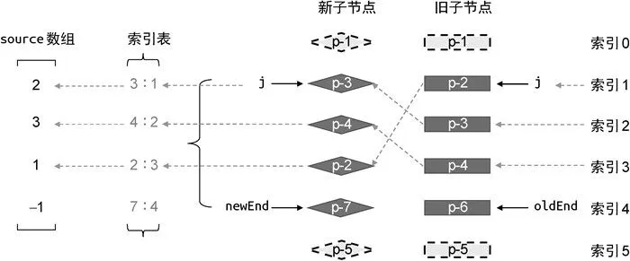

```
图 11-21　用于计算 source 数组的递增子序列的例子
在这个例子中，我们计算出 source 数组为 [2, 3, 1, -1]。那么，该数组的最长递增子
```

序列是什么呢？这就需要我们了解最长递增子序列的概念。为此，我们先要搞清楚什么是一个序列的递增子序列。简单来说，给定一个数值序列，找到它的一个子序列，并且该子序列中的值是递增的，子序列中的元素在原序列中不一定连续。一个序列可能有很多个递增子序列，其

```
中最长的那一个就称为最长递增子序列。举个例子，假设给定数值序列 [ 0, 8, 4, 12
]，那么它的最长递增子序列就是 [0, 8, 12]。当然，对于同一个数值序列来说，它的最长
递增子序列可能有多个，例如 [0, 4, 12] 也是本例的答案之一。
理解了什么是最长递增子序列，接下来我们就可以求解 source 数组的最长递增子序列了，
```

如下面的代码所示：

```javascript
if (moved) {
  // 计算最长递增子序列
  const seq = lis(sources) // [ 0, 1 ]
}
在上面这段代码中，我们使用 lis 函数计算一个数组的最长递增子序列。lis 函数接收
source 数组作为参数，并返回 source 数组的最长递增子序列之一。在上例中，你可能疑
惑为什么通过 lis 函数计算得到的是 [0, 1]？实际上，source 数组 [2, 3, 1, -1] 的
最长递增子序列应该是 [2, 3]，但我们得到的结果是 [0, 1]，这是为什么呢？这是因为
lis 函数的返回结果是最长递增子序列中的元素在 source 数组中的位置索引，如图 11-22
```

所示。

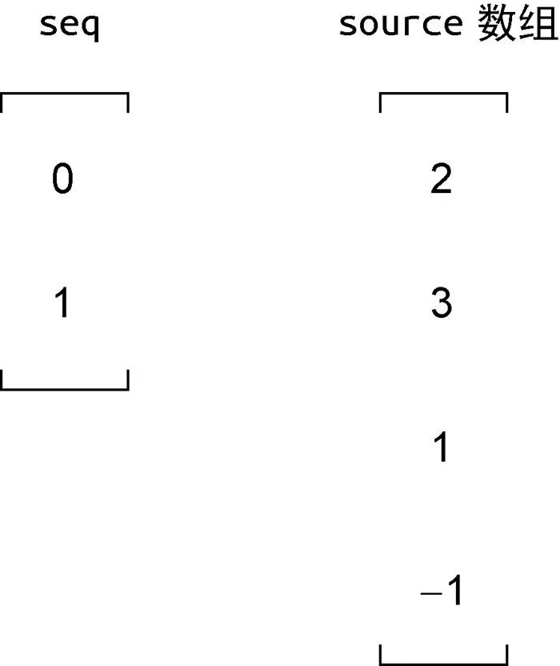

```
图 11-22　递增子序列中存储的是 source 数组内元素的位置索引
因为 source 数组的最长递增子序列为 [2, 3]，其中元素 2 在该数组中的索引为 0，而数
组 3 在该数组中的索引为 1，所以最终结果为 [0, 1]。
```

有了最长递增子序列的索引信息后，下一步要重新对节点进行编号，如图 11-23 所示。

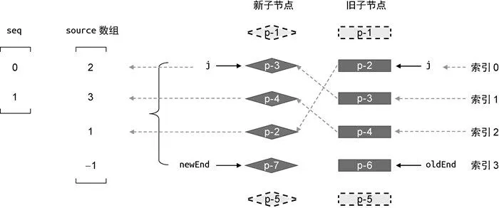

- 图 11-23　重新对节点进行编号后的状态

```
观察图 11-23，在编号时，我们忽略了经过预处理的节点 p-1 和 p-5。所以，索引为 0 的节
点是 p-2，而索引为 1 节点是 p-3，以此类推。重新编号是为了让子序列 seq 与新的索引值
产生对应关系。其实，最长递增子序列 seq 拥有一个非常重要的意义。以上例来说，子序列
seq 的值为 [0, 1]，它的含义是：在新的一组子节点中，重新编号后索引值为 0 和 1 的这
两个节点在更新前后顺序没有发生变化。换句话说，重新编号后，索引值为 0 和 1 的节点不
需要移动。在新的一组子节点中，节点 p-3 的索引为 0，节点 p-4 的索引为 1，所以节点
p-3 和 p-4 所对应的真实 DOM 不需要移动。换句话说，只有节点 p-2 和 p-7 可能需要移
```

动。

```
为了完成节点的移动，我们还需要创建两个索引值 i 和 s：
用索引 i 指向新的一组子节点中的最后一个节点；
用索引 s 指向最长递增子序列中的最后一个元素。
```

如图 11-24 所示。

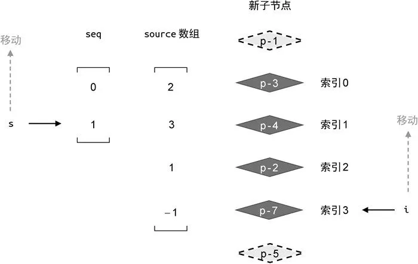

```
图 11-24　建立索引 s 和 i，分别指向子序列和索引的最后一个位置
```

观察图 11-24，为了简化图示，我们在去掉了旧的一组子节点以及无关的线条和变量。接下

```
来，我们将开启一个 for 循环，让变量 i 和 s 按照图 11-24 中箭头的方向移动，如下面的代
```

码所示：

```javascript
if (moved) {
  const seq = lis(sources)
// s 指向最长递增子序列的最后一个元素
let s = seq.length - 1
// i 指向新的一组子节点的最后一个元素
let i = count - 1
// for 循环使得 i 递减，即按照图 11-24 中箭头的方向移动
for (i; i >= 0; i–) {
if (i !== seq[s]) {
// 如果节点的索引 i 不等于 seq[s] 的值，说明该节点需要移动
} else {
// 当 i === seq[s] 时，说明该位置的节点不需要移动
// 只需要让 s 指向下一个位置
s–
}
}
}
其中，for 循环的目的是让变量 i 按照图 11-24 中箭头的方向移动，以便能够逐个访问新的
一组子节点中的节点，这里的变量 i 就是节点的索引。在 for 循环内，判断条件 i !==
seq[s]，如果节点的索引 i 不等于 seq[s] 的值，则说明该节点对应的真实 DOM 需要移
动，否则说明当前访问的节点不需要移动，但这时变量 s 需要按照图 11-24 中箭头的方向移
动，即让变量 s 递减。
接下来我们就按照上述思路执行更新。初始时索引 i 指向节点 p-7。由于节点 p-7 对应的
source 数组中相同位置的元素值为 -1，所以我们应该将节点 p-7 作为全新的节点进行挂
```

载，如下面的代码所示：

```javascript
if (moved) {
  const seq = lis(sources)
// s 指向最长递增子序列的最后一个元素
let s = seq.length - 1
// i 指向新的一组子节点的最后一个元素
let i = count - 1
// for 循环使得 i 递减，即按照图 11-24 中箭头的方向移动
for (i; i >= 0; i–) {
if (source[i] === -1) {
// 说明索引为 i 的节点是全新的节点，应该将其挂载
// 该节点在新 children 中的真实位置索引
const pos = i + newStart
const newVNode = newChildren[pos]
// 该节点的下一个节点的位置索引
const nextPos = pos + 1
// 锚点
const anchor = nextPos < newChildren.length
? newChildren[nextPos].el
: null
// 挂载
patch(null, newVNode, container, anchor)
} else if (i !== seq[s]) {
// 如果节点的索引 i 不等于 seq[s] 的值，说明该节点需要移动
} else {
// 当 i === seq[s] 时，说明该位置的节点不需要移动
// 只需要让 s 指向下一个位置
s–
}
}
}
```

```
如果 source[i] 的值为 -1，则说明索引为 i 的节点是全新的节点，于是我们调用 patch
函数将其挂载到容器中。这里需要注意的是，由于索引 i 是重新编号后的，因此为了得到真
实索引值，我们需要计算表达式 i + newStart 的值。
新节点创建完毕后，for 循环已经执行了一次，此时索引 i 向上移动一步，指向了节点 p-
2，如图 11-25 所示。
```

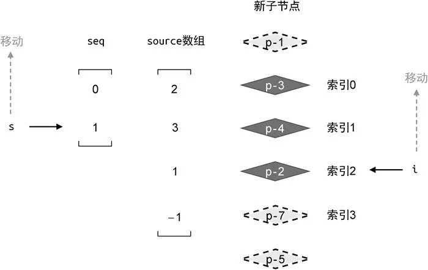

- 图 11-25　节点以及索引的当前状态

```sql
接着，进行下一轮 for 循环，步骤如下。
第一步：source[i] 是否等于 -1？很明显，此时索引 i 的值为 2，source[2] 的值等
于 1，因此节点 p-2 不是全新的节点，不需要挂载它，进行下一步的判断。
第二步：i !== seq[s] 是否成立？此时索引 i 的值为 2，索引 s 的值为 1。因此 2
!== seq[1] 成立，节点 p-2 所对应的真实 DOM 需要移动。
在第二步中，我们知道了节点 p-2 所对应的真实 DOM 应该移动。实现代码如下：
if (moved) {
  const seq = lis(sources)
// s 指向最长递增子序列的最后一个元素
let s = seq.length - 1
let i = count - 1
for (i; i >= 0; i–) {
if (source[i] === -1) {
// 省略部分代码
} else if (i !== seq[s]) {
// 说明该节点需要移动
// 该节点在新的一组子节点中的真实位置索引
const pos = i + newStart
const newVNode = newChildren[pos]
// 该节点的下一个节点的位置索引
const nextPos = pos + 1
// 锚点
const anchor = nextPos < newChildren.length
? newChildren[nextPos].el
: null
// 移动
insert(newVNode.el, container, anchor)
} else {
// 当 i === seq[s] 时，说明该位置的节点不需要移动
// 并让 s 指向下一个位置
s–
}
}
}
```

可以看到，移动节点的实现思路类似于挂载全新的节点。不同点在于，移动节点是通过

```sql
insert 函数来完成的。
接着，进行下一轮的循环。此时索引 i 指向节点 p-4，如图 11-26 所示。
```

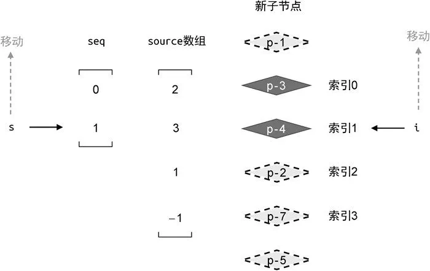

- 图 11-26　节点以及索引的当前状态

更新过程仍然分为三个步骤。

```
第一步：判断表达式 source[i] 的值是否等于 -1？很明显，此时索引 i 的值为 1，表达
式 source[1] 的值等于 3，条件不成立。所以节点 p-4 不是全新的节点，不需要挂载
```

- 它。接着进行下一步判断。

```
第二步：判断表达式 i !== seq[s] 是否成立？此时索引 i 的值为 1，索引 s 的值为
1。这时表达式 1 === seq[1] 为真，所以条件 i !== seq[s] 也不成立。
第三步：由于第一步和第二步中的条件都不成立，所以代码会执行最终的 else 分支。这
意味着，节点 p-4 所对应的真实 DOM 不需要移动，但我们仍然需要让索引 s 的值递减，
即 s--。
经过三步判断之后，我们得出结论：节点 p-4 不需要移动。于是进行下一轮循环，此时的状
```

态如图 11-27 所示。

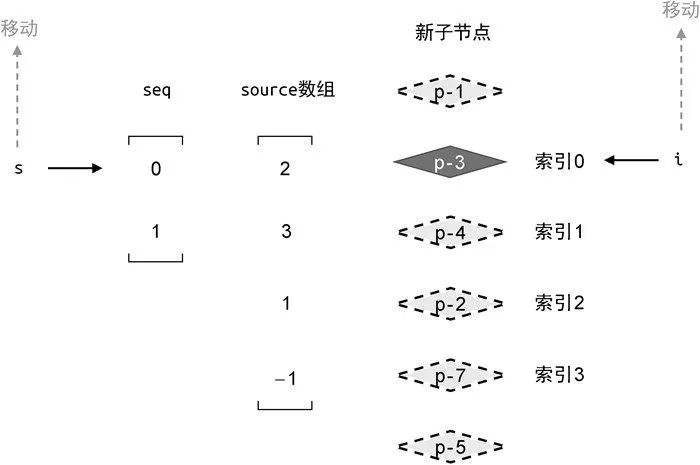

- 图 11-27　节点以及索引的当前状态

```
由图 11-27 可知，此时索引 i 指向节点 p-3。我们继续进行三个步骤的判断。
第一步：判断表达式 source[i] 的值是否等于 -1？很明显，此时索引 i 的值为 0，表达
式 source[0] 的值等于 2，所以节点 p-3 不是全新的节点，不需要挂载它，接着进行下
```

- 一步判断。

```
第二步：判断表达式 i !== seq[s] 是否成立？此时索引 i 的值为 0，索引 s 的值也为
0。这时表达式 0 === seq[0] 为真，因此条件也不成立，最终将执行 else 分支的代
```

- 码，也就是第三步。

```
第三步：到了这里，意味着节点 p-3 所对应的真实 DOM 也不需要移动。
```

在这一轮更新完成之后，循环将会停止，更新完成。

需要强调的是，关于给定序列的递增子序列的求法不在本书的讲解范围内，网络上有大量文章讲解了这方面的内容，读者可以自行查阅。如下是用于求解给定序列的最长递增子序列的代码，取自 Vue.js 3：

```javascript
function getSequence(arr) {
  const p = arr.slice()
  const result = [0]
  let i, j, u, v, c
  const len = arr.length
  for (i = 0; i < len; i++) {
    const arrI = arr[i]
    if (arrI !== 0) {
      j = result[result.length - 1]
      if (arr[j] < arrI) {
        p[i] = j
        result.push(i)
        continue
      }
      u = 0
      v = result.length - 1
      while (u < v) {
        c = ((u + v) / 2) | 0
        if (arr[result[c]] < arrI) {
          u = c + 1
        } else {
          v = c
        }
      }
      if (arrI < arr[result[u]]) {
        if (u > 0) {
          p[i] = result[u - 1]
        }
        result[u] = i
      }
    }
  }
  u = result.length
  v = result[u - 1]
  while (u-- > 0) {
    result[u] = v
    v = p[v]
  }
  return result
}
```

## 11.4　总结

快速 Diff 算法在实测中性能最优。它借鉴了文本 Diff 中的预处理思路，先处理新旧两组子节点中相同的前置节点和相同的后置节点。当前置节点和后置节点全部处理完毕后，如果无法简单地通过挂载新节点或者卸载已经不存在的节点来完成更新，则需要根据节点的索引关系，构造出一个最长递增子序列。最长递增子序列所指向的节点即为不需要移动的节点。
