# 第15章编译器核心技术概览(1)

## 第 15 章　编译器核心技术概览

编译技术是一门庞大的学科，我们无法用几个章节对其做完善的讲解。但不同用途的编译器或编译技术的难度可能相差很大，对知识的掌握要求也会相差很多。如果你要实现诸如 C、JavaScript 这类通用用途语言（general purpose language），那么就需要掌握较多编译技术知识。例如，理解上下文无关文法，使用巴科斯范式（BNF），扩展巴科斯范式（EBNF）书写语法规则，完成语法推导，理解和消除左递归，递归下降算法，甚至类型系统方面的知识等。但作为前端工程师，我们应用编译技术的场景通常是：表格、报表中的自定义公式计算器，设计一种领域特定语言（DSL）等。其中，实现公式计算器甚至只涉及编译前端技术，而领域特定语言根据其具体使用场景和目标平台的不同，难度会有所不同。Vue.js 的模板和 JSX 都属于领域特定语言，它们的实现难度属于中、低级别，只要掌握基本的编译技术理论即可实现这些功能。

## 15.1　模板 DSL 的编译器

编译器其实只是一段程序，它用来将“一种语言 A”翻译成“另外一种语言 B”。其中，语言 A 通常叫作源代码（source code），语言 B 通常叫作目标代码（object code 或 target code）。编译器将源代码翻译为目标代码的过程叫作编译（compile）。完整的编译过程通常包含词法分析、语法分析、语义分析、中间代码生成、优化、目标代码生成等步骤，如图 15-1 所示。

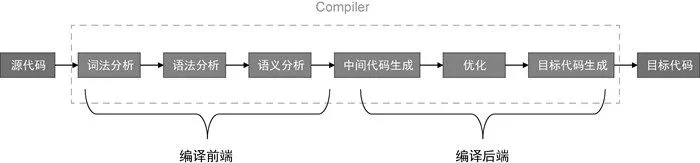

- 图 15-1　完整的编译过程

可以看到，整个编译过程分为编译前端和编译后端。编译前端包含词法分析、语法分析和语义分析，它通常与目标平台无关，仅负责分析源代码。编译后端则通常与目标平台有关，编译后端涉及中间代码生成和优化以及目标代码生成。但是，编译后端并不一定会包含中间代码生成和优化这两个环节，这取决于具体的场景和实现。中间代码生成和优化这两个环节有时也叫“中端”。

图 15-1 展示了“教科书”式的编译模型，但 Vue.js 的模板作为 DSL，其编译流程会有所不同。对于 Vue.js 模板编译器来说，源代码就是组件的模板，而目标代码是能够在浏览器平台上运行的 JavaScript 代码，或其他拥有 JavaScript 运行时的平台代码，如图 15-2 所示。

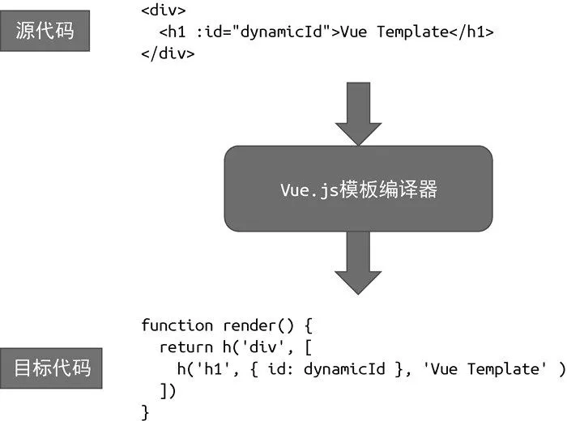

- 图 15-2　Vue.js 模板编译器的目标代码是 JavaScript 代码

可以看到，Vue.js 模板编译器的目标代码其实就是渲染函数。详细而言，Vue.js 模板编译器会首先对模板进行词法分析和语法分析，得到模板 AST。接着，将模板 AST 转换（transform）

成 JavaScript AST。最后，根据 JavaScript AST 生成 JavaScript 代码，即渲染函数代码。图15-3 给出了 Vue.js 模板编译器的工作流程。

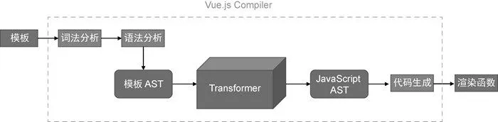

- 图 15-3　Vue.js 模板编译器的工作流程

AST 是 abstract syntax tree 的首字母缩写，即抽象语法树。所谓模板 AST，其实就是用来描述模板的抽象语法树。举个例子，假设我们有如下模板：

```xml
<div>
  <h1 v-if="ok">Vue Template</h1>
</div>
```

这段模板会被编译为如下所示的 AST：

```javascript
const ast = {
  // 逻辑根节点
  type: 'Root',
  children: [
    // div 标签节点
    {
      type: 'Element',
      tag: 'div',
      children: [
        // h1 标签节点
        {
          type: 'Element',
          tag: 'h1',
          props: [
            // v-if 指令节点
            {
              type: 'Directive', // 类型为 Directive 代表指令
              name: 'if'，       // 指令名称为 if，不带有前缀 v-
              exp: {
                // 表达式节点
                type: 'Expression',
                content: 'ok'
              }
            }
          ]
        }
      ]
    }
  ]
}
```

可以看到，AST 其实就是一个具有层级结构的对象。模板 AST 具有与模板同构的嵌套结构。

```
每一棵 AST 都有一个逻辑上的根节点，其类型为 Root。模板中真正的根节点则作为 Root
节点的 children 存在。观察上面的 AST，我们可以得出如下结论。
不同类型的节点是通过节点的 type 属性进行区分的。例如标签节点的 type 值为
'Element'。
标签节点的子节点存储在其 children 数组中。
标签节点的属性节点和指令节点会存储在 props 数组中。
不同类型的节点会使用不同的对象属性进行描述。例如指令节点拥有 name 属性，用来表
达指令的名称，而表达式节点拥有 content 属性，用来描述表达式的内容。
我们可以通过封装 parse 函数来完成对模板的词法分析和语法分析，得到模板 AST，如图
```

15-4 所示。

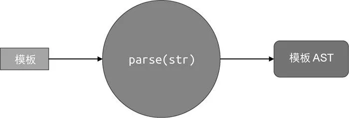

```
图 15-4　parse 函数的作用
```

我们也可以用下面的代码来表达模板解析的过程：

```xml
const template = `
  <div>
    <h1 v-if="ok">Vue Template</h1>
  </div>
`
const templateAST = parse(template)
可以看到，parse 函数接收字符串模板作为参数，并将解析后得到的 AST 作为返回值返回。
```

有了模板 AST 后，我们就可以对其进行语义分析，并对模板 AST 进行转换了。什么是语义分析呢？举几个例子。

```
检查 v-else 指令是否存在相符的 v-if 指令。
```

- 分析属性值是否是静态的，是否是常量等。

- 插槽是否会引用上层作用域的变量。

- ……

在语义分析的基础上，我们即可得到模板 AST。接着，我们还需要将模板 AST 转换为JavaScript AST。因为 Vue.js 模板编译器的最终目标是生成渲染函数，而渲染函数本质上是JavaScript 代码，所以我们需要将模板 AST 转换成用于描述渲染函数的 JavaScript AST。

```
我们可以封装 transform 函数来完成模板 AST 到 JavaScript AST 的转换工作，如图 15-5
```

所示。

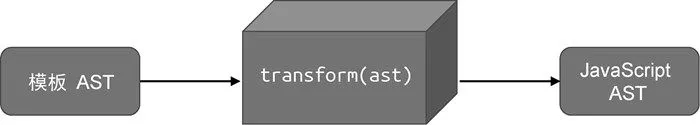

```
图 15-5　transform 函数的作用
```

同样，我们也可以用下面的代码来表达：

```javascript
const templateAST = parse(template)
const jsAST = transform(templateAST)
```

我们会在下一章详细讲解 JavaScript AST 的结构。

有了 JavaScript AST 后，我们就可以根据它生成渲染函数了，这一步可以通过封装

```
generate 函数来完成，如图 15-6 所示。
```

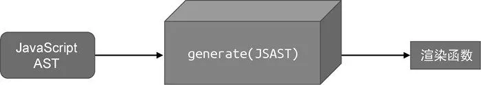

```
图 15-6　generate 函数的作用
```

我们也可以用下面的代码来表达代码生成的过程：

```javascript
const templateAST = parse(template)
const jsAST = transform(templateAST)
const code = generate(jsAST)
在上面这段代码中，generate 函数会将渲染函数的代码以字符串的形式返回，并存储在
code 常量中。图 15-7 给出了完整的流程。
```

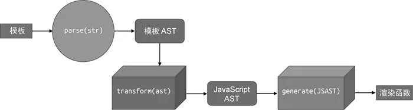

- 图 15-7　将 Vue.js 模板编译为渲染函数的完整流程

## 15.2　parser 的实现原理与状态机

在上一节中，我们讲解了 Vue.js 模板编译器的基本结构和工作流程，它主要由三个部分组成：

```
用来将模板字符串解析为模板 AST 的解析器（parser）；
用来将模板 AST 转换为 JavaScript AST 的转换器（transformer）；
用来根据 JavaScript AST 生成渲染函数代码的生成器（generator）。
本节，我们将详细讨论解析器 parser 的实现原理。
```

解析器的入参是字符串模板，解析器会逐个读取字符串模板中的字符，并根据一定的规则将整个字符串切割为一个个 Token。这里的 Token 可以视作词法记号，后续我们将使用 Token 一词来代表词法记号进行讲解。举例来说，假设有这样一段模板：

```xml
<p>Vue</p>
```

解析器会把这段字符串模板切割为三个 Token。

```
开始标签：<p>。
文本节点：Vue。
结束标签：</p>。
```

那么，解析器是如何对模板进行切割的呢？依据什么规则？这就不得不提到有限状态自动机。千万不要被这个名词吓到，它理解起来并不难。所谓“有限状态”，就是指有限个状态，而“自动机”意味着随着字符的输入，解析器会自动地在不同状态间迁移。拿上面的模板来说，当我们

```
分析这段模板字符串时，parse 函数会逐个读取字符，状态机会有一个初始状态，我们记为
```

“初始状态 1”。图 15-8 给出了状态迁移的过程。

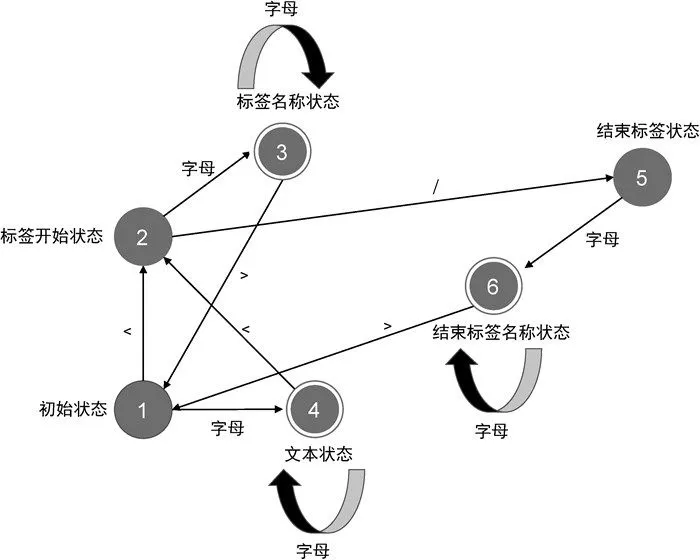

- 图 15-8　解析器的状态机图

我们用自然语言来描述图 15-8 给出的状态迁移过程。

- 状态机始于“初始状态 1”。

```
在“初始状态 1”下，读取模板的第一个字符 <，状态机会进入下一个状态，即“标签开始状态
```

- 2”。

```
在“标签开始状态 2”下，读取下一个字符 p。由于字符 p 是字母，所以状态机会进入“标签
```

- 名称状态 3”。

```
在“标签名称状态 3”下，读取下一个字符 >，此时状态机会从“标签名称状态 3”迁移回“初始
状态 1”，并记录在“标签名称状态”下产生的标签名称 p。
在“初始状态 1”下，读取下一个字符 V，此时状态机会进入“文本状态 4”。
在“文本状态 4”下，继续读取后续字符，直到遇到字符 < 时，状态机会再次进入“标签开始
状态 2”，并记录在“文本状态 4”下产生的文本内容，即字符串“Vue”。
在“标签开始状态 2”下，读取下一个字符 /，状态机会进入“结束标签状态 5”。
在“结束标签状态 5”下，读取下一个字符 p，状态机会进入“结束标签名称状态 6”。
在“结束标签名称状态 6”下，读取最后一个字符 >，它是结束标签的闭合字符，于是状态机
```

- 迁移回“初始状态 1”，并记录在“结束标签名称状态 6”下生成的结束标签名称。

经过这样一系列的状态迁移过程之后，我们最终就能够得到相应的 Token 了。观察图 15-8 可以发现，有的圆圈是单线的，而有的圆圈是双线的。双线代表此时状态机是一个合法的Token。

另外，图 15-8 给出的状态机并不严谨。实际上，解析 HTML 并构造 Token 的过程是有规范可循的。在 WHATWG 发布的关于浏览器解析 HTML 的规范中，详细阐述了状态迁移。图 15-9截取了该规范中定义的在“初始状态”下状态机的状态迁移过程。

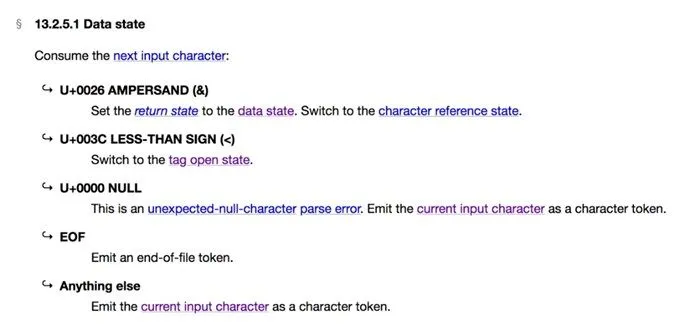

- 图 15-9　Data State

```
可以看到，在“初始状态”（Data State）下，当遇到字符 < 时，状态机会迁移到 tag open
state，即“标签开始状态”。如果遇到字符 < 以外的字符，规范中也都有对应的说明，应该让
```

状态机迁移到怎样的状态。不过 Vue.js 的模板作为一个 DSL，并非必须遵守该规范。但Vue.js 的模板毕竟是类 HTML 的实现，因此，尽可能按照规范来做，不会有什么坏处。更重要的一点是，规范中已经定义了非常详细的状态迁移过程，这对于我们编写解析器非常有帮助。

按照有限状态自动机的状态迁移过程，我们可以很容易地编写对应的代码实现。因此，有限状态自动机可以帮助我们完成对模板的标记化（tokenized），最终我们将得到一系列 Token。图15-8 中描述的状态机的实现如下：

```javascript
// 定义状态机的状态
const State = {
  initial: 1,    // 初始状态
  tagOpen: 2,    // 标签开始状态
  tagName: 3,    // 标签名称状态
  text: 4,       // 文本状态
  tagEnd: 5,     // 结束标签状态
  tagEndName: 6  // 结束标签名称状态
}
// 一个辅助函数，用于判断是否是字母
function isAlpha(char) {
  return char >= 'a' && char <= 'z' || char >= 'A' && char <= 'Z'
}
// 接收模板字符串作为参数，并将模板切割为 Token 返回
function tokenize(str) {
// 状态机的当前状态：初始状态
let currentState = State.initial
// 用于缓存字符
const chars = []
// 生成的 Token 会存储到 tokens 数组中，并作为函数的返回值返回
const tokens = []
// 使用 while 循环开启自动机，只要模板字符串没有被消费尽，自动机就会一直运行
while(str) {
// 查看第一个字符，注意，这里只是查看，没有消费该字符
const char = str[0]
// switch 语句匹配当前状态
switch (currentState) {
// 状态机当前处于初始状态
case State.initial:
// 遇到字符 <
if (char === ‘<’) {
// 1. 状态机切换到标签开始状态
currentState = State.tagOpen
// 2. 消费字符 <
str = str.slice(1)
} else if (isAlpha(char)) {
// 1. 遇到字母，切换到文本状态
currentState = State.text
// 2. 将当前字母缓存到 chars 数组
chars.push(char)
// 3. 消费当前字符
str = str.slice(1)
}
break
// 状态机当前处于标签开始状态
case State.tagOpen:
if (isAlpha(char)) {
// 1. 遇到字母，切换到标签名称状态
currentState = State.tagName
// 2. 将当前字符缓存到 chars 数组
chars.push(char)
// 3. 消费当前字符
str = str.slice(1)
} else if (char === ‘/’) {
// 1. 遇到字符 /，切换到结束标签状态
currentState = State.tagEnd
// 2. 消费字符 /
str = str.slice(1)
}
break
// 状态机当前处于标签名称状态
case State.tagName:
if (isAlpha(char)) {
// 1. 遇到字母，由于当前处于标签名称状态，所以不需要切换状态，
// 但需要将当前字符缓存到 chars 数组
chars.push(char)
// 2. 消费当前字符
str = str.slice(1)
} else if (char === ‘>’) {
// 1.遇到字符 >，切换到初始状态
currentState = State.initial
// 2. 同时创建一个标签 Token，并添加到 tokens 数组中
// 注意，此时 chars 数组中缓存的字符就是标签名称
tokens.push({
type: ‘tag’,
name: chars.join(‘’)
})
// 3. chars 数组的内容已经被消费，清空它
chars.length = 0
// 4. 同时消费当前字符 >
str = str.slice(1)
}
break
// 状态机当前处于文本状态
case State.text:
if (isAlpha(char)) {
// 1. 遇到字母，保持状态不变，但应该将当前字符缓存到 chars 数组
chars.push(char)
// 2. 消费当前字符
str = str.slice(1)
} else if (char === ‘<’) {
// 1. 遇到字符 <，切换到标签开始状态
currentState = State.tagOpen
// 2. 从 文本状态 --> 标签开始状态，此时应该创建文本 Token，并添加到 tokens 数组
// 注意，此时 chars 数组中的字符就是文本内容
tokens.push({
type: ‘text’,
content: chars.join(‘’)
0           })
1           // 3. chars 数组的内容已经被消费，清空它
2           chars.length = 0
3           // 4. 消费当前字符
4           str = str.slice(1)
5         }
6         break
7       // 状态机当前处于标签结束状态
8       case State.tagEnd:
9         if (isAlpha(char)) {
0           // 1. 遇到字母，切换到结束标签名称状态
1           currentState = State.tagEndName
2           // 2. 将当前字符缓存到 chars 数组
3           chars.push(char)
4           // 3. 消费当前字符
5           str = str.slice(1)
6         }
7         break
8       // 状态机当前处于结束标签名称状态
9       case State.tagEndName:
0         if (isAlpha(char)) {
1           // 1. 遇到字母，不需要切换状态，但需要将当前字符缓存到 chars 数组
2           chars.push(char)
3           // 2. 消费当前字符
4           str = str.slice(1)
5         } else if (char === ‘>’) {
6           // 1. 遇到字符 >，切换到初始状态
7           currentState = State.initial
8           // 2. 从 结束标签名称状态 --> 初始状态，应该保存结束标签名称 Token
9           // 注意，此时 chars 数组中缓存的内容就是标签名称
0           tokens.push({
1             type: ‘tagEnd’,
2             name: chars.join(‘’)
3           })
4           // 3. chars 数组的内容已经被消费，清空它
5           chars.length = 0
6           // 4. 消费当前字符
7           str = str.slice(1)
8         }
9         break
0     }
1   }
2
3   // 最后，返回 tokens
4   return tokens
5 }
```

上面这段代码看上去比较冗长，可优化的点非常多。这段代码高度还原了图 15-8 中展示的状态机，配合代码中的注释会更容易理解。

```javascript
使用上面给出的 tokenize 函数来解析模板 <p>Vue</p>，我们将得到三个 Token：
const tokens = tokenize(`<p>Vue</p>`)
// [
//   { type: 'tag', name: 'p' },        // 开始标签
//   { type: 'text', content: 'Vue' },  // 文本节点
//   { type: 'tagEnd', name: 'p' }      // 结束标签
// ]
```

现在，你已经明白了状态机的工作原理，以及模板编译器将模板字符串切割为一个个 Token的过程。但拿上述例子来说，我们并非总是需要所有 Token。例如，在解析模板的过程中，结

```
束标签 Token 可以省略。这时，我们就可以调整 tokenize 函数的代码，并选择性地忽略结
```

束标签 Token。当然，有时我们也可能需要更多的 Token，这都取决于具体的需求，然后据此灵活地调整代码实现。

总而言之，通过有限自动机，我们能够将模板解析为一个个 Token，进而可以用它们构建一棵

```
AST 了。但在具体构建 AST 之前，我们需要思考能否简化 tokenize 函数的代码。实际上，
我们可以通过正则表达式来精简 tokenize 函数的代码。上文之所以没有从最开始就采用正
```

则表达式来实现，是因为正则表达式的本质就是有限自动机。当你编写正则表达式的时候，其实就是在编写有限自动机。

## 15.3　构造 AST

实际上，不同用途的编译器之间可能会存在非常大的差异。它们唯一的共同点是，都会将源代码转换成目标代码。但如果深入细节即可发现，不同编译器之间的实现思路甚至可能完全不同，其中就包括 AST 的构造方式。对于通用用途语言（GPL）来说，例如 JavaScript 这样的脚本语言，想要为其构造 AST，较常用的一种算法叫作递归下降算法，这里面需要解决 GPL层面才会遇到的很多问题，例如最基本的运算符优先级问题。然而，对于像 Vue.js 模板这样的 DSL 来说，首先可以确定的一点是，它不具有运算符，所以也就没有所谓的运算符优先级问题。DSL 与 GPL 的区别在于，GPL 是图灵完备的，我们可以使用 GPL 来实现 DSL。而DSL 不要求图灵完备，它只需要满足特定场景下的特定用途即可。

为 Vue.js 的模板构造 AST 是一件很简单的事。HTML 是一种标记语言，它的格式非常固定，标签元素之间天然嵌套，形成父子关系。因此，一棵用于描述 HTML 的 AST 将拥有与 HTML标签非常相似的树型结构。举例来说，假设有如下模板：

```xml
<div><p>Vue</p><p>Template</p></div>
在上面这段模板中，最外层的根节点是 div 标签，它有两个 p 标签作为子节点。同时，这两
个 p 标签都具有一个文本节点作为子节点。我们可以将这段模板对应的 AST 设计为：
const ast = {
  // AST 的逻辑根节点
  type: 'Root',
  children: [
    // 模板的 div 根节点
    {
      type: 'Element',
      tag: 'div',
      children: [
        // div 节点的第一个子节点 p
        {
          type: 'Element',
          tag: 'p',
          // p 节点的文本节点
          children: [
            {
              type: 'Text',
              content: 'Vue'
            }
          ]
        },
        // div 节点的第二个子节点 p
        {
          type: 'Element',
          tag: 'p',
          // p 节点的文本节点
          children: [
            {
              type: 'Text',
              content: 'Template'
            }
          ]
        }
      ]
    }
  ]
}
```

可以看到，AST 在结构上与模板是“同构”的，它们都具有树型结构，如图 15-10 所示。

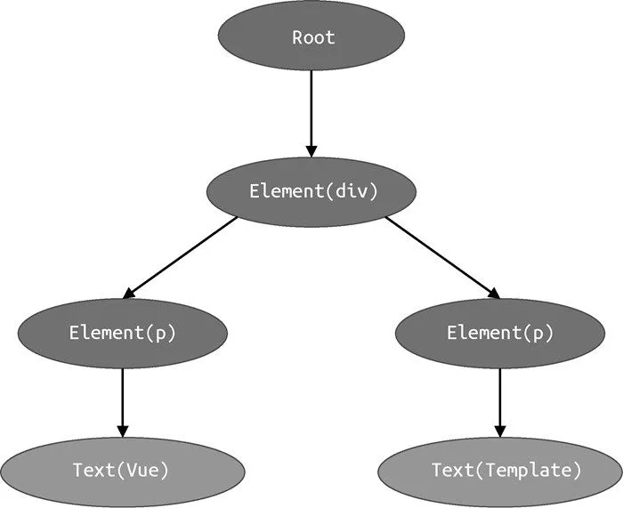

- 图 15-10　AST 的结构

了解了 AST 的结构，接下来我们的任务是，使用程序根据模板解析后生成的 Token 构造出这

```javascript
样一棵 AST。首先，我们使用上一节讲解的 tokenize 函数将本节开头给出的模板进行标记
化。解析这段模板得到的 tokens 如下所示：
const tokens = tokenize(`<div><p>Vue</p><p>Template</p></div>`)
执行上面这段代码，我们将得到如下 tokens：
const tokens = [
  ,          // div 开始标签节点
  ,            // p 开始标签节点
  ,      // 文本节点
  ,         // p 结束标签节点
  ,            // p 开始标签节点
  , // 文本节点
  ,         // p 结束标签节点
          // div 结束标签节点
]
```

根据 Token 列表构建 AST 的过程，其实就是对 Token 列表进行扫描的过程。从第一个 Token开始，顺序地扫描整个 Token 列表，直到列表中的所有 Token 处理完毕。在这个过程中，我

```
们需要维护一个栈 elementStack，这个栈将用于维护元素间的父子关系。每遇到一个开始
标签节点，我们就构造一个 Element 类型的 AST 节点，并将其压入栈中。类似地，每当遇
```

到一个结束标签节点，我们就将当前栈顶的节点弹出。这样，栈顶的节点将始终充当父节点的角色。扫描过程中遇到的所有节点，都会作为当前栈顶节点的子节点，并添加到栈顶节点的

```
children 属性下。
```

还是拿上例来说，图 15-11 给出了在扫描 Token 列表之前，Token 列表、父级元素栈和 AST三者的状态。

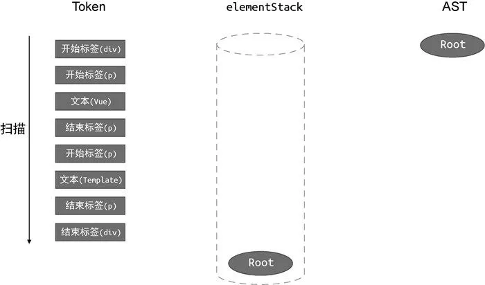

- 图 15-11　Token 列表、父级元素栈和 AST 三者的当前状态

在图 15-11 中，左侧的是 Token 列表，我们将会按照从上到下的顺序扫描 Token 列表，中间

```
和右侧分别展示了栈 elementStack 的状态和 AST 的状态。可以看到，它们最初都只有
Root 根节点。
接着，我们对 Token 列表进行扫描。首先，扫描到第一个 Token，即“开始标签（div）”，如
```

图 15-12 所示。

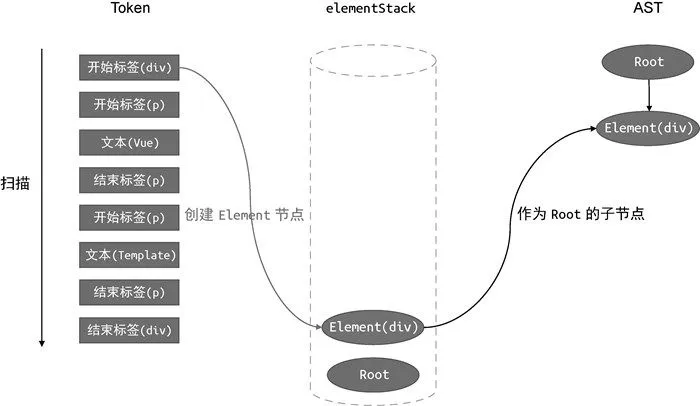

- 图 15-12　Token 列表、父级元素栈和 AST 三者的当前状态

```
由于当前扫描到的 Token 是一个开始标签节点，因此我们创建一个类型为 Element 的 AST
节点 Element(div)，然后将该节点作为当前栈顶节点的子节点。由于当前栈顶节点是
Root 根节点，所以我们将新建的 Element(div) 节点作为 Root 根节点的子节点添加到
AST 中，最后将新建的 Element(div) 节点压入 elementStack 栈。
```

接着，我们扫描下一个 Token，如图 15-13 所示。

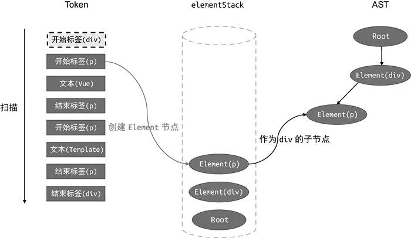

- 图 15-13　Token 列表、父级元素栈和 AST 三者的当前状态

```
扫描到的第二个 Token 也是一个开始标签节点，于是我们再创建一个类型为 Element 的
AST 节点 Element(p)，然后将该节点作为当前栈顶节点的子节点。由于当前栈顶节点为
Element(div) 节点，所以我们将新建的 Element(p) 节点作为 Element(div) 节点的子
节点添加到 AST 中，最后将新建的 Element(p) 节点压入 elementStack 栈。
```

接着，我们扫描下一个 Token，如图 15-14 所示。

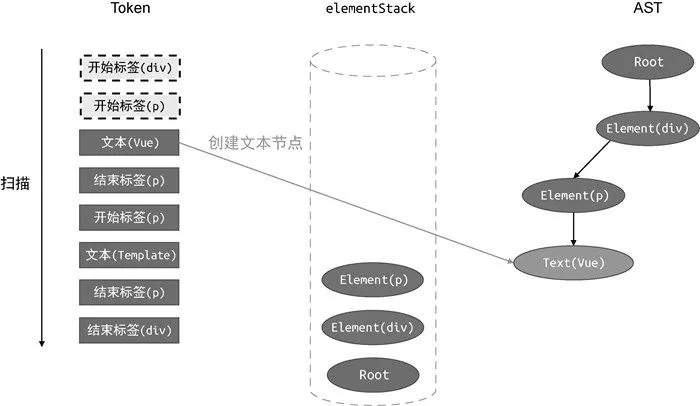

- 图 15-14　Token 列表、父级元素栈和 AST 三者的当前状态

```
扫描到的第三个 Token 是一个文本节点，于是我们创建一个类型为 Text 的 AST 节点
Text(Vue)，然后将该节点作为当前栈顶节点的子节点。由于当前栈顶节点为 Element(p)
节点，所以我们将新建的 Text(p) 节点作为 Element(p) 节点的子节点添加到 AST 中。
```

接着，扫描下一个 Token，如图 15-15 所示。

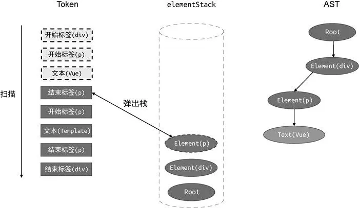

- 图 15-15　Token 列表、父级元素栈和 AST 三者的当前状态

```
此时扫描到的 Token 是一个结束标签，所以我们需要将栈顶的 Element(p) 节点从
elementStack 栈中弹出。接着，扫描下一个 Token，如图 15-16 所示。
```

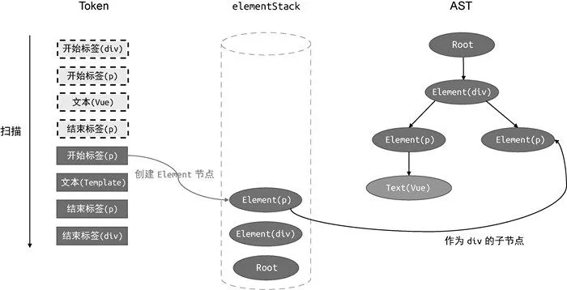

- 图 15-16　Token 列表、父级元素栈和 AST 三者的当前状态

```
此时扫描到的 Token 是一个开始标签。我们为它新建一个 AST 节点 Element(p)，并将其作
为当前栈顶节点 Element(div) 的子节点。最后，将 Element(p) 压入 elementStack
```

栈中，使其成为新的栈顶节点。

接着，扫描下一个 Token，如图 15-17 所示。

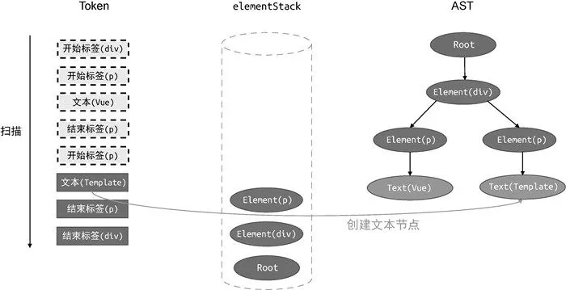

- 图 15-17　Token 列表、父级元素栈和 AST 三者的当前状态

此时扫描到的 Token 是一个文本节点，所以只需要为其创建一个相应的 AST 节点

```
Text(Template) 即可，然后将其作为当前栈顶节点 Element(p) 的子节点添加到 AST
```

中。

接着，扫描下一个 Token，如图 15-18 所示。

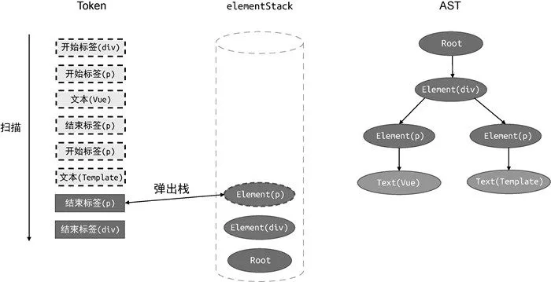

- 图 15-18　Token 列表、父级元素栈和 AST 三者的当前状态

```
此时扫描到的 Token 是一个结束标签，于是我们将当前的栈顶节点 Element(p) 从
elementStack 栈中弹出。
```

接着，扫描下一个 Token，如图 15-19 所示。

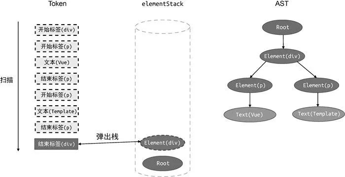

- 图 15-19　Token 列表、父级元素栈和 AST 三者的当前状态

```
此时，扫描到了最后一个 Token，它是一个 div 结束标签，所以我们需要再次将当前栈顶节
点 Element(div) 从 elementStack 栈中弹出。至此，所有 Token 都被扫描完毕，AST 构
```

建完成。图 15-20 给出了最终状态。

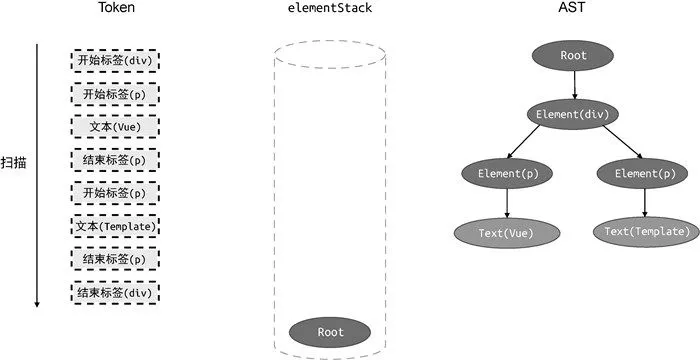

- 图 15-20　Token 列表、父级元素栈和 AST 三者的当前状态

如图 15-20 所示，在所有 Token 扫描完毕后，一棵 AST 就构建完成了。

扫描 Token 列表并构建 AST 的具体实现如下：

```xml
// parse 函数接收模板作为参数
function parse(str) {
  // 首先对模板进行标记化，得到 tokens
  const tokens = tokenize(str)
  // 创建 Root 根节点
  const root = {
    type: 'Root',
    children: []
  }
  // 创建 elementStack 栈，起初只有 Root 根节点
  const elementStack = [root]
<p>// 开启一个 while 循环扫描 tokens，直到所有 Token 都被扫描完毕为止
while (tokens.length) {
// 获取当前栈顶节点作为父节点 parent
const parent = elementStack[elementStack.length - 1]
// 当前扫描的 Token
const t = tokens[0]
switch (t.type) {
case ‘tag’:
// 如果当前 Token 是开始标签，则创建 Element 类型的 AST 节点
const elementNode = {
type: ‘Element’,
tag: t.name,
children: []
}
// 将其添加到父级节点的 children 中
parent.children.push(elementNode)
// 将当前节点压入栈
elementStack.push(elementNode)
break
case ‘text’:
// 如果当前 Token 是文本，则创建 Text 类型的 AST 节点
const textNode = {
type: ‘Text’,
content: t.content
}
// 将其添加到父节点的 children 中
parent.children.push(textNode)
break
case ‘tagEnd’:
// 遇到结束标签，将栈顶节点弹出
elementStack.pop()
break
}
// 消费已经扫描过的 token
tokens.shift()
}</p>
// 最后返回 AST
return root
}
```

上面这段代码很好地还原了上文中介绍的构建 AST 的思路，我们可以使用如下代码对其进行测试：

```javascript
const ast = parse(`<div><p>Vue</p><p>Template</p></div>`)
```

运行这句代码，我们将得到与本节开头给出的 AST 一致的结果。这里有必要说明一点，当前的实现仍然存在诸多问题，例如无法处理自闭合标签等。这些问题我们会在第 16 章详细讲解。
