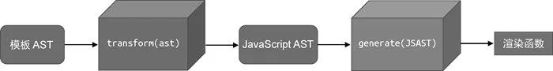
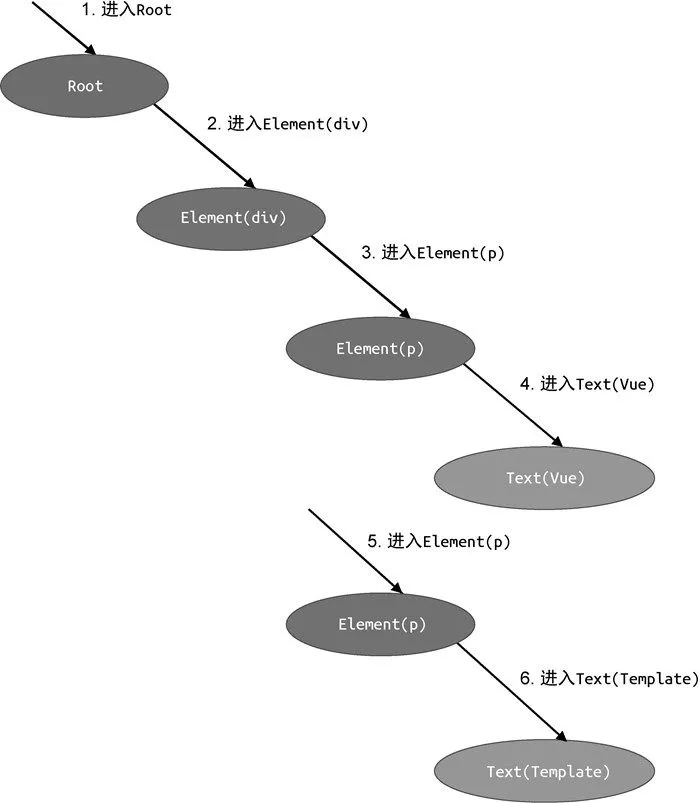
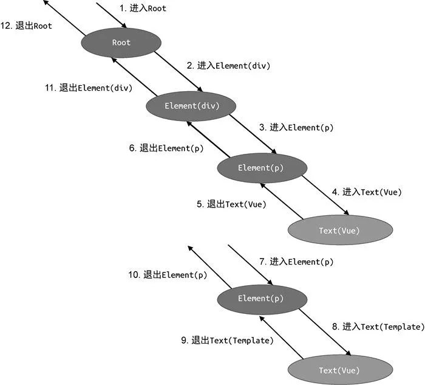

# 第15章编译器核心技术概览(2)

## 15.4　AST 的转换与插件化架构

在上一节中，我们完成了模板 AST 的构造。本节，我们将讨论关于 AST 的转换。所谓 AST的转换，指的是对 AST 进行一系列操作，将其转换为新的 AST 的过程。新的 AST 可以是原语言或原 DSL 的描述，也可以是其他语言或其他 DSL 的描述。例如，我们可以对模板 AST进行操作，将其转换为 JavaScript AST。转换后的 AST 可以用于代码生成。这其实就是Vue.js 的模板编译器将模板编译为渲染函数的过程，如图 15-21 所示。



- 图 15-21　模板编译器将模板编译为渲染函数的过程

```
其中 transform 函数就是用来完成 AST 转换工作的。
```

### 15.4.1　节点的访问

为了对 AST 进行转换，我们需要能访问 AST 的每一个节点，这样才有机会对特定节点进行修改、替换、删除等操作。由于 AST 是树型数据结构，所以我们需要编写一个深度优先的遍历算法，从而实现对 AST 中节点的访问。不过，在开始编写转换代码之前，我们有必要编写一

```xml
个 dump 工具函数，用来打印当前 AST 中节点的信息，如下面的代码所示：
function dump(node, indent = 0) {
  // 节点的类型
  const type = node.type
  // 节点的描述，如果是根节点，则没有描述
  // 如果是 Element 类型的节点，则使用 node.tag 作为节点的描述
  // 如果是 Text 类型的节点，则使用 node.content 作为节点的描述
  const desc = node.type === 'Root'
    ? ''
    : node.type === 'Element'
      ? node.tag
      : node.content
<p>// 打印节点的类型和描述信息
console.log(<code>${'-'.repeat(indent)}$: $</code>)</p>
${'-'.repeat(indent)}$: $// 递归地打印子节点
if (node.children) {
node.children.forEach(n => dump(n, indent + 2))
}
}
我们沿用上一节中给出的例子，看看使用 dump 函数会输出怎样的结果：
const ast = parse(`<div><p>Vue</p><p>Template</p></div>`)
console.log(dump(ast))
```

运行上面这段代码，将得到如下输出：

```
Root:
--Element: div
----Element: p
------Text: Vue
----Element: p
------Text: Template
可以看到，dump 函数以清晰的格式来展示 AST 中的节点。在后续编写 AST 的转换代码时，
我们将使用 dump 函数来展示转换后的结果。
```

接下来，我们将着手实现对 AST 中节点的访问。访问节点的方式是，从 AST 根节点开始，进行深度优先遍历，如下面的代码所示：

```xml
function traverseNode(ast) {
  // 当前节点，ast 本身就是 Root 节点
  const currentNode = ast
  // 如果有子节点，则递归地调用 traverseNode 函数进行遍历
  const children = currentNode.children
  if (children) {
    for (let i = 0; i < children.length; i++) {
      traverseNode(children[i])
    }
  }
}
traverseNode 函数用来以深度优先的方式遍历 AST，它的实现与 dump 函数几乎相同。有
了 traverseNdoe 函数之后，我们即可实现对 AST 中节点的访问。例如，我们可以实现一
个转换功能，将 AST 中所有 p 标签转换为 h1 标签，如下面的代码所示：
function traverseNode(ast) {
  // 当前节点，ast 本身就是 Root 节点
  const currentNode = ast
<p>// 对当前节点进行操作
if (currentNode.type === ‘Element’ && currentNode.tag === ‘p’) {
// 将所有 p 标签转换为 h1 标签
currentNode.tag = ‘h1’
}</p>
// 如果有子节点，则递归地调用 traverseNode 函数进行遍历
const children = currentNode.children
if (children) {
for (let i = 0; i < children.length; i++) {
traverseNode(children[i])
}
}
}
在上面这段代码中，我们通过检查当前节点的 type 属性和 tag 属性，来确保被操作的节点
是 p 标签。接着，我们将符合条件的节点的 tag 属性值修改为 'h1'，从而实现 p 标签到
h1 标签的转换。我们可以使用 dump 函数打印转换后的 AST 的信息，如下面的代码所示：
// 封装 transform 函数，用来对 AST 进行转换
function transform(ast) {
  // 调用 traverseNode 完成转换
  traverseNode(ast)
  // 打印 AST 信息
  console.log(dump(ast))
}
const ast = parse(<code>&lt;div&gt;&lt;p&gt;Vue&lt;/p&gt;&lt;p&gt;Template&lt;/p&
transform(ast)
&lt;div&gt;&lt;p&gt;Vue&lt;/p&gt;&lt;p&gt;Template&lt;/p&gt;&lt;/div&gt;
```

运行上面这段代码，我们将得到如下输出：

```
Root:
--Element: div
----Element: h1
------Text: Vue
----Element: h1
------Text: Template
可以看到，所有 p 标签都已经变成了 h1 标签。
```

我们还可以对 AST 进行其他转换。例如，实现一个转换，将文本节点的内容重复两次：

```xml
function traverseNode(ast) {
  // 当前节点，ast 本身就是 Root 节点
  const currentNode = ast
<p>// 对当前节点进行操作
if (currentNode.type === ‘Element’ && currentNode.tag === ‘p’) {
// 将所有 p 标签转换为 h1 标签
currentNode.tag = ‘h1’
}</p>
<p>// 如果节点的类型为 Text
if (currentNode.type === ‘Text’) {
// 重复其内容两次，这里我们使用了字符串的 repeat() 方法
currentNode.content = currentNode.content.repeat(2)
}</p>
// 如果有子节点，则递归地调用 traverseNode 函数进行遍历
const children = currentNode.children
if (children) {
for (let i = 0; i < children.length; i++) {
traverseNode(children[i])
}
}
}
```

如上面的代码所示，我们增加了对文本类型节点的处理代码。一旦检查到当前节点的类型为

```
Text，则调用 repeat(2) 方法将文本节点的内容重复两次。最终，我们将得到如下输出：
Root:
--Element: div
----Element: h1
------Text: VueVue
----Element: h1
------Text: TemplateTemplate
```

可以看到，文本节点的内容全部重复了两次。

```
不过，随着功能的不断增加，traverseNode 函数将会变得越来越“臃肿”。这时，我们很自
```

然地想到，能否对节点的操作和访问进行解耦呢？答案是“当然可以”，我们可以使用回调函数

```xml
的机制来实现解耦，如下面 traverseNode 函数的代码所示：
// 接收第二个参数 context
function traverseNode(ast, context) {
  const currentNode = ast
<p>// context.nodeTransforms 是一个数组，其中每一个元素都是一个函数
const transforms = context.nodeTransforms
for (let i = 0; i < transforms.length; i++) {
// 将当前节点 currentNode 和 context 都传递给 nodeTransforms 中注册的回调函数
transforms[i](currentNode, context)
}</p>
const children = currentNode.children
if (children) {
for (let i = 0; i < children.length; i++) {
traverseNode(children[i], context)
}
}
}
```

```javascript
在上面这段代码中，我们首先为 traverseNode 函数增加了第二个参数 context。关于
context 的内容，下文会详细介绍。接着，我们把回调函数存储到 transforms 数组中，
然后遍历该数组，并逐个调用注册在其中的回调函数。最后，我们将当前节点 currentNode
和 context 对象分别作为参数传递给回调函数。
有了修改后的 traverseNode 函数，我们就可以如下所示使用它了：
function transform(ast) {
  // 在 transform 函数内创建 context 对象
  const context = {
    // 注册 nodeTransforms 数组
    nodeTransforms: [
      transformElement, // transformElement 函数用来转换标签节点
      transformText     // transformText 函数用来转换文本节点
    ]
  }
  // 调用 traverseNode 完成转换
  traverseNode(ast, context)
  // 打印 AST 信息
  console.log(dump(ast))
}
其中，transformElement 函数和 transformText 函数的实现如下：
function transformElement(node) {
  if (node.type === 'Element' && node.tag === 'p') {
    node.tag = 'h1'
  }
}
function transformText(node) {
if (node.type === ‘Text’) {
node.content = node.content.repeat(2)
}
}
可以看到，解耦之后，节点操作封装到了 transformElement 和 transformText 这样的
```

独立函数中。我们甚至可以编写任意多个类似的转换函数，只需要将它们注册到

```
context.nodeTransforms 中即可。这样就解决了功能增加所导致的 traverseNode 函
```

数“臃肿”的问题。

### 15.4.2　转换上下文与节点操作

```
在上文中，我们将转换函数注册到 context.nodeTransforms 数组中。那么，为什么要使
用 context 对象呢？直接定义一个数组不可以吗？为了搞清楚这个问题，就不得不提到关于
```

上下文的知识。你可能或多或少听说过关于 Context（上下文）的内容，我们可以把 Context看作程序在某个范围内的“全局变量”。实际上，上下文并不是一个具象的东西，它依赖于具体的使用场景。我们举几个例子来直观地感受一下。

```
在编写 React 应用时，我们可以使用 React.createContext 函数创建一个上下文对
```

- 象，该上下文对象允许我们将数据通过组件树一层层地传递下去。无论组件树的层级有多深，只要组件在这棵组件树的层级内，那么它就能够访问上下文对象中的数据。

```
在编写 Vue.js 应用时，我们也可以通过 provide/inject 等能力，向一整棵组件树提供
```

- 数据。这些数据可以称为上下文。

```
在编写 Koa 应用时，中间件函数接收的 context 参数也是一种上下文对象，所有中间件
都可以通过 context 来访问相同的数据。
```

通过上述三个例子我们能够认识到，上下文对象其实就是程序在某个范围内的“全局变量”。换句话说，我们也可以把全局变量看作全局上下文。

```
回到我们本节讲解的 context.nodeTransforms 数组，这里的 context 可以看作 AST
转换函数过程中的上下文数据。所有 AST 转换函数都可以通过 context 来共享数据。上下
```

文对象中通常会维护程序的当前状态，例如当前转换的节点是哪一个？当前转换的节点的父节点是谁？甚至当前节点是父节点的第几个子节点？等等。这些信息对于编写复杂的转换函数非常有用。所以，接下来我们要做的就是构造转换上下文信息，如下面的代码所示：

```javascript
function transform(ast) {
  const context = {
    // 增加 currentNode，用来存储当前正在转换的节点
    currentNode: null,
    // 增加 childIndex，用来存储当前节点在父节点的 children 中的位置索引
    childIndex: 0,
    // 增加 parent，用来存储当前转换节点的父节点
    parent: null,
    nodeTransforms: [
      transformElement,
      transformText
    ]
  }
traverseNode(ast, context)
console.log(dump(ast))
}
```

在上面这段代码中，我们为转换上下文对象扩展了一些重要信息。

```
currentNode：用来存储当前正在转换的节点。
childIndex：用来存储当前节点在父节点的 children 中的位置索引。
parent：用来存储当前转换节点的父节点。
```

```
紧接着，我们需要在合适的地方设置转换上下文对象中的数据，如下面 traverseNode 函数
```

的代码所示：

```xml
function traverseNode(ast, context) {
  // 设置当前转换的节点信息 context.currentNode
  context.currentNode = ast
<p>const transforms = context.nodeTransforms
for (let i = 0; i < transforms.length; i++) {
transforms[i](context.currentNode, context)
}</p>
const children = context.currentNode.children
if (children) {
for (let i = 0; i < children.length; i++) {
// 递归地调用 traverseNode 转换子节点之前，将当前节点设置为父节点
context.parent = context.currentNode
// 设置位置索引
context.childIndex = i
// 递归地调用时，将 context 透传
traverseNode(children[i], context)
}
}
}
```

```
观察上面这段代码，其关键点在于，在递归地调用 traverseNode 函数进行子节点的转换之
前，我们必须设置 context.parent 和 context.childIndex 的值，这样才能保证在接
下来的递归转换中，context 对象所存储的信息是正确的。
```

有了上下文数据后，我们就可以实现节点替换功能了。什么是节点替换呢？在对 AST 进行转换的时候，我们可能希望把某些节点替换为其他类型的节点。例如，将所有文本节点替换成一

```
个元素节点。为了完成节点替换，我们需要在上下文对象中添加 context.replaceNode 函
```

数。该函数接收新的 AST 节点作为参数，并使用新节点替换当前正在转换的节点，如下面的代码所示：

```javascript
function transform(ast) {
  const context = {
    currentNode: null,
    parent: null,
    // 用于替换节点的函数，接收新节点作为参数
    replaceNode(node) {
      // 为了替换节点，我们需要修改 AST
      // 找到当前节点在父节点的 children 中的位置：context.childIndex
      // 然后使用新节点替换即可
      context.parent.children[context.childIndex] = node
      // 由于当前节点已经被新节点替换掉了，因此我们需要将 currentNode 更新为新节点
      context.currentNode = node
    },
    nodeTransforms: [
      transformElement,
      transformText
    ]
  }
traverseNode(ast, context)
console.log(dump(ast))
}
```

```
观察上面代码中的 replaceNode 函数。在该函数内，我们首先通过
context.childIndex 属性取得当前节点的位置索引，然后通过
context.parent.children 取得当前节点所在集合，最后配合使用
context.childIndex 与 context.parent.children 即可完成节点替换。另外，由于
当前节点已经替换为新节点了，所以我们应该使用新节点更新 context.currentNode 属性
```

的值。

```javascript
接下来，我们就可以在转换函数中使用 replaceNode 函数对 AST 中的节点进行替换了。如
下面 transformText 函数的代码所示，它能够将文本节点转换为元素节点：
// 转换函数的第二个参数就是 context 对象
function transformText(node, context) {
  if (node.type === 'Text') {
    // 如果当前转换的节点是文本节点，则调用 context.replaceNode 函数将其替换为元素节点
    context.replaceNode({
      type: 'Element',
      tag: 'span'
    })
  }
}
如上面的代码所示，转换函数的第二个参数就是 context 对象，所以我们可以在转换函数内
部使用该对象上的任意属性或函数。在 transformText 函数内部，首先检查当前转换的节
点是否是文本节点，如果是，则调用 context.replaceNode 函数将其替换为新的 span 标
```

签节点。

下面的例子用来验证节点替换功能：

```javascript
const ast = parse(`<div><p>Vue</p><p>Template</p></div>`)
transform(ast)
```

运行上面这段代码，其转换前后的结果分别是：

```
// 转换前
Root:
--Element: div
----Element: p
------Text: VueVue
----Element: p
------Text: TemplateTemplate
// 转换后
Root:
–Element: div
----Element: h1
------Element: span
----Element: h1
------Element: span
可以看到，转换后的 AST 中的文本节点全部变为 span 标签节点了。
```

除了替换节点，有时我们还希望移除当前访问的节点。我们可以通过实现

```javascript
context.removeNode 函数来达到目的，如下面的代码所示：
function transform(ast) {
  const context = {
    currentNode: null,
    parent: null,
    replaceNode(node) {
      context.currentNode = node
      context.parent.children[context.childIndex] = node
    },
    // 用于删除当前节点。
    removeNode() {
      if (context.parent) {
        // 调用数组的 splice 方法，根据当前节点的索引删除当前节点
        context.parent.children.splice(context.childIndex, 1)
        // 将 context.currentNode 置空
        context.currentNode = null
      }
    },
    nodeTransforms: [
      transformElement,
      transformText
    ]
  }
traverseNode(ast, context)
console.log(dump(ast))
}
移除当前访问的节点也非常简单，只需要取得其位置索引 context.childIndex，再调用
数组的 splice 方法将其从所属的 children 列表中移除即可。另外，当节点被移除之后，
不要忘记将 context.currentNode 的值置空。这里有一点需要注意，由于当前节点被移除
了，所以后续的转换函数将不再需要处理该节点。因此，我们需要对 traverseNode 函数做
```

一些调整，如下面的代码所示：

```xml
function traverseNode(ast, context) {
  context.currentNode = ast
<p>const transforms = context.nodeTransforms
for (let i = 0; i < transforms.length; i++) {
transforms[i](context.currentNode, context)
// 由于任何转换函数都可能移除当前节点，因此每个转换函数执行完毕后，
// 都应该检查当前节点是否已经被移除，如果被移除了，直接返回即可
if (!context.currentNode) return
}</p>
const children = context.currentNode.children
if (children) {
for (let i = 0; i < children.length; i++) {
context.parent = context.currentNode
context.childIndex = i
traverseNode(children[i], context)
}
}
}
在修改后的 traverseNode 函数中，我们增加了一行代码，用于检查
context.currentNode 是否存在。由于任何转换函数都可能移除当前访问的节点，所以每
```

个转换函数执行完毕后，都应该检查当前访问的节点是否已经被移除，如果被某个转换函数移

```
除了，则 traverseNode 直接返回即可，无须做后续的处理。
有了 context.removeNode 函数之后，我们即可实现用于移除文本节点的转换函数，如下
```

面的代码所示：

```javascript
function transformText(node, context) {
  if (node.type === 'Text') {
    // 如果是文本节点，直接调用 context.removeNode 函数将其移除即可
    context.removeNode()
  }
}
配合上面的 transformText 转换函数，运行下面的用例：
const ast = parse(`<div><p>Vue</p><p>Template</p></div>`)
transform(ast)
```

转换前后输出结果是：

```
// 转换前
Root:
--Element: div
----Element: p
------Text: VueVue
----Element: p
------Text: TemplateTemplate
// 转换后
Root:
–Element: div
----Element: h1
----Element: h1
```

可以看到，在转换后的 AST 中，将不再有任何文本节点。

### 15.4.3　进入与退出

在转换 AST 节点的过程中，往往需要根据其子节点的情况来决定如何对当前节点进行转换。这就要求父节点的转换操作必须等待其所有子节点全部转换完毕后再执行。然而，我们目前设计的转换工作流并不支持这一能力。上文中介绍的转换工作流，是一种从根节点开始、顺序执行的工作流，如图 15-22 所示。



- 图 15-22　顺序执行工作流

```
从图 15-22 中可以看到，Root 根节点第一个被处理，节点层次越深，对它的处理将越靠后。
```

这种顺序处理的工作流存在的问题是，当一个节点被处理时，意味着它的父节点已经被处理完毕了，并且我们无法再回过头重新处理父节点。

更加理想的转换工作流应该如图 15-23 所示。



- 图 15-23　更加理想的转换工作流

由图 15-23 可知，对节点的访问分为两个阶段，即进入阶段和退出阶段。当转换函数处于进入阶段时，它会先进入父节点，再进入子节点。而当转换函数处于退出阶段时，则会先退出子节点，再退出父节点。这样，只要我们在退出节点阶段对当前访问的节点进行处理，就一定能够保证其子节点全部处理完毕。

为了实现如图 15-23 所示的转换工作流，我们需要重新设计转换函数的能力，如下面

```xml
traverseNode 函数的代码所示：
function traverseNode(ast, context) {
  context.currentNode = ast
  // 1. 增加退出阶段的回调函数数组
  const exitFns = []
  const transforms = context.nodeTransforms
  for (let i = 0; i < transforms.length; i++) {
    // 2. 转换函数可以返回另外一个函数，该函数即作为退出阶段的回调函数
    const onExit = transforms[i](context.currentNode, context)
    if (onExit) {
      // 将退出阶段的回调函数添加到 exitFns 数组中
      exitFns.push(onExit)
    }
    if (!context.currentNode) return
  }
<p>const children = context.currentNode.children
if (children) {
for (let i = 0; i < children.length; i++) {
context.parent = context.currentNode
context.childIndex = i
traverseNode(children[i], context)
}
}</p>
// 在节点处理的最后阶段执行缓存到 exitFns 中的回调函数
// 注意，这里我们要反序执行
let i = exitFns.length
while (i–) {
exitFns<a href="">i
}
}
</a href="">
```

```
在上面这段代码中，我们增加了一个数组 exitFns，用来存储由转换函数返回的回调函数。
接着，在 traverseNode 函数的最后，执行这些缓存在 exitFns 数组中的回调函数。这样
```

就保证了，当退出阶段的回调函数执行时，当前访问的节点的子节点已经全部处理过了。有了这些能力之后，我们在编写转换函数时，可以将转换逻辑编写在退出阶段的回调函数中，从而保证在对当前访问的节点进行转换之前，其子节点一定全部处理完毕了，如下面的代码所示：

```javascript
function transformElement(node, context) {
  // 进入节点
// 返回一个会在退出节点时执行的回调函数
return () => {
// 在这里编写退出节点的逻辑，当这里的代码运行时，当前转换节点的子节点一定处理完毕了
}
}
```

另外还有一点需要注意，退出阶段的回调函数是反序执行的。这意味着，如果注册了多个转换函数，则它们的注册顺序将决定代码的执行结果。假设我们注册的两个转换函数分别是

```xml
transformA 和 transformB，如下面的代码所示：
function transform(ast) {
  const context = {
    // 省略部分代码
<pre><code> // 注册两个转换函数，transformA 先于 transformB
nodeTransforms: [
  transformA,
  transformB
]
</code></pre><p>}</p> // 注册两个转换函数，transformA 先于 transformB
nodeTransforms: [
  transformA,
  transformB
]
traverseNode(ast, context)
console.log(dump(ast))
}
在上面这段代码中，转换函数 transformA 先于 transformB 被注册。这意味着，在执行
转换时，transformA 的“进入阶段”会先于 transformB 的“进入阶段”执行，而
transformA 的“退出阶段”将晚于 transformB 的“退出阶段”执行：
-- transformA 进入阶段执行
---- transformB 进入阶段执行
---- transformB 退出阶段执行
-- transformA 退出阶段执行
这么设计的好处是，转换函数 transformA 将有机会等待 transformB 执行完毕后，再根
```

据具体情况决定应该如何工作。

```
如果将 transformA 与 transformB 的顺序调换，那么转换函数的执行顺序也将改变：
-- transformB 进入阶段执行
---- transformA 进入阶段执行
---- transformA 退出阶段执行
-- transformB 退出阶段执行
```

由此可见，当把转换逻辑编写在转换函数的退出阶段时，不仅能够保证所有子节点全部处理完毕，还能够保证所有后续注册的转换函数执行完毕。

## 15.5　将模板 AST 转为 JavaScript AST

在上一节中，我们讨论了如何对 AST 进行转换，并实现了一个基本的插件架构，即通过注册自定义的转换函数实现对 AST 的操作。本节，我们将讨论如何将模板 AST 转换为 JavaScriptAST，为后续讲解代码生成做铺垫。

为什么要将模板 AST 转换为 JavaScript AST 呢？原因我们已经多次提到：我们需要将模板编译为渲染函数。而渲染函数是由 JavaScript 代码来描述的，因此，我们需要将模板 AST 转换为用于描述渲染函数的 JavaScript AST。

以上一节给出的模板为例：

```xml
<div><p>Vue</p><p>Template</p></div>
```

与这段模板等价的渲染函数是：

```javascript
function render() {
  return h('div', [
    h('p', 'Vue'),
    h('p', 'Template')
  ])
}
```

上面这段渲染函数的 JavaScript 代码所对应的 JavaScript AST 就是我们的转换目标。那么，它对应的 JavaScript AST 是什么样子的呢？与模板 AST 是模板的描述一样，JavaScript AST是 JavaScript 代码的描述。所以，本质上我们需要设计一些数据结构来描述渲染函数的代码。

首先，我们观察上面这段渲染函数的代码。它是一个函数声明，所以我们首先要描述JavaScript 中的函数声明语句。一个函数声明语句由以下几部分组成。

```
id：函数名称，它是一个标识符 Identifier。
params：函数的参数，它是一个数组。
body：函数体，由于函数体可以包含多个语句，因此它也是一个数组。
```

为了简化问题，这里我们不考虑箭头函数、生成器函数、async 函数等情况。那么，根据以上这些信息，我们就可以设计一个基本的数据结构来描述函数声明语句：

```javascript
const FunctionDeclNode = {
  type: 'FunctionDecl' // 代表该节点是函数声明
  // 函数的名称是一个标识符，标识符本身也是一个节点
  id: {
    type: 'Identifier',
    name: 'render' // name 用来存储标识符的名称，在这里它就是渲染函数的名称 render
  },
  params: [], // 参数，目前渲染函数还不需要参数，所以这里是一个空数组
  // 渲染函数的函数体只有一个语句，即 return 语句
  body: [
    {
      type: 'ReturnStatement',
      return: null // 暂时留空，在后续讲解中补全
    }
  ]
}
```

如上面的代码所示，我们使用一个对象来描述一个 JavaScript AST 节点。每个节点都具有

```
type 字段，该字段用来代表节点的类型。对于函数声明语句来说，它的类型是
FunctionDecl。接着，我们使用 id 字段来存储函数的名称。函数的名称应该是一个合法
的标识符，因此 id 字段本身也是一个类型为 Identifier 的节点。当然，我们在设计
JavaScript AST 的时候，可以根据实际需要进行调整。例如，我们完全可以将 id 字段设计为
```

一个字符串类型的值。这样做虽然不完全符合 JavaScript 的语义，但是能够满足我们的需

```
求。对于函数的参数，我们使用 params 数组来存储。目前，我们设计的渲染函数还不需要
参数，因此暂时设为空数组。最后，我们使用 body 字段来描述函数的函数体。一个函数的函
```

数体内可以存在多个语句，所以我们使用一个数组来描述它。该数组内的每个元素都对应一条语句，对于渲染函数来说，目前它只有一个返回语句，所以我们使用一个类型为

```
ReturnStatement 的节点来描述该返回语句。
```

介绍完函数声明语句的节点结构后，我们再来看一下渲染函数的返回值。渲染函数返回的是虚

```
拟 DOM 节点，具体体现在 h 函数的调用。我们可以使用 CallExpression 类型的节点来
```

描述函数调用语句，如下面的代码所示：

```javascript
const CallExp = {
  type: 'CallExpression',
  // 被调用函数的名称，它是一个标识符
  callee: {
    type: 'Identifier',
    name: 'h'
  },
  // 参数
  arguments: []
}
类型为 CallExpression 的节点拥有两个属性。
callee：用来描述被调用函数的名称，它本身是一个标识符节点。
arguments：被调用函数的形式参数，多个参数的话用数组来描述。
```

我们再次观察渲染函数的返回值：

```javascript
function render() {
  // h 函数的第一个参数是一个字符串字面量
  // h 函数的第二个参数是一个数组
  return h('div', [/*...*/])
}
```

```javascript
可以看到，最外层的 h 函数的第一个参数是一个字符串字面量，我们可以使用类型为
StringLiteral 的节点来描述它：
const Str = {
  type: 'StringLiteral',
  value: 'div'
}
最外层的 h 函数的第二个参数是一个数组，我们可以使用类型为 ArrayExpression 的节点
```

来描述它：

```javascript
const Arr = {
  type: 'ArrayExpression',
  // 数组中的元素
  elements: []
}
使用上述 CallExpression、StringLiteral、ArrayExpression 等节点来填充渲染函
```

数的返回值，其最终结果如下面的代码所示：

```javascript
const FunctionDeclNode = {
  type: 'FunctionDecl' // 代表该节点是函数声明
  // 函数的名称是一个标识符，标识符本身也是一个节点
  id: {
    type: 'Identifier',
    name: 'render' // name 用来存储标识符的名称，在这里它就是渲染函数的名称 render
  },
  params: [], // 参数，目前渲染函数还不需要参数，所以这里是一个空数组
  // 渲染函数的函数体只有一个语句，即 return 语句
  body: [
    {
      type: 'ReturnStatement',
      // 最外层的 h 函数调用
      return: {
        type: 'CallExpression',
        callee: { type: 'Identifier', name: 'h' },
        arguments: [
          // 第一个参数是字符串字面量 'div'
          {
            type: 'StringLiteral',
            value: 'div'
          },
          // 第二个参数是一个数组
          {
            type: 'ArrayExpression',
            elements: [
              // 数组的第一个元素是 h 函数的调用
              {
                type: 'CallExpression',
                callee: { type: 'Identifier', name: 'h' },
                arguments: [
                  // 该 h 函数调用的第一个参数是字符串字面量
                  { type: 'StringLiteral', value: 'p' },
                  // 第二个参数也是一个字符串字面量
                  { type: 'StringLiteral', value: 'Vue' },
                ]
              },
              // 数组的第二个元素也是 h 函数的调用
              {
                type: 'CallExpression',
                callee: { type: 'Identifier', name: 'h' },
                arguments: [
                  // 该 h 函数调用的第一个参数是字符串字面量
                  { type: 'StringLiteral', value: 'p' },
                  // 第二个参数也是一个字符串字面量
                  { type: 'StringLiteral', value: 'Template' },
                ]
              }
            ]
          }
        ]
      }
    }
  ]
}
```

如上面这段 JavaScript AST 的代码所示，它是对渲染函数代码的完整描述。接下来我们的任务是，编写转换函数，将模板 AST 转换为上述 JavaScript AST。不过在开始之前，我们需要编写一些用来创建 JavaScript AST 节点的辅助函数，如下面的代码所示：

```javascript
// 用来创建 StringLiteral 节点
function createStringLiteral(value) {
  return {
    type: 'StringLiteral',
    value
  }
}
// 用来创建 Identifier 节点
function createIdentifier(name) {
  return {
    type: 'Identifier',
    name
  }
}
// 用来创建 ArrayExpression 节点
function createArrayExpression(elements) {
  return {
    type: 'ArrayExpression',
    elements
  }
}
// 用来创建 CallExpression 节点
function createCallExpression(callee, arguments) {
  return {
    type: 'CallExpression',
    callee: createIdentifier(callee),
    arguments
  }
}
```

有了这些辅助函数，我们可以更容易地编写转换代码。

为了把模板 AST 转换为 JavaScript AST，我们同样需要两个转换函数：

```
transformElement 和 transformText，它们分别用来处理标签节点和文本节点。具体
```

实现如下：

```xml
// 转换文本节点
function transformText(node) {
  // 如果不是文本节点，则什么都不做
  if (node.type !== 'Text') {
    return
  }
  // 文本节点对应的 JavaScript AST 节点其实就是一个字符串字面量，
  // 因此只需要使用 node.content 创建一个 StringLiteral 类型的节点即可
  // 最后将文本节点对应的 JavaScript AST 节点添加到 node.jsNode 属性下
  node.jsNode = createStringLiteral(node.content)
}
<p>// 转换标签节点
function transformElement(node) {
// 将转换代码编写在退出阶段的回调函数中，
// 这样可以保证该标签节点的子节点全部被处理完毕
return () => {
// 如果被转换的节点不是元素节点，则什么都不做
if (node.type !== ‘Element’) {
return
}</p>
<pre><code> // 1. 创建 h 函数调用语句,
// h 函数调用的第一个参数是标签名称，因此我们以 node.tag 来创建一个字符串字面量节点
// 作为第一个参数
const callExp = createCallExpression('h', [
  createStringLiteral(node.tag)
])
// 2. 处理 h 函数调用的参数
node.children.length === 1
  // 如果当前标签节点只有一个子节点，则直接使用子节点的 jsNode 作为参数
  ? callExp.arguments.push(node.children[0].jsNode)
  // 如果当前标签节点有多个子节点，则创建一个 ArrayExpression 节点作为参数
  : callExp.arguments.push(
    // 数组的每个元素都是子节点的 jsNode
    createArrayExpression(node.children.map(c =&gt; c.jsNode))
  )
// 3. 将当前标签节点对应的 JavaScript AST 添加到 jsNode 属性下
node.jsNode = callExp
</code></pre> // 1. 创建 h 函数调用语句,
// h 函数调用的第一个参数是标签名称，因此我们以 node.tag 来创建一个字符串字面量节点
// 作为第一个参数
const callExp = createCallExpression('h', [
  createStringLiteral(node.tag)
])
// 2. 处理 h 函数调用的参数
node.children.length === 1
  // 如果当前标签节点只有一个子节点，则直接使用子节点的 jsNode 作为参数
  ? callExp.arguments.push(node.children[0].jsNode)
  // 如果当前标签节点有多个子节点，则创建一个 ArrayExpression 节点作为参数
  : callExp.arguments.push(
    // 数组的每个元素都是子节点的 jsNode
    createArrayExpression(node.children.map(c =&gt; c.jsNode))
  )
// 3. 将当前标签节点对应的 JavaScript AST 添加到 jsNode 属性下
node.jsNode = callExp
}
}
```

如上面的代码及注释所示，总体实现并不复杂。有两点需要注意：

- 在转换标签节点时，我们需要将转换逻辑编写在退出阶段的回调函数内，这样才能保证其子节点全部被处理完毕；

- 无论是文本节点还是标签节点，它们转换后的 JavaScript AST 节点都存储在节点的

```
node.jsNode 属性下。
使用上面两个转换函数即可完成标签节点和文本节点的转换，即把模板转换成 h 函数的调
用。但是，转换后得到的 AST 只是用来描述渲染函数 render 的返回值的，所以我们最后一
步要做的就是，补全 JavaScript AST，即把用来描述 render 函数本身的函数声明语句节点
附加到 JavaScript AST 中。这需要我们编写 transformRoot 函数来实现对 Root 根节点的
```

转换：

```javascript
// 转换 Root 根节点
function transformRoot(node) {
  // 将逻辑编写在退出阶段的回调函数中，保证子节点全部被处理完毕
  return () => {
    // 如果不是根节点，则什么都不做
    if (node.type !== 'Root') {
      return
    }
    // node 是根节点，根节点的第一个子节点就是模板的根节点，
    // 当然，这里我们暂时不考虑模板存在多个根节点的情况
    const vnodeJSAST = node.children[0].jsNode
    // 创建 render 函数的声明语句节点，将 vnodeJSAST 作为 render 函数体的返回语句
    node.jsNode = {
      type: 'FunctionDecl',
      id: { type: 'Identifier', name: 'render' },
      params: [],
      body: [
        {
          type: 'ReturnStatement',
          return: vnodeJSAST
        }
      ]
    }
  }
}
```

经过这一步处理之后，模板 AST 将转换为对应的 JavaScript AST，并且可以通过根节点的

```
node.jsNode 来访问转换后的 JavaScript AST。下一节我们将讨论如何根据转换后得到的
```

JavaScript AST 生成渲染函数代码。

## 15.6　代码生成

在上一节中，我们完成了 JavaScript AST 的构造。本节，我们将讨论如何根据 JavaScriptAST 生成渲染函数的代码，即代码生成。代码生成本质上是字符串拼接的艺术。我们需要访问 JavaScript AST 中的节点，为每一种类型的节点生成相符的 JavaScript 代码。

```
本节，我们将实现 generate 函数来完成代码生成的任务。代码生成也是编译器的最后一
```

步：

```javascript
function compile(template) {
  // 模板 AST
  const ast = parse(template)
  // 将模板 AST 转换为 JavaScript AST
  transform(ast)
  // 代码生成
  const code = generate(ast.jsNode)
return code
}
```

与 AST 转换一样，代码生成也需要上下文对象。该上下文对象用来维护代码生成过程中程序的运行状态，如下面的代码所示：

```xml
function generate(node) {
  const context = {
    // 存储最终生成的渲染函数代码
    code: '',
    // 在生成代码时，通过调用 push 函数完成代码的拼接
    push(code) {
      context.code += code
    }
  }
<p>// 调用 genNode 函数完成代码生成的工作，
genNode(node, context)</p>
// 返回渲染函数代码
return context.code
}
在上面这段 generate 函数的代码中，首先我们定义了上下文对象 context，它包含
context.code 属性，用来存储最终生成的渲染函数代码，还定义了 context.push 函
数，用来完成代码拼接，接着调用 genNode 函数完成代码生成的工作，最后将最终生成的渲
```

染函数代码返回。

另外，我们希望最终生成的代码具有较强的可读性，因此我们应该考虑生成代码的格式，例如

```
缩进和换行等。这就需要我们扩展 context 对象，为其增加用来完成换行和缩进的工具函
```

数，如下面的代码所示：

```xml
function generate(node) {
  const context = {
    code: '',
    push(code) {
      context.code += code
    },
    // 当前缩进的级别，初始值为 0，即没有缩进
    currentIndent: 0,
    // 该函数用来换行，即在代码字符串的后面追加 \n 字符，
    // 另外，换行时应该保留缩进，所以我们还要追加 currentIndent * 2 个空格字符
    newline() {
      context.code += '\n' + `  `.repeat(context.currentIndent)
    },
    // 用来缩进，即让 currentIndent 自增后，调用换行函数
    indent() {
      context.currentIndent++
      context.newline()
    },
    // 取消缩进，即让 currentIndent 自减后，调用换行函数
    deIndent() {
      context.currentIndent--
      context.newline()
    }
  }
<p>genNode(node, context)</p>
return context.code
}
在上面这段代码中，我们增加了 context.currentIndent 属性，它代表缩进的级别，初
始值为 0，代表没有缩进，还增加了 context.newline() 函数，每次调用该函数时，都会
在代码字符串后面追加换行符 \n。由于换行时需要保留缩进，所以我们还要追加
context.currentIndent * 2 个空格字符。这里我们假设缩进为两个空格字符，后续我
们可以将其设计为可配置的。同时，我们还增加了 context.indent() 函数用来完成代码
缩进，它的原理很简单，即让缩进级别 context.currentIndent 进行自增，再调用
```

```
context.newline() 函数。与之对应的 context.deIndent() 函数则用来取消缩进，即
让缩进级别 context.currentIndent 进行自减，再调用 context.newline() 函数。
有了这些基础能力之后，我们就可以开始编写 genNode 函数来完成代码生成的工作了。代码
```

生成的原理其实很简单，只需要匹配各种类型的 JavaScript AST 节点，并调用对应的生成函数即可，如下面的代码所示：

```javascript
function genNode(node, context) {
  switch (node.type) {
    case 'FunctionDecl':
      genFunctionDecl(node, context)
      break
    case 'ReturnStatement':
      genReturnStatement(node, context)
      break
    case 'CallExpression':
      genCallExpression(node, context)
      break
    case 'StringLiteral':
      genStringLiteral(node, context)
      break
    case 'ArrayExpression':
      genArrayExpression(node, context)
      break
  }
}
在 genNode 函数内部，我们使用 switch 语句来匹配不同类型的节点，并调用与之对应的生
```

成器函数。

```
对于 FunctionDecl 节点，使用 genFunctionDecl 函数为该类型节点生成对应的
```

- JavaScript 代码。

```
对于 ReturnStatement 节点，使用 genReturnStatement 函数为该类型节点生成对
```

- 应的 JavaScript 代码。

```
对于 CallExpression 节点，使用 genCallExpression 函数为该类型节点生成对应的
```

- JavaScript 代码。

```
对于 StringLiteral 节点，使用 genStringLiteral 函数为该类型节点生成对应的
```

- JavaScript 代码。

```
对于 ArrayExpression 节点，使用 genArrayExpression 函数为该类型节点生成对
```

- 应的 JavaScript 代码。

```
由于我们目前只涉及这五种类型的 JavaScript 节点，所以现在的 genNode 函数足够完成上述
案例。当然，如果后续需要增加节点类型，只需要在 genNode 函数中添加相应的处理分支即
```

可。

接下来，我们将逐步完善代码生成工作。首先，我们来实现函数声明语句的代码生成，即

```javascript
genFunctionDecl 函数，如下面的代码所示：
function genFunctionDecl(node, context) {
  // 从 context 对象中取出工具函数
  const { push, indent, deIndent } = context
  // node.id 是一个标识符，用来描述函数的名称，即 node.id.name
  push(`function $ `)
  push(`(`)
  // 调用 genNodeList 为函数的参数生成代码
  genNodeList(node.params, context)
  push(`) `)
  push(`{`)
  // 缩进
  indent()
  // 为函数体生成代码，这里递归地调用了 genNode 函数
  node.body.forEach(n => genNode(n, context))
  // 取消缩进
  deIndent()
  push(`}`)
}
genFunctionDecl 函数用来为函数声明类型的节点生成对应的 JavaScript 代码。以渲染函
```

数的声明节点为例，它最终生成的代码将会是：

```javascript
function render () {
  ... 函数体
}
另外我们注意到，在 genFunctionDecl 函数内部调用了 genNodeList 函数来为函数的参
```

数生成对应的代码。它的实现如下：

```javascript
function genNodeList(nodes, context) {
  const { push } = context
  for (let i = 0; i < nodes.length; i++) {
    const node = nodes[i]
    genNode(node, context)
    if (i < nodes.length - 1) {
      push(', ')
    }
  }
}
genNodeList 函数接收一个节点数组作为参数，并为每一个节点递归地调用 genNode 函数
```

完成代码生成工作。这里要注意的一点是，每处理完一个节点，需要在生成的代码后面拼接逗

```javascript
号字符（,）。举例来说：
// 如果节点数组为
const node = [节点 1， 节点 2， 节点 3]
// 那么生成的代码将类似于
'节点 1，节点 2，节点 3'
// 如果在这段代码的前后分别添加圆括号，那么它将可用于函数的参数声明
('节点 1，节点 2，节点 3')
// 如果在这段代码的前后分别添加方括号，那么它将是一个数组
['节点 1，节点 2，节点 3']
```

```
由上例可知，genNodeList 函数会在节点代码之间补充逗号字符。实际上，
genArrayExpression 函数就利用了这个特点来实现对数组表达式的代码生成，如下面的
```

代码所示：

```javascript
function genArrayExpression(node, context) {
  const { push } = context
  // 追加方括号
  push('[')
  // 调用 genNodeList 为数组元素生成代码
  genNodeList(node.elements, context)
  // 补全方括号
  push(']')
}
不过，由于目前渲染函数暂时没有接收任何参数，所以 genNodeList 函数不会为其生成任
何代码。对于 genFunctionDecl 函数，另外需要注意的是，由于函数体本身也是一个节点
数组，所以我们需要遍历它并递归地调用 genNode 函数生成代码。
对于 ReturnStatement 和 StringLiteral 类型的节点来说，为它们生成代码很简单，如
```

下所示：

```javascript
function genReturnStatement(node, context) {
  const { push } = context
  // 追加 return 关键字和空格
  push(`return `)
  // 调用 genNode 函数递归地生成返回值代码
  genNode(node.return, context)
}
function genStringLiteral(node, context) {
const { push } = context
// 对于字符串字面量，只需要追加与 node.value 对应的字符串即可
push(<code>'$'</code>)
}
'$'
最后，只剩下 genCallExpression 函数了，它的实现如下：
function genCallExpression(node, context) {
  const { push } = context
  // 取得被调用函数名称和参数列表
  const { callee, arguments: args } = node
  // 生成函数调用代码
  push(`$(`)
  // 调用 genNodeList 生成参数代码
  genNodeList(args, context)
  // 补全括号
  push(`)`)
}
可以看到，在 genCallExpression 函数内，我们也用到了 genNodeList 函数来为函数调
```

用时的参数生成对应的代码。配合上述生成器函数的实现，我们将得到符合预期的渲染函数代码。运行如下测试用例：

```javascript
const ast = parse(`<div><p>Vue</p><p>Template</p></div>`)
transform(ast)
const code = generate(ast.jsNode)
```

最终得到的代码字符串如下：

```javascript
function render () {
  return h('div', [h('p', 'Vue'), h('p', 'Template')])
}
```

## 15.7　总结

在本章中，我们首先讨论了 Vue.js 模板编译器的工作流程。Vue.js 的模板编译器用于把模板编译为渲染函数。它的工作流程大致分为三个步骤。

(1) 分析模板，将其解析为模板 AST。

(2) 将模板 AST 转换为用于描述渲染函数的 JavaScript AST。

(3) 根据 JavaScript AST 生成渲染函数代码。

```
接着，我们讨论了 parser 的实现原理，以及如何用有限状态自动机构造一个词法分析器。
```

词法分析的过程就是状态机在不同状态之间迁移的过程。在此过程中，状态机会产生一个个Token，形成一个 Token 列表。我们将使用该 Token 列表来构造用于描述模板的 AST。具体做法是，扫描 Token 列表并维护一个开始标签栈。每当扫描到一个开始标签节点，就将其压入栈顶。栈顶的节点始终作为下一个扫描的节点的父节点。这样，当所有 Token 扫描完毕后，即可构建出一棵树型 AST。

然后，我们讨论了 AST 的转换与插件化架构。AST 是树型数据结构，为了访问 AST 中的节点，我们采用深度优先的方式对 AST 进行遍历。在遍历过程中，我们可以对 AST 节点进行各种操作，从而实现对 AST 的转换。为了解耦节点的访问和操作，我们设计了插件化架构，将

```
节点的操作封装到独立的转换函数中。这些转换函数可以通过 context.nodeTransforms
来注册。这里的 context 称为转换上下文。上下文对象中通常会维护程序的当前状态，例如
```

当前访问的节点、当前访问的节点的父节点、当前访问的节点的位置索引等信息。有了上下文对象及其包含的重要信息后，我们即可轻松地实现节点的替换、删除等能力。但有时，当前访问节点的转换工作依赖于其子节点的转换结果，所以为了优先完成子节点的转换，我们将整个转换过程分为“进入阶段”与“退出阶段”。每个转换函数都分两个阶段执行，这样就可以实现更加细粒度的转换控制。

之后，我们讨论了如何将模板 AST 转换为用于描述渲染函数的 JavaScript AST。模板 AST 用来描述模板，类似地，JavaScript AST 用于描述 JavaScript 代码。只有把模板 AST 转换为JavaScript AST 后，我们才能据此生成最终的渲染函数代码。

最后，我们讨论了渲染函数代码的生成工作。代码生成是模板编译器的最后一步工作，生成的代码将作为组件的渲染函数。代码生成的过程就是字符串拼接的过程。我们需要为不同的AST 节点编写对应的代码生成函数。为了让生成的代码具有更强的可读性，我们还讨论了如何对生成的代码进行缩进和换行。我们将用于缩进和换行的代码封装为工具函数，并且定义到代码生成过程中的上下文对象中。
