# 第16章解析器(1)

## 第 16 章　解析器

在第 15 章中，我们初步讨论了解析器（parser）的工作原理，知道了解析器本质上是一个状

```
态机。但我们也曾提到，正则表达式其实也是一个状态机。因此在编写 parser 的时候，利
```

用正则表达式能够让我们少写不少代码。本章我们将更多地利用正则表达式来实现 HTML 解析器。另外，一个完善的 HTML 解析器远比想象的要复杂。我们知道，浏览器会对 HTML 文本进行解析，那么它是如何做的呢？其实关于 HTML 文本的解析，是有规范可循的，即WHATWG 关于 HTML 的解析规范，其中定义了完整的错误处理和状态机的状态迁移流程，还

```
提及了一些特殊的状态，例如 DATA、CDATA、RCDATA、RAWTEXT 等。那么，这些状态有
```

什么含义呢？它们对解析器有哪些影响呢？什么是 HTML 实体，以及 Vue.js 模板解析器需要如何处理 HTML 实体呢？这些问题都会在本章中讨论。

## 16.1　文本模式及其对解析器的影响

文本模式指的是解析器在工作时所进入的一些特殊状态，在不同的特殊状态下，解析器对文本的解析行为会有所不同。具体来说，当解析器遇到一些特殊标签时，会切换模式，从而影响其对文本的解析行为。这些特殊标签是：

```xml
<title> 标签、<textarea> 标签，当解析器遇到这两个标签时，会切换到 RCDATA 模
```

- 式；

```xml
<style>、<xmp>、<iframe>、<noembed>、<noframes>、<noscript> 等标签，
当解析器遇到这些标签时，会切换到 RAWTEXT 模式；
当解析器遇到 <![CDATA[ 字符串时，会进入 CDATA 模式。
解析器的初始模式则是 DATA 模式。对于 Vue.js 的模板 DSL 来说，模板中不允许出现
<script> 标签，因此 Vue.js 模板解析器在遇到 <script> 标签时也会切换到 RAWTEXT 模
```

式。

解析器的行为会因工作模式的不同而不同。WHATWG 规范的第 13.2.5.1 节给出了初始模式下解析器的工作流程，如图 16-1 所示。

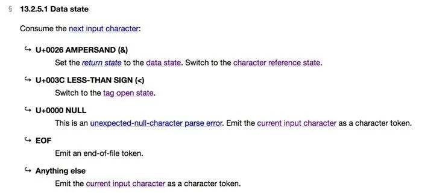

```
图 16-1　WHATWG 规范中关于 Data state 的描述
我们对图 16-1 做一些必要的解释。在默认的 DATA 模式下，解析器在遇到字符 < 时，会切换
```

到标签开始状态（tag open state）。换句话说，在该模式下，解析器能够解析标签元素。当解

```
析器遇到字符 & 时，会切换到字符引用状态（character reference state），也称 HTML 字符实
体状态。也就是说，在 DATA 模式下，解析器能够处理 HTML 字符实体。
我们再来看看当解析器处于 RCDATA 状态时，它的工作情况如何。图 16-2 给出了 WHATWG
```

规范第 13.2.5.2 节的内容。

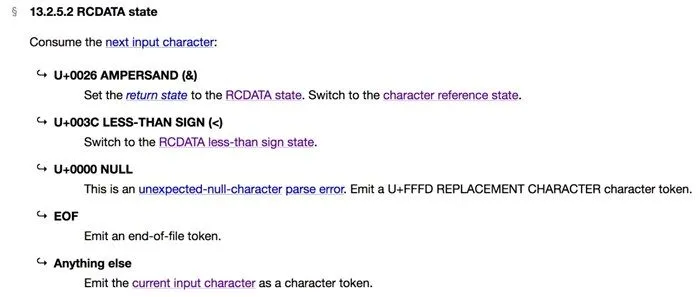

```
图 16-2　WHATWG 规范中关于 RCDATA state 的描述
由图 16-2 可知，当解析器遇到字符 < 时，不会再切换到标签开始状态，而会切换到 RCDATA
less-than sign state 状态。图 16-3 给出了 RCDATA less-than sign state 状态
```

下解析器的工作方式。

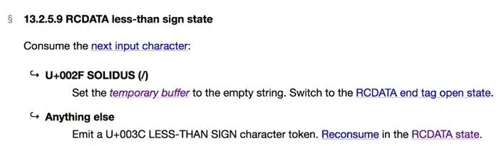

```xml
图 16-3　WHATWG 规范中关于 RCDATA less-than sign state 的描述
由图 16-3 可知，在 RCDATA less-than sign state 状态下，如果解析器遇到字符 /，
则直接切换到 RCDATA 的结束标签状态，即 RCDATA end tag open state；否则会将当
前字符 < 作为普通字符处理，然后继续处理后面的字符。由此可知，在 RCDATA 状态下，解
析器不能识别标签元素。这其实间接说明了在 <textarea> 内可以将字符 < 作为普通文本，
解析器并不会认为字符 < 是标签开始的标志，如下面的代码所示：
<textarea>
  <div>asdf</div>asdfasdf
</textarea>
在上面这段 HTML 代码中，<textarea> 标签内存在一个 <div> 标签。但解析器并不会把
<div> 解析为标签元素，而是作为普通文本处理。但是，由图 16-2 可知，在 RCDATA 模式
下，解析器仍然支持 HTML 实体。因为当解析器遇到字符 & 时，会切换到字符引用状态，如
```

下面的代码所示：

```xml
<textarea>&copy;</textarea>
```

浏览器在渲染这段 HTML 代码时，会在文本框内展示字符 ©。

```
解析器在 RAWTEXT 模式下的工作方式与在 RCDATA 模式下类似。唯一不同的是，在
RAWTEXT 模式下，解析器将不再支持 HTML 实体。图 16-4 给出了 WHATWG 规范第
13.2.5.3 节中所定义的 RAWTEXT 模式下状态机的工作方式。
```

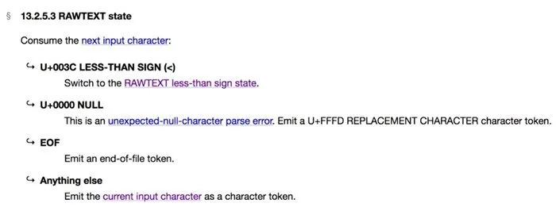

```
图 16-4　WHATWG 规范中关于 RAWTEXT state 的描述
对比图 16-4 与图 16-2 可知，RAWTEXT 模式的确不支持 HTML 实体。在该模式下，解析器会
将 HTML 实体字符作为普通字符处理。Vue.js 的单文件组件的解析器在遇到 <script> 标签
时就会进入 RAWTEXT 模式，这时它会把 <script> 标签内的内容全部作为普通文本处理。
CDATA 模式在 RAWTEXT 模式的基础上更进一步。图 16-5 给出了 WHATWG 规范第
```

13.2.5.69 节中所定义的 CDATA 模式下状态机的工作方式。

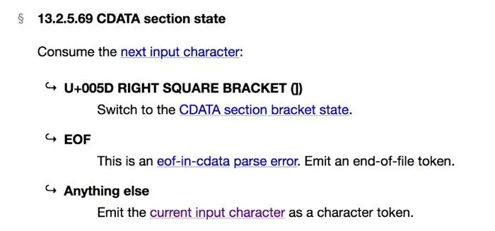

```
图 16-5　WHATWG 规范中关于 CDATA section state 的描述
在 CDATA 模式下，解析器将把任何字符都作为普通字符处理，直到遇到 CDATA 的结束标志
```

为止。

```
实际上，在 WHATWG 规范中还定义了 PLAINTEXT 模式，该模式与 RAWTEXT 模式类似。不
同的是，解析器一旦进入 PLAINTEXT 模式，将不会再退出。另外，Vue.js 的模板 DSL 解析
器是用不到 PLAINTEXT 模式的，因此我们不会过多介绍它。
```

表 16-1 汇总了不同的模式及各其特性。

表 16-1　不同的模式及其特性

- 是否支持 HTML 实体

模式

- 能否解析标签

```
DATA
```

- 能是

除了表 16-1 列出的特性之外，不同的模式还会影响解析器对于终止解析的判断，后文会具体讨论。另外，后续编写解析器代码时，我们会将上述模式定义为状态表，如下面的代码所示：

```javascript
const TextModes = {
  DATA: 'DATA',
  RCDATA: 'RCDATA',
  RAWTEXT: 'RAWTEXT',
  CDATA: 'CDATA'
}
```

## 16.2　递归下降算法构造模板 AST

从本节开始，我们将着手实现一个更加完善的模板解析器。解析器的基本架构模型如下：

```xml
// 定义文本模式，作为一个状态表
const TextModes = {
  DATA: 'DATA',
  RCDATA: 'RCDATA',
  RAWTEXT: 'RAWTEXT',
  CDATA: 'CDATA'
}
<p>// 解析器函数，接收模板作为参数
function parse(str) {
// 定义上下文对象
const context = {
// source 是模板内容，用于在解析过程中进行消费
source: str,
// 解析器当前处于文本模式，初始模式为 DATA
mode: TextModes.DATA
}
// 调用 parseChildren 函数开始进行解析，它返回解析后得到的子节点
// parseChildren 函数接收两个参数：
// 第一个参数是上下文对象 context
// 第二个参数是由父代节点构成的节点栈，初始时栈为空
const nodes = parseChildren(context, [])</p>
// 解析器返回 Root 根节点
return {
type: ‘Root’,
// 使用 nodes 作为根节点的 children
children: nodes
}
}
在上面这段代码中，我们首先定义了一个状态表 TextModes，它用来描述预定义的文本模
式。然后，我们定义了 parse 函数，即解析器函数，在其中定义了上下文对象 context，
用来维护解析程序执行过程中程序的各种状态。接着，调用 parseChildren 函数进行解
析，该函数会返回解析后得到的子节点，并使用这些子节点作为 children 来创建 Root 根
节点。最后，parse 函数返回根节点，完成模板 AST 的构建。
```

这段代码的思路与我们在第 15 章中讲述的关于模板 AST 的构建思路有所不同。在第 15 章中，我们首先对模板内容进行标记化得到一系列 Token，然后根据这些 Token 构建模板AST。实际上，创建 Token 与构造模板 AST 的过程可以同时进行，因为模板和模板 AST 具有同构的特性。

```
另外，在上面这段代码中，parseChildren 函数是整个解析器的核心。后续我们会递归地
调用它来不断地消费模板内容。parseChildren 函数会返回解析后得到的子节点。举个例
```

子，假设有如下模板：

```xml
<p>1</p>
<p>2</p>
上面这段模板有两个根节点，即两个 <p> 标签。parseChildren 函数在解析这段模板后，
会得到由这两个 <p> 节点组成的数组：
[
  { type: 'Element', tag: 'p', children: [/*...*/]  },
  { type: 'Element', tag: 'p', children: [/*...*/]  },
]
之后，这个数组将作为 Root 根节点的 children。
parseChildren 函数接收两个参数。
第一个参数：上下文对象 context。
```

- 第二个参数：由父代节点构成的栈，用于维护节点间的父子级关系。

```
parseChildren 函数本质上也是一个状态机，该状态机有多少种状态取决于子节点的类型
```

数量。在模板中，元素的子节点可以是以下几种。

```
标签节点，例如 <div>。
文本插值节点，例如 {{ val }}。
普通文本节点，例如：text。
```

- 注释节点，例如 。

```
CDATA 节点，例如 <![CDATA[ xxx ]]>。
在标准的 HTML 中，节点的类型将会更多，例如 DOCTYPE 节点等。为了降低复杂度，我们仅
```

考虑上述类型的节点。

```
图 16-6 给出了 parseChildren 函数在解析模板过程中的状态迁移过程。
```

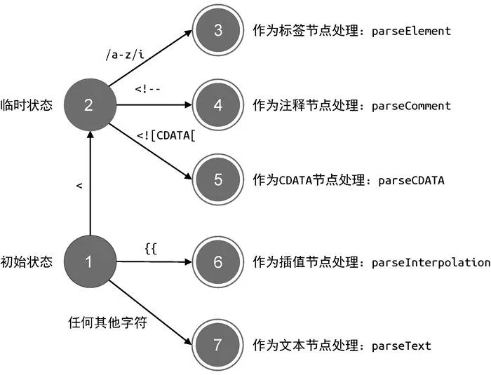

```
图 16-6　parseChildren 函数在解析模板过程中的状态迁移过程
```

我们可以把图 16-6 所展示的状态迁移过程总结如下。

```
当遇到字符 < 时，进入临时状态。
如果下一个字符匹配正则 /a-z/i，则认为这是一个标签节点，于是调用
parseElement 函数完成标签的解析。注意正则表达式 /a-z/i 中的 i，意思是忽略
```

- 大小写（case-insensitive）。

```
如果字符串以 <!-- 开头，则认为这是一个注释节点，于是调用 parseComment 函数
```

- 完成注释节点的解析。

```
如果字符串以 <![CDATA[ 开头，则认为这是一个 CDATA 节点，于是调用
parseCDATA 函数完成 CDATA 节点的解析。
如果字符串以 {{ 开头，则认为这是一个插值节点，于是调用 parseInterpolation 函
```

- 数完成插值节点的解析。

```
其他情况，都作为普通文本，调用 parseText 函数完成文本节点的解析。
```

落实到代码时，我们还需要结合文本模式，如下面的代码所示：

```xml
function parseChildren(context, ancestors) {
  // 定义 nodes 数组存储子节点，它将作为最终的返回值
  let nodes = []
  // 从上下文对象中取得当前状态，包括模式 mode 和模板内容 source
  const { mode, source } = context
<p>// 开启 while 循环，只要满足条件就会一直对字符串进行解析
// 关于 isEnd() 后文会详细讲解
while(!isEnd(context, ancestors)) {
let node
// 只有 DATA 模式和 RCDATA 模式才支持插值节点的解析
if (mode === TextModes.DATA || mode === TextModes.RCDATA) {
// 只有 DATA 模式才支持标签节点的解析
if (mode === TextModes.DATA && source[0] === ‘<’) {
if (source[1] === ‘!’) {
if (source.startsWith(‘<!–’)) {
// 注释
node = parseComment(context)
} else if (source.startsWith(‘<![CDATA[’)) {
// CDATA
node = parseCDATA(context, ancestors)
}
} else if (source[1] === ‘/’) {
// 结束标签，这里需要抛出错误，后文会详细解释原因
} else if (/[a-z]/i.test(source[1])) {
// 标签
node = parseElement(context, ancestors)
}
} else if (source.startsWith(‘{{’)) {
// 解析插值
node = parseInterpolation(context)
}
}</p>
<pre><code> // node 不存在，说明处于其他模式，即非 DATA 模式且非 RCDATA 模式
// 这时一切内容都作为文本处理
if (!node) {
  // 解析文本节点
  node = parseText(context)
}
// 将节点添加到 nodes 数组中
nodes.push(node)
</code></pre><p>}</p> // node 不存在，说明处于其他模式，即非 DATA 模式且非 RCDATA 模式
// 这时一切内容都作为文本处理
if (!node) {
  // 解析文本节点
  node = parseText(context)
}
// 将节点添加到 nodes 数组中
nodes.push(node)
// 当 while 循环停止后，说明子节点解析完毕，返回子节点
return nodes
}
```

上面这段代码完整地描述了图 16-6 所示的状态迁移过程，这里有几点需要注意。

```
parseChildren 函数的返回值是由子节点组成的数组，每次 while 循环都会解析一个或
多个节点，这些节点会被添加到 nodes 数组中，并作为 parseChildren 函数的返回值
```

- 返回。

```
解析过程中需要判断当前的文本模式。根据表 16-1 可知，只有处于 DATA 模式或 RCDATA
模式时，解析器才支持插值节点的解析。并且，只有处于 DATA 模式时，解析器才支持标
签节点、注释节点和 CDATA 节点的解析。
```

- 在 16.1 节中我们介绍过，当遇到特定标签时，解析器会切换模式。一旦解析器切换到

```
DATA 模式和 RCDATA 模式之外的模式时，一切字符都将作为文本节点被解析。当然，即
使在 DATA 模式或 RCDATA 模式下，如果无法匹配标签节点、注释节点、CDATA 节点、插
```

- 值节点，那么也会作为文本节点解析。

```
除了上述三点内容外，你可能对这段代码仍然有疑问，其中之一是 while 循环何时停止？以
及 isEnd() 函数的用途是什么？这里我们给出简单的解释，parseChildren 函数是用来解
析子节点的，因此 while 循环一定要遇到父级节点的结束标签才会停止，这是正常的思路。
```

但这个思路存在一些问题，不过我们这里暂时将其忽略，后文会详细讨论。

```
我们可以通过一个例子来更加直观地了解 parseChildren 函数，以及其他解析函数在解析
```

模板时的工作职责和工作流程。以下面的模板为例：

```xml
const template = `<div>
  <p>Text1</p>
  <p>Text2</p>
</div>`
```

这里需要强调的是，在解析模板时，我们不能忽略空白字符。这些空白字符包括：换行符

```javascript
（\n）、回车符（\r）、空格（' '）、制表符（\t）以及换页符（\f）。如果我们用加号
（+）代表换行符，用减号（-）代表空格字符。那么上面的模板可以表示为：
const template = `<div>+--<p>Text1</p>+--<p>Text2</p>+</div>`
```

接下来，我们以这段模板作为输入来执行解析过程。

```javascript
解析器一开始处于 DATA 模式。开始执行解析后，解析器遇到的第一个字符为 <，并且第二个
字符能够匹配正则表达式 /a-z/i，所以解析器会进入标签节点状态，并调用
parseElement 函数进行解析。
parseElement 函数会做三件事：解析开始标签，解析子节点，解析结束标签。可以用下面
的伪代码来表达 parseElement 函数所做的事情：
function parseElement() {
  // 解析开始标签
  const element = parseTag()
  // 这里递归地调用 parseChildren 函数进行 <div> 标签子节点的解析
  element.children = parseChildren()
  // 解析结束标签
  parseEndTag()
return element
}
```

如果一个标签不是自闭合标签，则可以认为，一个完整的标签元素是由开始标签、子节点和结

```
束标签这三部分构成的。因此，在 parseElement 函数内，我们分别调用三个解析函数来处
```

理这三部分内容。以上述模板为例。

```
parseTag 解析开始标签。parseTag 函数用于解析开始标签，包括开始标签上的属性和
指令。因此，在 parseTag 解析函数执行完毕后，会消费字符串中的内容 <div>，处理后
```

- 的模板内容将变为：

```javascript
const template = `+--<p>Text1</p>+--<p>Text2</p>+</div>`
1
递归地调用 parseChildren 函数解析子节点。parseElement 函数在解析开始标签
时，会产生一个标签节点 element。在 parseElement 函数执行完毕后，剩下的模板内
容应该作为 element 的子节点被解析，即 element.children。因此，我们要递归地调
用 parseChildren 函数。在这个过程中，parseChildren 函数会消费字符串的内容：
+--<p>Text1</p>+--<p>Text2</p>+。处理后的模板内容将变为：
const template = `</div>`
1
parseEndTag 处理结束标签。可以看到，在经过 parseChildren 函数处理后，模板内
容只剩下一个结束标签了。因此，只需要调用 parseEndTag 解析函数来消费它即可。
```

经过上述三个步骤的处理后，这段模板就被解析完毕了，最终得到了模板 AST。但这里值得

```
注意的是，为了解析标签的子节点，我们递归地调用了 parseChildren 函数。这意味着，
```

一个新的状态机开始运行了，我们称其为“状态机 2”。“状态机 2”所处理的模板内容为：

```javascript
const template = `+--<p>Text1</p>+--<p>Text2</p>+`
```

接下来，我们继续分析“状态机 2”的状态迁移流程。在“状态机 2”开始运行时，模板的第一个字

```javascript
符是换行符（字符 + 代表换行符）。因此，解析器会进入文本节点状态，并调用 parseText
函数完成文本节点的解析。parseText 函数会将下一个 < 字符之前的所有字符都视作文本节
点的内容。换句话说，parseText 函数会消费模板内容 +--，并产生一个文本节点。在
parseText 解析函数执行完毕后，剩下的模板内容为：
const template = `<p>Text1</p>+--<p>Text2</p>+`
接着，parseChildren 函数继续执行。此时模板的第一个字符为 <，并且下一个字符能够
匹配正则 /a-z/i。于是解析器再次进入 parseElement 解析函数的执行阶段，这会消费模
板内容 <p>Text1</p>。在这一步过后，剩下的模板内容为：
const template = `+--<p>Text2</p>+`
可以看到，此时模板的第一个字符是换行符，于是调用 parseText 函数消费模板内容 +-
-。现在，模板中剩下的内容是：
const template = `<p>Text2</p>+`
解析器会再次调用 parseElement 函数处理标签节点。在这之后，剩下的模板内容为：
const template = `+`
```

```
可以看到，现在模板内容只剩下一个换行符了。parseChildren 函数会继续执行并调用
parseText 函数消费剩下的内容，并产生一个文本节点。最终，模板被解析完毕，“状态机
```

2”停止运行。

```
在“状态机 2”运行期间，为了处理标签节点，我们又调用了两次 parseElement 函数。第一
次调用用于处理内容 <p>Text1</p>，第二次调用用于处理内容 <p>Text2</p>。我们知
道，parseElement 函数会递归地调用 parseChildren 函数完成子节点的解析，这就意味
```

着解析器会再开启了两个新的状态机。

```
通过上述例子我们能够认识到，parseChildren 解析函数是整个状态机的核心，状态迁移
操作都在该函数内完成。在 parseChildren 函数运行过程中，为了处理标签节点，会调用
parseElement 解析函数，这会间接地调用 parseChildren 函数，并产生一个新的状态
机。随着标签嵌套层次的增加，新的状态机会随着 parseChildren 函数被递归地调用而不
断创建，这就是“递归下降”中“递归”二字的含义。而上级 parseChildren 函数的调用用于构
造上级模板 AST 节点，被递归调用的下级 parseChildren 函数则用于构造下级模板 AST
```

节点。最终，会构造出一棵树型结构的模板 AST，这就是“递归下降”中“下降”二字的含义。

## 16.3　状态机的开启与停止

```xml
在上一节中，我们讨论了递归下降算法的含义。我们知道，parseChildren 函数本质上是
一个状态机，它会开启一个 while 循环使得状态机自动运行，如下面的代码所示：
function parseChildren(context, ancestors) {
  let nodes = []
<p>const { mode } = context
// 运行状态机
while(!isEnd(context, ancestors)) {
// 省略部分代码
}</p>
return nodes
}
```

```
这里的问题在于，状态机何时停止呢？换句话说，while 循环应该何时停止运行呢？这涉及
isEnd() 函数的判断逻辑。为了搞清楚这个问题，我们需要模拟状态机的运行过程。
我们知道，在调用 parseElement 函数解析标签节点时，会递归地调用 parseChildren
```

函数，从而开启新的状态机，如图 16-7 所示。

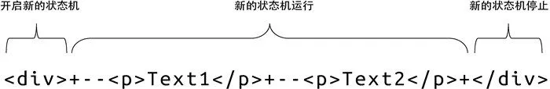

- 图 16-7　开启新的状态机

为了便于描述，我们可以把图 16-7 中所示的新的状态机称为“状态机 1”。“状态机 1”开始运

```
行，继续解析模板，直到遇到下一个 <p> 标签，如图 16-8 所示。
```

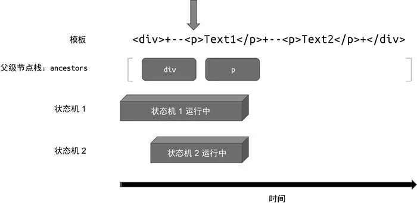

- 图 16-8　递归地开启新的状态机

```
因为遇到了 <p> 标签，所以“状态机 1”也会调用 parseElement 函数进行解析。于是又重复
了上述过程，即把当前解析的标签节点压入父级节点栈，然后递归地调用 parseChildren
```

函数开启新的状态机，即“状态机 2”。可以看到，此时有两个状态机在同时运行。

```
此时“状态机 2”拥有程序的执行权，它持续解析模板直到遇到结束标签 </p>。因为这是一个
```

结束标签，并且在父级节点栈中存在与该结束标签同名的标签节点，所以“状态机 2”会停止运行，并弹出父级节点栈中处于栈顶的节点，如图 16-9 所示。

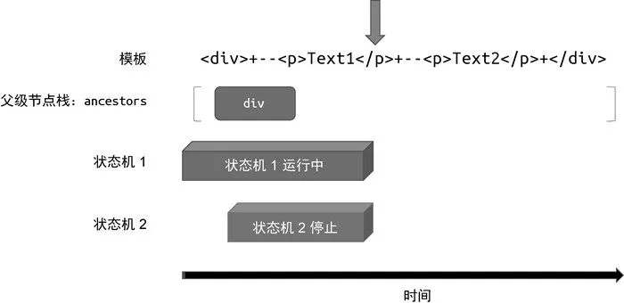

- 图 16-9　状态机 2 停止运行

此时“状态机 2”已经停止运行了，但“状态机 1”仍在运行中，于是会继续解析模板，直到遇到下

```
一个 <p> 标签。这时“状态机 1”会再次调用 parseElement 函数解析标签节点，因此又会执
```

行压栈并开启新的“状态机 3”，如图 16-10 所示。

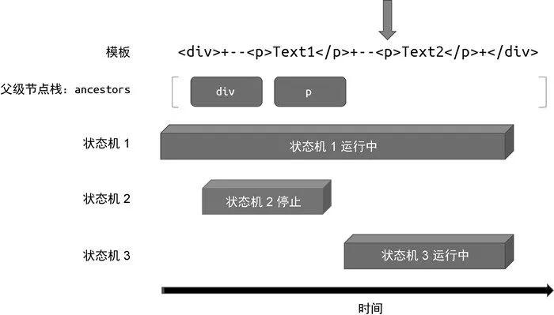

- 图 16-10　开启状态机 3

```
此时“状态机 3”拥有程序的执行权，它会继续解析模板，直到遇到结束标签 </p>。因为这是
```

一个结束标签，并且在父级节点栈中存在与该结束标签同名的标签节点，所以“状态机 3”会停止运行，并弹出父级节点栈中处于栈顶的节点，如图 16-11 所示。

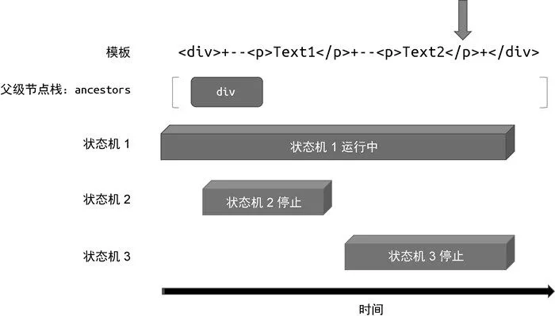

- 图 16-11　状态机 3 停止运行

当“状态机 3”停止运行后，程序的执行权交还给“状态机 1”。“状态机 1”会继续解析模板，直到

```
遇到最后的 </div> 结束标签。这时“状态机 1”发现父级节点栈中存在与结束标签同名的标签
```

节点，于是将该节点弹出父级节点栈，并停止运行，如图 16-12 所示。

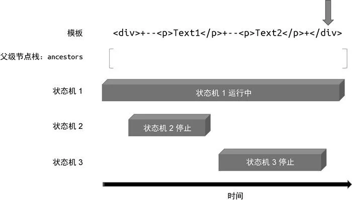

- 图 16-12　状态机 1 停止

这时父级节点栈为空，状态机全部停止运行，模板解析完毕。

通过上面的描述，我们能够清晰地认识到，解析器会在何时开启新的状态机，以及状态机会在何时停止。结论是：当解析器遇到开始标签时，会将该标签压入父级节点栈，同时开启新的状态机。当解析器遇到结束标签，并且父级节点栈中存在与该标签同名的开始标签节点时，会停

```
止当前正在运行的状态机。根据上述规则，我们可以给出 isEnd 函数的逻辑，如下面的代码
```

所示：

```javascript
function isEnd(context, ancestors) {
  // 当模板内容解析完毕后，停止
  if (!context.source) return true
  // 获取父级标签节点
  const parent = ancestors[ancestors.length - 1]
  // 如果遇到结束标签，并且该标签与父级标签节点同名，则停止
  if (parent && context.source.startsWith(`</$`)) {
    return true
  }
}
```

上面这段代码展示了状态机的停止时机，具体如下：

- 第一个停止时机是当模板内容被解析完毕时；

- 第二个停止时机则是在遇到结束标签时，这时解析器会取得父级节点栈栈顶的节点作为父节点，检查该结束标签是否与父节点的标签同名，如果相同，则状态机停止运行。

这里需要注意的是，在第二个停止时机中，我们直接比较结束标签的名称与栈顶节点的标签名称。这么做的确可行，但严格来讲是有瑕疵的。例如下面的模板所示：

```xml
<div><span></div></span>
```

观察上述模板，它存在一个明显的问题，你能发现吗？实际上，这段模板有两种解释方式，图16-13 给出了第一种。

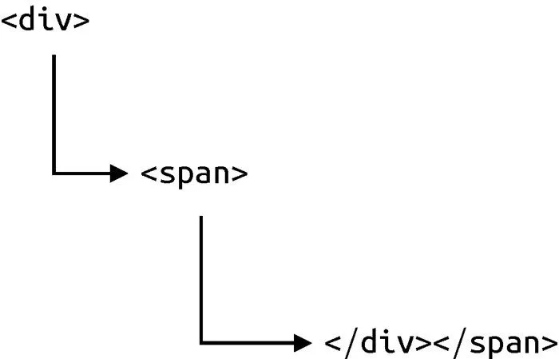

- 图 16-13　第一种模板解释方式

如图 16-13 所示，这种解释方式的流程如下。

```
“状态机 1”遇到 <div> 开始标签，调用 parseElement 解析函数，这会开启“状态机 2”来
```

- 完成子节点的解析。

```
“状态机 2”遇到 <span> 开始标签，调用 parseElement 解析函数，这会开启“状态机
```

- 3”来完成子节点的解析。

```
“状态机 3”遇到 </div> 结束标签。由于此时父级节点栈栈顶的节点名称是 span，并不是
div，所以“状态机 3”不会停止运行。这时，“状态机 3”遭遇了不符合预期的状态，因为结束
标签 </div> 缺少与之对应的开始标签，所以这时“状态机 3”会抛出错误：“无效的结束标
```

- 签”。

上述流程的思路与我们当前的实现相符，状态机会遭遇不符合预期的状态。下面

```xml
parseChildren 函数的代码能够体现这一点：
function parseChildren(context, ancestors) {
  let nodes = []
<p>const { mode } = context</p>
<p>while(!isEnd(context, ancestors)) {
let node</p>
<pre><code> if (mode === TextModes.DATA || mode === TextModes.RCDATA) {
  if (mode === TextModes.DATA &amp;&amp; context.source[0] === '&lt;') {
    if (context.source[1] === '!') {
      // 省略部分代码
    } else if (context.source[1] === '/') {
      // 状态机遭遇了闭合标签，此时应该抛出错误，因为它缺少与之对应的开始标签
      console.error('无效的结束标签')
      continue
    } else if (/[a-z]/i.test(context.source[1])) {
      // 省略部分代码
    }
  } else if (context.source.startsWith('{{')) {
      // 省略部分代码
  }
}
// 省略部分代码
</code></pre><p>}</p> if (mode === TextModes.DATA || mode === TextModes.RCDATA) {
  if (mode === TextModes.DATA &amp;&amp; context.source[0] === '&lt;') {
    if (context.source[1] === '!') {
      // 省略部分代码
    } else if (context.source[1] === '/') {
      // 状态机遭遇了闭合标签，此时应该抛出错误，因为它缺少与之对应的开始标签
      console.error('无效的结束标签')
      continue
    } else if (/[a-z]/i.test(context.source[1])) {
      // 省略部分代码
    }
  } else if (context.source.startsWith('{{')) {
      // 省略部分代码
  }
}
// 省略部分代码
return nodes
}
```

换句话说，按照我们当前的实现思路来解析上述例子中的模板，最终得到的错误信息是：“无效的结束标签”。但其实还有另外一种更好的解析方式。观察上例中给出的模板，其中存在一段完整的内容，如图 16-14 所示。

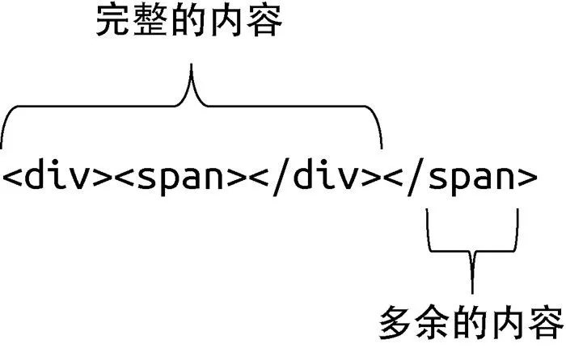

- 图 16-14　第二种模板解释方式

从图 16-14 中可以看到，模板中存在一段完整的内容，我们希望解析器可以正常对其进行解析，这很可能也是符合用户意图的。但实际上，无论哪一种解释方式，对程序的影响都不大。两者的区别体现在错误处理上。对于第一种解释方式，我们得到的错误信息是：“无效的结束标签”。而对于第二种解释方式，在“完整的内容”部分被解析完毕后，解析器就会打印错误信

```
息：“<span> 标签缺少闭合标签”。很显然，第二种解释方式更加合理。
为了实现第二种解释方式，我们需要调整 isEnd 函数的逻辑。当判断状态机是否应该停止
```

时，我们不应该总是与栈顶的父级节点做比较，而是应该与整个父级节点栈中的所有节点做比较。只要父级节点栈中存在与当前遇到的结束标签同名的节点，就停止状态机，如下面的代码所示：

```javascript
function isEnd(context, ancestors) {
  if (!context.source) return true
// 与父级节点栈内所有节点做比较
for (let i = ancestors.length - 1; i >= 0; --i) {
// 只要栈中存在与当前结束标签同名的节点，就停止状态机
if (context.source.startsWith(<code>&lt;/$</code>)) {
return true
}
}
}
&lt;/$
```

按照新的思路再次对如下模板执行解析：

```xml
<div><span></div></span>
```

其流程如下。

```
“状态机 1”遇到 <div> 开始标签，调用 parseElement 解析函数，并开启“状态机 2”解析
```

- 子节点。

```
“状态机 2”遇到 <span> 开始标签，调用 parseElement 解析函数，并开启“状态机 3”解
```

- 析子节点。

```
“状态机 3”遇到 </div> 结束标签，由于节点栈中存在名为 div 的标签节点，于是“状态机
```

- 3”停止了。

```
在这个过程中，“状态机 2”在调用 parseElement 解析函数时，parseElement 函数能够发
现 <span> 缺少闭合标签，于是会打印错误信息“<span> 标签缺少闭合标签”，如下面的代码
```

所示：

```xml
function parseElement(context, ancestors) {
  const element = parseTag(context)
  if (element.isSelfClosing) return element
<p>ancestors.push(element)
element.children = parseChildren(context, ancestors)
ancestors.pop()</p>
<p>if (context.source.startsWith(<code>&lt;/$</code>)) {
parseTag(context, ‘end’)
} else {
// 缺少闭合标签
console.error(<code>$ 标签缺少闭合标签</code>)
}</p>
&lt;/$$ 标签缺少闭合标签return element
}
```

## 16.4　解析标签节点

```
在上一节给出的 parseElement 函数的实现中，无论是解析开始标签还是闭合标签，我们都
调用了 parseTag 函数。同时，我们使用 parseChildren 函数来解析开始标签与闭合标签
```

中间的部分，如下面的代码及注释所示：

```xml
function parseElement(context, ancestors) {
  // 调用 parseTag 函数解析开始标签
  const element = parseTag(context)
  if (element.isSelfClosing) return element
<p>ancestors.push(element)
element.children = parseChildren(context, ancestors)
ancestors.pop()</p>
<p>if (context.source.startsWith(<code>&lt;/$</code>)) {
// 再次调用 parseTag 函数解析结束标签，传递了第二个参数：‘end’
parseTag(context, ‘end’)
} else {
console.error(<code>$ 标签缺少闭合标签</code>)
}</p>
&lt;/$$ 标签缺少闭合标签return element
}
```

标签节点的整个解析过程如图 16-15 所示。

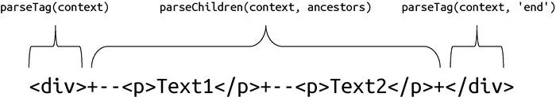

- 图 16-15　解析标签节点的过程

这里需要注意的是，由于开始标签与结束标签的格式非常类似，所以我们统一使用

```
parseTag 函数处理，并通过该函数的第二个参数来指定具体的处理类型。当第二个参数值
为字符串 'end' 时，意味着解析的是结束标签。另外，无论处理的是开始标签还是结束标
签，parseTag 函数都会消费对应的内容。为了实现对模板内容的消费，我们需要在上下文
```

对象中新增两个工具函数，如下面的代码所示：

```xml
function parse(str) {
  // 上下文对象
  const context = {
    // 模板内容
    source: str,
    mode: TextModes.DATA,
    // advanceBy 函数用来消费指定数量的字符，它接收一个数字作为参数
    advanceBy(num) {
      // 根据给定字符数 num，截取位置 num 后的模板内容，并替换当前模板内容
      context.source = context.source.slice(num)
    },
    // 无论是开始标签还是结束标签，都可能存在无用的空白字符，例如 <div    >
    advanceSpaces() {
      // 匹配空白字符
      const match = /^[\t\r\n\f ]+/.exec(context.source)
      if (match) {
        // 调用 advanceBy 函数消费空白字符
        context.advanceBy(match[0].length)
      }
    }
  }
<p>const nodes = parseChildren(context, [])</p>
return {
type: ‘Root’,
children: nodes
}
}
在上面这段代码中，我们为上下文对象增加了 advanceBy 函数和 advanceSpaces 函数。
其中 advanceBy 函数用来消费指定数量的字符。其实现原理很简单，即调用字符串的
slice 函数，根据指定位置截取剩余字符串，并使用截取后的结果作为新的模板内容。
advanceSpaces 函数则用来消费无用的空白字符，因为标签中可能存在空白字符，例如在
模板 <div----> 中减号（-）代表空白字符。
有了 advanceBy 和 advanceSpaces 函数后，我们就可以给出 parseTag 函数的实现了，
```

如下面的代码所示：

```xml
// 由于 parseTag 既用来处理开始标签，也用来处理结束标签，因此我们设计第二个参数 type，
// 用来代表当前处理的是开始标签还是结束标签，type 的默认值为 'start'，即默认作为开始标签处理
function parseTag(context, type = 'start') {
  // 从上下文对象中拿到 advanceBy 函数
  const { advanceBy, advanceSpaces } = context
<p>// 处理开始标签和结束标签的正则表达式不同
const match = type === ‘start’
// 匹配开始标签
? /^<([a-z][^\t\r\n\f />]<em>)/i.exec(context.source)
// 匹配结束标签
: /^</([a-z][^\t\r\n\f />]</em>)/i.exec(context.source)
// 匹配成功后，正则表达式的第一个捕获组的值就是标签名称
const tag = match[1]
// 消费正则表达式匹配的全部内容，例如 ‘<div’ 这段内容
advanceBy(match[0].length)
// 消费标签中无用的空白字符
advanceSpaces()</p>
<p>// 在消费匹配的内容后，如果字符串以 ‘/>’ 开头，则说明这是一个自闭合标签
const isSelfClosing = context.source.startsWith(‘/>’)
// 如果是自闭合标签，则消费 ‘/>’， 否则消费 ‘>’
advanceBy(isSelfClosing ? 2 : 1)</p>
// 返回标签节点
return {
type: ‘Element’,
// 标签名称
tag,
// 标签的属性暂时留空
props: [],
// 子节点留空
children: [],
// 是否自闭合
isSelfClosing
}
}
```

上面这段代码有两个关键点。

```
由于 parseTag 函数既用于解析开始标签，又用于解析结束标签，因此需要用一个参数来
标识当前处理的标签类型，即 type。
```

- 对于开始标签和结束标签，用于匹配它们的正则表达式只有一点不同：结束标签是以字符串

```
</ 开头的。图 16-16 给出了用于匹配开始标签的正则表达式的含义。
```

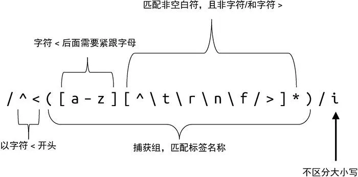

- 图 16-16　用于匹配开始标签和结束标签的正则

下面给出了几个使用图 16-16 所示的正则来匹配开始标签的例子。

```
对于字符串 '<div>'，会匹配出字符串 '<div'，剩余 '>'。
对于字符串 '<div/>'，会匹配出字符串 '<div'，剩余 '/>'。
对于字符串 '<div---->'，其中减号（-）代表空白符，会匹配出字符串 '<div'，剩余
'---->'。
```

另外，图 16-16 中所示的正则拥有一个捕获组，它用来捕获标签名称。

```
除了正则表达式外，parseTag 函数的另外几个关键点如下。
在完成正则匹配后，需要调用 advanceBy 函数消费由正则匹配的全部内容。
```

- 根据上面给出的第三个正则匹配例子可知，由于标签中可能存在无用的空白字符，例如

```xml
<div---->，因此我们需要调用 advanceSpaces 函数消费空白字符。
在消费由正则匹配的内容后，需要检查剩余模板内容是否以字符串 /> 开头。如果是，则说
明当前解析的是一个自闭合标签，这时需要将标签节点的 isSelfClosing 属性设置为
true。
最后，判断标签是否自闭合。如果是，则调用 advnaceBy 函数消费内容 />，否则只需要
消费内容 > 即可。
在经过上述处理后，parseTag 函数会返回一个标签节点。parseElement 函数在得到由
parseTag 函数产生的标签节点后，需要根据节点的类型完成文本模式的切换，如下面的代
```

码所示：

```xml
function parseElement(context, ancestors) {
  const element = parseTag(context)
  if (element.isSelfClosing) return element
<p>// 切换到正确的文本模式
if (element.tag === ‘textarea’ || element.tag === ‘title’) {
// 如果由 parseTag 解析得到的标签是 <textarea> 或 <title>，则切换到 RCDATA 模式
context.mode = TextModes.RCDATA
} else if (/style|xmp|iframe|noembed|noframes|noscript/.test(element.tag)) {
// 如果由 parseTag 解析得到的标签是：
// <style>、<xmp>、<iframe>、<noembed>、<noframes>、<noscript>
// 则切换到 RAWTEXT 模式
context.mode = TextModes.RAWTEXT
} else {
// 否则切换到 DATA 模式
context.mode = TextModes.DATA
}</p>
<p>ancestors.push(element)
element.children = parseChildren(context, ancestors)
ancestors.pop()</p>
<p>if (context.source.startsWith(<code>&lt;/$</code>)) {
parseTag(context, ‘end’)
} else {
console.error(<code>$ 标签缺少闭合标签</code>)
}</p>
&lt;/$$ 标签缺少闭合标签return element
}
```

至此，我们就实现了对标签节点的解析。但是目前的实现忽略了节点中的属性和指令，下一节将会讲解。
