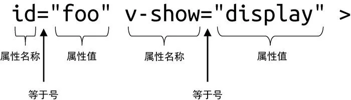
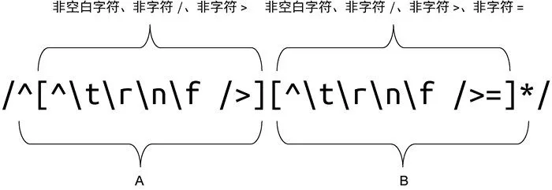
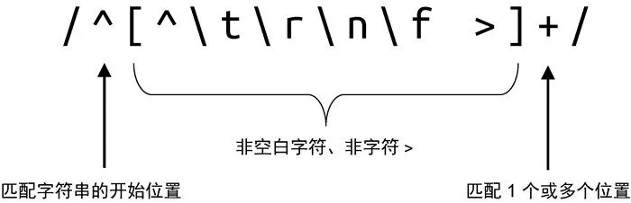
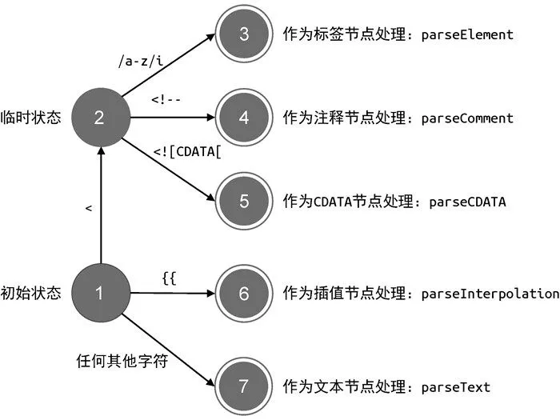
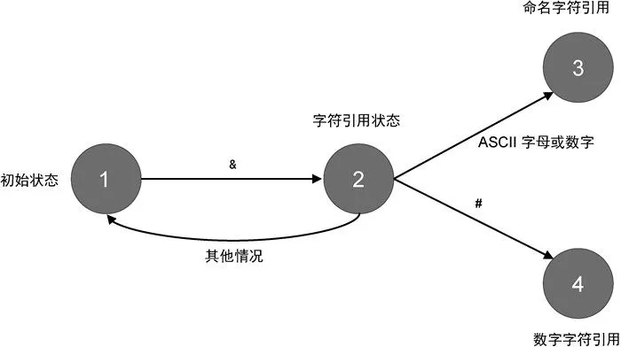
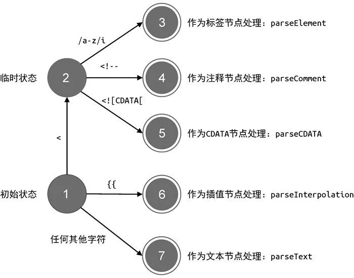

# 第16章解析器(2)

## 16.5　解析属性

```
上一节中介绍的 parseTag 解析函数会消费整个开始标签，这意味着该函数需要有能力处理
```

开始标签中存在属性与指令，例如：

```xml
<div id="foo" v-show="display"/>
上面这段模板中的 div 标签存在一个 id 属性和一个 v-show 指令。为了处理属性和指令，
我们需要在 parseTag 函数中增加 parseAttributes 解析函数，如下面的代码所示：
function parseTag(context, type = 'start') {
  const { advanceBy, advanceSpaces } = context
<p>const match = type === ‘start’
? /^<([a-z][^\t\r\n\f />]<em>)/i.exec(context.source)
: /^</([a-z][^\t\r\n\f />]</em>)/i.exec(context.source)
const tag = match[1]</p>
<p>advanceBy(match[0].length)
advanceSpaces()
// 调用 parseAttributes 函数完成属性与指令的解析，并得到 props 数组，
// props 数组是由指令节点与属性节点共同组成的数组
const props = parseAttributes(context)</p>
<p>const isSelfClosing = context.source.startsWith(‘/>’)
advanceBy(isSelfClosing ? 2 : 1)</p>
return {
type: ‘Element’,
tag,
props, // 将 props 数组添加到标签节点上
children: [],
isSelfClosing
}
}
```

上面这段代码的关键点之一是，我们需要在消费标签的“开始部分”和无用的空白字符之后，再

```xml
调用 parseAttribute 函数。举个例子，假设标签的内容如下：
<div id="foo" v-show="display" >
标签的“开始部分”指的是字符串 <div，所以当消耗标签的“开始部分”以及无用空白字符后，剩
```

下的内容为：

```
id="foo" v-show="display" >
上面这段内容才是 parseAttributes 函数要处理的内容。由于该函数只用来解析属性和指
```

令，因此它会不断地消费上面这段模板内容，直到遇到标签的“结束部分”为止。其中，结束部

```
分指的是字符 > 或者字符串 />。据此我们可以给出 parseAttributes 函数的整体框架，
```

如下面的代码所示：

```javascript
function parseAttributes(context) {
  // 用来存储解析过程中产生的属性节点和指令节点
  const props = []
// 开启 while 循环，不断地消费模板内容，直至遇到标签的“结束部分”为止
while (
!context.source.startsWith(‘>’) &&
!context.source.startsWith(‘/>’)
) {
// 解析属性或指令
}
// 将解析结果返回
return props
}
实际上，parseAttributes 函数消费模板内容的过程，就是不断地解析属性名称、等于
```

号、属性值的过程，如图 16-17 所示。



- 图 16-17　属性的格式

```
parseAttributes 函数会按照从左到右的顺序不断地消费字符串。以图 16-17 为例，该函
```

数的解析过程如下。

```
首先，解析出第一个属性的名称 id，并消费字符串 'id'。此时剩余模板内容为：
="foo" v-show="display" >
1
```

- 在解析属性名称时，除了要消费属性名称之外，还要消费属性名称后面可能存在的空白字符。如下面这段模板中，属性名称和等于号之间存在空白字符：

```
id  =  "foo" v-show="display" >
1
```

- 但无论如何，在属性名称解析完毕之后，模板剩余内容一定是以等于号开头的，即

```
=  "foo" v-show="display" >
1
```

- 如果消费属性名称之后，模板内容不以等于号开头，则说明模板内容不合法，我们可以选择性地抛出错误。

- 接着，我们需要消费等于号字符。由于等于号和属性值之间也可能存在空白字符，所以我们也需要消费对应的空白字符。在这一步操作过后，模板的剩余内容如下：

```
"foo" v-show="display" >
1
```

- 接下来，到了处理属性值的环节。模板中的属性值存在三种情况。

```
属性值被双引号包裹：id="foo"。
属性值被单引号包裹：id='foo'。
属性值没有引号包裹：id=foo。
按照上述例子，此时模板的内容一定以双引号（"）开头。因此我们可以通过检查当前模板
```

- 内容是否以引号开头来确定属性值是否被引用。如果属性值被引号引用，则消费引号。此时模板的剩余内容为：

```
foo" v-show="display" >
1
```

- 既然属性值被引号引用了，就意味着在剩余模板内容中，下一个引号之前的内容都应该被解

```
析为属性值。在这个例子中，属性值的内容是字符串 foo。于是，我们消费属性值及其后
```

- 面的引号。当然，如果属性值没有被引号引用，那么在剩余模板内容中，下一个空白字符之前的所有字符都应该作为属性值。

- 当属性值和引号被消费之后，由于属性值与下一个属性名称之间可能存在空白字符，所以我们还要消费对应的空白字符。在这一步处理过后，剩余模板内容为：

```
v-show="display" >
1
```

- 可以看到，经过上述操作之后，第一个属性就处理完毕了。

```xml
此时模板中还剩下一个指令，我们只需重新执行上述步骤，即可完成 v-show 指令的解
析。当 v-show 指令解析完毕后，将会遇到标签的“结束部分”，即字符 >。这时，
parseAttributes 函数中的 while 循环将会停止，完成属性和指令的解析。
下面的 parseAttributes 函数给出了上述逻辑的具体实现：
function parseAttributes(context) {
  const { advanceBy, advanceSpaces } = context
  const props = []
<p>while (
!context.source.startsWith(‘>’) &&
!context.source.startsWith(‘/>’)
) {
// 该正则用于匹配属性名称
const match = /^[^\t\r\n\f />][^\t\r\n\f />=]*/.exec(context.source)
// 得到属性名称
const name = match[0]</p>
<pre><code> // 消费属性名称
advanceBy(name.length)
// 消费属性名称与等于号之间的空白字符
advanceSpaces()
// 消费等于号
advanceBy(1)
// 消费等于号与属性值之间的空白字符
advanceSpaces()
// 属性值
let value = ''
// 获取当前模板内容的第一个字符
const quote = context.source[0]
// 判断属性值是否被引号引用
const isQuoted = quote === '"' || quote === "'"
if (isQuoted) {
  // 属性值被引号引用，消费引号
  advanceBy(1)
  // 获取下一个引号的索引
  const endQuoteIndex = context.source.indexOf(quote)
  if (endQuoteIndex &gt; -1) {
    // 获取下一个引号之前的内容作为属性值
    value = context.source.slice(0, endQuoteIndex)
    // 消费属性值
    advanceBy(value.length)
    // 消费引号
    advanceBy(1)
  } else {
    // 缺少引号错误
    console.error('缺少引号')
  }
} else {
  // 代码运行到这里，说明属性值没有被引号引用
  // 下一个空白字符之前的内容全部作为属性值
  const match = /^[^\t\r\n\f &gt;]+/.exec(context.source)
  // 获取属性值
  value = match[0]
  // 消费属性值
  advanceBy(value.length)
}
// 消费属性值后面的空白字符
advanceSpaces()
// 使用属性名称 + 属性值创建一个属性节点，添加到 props 数组中
props.push({
  type: 'Attribute',
  name,
  value
})
</code></pre> // 消费属性名称
advanceBy(name.length)
// 消费属性名称与等于号之间的空白字符
advanceSpaces()
// 消费等于号
advanceBy(1)
// 消费等于号与属性值之间的空白字符
advanceSpaces()
// 属性值
let value = ''
// 获取当前模板内容的第一个字符
const quote = context.source[0]
// 判断属性值是否被引号引用
const isQuoted = quote === '"' || quote === "'"
if (isQuoted) {
  // 属性值被引号引用，消费引号
  advanceBy(1)
  // 获取下一个引号的索引
  const endQuoteIndex = context.source.indexOf(quote)
  if (endQuoteIndex &gt; -1) {
    // 获取下一个引号之前的内容作为属性值
    value = context.source.slice(0, endQuoteIndex)
    // 消费属性值
    advanceBy(value.length)
    // 消费引号
    advanceBy(1)
  } else {
    // 缺少引号错误
    console.error('缺少引号')
  }
} else {
  // 代码运行到这里，说明属性值没有被引号引用
  // 下一个空白字符之前的内容全部作为属性值
  const match = /^[^\t\r\n\f &gt;]+/.exec(context.source)
  // 获取属性值
  value = match[0]
  // 消费属性值
  advanceBy(value.length)
}
// 消费属性值后面的空白字符
advanceSpaces()
// 使用属性名称 + 属性值创建一个属性节点，添加到 props 数组中
props.push({
  type: 'Attribute',
  name,
  value
})
}
// 返回
return props
}
```

在上面这段代码中，有两个重要的正则表达式：

```
/^[^\t\r\n\f />][^\t\r\n\f />=]*/，用来匹配属性名称；
/^[^\t\r\n\f >]+/，用来匹配没有使用引号引用的属性值。
```

我们分别来看看这两个正则表达式是如何工作的。图 16-18 给出了用于匹配属性名称的正则表达式的匹配原理。



- 图 16-18　用于匹配属性的正则

如图 16-18 所示，我们可以将这个正则表达式分为 A、B 两个部分来看。

```
部分 A 用于匹配一个位置，这个位置不能是空白字符，也不能是字符 / 或字符 >，并且字
```

- 符串要以该位置开头。

```
部分 B 则用于匹配 0 个或多个位置，这些位置不能是空白字符，也不能是字符 /、>、=。
注意，这些位置不允许出现等于号（=）字符，这就实现了只匹配等于号之前的内容，即属
```

- 性名称。

图 16-19 给出了第二个正则表达式的匹配原理。



- 图 16-19　第二个正则表达式的匹配原理

```
该正则表达式从字符串的开始位置进行匹配，并且会匹配一个或多个非空白字符、非字符 >。
换句话说，该正则表达式会一直对字符串进行匹配，直到遇到空白字符或字符 > 为止，这就
```

实现了属性值的提取。

```xml
配合 parseAttributes 函数，假设给出如下模板：
<div id="foo" v-show="display"></div>
```

解析上面这段模板，将会得到如下 AST：

```javascript
const ast = {
  type: 'Root',
  children: [
    {
      type: 'Element'
      tag: 'div',
      props: [
        // 属性
        { type: 'Attribute', name: 'id', value: 'foo' },
        { type: 'Attribute', name: 'v-show', value: 'display' }
      ]
    }
  ]
}
可以看到，在 div 标签节点的 props 属性中，包含两个类型为 Attribute 的节点，这两
个节点就是 parseAttributes 函数的解析结果。
```

我们可以增加更多在 Vue.js 中常见的属性和指令进行测试，如以下模板所示：

```xml
<div :id="dynamicId" @click="handler" v-on:mousedown="onMouseDown" ></div>
```

上面这段模板经过解析后，得到如下 AST：

```javascript
const ast = {
  type: 'Root',
  children: [
    {
      type: 'Element'
      tag: 'div',
      props: [
        // 属性
        { type: 'Attribute', name: ':id', value: 'dynamicId' },
        { type: 'Attribute', name: '@click', value: 'handler' },
        { type: 'Attribute', name: 'v-on:mousedown', value: 'onMouseDown' }
      ]
    }
  ]
}
可以看到，在类型为 Attribute 的属性节点中，其 name 字段完整地保留着模板中编写的属
```

性名称。我们可以对属性名称做进一步的分析，从而得到更具体的信息。例如，属性名称以字

```
符 @ 开头，则认为它是一个 v-on 指令绑定。我们甚至可以把以 v- 开头的属性看作指令绑
```

定，从而为它赋予不同的节点类型，例如：

```
// 指令，类型为 Directive
{ type: 'Directive', name: 'v-on:mousedown', value: 'onMouseDown' }
{ type: 'Directive', name: '@click', value: 'handler' }
// 普通属性
{ type: 'Attribute', name: 'id', value: 'foo' }
```

不仅如此，为了得到更加具体的信息，我们甚至可以进一步分析指令节点的数据，也可以设计更多语法规则，这完全取决于框架设计者在语法层面的设计，以及为框架赋予的能力。

## 16.6　解析文本与解码 HTML 实体

### 16.6.1　解析文本

本节我们将讨论文本节点的解析。给出如下模板：

```javascript
const template = '<div>Text</div>'
解析器在解析上面这段模板时，会先经过 parseTag 函数的处理，这会消费标签的开始部分
'<div>'。处理完毕后，剩余模板内容为：
const template = 'Text</div>'
紧接着，解析器会调用 parseChildren 函数，开启一个新的状态机来处理这段模板。我们
```

来回顾一下状态机的状态迁移过程，如图 16-20 所示。



```
图 16-20　parseChildren 函数在解析模板过程中的状态迁移过程
状态机始于“状态 1”。在“状态 1”下，读取模板的第一个字符 T，由于该字符既不是字符 <，也
不是插值定界符 {{，因此状态机会进入“状态 7”，即调用 parseText 函数处理文本内容。此
时解析器会在模板中寻找下一个 < 字符或插值定界符 {{ 的位置索引，记为索引 I。然后，解
析器会从模板的头部到索引 I 的位置截取内容，这段截取出来的字符串将作为文本节点的内
```

容。以下面的模板内容为例：

```javascript
const template = 'Text</div>'
parseText 函数会尝试在这段模板内容中找到第一个出现的字符 < 的位置索引。在这个例子
中，字符 < 的索引值为 4。然后，parseText 函数会截取介于索引 [0, 4) 的内容作为文
本内容。在这个例子中，文本内容就是字符串 'Text'。
```

假设模板中存在插值，如下面的模板所示：

```xml
const template = 'Text-{{ val }}</div>'
在处理这段模板时，parseText 函数会找到第一个插值定界符 {{ 出现的位置索引。在这个
例子中，定界符的索引为 5。于是，parseText 函数会截取介于索引 [0, 5) 的内容作为文
本内容。在这个例子中，文本内容就是字符串 'Text-'。
下面的 parseText 函数给出了具体实现：
function parseText(context) {
  // endIndex 为文本内容的结尾索引，默认将整个模板剩余内容都作为文本内容
  let endIndex = context.source.length
  // 寻找字符 < 的位置索引
  const ltIndex = context.source.indexOf('<')
  // 寻找定界符 {{ 的位置索引
  const delimiterIndex = context.source.indexOf('{{')
<p>// 取 ltIndex 和当前 endIndex 中较小的一个作为新的结尾索引
if (ltIndex > -1 && ltIndex < endIndex) {
endIndex = ltIndex
}
// 取 delimiterIndex 和当前 endIndex 中较小的一个作为新的结尾索引
if (delimiterIndex > -1 && delimiterIndex < endIndex) {
endIndex = delimiterIndex
}</p>
<p>// 此时 endIndex 是最终的文本内容的结尾索引，调用 slice 函数截取文本内容
const content = context.source.slice(0, endIndex)
// 消耗文本内容
context.advanceBy(content.length)</p>
// 返回文本节点
return {
// 节点类型
type: ‘Text’,
// 文本内容
content
}
}
如上面的代码所示，由于字符 < 与定界符 {{ 的出现顺序是未知的，所以我们需要取两者中较
小的一个作为文本截取的终点。有了截取终点后，只需要调用字符串的 slice 函数对字符串
进行截取即可，截取出来的内容就是文本节点的文本内容。最后，我们创建一个类型为 Text
的文本节点，将其作为 parseText 函数的返回值。
配合上述 parseText 函数解析如下模板：
const ast = parse(`<div>Text</div>`)
```

得到如下 AST：

```javascript
const ast = {
  type: 'Root',
  children: [
    {
      type: 'Element',
      tag: 'div',
      props: [],
      isSelfClosing: false,
      children: [
        // 文本节点
        { type: 'Text', content: 'Text' }
      ]
    }
  ]
}
```

这样，我们就实现了对文本节点的解析。解析文本节点本身并不复杂，复杂点在于，我们需要对解析后的文本内容进行 HTML 实体的解码工作。为此，我们有必要先了解什么是 HTML 实体。

### 16.6.2　解码命名字符引用

```xml
HTML 实体是一段以字符 & 开始的文本内容。实体用来描述 HTML 中的保留字符和一些难以
通过普通键盘输入的字符，以及一些不可见的字符。例如，在 HTML 中，字符 < 具有特殊含
义，如果希望以普通文本的方式来显示字符 <，需要通过实体来表达：
<div>A&lt;B</div>
其中字符串 &lt; 就是一个 HTML 实体，用来表示字符 <。如果我们不用 HTML 实体，而是
直接使用字符 <，那么将会产生非法的 HTML 内容：
<div>A<B</div>
```

这会导致浏览器的解析结果不符合预期。

```
HTML 实体总是以字符 & 开头，以字符 ; 结尾。在 Web 诞生的初期，HTML 实体的数量较
```

少，因此允许省略其中的尾分号。但随着 HTML 字符集越来越大，HTML 实体出现了包含的

```
情况，例如 &lt 和 &ltcc 都是合法的实体，如果不加分号，浏览器将无法区分它们。因此，
```

WHATWG 规范中明确规定，如果不为实体加分号，将会产生解析错误。但考虑到历史原因（互联网上存在大量省略分号的情况），现代浏览器都能够解析早期规范中定义的那些可以省略分号的 HTML 实体。

HTML 实体有两类，一类叫作命名字符引用（named character reference），也叫命名实体

```
（named entity），顾名思义，这类实体具有特定的名称，例如上文中的 &lt;。WHATWG 规
```

范中给出了全部的命名字符引用，有 2000 多个，可以通过命名字符引用表查询。下面列出了部分内容：

```
// 共 2000+
{
  "GT": ">",
  "gt": ">",
  "LT": "<",
  "lt": "<",
  // 省略部分代码
  "awint;": "⨑",
  "bcong;": "≌",
  "bdquo;": "„",
  "bepsi;": "϶",
  "blank;": "␣",
  "blk12;": "▒",
  "blk14;": "░",
  "blk34;": "▓",
  "block;": "█",
  "boxDL;": "╗",
  "boxDl;": "╖",
  "boxdL;": "╕",
  // 省略部分代码
}
```

除了命名字符引用之外，还有一类字符引用没有特定的名称，只能用数字表示，这类实体叫作数字字符引用（numeric character reference）。与命名字符引用不同，数字字符引用以字符串

```
&# 开头，比命名字符引用的开头部分多出了字符 #，例如 &#60;。实际上，&#60; 对应的
字符也是 <，换句话说，&#60; 与 &lt; 是等价的。数字字符引用既可以用十进制来表示，
也可以使用十六进制来表示。例如，十进制数字 60 对应的十六进制值为 3c，因此实体
&#60; 也可以表示为 &#x3c;。可以看到，当使用十六进制数表示实体时，需要以字符串
&#x 开头。
```

理解了 HTML 实体后，我们再来讨论为什么 Vue.js 模板的解析器要对文本节点中的 HTML 实体进行解码。为了理解这个问题，我们需要先明白一个大前提：在 Vue.js 模板中，文本节点所包含的 HTML 实体不会被浏览器解析。这是因为模板中的文本节点最终将通过如

```
el.textContent 等文本操作方法设置到页面，而通过 el.textContent 设置的文本内容
```

是不会经过 HTML 实体解码的，例如：

```
el.textContent = '&lt;'
最终 el 的文本内容将会原封不动地呈现为字符串 '&lt;'，而不会呈现字符 <。这就意味
```

着，如果用户在 Vue.js 模板中编写了 HTML 实体，而模板解析器不对其进行解码，那么最终渲染到页面的内容将不符合用户的预期。因此，我们应该在解析阶段对文本节点中存在的HTML 实体进行解码。

模板解析器的解码行为应该与浏览器的行为一致。因此，我们应该按照 WHATWG 规范实现解码逻辑。规范中明确定义了解码 HTML 实体时状态机的状态迁移流程。图 16-21 给出了简化版的状态迁移流程，我们会在后文中对其进行补充。



- 图 16-21　解析字符引用的状态机

```
假定状态机当前处于初始的 DATA 模式。由图 16-21 可知，当解析器遇到字符 & 时，会进入
“字符引用状态”，并消费字符 &，接着解析下一个字符。如果下一个字符是 ASCII 字母或数字
（ASCII alphanumeric），则进入“命名字符引用状态”，其中 ASCII 字母或数字指的是 0~9 这
十个数字以及字符集合 a~z 再加上字符集合 A~Z。当然，如果下一个字符是 #，则进入“数
```

字字符引用状态”。

一旦状态机进入命名字符引用状态，解析器将会执行比较复杂的匹配流程。我们通过几个例子来直观地感受一下这个过程。假设文本内容为：

```
a&ltb
```

上面这段文本会被解析为：

```
a<b
```

为什么会得到这样的解析结果呢？接下来，我们分析整个解析过程。

```
首先，当解析器遇到字符 & 时，会进入字符引用状态。接着，解析下一个字符 l，这会使
```

- 得解析器进入命名字符引用状态，并在命名字符引用表（后文简称“引用表”）中查找以字符

```
l 开头的项。由于引用表中存在诸多以字符 l 开头的项，例如 lt、lg、le 等，因此解析
```

- 器认为此时是“匹配”的。

```
于是开始解析下一个字符 t，并尝试去引用表中查找以 lt 开头的项。由于引用表中也存在
多个以 lt 开头的项，例如 lt、ltcc;、ltri; 等，因此解析器认为此时也是“匹配”的。
于是又开始解析下一个字符 b，并尝试去引用表中查找以 ltb 开头的项，结果发现引用表
```

- 中不存在符合条件的项，至此匹配结束。

```
当匹配结束时，解析器会检查最后一个匹配的字符。如果该字符是分号（;），则会产生一个
合法的匹配，并渲染对应字符。但在上例中，最后一个匹配的字符是字符 t，并不是分号
（;），因此会产生一个解析错误，但由于历史原因，浏览器仍然能够解析它。在这种情况
```

下，浏览器的解析规则是：最短原则。其中“最短”指的是命名字符引用的名称最短。举个例子，假设文本内容为：

```
a&ltcc;
我们知道 &ltcc; 是一个合法的命名字符引用，因此上述文本会被渲染为：a。但如果去掉
```

上述文本中的分号，即

```
a&ltcc
解析器在处理这段文本中的实体时，最后匹配的字符将不再是分号，而是字符 c。按照“最短
原则”，解析器只会渲染名称更短的字符引用。在字符串 &ltcc 中，&lt 的名称要短于
&ltcc，因此最终会将 &lt 作为合法的字符引用来渲染，而字符串 cc 将作为普通字符来渲
染。所以上面的文本最终会被渲染为：a<cc。
```

需要说明的是，上述解析过程仅限于不用作属性值的普通文本。换句话说，用作属性值的文本会有不同的解析规则。举例来说，给出如下 HTML 文本：

```xml
<a href="foo.com?a=1&lt=2">foo.com?a=1&lt=2</a>
可以看到，a 标签的 href 属性值与它的文本子节点具有同样的内容，但它们被解析之后的结
果不同。其中属性值中出现的 &lt 将原封不动地展示，而文本子节点中出现的 &lt 将会被解
析为字符 <。这也是符合期望的，很明显，&lt=2 将构成链接中的查询参数，如果将其中的
&lt 解码为字符 <，将会破坏用户的 URL。实际上，WHATWG 规范中对此也有完整的定
```

义，出于历史原因的考虑，对于属性值中的字符引用，如果最后一个匹配的字符不是分号，并且该匹配的字符的下一个字符是等于号、ASCII 字母或数字，那么该匹配项将作为普通文本被解析。

明白了原理，我们就着手实现。我们面临的第一个问题是，如何处理省略分号的情况？关于字符引用中的分号，我们可以总结如下。

- 当存在分号时：执行完整匹配。

- 当省略分号时：执行最短匹配。

为此，我们需要精心设计命名字符引用表。由于命名字符引用的数量非常多，因此这里我们只取其中一部分作为命名字符引用表的内容，如下面的代码所示：

```javascript
const namedCharacterReferences = {
  "gt": ">",
  "gt;": ">",
  "lt": "<",
  "lt;": "<",
  "ltcc;": ""
}
上面这张表是经过精心设计的。观察 namedCharacterReferences 对象可以发现，相同的
字符对应的实体会有多个，即带分号的版本和不带分号的版本，例如 "gt" 和 "gt;"。另外
一些实体则只有带分号的版本，因为这些实体不允许省略分号，例如 "ltcc;"。我们可以根
```

据这张表来实现实体的解码逻辑。假设我们有如下文本内容：

```
a&ltccbbb
在解码这段文本时，我们首先根据字符 & 将文本分为两部分。
一部分是普通文本：a。
另一部分则是：&ltccbbb。
```

对于普通文本部分，由于它不需要被解码，因此索引原封不动地保留。而对于可能是字符引用的部分，执行解码工作。

- 第一步：计算出命名字符引用表中实体名称的最大长度。由于在

```
namedCharacterReferences 对象中，名称最长的实体是 ltcc;，它具有 5 个字符，
因此最大长度是 5。
第二步：根据最大长度截取字符串 ltccbbb，即 'ltccbbb'.slice(0, 5)，最终结果
是：'ltccb'
第三步：用截取后的字符串 'ltccb' 作为键去命名字符引用表中查询对应的值，即解码。
由于引用表 namedCharacterReferences 中不存在键值为 'ltccb' 的项，因此不匹
```

- 配。

```
第四步：当发现不匹配时，我们将最大长度减 1，并重新执行第二步，直到找到匹配项为
止。在上面这个例子中，最终的匹配项将会是 'lt'。因此，上述文本最终会被解码为：
a<ccbbb
1
```

这样，我们就实现了当字符引用省略分号时按照“最短原则”进行解码。

```xml
下面的 decodeHtml 函数给出了具体实现：
// 第一个参数为要被解码的文本内容
// 第二个参数是一个布尔值，代表文本内容是否作为属性值
function decodeHtml(rawText, asAttr = false) {
  let offset = 0
  const end = rawText.length
  // 经过解码后的文本将作为返回值被返回
  let decodedText = ''
  // 引用表中实体名称的最大长度
  let maxCRNameLength = 0
<p>// advance 函数用于消费指定长度的文本
function advance(length) {
offset += length
rawText = rawText.slice(length)
}</p>
<p>// 消费字符串，直到处理完毕为止
while (offset < end) {
// 用于匹配字符引用的开始部分，如果匹配成功，那么 head[0] 的值将有三种可能：
// 1. head[0] === ‘&’，这说明该字符引用是命名字符引用
// 2. head[0] === ‘&#’，这说明该字符引用是用十进制表示的数字字符引用
// 3. head[0] === ‘&#x’，这说明该字符引用是用十六进制表示的数字字符引用
const head = /&(?:#x?)?/i.exec(rawText)
// 如果没有匹配，说明已经没有需要解码的内容了
if (!head) {
// 计算剩余内容的长度
const remaining = end - offset
// 将剩余内容加到 decodedText 上
decodedText += rawText.slice(0, remaining)
// 消费剩余内容
advance(remaining)
break
}</p>
<pre><code> // head.index 为匹配的字符 &amp; 在 rawText 中的位置索引
// 截取字符 &amp; 之前的内容加到 decodedText 上
decodedText += rawText.slice(0, head.index)
// 消费字符 &amp; 之前的内容
advance(head.index)
// 如果满足条件，则说明是命名字符引用，否则为数字字符引用
if (head[0] === '&amp;') {
  let name = ''
  let value
  // 字符 &amp; 的下一个字符必须是 ASCII 字母或数字，这样才是合法的命名字符引用
  if (/[0-9a-z]/i.test(rawText[1])) {
    // 根据引用表计算实体名称的最大长度，
    if (!maxCRNameLength) {
      maxCRNameLength = Object.keys(namedCharacterReferences).reduce(
        (max, name) =&gt; Math.max(max, name.length),
        0
      )
    }
    // 从最大长度开始对文本进行截取，并试图去引用表中找到对应的项
    for (let length = maxCRNameLength; !value &amp;&amp; length &gt; 0; --length
      // 截取字符 &amp; 到最大长度之间的字符作为实体名称
      name = rawText.substr(1, length)
      // 使用实体名称去索引表中查找对应项的值
      value = (namedCharacterReferences)[name]
    }
    // 如果找到了对应项的值，说明解码成功
    if (value) {
      // 检查实体名称的最后一个匹配字符是否是分号
      const semi = name.endsWith(';')
      // 如果解码的文本作为属性值，最后一个匹配的字符不是分号，
      // 并且最后一个匹配字符的下一个字符是等于号（=）、ASCII 字母或数字，
      // 由于历史原因，将字符 &amp; 和实体名称 name 作为普通文本
      if (
        asAttr &amp;&amp;
        !semi &amp;&amp;
        /[=a-z0-9]/i.test(rawText[name.length + 1] || '')
      ) {
        decodedText += '&amp;' + name
        advance(1 + name.length)
      } else {
        // 其他情况下，正常使用解码后的内容拼接到 decodedText 上
        decodedText += value
        advance(1 + name.length)
      }
    } else {
      // 如果没有找到对应的值，说明解码失败
      decodedText += '&amp;' + name
      advance(1 + name.length)
    }
  } else {
    // 如果字符 &amp; 的下一个字符不是 ASCII 字母或数字，则将字符 &amp; 作为普通文本
    decodedText += '&amp;'
    advance(1)
  }
}
</code></pre> // head.index 为匹配的字符 &amp; 在 rawText 中的位置索引
// 截取字符 &amp; 之前的内容加到 decodedText 上
decodedText += rawText.slice(0, head.index)
// 消费字符 &amp; 之前的内容
advance(head.index)
// 如果满足条件，则说明是命名字符引用，否则为数字字符引用
if (head[0] === '&amp;') {
  let name = ''
  let value
  // 字符 &amp; 的下一个字符必须是 ASCII 字母或数字，这样才是合法的命名字符引用
  if (/[0-9a-z]/i.test(rawText[1])) {
    // 根据引用表计算实体名称的最大长度，
    if (!maxCRNameLength) {
      maxCRNameLength = Object.keys(namedCharacterReferences).reduce(
        (max, name) =&gt; Math.max(max, name.length),
        0
      )
    }
    // 从最大长度开始对文本进行截取，并试图去引用表中找到对应的项
    for (let length = maxCRNameLength; !value &amp;&amp; length &gt; 0; --length
      // 截取字符 &amp; 到最大长度之间的字符作为实体名称
      name = rawText.substr(1, length)
      // 使用实体名称去索引表中查找对应项的值
      value = (namedCharacterReferences)[name]
    }
    // 如果找到了对应项的值，说明解码成功
    if (value) {
      // 检查实体名称的最后一个匹配字符是否是分号
      const semi = name.endsWith(';')
      // 如果解码的文本作为属性值，最后一个匹配的字符不是分号，
      // 并且最后一个匹配字符的下一个字符是等于号（=）、ASCII 字母或数字，
      // 由于历史原因，将字符 &amp; 和实体名称 name 作为普通文本
      if (
        asAttr &amp;&amp;
        !semi &amp;&amp;
        /[=a-z0-9]/i.test(rawText[name.length + 1] || '')
      ) {
        decodedText += '&amp;' + name
        advance(1 + name.length)
      } else {
        // 其他情况下，正常使用解码后的内容拼接到 decodedText 上
        decodedText += value
        advance(1 + name.length)
      }
    } else {
      // 如果没有找到对应的值，说明解码失败
      decodedText += '&amp;' + name
      advance(1 + name.length)
    }
  } else {
    // 如果字符 &amp; 的下一个字符不是 ASCII 字母或数字，则将字符 &amp; 作为普通文本
    decodedText += '&amp;'
    advance(1)
  }
}
}
return decodedText
}
有了 decodeHtml 函数之后，我们就可以在解析文本节点时通过它对文本内容进行解码：
function parseText(context) {
  // 省略部分代码
return {
type: ‘Text’,
content: decodeHtml(content) // 调用 decodeHtml 函数解码内容
}
}
```

### 16.6.3　解码数字字符引用

在上一节中，我们使用下面的正则表达式来匹配一个文本中字符引用的开始部分：

```javascript
const head = /&(?:#x?)?/i.exec(rawText)
```

我们可以根据该正则的匹配结果，来判断字符引用的类型。

```
如果 head[0] === '&'，则说明匹配的是命名字符引用。
如果 head[0] === '&#'，则说明匹配的是以十进制表示的数字字符引用。
如果 head[0] === '&#x'，则说明匹配的是以十六进制表示的数字字符引用。
```

数字字符引用的格式是：前缀 + Unicode 码点。解码数字字符引用的关键在于，如何提取字符

```
引用中的 Unicode 码点。考虑到数字字符引用的前缀可以是以十进制表示（&#），也可以是以
十六进制表示（&#x），所以我们使用下面的代码来完成码点的提取：
```

```javascript
// 判断是以十进制表示还是以十六进制表示
const hex = head[0] === '&#x'
// 根据不同进制表示法，选用不同的正则
const pattern = hex ? /^&#x([0-9a-f]+);?/i : /^&#([0-9]+);?/
// 最终，body[1] 的值就是 Unicode 码点
const body = pattern.exec(rawText)
有了 Unicode 码点之后，只需要调用 String.fromCodePoint 函数即可将其解码为对应的
```

字符：

```javascript
if (body) {
  // 根据对应的进制，将码点字符串转换为数字
  const cp = parseInt(body[1], hex ? 16 : 10)
  // 解码
  const char = String.fromCodePoint(cp)
}
```

不过，在真正进行解码前，需要对码点的值进行合法性检查。WHATWG 规范中对此也有明确的定义。

```
如果码点值为 0x00，即十进制的数字 0，它在 Unicode 中代表空字符（NULL），这将是
一个解析错误，解析器会将码点值替换为 0xFFFD。
如果码点值大于 0x10FFFF（0x10FFFF 为 Unicode 的最大值），这也是一个解析错误，
解析器会将码点值替换为 0xFFFD。
```

- 如果码点值处于代理对（surrogate pair）范围内，这也是一个解析错误，解析器会将码点

```
值替换为 0xFFFD，其中 surrogate pair 是预留给 UTF-16 的码位，其范围是：[0xD800,
0xDFFF]。
如果码点值是 noncharacter，这也是一个解析错误，但什么都不需要做。这里的
noncharacter 代表 Unicode 永久保留的码点，用于 Unicode 内部，它的取值范围是：
[0xFDD0, 0xFDEF]，还包括：0xFFFE、0xFFFF、0x1FFFE、0x1FFFF、
0x2FFFE、0x2FFFF、0x3FFFE、0x3FFFF、0x4FFFE、0x4FFFF、0x5FFFE、
0x5FFFF、0x6FFFE、0x6FFFF、0x7FFFE、0x7FFFF、0x8FFFE、0x8FFFF、
0x9FFFE、0x9FFFF、0xAFFFE、0xAFFFF、0xBFFFE、0xBFFFF、0xCFFFE、
0xCFFFF、0xDFFFE、0xDFFFF、0xEFFFE、0xEFFFF、0xFFFFE、0xFFFFF、
0x10FFFE、0x10FFFF。
如果码点值对应的字符是回车符（0x0D），或者码点值为控制字符集（control character）
```

- 中的非 ASCII 空白符（ASCII whitespace），则是一个解析错误。这时需要将码点作为索引，在下表中查找对应的替换码点：

```javascript
const CCR_REPLACEMENTS = {
1
  0x80: 0x20ac,
2
  0x82: 0x201a,
3
  0x83: 0x0192,
4
  0x84: 0x201e,
5
  0x85: 0x2026,
6
  0x86: 0x2020,
7
  0x87: 0x2021,
8
  0x88: 0x02c6,
9
  0x89: 0x2030,
10
  0x8a: 0x0160,
11
  0x8b: 0x2039,
12
  0x8c: 0x0152,
13
  0x8e: 0x017d,
14
  0x91: 0x2018,
15
  0x92: 0x2019,
16
  0x93: 0x201c,
17
  0x94: 0x201d,
18
  0x95: 0x2022,
19
  0x96: 0x2013,
20
  0x97: 0x2014,
21
  0x98: 0x02dc,
22
  0x99: 0x2122,
23
  0x9a: 0x0161,
24
  0x9b: 0x203a,
25
  0x9c: 0x0153,
26
  0x9e: 0x017e,
27
  0x9f: 0x0178
28
}
29
```

- 如果存在对应的替换码点，则渲染该替换码点对应的字符，否则直接渲染原码点对应的字符。

上述关于码点合法性检查的具体实现如下：

```javascript
if (body) {
  // 根据对应的进制，将码点字符串转换为数字
  const cp = parseInt(body[1], hex ? 16 : 10)
  // 检查码点的合法性
  if (cp === 0) {
    // 如果码点值为 0x00，替换为 0xfffd
    cp = 0xfffd
  } else if (cp > 0x10ffff) {
    // 如果码点值超过 Unicode 的最大值，替换为 0xfffd
    cp = 0xfffd
  } else if (cp >= 0xd800 && cp <= 0xdfff) {
    // 如果码点值处于 surrogate pair 范围内，替换为 0xfffd
    cp = 0xfffd
  } else if ((cp >= 0xfdd0 && cp <= 0xfdef) || (cp & 0xfffe) === 0xfffe) {
    // 如果码点值处于 noncharacter 范围内，则什么都不做，交给平台处理
    // noop
  } else if (
    // 控制字符集的范围是：[0x01, 0x1f] 加上 [0x7f, 0x9f]
    // 去掉 ASICC 空白符：0x09(TAB)、0x0A(LF)、0x0C(FF)
    // 0x0D(CR) 虽然也是 ASICC 空白符，但需要包含
    (cp >= 0x01 && cp <= 0x08) ||
    cp === 0x0b ||
    (cp >= 0x0d && cp <= 0x1f) ||
    (cp >= 0x7f && cp <= 0x9f)
  ) {
    // 在 CCR_REPLACEMENTS 表中查找替换码点，如果找不到，则使用原码点
    cp = CCR_REPLACEMENTS[cp] || cp
  }
  // 最后进行解码
  const char = String.fromCodePoint(cp)
}
```

在上面这段代码中，我们完整地还原了码点合法性检查的逻辑，它有如下几个关键点。

```
其中控制字符集（control character）的码点范围是：[0x01, 0x1f] 和 [0x7f,
0x9f]。这个码点范围包含了 ASCII 空白符：0x09(TAB)、0x0A(LF)、0x0C(FF) 和
0x0D(CR)，但 WHATWG 规范中要求包含 0x0D(CR)。
码点 0xfffd 对应的符号是 ᓼ。你一定在出现“乱码”的情况下见过这个字符，它是
```

- Unicode 中的替换字符，通常表示在解码过程中出现“错误”，例如使用了错误的解码方式等。

```
最后，我们将上述代码整合到 decodeHtml 函数中，这样就实现一个完善的 HTML 文本解码
```

函数：

```xml
function decodeHtml(rawText, asAttr = false) {
  // 省略部分代码
<p>// 消费字符串，直到处理完毕为止
while (offset < end) {
// 省略部分代码</p>
<pre><code> // 如果满足条件，则说明是命名字符引用，否则为数字字符引用
if (head[0] === '&amp;') {
  // 省略部分代码
} else {
  // 判断是十进制表示还是十六进制表示
  const hex = head[0] === '&amp;#x'
  // 根据不同进制表示法，选用不同的正则
  const pattern = hex ? /^&amp;#x([0-9a-f]+);?/i : /^&amp;#([0-9]+);?/
  // 最终，body[1] 的值就是 Unicode 码点
  const body = pattern.exec(rawText)
  // 如果匹配成功，则调用 String.fromCodePoint 函数进行解码
  if (body) {
    // 根据对应的进制，将码点字符串转换为数字
    const cp = Number.parseInt(body[1], hex ? 16 : 10)
    // 码点的合法性检查
    if (cp === 0) {
      // 如果码点值为 0x00，替换为 0xfffd
      cp = 0xfffd
    } else if (cp &gt; 0x10ffff) {
      // 如果码点值超过 Unicode 的最大值，替换为 0xfffd
      cp = 0xfffd
    } else if (cp &gt;= 0xd800 &amp;&amp; cp &lt;= 0xdfff) {
      // 如果码点值处于 surrogate pair 范围内，替换为 0xfffd
      cp = 0xfffd
    } else if ((cp &gt;= 0xfdd0 &amp;&amp; cp &lt;= 0xfdef) || (cp &amp; 0xfffe)
      // 如果码点值处于 noncharacter 范围内，则什么都不做，交给平台处理
      // noop
    } else if (
      // 控制字符集的范围是：[0x01, 0x1f] 加上 [0x7f, 0x9f]
      // 去掉 ASICC 空白符：0x09(TAB)、0x0A(LF)、0x0C(FF)
      // 0x0D(CR) 虽然也是 ASICC 空白符，但需要包含
      (cp &gt;= 0x01 &amp;&amp; cp &lt;= 0x08) ||
      cp === 0x0b ||
      (cp &gt;= 0x0d &amp;&amp; cp &lt;= 0x1f) ||
      (cp &gt;= 0x7f &amp;&amp; cp &lt;= 0x9f)
    ) {
      // 在 CCR_REPLACEMENTS 表中查找替换码点，如果找不到，则使用原码点
      cp = CCR_REPLACEMENTS[cp] || cp
    }
    // 解码后追加到 decodedText 上
    decodedText += String.fromCodePoint(cp)
    // 消费整个数字字符引用的内容
    advance(body[0].length)
  } else {
    // 如果没有匹配，则不进行解码操作，只是把 head[0] 追加到 decodedText 上并消费
    decodedText += head[0]
    advance(head[0].length)
  }
}
</code></pre> // 如果满足条件，则说明是命名字符引用，否则为数字字符引用
if (head[0] === '&amp;') {
  // 省略部分代码
} else {
  // 判断是十进制表示还是十六进制表示
  const hex = head[0] === '&amp;#x'
  // 根据不同进制表示法，选用不同的正则
  const pattern = hex ? /^&amp;#x([0-9a-f]+);?/i : /^&amp;#([0-9]+);?/
  // 最终，body[1] 的值就是 Unicode 码点
  const body = pattern.exec(rawText)
  // 如果匹配成功，则调用 String.fromCodePoint 函数进行解码
  if (body) {
    // 根据对应的进制，将码点字符串转换为数字
    const cp = Number.parseInt(body[1], hex ? 16 : 10)
    // 码点的合法性检查
    if (cp === 0) {
      // 如果码点值为 0x00，替换为 0xfffd
      cp = 0xfffd
    } else if (cp &gt; 0x10ffff) {
      // 如果码点值超过 Unicode 的最大值，替换为 0xfffd
      cp = 0xfffd
    } else if (cp &gt;= 0xd800 &amp;&amp; cp &lt;= 0xdfff) {
      // 如果码点值处于 surrogate pair 范围内，替换为 0xfffd
      cp = 0xfffd
    } else if ((cp &gt;= 0xfdd0 &amp;&amp; cp &lt;= 0xfdef) || (cp &amp; 0xfffe)
      // 如果码点值处于 noncharacter 范围内，则什么都不做，交给平台处理
      // noop
    } else if (
      // 控制字符集的范围是：[0x01, 0x1f] 加上 [0x7f, 0x9f]
      // 去掉 ASICC 空白符：0x09(TAB)、0x0A(LF)、0x0C(FF)
      // 0x0D(CR) 虽然也是 ASICC 空白符，但需要包含
      (cp &gt;= 0x01 &amp;&amp; cp &lt;= 0x08) ||
      cp === 0x0b ||
      (cp &gt;= 0x0d &amp;&amp; cp &lt;= 0x1f) ||
      (cp &gt;= 0x7f &amp;&amp; cp &lt;= 0x9f)
    ) {
      // 在 CCR_REPLACEMENTS 表中查找替换码点，如果找不到，则使用原码点
      cp = CCR_REPLACEMENTS[cp] || cp
    }
    // 解码后追加到 decodedText 上
    decodedText += String.fromCodePoint(cp)
    // 消费整个数字字符引用的内容
    advance(body[0].length)
  } else {
    // 如果没有匹配，则不进行解码操作，只是把 head[0] 追加到 decodedText 上并消费
    decodedText += head[0]
    advance(head[0].length)
  }
}
}
return decodedText
}
```

## 16.7　解析插值与注释

文本插值是 Vue.js 模板中用来渲染动态数据的常用方法：

```
{{ count }}
默认情况下，插值以字符串 {{ 开头，并以字符串 }} 结尾。我们通常将这两个特殊的字符串
```

称为定界符。定界符中间的内容可以是任意合法的 JavaScript 表达式，例如：

```
{{ obj.foo }}
```

或

```
{{ obj.fn() }}
解析器在遇到文本插值的起始定界符 ({{) 时，会进入文本“插值状态 6”，并调用
parseInterpolation 函数来解析插值内容，如图 16-22 所示。
```



```
图 16-22　parseChildren 函数在解析模板过程中的状态迁移过程
```

解析器在解析插值时，只需要将文本插值的开始定界符与结束定界符之间的内容提取出来，作为 JavaScript 表达式即可，具体实现如下：

```javascript
function parseInterpolation(context) {
  // 消费开始定界符
  context.advanceBy('{{'.length)
  // 找到结束定界符的位置索引
  closeIndex = context.source.indexOf('}}')
  if (closeIndex < 0) {
    console.error('插值缺少结束定界符')
  }
  // 截取开始定界符与结束定界符之间的内容作为插值表达式
  const content = context.source.slice(0, closeIndex)
  // 消费表达式的内容
  context.advanceBy(content.length)
  // 消费结束定界符
  context.advanceBy('}}'.length)
// 返回类型为 Interpolation 的节点，代表插值节点
return {
type: ‘Interpolation’,
// 插值节点的 content 是一个类型为 Expression 的表达式节点
content: {
type: ‘Expression’,
// 表达式节点的内容则是经过 HTML 解码后的插值表达式
content: decodeHtml(content)
}
}
}
```

```javascript
配合上面的 parseInterpolation 函数，解析如下模板内容：
const ast = parse(`<div>foo {{ bar }} baz</div>`)
```

最终将得到如下 AST：

```javascript
const ast = {
  type: 'Root',
  children: [
    {
      type: 'Element',
      tag: 'div',
      isSelfClosing: false,
      props: [],
      children: [
        { type: 'Text', content: 'foo ' },
        // 插值节点
        {
          type: 'Interpolation',
          content: [
            type: 'Expression',
            content: ' bar '
          ]
        },
        { type: 'Text', content: ' baz' }
      ]
    }
  ]
}
解析注释的思路与解析插值非常相似，如下面的 parseComment 函数所示：
function parseComment(context) {
  // 消费注释的开始部分
  context.advanceBy('<!--'.length)
  // 找到注释结束部分的位置索引
  closeIndex = context.source.indexOf('-->')
  // 截取注释节点的内容
  const content = context.source.slice(0, closeIndex)
  // 消费内容
  context.advanceBy(content.length)
  // 消费注释的结束部分
  context.advanceBy('-->'.length)
  // 返回类型为 Comment 的节点
  return {
    type: 'Comment',
    content
  }
}
配合 parseComment 函数，解析如下模板内容：
const ast = parse(`<div><!-- comments --></div>`)
```

最终得到如下 AST：

```javascript
const ast = {
  type: 'Root',
  children: [
    {
      type: 'Element',
      tag: 'div',
      isSelfClosing: false,
      props: [],
      children: [
        { type: 'Comment', content: ' comments ' }
      ]
    }
  ]
}
```

## 16.8　总结

在本章中，我们首先讨论了解析器的文本模式及其对解析器的影响。文本模式指的是解析器在

```
工作时所进入的一些特殊状态，如 RCDATA 模式、CDATA 模式、RAWTEXT 模式，以及初始
的 DATA 模式等。在不同模式下，解析器对文本的解析行为会有所不同。
接着，我们讨论了如何使用递归下降算法构造模板 AST。在 parseChildren 函数运行的过
程中，为了处理标签节点，会调用 parseElement 解析函数，这会间接地调用
parseChildren 函数，并产生一个新的状态机。随着标签嵌套层次的增加，新的状态机也
会随着 parseChildren 函数被递归地调用而不断创建，这就是“递归下降”中“递归”二字的含
义。而上级 parseChildren 函数的调用用于构造上级模板 AST 节点，被递归调用的下级
parseChildren 函数则用于构造下级模板 AST 节点。最终会构造出一棵树型结构的模板
```

AST，这就是“递归下降”中“下降”二字的含义。

```
在解析模板构建 AST 的过程中，parseChildren 函数是核心。每次调用 parseChildren
```

函数，就意味着新状态机的开启。状态机的结束时机有两个。

- 第一个停止时机是当模板内容被解析完毕时。

- 第二个停止时机则是遇到结束标签时，这时解析器会取得父级节点栈栈顶的节点作为父节点，检查该结束标签是否与父节点的标签同名，如果相同，则状态机停止运行。

我们还讨论了文本节点的解析。解析文本节点本身并不复杂，它的复杂点在于，我们需要对解析后的文本内容进行 HTML 实体的解码工作。WHATWG 规范中也定义了解码 HTML 实体过程中的状态迁移流程。HTML 实体类型有两种，分别是命名字符引用和数字字符引用。命名字符引用的解码方案可以总结为两种。

- 当存在分号时：执行完整匹配。

- 当省略分号时：执行最短匹配。

对于数字字符引用，则需要按照 WHATWG 规范中定义的规则逐步实现。
