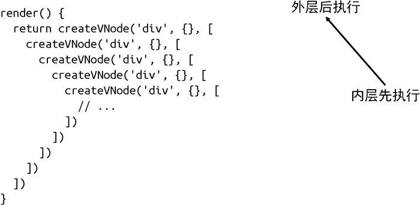

# 第17章编译优化

编译优化指的是编译器将模板编译为渲染函数的过程中，尽可能多地提取关键信息，并以此指导生成最优代码的过程。编译优化的策略与具体实现是由框架的设计思路所决定的，不同的框架具有不同的设计思路，因此编译优化的策略也不尽相同。但优化的方向基本一致，即尽可能地区分动态内容和静态内容，并针对不同的内容采用不同的优化策略。

## 17.1　动态节点收集与补丁标志

### 17.1.1　传统 Diff 算法的问题

我们在第三篇中讲解渲染器的时候，介绍了三种关于传统虚拟 DOM 的 Diff 算法。但无论哪一种 Diff 算法，当它在比对新旧两棵虚拟 DOM 树的时候，总是要按照虚拟 DOM 的层级结构“一层一层”地遍历。举个例子，假设我们有如下模板：

```xml
<div id="foo">
  <p class="bar">{{ text }}</p>
</div>
在上面这段模板中，唯一可能变化的就是 p 标签的文本子节点的内容。也就是说，当响应式
数据 text 的值发生变化时，最高效的更新方式就是直接设置 p 标签的文本内容。但传统 Diff
算法显然做不到如此高效，当响应式数据 text 发生变化时，会产生一棵新的虚拟 DOM 树，
```

传统 Diff 算法对比新旧两棵虚拟 DOM 树的过程如下。

```
对比 div 节点，以及该节点的属性和子节点。
对比 p 节点，以及该节点的属性和子节点。
对比 p 节点的文本子节点，如果文本子节点的内容变了，则更新之，否则什么都不做。
可以看到，与直接更新 p 标签的文本内容相比，传统 Diff 算法存在很多无意义的比对操作。
```

如果能够跳过这些无意义的操作，性能将会大幅提升。而这就是 Vue.js 3 编译优化的思路来源。

实际上，模板的结构非常稳定。通过编译手段，我们可以分析出很多关键信息，例如哪些节点是静态的，哪些节点是动态的。结合这些关键信息，编译器可以直接生成原生 DOM 操作的代码，这样甚至能够抛掉虚拟 DOM，从而避免虚拟 DOM 带来的性能开销。但是，考虑到渲染函数的灵活性，以及 Vue.js 2 的兼容问题，Vue.js 3 最终还是选择了保留虚拟 DOM。这样一来，就必然要面临它所带来的额外性能开销。

那么，为什么虚拟 DOM 会产生额外的性能开销呢？根本原因在于，渲染器在运行时得不到足够的信息。传统 Diff 算法无法利用编译时提取到的任何关键信息，这导致渲染器在运行时不可能去做相关的优化。而 Vue.js 3 的编译器会将编译时得到的关键信息“附着”在它生成的虚拟DOM 上，这些信息会通过虚拟 DOM 传递给渲染器。最终，渲染器会根据这些关键信息执行“快捷路径”，从而提升运行时的性能。

### 17.1.2　Block 与 PatchFlags

之所以说传统 Diff 算法无法避免新旧虚拟 DOM 树间无用的比较操作，是因为它在运行时得不到足够的关键信息，从而无法区分动态内容和静态内容。换句话说，只要运行时能够区分动态内容和静态内容，即可实现极致的优化策略。假设我们有如下模板：

```xml
<div>
  <div>foo</div>
  <p>{{ bar }}</p>
</div>
在上面这段模板中，只有 {{ bar }} 是动态的内容。因此，在理想情况下，当响应式数据
bar 的值变化时，只需要更新 p 标签的文本节点即可。为了实现这个目标，我们需要提供更
```

多信息给运行时，这需要我们从虚拟 DOM 的结构入手。来看一下传统的虚拟 DOM 是如何描述上面那段模板的：

```javascript
const vnode = {
  tag: 'div',
  children: [
    { tag: 'div', children: 'foo' },
    { tag: 'p', children: ctx.bar },
  ]
}
```

传统的虚拟 DOM 中没有任何标志能够体现出节点的动态性。但经过编译优化之后，编译器会将它提取到的关键信息“附着”到虚拟 DOM 节点上，如下面的代码所示：

```javascript
const vnode = {
  tag: 'div',
  children: [
    { tag: 'div', children: 'foo' },
    { tag: 'p', children: ctx.bar, patchFlag: 1 },  // 这是动态节点
  ]
}
可以看到，用来描述 p 标签的虚拟节点拥有一个额外的属性，即 patchFlag，它的值是一个
数字。只要虚拟节点存在该属性，我们就认为它是一个动态节点。这里的 patchFlag 属性就
```

是所谓的补丁标志。

我们可以把补丁标志理解为一系列数字标记，并根据数字值的不同赋予它不同的含义，示例如下。

```
数字 1：代表节点有动态的 textContent（例如上面模板中的 p 标签）。
数字 2：代表元素有动态的 class 绑定。
数字 3：代表元素有动态的 style 绑定。
```

- 数字 4：其他……。

通常，我们会在运行时的代码中定义补丁标志的映射，例如：

```javascript
const PatchFlags = {
  TEXT: 1, // 代表节点有动态的 textContent
  CLASS: 2, // 代表元素有动态的 class 绑定
  STYLE: 3
  // 其他……
}
```

有了这项信息，我们就可以在虚拟节点的创建阶段，把它的动态子节点提取出来，并将其存储

```javascript
到该虚拟节点的 dynamicChildren 数组内：
const vnode = {
  tag: 'div',
  children: [
    { tag: 'div', children: 'foo' },
    { tag: 'p', children: ctx.bar, patchFlag: PatchFlags.TEXT }  // 这是动态节点
  ],
  // 将 children 中的动态节点提取到 dynamicChildren 数组中
  dynamicChildren: [
    // p 标签具有 patchFlag 属性，因此它是动态节点
    { tag: 'p', children: ctx.bar, patchFlag: PatchFlags.TEXT }
  ]
}
我们会在下一节中讨论如何提取动态节点。观察上面的 vnode 对象可以发现，与普通虚拟节
点相比，它多出了一个额外的 dynamicChildren 属性。我们把带有该属性的虚拟节点称为
“块”，即 Block。所以，一个 Block 本质上也是一个虚拟 DOM 节点，只不过它比普通的虚
拟节点多出来一个用来存储动态子节点的 dynamicChildren 属性。这里需要注意的是，一
个 Block 不仅能够收集它的直接动态子节点，还能够收集所有动态子代节点。举个例子，假
```

设我们有如下模板：

```xml
<div>
  <div>
    <p>{{ bar }}</p>
  </div>
</div>
在这段模板中，p 标签并不是最外层 div 标签的直接子节点，而是它的子代节点。因此，最
外层的 div 标签对应的 Block 能够将 p 标签收集到其 dynamicChildren 数组中，如下面
```

的代码所示：

```javascript
const vnode = {
  tag: 'div',
  children: [
    {
      tag: 'div',
      children: [
        { tag: 'p', children: ctx.bar, patchFlag: PatchFlags.TEXT }  // 这是动态节
      ]
     },
  ],
  dynamicChildren: [
    // Block 可以收集所有动态子代节点
    { tag: 'p', children: ctx.bar, patchFlag: PatchFlags.TEXT }
  ]
}
有了 Block 这个概念之后，渲染器的更新操作将会以 Block 为维度。也就是说，当渲染器
在更新一个 Block 时，会忽略虚拟节点的 children 数组，而是直接找到该虚拟节点的
dynamicChildren 数组，并只更新该数组中的动态节点。这样，在更新时就实现了跳过静
```

态内容，只更新动态内容。同时，由于动态节点中存在对应的补丁标志，所以在更新动态节点

```
的时候，也能够做到靶向更新。例如，当一个动态节点的 patchFlag 值为数字 1 时，我们
```

知道它只存在动态的文本节点，所以只需要更新它的文本内容即可。

```
既然 Block 的好处这么多，那么什么情况下需要将一个普通的虚拟节点变成 Block 节点
呢？实际上，当我们在编写模板代码的时候，所有模板的根节点都会是一个 Block 节点，如
```

下面的代码所示：

```xml
<template>
  <!-- 这个 div 标签是一个 Block -->
  <div>
    <!-- 这个 p 标签不是 Block，因为它不是根节点 -->
    <p>{{ bar }}</p>
  </div>
  <!-- 这个 h1 标签是一个 Block -->
  <h1>
    <!-- 这个 span 标签不是 Block，因为它不是根节点 -->
    <span :id="dynamicId"></span>
  </h1>
</template>
实际上，除了模板中的根节点需要作为 Block 角色之外，任何带有 v-for、v-if/v-
else-if/v-else 等指令的节点都需要作为 Block 节点，我们会在后续章节中详细讨论。
```

### 17.1.3　收集动态节点

在编译器生成的渲染函数代码中，并不会直接包含用来描述虚拟节点的数据结构，而是包含着用来创建虚拟 DOM 节点的辅助函数，如下面的代码所示：

```sql
render() {
  return createVNode('div', { id: 'foo' }, [
    createVNode('p', null, 'text')
  ])
}
其中 createVNode 函数就是用来创建虚拟 DOM 节点的辅助函数，它的基本实现类似于：
function createVNode(tag, props, children) {
  const key = props && props.key
  props && delete props.key
return {
tag,
props,
children,
key
}
}
可以看到，createVNode 函数的返回值是一个虚拟 DOM 节点。在 createVNode 函数内
部，通常还会对 props 和 children 做一些额外的处理工作。
```

编译器在优化阶段提取的关键信息会影响最终生成的代码，具体体现在用于创建虚拟 DOM 节点的辅助函数上。假设我们有如下模板：

```xml
<div id="foo">
  <p class="bar">{{ text }}</p>
</div>
```

编译器在对这段模板进行编译优化后，会生成带有补丁标志（patch flag）的渲染函数，如下面的代码所示：

```
render() {
  return createVNode('div', { id: 'foo' }, [
    createVNode('p', { class: 'bar' }, text, PatchFlags.TEXT) // PatchFlags.TEXT
  ])
}
```

```
在上面这段代码中，用于创建 p 标签的 createVNode 函数调用存在第四个参数，即
PatchFlags.TEXT。这个参数就是所谓的补丁标志，它代表当前虚拟 DOM 节点是一个动态
```

节点，并且动态因素是：具有动态的文本子节点。这样就实现了对动态节点的标记。

```
下一步我们要思考的是如何将根节点变成一个 Block，以及如何将动态子代节点收集到该
Block 的 dynamicChildren 数组中。这里有一个重要的事实，即在渲染函数内，对
createVNode 函数的调用是层层的嵌套结构，并且该函数的执行顺序是“内层先执行，外层
```

后执行”，如图 17-1 所示。



- 图 17-1　由内向外的执行方式

```
当外层 createVNode 函数执行时，内层的 createVNode 函数已经执行完毕了。因此，为
了让外层 Block 节点能够收集到内层动态节点，就需要一个栈结构的数据来临时存储内层的
```

动态节点，如下面的代码所示：

```sql
// 动态节点栈
const dynamicChildrenStack = []
// 当前动态节点集合
let currentDynamicChildren = null
// openBlock 用来创建一个新的动态节点集合，并将该集合压入栈中
function openBlock() {
  dynamicChildrenStack.push((currentDynamicChildren = []))
}
// closeBlock 用来将通过 openBlock 创建的动态节点集合从栈中弹出
function closeBlock() {
  currentDynamicChildren = dynamicChildrenStack.pop()
}
接着，我们还需要调整 createVNode 函数，如下面的代码所示：
function createVNode(tag, props, children, flags) {
  const key = props && props.key
  props && delete props.key
<p>const vnode = {
tag,
props,
children,
key,
patchFlags: flags
}</p>
<p>if (typeof flags !== ‘undefined’ && currentDynamicChildren) {
// 动态节点，将其添加到当前动态节点集合中
currentDynamicChildren.push(vnode)
}</p>
return vnode
}
在 createVNode 函数内部，检测节点是否存在补丁标志。如果存在，则说明该节点是动态
节点，于是将其添加到当前动态节点集合 currentDynamicChildren 中。
```

最后，我们需要重新设计渲染函数的执行方式，如下面的代码所示：

```xml
render() {
  // 1. 使用 createBlock 代替 createVNode 来创建 block
  // 2. 每当调用 createBlock 之前，先调用 openBlock
  return (openBlock(), createBlock('div', null, [
    createVNode('p', { class: 'foo' }, null, 1 /* patch flag */),
    createVNode('p', { class: 'bar' }, null),
  ]))
}
<p>function createBlock(tag, props, children) {
// block 本质上也是一个 vnode
const block = createVNode(tag, props, children)
// 将当前动态节点集合作为 block.dynamicChildren
block.dynamicChildren = currentDynamicChildren</p>
// 关闭 block
closeBlock()
// 返回
return block
}
```

观察渲染函数内的代码可以发现，我们利用逗号运算符的性质来保证渲染函数的返回值仍然是

```
VNode 对象。这里的关键点是 createBlock 函数，任何应该作为 Block 角色的虚拟节
点，都应该使用该函数来完成虚拟节点的创建。由于 createVNode 函数和 createBlock
函数的执行顺序是从内向外，所以当 createBlock 函数执行时，内层的所有
createVNode 函数已经执行完毕了。这时，currentDynamicChildren 数组中所存储的
就是属于当前 Block 的所有动态子代节点。因此，我们只需要将
currentDynamicChildren 数组作为 block.dynamicChildren 属性的值即可。这样，
```

我们就完成了动态节点的收集。

### 17.1.4　渲染器的运行时支持

```
现在，我们已经有了动态节点集合 vnode.dynamicChildren，以及附着其上的补丁标志。
```

基于这两点，即可在渲染器中实现靶向更新。

```
回顾一下传统的节点更新方式，如下面的 patchElement 函数所示，它取自第三篇所讲解的
```

渲染器：

```xml
function patchElement(n1, n2) {
  const el = n2.el = n1.el
  const oldProps = n1.props
  const newProps = n2.props
<p>for (const key in newProps) {
if (newProps[key] !== oldProps[key]) {
patchProps(el, key, oldProps[key], newProps[key])
}
}
for (const key in oldProps) {
if (!(key in newProps)) {
patchProps(el, key, oldProps[key], null)
}
}</p>
// 在处理 children 时，调用 patchChildren 函数
patchChildren(n1, n2, el)
}
```

```
由上面的代码可知，渲染器在更新标签节点时，使用 patchChildren 函数来更新标签的子
```

节点。但该函数会使用传统虚拟 DOM 的 Diff 算法进行更新，这样做效率比较低。有了

```xml
dynamicChildren 之后，我们可以直接对比动态节点，如下面的代码所示：
function patchElement(n1, n2) {
  const el = n2.el = n1.el
  const oldProps = n1.props
  const newProps = n2.props
<p>// 省略部分代码</p>
<p>if (n2.dynamicChildren) {
// 调用 patchBlockChildren 函数，这样只会更新动态节点
patchBlockChildren(n1, n2)
} else {
patchChildren(n1, n2, el)
}
}</p>
function patchBlockChildren(n1, n2) {
// 只更新动态节点即可
for (let i = 0; i < n2.dynamicChildren.length; i++) {
patchElement(n1.dynamicChildren[i], n2.dynamicChildren[i])
}
}
```

```
在修改后的 patchElement 函数中，我们优先检测虚拟 DOM 是否存在动态节点集合，即
dynamicChildren 数组。如果存在，则直接调用 patchBlockChildren 函数完成更新。
```

这样，渲染器只会更新动态节点，而跳过所有静态节点。

动态节点集合能够使得渲染器在执行更新时跳过静态节点，但对于单个动态节点的更新来说，由于它存在对应的补丁标志，因此我们可以针对性地完成靶向更新，如以下代码所示：

```xml
function patchElement(n1, n2) {
  const el = n2.el = n1.el
  const oldProps = n1.props
  const newProps = n2.props
<p>if (n2.patchFlags) {
// 靶向更新
if (n2.patchFlags === 1) {
// 只需要更新 class
} else if (n2.patchFlags === 2) {
// 只需要更新 style
} else if (…) {
// …
}
} else {
// 全量更新
for (const key in newProps) {
if (newProps[key] !== oldProps[key]) {
patchProps(el, key, oldProps[key], newProps[key])
}
}
for (const key in oldProps) {
if (!(key in newProps)) {
patchProps(el, key, oldProps[key], null)
}
}
}</p>
// 在处理 children 时，调用 patchChildren 函数
patchChildren(n1, n2, el)
}
可以看到，在 patchElement 函数内，我们通过检测补丁标志实现了 props 的靶向更新。
这样就避免了全量的 props 更新，从而最大化地提升性能。
```

## 17.2　Block 树

```
在上一节中，我们约定了组件模板的根节点必须作为 Block 角色。这样，从根节点开始，所
有动态子代节点都会被收集到根节点的 dynamicChildren 数组中。但是，如果只有根节点
是 Block 角色，是不会形成 Block 树的。既然会形成 Block 树，那就意味着除了根节点之
外，还会有其他特殊节点充当 Block 角色。实际上，带有结构化指令的节点，如带有 v-if
和 v-for 指令的节点，都应该作为 Block 角色。接下来，我们就详细讨论原因。
```

### 17.2.1　带有 v-if 指令的节点

首先，我们来看下面这段模板：

```xml
<div>
  <section v-if="foo">
    <p>{{ a }}</p>
  </section>
  <div v-else>
    <p>{{ a }}</p>
  </div>
</div>
假设只有最外层的 div 标签会作为 Block 角色。那么，当变量 foo 的值为 true 时，
block 收集到的动态节点是：
cosnt block = {
  tag: 'div',
  dynamicChildren: [
    { tag: 'p', children: ctx.a, patchFlags: 1 }
  ]
  // ...
}
而当变量 foo 的值为 false 时，block 收集到的动态节点是：
cosnt block = {
  tag: 'div',
  dynamicChildren: [
    { tag: 'p', children: ctx.a, patchFlags: 1 }
  ]
  // ...
}
可以发现，无论变量 foo 的值是 true 还是 false，block 所收集的动态节点是不变的。
这意味着，在 Diff 阶段不会做任何更新。但是我们也看到了，在上面的模板中，带有 v-if 指
令的是 <section> 标签，而带有 v-else 指令的是 <div> 标签。很明显，更新前后的标签
```

不同，如果不做任何更新，将产生严重的 bug。不仅如此，下面的模板也会出现同样的问题：

```xml
<div>
  <section v-if="foo">
    <p>{{ a }}</p>
  </section>
  <section v-else> <!-- 即使这里是 section -->
       <div> <!-- 这个 div 标签在 Diff 过程中被忽略 -->
            <p>{{ a }}</p>
        </div>
  </section >
</div>
在上面这段模板中，即使带有 v-if 指令的标签与带有 v-else 指令的标签都是 <section>
```

标签，但由于两个分支的虚拟 DOM 树的结构不同，仍然会导致更新失败。

```
实际上，上述问题的根本原因在于，dynamicChildren 数组中收集的动态节点是忽略虚拟
```

DOM 树层级的。换句话说，结构化指令会导致更新前后模板的结构发生变化，即模板结构不

```
稳定。那么，如何让虚拟 DOM 树的结构变稳定呢？其实很简单，只需要让带有 v-if/v-
else-if/v-else 等结构化指令的节点也作为 Block 角色即可。
```

以下面的模板为例：

```xml
<div>
  <section v-if="foo">
    <p>{{ a }}</p>
  </section>
  <section v-else> <!-- 即使这里是 section -->
       <div> <!-- 这个 div 标签在 Diff 过程中被忽略 -->
            <p>{{ a }}</p>
        </div>
  </section >
</div>
如果上面这段模板中的两个 <section> 标签都作为 Block 角色，那么将构成一棵 Block
```

树：

```
Block(Div)
    - Block(Section v-if)
    - Block(Section v-else)
父级 Block 除了会收集动态子代节点之外，也会收集子 Block。因此，两个子
Block(section) 将作为父级 Block(div) 的动态节点被收集到父级 Block(div) 的
dynamicChildren 数组中，如下面的代码所示：
cosnt block = {
    tag: 'div',
    dynamicChildren: [
      /* Block(Section v-if) 或者 Block(Section v-else) */
      { tag: 'section', { key: 0 /* key 值会根据不同的 Block 而发生变化 */ }, dynami
    ]
}
这样，当 v-if 条件为真时，父级 Block 的 dynamicChildren 数组中包含的是
Block(section v-if)；当 v-if 的条件为假时，父级 Block 的 dynamicChildren 数
组中包含的将是 Block(section v-else)。在 Diff 过程中，渲染器能够根据 Block 的
key 值区分出更新前后的两个 Block 是不同的，并使用新的 Block 替换旧的 Block。这样
```

就解决了 DOM 结构不稳定引起的更新问题。

### 17.2.2　带有 v-for 指令的节点

```
不仅带有 v-if 指令的节点会让虚拟 DOM 树的结构不稳定，带有 v-for 指令的节点也会让
```

虚拟 DOM 树变得不稳定，而后者的情况会稍微复杂一些。

思考如下模板：

```xml
<div>
  <p v-for="item in list">{{ item }}</p>
  <i>{{ foo }}</i>
  <i>{{ bar }}</i>
</div>
假设 list 是一个数组，在更新过程中，list 数组的值由 [1 ,2] 变为 [1]。按照之前的
思路，即只有根节点会作为 Block 角色，那么，上面的模板中，只有最外层的 <div> 标签
会作为 Block。所以，这段模板在更新前后对应的 Block 树是：
// 更新前
const prevBlock = {
  tag: 'div',
  dynamicChildren: [
    { tag: 'p', children: 1, 1 /* TEXT */ },
    { tag: 'p', children: 2, 1 /* TEXT */ },
    { tag: 'i', children: ctx.foo, 1 /* TEXT */ },
    { tag: 'i', children: ctx.bar, 1 /* TEXT */ },
  ]
}
// 更新后
const nextBlock = {
tag: ‘div’,
dynamicChildren: [
{ tag: ‘p’, children: item, 1 /* TEXT <em>/ },
{ tag: ‘i’, children: ctx.foo, 1 /</em> TEXT <em>/ },
{ tag: ‘i’, children: ctx.bar, 1 /</em> TEXT */ },
]
}
```

```
观察上面这段代码，更新前的 Block 树（prevBlock）中有四个动态节点，而更新后的
Block 树（nextBlock）中只有三个动态节点。这时要如何进行 Diff 操作呢？有人可能会
说，使用更新前后的两个 dynamicChildren 数组内的节点进行传统 Diff 不就可以吗？这么
```

做显然是不对的，因为传统 Diff 的一个非常重要的前置条件是：进行 Diff 操作的节点必须是同

```
层级节点。但是 dynamicChildren 数组内的节点未必是同层级的，这一点我们在前面的章
```

节中提到过。

```javascript
实际上，解决方法很简单，我们只需要让带有 v-for 指令的标签也作为 Block 角色即可。
这样就能够保证虚拟 DOM 树具有稳定的结构，即无论 v-for 在运行时怎样变化，这棵
Block 树看上去都是一样的，如下面的代码所示：
const block = {
  tag: 'div',
  dynamicChildren: [
    // 这是一个 Block，它有 dynamicChildren
    { tag: Fragment, dynamicChildren: [/* v-for 的节点 */] }
    { tag: 'i', children: ctx.foo, 1 /* TEXT */ },
    { tag: 'i', children: ctx.bar, 1 /* TEXT */ },
  ]
}
由于 v-for 指令渲染的是一个片段，所以我们需要使用类型为 Fragment 的节点来表达 v-
for 指令的渲染结果，并作为 Block 角色。
```

### 17.2.3　Fragment 的稳定性

```
在上一节中，我们使用了一个 Fragment 来表达 v-for 循环产生的虚拟节点，并让其充当
Block 的角色来解决 v-for 指令导致的虚拟 DOM 树结构不稳定问题。但是，我们需要仔细
研究这个 Fragment 节点本身。
```

给出下面这段模板：

```xml
<p v-for="item in list">{{ item }}</p>
当 list 数组由 [1, 2] 变成 [1] 时，Fragment 节点在更新前后对应的内容分别是：
// 更新前
const prevBlock = {
  tag: Fragment,
  dynamicChildren: [
    { tag: 'p', children: item, 1 /* TEXT */ },
    { tag: 'p', children: item, 2 /* TEXT */ }
  ]
}
// 更新后
const prevBlock = {
tag: Fragment,
dynamicChildren: [
{ tag: ‘p’, children: item, 1 /* TEXT */ }
]
}
我们发现，Fragment 本身收集的动态节点仍然面临结构不稳定的情况。所谓结构不稳定，
从结果上看，指的是更新前后一个 block 的 dynamicChildren 数组中收集的动态节点的
```

数量或顺序不一致。这种不一致会导致我们无法直接进行靶向更新，怎么办呢？其实对于这种

```
情况，没有更好的解决办法，我们只能放弃根据 dynamicChildren 数组中的动态节点进行
靶向更新的思路，并回退到传统虚拟 DOM 的 Diff 手段，即直接使用 Fragment 的
children 而非 dynamicChildren 来进行 Diff 操作。
```

```
但需要注意的是，Fragment 的子节点（children）仍然可以是由 Block 组成的数组，例
```

如：

```javascript
const block = {
  tag: Fragment,
  children: [
    { tag: 'p', children: item, dynamicChildren: [/*...*/], 1 /* TEXT */ },
    { tag: 'p', children: item, dynamicChildren: [/*...*/], 1 /* TEXT */ }
  ]
}
这样，当 Fragment 的子节点进行更新时，就可以恢复优化模式。
既然有不稳定的 Fragment，那就有稳定的 Fragment。那什么样的 Fragment 是稳定的
```

呢？有以下几种情况。

```xml
v-for 指令的表达式是常量：
<p v-for="n in 10"></p>
1
<!-- 或者 -->
2
<p v-for="s in 'abc'"></p>
3
由于表达式 10 和 'abc' 是常量，所以无论怎样更新，上面两个 Fragment 都不会变
化。因此这两个 Fragment 是稳定的。对于稳定的 Fragment，我们不需要回退到传统
```

- Diff 操作，这在性能上会有一定的优势。

- 模板中有多个根节点。Vue.js 3 不再限制组件的模板必须有且仅有一个根节点。当模板中存

```xml
在多个根节点时，我们需要使用 Fragment 来描述它。例如：
<template>
1
  <div></div>
2
  <p></p>
3
  <i></i>
4
</template>
5
同时，用于描述具有多个根节点的模板的 Fragment 也是稳定的。
```

## 17.3　静态提升

```
理解了 Block 树之后，我们再来看看其他方面的优化，其中之一就是静态提升。它能够减少
```

更新时创建虚拟 DOM 带来的性能开销和内存占用。

假设我们有如下模板：

```xml
<div>
  <p>static text</p>
  <p>{{ title }}</p>
</div>
```

在没有静态提升的情况下，它对应的渲染函数是：

```javascript
function render() {
  return (openBlock(), createBlock('div', null, [
    createVNode('p', null, 'static text'),
    createVNode('p', null, ctx.title, 1 /* TEXT */)
  ]))
}
可以看到，在这段虚拟 DOM 的描述中存在两个 p 标签，一个是纯静态的，而另一个拥有动态
文本。当响应式数据 title 的值发生变化时，整个渲染函数会重新执行，并产生新的虚拟
```

DOM 树。这个过程有一个明显的问题，即纯静态的虚拟节点在更新时也会被重新创建一次。很显然，这是没有必要的，所以我们需要想办法避免由此带来的性能开销。而解决方案就是所谓的“静态提升”，即把纯静态的节点提升到渲染函数之外，如下面的代码所示：

```javascript
// 把静态节点提升到渲染函数之外
const hoist1 = createVNode('p', null, 'text')
function render() {
return (openBlock(), createBlock(‘div’, null, [
hoist1, // 静态节点引用
createVNode(‘p’, null, ctx.title, 1 /* TEXT */)
]))
}
```

可以看到，当把纯静态的节点提升到渲染函数之外后，在渲染函数内只会持有对静态节点的引用。当响应式数据变化，并使得渲染函数重新执行时，并不会重新创建静态的虚拟节点，从而避免了额外的性能开销。

需要强调的是，静态提升是以树为单位的。以下面的模板为例：

```xml
<div>
  <section>
    <p>
      <span>abc</span>
    </p>
  </section >
</div>
在上面这段模板中，除了根节点的 div 标签会作为 Block 角色而不可被提升之外，整个
<section> 元素及其子代节点都会被提升。如果我们把上面模板中的静态字符串 abc 换成
动态绑定的 {{ abc }}，那么整棵树都不会被提升。
```

虽然包含动态绑定的节点本身不会被提升，但是该动态节点上仍然可能存在纯静态的属性，如下面的模板所示：

```xml
<div>
  <p foo="bar" a=b>{{ text }}</p>
</div>
在上面这段模板中，p 标签存在动态绑定的文本内容，因此整个节点都不会被静态提升。但该
节点的所有 props 都是静态的，因此在最终生成渲染函数时，我们可以将纯静态的 props
```

提升到渲染函数之外，如下面的代码所示：

```javascript
// 静态提升的 props 对象
const hoistProp = { foo: 'bar', a: 'b' }
function render(ctx) {
return (openBlock(), createBlock(‘div’, null, [
createVNode(‘p’, hoistProp, ctx.text)
]))
}
```

这样做同样可以减少创建虚拟 DOM 产生的开销以及内存占用。

## 17.4　预字符串化

基于静态提升，我们还可以进一步采用预字符串化的优化手段。预字符串化是基于静态提升的一种优化策略。静态提升的虚拟节点或虚拟节点树本身是静态的，那么，能否将其预字符串化呢？如下面的模板所示：

```xml
<div>
  <p></p>
  <p></p>
  // ... 20 个 p 标签
  <p></p>
</div>
```

假设上面的模板中包含大量连续纯静态的标签节点，当采用了静态提升优化策略时，其编译后的代码如下：

```javascript
cosnt hoist1 = createVNode('p', null, null, PatchFlags.HOISTED)
cosnt hoist2 = createVNode('p', null, null, PatchFlags.HOISTED)
// ... 20 个 hoistx 变量
cosnt hoist20 = createVNode('p', null, null, PatchFlags.HOISTED)
render() {
return (openBlock(), createBlock(‘div’, null, [
hoist1, hoist2, /* …20 个变量 */, hoist20
]))
}
预字符串化能够将这些静态节点序列化为字符串，并生成一个 Static 类型的 VNode：
const hoistStatic = createStaticVNode('<p></p><p></p><p></p>...20 个...<p></p>')
render() {
return (openBlock(), createBlock(‘div’, null, [
hoistStatic
]))
}
```

这么做有几个明显的优势。

```
大块的静态内容可以通过 innerHTML 进行设置，在性能上具有一定优势。
```

- 减少创建虚拟节点产生的性能开销。

- 减少内存占用。

## 17.5　缓存内联事件处理函数

提到优化，就不得不提对内联事件处理函数的缓存。缓存内联事件处理函数可以避免不必要的更新。假设模板内容如下：

```xml
<Comp @change="a + b" />
上面这段模板展示的是一个绑定了 change 事件的组件，并且为 change 事件绑定的事件处
```

理程序是一个内联语句。对于这样的模板，编译器会为其创建一个内联事件处理函数，如下面的代码所示：

```javascript
function render(ctx) {
  return h(Comp, {
    // 内联事件处理函数
    onChange: () => (ctx.a + ctx.b)
  })
}
很显然，每次重新渲染时（即 render 函数重新执行时），都会为 Comp 组件创建一个全新的
props 对象。同时，props 对象中 onChange 属性的值也会是全新的函数。这会导致渲染
器对 Comp 组件进行更新，造成额外的性能开销。为了避免这类无用的更新，我们需要对内联
```

事件处理函数进行缓存，如下面的代码所示：

```javascript
function render(ctx, cache) {
  return h(Comp, {
    // 将内联事件处理函数缓存到 cache 数组中
    onChange: cache[0] || (cache[0] = ($event) => (ctx.a + ctx.b))
  })
}
渲染函数的第二个参数是一个数组 cache，该数组来自组件实例，我们可以把内联事件处理
函数添加到 cache 数组中。这样，当渲染函数重新执行并创建新的虚拟 DOM 树时，会优先
读取缓存中的事件处理函数。这样，无论执行多少次渲染函数，props 对象中 onChange 属
性的值始终不变，于是就不会触发 Comp 组件更新了。
```

## 17.6　v-once

```
Vue.js 3 不仅会缓存内联事件处理函数，配合 v-once 还可实现对虚拟 DOM 的缓存。Vue.js
2 也支持 v-once 指令，当编译器遇到 v-once 指令时，会利用我们上一节介绍的 cache 数
```

组来缓存渲染函数的全部或者部分执行结果，如下面的模板所示：

```xml
<section>
  <div v-once>{{ foo }}</div>
</section>
在上面这段模板中，div 标签存在动态绑定的文本内容。但是它被 v-once 指令标记，所以
```

这段模板会被编译为：

```javascript
function render(ctx, cache) {
  return (openBlock(), createBlock('div', null, [
    cache[1] || (cache[1] = createVNode("div", null, ctx.foo, 1 /* TEXT */))
  ]))
}
从编译结果中可以看到，该 div 标签对应的虚拟节点被缓存到了 cache 数组中。既然虚拟节
```

点已经被缓存了，那么后续更新导致渲染函数重新执行时，会优先读取缓存的内容，而不会重新创建虚拟节点。同时，由于虚拟节点被缓存，意味着更新前后的虚拟节点不会发生变化，因此也就不需要这些被缓存的虚拟节点参与 Diff 操作了。所以在实际编译后的代码中经常出现下面这段内容：

```
render(ctx, cache) {
  return (openBlock(), createBlock('div', null, [
    cache[1] || (
      setBlockTracking(-1), // 阻止这段 VNode 被 Block 收集
      cache[1] = h("div", null, ctx.foo, 1 /* TEXT */),
      setBlockTracking(1), // 恢复
      cache[1] // 整个表达式的值
    )
  ]))
}
注意上面这段代码中的 setBlockTracking(-1) 函数调用，它用来暂停动态节点的收集。
换句话说，使用 v-once 包裹的动态节点不会被父级 Block 收集。因此，被 v-once 包裹
```

的动态节点在组件更新时，自然不会参与 Diff 操作。

```xml
v-once 指令通常用于不会发生改变的动态绑定中，例如绑定一个常量：
<div>{{ SOME_CONSTANT }}</div>
为了提升性能，我们可以使用 v-once 来标记这段内容：
<div v-once>{{ SOME_CONSTANT }}</div>
```

这样，在组件更新时就会跳过这段内容的更新，从而提升更新性能。

```
实际上，v-once 指令能够从两个方面提升性能。
```

- 避免组件更新时重新创建虚拟 DOM 带来的性能开销。因为虚拟 DOM 被缓存了，所以更新时无须重新创建。

```
避免无用的 Diff 开销。这是因为被 v-once 标记的虚拟 DOM 树不会被父级 Block 节点收
```

- 集。

## 17.7　总结

本章中，我们主要讨论了 Vue.js 3 在编译优化方面所做的努力。编译优化指的是通过编译的手段提取关键信息，并以此指导生成最优代码的过程。具体来说，Vue.js 3 的编译器会充分分析模板，提取关键信息并将其附着到对应的虚拟节点上。在运行时阶段，渲染器通过这些关键信息执行“快捷路径”，从而提升性能。

编译优化的核心在于，区分动态节点与静态节点。Vue.js 3 会为动态节点打上补丁标志，即

```
patchFlag。同时，Vue.js 3 还提出了 Block 的概念，一个 Block 本质上也是一个虚拟节
点，但与普通虚拟节点相比，会多出一个 dynamicChildren 数组。该数组用来收集所有动
态子代节点，这利用了 createVNode 函数和 createBlock 函数的层层嵌套调用的特点，
```

即以“由内向外”的方式执行。再配合一个用来临时存储动态节点的节点栈，即可完成动态子代节点的收集。

```
由于 Block 会收集所有动态子代节点，所以对动态节点的比对操作是忽略 DOM 层级结构
的。这会带来额外的问题，即 v-if、v-for 等结构化指令会影响 DOM 层级结构，使之不稳
定。这会间接导致基于 Block 树的比对算法失效。而解决方式很简单，只需要让带有 v-
if、v-for 等指令的节点也作为 Block 角色即可。
除了 Block 树以及补丁标志之外，Vue.js 3 在编译优化方面还做了其他努力，具体如下。
```

- 静态提升：能够减少更新时创建虚拟 DOM 带来的性能开销和内存占用。

- 预字符串化：在静态提升的基础上，对静态节点进行字符串化。这样做能够减少创建虚拟节点产生的性能开销以及内存占用。

- 缓存内联事件处理函数：避免造成不必要的组件更新。

```
v-once 指令：缓存全部或部分虚拟节点，能够避免组件更新时重新创建虚拟 DOM 带来的
```

- 性能开销，也可以避免无用的 Diff 操作。
