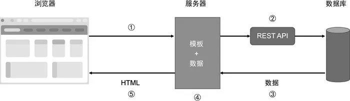
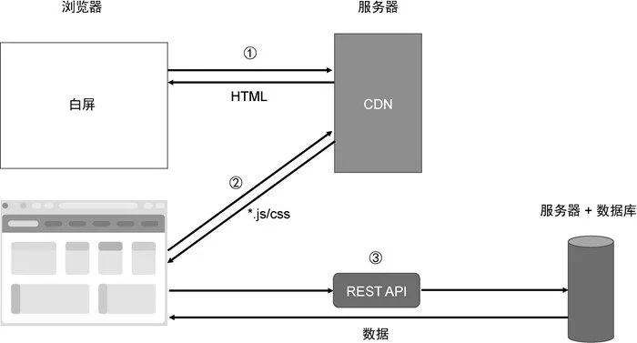
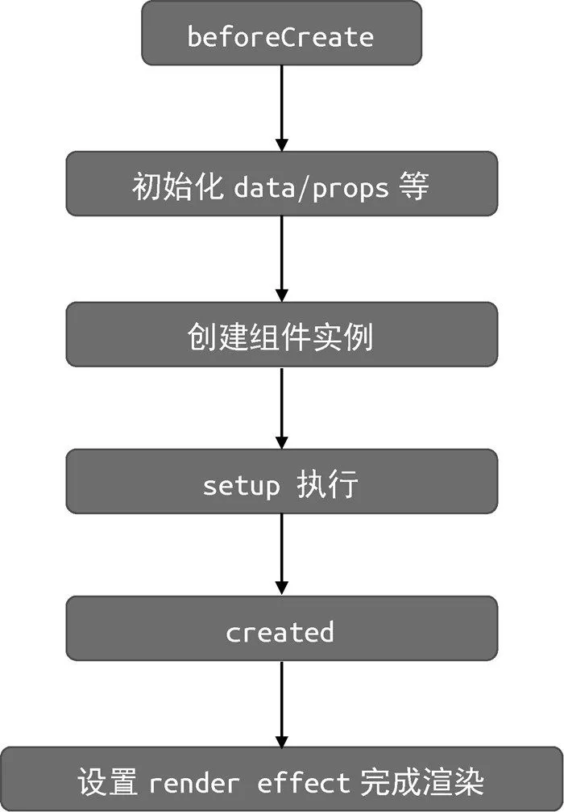
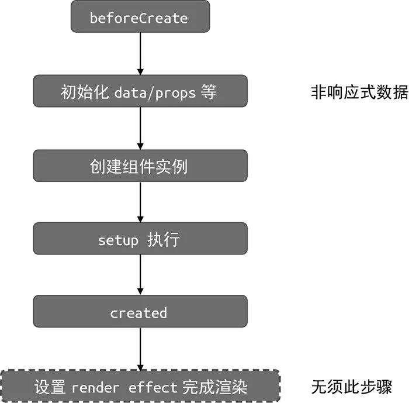
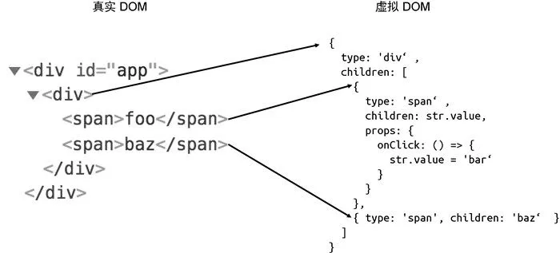

# 第18章同构渲染

## 第 18 章　同构渲染

Vue.js 可以用于构建客户端应用程序，组件的代码在浏览器中运行，并输出 DOM 元素。同时，Vue.js 还可以在 Node.js 环境中运行，它可以将同样的组件渲染为字符串并发送给浏览器。这实际上描述了 Vue.js 的两种渲染方式，即客户端渲染（client-side rendering，CSR），以及服务端渲染（server-side rendering，SSR）。另外，Vue.js 作为现代前端框架，不仅能够独立地进行 CSR 或 SSR，还能够将两者结合，形成所谓的同构渲染（isomorphicrendering）。本章，我们将讨论 CSR、SSR 以及同构渲染之间的异同，以及 Vue.js 同构渲染的实现机制。

## 18.1　CSR、SSR 以及同构渲染

在设计软件时，我们经常会遇到这样的问题：“是否应该使用服务端渲染？”这个问题没有确切的答案，具体还要看软件的需求以及场景。想要为软件选择合适的架构策略，就需要我们对不同的渲染策略做到了然于胸，知道它们各自的优缺点。服务端渲染并不是一项新技术，也不是一个新概念。在 Web 2.0 之前，网站主要负责提供各种各样的内容，通常是一些新闻站点、个人博客、小说站点等。这些站点主要强调内容本身，而不强调与用户之间具有高强度的交互。当时的站点基本采用传统的服务端渲染技术来实现。例如，比较流行的 PHP/JSP 等技术。图 18-1 给出了服务端渲染的工作流程图。



- 图 18-1　服务端渲染的工作流程

(1) 用户通过浏览器请求站点。

(2) 服务器请求 API 获取数据。

(3) 接口返回数据给服务器。

(4) 服务器根据模板和获取的数据拼接出最终的 HTML 字符串。

(5) 服务器将 HTML 字符串发送给浏览器，浏览器解析 HTML 内容并渲染。

当用户再次通过超链接进行页面跳转，会重复上述 5 个步骤。可以看到，传统的服务端渲染的用户体验非常差，任何一个微小的操作都可能导致页面刷新。

后来以 AJAX 为代表，催生了 Web 2.0。在这个阶段，大量的 SPA（single-page application）诞生，也就是接下来我们要介绍的 CSR 技术。与 SSR 在服务端完成模板和数据的融合不同，CSR 是在浏览器中完成模板与数据的融合，并渲染出最终的 HTML 页面。图 18-2 给出了 CSR 的详细工作流程。



- 图 18-2　CSR 的工作流程

- 客户端向服务器或 CDN 发送请求，获取静态的 HTML 页面。注意，此时获取的 HTML 页

```
面通常是空页面。在 HTML 页面中，会包含 <style>、<link> 和 <script> 等标签。
```

- 例如：

```xml
<!DOCTYPE html>
1
<html lang="zh">
2
<head>
3
  <meta charset="UTF-8">
4
  <meta name="viewport" content="width=device-width, initial-scale=1.0">
5
  <title>My App</title>
6
  <link rel="stylesheet" href="/dist/app.css">
7
</head>
8
<body>
9
  <div id="app"></div>
10
<script src=“/dist/app.js”></script>
11
12
</body>
13
14
</html>
15
16
这是一个包含 <link rel="stylesheet"> 与 <script> 标签的空 HTML 页面。浏览
```

- 器在得到该页面后，不会渲染出任何内容，所以从用户的视角看，此时页面处于“白屏”阶段。

- 虽然 HTML 页面是空的，但浏览器仍然会解析 HTML 内容。由于 HTML 页面中存在

```xml
<link rel="stylesheet"> 和 <script> 等标签，所以浏览器会加载 HTML 中引用的
```

- 资源，例如 app.css 和 app.js。接着，服务器或 CDN 会将相应的资源返回给浏览器，浏览器对 CSS 和 JavaScript 代码进行解释和执行。因为页面的渲染任务是由 JavaScript 来完成的，所以当 JavaScript 被解释和执行后，才会渲染出页面内容，即“白屏”结束。但初始渲染出来的内容通常是一个“骨架”，因为还没有请求 API 获取数据。

- 客户端再通过 AJAX 技术请求 API 获取数据，一旦接口返回数据，客户端就会完成动态内容的渲染，并呈现完整的页面。

当用户再次通过点击“跳转”到其他页面时，浏览器并不会真正的进行跳转动作，即不会进行刷新，而是通过前端路由的方式动态地渲染页面，这对用户的交互体验会非常友好。但很明显的是，与 SSR 相比，CSR 会产生所谓的“白屏”问题。实际上，CSR 不仅仅会产生白屏问题，它对 SEO（搜索引擎优化）也不友好。表 18-1 从多个方面比较了 SSR 与 CSR。

表 18-1　SSR 与 CSR 的比较

- SSRCSR

SEO

- 友好不友好

白屏问题

- 无有

占用服务端资源

- 多少

用户体验

- 差好

SSR 和 CSR 各有优缺点。SSR 对 SEO 更加友好，而 CSR 对 SEO 不太友好。由于 SSR 的内容到达时间更快，因此它不会产生白屏问题。相对地，CSR 会有白屏问题。另外，由于SSR 是在服务端完成页面渲染的，所以它需要消耗更多服务端资源。CSR 则能够减少对服务端资源的消耗。对于用户体验，由于 CSR 不需要进行真正的“跳转”，用户会感觉更加“流畅”，所以 CSR 相比 SSR 具有更好的用户体验。从这些角度来看，无论是 SSR 还是 CSR，都不可以作为“银弹”，我们需要从项目的实际需求出发，决定到底采用哪一个。例如你的项目非常需要 SEO，那么就应该采用 SSR。

那么，我们能否融合 SSR 与 CSR 两者的优点于一身呢？答案是“可以的”，这就是接下来我们要讨论的同构渲染。同构渲染分为首次渲染（即首次访问或刷新页面）以及非首次渲染。图18-3 给出了同构渲染首次渲染的工作流程。


- 图 18-3　真实 DOM 与虚拟 DOM 的关系

实际上，同构渲染中的首次渲染与 SSR 的工作流程是一致的。也就是说，当首次访问或者刷新页面时，整个页面的内容是在服务端完成渲染的，浏览器最终得到的是渲染好的 HTML 页面。但是该页面是纯静态的，这意味着用户还不能与页面进行任何交互，因为整个应用程序的

```
脚本还没有加载和执行。另外，该静态的 HTML 页面中也会包含 <link>、<script> 等标
```

签。除此之外，同构渲染所产生的 HTML 页面与 SSR 所产生的 HTML 页面有一点最大的不同，即前者会包含当前页面所需要的初始化数据。直白地说，服务器通过 API 请求的数据会被序列化为字符串，并拼接到静态的 HTML 字符串中，最后一并发送给浏览器。这么做实际上是为了后续的激活操作，后文会详细讲解。

假设浏览器已经接收到初次渲染的静态 HTML 页面，接下来浏览器会解析并渲染该页面。在

```
解析过程中，浏览器会发现 HTML 代码中存在 <link> 和 <script> 标签，于是会从 CDN
```

或服务器获取相应的资源，这一步与 CSR 一致。当 JavaScript 资源加载完毕后，会进行激活操作，这里的激活就是我们在 Vue.js 中常说的 “hydration”。激活包含两部分工作内容。

- Vue.js 在当前页面已经渲染的 DOM 元素以及 Vue.js 组件所渲染的虚拟 DOM 之间建立联系。

- Vue.js 从 HTML 页面中提取由服务端序列化后发送过来的数据，用以初始化整个 Vue.js 应用程序。

激活完成后，整个应用程序已经完全被 Vue.js 接管为 CSR 应用程序了。后续操作都会按照CSR 应用程序的流程来执行。当然，如果刷新页面，仍然会进行服务端渲染，然后再进行激活，如此往复。

表 18-2 对比了 SSR、CSR 和同构渲染的优劣。

表 18-2　SSR、CSR 和同构渲染之间的对比

- SSRCSR同构渲染

SEO

- 友好不友好友好

白屏问题

- 无有无

占用服务端资源

- 多少中

用户体验

- 差好好

可以看到，同构渲染除了也需要部分服务端资源外，其他方面的表现都非常棒。由于同构渲染方案在首次渲染时和浏览器刷新时仍然需要服务端完成渲染工作，所以也需要部分服务端资源，但相比所有页面跳转都需要服务端完成渲染来说，同构渲染所占用的服务端资源相对少一些。

另外，对同构渲染最多的误解是，它能够提升可交互时间（TTI）。事实是同构渲染仍然需要像CSR 那样等待 JavaScript 资源加载完成，并且客户端激活完成后，才能响应用户操作。因此，理论上同构渲染无法提升可交互时间。

同构渲染的“同构”一词的含义是，同样一套代码既可以在服务端运行，也可以在客户端运行。例如，我们用 Vue.js 编写一个组件，该组件既可以在服务端运行，被渲染为 HTML 字符串；也可以在客户端运行，就像普通的 CSR 应用程序一样。我们会在 18.2 节讨论 Vue.js 的组件是如何在服务端被渲染为 HTML 字符串的。

## 18.2　将虚拟 DOM 渲染为 HTML 字符串

既然“同构”指的是，同样的代码既能在服务端运行，也能在客户端运行，那么本节我们就讨论如何在服务端将虚拟 DOM 渲染为 HTML 字符串。

```javascript
给出如下虚拟节点对象，它用来描述一个普通的 div 标签：
const ElementVNode = {
  type: 'div',
  props: {
    id: 'foo'
  },
  children: [
    { type: 'p', children: 'hello' }
  ]
}
为了将虚拟节点 ElementVNode 渲染为字符串，我们需要实现 renderElementVNode 函
```

数。该函数接收用来描述普通标签的虚拟节点作为参数，并返回渲染后的 HTML 字符串：

```javascript
function renderElementVNode(vnode) {
  // 返回渲染后的结果，即 HTML 字符串
}
在不考虑任何边界条件的情况下，实现 renderElementVNode 非常简单，如下面的代码所
```

示：

```xml
function renderElementVNode(vnode) {
  // 取出标签名称 tag 和标签属性 props，以及标签的子节点
  const { type: tag, props, children } = vnode
  // 开始标签的头部
  let ret = `<$`
  // 处理标签属性
  if (props) {
    for (const k in props) {
      // 以 key="value" 的形式拼接字符串
      ret += ` $="$"`
    }
  }
  // 开始标签的闭合
  ret += `>`
<p>// 处理子节点
// 如果子节点的类型是字符串，则是文本内容，直接拼接
if (typeof children === ‘string’) {
ret += children
} else if (Array.isArray(children)) {
// 如果子节点的类型是数组，则递归地调用 renderElementVNode 完成渲染
children.forEach(child => {
ret += renderElementVNode(child)
})
}</p>
<p>// 结束标签
ret += <code>&lt;/$&gt;</code></p>
&lt;/$&gt;// 返回拼接好的 HTML 字符串
return ret
}
接着，我们可以调用 renderElementVNode 函数完成对 ElementVNode 的渲染：
console.log(renderElementVNode(ElementVNode)) // <div id="foo"><p>hello</p></div
```

可以看到，输出结果是我们所期望的 HTML 字符串。实际上，将一个普通标签类型的虚拟节点渲染为 HTML 字符串，本质上是字符串的拼接。不过，上面给出的

```
renderElementVNode 函数的实现仅仅用来展示将虚拟 DOM 渲染为 HTML 字符串的核心
```

原理，并不满足生产要求，因为它存在以下几点缺陷。

```
renderElementVNode 函数在渲染标签类型的虚拟节点时，还需要考虑该节点是否是自
```

- 闭合标签。

```
对于属性（props）的处理会比较复杂，要考虑属性名称是否合法，还要对属性值进行
```

- HTML 转义。

```
子节点的类型多种多样，可能是任意类型的虚拟节点，如 Fragment、组件、函数式组
```

- 件、文本等，这些都需要处理。

- 标签的文本子节点也需要进行 HTML 转义。

上述这些问题都属于边界条件，接下来我们逐个处理。首先处理自闭合标签，它的术语叫作void element，它的完整列表如下：

```javascript
const VOID_TAGS = 'area,base,br,col,embed,hr,img,input,link,meta,param,source,tr
```

可以在 WHATWG 的规范中查看完整的 void element。

对于 void element，由于它无须闭合标签，所以在为此类标签生成 HTML 字符串时，无须为其生成对应的闭合标签，如下面的代码所示：

```xml
const VOID_TAGS = 'area,base,br,col,embed,hr,img,input,link,meta,param,source,tr
<p>function renderElementVNode2(vnode) {
const { type: tag, props, children } = vnode
// 判断是否是 void element
const isVoidElement = VOID_TAGS.includes(tag)</p>
<p>let ret = <code>&lt;$</code></p>
<p>if (props) {
for (const k in props) {
ret += <code> $="$"</code>
}
}</p>
<p>// 如果是 void element，则自闭合
ret += isVoidElement ? <code>/&gt;</code> : <code>&gt;</code>
// 如果是 void element，则直接返回结果，无须处理 children，因为 void element 没有 childr
if (isVoidElement) return ret</p>
<p>if (typeof children === ‘string’) {
ret += children
} else {
children.forEach(child => {
ret += renderElementVNode2(child)
})
}</p>
<p>ret += <code>&lt;/$&gt;</code></p>
&lt;$ $="$"/&gt;&gt;&lt;/$&gt;return ret
}
```

在上面这段代码中，我们增加了对 void element 的处理。需要注意的一点是，由于自闭合标

```
签没有子节点，所以可以跳过对 children 的处理。
```

接下来，我们需要更严谨地处理 HTML 属性。处理属性需要考虑多个方面，首先是对 booleanattribute 的处理。所谓 boolean attribute，并不是说这类属性的值是布尔类型，而是指，如果

```xml
这类指令存在，则代表 true，否则代表 false。例如 <input/> 标签的 checked 属性和
disabled 属性：
<!-- 选中的 checkbox -->
<input type="checkbox" checked />
<!-- 未选中的 checkbox -->
<input type="checkbox" />
```

从上面这段 HTML 代码示例中可以看出，当渲染 boolean attribute 时，通常无须渲染它的属性值。

关于属性，另外一点需要考虑的是安全问题。WHATWG 规范的 13.1.2.3 节中明确定义了属性名称的组成。

属性名称必须由一个或多个非以下字符组成。

```
控制字符集（control character）的码点范围是：[0x01, 0x1f] 和 [0x7f, 0x9f]。
```

- U+0020 (SPACE)、U+0022 (")、U+0027 (')、U+003E (>)、U+002F (/) 以及 U+003D(=)。

```
noncharacters，这里的 noncharacters 代表 Unicode 永久保留的码点，这些码点在
Unicode 内部使用，它的取值范围是：[0xFDD0, 0xFDEF]，还包括：0xFFFE、
0xFFFF、0x1FFFE、0x1FFFF、0x2FFFE、0x2FFFF、0x3FFFE、0x3FFFF、
0x4FFFE、0x4FFFF、0x5FFFE、0x5FFFF、0x6FFFE、0x6FFFF、0x7FFFE、
0x7FFFF、0x8FFFE、0x8FFFF、0x9FFFE、0x9FFFF、0xAFFFE、0xAFFFF、
0xBFFFE、0xBFFFF、0xCFFFE、0xCFFFF、0xDFFFE、0xDFFFF、0xEFFFE、
0xEFFFF、0xFFFFE、0xFFFFF、0x10FFFE、0x10FFFF。
考虑到 Vue.js 的模板编译器在编译过程中已经对 noncharacters 以及控制字符集进行了处
```

理，所以我们只需要小范围处理即可，任何不满足上述条件的属性名称都是不安全且不合法的。

```
另外，在虚拟节点中的 props 对象中，通常会包含仅用于组件运行时逻辑的相关属性。例
如，key 属性仅用于虚拟 DOM 的 Diff 算法，ref 属性仅用于实现 template ref 的功能等。
```

在进行服务端渲染时，应该忽略这些属性。除此之外，服务端渲染也无须考虑事件绑定。因

```
此，也应该忽略 props 对象中的事件处理函数。
```

更加严谨的属性处理方案如下：

```xml
function renderElementVNode(vnode) {
  const { type: tag, props, children } = vnode
  const isVoidElement = VOID_TAGS.includes(tag)
<p>let ret = <code>&lt;$</code></p>
<p>if (props) {
// 调用 renderAttrs 函数进行严谨处理
ret += renderAttrs(props)
}</p>
<p>ret += isVoidElement ? <code>/&gt;</code> : <code>&gt;</code></p>
<p>if (isVoidElement) return ret</p>
<p>if (typeof children === ‘string’) {
ret += children
} else {
children.forEach(child => {
ret += renderElementVNode(child)
})
}</p>
<p>ret += <code>&lt;/$&gt;</code></p>
&lt;$/&gt;&gt;&lt;/$&gt;return ret
}
```

```xml
可以看到，在 renderElementVNode 函数内，我们调用了 renderAttrs 函数来实现对
props 的处理。renderAttrs 函数的具体实现如下：
// 应该忽略的属性
const shouldIgnoreProp = ['key', 'ref']
function renderAttrs(props) {
let ret = ‘’
for (const key in props) {
if (
// 检测属性名称，如果是事件或应该被忽略的属性，则忽略它
shouldIgnoreProp.includes(key) ||
/^on[^a-z]/.test(key)
) {
continue
}
const value = props[key]
// 调用 renderDynamicAttr 完成属性的渲染
ret += renderDynamicAttr(key, value)
}
return ret
}
renderDynamicAttr 函数的实现如下：
// 用来判断属性是否是 boolean attribute
const isBooleanAttr = (key) =>
(`itemscope,allowfullscreen,formnovalidate,ismap,nomodule,novalidate,readonly` +
  `,async,autofocus,autoplay,controls,default,defer,disabled,hidden,` +
  `loop,open,required,reversed,scoped,seamless,` +
  `checked,muted,multiple,selected`).split(',').includes(key)
<p>// 用来判断属性名称是否合法且安全
const isSSRSafeAttrName = (key) => !/[>/="'\u0009\u000a\u000c\u0020]/.test(key)</
function renderDynamicAttr(key, value) {
if (isBooleanAttr(key)) {
// 对于 boolean attribute，如果值为 false，则什么都不需要渲染，否则只需要渲染 key 即可
return value === false ? <code>: ` $`    } else if (isSSRSafeAttrName(key)) {
}
}
: ` $`    } else if (isSSRSafeAttrName(key)) {      // 对于其他安全的属性，执行完整的渲
这样我们就实现了对普通元素类型的虚拟节点的渲染。实际上，在 Vue.js 中，由于 class 和
style 这两个属性可以使用多种合法的数据结构来表示，例如 class 的值可以是字符串、对
```

象、数组，所以理论上我们还需要考虑这些情况。不过原理都是相通的，对于使用不同数据结

```
构表示的 class 或 style，我们只需要将不同类型的数据结构序列化成字符串表示即可。
另外，观察上面代码中的 renderDynamicAttr 函数的实现能够发现，在处理属性值时，我
们调用了 escapeHtml 对其进行转义处理，这对于防御 XSS 攻击至关重要。HTML 转义指
```

的是将特殊字符转换为对应的 HTML 实体。其转换规则很简单。

- 如果该字符串作为普通内容被拼接，则应该对以下字符进行转义。

```
将字符 & 转义为实体 &amp;。
将字符 < 转义为实体 &lt;。
将字符 > 转义为实体 &gt;。
```

- 如果该字符串作为属性值被拼接，那么除了上述三个字符应该被转义之外，还应该转义下面两个字符。

```
将字符 " 转义为实体 &quot;。
将字符 ' 转义为实体 &#39;。
```

具体实现如下：

```xml
const escapeRE = /["'&<>]/
function escapeHtml(string) {
  const str = '' + string
  const match = escapeRE.exec(str)
<p>if (!match) {
return str
}</p>
<p>let html = ‘’
let escaped
let index
let lastIndex = 0
for (index = match.index; index < str.length; index++) {
switch (str.charCodeAt(index)) {
case 34: // "
escaped = ‘&quot;’
break
case 38: // &
escaped = ‘&amp;’
break
case 39: // ’
escaped = ‘&#39;’
break
case 60: // <
escaped = ‘&lt;’
break
case 62: // >
escaped = ‘&gt;’
break
default:
continue
}</p>
<pre><code> if (lastIndex !== index) {
  html += str.substring(lastIndex, index)
}
lastIndex = index + 1
html += escaped
</code></pre><p>}</p> if (lastIndex !== index) {
  html += str.substring(lastIndex, index)
}
lastIndex = index + 1
html += escaped
return lastIndex !== index ? html + str.substring(lastIndex, index) : html
}
```

原理很简单，只需要在给定字符串中查找需要转义的字符，然后将其替换为对应的 HTML 实体即可。

## 18.3　将组件渲染为 HTML 字符串

在 18.2 节中，我们讨论了如何将普通标签类型的虚拟节点渲染为 HTML 字符串。本节，我们将在此基础上，讨论如何将组件类型的虚拟节点渲染为 HTML 字符串。

假设我们有如下组件，以及用来描述组件的虚拟节点：

```javascript
// 组件
const MyComponent = {
  setup() {
    return () => {
      // 该组件渲染一个 div 标签
      return {
        type: 'div',
        children: 'hello'
      }
    }
  }
}
// 用来描述组件的 VNode 对象
const CompVNode = {
type: MyComponent,
}
我们将实现 renderComponentVNode 函数，并用它把组件类型的虚拟节点渲染为 HTML 字
```

符串：

```javascript
const html = renderComponentVNode(CompVNode)
console.log(html) // 输出：<div>hello</div>
```

实际上，把组件渲染为 HTML 字符串与把普通标签节点渲染为 HTML 字符串并没有本质区别。我们知道，组件的渲染函数用来描述组件要渲染的内容，它的返回值是虚拟 DOM。所以，我们只需要执行组件的渲染函数取得对应的虚拟 DOM，再将该虚拟 DOM 渲染为 HTML

```javascript
字符串，并作为 renderComponentVNode 函数的返回值即可。最基本的实现如下：
function renderComponentVNode(vnode) {
  // 获取 setup 组件选项
  let { type: { setup } } = vnode
  // 执行 setup 函数得到渲染函数 render
  const render = setup()
  // 执行渲染函数得到 subTree，即组件要渲染的内容
  const subTree = render()
  // 调用 renderElementVNode 完成渲染，并返回其结果
  return renderElementVNode(subTree)
}
```

上面这段代码的逻辑非常简单，它仅仅展示了渲染组件的最基本原理，仍然存在很多问题。

```
subTree 本身可能是任意类型的虚拟节点，包括组件类型。因此，我们不能直接使用
renderElementVNode 来渲染它。
执行 setup 函数时，也应该提供 setupContext 对象。而执行渲染函数 render 时，也
应该将其 this 指向 renderContext 对象。实际上，在组件的初始化和渲染方面，其完
整流程与第 13 章讲解的客户端的渲染流程一致。例如，也需要初始化 data，也需要得到
setup 函数的执行结果，并检查 setup 函数的返回值是函数还是 setupState 等。
对于第一个问题，我们可以通过封装通用函数来解决，如下面 renderVNode 函数的代码所
```

示：

```javascript
function renderVNode(vnode) {
  const type = typeof vnode.type
  if (type === 'string') {
    return renderElementVNode(vnode)
  } else if (type === 'object' || type === 'function') {
    return renderComponentVNode(vnode)
  } else if (vnode.type === Text) {
    // 处理文本...
  } else if (vnode.type === Fragment) {
    // 处理片段...
  } else {
    // 其他 VNode 类型
  }
}
有了 renderVNode 后，我们就可以在 renderComponentVNode 中使用它来渲染
subTree 了：
function renderComponentVNode(vnode) {
  let { type: { setup } } = vnode
  const render = setup()
  const subTree = render()
  // 使用 renderVNode 完成对 subTree 的渲染
  return renderVNode(subTree)
}
```

第二个问题则涉及组件的初始化流程。我们先回顾一下组件在客户端渲染时的整体流程，如图18-4 所示。



- 图 18-4　客户端渲染时，组件的初始化流程

在进行服务端渲染时，组件的初始化流程与客户端渲染时组件的初始化流程基本一致，但有两个重要的区别。

- 服务端渲染的是应用的当前快照，它不存在数据变更后重新渲染的情况。因此，所有数据在服务端都无须是响应式的。利用这一点，我们可以减少服务端渲染过程中创建响应式数据对象的开销。

```
服务端渲染只需要获取组件要渲染的 subTree 即可，无须调用渲染器完成真实 DOM 的创
建。因此，在服务端渲染时，可以忽略“设置 render effect 完成渲染”这一步。
```

图 18-5 给出了服务端渲染时初始化组件的流程。



- 图 18-5　服务端渲染时，组件的初始化流程

可以看到，只需要对客户端初始化组件的逻辑稍作调整，即可实现组件在服务端的渲染。另

```
外，由于组件在服务端渲染时，不需要渲染真实 DOM 元素，所以无须创建并执行 render
effect。这意味着，组件的 beforeMount 以及 mounted 钩子不会被触发。而且，由于服
务端渲染不存在数据变更后的重新渲染逻辑，所以 beforeUpdate 和 updated 钩子也不会
```

在服务端执行。完整的实现如下：

```xml
function renderComponentVNode(vnode) {
  const isFunctional = typeof vnode.type === 'function'
  let componentOptions = vnode.type
  if (isFunctional) {
    componentOptions = {
      render: vnode.type,
      props: vnode.type.props
    }
  }
  let { render, data, setup, beforeCreate, created, props: propsOption } = compo
<p>beforeCreate && beforeCreate()</p>
<p>// 无须使用 reactive() 创建 data 的响应式版本
const state = data ? data() : null
const [props, attrs] = resolveProps(propsOption, vnode.props)</p>
<p>const slots = vnode.children || {}</p>
<p>const instance = {
state,
props, // props 无须 shallowReactive
isMounted: false,
subTree: null,
slots,
mounted: [],
keepAliveCtx: null
}</p>
<p>function emit(event, …payload) {
const eventName = <code>on$</code>
const handler = instance.props[eventName]
if (handler) {
handler(…payload)
} else {
console.error(‘事件不存在’)
}
}</p>
<p>// setup
let setupState = null
if (setup) {
const setupContext = { attrs, emit, slots }
const prevInstance = setCurrentInstance(instance)
const setupResult = setup(shallowReadonly(instance.props), setupContext)
setCurrentInstance(prevInstance)
if (typeof setupResult === ‘function’) {
if (render) console.error(‘setup 函数返回渲染函数，render 选项将被忽略’)
render = setupResult
} else {
setupState = setupContext
}
}</p>
<p>vnode.component = instance</p>
<p>const renderContext = new Proxy(instance, {
get(t, k, r) {
const { state, props, slots } = t</p>
<pre><code>   if (k === '$slots') return slots
  if (state &amp;&amp; k in state) {
    return state[k]
  } else if (k in props) {
    return props[k]
  } else if (setupState &amp;&amp; k in setupState) {
    return setupState[k]
  } else {
    console.error('不存在')
  }
},
set (t, k, v, r) {
  const { state, props } = t
  if (state &amp;&amp; k in state) {
    state[k] = v
  } else if (k in props) {
    props[k] = v
  } else if (setupState &amp;&amp; k in setupState) {
    setupState[k] = v
  } else {
    console.error('不存在')
  }
}
</code></pre><p>})</p><p>created && created.call(renderContext)</p><p>const subTr
  if (state &amp;&amp; k in state) {
    return state[k]
  } else if (k in props) {
    return props[k]
  } else if (setupState &amp;&amp; k in setupState) {
    return setupState[k]
  } else {
    console.error('不存在')
  }
},
set (t, k, v, r) {
  const { state, props } = t
  if (state &amp;&amp; k in state) {
    state[k] = v
  } else if (k in props) {
    props[k] = v
  } else if (setupState &amp;&amp; k in setupState) {
    setupState[k] = v
  } else {
    console.error('不存在')
  }
}
return renderVNode(subTree)
}
```

观察上面的代码可以发现，该实现与客户端渲染的逻辑基本一致。这段代码与第 13 章给出的

```
关于组件渲染的代码也非常相似，唯一的区别在于，在服务端渲染时，无须使用 reactive
函数为 data 数据创建响应式版本，并且 props 数据也无须是浅响应的。
```

## 18.4　客户端激活的原理

讨论完如何将组件渲染为 HTML 字符串之后，我们再来讨论客户端激活的实现原理。什么是客户端激活呢？我们知道，对于同构渲染来说，组件的代码会在服务端和客户端分别执行一次。在服务端，组件会被渲染为静态的 HTML 字符串，然后发送给浏览器，浏览器再把这段纯静态的 HTML 渲染出来。这意味着，此时页面中已经存在对应的 DOM 元素。同时，该组件还会被打包到一个 JavaScript 文件中，并在客户端被下载到浏览器中解释并执行。这时问题来了，当组件的代码在客户端执行时，会再次创建 DOM 元素吗？答案是“不会”。由于浏览器在渲染了由服务端发送过来的 HTML 字符串之后，页面中已经存在对应的 DOM 元素了，所以组件代码在客户端运行时，不需要再次创建相应的 DOM 元素。但是，组件代码在客户端运行时，仍然需要做两件重要的事：

- 在页面中的 DOM 元素与虚拟节点对象之间建立联系；

- 为页面中的 DOM 元素添加事件绑定。

我们知道，一个虚拟节点被挂载之后，为了保证更新程序能正确运行，需要通过该虚拟节点的

```
vnode.el 属性存储对真实 DOM 对象的引用。而同构渲染也是一样，为了应用程序在后续更
```

新过程中能够正确运行，我们需要在页面中已经存在的 DOM 对象与虚拟节点对象之间建立正

```
确的联系。另外，在服务端渲染的过程中，会忽略虚拟节点中与事件相关的 props。所以，
```

当组件代码在客户端运行时，我们需要将这些事件正确地绑定到元素上。其实，这两个步骤就体现了客户端激活的含义。

理解了客户端激活的含义后，我们再来看一下它的具体实现。当组件进行纯客户端渲染时，我

```
们通过渲染器的 renderer.render 函数来完成渲染，例如：
renderer.render(vnode, container)
而对于同构应用，我们将使用独立的 renderer.hydrate 函数来完成激活：
renderer.hydrate(vnode, container)
```

实际上，我们可以用代码模拟从服务端渲染到客户端激活的整个过程，如下所示：

```xml
// html 代表由服务端渲染的字符串
const html = renderComponentVNode(compVNode)
<p>// 假设客户端已经拿到了由服务端渲染的字符串
// 获取挂载点
const container = document.querySelector(‘#app’)
// 设置挂载点的 innerHTML，模拟由服务端渲染的内容
container.innerHTML = html</p>
// 接着调用 hydrate 函数完成激活
renderer.hydrate(compVNode, container)
其中 CompVNode 的代码如下：
const MyComponent = {
  name: 'App',
  setup() {
    const str = ref('foo')
<pre><code> return () =&gt; {
  return {
    type: 'div',
    children: [
      {
        type: 'span',
        children: str.value,
        props: {
          onClick: () =&gt; {
            str.value = 'bar'
          }
        }
      },
      { type: 'span', children: 'baz' }
    ]
  }
}
</code></pre><p>}
}</p> return () =&gt; {
  return {
    type: 'div',
    children: [
      {
        type: 'span',
        children: str.value,
        props: {
          onClick: () =&gt; {
            str.value = 'bar'
          }
        }
      },
      { type: 'span', children: 'baz' }
    ]
  }
}
const CompVNode = {
type: MyComponent,
}
接下来，我们着手实现 renderer.hydrate 函数。与 renderer.render 函数一样，
renderer.hydrate 函数也是渲染器的一部分，因此它也会作为 createRenderer 函数的
```

返回值，如下面的代码所示：

```javascript
function createRenderer(options) {
  function hydrate(node, vnode) {
    // ...
  }
return {
render,
// 作为 createRenderer 函数的返回值
hydrate
}
}
这样，我们就可以通过 renderer.hydrate 函数来完成客户端激活了。在具体实现之前，
```

我们先来看一下页面中已经存在的真实 DOM 元素与虚拟 DOM 对象之间的关系。图 18-6 给

```
出了上面代码中 MyComponent 组件所渲染的真实 DOM 和它所渲染的虚拟 DOM 对象之间的
```

关系。



- 图 18-6　真实 DOM 与虚拟 DOM 之间的关系

由图 18-6 可知，真实 DOM 元素与虚拟 DOM 对象都是树型结构，并且节点之间存在一一对应的关系。因此，我们可以认为它们是“同构”的。而激活的原理就是基于这一事实，递归地在真实 DOM 元素与虚拟 DOM 节点之间建立关系。另外，在虚拟 DOM 中并不存在与容器元素（或挂载点）对应的节点。因此，在激活的时候，应该从容器元素的第一个子节点开始，如下面的代码所示：

```javascript
function hydrate(vnode, container) {
  // 从容器元素的第一个子节点开始
  hydrateNode(container.firstChild, vnode)
}
其中，hydrateNode 函数接收两个参数，分别是真实 DOM 元素和虚拟 DOM 元素。
hydrateNode 函数的具体实现如下：
```

```xml
function hydrateNode(node, vnode) {
  const { type } = vnode
  // 1. 让 vnode.el 引用真实 DOM
  vnode.el = node
<p>// 2. 检查虚拟 DOM 的类型，如果是组件，则调用 mountComponent 函数完成激活
if (typeof type === ‘object’) {
mountComponent(vnode, container, null)
} else if (typeof type === ‘string’) {
// 3. 检查真实 DOM 的类型与虚拟 DOM 的类型是否匹配
if (node.nodeType !== 1) {
console.error(‘mismatch’)
console.error(‘服务端渲染的真实 DOM 节点是：’, node)
console.error(‘客户端渲染的虚拟 DOM 节点是：’, vnode)
} else {
// 4. 如果是普通元素，则调用 hydrateElement 完成激活
hydrateElement(node, vnode)
}
}</p>
// 5. 重要：hydrateNode 函数需要返回当前节点的下一个兄弟节点，以便继续进行后续的激活操作
return node.nextSibling
}
hydrateNode 函数的关键点比较多。首先，要在真实 DOM 元素与虚拟 DOM 元素之间建立
联系，即 vnode.el = node。这样才能保证后续更新操作正常进行。其次，我们需要检测
```

虚拟 DOM 的类型，并据此判断应该执行怎样的激活操作。在上面的代码中，我们展示了对组件和普通元素类型的虚拟节点的处理。可以看到，在激活普通元素类型的节点时，我们检查真

```
实 DOM 元素的类型与虚拟 DOM 的类型是否相同，如果不同，则需要打印 mismatch 错
```

误，即客户端渲染的节点与服务端渲染的节点不匹配。同时，为了能够让用户快速定位问题节点，保证开发体验，我们最好将客户端渲染的虚拟节点与服务端渲染的真实 DOM 节点都打印

```
出来，供用户参考。对于组件类型节点的激活操作，则可以直接通过 mountComponent 函数
来完成。对于普通元素的激活操作，则可以通过 hydrateElement 函数来完成。最后，
hydrateNode 函数需要返回当前激活节点的下一个兄弟节点，以便进行后续的激活操作。
hydrateNode 函数的返回值非常重要，它的用途体现在 hydrateElement 函数内，如下面
```

的代码所示：

```javascript
// 用来激活普通元素类型的节点
function hydrateElement(el, vnode) {
  // 1. 为 DOM 元素添加事件
  if (vnode.props) {
    for (const key in vnode.props) {
      // 只有事件类型的 props 需要处理
      if (/^on/.test(key)) {
        patchProps(el, key, null, vnode.props[key])
      }
    }
  }
  // 递归地激活子节点
  if (Array.isArray(vnode.children)) {
    // 从第一个子节点开始
    let nextNode = el.firstChild
    const len = vnode.children.length
    for (let i = 0; i < len; i++) {
      // 激活子节点，注意，每当激活一个子节点，hydrateNode 函数都会返回当前子节点的下一个兄弟
      // 于是可以进行后续的激活了
      nextNode = hydrateNode(nextNode, vnode.children[i])
    }
  }
}
hydrateElement 函数有两个关键点。
```

- 因为服务端渲染是忽略事件的，浏览器只是渲染了静态的 HTML 而已，所以激活 DOM 元素的操作之一就是为其添加事件处理程序。

```
递归地激活当前元素的子节点，从第一个子节点 el.firstChild 开始，递归地调用
hydrateNode 函数完成激活。注意这里的小技巧，hydrateNode 函数会返回当前节点的
```

- 下一个兄弟节点，利用这个特点即可完成所有子节点的处理。

```
对于组件的激活，我们还需要针对性地处理 mountComponent 函数。由于服务端渲染的页面
中已经存在真实 DOM 元素，所以当调用 mountComponent 函数进行组件的挂载时，无须再
次创建真实 DOM 元素。基于此，我们需要对 mountComponent 函数做一些调整，如下面的
```

代码所示：

```sql
function mountComponent(vnode, container, anchor) {
  // 省略部分代码
instance.update = effect(() => {
const subTree = render.call(renderContext, renderContext)
if (!instance.isMounted) {
beforeMount && beforeMount.call(renderContext)
// 如果 vnode.el 存在，则意味着要执行激活
if (vnode.el) {
// 直接调用 hydrateNode 完成激活
hydrateNode(vnode.el, subTree)
} else {
// 正常挂载
patch(null, subTree, container, anchor)
}
instance.isMounted = true
mounted && mounted.call(renderContext)
instance.mounted && instance.mounted.forEach(hook => hook.call(renderContext))
} else {
beforeUpdate && beforeUpdate.call(renderContext)
patch(instance.subTree, subTree, container, anchor)
updated && updated.call(renderContext)
}
instance.subTree = subTree
}, {
scheduler: queueJob
})
}
可以看到，唯一需要调整的地方就是组件的渲染副作用，即 render effect。还记得
hydrateNode 函数所做的第一件事是什么吗？是在真实 DOM 与虚拟 DOM 之间建立联系，
即 vnode.el = node。所以，当渲染副作用执行挂载操作时，我们优先检查虚拟节点的
vnode.el 属性是否已经存在，如果存在，则意味着无须进行全新的挂载，只需要进行激活
```

操作即可，否则仍然按照之前的逻辑进行全新的挂载。最后一个关键点是，组件的激活操作需

```
要在真实 DOM 与 subTree 之间进行。
```

## 18.5　编写同构的代码

正如我们在 18.1 节中介绍的那样，“同构”一词指的是一份代码既在服务端运行，又在客户端运行。因此，在编写组件代码时，应该额外注意因代码运行环境的不同所导致的差异。

### 18.5.1　组件的生命周期

我们知道，当组件的代码在服务端运行时，由于不会对组件进行真正的挂载操作，即不会把虚

```
拟 DOM 渲染为真实 DOM 元素，所以组件的 beforeMount 与 mounted 这两个钩子函数不
```

会执行。又因为服务端渲染的是应用的快照，所以不存在数据变化后的重新渲染，因此，组件

```
的 beforeUpdate 与 updated 这两个钩子函数也不会执行。另外，在服务端渲染时，也不
会发生组件被卸载的情况，所以组件的 beforeUnmount 与 unmounted 这两个钩子函数也
不会执行。实际上，只有 beforeCreate 与 created 这两个钩子函数会在服务端执行，所
```

以当你编写组件代码时需要额外注意。如下是一段常见的问题代码：

```bash
<script>
export default {
  created() {
    this.timer = setInterval(() => {
      // 做一些事情
    }, 1000)
  },
  beforeUnmount() {
    // 清除定时器
    clearInterval(this.timer)
  }
}
</script>
观察上面这段组件代码，我们在 created 钩子函数中设置了一个定时器，并尝试在组件被卸
载之前将其清除，即在 beforeUnmount 钩子函数执行时将其清除。如果在客户端运行这段
```

代码，并不会产生任何问题；但如果在服务端运行，则会造成内存泄漏。因为

```
beforeUnmount 钩子函数不会在服务端运行，所以这个定时器将永远不会被清除。
实际上，在 created 钩子函数中设置定时器对于服务端渲染没有任何意义。这是因为服务端
```

渲染的是应用程序的快照，所谓快照，指的是在当前数据状态下页面应该呈现的内容。所以，在定时器到时，修改数据状态之前，应用程序的快照已经渲染完毕了。所以我们说，在服务端渲染时，定时器内的代码没有任何意义。遇到这类问题时，我们通常有两个解决方案：

```
方案一：将创建定时器的代码移动到 mounted 钩子中，即只在客户端执行定时器；
```

- 方案二：使用环境变量包裹这段代码，让其不在服务端运行。

方案一应该很好理解，而方案二依赖项目的环境变量。例如，在通过 webpack 或 Vite 等构建工具搭建的同构项目中，通常带有这种环境变量。以 Vite 为例，我们可以使用

```bash
import.meta.env.SSR 来判断当前代码的运行环境：
<script>
export default {
  created() {
    // 只在非服务端渲染时执行，即只在客户端执行
    if (!import.meta.env.SSR) {
      this.timer = setInterval(() => {
        // 做一些事情
      }, 1000)
    }
  },
  beforeUnmount() {
    clearInterval(this.timer)
  }
}
</script>
可以看到，我们通过 import.meta.env.SSR 来使代码只在特定环境中运行。实际上，构建
```

工具会分别为客户端和服务端输出两个独立的包。构建工具在为客户端打包资源的时候，会在

```
资源中排除被 import.meta.env.SSR 包裹的代码。换句话说，上面的代码中被
!import.meta.env.SSR 包裹的代码只会在客户端包中存在。
```

### 18.5.2　使用跨平台的 API

编写同构代码的另一个关键点是使用跨平台的 API。由于组件的代码既运行于浏览器，又运行于服务器，所以在编写代码的时候要避免使用平台特有的 API。例如，仅在浏览器环境中才存

```bash
在的 window、document 等对象。然而，有时你不得不使用这些平台特有的 API。这时你可
以使用诸如 import.meta.env.SSR 这样的环境变量来做代码守卫：
<script>
if (!import.meta.env.SSR) {
  // 使用浏览器平台特有的 API
  window.xxx
}
export default {
// …
}
</script>
```

类似地，Node.js 中特有的 API 也无法在浏览器中运行。因此，为了减轻开发时的心智负担，我们可以选择跨平台的第三方库。例如，使用 Axios 作为网络请求库。

### 18.5.3　只在某一端引入模块

通常情况下，我们自己编写的组件的代码是可控的，这时我们可以使用跨平台的 API 来保证代码“同构”。然而，第三方模块的代码非常不可控。假设我们有如下组件：

```bash
<script>
import storage from './storage.js'
export default {
  // ...
}
</script>
上面这段组件代码本身没有任何问题，但它依赖了 ./storage.js 模块。如果该模块中存在
非同构的代码，则仍然会发生错误。假设 ./storage.js 模块的代码如下：
// storage.js
export const storage = window.localStorage
```

```bash
可以看到，./storage.js 模块中依赖了浏览器环境下特有的 API，即
window.localStorage。因此，当进行服务端渲染时会发生错误。对于这个问题，有两种
解决方案，方案一是使用 import.meta.env.SSR 来做代码守卫：
// storage.js
export const storage = !import.meta.env.SSR ? window.localStorage : {}
```

这样做虽然能解决问题，但是在大多数情况下我们无法修改第三方模块的代码。因此，更多时候我们会采用接下来介绍的方案二来解决问题，即条件引入：

```bash
<script>
let storage
// 只有在非 SSR 下才引入 ./storage.js 模块
if (!import.meta.env.SSR) {
  storage = import('./storage.js')
}
export default {
  // ...
}
</script>
上面这段代码是修改后的组件代码。可以看到，我们通过 import.meta.env.SSR 做了代码
```

守卫，实现了特定环境下的模块加载。但是，仅在特定环境下加载模板，就意味着该模板的功

```
能仅在该环境下生效。例如在上面的代码中，./storage.js 模板的代码仅会在客户端生
```

效。也就是说，服务端将会缺失该模块的功能。为了弥补这个缺陷，我们通常需要根据实际情况，再实现一个具有同样功能并且可运行于服务端的模块，如下面的代码所示：

```bash
<script>
let storage
if (!import.meta.env.SSR) {
  // 用于客户端
  storage = import('./storage.js')
} else {
  // 用于服务端
  storage = import('./storage-server.js')
}
export default {
  // ...
}
</script>
```

可以看到，我们根据环境的不同，引入不用的模块实现。

### 18.5.4　避免交叉请求引起的状态污染

编写同构代码时，额外需要注意的是，避免交叉请求引起的状态污染。在服务端渲染时，我们会为每一个请求创建一个全新的应用实例，例如：

```xml
import { createSSRApp } from 'vue'
import { renderToString } from '@vue/server-renderer'
import App from 'App.vue'
<p>// 每个请求到来，都会执行一次 render 函数
async function render(url, manifest) {
// 为当前请求创建应用实例
const app = createSSRApp(App)</p>
<p>const ctx = {}
const html = await renderToString(app, ctx)</p>
return html
}
可以看到，每次调用 render 函数进行服务端渲染时，都会为当前请求调用 createSSRApp
```

函数来创建一个新的应用实例。这是为了避免不同请求共用同一个应用实例所导致的状态污染。

除了要为每一个请求创建独立的应用实例之外，状态污染的情况还可能发生在单个组件的代码中，如下所示：

```bash
<script>
// 模块级别的全局变量
let count = 0
export default {
create() {
count++
}
}
</script>
```

如果上面这段组件的代码在浏览器中运行，则不会产生任何问题，因为浏览器与用户是一对一的关系，每一个浏览器都是独立的。但如果这段代码在服务器中运行，情况会有所不同，因为服务器与用户是一对多的关系。当用户 A 发送请求到服务器时，服务器会执行上面这段组件的

```
代码，即执行 count++。接着，用户 B 也发送请求到服务器，服务器再次执行上面这段组件
的代码，此时的 count 已经因用户 A 的请求自增了一次，因此对于用户 B 而言，用户 A 的
```

请求会影响到他，于是就会造成请求间的交叉污染。所以，在编写组件代码时，要额外注意组件中出现的全局变量。

### 18.5.5　<ClientOnly> 组件

```
最后，我们再来介绍一个对编写同构代码非常有帮助的组件，即 <ClientOnly> 组件。在日
```

常开发中，我们经常会使用第三方模块。而它们不一定对 SSR 友好，例如：

```xml
<template>
  <SsrIncompatibleComp />
</template>
假设 <SsrIncompatibleComp /> 是一个不兼容 SSR 的第三方组件，我们没有办法修改它
```

的源代码，这时应该怎么办呢？这时我们会想，既然这个组件不兼容 SSR，那么能否只在客

```
户端渲染该组件呢？其实是可以的，我们可以自行实现一个 <ClientOnly> 的组件，该组件
```

可以让模板的一部分内容仅在客户端渲染，如下面这段模板所示：

```bash
<template>
  <ClientOnly>
    <SsrIncompatibleComp />
  </ClientOnly>
</template>
可以看到，我们使用 <ClientOnly> 组件包裹了不兼容 SSR 的
<SsrIncompatibleComp/> 组件。这样，在服务端渲染时就会忽略该组件，且该组件仅会
在客户端被渲染。那么，<ClientOnly> 组件是如何做到这一点的呢？这其实是利用了 CSR
与 SSR 的差异。如下是 <ClientOnly> 组件的实现：
import { ref, onMounted, defineComponent } from 'vue'
export const ClientOnly = defineComponent({
setup(_, { slots }) {
// 标记变量，仅在客户端渲染时为 true
const show = ref(false)
// onMounted 钩子只会在客户端执行
onMounted(() => {
show.value = true
})
// 在服务端什么都不渲染，在客户端才会渲染 <ClientOnly> 组件的插槽内容
return () => (show.value && slots.default ? slots.default() : null)
}
})
可以看到，整体实现非常简单。其原理是利用了 onMounted 钩子只会在客户端执行的特性。
我们创建了一个标记变量 show，初始值为 false，并且仅在客户端渲染时将其设置为
true。这意味着，在服务端渲染的时候，<ClientOnly> 组件的插槽内容不会被渲染。而在
客户端渲染时，只有等到 mounted 钩子触发后才会渲染 <ClientOnly> 组件的插槽内容。
这样就实现了被 <ClientOnly> 组件包裹的内容仅会在客户端被渲染。
另外，<ClientOnly> 组件并不会导致客户端激活失败。因为在客户端激活的时候，
mounted 钩子还没有触发，所以服务端与客户端渲染的内容一致，即什么都不渲染。等到激
活完成，且 mounted 钩子触发执行之后，才会在客户端将 <ClientOnly> 组件的插槽内容
```

渲染出来。

## 18.6　总结

在本章中，我们首先讨论了 CSR、SSR 和同构渲染的工作机制，以及它们各自的优缺点。具体可以总结为表 18-3。

表 18-3　CSR 和 SSR 的比较

- SSRCSR

SEO

- 友好不友好

白屏问题

- 无有

当我们为应用程序选择渲染架构时，需要结合软件的需求及场景，选择合适的渲染方案。

接着，我们讨论了 Vue.js 是如何把虚拟节点渲染为字符串的。以普通标签节点为例，在将其渲染为字符串时，要考虑以下内容。

- 自闭合标签的处理。对于自闭合标签，无须为其渲染闭合标签部分，也无须处理其子节点。

- 属性名称的合法性，以及属性值的转义。

- 文本子节点的转义。

具体的转义规则如下。

- 对于普通内容，应该对文本中的以下字符进行转义。

```
将字符 & 转义为实体 &amp;。
将字符 < 转义为实体 &lt;。
将字符 > 转义为实体 &gt;。
```

- 对于属性值，除了上述三个字符应该转义之外，还应该转义下面两个字符。

```
将字符 " 转义为实体 &quot;。
将字符 ' 转义为实体 &#39;。
```

然后，我们讨论了如何将组件渲染为 HTML 字符串。在服务端渲染组件与渲染普通标签并没

```
有本质区别。我们只需要通过执行组件的 render 函数，得到该组件所渲染的 subTree 并将
```

其渲染为 HTML 字符串即可。另外，在渲染组件时，需要考虑以下几点。

```
服务端渲染不存在数据变更后的重新渲染，所以无须调用 reactive 函数对 data 等数据
进行包装，也无须使用 shallowReactive 函数对 props 数据进行包装。正因如此，我
们也无须调用 beforeUpdate 和 updated 钩子。
服务端渲染时，由于不需要渲染真实 DOM 元素，所以无须调用组件的 beforeMount 和
mounted 钩子。
```

之后，我们讨论了客户端激活的原理。在同构渲染过程中，组件的代码会分别在服务端和浏览器中执行一次。在服务端，组件会被渲染为静态的 HTML 字符串，并发送给浏览器。浏览器则会渲染由服务端返回的静态的 HTML 内容，并下载打包在静态资源中的组件代码。当下载完毕后，浏览器会解释并执行该组件代码。当组件代码在客户端执行时，由于页面中已经存在对应的 DOM 元素，所以渲染器并不会执行创建 DOM 元素的逻辑，而是会执行激活操作。激活操作可以总结为两个步骤。

```
在虚拟节点与真实 DOM 元素之间建立联系，即 vnode.el = el。这样才能保证后续更
```

- 新程序正确运行。

- 为 DOM 元素添加事件绑定。

最后，我们讨论了如何编写同构的组件代码。由于组件代码既运行于服务端，也运行于客户端，所以当我们编写组件代码时要额外注意。具体可以总结为以下几点。

```
注意组件的生命周期。beforeUpdate、updated、beforeMount、mounted、
beforeUnmount、unmounted 等生命周期钩子函数不会在服务端执行。
```

- 使用跨平台的 API。由于组件的代码既要在浏览器中运行，也要在服务器中运行，所以编写组件代码时，要额外注意代码的跨平台性。通常我们在选择第三方库的时候，会选择支持跨平台的库，例如使用 Axios 作为网络请求库。

- 特定端的实现。无论在客户端还是在服务端，都应该保证功能的一致性。例如，组件需要读

```
取 cookie 信息。在客户端，我们可以通过 document.cookie 来实现读取；而在服务
```

- 端，则需要根据请求头来实现读取。所以，很多功能模块需要我们为客户端和服务端分别实现。

- 避免交叉请求引起的状态污染。状态污染既可以是应用级的，也可以是模块级的。对于应用，我们应该为每一个请求创建一个独立的应用实例。对于模块，我们应该避免使用模块级的全局变量。这是因为在不做特殊处理的情况下，多个请求会共用模块级的全局变量，造成请求间的交叉污染。

```
仅在客户端渲染组件中的部分内容。这需要我们自行封装 <ClientOnly> 组件，被该组件
```

- 包裹的内容仅在客户端才会被渲染。
