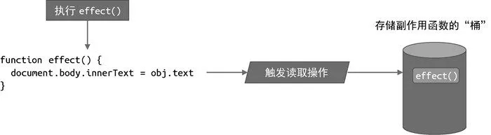
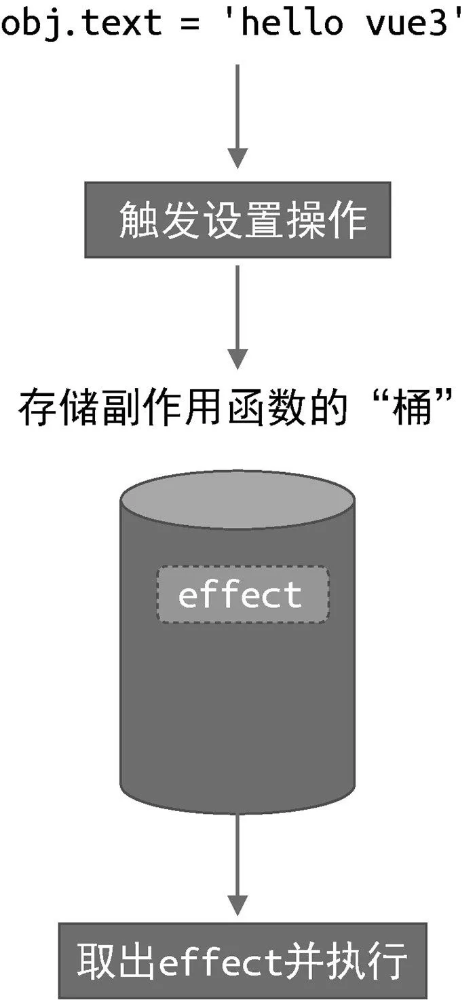
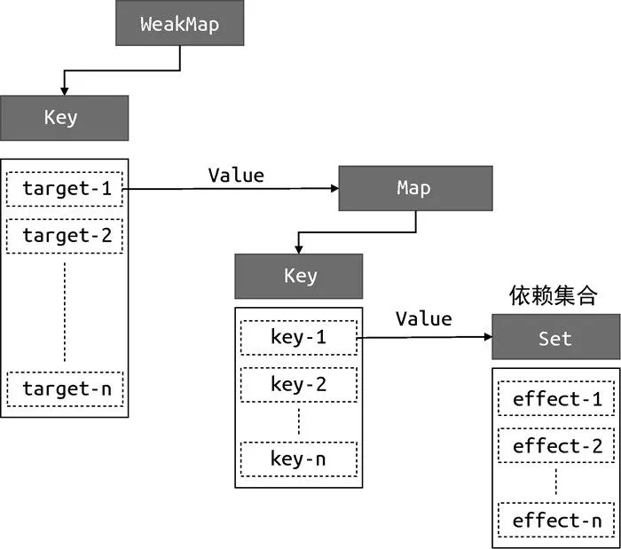
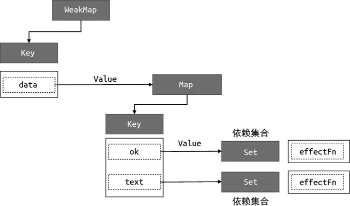
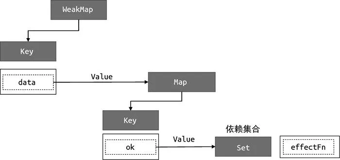
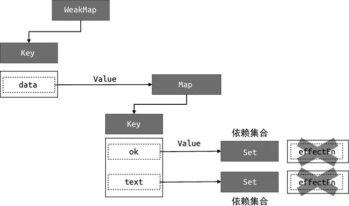
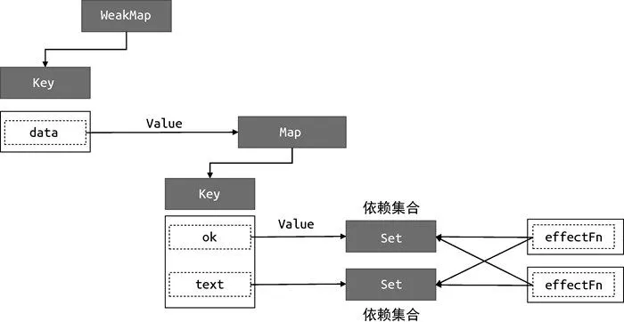
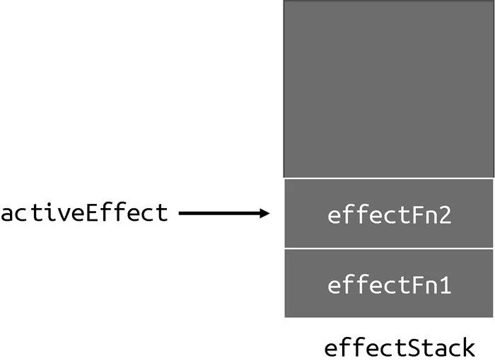
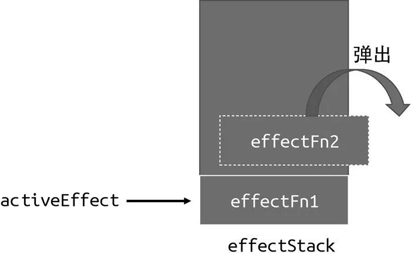

# 第4章响应系统的作用与实现(1)

## 第 4 章　响应系统的作用与实现

前文没有提到响应系统，响应系统也是 Vue.js 的重要组成部分，所以我们会花费大量篇幅介绍。在本章中，我们首先讨论什么是响应式数据和副作用函数，然后尝试实现一个相对完善的响应系统。在这个过程中，我们会遇到各种各样的问题，例如如何避免无限递归？为什么需要嵌套的副作用函数？两个副作用函数之间会产生哪些影响？以及其他很多需要考虑的细节。接

```
着，我们会详细讨论与响应式数据相关的内容。我们知道 Vue.js 3 采用 Proxy 实现响应式数
```

据，这涉及语言规范层面的知识。这部分内容包括如何根据语言规范实现对数据对象的代理，以及其中的一些重要细节。接下来，我们就从认识响应式数据和副作用函数开始，一步一步地了解响应系统的设计与实现。

## 4.1　响应式数据与副作用函数

副作用函数指的是会产生副作用的函数，如下面的代码所示：

```javascript
01 function effect() {
02   document.body.innerText = 'hello vue3'
03 }
当 effect 函数执行时，它会设置 body 的文本内容，但除了 effect 函数之外的任何函数
都可以读取或设置 body 的文本内容。也就是说，effect 函数的执行会直接或间接影响其他
函数的执行，这时我们说 effect 函数产生了副作用。副作用很容易产生，例如一个函数修
```

改了全局变量，这其实也是一个副作用，如下面的代码所示：

```javascript
01 // 全局变量
02 let val = 1
03
04 function effect() {
05   val = 2 // 修改全局变量，产生副作用
06 }
```

理解了什么是副作用函数，再来说说什么是响应式数据。假设在一个副作用函数中读取了某个对象的属性：

```javascript
01 const obj = { text: 'hello world' }
02 function effect() {
03   // effect 函数的执行会读取 obj.text
04   document.body.innerText = obj.text
05 }
如上面的代码所示，副作用函数 effect 会设置 body 元素的 innerText 属性，其值为
obj.text，当 obj.text 的值发生变化时，我们希望副作用函数 effect 会重新执行：
01 obj.text = 'hello vue3' // 修改 obj.text 的值，同时希望副作用函数会重新执行
这句代码修改了字段 obj.text 的值，我们希望当值变化后，副作用函数自动重新执行，如
果能实现这个目标，那么对象 obj 就是响应式数据。但很明显，以上面的代码来看，我们还
做不到这一点，因为 obj 是一个普通对象，当我们修改它的值时，除了值本身发生变化之
```

外，不会有任何其他反应。下一节中我们会讨论如何让数据变成响应式数据。

## 4.2　响应式数据的基本实现

```
接着上文思考，如何才能让 obj 变成响应式数据呢？通过观察我们能发现两点线索：
当副作用函数 effect 执行时，会触发字段 obj.text 的读取操作；
当修改 obj.text 的值时，会触发字段 obj.text 的设置操作。
如果我们能拦截一个对象的读取和设置操作，事情就变得简单了，当读取字段 obj.text
时，我们可以把副作用函数 effect 存储到一个“桶”里，如图 4-1 所示。
```



- 图 4-1　将副作用函数存储到“桶”中

```
接着，当设置 obj.text 时，再把副作用函数 effect 从“桶”里取出并执行即可，如图 4-2
```

所示。



- 图 4-2　把副作用函数从“桶”内取出并执行

现在问题的关键变成了我们如何才能拦截一个对象属性的读取和设置操作。在 ES2015 之前，

```javascript
只能通过 Object.defineProperty 函数实现，这也是 Vue.js 2 所采用的方式。在
ES2015+ 中，我们可以使用代理对象 Proxy 来实现，这也是 Vue.js 3 所采用的方式。
接下来我们就根据如上思路，采用 Proxy 来实现：
01 // 存储副作用函数的桶
02 const bucket = new Set()
03
04 // 原始数据
05 const data = { text: 'hello world' }
06 // 对原始数据的代理
07 const obj = new Proxy(data, {
08   // 拦截读取操作
09   get(target, key) {
10     // 将副作用函数 effect 添加到存储副作用函数的桶中
11     bucket.add(effect)
12     // 返回属性值
13     return target[key]
14   },
15   // 拦截设置操作
16   set(target, key, newVal) {
17     // 设置属性值
18     target[key] = newVal
19     // 把副作用函数从桶里取出并执行
20     bucket.forEach(fn => fn())
21     // 返回 true 代表设置操作成功
22     return true
23   }
24 })
首先，我们创建了一个用于存储副作用函数的桶 bucket，它是 Set 类型。接着定义原始数
据 data，obj 是原始数据的代理对象，我们分别设置了 get 和 set 拦截函数，用于拦截读
取和设置操作。当读取属性时将副作用函数 effect 添加到桶里，即
bucket.add(effect)，然后返回属性值；当设置属性值时先更新原始数据，再将副作用函
```

数从桶里取出并重新执行，这样我们就实现了响应式数据。可以使用下面的代码来测试一下：

```javascript
01 // 副作用函数
02 function effect() {
03   document.body.innerText = obj.text
04 }
05 // 执行副作用函数，触发读取
06 effect()
07 // 1 秒后修改响应式数据
08 setTimeout(() => {
09   obj.text = 'hello vue3'
10 }, 1000)
```

在浏览器中运行上面这段代码，会得到期望的结果。

```
但是目前的实现还存在很多缺陷，例如我们直接通过名字（effect）来获取副作用函数，这
```

种硬编码的方式很不灵活。副作用函数的名字可以任意取，我们完全可以把副作用函数命名为

```
myEffect，甚至是一个匿名函数，因此我们要想办法去掉这种硬编码的机制。下一节会详细
```

讲解这一点，这里大家只需要理解响应式数据的基本实现和工作原理即可。

## 4.3　设计一个完善的响应系统

在上一节中，我们了解了如何实现响应式数据。但其实在这个过程中我们已经实现了一个微型响应系统，之所以说“微型”，是因为它还不完善，本节我们将尝试构造一个更加完善的响应系统。

从上一节的例子中不难看出，一个响应系统的工作流程如下：

- 当读取操作发生时，将副作用函数收集到“桶”中；

- 当设置操作发生时，从“桶”中取出副作用函数并执行。

看上去很简单，但需要处理的细节还真不少。例如在上一节的实现中，我们硬编码了副作用函

```
数的名字（effect），导致一旦副作用函数的名字不叫 effect，那么这段代码就不能正确
```

地工作了。而我们希望的是，哪怕副作用函数是一个匿名函数，也能够被正确地收集到“桶”中。为了实现这一点，我们需要提供一个用来注册副作用函数的机制，如以下代码所示：

```javascript
01 // 用一个全局变量存储被注册的副作用函数
02 let activeEffect
03 // effect 函数用于注册副作用函数
04 function effect(fn) {
05   // 当调用 effect 注册副作用函数时，将副作用函数 fn 赋值给 activeEffect
06   activeEffect = fn
07   // 执行副作用函数
08   fn()
09 }
首先，定义了一个全局变量 activeEffect，初始值是 undefined，它的作用是存储被注
册的副作用函数。接着重新定义了 effect 函数，它变成了一个用来注册副作用函数的函
数，effect 函数接收一个参数 fn，即要注册的副作用函数。我们可以按照如下所示的方式
使用 effect 函数：
01 effect(
02   // 一个匿名的副作用函数
03   () => {
04     document.body.innerText = obj.text
05   }
06 )
可以看到，我们使用一个匿名的副作用函数作为 effect 函数的参数。当 effect 函数执行
时，首先会把匿名的副作用函数 fn 赋值给全局变量 activeEffect。接着执行被注册的匿
名副作用函数 fn，这将会触发响应式数据 obj.text 的读取操作，进而触发代理对象
Proxy 的 get 拦截函数：
01 const obj = new Proxy(data, {
02   get(target, key) {
03     // 将 activeEffect 中存储的副作用函数收集到“桶”中
04     if (activeEffect) {  // 新增
05       bucket.add(activeEffect)  // 新增
06     }  // 新增
07     return target[key]
08   },
09   set(target, key, newVal) {
10     target[key] = newVal
11     bucket.forEach(fn => fn())
12     return true
13   }
14 })
如上面的代码所示，由于副作用函数已经存储到了 activeEffect 中，所以在 get 拦截函
数内应该把 activeEffect 收集到“桶”中，这样响应系统就不依赖副作用函数的名字了。
但如果我们再对这个系统稍加测试，例如在响应式数据 obj 上设置一个不存在的属性时：
01 effect(
02   // 匿名副作用函数
03   () => {
04     console.log('effect run') // 会打印 2 次
05     document.body.innerText = obj.text
06   }
07 )
08
09 setTimeout(() => {
10   // 副作用函数中并没有读取 notExist 属性的值
11   obj.notExist = 'hello vue3'
12 }, 1000)
可以看到，匿名副作用函数内部读取了字段 obj.text 的值，于是匿名副作用函数与字段
obj.text 之间会建立响应联系。接着，我们开启了一个定时器，一秒钟后为对象 obj 添加
新的 notExist 属性。我们知道，在匿名副作用函数内并没有读取 obj.notExist 属性的
值，所以理论上，字段 obj.notExist 并没有与副作用建立响应联系，因此，定时器内语句
```

的执行不应该触发匿名副作用函数重新执行。但如果我们执行上述这段代码就会发现，定时器到时后，匿名副作用函数却重新执行了，这是不正确的。为了解决这个问题，我们需要重新设计“桶”的数据结构。

```
在上一节的例子中，我们使用一个 Set 数据结构作为存储副作用函数的“桶”。导致该问题的根
```

本原因是，我们没有在副作用函数与被操作的目标字段之间建立明确的联系。例如当读取属性时，无论读取的是哪一个属性，其实都一样，都会把副作用函数收集到“桶”里；当设置属性时，无论设置的是哪一个属性，也都会把“桶”里的副作用函数取出并执行。副作用函数与被操作的字段之间没有明确的联系。解决方法很简单，只需要在副作用函数与被操作的字段之间建

```
立联系即可，这就需要我们重新设计“桶”的数据结构，而不能简单地使用一个 Set 类型的数据
```

作为“桶”了。

那应该设计怎样的数据结构呢？在回答这个问题之前，我们需要先仔细观察下面的代码：

```javascript
01 effect(function effectFn() {
02   document.body.innerText = obj.text
03 })
```

在这段代码中存在三个角色：

```
被操作（读取）的代理对象 obj；
被操作（读取）的字段名 text；
使用 effect 函数注册的副作用函数 effectFn。
如果用 target 来表示一个代理对象所代理的原始对象，用 key 来表示被操作的字段名，用
effectFn 来表示被注册的副作用函数，那么可以为这三个角色建立如下关系：
01 target
02     └── key
03         └── effectFn
```

这是一种树型结构，下面举几个例子来对其进行补充说明。

如果有两个副作用函数同时读取同一个对象的属性值：

```javascript
01 effect(function effectFn1() {
02   obj.text
03 })
04 effect(function effectFn2() {
05   obj.text
06 })
```

那么关系如下：

```
01 target
02     └── text
03         └── effectFn1
04         └── effectFn2
```

如果一个副作用函数中读取了同一个对象的两个不同属性：

```javascript
01 effect(function effectFn() {
02   obj.text1
03   obj.text2
04 })
```

那么关系如下：

```
01 target
02     └── text1
03         └── effectFn
04     └── text2
05         └── effectFn
```

如果在不同的副作用函数中读取了两个不同对象的不同属性：

```javascript
01 effect(function effectFn1() {
02   obj1.text1
03 })
04 effect(function effectFn2() {
05   obj2.text2
06 })
```

那么关系如下：

```
01 target1
02     └── text1
03         └── effectFn1
04 target2
05     └── text2
06         └── effectFn2
```

总之，这其实就是一个树型数据结构。这个联系建立起来之后，就可以解决前文提到的问题

```
了。拿上面的例子来说，如果我们设置了 obj2.text2 的值，就只会导致 effectFn2 函数
重新执行，并不会导致 effectFn1 函数重新执行。
接下来我们尝试用代码来实现这个新的“桶”。首先，需要使用 WeakMap 代替 Set 作为桶的数
```

据结构：

```javascript
01 // 存储副作用函数的桶
02 const bucket = new WeakMap()
然后修改 get/set 拦截器代码：
01 const obj = new Proxy(data, {
02   // 拦截读取操作
03   get(target, key) {
04     // 没有 activeEffect，直接 return
05     if (!activeEffect) return target[key]
06     // 根据 target 从“桶”中取得 depsMap，它也是一个 Map 类型：key --> effects
07     let depsMap = bucket.get(target)
08     // 如果不存在 depsMap，那么新建一个 Map 并与 target 关联
09     if (!depsMap) {
10       bucket.set(target, (depsMap = new Map()))
11     }
12     // 再根据 key 从 depsMap 中取得 deps，它是一个 Set 类型，
13     // 里面存储着所有与当前 key 相关联的副作用函数：effects
14     let deps = depsMap.get(key)
15     // 如果 deps 不存在，同样新建一个 Set 并与 key 关联
16     if (!deps) {
17       depsMap.set(key, (deps = new Set()))
18     }
19     // 最后将当前激活的副作用函数添加到“桶”里
20     deps.add(activeEffect)
21
22     // 返回属性值
23     return target[key]
24   },
25   // 拦截设置操作
26   set(target, key, newVal) {
27     // 设置属性值
28     target[key] = newVal
29     // 根据 target 从桶中取得 depsMap，它是 key --> effects
30     const depsMap = bucket.get(target)
31     if (!depsMap) return
32     // 根据 key 取得所有副作用函数 effects
33     const effects = depsMap.get(key)
34     // 执行副作用函数
35     effects && effects.forEach(fn => fn())
36   }
37 })
从这段代码可以看出构建数据结构的方式，我们分别使用了 WeakMap、Map 和 Set：
WeakMap 由 target --> Map 构成；
Map 由 key --> Set 构成。
其中 WeakMap 的键是原始对象 target，WeakMap 的值是一个 Map 实例，而 Map 的键是
原始对象 target 的 key，Map 的值是一个由副作用函数组成的 Set。它们的关系如图 4-3
```

所示。



```
图 4-3　WeakMap、Map 和 Set 之间的关系
为了方便描述，我们把图 4-3 中的 Set 数据结构所存储的副作用函数集合称为 key 的依赖集
```

合。

```bash
搞清了它们之间的关系，我们有必要解释一下这里为什么要使用 WeakMap，这其实涉及
WeakMap 和 Map 的区别，我们用一段代码来讲解：
01 const map = new Map();
02 const weakmap = new WeakMap();
03
04 (function(){
05     const foo = ;
06     const bar = ;
07
08     map.set(foo, 1);
09     weakmap.set(bar, 2);
10 })()
首先，我们定义了 map 和 weakmap 常量，分别对应 Map 和 WeakMap 的实例。接着定义了
一个立即执行的函数表达式（IIFE），在函数表达式内部定义了两个对象：foo 和 bar，这两
个对象分别作为 map 和 weakmap 的 key。当该函数表达式执行完毕后，对于对象 foo 来
说，它仍然作为 map 的 key 被引用着，因此垃圾回收器（grabage collector）不会把它从内
存中移除，我们仍然可以通过 map.keys 打印出对象 foo。然而对于对象 bar 来说，由于
WeakMap 的 key 是弱引用，它不影响垃圾回收器的工作，所以一旦表达式执行完毕，垃圾回
收器就会把对象 bar 从内存中移除，并且我们无法获取 weakmap 的 key 值，也就无法通过
weakmap 取得对象 bar。
简单地说，WeakMap 对 key 是弱引用，不影响垃圾回收器的工作。据这个特性可知，一旦
key 被垃圾回收器回收，那么对应的键和值就访问不到了。所以 WeakMap 经常用于存储那些
只有当 key 所引用的对象存在时（没有被回收）才有价值的信息，例如上面的场景中，如果
target 对象没有任何引用了，说明用户侧不再需要它了，这时垃圾回收器会完成回收任务。
但如果使用 Map 来代替 WeakMap，那么即使用户侧的代码对 target 没有任何引用，这个
target 也不会被回收，最终可能导致内存溢出。
```

最后，我们对上文中的代码做一些封装处理。在目前的实现中，当读取属性值时，我们直接在

```javascript
get 拦截函数里编写把副作用函数收集到“桶”里的这部分逻辑，但更好的做法是将这部分逻辑
单独封装到一个 track 函数中，函数的名字叫 track 是为了表达追踪的含义。同样，我们
也可以把触发副作用函数重新执行的逻辑封装到 trigger 函数中：
01 const obj = new Proxy(data, {
02   // 拦截读取操作
03   get(target, key) {
04     // 将副作用函数 activeEffect 添加到存储副作用函数的桶中
05     track(target, key)
06     // 返回属性值
07     return target[key]
08   },
09   // 拦截设置操作
10   set(target, key, newVal) {
11     // 设置属性值
12     target[key] = newVal
13     // 把副作用函数从桶里取出并执行
14     trigger(target, key)
15   }
16 })
17
18 // 在 get 拦截函数内调用 track 函数追踪变化
19 function track(target, key) {
20   // 没有 activeEffect，直接 return
21   if (!activeEffect) return
22   let depsMap = bucket.get(target)
23   if (!depsMap) {
24     bucket.set(target, (depsMap = new Map()))
25   }
26   let deps = depsMap.get(key)
27   if (!deps) {
28     depsMap.set(key, (deps = new Set()))
29   }
30   deps.add(activeEffect)
31 }
32 // 在 set 拦截函数内调用 trigger 函数触发变化
33 function trigger(target, key) {
34   const depsMap = bucket.get(target)
35   if (!depsMap) return
36   const effects = depsMap.get(key)
37   effects && effects.forEach(fn => fn())
38 }
如以上代码所示，分别把逻辑封装到 track 和 trigger 函数内，这能为我们带来极大的灵
```

活性。

## 4.4　分支切换与 cleanup

首先，我们需要明确分支切换的定义，如下面的代码所示：

```javascript
01 const data = { ok: true, text: 'hello world' }
02 const obj = new Proxy(data, { /* ... */ })
03
04 effect(function effectFn() {
05   document.body.innerText = obj.ok ? obj.text : 'not'
06 })
在 effectFn 函数内部存在一个三元表达式，根据字段 obj.ok 值的不同会执行不同的代码
分支。当字段 obj.ok 的值发生变化时，代码执行的分支会跟着变化，这就是所谓的分支切
```

换。

```
分支切换可能会产生遗留的副作用函数。拿上面这段代码来说，字段 obj.ok 的初始值为
true，这时会读取字段 obj.text 的值，所以当 effectFn 函数执行时会触发字段
obj.ok 和字段 obj.text 这两个属性的读取操作，此时副作用函数 effectFn 与响应式数
```

据之间建立的联系如下：

```
01 data
02     └── ok
03         └── effectFn
04     └── text
05         └── effectFn
```

图 4-4 给出了更详细的描述。



- 图 4-4　副作用函数与响应式数据之间的联系

```
可以看到，副作用函数 effectFn 分别被字段 data.ok 和字段 data.text 所对应的依赖
集合收集。当字段 obj.ok 的值修改为 false，并触发副作用函数重新执行后，由于此时字
段 obj.text 不会被读取，只会触发字段 obj.ok 的读取操作，所以理想情况下副作用函数
effectFn 不应该被字段 obj.text 所对应的依赖集合收集，如图 4-5 所示。
```



- 图 4-5　理想情况下副作用函数与响应式数据之间的联系

```
但按照前文的实现，我们还做不到这一点。也就是说，当我们把字段 obj.ok 的值修改为
false，并触发副作用函数重新执行之后，整个依赖关系仍然保持图 4-4 所描述的那样，这时
```

就产生了遗留的副作用函数。

遗留的副作用函数会导致不必要的更新，拿下面这段代码来说：

```javascript
01 const data = { ok: true, text: 'hello world' }
02 const obj = new Proxy(data, { /* ... */ })
03
04 effect(function effectFn() {
05   document.body.innerText = obj.ok ? obj.text : 'not'
06 })
obj.ok 的初始值为 true，当我们将其修改为 false 后：
01 obj.ok = false
这会触发更新，即副作用函数会重新执行。但由于此时 obj.ok 的值为 false，所以不再会
读取字段 obj.text 的值。换句话说，无论字段 obj.text 的值如何改变，
document.body.innerText 的值始终都是字符串 'not'。所以最好的结果是，无论
obj.text 的值怎么变，都不需要重新执行副作用函数。但事实并非如此，如果我们再尝试
修改 obj.text 的值：
01 obj.text = 'hello vue3'
这仍然会导致副作用函数重新执行，即使 document.body.innerText 的值不需要变化。
```

解决这个问题的思路很简单，每次副作用函数执行时，我们可以先把它从所有与之关联的依赖集合中删除，如图 4-6 所示。



- 图 4-6　断开副作用函数与响应式数据之间的联系

当副作用函数执行完毕后，会重新建立联系，但在新的联系中不会包含遗留的副作用函数，即图 4-5 所描述的那样。所以，如果我们能做到每次副作用函数执行前，将其从相关联的依赖集合中移除，那么问题就迎刃而解了。

要将一个副作用函数从所有与之关联的依赖集合中移除，就需要明确知道哪些依赖集合中包含

```
它，因此我们需要重新设计副作用函数，如下面的代码所示。在 effect 内部我们定义了新
的 effectFn 函数，并为其添加了 effectFn.deps 属性，该属性是一个数组，用来存储所
```

有包含当前副作用函数的依赖集合：

```javascript
01 // 用一个全局变量存储被注册的副作用函数
02 let activeEffect
03 function effect(fn) {
04   const effectFn = () => {
05     // 当 effectFn 执行时，将其设置为当前激活的副作用函数
06     activeEffect = effectFn
07     fn()
08   }
09   // activeEffect.deps 用来存储所有与该副作用函数相关联的依赖集合
10   effectFn.deps = []
11   // 执行副作用函数
12   effectFn()
13 }
那么 effectFn.deps 数组中的依赖集合是如何收集的呢？其实是在 track 函数中：
01 function track(target, key) {
02   // 没有 activeEffect，直接 return
03   if (!activeEffect) return
04   let depsMap = bucket.get(target)
05   if (!depsMap) {
06     bucket.set(target, (depsMap = new Map()))
07   }
08   let deps = depsMap.get(key)
09   if (!deps) {
10     depsMap.set(key, (deps = new Set()))
11   }
12   // 把当前激活的副作用函数添加到依赖集合 deps 中
13   deps.add(activeEffect)
14   // deps 就是一个与当前副作用函数存在联系的依赖集合
15   // 将其添加到 activeEffect.deps 数组中
16   activeEffect.deps.push(deps) // 新增
17 }
如以上代码所示，在 track 函数中我们将当前执行的副作用函数 activeEffect 添加到依
赖集合 deps 中，这说明 deps 就是一个与当前副作用函数存在联系的依赖集合，于是我们也
把它添加到 activeEffect.deps 数组中，这样就完成了对依赖集合的收集。图 4-7 描述了
```

这一步所建立的关系。



- 图 4-7　对依赖集合的收集

```
有了这个联系后，我们就可以在每次副作用函数执行时，根据 effectFn.deps 获取所有相
```

关联的依赖集合，进而将副作用函数从依赖集合中移除：

```sql
01 // 用一个全局变量存储被注册的副作用函数
02 let activeEffect
03 function effect(fn) {
04   const effectFn = () => {
05     // 调用 cleanup 函数完成清除工作
06     cleanup(effectFn)  // 新增
07     activeEffect = effectFn
08     fn()
09   }
10   effectFn.deps = []
11   effectFn()
12 }
下面是 cleanup 函数的实现：
01 function cleanup(effectFn) {
02   // 遍历 effectFn.deps 数组
03   for (let i = 0; i < effectFn.deps.length; i++) {
04     // deps 是依赖集合
05     const deps = effectFn.deps[i]
06     // 将 effectFn 从依赖集合中移除
07     deps.delete(effectFn)
08   }
09   // 最后需要重置 effectFn.deps 数组
10   effectFn.deps.length = 0
11 }
cleanup 函数接收副作用函数作为参数，遍历副作用函数的 effectFn.deps 数组，该数组
```

的每一项都是一个依赖集合，然后将该副作用函数从依赖集合中移除，最后重置

```
effectFn.deps 数组。
```

至此，我们的响应系统已经可以避免副作用函数产生遗留了。但如果你尝试运行代码，会发现

```javascript
目前的实现会导致无限循环执行，问题出在 trigger 函数中：
01 function trigger(target, key) {
02   const depsMap = bucket.get(target)
03   if (!depsMap) return
04   const effects = depsMap.get(key)
05   effects && effects.forEach(fn => fn()) // 问题出在这句代码
06 }
在 trigger 函数内部，我们遍历 effects 集合，它是一个 Set 集合，里面存储着副作用
函数。当副作用函数执行时，会调用 cleanup 进行清除，实际上就是从 effects 集合中将
```

当前执行的副作用函数剔除，但是副作用函数的执行会导致其重新被收集到集合中，而此时对

```sql
于 effects 集合的遍历仍在进行。这个行为可以用如下简短的代码来表达：
01 const set = new Set([1])
02
03 set.forEach(item => {
04   set.delete(1)
05   set.add(1)
06   console.log('遍历中')
07 })
在上面这段代码中，我们创建了一个集合 set，它里面有一个元素数字 1，接着我们调用
forEach 遍历该集合。在遍历过程中，首先调用 delete(1) 删除数字 1，紧接着调用
add(1) 将数字 1 加回，最后打印 '遍历中'。如果我们在浏览器中执行这段代码，就会发现
```

它会无限执行下去。

```
语言规范中对此有明确的说明：在调用 forEach 遍历 Set 集合时，如果一个值已经被访问
过了，但该值被删除并重新添加到集合，如果此时 forEach 遍历没有结束，那么该值会重新
被访问。因此，上面的代码会无限执行。解决办法很简单，我们可以构造另外一个 Set 集合
```

并遍历它：

```sql
01 const set = new Set([1])
02
03 const newSet = new Set(set)
04 newSet.forEach(item => {
05   set.delete(1)
06   set.add(1)
07   console.log('遍历中')
08 })
这样就不会无限执行了。回到 trigger 函数，我们需要同样的手段来避免无限执行：
01 function trigger(target, key) {
02   const depsMap = bucket.get(target)
03   if (!depsMap) return
04   const effects = depsMap.get(key)
05
06   const effectsToRun = new Set(effects)  // 新增
07   effectsToRun.forEach(effectFn => effectFn())  // 新增
08   // effects && effects.forEach(effectFn => effectFn()) // 删除
09 }
如以上代码所示，我们新构造了 effectsToRun 集合并遍历它，代替直接遍历 effects 集
```

合，从而避免了无限执行。

- 提示

```
ECMA 关于 Set.prototype.forEach 的规范，可参见 ECMAScript 2020 Language
```

- Specification。

## 4.5　嵌套的 effect 与 effect 栈

```javascript
effect 是可以发生嵌套的，例如：
01 effect(function effectFn1() {
02   effect(function effectFn2() { /* ... */ })
03   /* ... */
04 })
在上面这段代码中，effectFn1 内部嵌套了 effectFn2，effectFn1 的执行会导致
effectFn2 的执行。那么，什么场景下会出现嵌套的 effect 呢？拿 Vue.js 来说，实际上
Vue.js 的渲染函数就是在一个 effect 中执行的：
01 // Foo 组件
02 const Foo = {
03   render() {
04     return /* ... */
05   }
06 }
在一个 effect 中执行 Foo 组件的渲染函数：
01 effect(() => {
02   Foo.render()
03 })
当组件发生嵌套时，例如 Foo 组件渲染了 Bar 组件：
01 // Bar 组件
02 const Bar = {
03   render() { /* ... */ },
04 }
05 // Foo 组件渲染了 Bar 组件
06 const Foo = {
07   render() {
08     return <Bar /> // jsx 语法
09   },
10 }
此时就发生了 effect 嵌套，它相当于：
01 effect(() => {
02   Foo.render()
03   // 嵌套
04   effect(() => {
05     Bar.render()
06   })
07 })
这个例子说明了为什么 effect 要设计成可嵌套的。接下来，我们需要搞清楚，如果
effect 不支持嵌套会发生什么？实际上，按照前文的介绍与实现来看，我们所实现的响应系
统并不支持 effect 嵌套，可以用下面的代码来测试一下：
01 // 原始数据
02 const data = { foo: true, bar: true }
03 // 代理对象
04 const obj = new Proxy(data, { /* ... */ })
05
06 // 全局变量
07 let temp1, temp2
08
09 // effectFn1 嵌套了 effectFn2
10 effect(function effectFn1() {
11   console.log('effectFn1 执行')
12
13   effect(function effectFn2() {
14     console.log('effectFn2 执行')
15     // 在 effectFn2 中读取 obj.bar 属性
16     temp2 = obj.bar
17   })
18   // 在 effectFn1 中读取 obj.foo 属性
19   temp1 = obj.foo
20 })
在上面这段代码中，effectFn1 内部嵌套了 effectFn2，很明显，effectFn1 的执行会
导致 effectFn2 的执行。需要注意的是，我们在 effectFn2 中读取了字段 obj.bar，在
effectFn1 中读取了字段 obj.foo，并且 effectFn2 的执行先于对字段 obj.foo 的读
```

取操作。在理想情况下，我们希望副作用函数与对象属性之间的联系如下：

```
01 data
02   └── foo
03     └── effectFn1
04   └── bar
05     └── effectFn2
在这种情况下，我们希望当修改 obj.foo 时会触发 effectFn1 执行。由于 effectFn2 嵌
套在 effectFn1 里，所以会间接触发 effectFn2 执行，而当修改 obj.bar 时，只会触发
effectFn2 执行。但结果不是这样的，我们尝试修改 obj.foo 的值，会发现输出为：
01 'effectFn1 执行'
02 'effectFn2 执行'
03 'effectFn2 执行'
一共打印三次，前两次分别是副作用函数 effectFn1 与 effectFn2 初始执行的打印结果，
到这一步是正常的，问题出在第三行打印。我们修改了字段 obj.foo 的值，发现
effectFn1 并没有重新执行，反而使得 effectFn2 重新执行了，这显然不符合预期。
问题出在哪里呢？其实就出在我们实现的 effect 函数与 activeEffect 上。观察下面这段
```

代码：

```javascript
01 // 用一个全局变量存储当前激活的 effect 函数
02 let activeEffect
03 function effect(fn) {
04   const effectFn = () => {
05     cleanup(effectFn)
06     // 当调用 effect 注册副作用函数时，将副作用函数赋值给 activeEffect
07     activeEffect = effectFn
08     fn()
09   }
10   // activeEffect.deps 用来存储所有与该副作用函数相关的依赖集合
11   effectFn.deps = []
12   // 执行副作用函数
13   effectFn()
14 }
我们用全局变量 activeEffect 来存储通过 effect 函数注册的副作用函数，这意味着同一
时刻 activeEffect 所存储的副作用函数只能有一个。当副作用函数发生嵌套时，内层副作
用函数的执行会覆盖 activeEffect 的值，并且永远不会恢复到原来的值。这时如果再有响
```

应式数据进行依赖收集，即使这个响应式数据是在外层副作用函数中读取的，它们收集到的副作用函数也都会是内层副作用函数，这就是问题所在。

```
为了解决这个问题，我们需要一个副作用函数栈 effectStack，在副作用函数执行时，将当
```

前副作用函数压入栈中，待副作用函数执行完毕后将其从栈中弹出，并始终让

```
activeEffect 指向栈顶的副作用函数。这样就能做到一个响应式数据只会收集直接读取其
```

值的副作用函数，而不会出现互相影响的情况，如以下代码所示：

```javascript
01 // 用一个全局变量存储当前激活的 effect 函数
02 let activeEffect
03 // effect 栈
04 const effectStack = []  // 新增
05
06 function effect(fn) {
07   const effectFn = () => {
08     cleanup(effectFn)
09     // 当调用 effect 注册副作用函数时，将副作用函数赋值给 activeEffect
10     activeEffect = effectFn
11     // 在调用副作用函数之前将当前副作用函数压入栈中
12     effectStack.push(effectFn)  // 新增
13     fn()
14     // 在当前副作用函数执行完毕后，将当前副作用函数弹出栈，并把 activeEffect 还原为之前的值
15     effectStack.pop()  // 新增
16     activeEffect = effectStack[effectStack.length - 1]  // 新增
17   }
18   // activeEffect.deps 用来存储所有与该副作用函数相关的依赖集合
19   effectFn.deps = []
20   // 执行副作用函数
21   effectFn()
22 }
我们定义了 effectStack 数组，用它来模拟栈，activeEffect 没有变化，它仍然指向当
```

前正在执行的副作用函数。不同的是，当前执行的副作用函数会被压入栈顶，这样当副作用函数发生嵌套时，栈底存储的就是外层副作用函数，而栈顶存储的则是内层副作用函数，如图 4-8 所示。



- 图 4-8　副作用函数栈

```
当内层副作用函数 effectFn2 执行完毕后，它会被弹出栈，并将副作用函数 effectFn1 设
置为 activeEffect，如图 4-9 所示。
```



- 图 4-9　副作用函数从栈中弹出

如此一来，响应式数据就只会收集直接读取其值的副作用函数作为依赖，从而避免发生错乱。

## 4.6　避免无限递归循环

如前文所说，实现一个完善的响应系统要考虑诸多细节。而本节要介绍的无限递归循环就是其中之一，还是举个例子：

```javascript
01 const data = { foo: 1 }
02 const obj = new Proxy(data, { /*...*/ })
03
04 effect(() => obj.foo++)
可以看到，在 effect 注册的副作用函数内有一个自增操作 obj.foo++，该操作会引起栈溢
```

出：

```
01 Uncaught RangeError: Maximum call stack size exceeded
```

为什么会这样呢？接下来我们就尝试搞清楚这个问题，并提供解决方案。

```
实际上，我们可以把 obj.foo++ 这个自增操作分开来看，它相当于：
01 effect(() => {
02   // 语句
03   obj.foo = obj.foo + 1
04 })
在这个语句中，既会读取 obj.foo 的值，又会设置 obj.foo 的值，而这就是导致问题的根
本原因。我们可以尝试推理一下代码的执行流程：首先读取 obj.foo 的值，这会触发
track 操作，将当前副作用函数收集到“桶”中，接着将其加 1 后再赋值给 obj.foo，此时会
触发 trigger 操作，即把“桶”中的副作用函数取出并执行。但问题是该副作用函数正在执行
```

中，还没有执行完毕，就要开始下一次的执行。这样会导致无限递归地调用自己，于是就产生了栈溢出。

解决办法并不难。通过分析这个问题我们能够发现，读取和设置操作是在同一个副作用函数内

```
进行的。此时无论是 track 时收集的副作用函数，还是 trigger 时要触发执行的副作用函
数，都是 activeEffect。基于此，我们可以在 trigger 动作发生时增加守卫条件：如果
```

trigger 触发执行的副作用函数与当前正在执行的副作用函数相同，则不触发执行，如以下代码所示：

```javascript
01 function trigger(target, key) {
02   const depsMap = bucket.get(target)
03   if (!depsMap) return
04   const effects = depsMap.get(key)
05
06   const effectsToRun = new Set()
07   effects && effects.forEach(effectFn => {
08     // 如果 trigger 触发执行的副作用函数与当前正在执行的副作用函数相同，则不触发执行
09     if (effectFn !== activeEffect) {  // 新增
10       effectsToRun.add(effectFn)
11     }
12   })
13   effectsToRun.forEach(effectFn => effectFn())
14   // effects && effects.forEach(effectFn => effectFn())
15 }
```

这样我们就能够避免无限递归调用，从而避免栈溢出。
