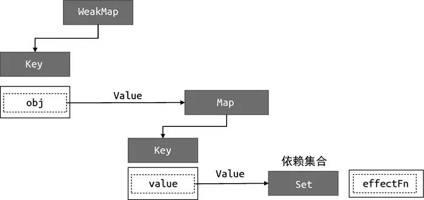
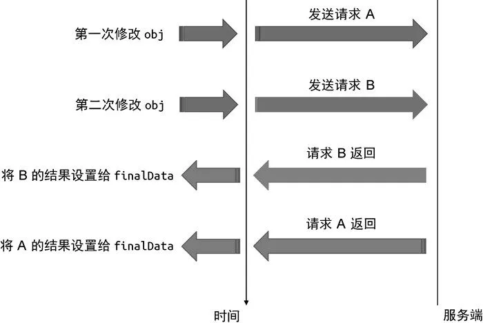
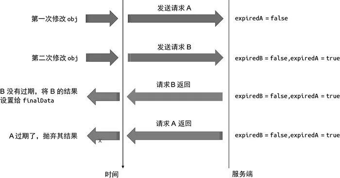

# 第4章响应系统的作用与实现(2)

## 4.7　调度执行

可调度性是响应系统非常重要的特性。首先我们需要明确什么是可调度性。所谓可调度，指的

```
是当 trigger 动作触发副作用函数重新执行时，有能力决定副作用函数执行的时机、次数以
```

及方式。

首先来看一下，如何决定副作用函数的执行方式，以下面的代码为例：

```javascript
01 const data = { foo: 1 }
02 const obj = new Proxy(data, { /* ... */ })
03
04 effect(() => {
05   console.log(obj.foo)
06 })
07
08 obj.foo++
09
10 console.log('结束了')
在副作用函数中，我们首先使用 console.log 语句打印 obj.foo 的值，接着对 obj.foo
执行自增操作，最后使用 console.log 语句打印 '结束了'。这段代码的输出结果如下：
01 1
02 2
03 '结束了'
```

现在假设需求有变，输出顺序需要调整为：

```
01 1
02 '结束了'
03 2
根据打印结果我们很容易想到对策，即把语句 obj.foo++ 和语句 console.log('结束
了') 位置互换即可。那么有没有什么办法能够在不调整代码的情况下实现需求呢？这时就需
```

要响应系统支持调度。

```javascript
我们可以为 effect 函数设计一个选项参数 options，允许用户指定调度器：
01 effect(
02   () => {
03     console.log(obj.foo)
04   },
05   // options
06   {
07     // 调度器 scheduler 是一个函数
08     scheduler(fn) {
09       // ...
10     }
11   }
12 )
如上面的代码所示，用户在调用 effect 函数注册副作用函数时，可以传递第二个参数
options。它是一个对象，其中允许指定 scheduler 调度函数，同时在 effect 函数内部
我们需要把 options 选项挂载到对应的副作用函数上：
01 function effect(fn, options = {}) {
02   const effectFn = () => {
03     cleanup(effectFn)
04     // 当调用 effect 注册副作用函数时，将副作用函数赋值给 activeEffect
05     activeEffect = effectFn
06     // 在调用副作用函数之前将当前副作用函数压栈
07     effectStack.push(effectFn)
08     fn()
09     // 在当前副作用函数执行完毕后，将当前副作用函数弹出栈，并把 activeEffect 还原为之前的值
10     effectStack.pop()
11     activeEffect = effectStack[effectStack.length - 1]
12   }
13   // 将 options 挂载到 effectFn 上
14   effectFn.options = options  // 新增
15   // activeEffect.deps 用来存储所有与该副作用函数相关的依赖集合
16   effectFn.deps = []
17   // 执行副作用函数
18   effectFn()
19 }
有了调度函数，我们在 trigger 函数中触发副作用函数重新执行时，就可以直接调用用户传
```

递的调度器函数，从而把控制权交给用户：

```javascript
01 function trigger(target, key) {
02   const depsMap = bucket.get(target)
03   if (!depsMap) return
04   const effects = depsMap.get(key)
05
06   const effectsToRun = new Set()
07   effects && effects.forEach(effectFn => {
08     if (effectFn !== activeEffect) {
09       effectsToRun.add(effectFn)
10     }
11   })
12   effectsToRun.forEach(effectFn => {
13     // 如果一个副作用函数存在调度器，则调用该调度器，并将副作用函数作为参数传递
14     if (effectFn.options.scheduler) {  // 新增
15       effectFn.options.scheduler(effectFn)  // 新增
16     } else {
17       // 否则直接执行副作用函数（之前的默认行为）
18       effectFn()  // 新增
19     }
20   })
21 }
如上面的代码所示，在 trigger 动作触发副作用函数执行时，我们优先判断该副作用函数是
```

否存在调度器，如果存在，则直接调用调度器函数，并把当前副作用函数作为参数传递过去，由用户自己控制如何执行；否则保留之前的行为，即直接执行副作用函数。

有了这些基础设施之后，我们就可以实现前文的需求了，如以下代码所示：

```javascript
01 const data = { foo: 1 }
02 const obj = new Proxy(data, { /* ... */ })
03
04 effect(
05   () => {
06     console.log(obj.foo)
07   },
08   // options
09   {
10     // 调度器 scheduler 是一个函数
11     scheduler(fn) {
12       // 将副作用函数放到宏任务队列中执行
13       setTimeout(fn)
14     }
15   }
16 )
17
18
19 obj.foo++
20
21 console.log('结束了')
我们使用 setTimeout 开启一个宏任务来执行副作用函数 fn，这样就能实现期望的打印顺
```

序了：

```
01 1
02 '结束了'
03 2
```

除了控制副作用函数的执行顺序，通过调度器还可以做到控制它的执行次数，这一点也尤为重要。我们思考如下例子：

```javascript
01 const data = { foo: 1 }
02 const obj = new Proxy(data, { /* ... */ })
03
04 effect(() => {
05   console.log(obj.foo)
06 })
07
08 obj.foo++
09 obj.foo++
首先在副作用函数中打印 obj.foo 的值，接着连续对其执行两次自增操作，在没有指定调度
```

器的情况下，它的输出如下：

```
01 1
02 2
03 3
由输出可知，字段 obj.foo 的值一定会从 1 自增到 3，2 只是它的过渡状态。如果我们只关
```

心最终结果而不关心过程，那么执行三次打印操作是多余的，我们期望的打印结果是：

```
01 1
02 3
```

其中不包含过渡状态，基于调度器我们可以很容易地实现此功能：

```javascript
01 // 定义一个任务队列
02 const jobQueue = new Set()
03 // 使用 Promise.resolve() 创建一个 promise 实例，我们用它将一个任务添加到微任务队列
04 const p = Promise.resolve()
05
06 // 一个标志代表是否正在刷新队列
07 let isFlushing = false
08 function flushJob() {
09   // 如果队列正在刷新，则什么都不做
10   if (isFlushing) return
11   // 设置为 true，代表正在刷新
12   isFlushing = true
13   // 在微任务队列中刷新 jobQueue 队列
14   p.then(() => {
15     jobQueue.forEach(job => job())
16   }).finally(() => {
17     // 结束后重置 isFlushing
18     isFlushing = false
19   })
20 }
21
22
23 effect(() => {
24   console.log(obj.foo)
25 }, {
26   scheduler(fn) {
27     // 每次调度时，将副作用函数添加到 jobQueue 队列中
28     jobQueue.add(fn)
29     // 调用 flushJob 刷新队列
30     flushJob()
31   }
32 })
33
34 obj.foo++
35 obj.foo++
观察上面的代码，首先，我们定义了一个任务队列 jobQueue，它是一个 Set 数据结构，目
的是利用 Set 数据结构的自动去重能力。接着我们看调度器 scheduler 的实现，在每次调
度执行时，先将当前副作用函数添加到 jobQueue 队列中，再调用 flushJob 函数刷新队
列。然后我们把目光转向 flushJob 函数，该函数通过 isFlushing 标志判断是否需要执
行，只有当其为 false 时才需要执行，而一旦 flushJob 函数开始执行，isFlushing 标
志就会设置为 true，意思是无论调用多少次 flushJob 函数，在一个周期内都只会执行一
次。需要注意的是，在 flushJob 内通过 p.then 将一个函数添加到微任务队列，在微任务
队列内完成对 jobQueue 的遍历执行。
整段代码的效果是，连续对 obj.foo 执行两次自增操作，会同步且连续地执行两次
scheduler 调度函数，这意味着同一个副作用函数会被 jobQueue.add(fn) 语句添加两
次，但由于 Set 数据结构的去重能力，最终 jobQueue 中只会有一项，即当前副作用函数。
类似地，flushJob 也会同步且连续地执行两次，但由于 isFlushing 标志的存在，实际上
flushJob 函数在一个事件循环内只会执行一次，即在微任务队列内执行一次。当微任务队
列开始执行时，就会遍历 jobQueue 并执行里面存储的副作用函数。由于此时 jobQueue 队
列内只有一个副作用函数，所以只会执行一次，并且当它执行时，字段 obj.foo 的值已经是
3 了，这样我们就实现了期望的输出：
01 1
02 3
```

可能你已经注意到了，这个功能有点类似于在 Vue.js 中连续多次修改响应式数据但只会触发一次更新，实际上 Vue.js 内部实现了一个更加完善的调度器，思路与上文介绍的相同。

## 4.8　计算属性 computed 与 lazy

```
前文介绍了 effect 函数，它用来注册副作用函数，同时它也允许指定一些选项参数
options，例如指定 scheduler 调度器来控制副作用函数的执行时机和方式；也介绍了用
来追踪和收集依赖的 track 函数，以及用来触发副作用函数重新执行的 trigger 函数。实
```

际上，综合这些内容，我们就可以实现 Vue.js 中一个非常重要并且非常有特色的能力——计算属性。

```
在深入讲解计算属性之前，我们需要先来聊聊关于懒执行的 effect，即 lazy 的 effect。
这是什么意思呢？举个例子，现在我们所实现的 effect 函数会立即执行传递给它的副作用
```

函数，例如：

```
01 effect(
02   // 这个函数会立即执行
03   () => {
04     console.log(obj.foo)
05   }
06 )
```

但在有些场景下，我们并不希望它立即执行，而是希望它在需要的时候才执行，例如计算属

```
性。这时我们可以通过在 options 中添加 lazy 属性来达到目的，如下面的代码所示：
01 effect(
02   // 指定了 lazy 选项，这个函数不会立即执行
03   () => {
04     console.log(obj.foo)
05   },
06   // options
07   {
08     lazy: true
09   }
10 )
lazy 选项和之前介绍的 scheduler 一样，它通过 options 选项对象指定。有了它，我们
就可以修改 effect 函数的实现逻辑了，当 options.lazy 为 true 时，则不立即执行副
```

作用函数：

```javascript
01 function effect(fn, options = {}) {
02   const effectFn = () => {
03     cleanup(effectFn)
04     activeEffect = effectFn
05     effectStack.push(effectFn)
06     fn()
07     effectStack.pop()
08     activeEffect = effectStack[effectStack.length - 1]
09   }
10   effectFn.options = options
11   effectFn.deps = []
12   // 只有非 lazy 的时候，才执行
13   if (!options.lazy) {  // 新增
14     // 执行副作用函数
15     effectFn()
16   }
17   // 将副作用函数作为返回值返回
18   return effectFn  // 新增
19 }
```

通过这个判断，我们就实现了让副作用函数不立即执行的功能。但问题是，副作用函数应该什

```
么时候执行呢？通过上面的代码可以看到，我们将副作用函数 effectFn 作为 effect 函数
的返回值，这就意味着当调用 effect 函数时，通过其返回值能够拿到对应的副作用函数，
```

这样我们就能手动执行该副作用函数了：

```javascript
01 const effectFn = effect(() => {
02   console.log(obj.foo)
03 }, { lazy: true })
04
05 // 手动执行副作用函数
06 effectFn()
如果仅仅能够手动执行副作用函数，其意义并不大。但如果我们把传递给 effect 的函数看
作一个 getter，那么这个 getter 函数可以返回任何值，例如：
01 const effectFn = effect(
02   // getter 返回 obj.foo 与 obj.bar 的和
03   () => obj.foo + obj.bar,
04   { lazy: true }
05 )
```

这样我们在手动执行副作用函数时，就能够拿到其返回值：

```javascript
01 const effectFn = effect(
02   // getter 返回 obj.foo 与 obj.bar 的和
03   () => obj.foo + obj.bar,
04   { lazy: true }
05 )
06 // value 是 getter 的返回值
07 const value = effectFn()
为了实现这个目标，我们需要再对 effect 函数做一些修改，如以下代码所示：
01 function effect(fn, options = {}) {
02   const effectFn = () => {
03     cleanup(effectFn)
04     activeEffect = effectFn
05     effectStack.push(effectFn)
06     // 将 fn 的执行结果存储到 res 中
07     const res = fn()  // 新增
08     effectStack.pop()
09     activeEffect = effectStack[effectStack.length - 1]
10     // 将 res 作为 effectFn 的返回值
11     return res  // 新增
12   }
13   effectFn.options = options
14   effectFn.deps = []
15   if (!options.lazy) {
16     effectFn()
17   }
18
19   return effectFn
20 }
通过新增的代码可以看到，传递给 effect 函数的参数 fn 才是真正的副作用函数，而
effectFn 是我们包装后的副作用函数。为了通过 effectFn 得到真正的副作用函数 fn 的
执行结果，我们需要将其保存到 res 变量中，然后将其作为 effectFn 函数的返回值。
```

现在我们已经能够实现懒执行的副作用函数，并且能够拿到副作用函数的执行结果了，接下来就可以实现计算属性了，如下所示：

```javascript
01 function computed(getter) {
02   // 把 getter 作为副作用函数，创建一个 lazy 的 effect
03   const effectFn = effect(getter, {
04     lazy: true
05   })
06
07   const obj = {
08     // 当读取 value 时才执行 effectFn
09     get value() {
10       return effectFn()
11     }
12   }
13
14   return obj
15 }
首先我们定义一个 computed 函数，它接收一个 getter 函数作为参数，我们把 getter 函
数作为副作用函数，用它创建一个 lazy 的 effect。computed 函数的执行会返回一个对
象，该对象的 value 属性是一个访问器属性，只有当读取 value 的值时，才会执行
effectFn 并将其结果作为返回值返回。
我们可以使用 computed 函数来创建一个计算属性：
01 const data = { foo: 1, bar: 2 }
02 const obj = new Proxy(data, { /* ... */ })
03
04 const sumRes = computed(() => obj.foo + obj.bar)
05
06 console.log(sumRes.value)  // 3
```

可以看到它能够正确地工作。不过现在我们实现的计算属性只做到了懒计算，也就是说，只有

```
当你真正读取 sumRes.value 的值时，它才会进行计算并得到值。但是还做不到对值进行缓
存，即假如我们多次访问 sumRes.value 的值，会导致 effectFn 进行多次计算，即使
obj.foo 和 obj.bar 的值本身并没有变化：
01 console.log(sumRes.value)  // 3
02 console.log(sumRes.value)  // 3
03 console.log(sumRes.value)  // 3
上面的代码多次访问 sumRes.value 的值，每次访问都会调用 effectFn 重新计算。
为了解决这个问题，就需要我们在实现 computed 函数时，添加对值进行缓存的功能，如以
```

下代码所示：

```javascript
01 function computed(getter) {
02   // value 用来缓存上一次计算的值
03   let value
04   // dirty 标志，用来标识是否需要重新计算值，为 true 则意味着“脏”，需要计算
05   let dirty = true
06
07   const effectFn = effect(getter, {
08     lazy: true
09   })
10
11   const obj = {
12     get value() {
13       // 只有“脏”时才计算值，并将得到的值缓存到 value 中
14       if (dirty) {
15         value = effectFn()
16         // 将 dirty 设置为 false，下一次访问直接使用缓存到 value 中的值
17         dirty = false
18       }
19       return value
20     }
21   }
22
23   return obj
24 }
我们新增了两个变量 value 和 dirty，其中 value 用来缓存上一次计算的值，而 dirty
是一个标识，代表是否需要重新计算。当我们通过 sumRes.value 访问值时，只有当
dirty 为 true 时才会调用 effectFn 重新计算值，否则直接使用上一次缓存在 value 中
的值。这样无论我们访问多少次 sumRes.value，都只会在第一次访问时进行真正的计算，
后续访问都会直接读取缓存的 value 值。
相信聪明的你已经看到问题所在了，如果此时我们修改 obj.foo 或 obj.bar 的值，再访问
sumRes.value 会发现访问到的值没有发生变化：
01 const data = { foo: 1, bar: 2 }
02 const obj = new Proxy(data, { /* ... */ })
03
04 const sumRes = computed(() => obj.foo + obj.bar)
05
06 console.log(sumRes.value)  // 3
07 console.log(sumRes.value)  // 3
08
09 // 修改 obj.foo
10 obj.foo++
11
12 // 再次访问，得到的仍然是 3，但预期结果应该是 4
13 console.log(sumRes.value)  // 3
这是因为，当第一次访问 sumRes.value 的值后，变量 dirty 会设置为 false，代表不需
要计算。即使我们修改了 obj.foo 的值，但只要 dirty 的值为 false，就不会重新计算，
```

所以导致我们得到了错误的值。

```
解决办法很简单，当 obj.foo 或 obj.bar 的值发生变化时，只要 dirty 的值重置为
true 就可以了。那么应该怎么做呢？这时就用到了上一节介绍的 scheduler 选项，如以下
```

代码所示：

```javascript
01 function computed(getter) {
02   let value
03   let dirty = true
04
05   const effectFn = effect(getter, {
06     lazy: true,
07     // 添加调度器，在调度器中将 dirty 重置为 true
08     scheduler() {
09       dirty = true
10     }
11   })
12
13   const obj = {
14     get value() {
15       if (dirty) {
16         value = effectFn()
17         dirty = false
18       }
19       return value
20     }
21   }
22
23   return obj
24 }
我们为 effect 添加了 scheduler 调度器函数，它会在 getter 函数中所依赖的响应式数
据变化时执行，这样我们在 scheduler 函数内将 dirty 重置为 true，当下一次访问
sumRes.value 时，就会重新调用 effectFn 计算值，这样就能够得到预期的结果了。
```

现在，我们设计的计算属性已经趋于完美了，但还有一个缺陷，它体现在当我们在另外一个

```javascript
effect 中读取计算属性的值时：
01 const sumRes = computed(() => obj.foo + obj.bar)
02
03 effect(() => {
04   // 在该副作用函数中读取 sumRes.value
05   console.log(sumRes.value)
06 })
07
08 // 修改 obj.foo 的值
09 obj.foo++
如以上代码所示，sumRes 是一个计算属性，并且在另一个 effect 的副作用函数中读取了
sumRes.value 的值。如果此时修改 obj.foo 的值，我们期望副作用函数重新执行，就像
```

我们在 Vue.js 的模板中读取计算属性值的时候，一旦计算属性发生变化就会触发重新渲染一

```
样。但是如果尝试运行上面这段代码，会发现修改 obj.foo 的值并不会触发副作用函数的渲
```

染，因此我们说这是一个缺陷。

```
分析问题的原因，我们发现，从本质上看这就是一个典型的 effect 嵌套。一个计算属性内
部拥有自己的 effect，并且它是懒执行的，只有当真正读取计算属性的值时才会执行。对于
计算属性的 getter 函数来说，它里面访问的响应式数据只会把 computed 内部的 effect
收集为依赖。而当把计算属性用于另外一个 effect 时，就会发生 effect 嵌套，外层的
effect 不会被内层 effect 中的响应式数据收集。
解决办法很简单。当读取计算属性的值时，我们可以手动调用 track 函数进行追踪；当计算
属性依赖的响应式数据发生变化时，我们可以手动调用 trigger 函数触发响应：
```

```javascript
01 function computed(getter) {
02   let value
03   let dirty = true
04
05   const effectFn = effect(getter, {
06     lazy: true,
07     scheduler() {
08       if (!dirty) {
09         dirty = true
10         // 当计算属性依赖的响应式数据变化时，手动调用 trigger 函数触发响应
11         trigger(obj, 'value')
12       }
13     }
14   })
15
16   const obj = {
17     get value() {
18       if (dirty) {
19         value = effectFn()
20         dirty = false
21       }
22       // 当读取 value 时，手动调用 track 函数进行追踪
23       track(obj, 'value')
24       return value
25     }
26   }
27
28   return obj
29 }
如以上代码所示，当读取一个计算属性的 value 值时，我们手动调用 track 函数，把计算
属性返回的对象 obj 作为 target，同时作为第一个参数传递给 track 函数。当计算属性所
依赖的响应式数据变化时，会执行调度器函数，在调度器函数内手动调用 trigger 函数触发
```

响应即可。这时，对于如下代码来说：

```javascript
01 effect(function effectFn() {
02   console.log(sumRes.value)
03 })
```

它会建立这样的联系：

```
01 computed(obj)
02     └── value
03         └── effectFn
```

图 4-10 给出了更详细的描述.



- 图 4-10　计算属性的响应联系

## 4.9　watch 的实现原理

```
所谓 watch，其本质就是观测一个响应式数据，当数据发生变化时通知并执行相应的回调函
```

数。举个例子：

```
01 watch(obj, () => {
02   console.log('数据变了')
03 })
04
05 // 修改响应数据的值，会导致回调函数执行
06 obj.foo++
假设 obj 是一个响应数据，使用 watch 函数观测它，并传递一个回调函数，当修改响应式数
```

据的值时，会触发该回调函数执行。

```
实际上，watch 的实现本质上就是利用了 effect 以及 options.scheduler 选项，如以
```

下代码所示：

```
01 effect(() => {
02   console.log(obj.foo)
03 }, {
04   scheduler() {
05     // 当 obj.foo 的值变化时，会执行 scheduler 调度函数
06   }
07 })
在一个副作用函数中访问响应式数据 obj.foo，通过前面的介绍，我们知道这会在副作用函
```

数与响应式数据之间建立联系，当响应式数据变化时，会触发副作用函数重新执行。但有一个

```javascript
例外，即如果副作用函数存在 scheduler 选项，当响应式数据发生变化时，会触发
scheduler 调度函数执行，而非直接触发副作用函数执行。从这个角度来看，其实
scheduler 调度函数就相当于一个回调函数，而 watch 的实现就是利用了这个特点。下面
是最简单的 watch 函数的实现：
01 // watch 函数接收两个参数，source 是响应式数据，cb 是回调函数
02 function watch(source, cb) {
03   effect(
04     // 触发读取操作，从而建立联系
05     () => source.foo,
06     {
07       scheduler() {
08         // 当数据变化时，调用回调函数 cb
09         cb()
10       }
11     }
12   )
13 }
我们可以如下所示使用 watch 函数：
01 const data = { foo: 1 }
02 const obj = new Proxy(data, { /* ... */ })
03
04 watch(obj, () => {
05   console.log('数据变化了')
06 })
07
08 obj.foo++
上面这段代码能正常工作，但是我们注意到在 watch 函数的实现中，硬编码了对
source.foo 的读取操作。换句话说，现在只能观测 obj.foo 的改变。为了让 watch 函数
```

具有通用性，我们需要一个封装一个通用的读取操作：

```javascript
01 function watch(source, cb) {
02   effect(
03     // 调用 traverse 递归地读取
04     () => traverse(source),
05     {
06       scheduler() {
07         // 当数据变化时，调用回调函数 cb
08         cb()
09       }
10     }
11   )
12 }
13
14 function traverse(value, seen = new Set()) {
15   // 如果要读取的数据是原始值，或者已经被读取过了，那么什么都不做
16   if (typeof value !== 'object' || value === null || seen.has(value)) return
17   // 将数据添加到 seen 中，代表遍历地读取过了，避免循环引用引起的死循环
18   seen.add(value)
19   // 暂时不考虑数组等其他结构
20   // 假设 value 就是一个对象，使用 for...in 读取对象的每一个值，并递归地调用 traverse 进
21   for (const k in value) {
22     traverse(value[k], seen)
23   }
24
25   return value
26 }
如上面的代码所示，在 watch 内部的 effect 中调用 traverse 函数进行递归的读取操
```

作，代替硬编码的方式，这样就能读取一个对象上的任意属性，从而当任意属性发生变化时都能够触发回调函数执行。

```
watch 函数除了可以观测响应式数据，还可以接收一个 getter 函数：
01 watch(
02   // getter 函数
03   () => obj.foo,
04   // 回调函数
05   () => {
06     console.log('obj.foo 的值变了')
07   }
08 )
如以上代码所示，传递给 watch 函数的第一个参数不再是一个响应式数据，而是一个
getter 函数。在 getter 函数内部，用户可以指定该 watch 依赖哪些响应式数据，只有当
```

这些数据变化时，才会触发回调函数执行。如下代码实现了这一功能：

```javascript
01 function watch(source, cb) {
02   // 定义 getter
03   let getter
04   // 如果 source 是函数，说明用户传递的是 getter，所以直接把 source 赋值给 getter
05   if (typeof source === 'function') {
06     getter = source
07   } else {
08     // 否则按照原来的实现调用 traverse 递归地读取
09     getter = () => traverse(source)
10   }
11
12   effect(
13     // 执行 getter
14     () => getter(),
15     {
16       scheduler() {
17         cb()
18       }
19     }
20   )
21 }
首先判断 source 的类型，如果是函数类型，说明用户直接传递了 getter 函数，这时直接
使用用户的 getter 函数；如果不是函数类型，那么保留之前的做法，即调用 traverse 函
数递归地读取。这样就实现了自定义 getter 的功能，同时使得 watch 函数更加强大。
```

细心的你可能已经注意到了，现在的实现还缺少一个非常重要的能力，即在回调函数中拿不到

```
旧值与新值。通常我们在使用 Vue.js 中的 watch 函数时，能够在回调函数中得到变化前后的
```

值：

```
01 watch(
02   () => obj.foo,
03   (newValue, oldValue) => {
04     console.log(newValue, oldValue)  // 2, 1
05   }
06 )
07
08 obj.foo++
那么如何获得新值与旧值呢？这需要充分利用 effect 函数的 lazy 选项，如以下代码所
```

示：

```javascript
01 function watch(source, cb) {
02   let getter
03   if (typeof source === 'function') {
04     getter = source
05   } else {
06     getter = () => traverse(source)
07   }
08   // 定义旧值与新值
09   let oldValue, newValue
10   // 使用 effect 注册副作用函数时，开启 lazy 选项，并把返回值存储到 effectFn 中以便后续手
11   const effectFn = effect(
12     () => getter(),
13     {
14       lazy: true,
15       scheduler() {
16         // 在 scheduler 中重新执行副作用函数，得到的是新值
17         newValue = effectFn()
18         // 将旧值和新值作为回调函数的参数
19         cb(newValue, oldValue)
20         // 更新旧值，不然下一次会得到错误的旧值
21         oldValue = newValue
22       }
23     }
24   )
25   // 手动调用副作用函数，拿到的值就是旧值
26   oldValue = effectFn()
27 }
在这段代码中，最核心的改动是使用 lazy 选项创建了一个懒执行的 effect。注意上面代码
中最下面的部分，我们手动调用 effectFn 函数得到的返回值就是旧值，即第一次执行得到
的值。当变化发生并触发 scheduler 调度函数执行时，会重新调用 effectFn 函数并得到
新值，这样我们就拿到了旧值与新值，接着将它们作为参数传递给回调函数 cb 就可以了。最
后一件非常重要的事情是，不要忘记使用新值更新旧值：oldValue = newValue，否则在
```

下一次变更发生时会得到错误的旧值。

## 4.10　立即执行的 watch 与回调执行时机

```
上一节中我们介绍了 watch 的基本实现。在这个过程中我们认识到，watch 的本质其实是对
effect 的二次封装。本节我们继续讨论关于 watch 的两个特性：一个是立即执行的回调函
```

数，另一个是回调函数的执行时机。

```
首先来看立即执行的回调函数。默认情况下，一个 watch 的回调只会在响应式数据发生变化
```

时才执行：

```
01 // 回调函数只有在响应式数据 obj 后续发生变化时才执行
02 watch(obj, () => {
03   console.log('变化了')
04 })
在 Vue.js 中可以通过选项参数 immediate 来指定回调是否需要立即执行：
01 watch(obj, () => {
02   console.log('变化了')
03 }, {
04   // 回调函数会在 watch 创建时立即执行一次
05   immediate: true
06 })
当 immediate 选项存在并且为 true 时，回调函数会在该 watch 创建时立刻执行一次。仔
```

细思考就会发现，回调函数的立即执行与后续执行本质上没有任何差别，所以我们可以把

```
scheduler 调度函数封装为一个通用函数，分别在初始化和变更时执行它，如以下代码所
```

示：

```javascript
01 function watch(source, cb, options = {}) {
02   let getter
03   if (typeof source === 'function') {
04     getter = source
05   } else {
06     getter = () => traverse(source)
07   }
08
09   let oldValue, newValue
10
11   // 提取 scheduler 调度函数为一个独立的 job 函数
12   const job = () => {
13     newValue = effectFn()
14     cb(newValue, oldValue)
15     oldValue = newValue
16   }
17
18   const effectFn = effect(
19     // 执行 getter
20     () => getter(),
21     {
22       lazy: true,
23       // 使用 job 函数作为调度器函数
24       scheduler: job
25     }
26   )
27
28   if (options.immediate) {
29     // 当 immediate 为 true 时立即执行 job，从而触发回调执行
30     job()
31   } else {
32     oldValue = effectFn()
33   }
34 }
```

这样就实现了回调函数的立即执行功能。由于回调函数是立即执行的，所以第一次回调执行时

```
没有所谓的旧值，因此此时回调函数的 oldValue 值为 undefined，这也是符合预期的。
```

除了指定回调函数为立即执行之外，还可以通过其他选项参数来指定回调函数的执行时机，例

```
如在 Vue.js 3 中使用 flush 选项来指定：
01 watch(obj, () => {
02   console.log('变化了')
03 }, {
04   // 回调函数会在 watch 创建时立即执行一次
05   flush: 'pre' // 还可以指定为 'post' | 'sync'
06 })
```

```
flush 本质上是在指定调度函数的执行时机。前文讲解过如何在微任务队列中执行调度函数
scheduler，这与 flush 的功能相同。当 flush 的值为 'post' 时，代表调度函数需要将
```

副作用函数放到一个微任务队列中，并等待 DOM 更新结束后再执行，我们可以用如下代码进行模拟：

```javascript
01 function watch(source, cb, options = {}) {
02   let getter
03   if (typeof source === 'function') {
04     getter = source
05   } else {
06     getter = () => traverse(source)
07   }
08
09   let oldValue, newValue
10
11   const job = () => {
12     newValue = effectFn()
13     cb(newValue, oldValue)
14     oldValue = newValue
15   }
16
17   const effectFn = effect(
18     // 执行 getter
19     () => getter(),
20     {
21       lazy: true,
22       scheduler: () => {
23         // 在调度函数中判断 flush 是否为 'post'，如果是，将其放到微任务队列中执行
24         if (options.flush === 'post') {
25           const p = Promise.resolve()
26           p.then(job)
27         } else {
28           job()
29         }
30       }
31     }
32   )
33
34   if (options.immediate) {
35     job()
36   } else {
37     oldValue = effectFn()
38   }
39 }
如以上代码所示，我们修改了调度器函数 scheduler 的实现方式，在调度器函数内检测
options.flush 的值是否为 post，如果是，则将 job 函数放到微任务队列中，从而实现
异步延迟执行；否则直接执行 job 函数，这本质上相当于 'sync' 的实现机制，即同步执
行。对于 options.flush 的值为 'pre' 的情况，我们暂时还没有办法模拟，因为这涉及组
件的更新时机，其中 'pre' 和 'post' 原本的语义指的就是组件更新前和更新后，不过这并
```

不影响我们理解如何控制回调函数的更新时机。

## 4.11　过期的副作用

竞态问题通常在多进程或多线程编程中被提及，前端工程师可能很少讨论它，但在日常工作中你可能早就遇到过与竞态问题相似的场景，举个例子：

```javascript
01 let finalData
02
03 watch(obj, async () => {
04   // 发送并等待网络请求
05   const res = await fetch('/path/to/request')
06   // 将请求结果赋值给 data
07   finalData = res
08 })
在这段代码中，我们使用 watch 观测 obj 对象的变化，每次 obj 对象发生变化都会发送网
络请求，例如请求接口数据，等数据请求成功之后，将结果赋值给 finalData 变量。
```

观察上面的代码，乍一看似乎没什么问题。但仔细思考会发现这段代码会发生竞态问题。假设

```
我们第一次修改 obj 对象的某个字段值，这会导致回调函数执行，同时发送了第一次请求
A。随着时间的推移，在请求 A 的结果返回之前，我们对 obj 对象的某个字段值进行了第二
```

次修改，这会导致发送第二次请求 B。此时请求 A 和请求 B 都在进行中，那么哪一个请求会

```
先返回结果呢？我们不确定，如果请求 B 先于请求 A 返回结果，就会导致最终 finalData
```

中存储的是 A 请求的结果，如图 4-11 所示。



- 图 4-11　请求 A 的结果覆盖请求 B 的结果

但由于请求 B 是后发送的，因此我们认为请求 B 返回的数据才是“最新”的，而请求 A 则应该

```
被视为“过期”的，所以我们希望变量 finalData 存储的值应该是由请求 B 返回的结果，而非
```

请求 A 返回的结果。

实际上，我们可以对这个问题做进一步总结。请求 A 是副作用函数第一次执行所产生的副作用，请求 B 是副作用函数第二次执行所产生的副作用。由于请求 B 后发生，所以请求 B 的结果应该被视为“最新”的，而请求 A 已经“过期”了，其产生的结果应被视为无效。通过这种方式，就可以避免竞态问题导致的错误结果。

归根结底，我们需要的是一个让副作用过期的手段。为了让问题更加清晰，我们先拿 Vue.js

```
中的 watch 函数来复现场景，看看 Vue.js 是如何帮助开发者解决这个问题的，然后尝试实现
```

这个功能。

```
在 Vue.js 中，watch 函数的回调函数接收第三个参数 onInvalidate，它是一个函数，类
似于事件监听器，我们可以使用 onInvalidate 函数注册一个回调，这个回调函数会在当前
```

副作用函数过期时执行：

```javascript
01 watch(obj, async (newValue, oldValue, onInvalidate) => {
02   // 定义一个标志，代表当前副作用函数是否过期，默认为 false，代表没有过期
03   let expired = false
04   // 调用 onInvalidate() 函数注册一个过期回调
05   onInvalidate(() => {
06     // 当过期时，将 expired 设置为 true
07     expired = true
08   })
09
10   // 发送网络请求
11   const res = await fetch('/path/to/request')
12
13   // 只有当该副作用函数的执行没有过期时，才会执行后续操作。
14   if (!expired) {
15     finalData = res
16   }
17 })
如上面的代码所示，在发送请求之前，我们定义了 expired 标志变量，用来标识当前副作用
函数的执行是否过期；接着调用 onInvalidate 函数注册了一个过期回调，当该副作用函数
的执行过期时将 expired 标志变量设置为 true；最后只有当没有过期时才采用请求结果，
```

这样就可以有效地避免上述问题了。

```javascript
那么 Vue.js 是怎么做到的呢？换句话说，onInvalidate 的原理是什么呢？其实很简单，在
watch 内部每次检测到变更后，在副作用函数重新执行之前，会先调用我们通过
onInvalidate 函数注册的过期回调，仅此而已，如以下代码所示：
01 function watch(source, cb, options = {}) {
02   let getter
03   if (typeof source === 'function') {
04     getter = source
05   } else {
06     getter = () => traverse(source)
07   }
08
09   let oldValue, newValue
10
11   // cleanup 用来存储用户注册的过期回调
12   let cleanup
13   // 定义 onInvalidate 函数
14   function onInvalidate(fn) {
15     // 将过期回调存储到 cleanup 中
16     cleanup = fn
17   }
18
19   const job = () => {
20     newValue = effectFn()
21     // 在调用回调函数 cb 之前，先调用过期回调
22     if (cleanup) {
23       cleanup()
24     }
25     // 将 onInvalidate 作为回调函数的第三个参数，以便用户使用
26     cb(newValue, oldValue, onInvalidate)
27     oldValue = newValue
28   }
29
30   const effectFn = effect(
31     // 执行 getter
32     () => getter(),
33     {
34       lazy: true,
35       scheduler: () => {
36         if (options.flush === 'post') {
37           const p = Promise.resolve()
38           p.then(job)
39         } else {
40           job()
41         }
42       }
43     }
44   )
45
46   if (options.immediate) {
47     job()
48   } else {
49     oldValue = effectFn()
50   }
51 }
在这段代码中，我们首先定义了 cleanup 变量，这个变量用来存储用户通过
onInvalidate 函数注册的过期回调。可以看到 onInvalidate 函数的实现非常简单，只
是把过期回调赋值给了 cleanup 变量。这里的关键点在 job 函数内，每次执行回调函数 cb
之前，先检查是否存在过期回调，如果存在，则执行过期回调函数 cleanup。最后我们把
onInvalidate 函数作为回调函数的第三个参数传递给 cb，以便用户使用。
```

我们还是通过一个例子来进一步说明：

```javascript
01 watch(obj, async (newValue, oldValue, onInvalidate) => {
02   let expired = false
03   onInvalidate(() => {
04     expired = true
05   })
06
07   const res = await fetch('/path/to/request')
08
09   if (!expired) {
10     finalData = res
11   }
12 })
13
14 // 第一次修改
15 obj.foo++
16 setTimeout(() => {
17   // 200ms 后做第二次修改
18   obj.foo++
19 }, 200)
如以上代码所示，我们修改了两次 obj.foo 的值，第一次修改是立即执行的，这会导致
watch 的回调函数执行。由于我们在回调函数内调用了 onInvalidate，所以会注册一个过
```

期回调，接着发送请求 A。假设请求 A 需要 1000ms 才能返回结果，而我们在 200ms 时第二

```
次修改了 obj.foo 的值，这又会导致 watch 的回调函数执行。这时要注意的是，在我们的
```

实现中，每次执行回调函数之前要先检查过期回调是否存在，如果存在，会优先执行过期回

```
调。由于在 watch 的回调函数第一次执行的时候，我们已经注册了一个过期回调，所以在
watch 的回调函数第二次执行之前，会优先执行之前注册的过期回调，这会使得第一次执行
的副作用函数内闭包的变量 expired 的值变为 true，即副作用函数的执行过期了。于是等
```

请求 A 的结果返回时，其结果会被抛弃，从而避免了过期的副作用函数带来的影响，如图 4-12 所示。



- 图 4-12　请求过期

## 4.12　总结

在本章中，我们首先介绍了副作用函数和响应式数据的概念，以及它们之间的关系。一个响应式数据最基本的实现依赖于对“读取”和“设置”操作的拦截，从而在副作用函数与响应式数据之间建立联系。当“读取”操作发生时，我们将当前执行的副作用函数存储到“桶”中；当“设置”操作发生时，再将副作用函数从“桶”里取出并执行。这就是响应系统的根本实现原理。

```
接着，我们实现了一个相对完善的响应系统。使用 WeakMap 配合 Map 构建了新的“桶”结构，
```

从而能够在响应式数据与副作用函数之间建立更加精确的联系。同时，我们也介绍了

```
WeakMap 与 Map 这两个数据结构之间的区别。WeakMap 是弱引用的，它不影响垃圾回收器
的工作。当用户代码对一个对象没有引用关系时，WeakMap 不会阻止垃圾回收器回收该对
```

象。

我们还讨论了分支切换导致的冗余副作用的问题，这个问题会导致副作用函数进行不必要的更新。为了解决这个问题，我们需要在每次副作用函数重新执行之前，清除上一次建立的响应联系，而当副作用函数重新执行后，会再次建立新的响应联系，新的响应联系中不存在冗余副作

```
用问题，从而解决了问题。但在此过程中，我们还遇到了遍历 Set 数据结构导致无限循环的
新问题，该问题产生的原因可以从 ECMA 规范中得知，即“在调用 forEach 遍历 Set 集合
时，如果一个值已经被访问过了，但这个值被删除并重新添加到集合，如果此时 forEach 遍
历没有结束，那么这个值会重新被访问。”解决方案是建立一个新的 Set 数据结构用来遍历。
```

然后，我们讨论了关于嵌套的副作用函数的问题。在实际场景中，嵌套的副作用函数发生在组件嵌套的场景中，即父子组件关系。这时为了避免在响应式数据与副作用函数之间建立的响应联系发生错乱，我们需要使用副作用函数栈来存储不同的副作用函数。当一个副作用函数执行完毕后，将其从栈中弹出。当读取响应式数据的时候，被读取的响应式数据只会与当前栈顶的副作用函数建立响应联系，从而解决问题。而后，我们遇到了副作用函数无限递归地调用自身，导致栈溢出的问题。该问题的根本原因在于，对响应式数据的读取和设置操作发生在同一个副作用函数内。解决办法很简单，如果 trigger 触发执行的副作用函数与当前正在执行的副作用函数相同，则不触发执行。

```
随后，我们讨论了响应系统的可调度性。所谓可调度，指的是当 trigger 动作触发副作用函
```

数重新执行时，有能力决定副作用函数执行的时机、次数以及方式。为了实现调度能力，我们

```
为 effect 函数增加了第二个选项参数，可以通过 scheduler 选项指定调用器，这样用户
```

可以通过调度器自行完成任务的调度。我们还讲解了如何通过调度器实现任务去重，即通过一个微任务队列对任务进行缓存，从而实现去重。

```
而后，我们讲解了计算属性，即 computed。计算属性实际上是一个懒执行的副作用函数，
我们通过 lazy 选项使得副作用函数可以懒执行。被标记为懒执行的副作用函数可以通过手动
```

方式让其执行。利用这个特点，我们设计了计算属性，当读取计算属性的值时，只需要手动执

```
行副作用函数即可。当计算属性依赖的响应式数据发生变化时，会通过 scheduler 将
dirty 标记设置为 true，代表“脏”。这样，下次读取计算属性的值时，我们会重新计算真正
```

的值。

```
之后，我们讨论了 watch 的实现原理。它本质上利用了副作用函数重新执行时的可调度性。
一个 watch 本身会创建一个 effect，当这个 effect 依赖的响应式数据发生变化时，会执
行该 effect 的调度器函数，即 scheduler。这里的 scheduler 可以理解为“回调”，所以
我们只需要在 scheduler 中执行用户通过 watch 函数注册的回调函数即可。此外，我们还
讲解了立即执行回调的 watch，通过添加新的 immediate 选项来实现，还讨论了如何控制
回调函数的执行时机，通过 flush 选项来指定回调函数具体的执行时机，本质上是利用了调
```

用器和异步的微任务队列。

最后，我们讨论了过期的副作用函数，它会导致竞态问题。为了解决这个问题，Vue.js 为

```
watch 的回调函数设计了第三个参数，即 onInvalidate。它是一个函数，用来注册过期回
调。每当 watch 的回调函数执行之前，会优先执行用户通过 onInvalidate 注册的过期回
```

调。这样，用户就有机会在过期回调中将上一次的副作用标记为“过期”，从而解决竞态问题。
