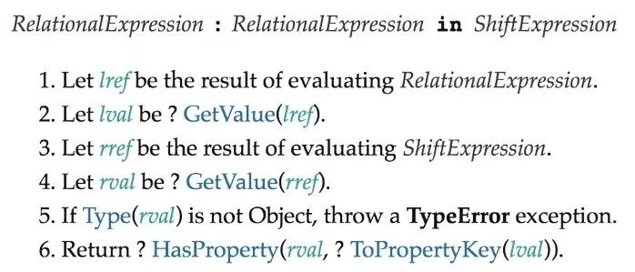
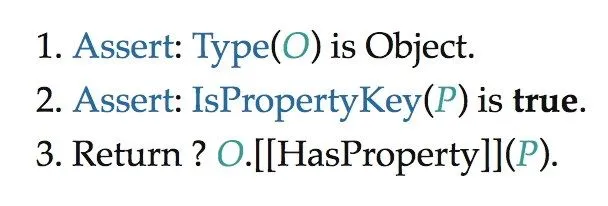
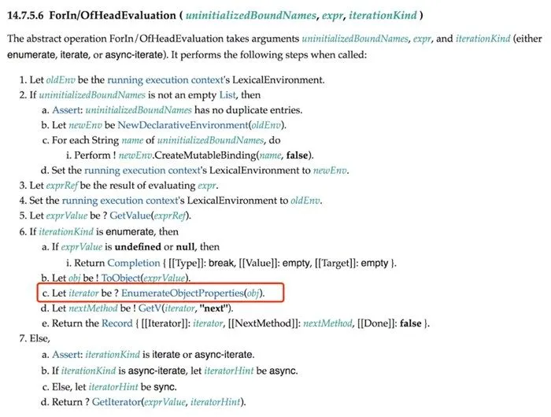
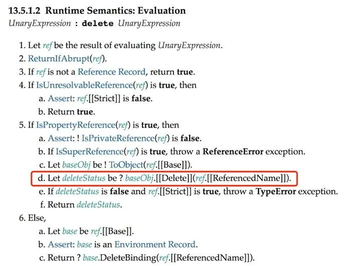

# 第5章非原始值的响应式方案(1)

## 第 5 章　非原始值的响应式方案

在上一章中，我们着重讨论了响应系统的概念与实现，并简单介绍了响应式数据的基本原理。本章中我们把目光聚焦在响应式数据本身，深入探讨实现响应式数据都需要考虑哪些内容，其中的难点又是什么。实际上，实现响应式数据要比想象中难很多，并不是像上一章讲述的那

```
样，单纯地拦截 get/set 操作即可。举例来说，如何拦截 for...in 循环？track 函数如
何追踪拦截到的 for...in 循环？类似的问题还有很多。除此之外，我们还应该考虑如何对
数组进行代理。Vue.js 3 还支持集合类型，如 Map、Set、WeakMap 以及 WeakSet 等，那
```

么应该如何对集合类型进行代理呢？实际上，想要实现完善的响应式数据，我们需要深入语言规范。本章在揭晓答案的同时，也会从语言规范的层面来分析原因，让你对响应式数据有更深入的理解。

另外，本章会引用 ECMA-262 规范，如不作特殊说明，皆指该规范的 2021 版本。

## 5.1　理解 Proxy 和 Reflect

```
既然 Vue.js 3 的响应式数据是基于 Proxy 实现的，那么我们就有必要了解 Proxy 以及与之
相关联的 Reflect。什么是 Proxy 呢？简单地说，使用 Proxy 可以创建一个代理对象。它
能够实现对其他对象的代理，这里的关键词是其他对象，也就是说，Proxy 只能代理对象，
```

无法代理非对象值，例如字符串、布尔值等。那么，代理指的是什么呢？所谓代理，指的是对一个对象基本语义的代理。它允许我们拦截并重新定义对一个对象的基本操作。这句话的关键词比较多，我们逐一解释。

```
什么是基本语义？给出一个对象 obj，可以对它进行一些操作，例如读取属性值、设置属性
```

值：

```
obj.foo // 读取属性 foo 的值
obj.foo++ // 读取和设置属性 foo 的值
```

类似这种读取、设置属性值的操作，就属于基本语义的操作，即基本操作。既然是基本操作，

```javascript
那么它就可以使用 Proxy 拦截：
const p = new Proxy(obj, {
  // 拦截读取属性操作
  get() { /*...*/ },
  // 拦截设置属性操作
  set() { /*...*/ }
})
如以上代码所示，Proxy 构造函数接收两个参数。第一个参数是被代理的对象，第二个参数
也是一个对象，这个对象是一组夹子（trap）。其中 get 函数用来拦截读取操作，set 函数
```

用来拦截设置操作。

在 JavaScript 的世界里，万物皆对象。例如一个函数也是一个对象，所以调用函数也是对一个对象的基本操作：

```bash
const fn = (name) => {
  console.log('我是：', name)
}
// 调用函数是对对象的基本操作
fn()
因此，我们可以用 Proxy 来拦截函数的调用操作，这里我们使用 apply 拦截函数的调用：
const p2 = new Proxy(fn, {
  // 使用 apply 拦截函数调用
  apply(target, thisArg, argArray) {
    target.call(thisArg, ...argArray)
  }
})
p2(‘hcy’) // 输出：‘我是：hcy’
上面两个例子说明了什么是基本操作。Proxy 只能够拦截对一个对象的基本操作。那么，什
```

么是非基本操作呢？其实调用对象下的方法就是典型的非基本操作，我们叫它复合操作：

```
obj.fn()
实际上，调用一个对象下的方法，是由两个基本语义组成的。第一个基本语义是 get，即先
通过 get 操作得到 obj.fn 属性。第二个基本语义是函数调用，即通过 get 得到 obj.fn
的值后再调用它，也就是我们上面说到的 apply。理解 Proxy 只能够代理对象的基本语义很
重要，后续我们讲解如何实现对数组或 Map、Set 等数据类型的代理时，都利用了 Proxy 的
```

这个特点。

```
理解了 Proxy，我们再来讨论 Reflect。Reflect 是一个全局对象，其下有许多方法，例
```

如：

```
Reflect.get()
Reflect.set()
Reflect.apply()
// ...
```

```
你可能已经注意到了，Reflect 下的方法与 Proxy 的拦截器方法名字相同，其实这不是偶
然。任何在 Proxy 的拦截器中能够找到的方法，都能够在 Reflect 中找到同名函数，那么
这些函数的作用是什么呢？其实它们的作用一点儿都不神秘。拿 Reflect.get 函数来说，
```

它的功能就是提供了访问一个对象属性的默认行为，例如下面两个操作是等价的：

```javascript
const obj = { foo: 1 }
// 直接读取
console.log(obj.foo) // 1
// 使用 Reflect.get 读取
console.log(Reflect.get(obj, ‘foo’)) // 1
```

可能有的读者会产生疑问：既然操作等价，那么它存在的意义是什么呢？实际上

```javascript
Reflect.get 函数还能接收第三个参数，即指定接收者 receiver，你可以把它理解为函
数调用过程中的 this，例如：
const obj = {
  get foo() {
    return this.foo
  }
}
console.log(Reflect.get(obj, 'foo', { foo: 2 })) // 输出的是 2 而不是 1
在这段代码中，我们指定第三个参数 receiver 为一个对象 { foo: 2 }，这时读取到的值
是 receiver 对象的 foo 属性值。实际上，Reflect.* 方法还有很多其他方面的意义，但
```

这里我们只关心并讨论这一点，因为它与响应式数据的实现密切相关。为了说明问题，回顾一下在上一节中实现响应式数据的代码：

```bash
const obj = { foo: 1 }
const p = new Proxy(obj, {
get(target, key) {
track(target, key)
// 注意，这里我们没有使用 Reflect.get 完成读取
return target[key]
},
set(target, key, newVal) {
// 这里同样没有使用 Reflect.set 完成设置
target[key] = newVal
trigger(target, key)
}
})
这是上一章中用来实现响应式数据的最基本的代码。在 get 和 set 拦截函数中，我们都是直
接使用原始对象 target 来完成对属性的读取和设置操作的，其中原始对象 target 就是上
述代码中的 obj 对象。
那么这段代码有什么问题吗？我们借助 effect 让问题暴露出来。首先，我们修改一下 obj
对象，为它添加 bar 属性：
const obj = {
  foo: 1,
  get bar() {
    return this.foo
  }
}
可以看到，bar 属性是一个访问器属性，它返回了 this.foo 属性的值。接着，我们在
effect 副作用函数中通过代理对象 p 访问 bar 属性：
effect(() => {
  console.log(p.bar) // 1
})
我们来分析一下这个过程发生了什么。当 effect 注册的副作用函数执行时，会读取 p.bar
属性，它发现 p.bar 是一个访问器属性，因此执行 getter 函数。由于在 getter 函数中
通过 this.foo 读取了 foo 属性值，因此我们认为副作用函数与属性 foo 之间也会建立联
系。当我们修改 p.foo 的值时应该能够触发响应，使得副作用函数重新执行才对。然而实际
并非如此，当我们尝试修改 p.foo 的值时：
p.foo++
```

副作用函数并没有重新执行，问题出在哪里呢？

```
实际上，问题就出在 bar 属性的访问器函数 getter 里：
```

```javascript
const obj = {
  foo: 1,
  get bar() {
    // 这里的 this 指向的是谁？
    return this.foo
  }
}
当我们使用 this.foo 读取 foo 属性值时，这里的 this 指向的是谁呢？我们回顾一下整个
流程。首先，我们通过代理对象 p 访问 p.bar，这会触发代理对象的 get 拦截函数执行：
const p = new Proxy(obj, {
  get(target, key) {
    track(target, key)
    // 注意，这里我们没有使用 Reflect.get 完成读取
    return target[key]
  },
  // 省略部分代码
})
在 get 拦截函数内，通过 target[key] 返回属性值。其中 target 是原始对象 obj，而
key 就是字符串 'bar'，所以 target[key] 相当于 obj.bar。因此，当我们使用 p.bar
访问 bar 属性时，它的 getter 函数内的 this 指向的其实是原始对象 obj，这说明我们最
终访问的其实是 obj.foo。很显然，在副作用函数内通过原始对象访问它的某个属性是不会
```

建立响应联系的，这等价于：

```
effect(() => {
  // obj 是原始数据，不是代理对象，这样的访问不能够建立响应联系
  obj.foo
})
```

因为这样做不会建立响应联系，所以出现了无法触发响应的问题。那么这个问题应该如何解决

```javascript
呢？这时 Reflect.get 函数就派上用场了。先给出解决问题的代码：
const p = new Proxy(obj, {
  // 拦截读取操作，接收第三个参数 receiver
  get(target, key, receiver) {
    track(target, key)
    // 使用 Reflect.get 返回读取到的属性值
    return Reflect.get(target, key, receiver)
  },
  // 省略部分代码
})
如上面的代码所示，代理对象的 get 拦截函数接收第三个参数 receiver，它代表谁在读取
```

属性，例如：

```javascript
p.bar // 代理对象 p 在读取 bar 属性
当我们使用代理对象 p 访问 bar 属性时，那么 receiver 就是 p，你可以把它简单地理解
为函数调用中的 this。接着关键的一步发生了，我们使用 Reflect.get(target, key,
receiver) 代替之前的 target[key]，这里的关键点就是第三个参数 receiver。我们已
经知道它就是代理对象 p，所以访问器属性 bar 的 getter 函数内的 this 指向代理对象
p：
const obj = {
  foo: 1,
  get bar() {
    // 现在这里的 this 为代理对象 p
    return this.foo
  }
}
可以看到，this 由原始对象 obj 变成了代理对象 p。很显然，这会在副作用函数与响应式
数据之间建立响应联系，从而达到依赖收集的效果。如果此时再对 p.foo 进行自增操作，会
```

发现已经能够触发副作用函数重新执行了。

```
正是基于上述原因，后文讲解中将统一使用 Reflect.* 方法。
```

## 5.2　JavaScript 对象及 Proxy 的工作原理

我们经常听到这样的说法：“JavaScript 中一切皆对象。”那么，到底什么是对象呢？这个问题需要我们查阅 ECMAScript 规范才能得到答案。实际上，根据 ECMAScript 规范，在 JavaScript中有两种对象，其中一种叫作常规对象（ordinary object），另一种叫作异质对象（exoticobject）。这两种对象包含了 JavaScript 世界中的所有对象，任何不属于常规对象的对象都是异质对象。那么到底什么是常规对象，什么是异质对象呢？这需要我们先了解对象的内部方法和内部槽。

```
我们知道，在 JavaScript 中，函数其实也是对象。假设给出一个对象 obj，如何区分它是普
```

通对象还是函数呢？实际上，在 JavaScript 中，对象的实际语义是由对象的内部方法（internal method）指定的。所谓内部方法，指的是当我们对一个对象进行操作时在引擎内部调用的方法，这些方法对于 JavaScript 使用者来说是不可见的。举个例子，当我们访问对象属性时：

```
obj.foo
引擎内部会调用 [[Get]] 这个内部方法来读取属性值。这里补充说明一下，在 ECMAScript
规范中使用 [[xxx]] 来代表内部方法或内部槽。当然，一个对象不仅部署了 [[Get]] 这个
```

- 1

内部方法，表 5-1 列出了规范要求的所有必要的内部方法

- 。

表 5-1　对象必要的内部方法

内部方法

- 签名描述

- 查明为

```
[[GetPrototypeOf]]
( ) → Object | Null
```

- 继承属

- 将该对

```
null
[[SetPrototypeOf]]
(Object | Null) → Boolean
```

- 完成，

```
[[IsExtensible]]
( ) → Boolean
```

- 查明是

- 控制能

```
[[PreventExtensions]]
( ) → Boolean
true
```

- 返回该

```
(propertyKey) → Undefined | Property
prop
[[GetOwnProperty]]
Descriptor
unde
```

- 创建或

```
(propertyKey, PropertyDescriptor) →
```

- 具有由

```
[[DefineOwnProperty]]
Boolean
```

- 属性已建或更

- 返回一

```
[[HasProperty]]
(propertyKey) → Boolean
prop
```

- 从该对

```
[[Get]]
(propertyKey, Receiver) → any
```

- 必须运代码时

- 将键值

```
valu
(propertyKey, value, Receiver) →
[[Set]]
```

- 值，则

```
Boolean
```

- 值。如法设置

内部方法

- 签名描述

- 从该对性。如

```sql
[[Delete]]
(propertyKey) →Boolean
由表 5-1 可知，包括 [[Get]] 在内，一个对象必须部署 11 个必要的内部方法。除了表 5-1
```

- 2

```
：[[Call]] 和 [[Construct]]，
```

所列的内部方法之外，还有两个额外的必要内部方法如表 5-2 所示。

表 5-2　额外的必要内部方法

内部方法

- 签名描述

```
将运行的代码与 this 对象
[[Call]]
(any, a List of any) → any
该内部方法的参数是一个 t
创建一个对象。通过 new
```

- 发。该内部方法的第一个参

```
[[Construct]]
(a List of any, Object) → Object
List 的元素是构造函数调
第二个参数是最初应用 ne
```

- 部方法的对象称为构造函数

```
如果一个对象需要作为函数调用，那么这个对象就必须部署内部方法 [[Call]]。现在我们
```

就可以回答前面的问题了：如何区分一个对象是普通对象还是函数呢？一个对象在什么情况下才能作为函数调用呢？答案是，通过内部方法和内部槽来区分对象，例如函数对象会部署内部

```
方法 [[Call]]，而普通对象则不会。
```

内部方法具有多态性，这是什么意思呢？这类似于面向对象里多态的概念。这就是说，不同类

```
型的对象可能部署了相同的内部方法，却具有不同的逻辑。例如，普通对象和 Proxy 对象都
部署了 [[Get]] 这个内部方法，但它们的逻辑是不同的，普通对象部署的 [[Get]] 内部方
法的逻辑是由 ECMA 规范的 10.1.8 节定义的，而 Proxy 对象部署的 [[Get]] 内部方法的
```

逻辑是由 ECMA 规范的 10.5.8 节来定义的。

了解了内部方法，就可以解释什么是常规对象，什么是异质对象了。满足以下三点要求的对象就是常规对象：

- 对于表 5-1 列出的内部方法，必须使用 ECMA 规范 10.1.x 节给出的定义实现；

```
对于内部方法 [[Call]]，必须使用 ECMA 规范 10.2.1 节给出的定义实现；
对于内部方法 [[Construct]]，必须使用 ECMA 规范 10.2.2 节给出的定义实现。
而所有不符合这三点要求的对象都是异质对象。例如，由于 Proxy 对象的内部方法
[[Get]] 没有使用 ECMA 规范的 10.1.8 节给出的定义实现，所以 Proxy 是一个异质对象。
现在我们对 JavaScript 中的对象有了更加深入的理解。接下来，我们就具体看看 Proxy 对
象。既然 Proxy 也是对象，那么它本身也部署了上述必要的内部方法，当我们通过代理对象
```

访问属性值时：

```javascript
const p = new Proxy(obj, {/* ... */})
p.foo
实际上，引擎会调用部署在对象 p 上的内部方法 [[Get]]。到这一步，其实代理对象和普通
对象没有太大区别。它们的区别在于对于内部方法 [[Get]] 的实现，这里就体现了内部方法
```

的多态性，即不同的对象部署相同的内部方法，但它们的行为可能不同。具体的不同体现在，

```
如果在创建代理对象时没有指定对应的拦截函数，例如没有指定 get() 拦截函数，那么当我
们通过代理对象访问属性值时，代理对象的内部方法 [[Get]] 会调用原始对象的内部方法
[[Get]] 来获取属性值，这其实就是代理透明性质。
```

现在相信你已经明白了，创建代理对象时指定的拦截函数，实际上是用来自定义代理对象本身的内部方法和行为的，而不是用来指定被代理对象的内部方法和行为的。表 5-3 列出了

- 3

```
Proxy 对象部署的所有内部方法以及用来自定义内部方法和行为的拦截函数名字
```

- 。

表 5-3　Proxy 对象部署的所有内部方法内部方法

- 处理器函数

```sql
[[GetPrototypeOf]]
getPrototypeOf
[[SetPrototypeOf]]
setPrototypeOf
[[IsExtensible]]
isExtensible
[[PreventExtensions]]
preventExtensions
[[GetOwnProperty]]
getOwnPropertyDescriptor
[[DefineOwnProperty]]
defineProperty
[[HasProperty]]
has
[[Get]]
get
[[Set]]
set
[[Delete]]
deleteProperty
[[OwnPropertyKeys]]
ownKeys
[[Call]]
apply
[[Construct]]
construct
当然，其中 [[Call]] 和 [[Construct]] 这两个内部方法只有当被代理的对象是函数和构
```

造函数时才会部署。

```sql
由表 5-3 可知，当我们要拦截删除属性操作时，可以使用 deleteProperty 拦截函数实现：
const obj = { foo: 1 }
const p = new Proxy(obj, {
  deleteProperty(target, key) {
    return Reflect.deleteProperty(target, key)
  }
})
console.log(p.foo) // 1
delete p.foo
console.log(p.foo) // 未定义
这里需要强调的是，deleteProperty 实现的是代理对象 p 的内部方法和行为，所以为了删
除被代理对象上的属性值，我们需要使用 Reflect.deleteProperty(target, key) 来
```

完成。

## 5.3　如何代理 Object

```
从本节开始，我们将着手实现响应式数据。前面我们使用 get 拦截函数去拦截对属性的读取
操作。但在响应系统中，“读取”是一个很宽泛的概念，例如使用 in 操作符检查对象上是否具
有给定的 key 也属于“读取”操作，如下面的代码所示：
effect(() => {
  'foo' in obj
})
```

这本质上也是在进行“读取”操作。响应系统应该拦截一切读取操作，以便当数据变化时能够正确地触发响应。下面列出了对一个普通对象的所有可能的读取操作。

```javascript
访问属性：obj.foo。
判断对象或原型上是否存在给定的 key：key in obj。
使用 for...in 循环遍历对象：for (const key in obj){}。
```

```javascript
接下来，我们逐步讨论如何拦截这些读取操作。首先是对于属性的读取，例如 obj.foo，我
们知道这可以通过 get 拦截函数实现：
const obj = { foo: 1 }
const p = new Proxy(obj, {
get(target, key, receiver) {
// 建立联系
track(target, key)
// 返回属性值
return Reflect.get(target, key, receiver)
},
})
对于 in 操作符，应该如何拦截呢？我们可以先查看表 5-3，尝试寻找与 in 操作符对应的拦
截函数，但表 5-3 中没有与 in 操作符相关的内容。怎么办呢？这时我们就需要查看关于 in
操作符的相关规范。在 ECMA-262 规范的 13.10.1 节中，明确定义了 in 操作符的运行时逻
```

辑，如图 5-1 所示。



```
图 5-1　in 操作符的运行时逻辑
```

图 5-1 描述的内容如下。

```
让 lref 的值为 RelationalExpression 的执行结果。
```

- 1.

```
让 lval 的值为 ? GetValue(lref)。
```

- 2.

```
让 rref 的值为 ShiftExpression 的执行结果。
```

- 3.

```
让 rval 的值为 ? GetValue(rref)。
```

- 4.

```
如果 Type(rval) 不是对象，则抛出 TypeError 异常。
```

- 5.

```
返回 ? HasProperty(rval, ? ToPropertyKey(lval))。
```

- 6.

```
关键点在第 6 步，可以发现，in 操作符的运算结果是通过调用一个叫作 HasProperty 的抽
象方法得到的。关于 HasProperty 抽象方法，可以在 ECMA-262 规范的 7.3.11 节中找到，
```

它的操作如图 5-2 所示。



```
图 5-2　HasProperty 抽象方法的逻辑
```

图 5-2 描述的内容如下。

```
断言：Type(O) 是 Object。
```

- 1.

```
断言：IsPropertyKey(P) 是 true。
```

- 2.

```
返回 ? O.[[HasProperty]](P)。
```

- 3.

```javascript
在第 3 步中，可以看到 HasProperty 抽象方法的返回值是通过调用对象的内部方法
[[HasProperty]] 得到的。而 [[HasProperty]] 内部方法可以在表 5-3 中找到，它对应
的拦截函数名叫 has，因此我们可以通过 has 拦截函数实现对 in 操作符的代理：
const obj = { foo: 1 }
const p = new Proxy(obj, {
  has(target, key) {
    track(target, key)
    return Reflect.has(target, key)
  }
})
这样，当我们在副作用函数中通过 in 操作符操作响应式数据时，就能够建立依赖关系：
effect(() => {
  'foo' in p // 将会建立依赖关系
})
```

```
再来看看如何拦截 for...in 循环。同样，我们能够拦截的所有方法都在表 5-3 中，而表 5-
```

3 列出的是一个对象的所有基本语义方法，也就是说，任何操作其实都是由这些基本语义方法

```
及其组合实现的，for...in 循环也不例外。为了搞清楚 for...in 循环依赖哪些基本语义
```

方法，还需要看规范。

由于这部分规范内容较多，因此这里只截取关键部分。在规范的 14.7.5.6 节中定义了

```
for...in 头部的执行规则，如图 5-3 所示。
```



```
图 5-3　for...in 头部的执行规则
```

图 5-3 中第 6 步描述的内容如下。

```
6. 如果 iterationKind 是枚举（enumerate），则
a. 如果 exprValue 是 undefined 或 null，那么
　　i. 返回 Completion { [[Type]]: break, [[Value]]: empty,
[[Target]]: empty }。
b. 让 obj 的值为 ! ToObject(exprValue)。
c. 让 iterator 的值为 ? EnumerateObjectProperties(obj)。
d. 让 nextMethod 的值为 ! GetV(iterator, "next")。
e. 返回 Record{ [[Iterator]]: iterator, [[NextMethod]]: nextMethod,
[[Done]]: false }。
```

仔细观察第 6 步的第 c 子步骤：

```
让 iterator 的值为 ? EnumerateObjectProperties(obj)。
其中的关键点在于 EnumerateObjectProperties(obj)。这里的
EnumerateObjectProperties 是一个抽象方法，该方法返回一个迭代器对象，规范的
```

14.7.5.9 节给出了满足该抽象方法的示例实现，如下面的代码所示：

```javascript
function* EnumerateObjectProperties(obj) {
  const visited = new Set();
  for (const key of Reflect.ownKeys(obj)) {
    if (typeof key === "symbol") continue;
    const desc = Reflect.getOwnPropertyDescriptor(obj, key);
    if (desc) {
      visited.add(key);
      if (desc.enumerable) yield key;
    }
  }
  const proto = Reflect.getPrototypeOf(obj);
  if (proto === null) return;
  for (const protoKey of EnumerateObjectProperties(proto)) {
    if (!visited.has(protoKey)) yield protoKey;
  }
}
```

```javascript
可以看到，该方法是一个 generator 函数，接收一个参数 obj。实际上，obj 就是被
for...in 循环遍历的对象，其关键点在于使用 Reflect.ownKeys(obj) 来获取只属于对
象自身拥有的键。有了这个线索，如何拦截 for...in 循环的答案已经很明显了，我们可以
使用 ownKeys 拦截函数来拦截 Reflect.ownKeys 操作：
const obj = { foo: 1 }
const ITERATE_KEY = Symbol()
const p = new Proxy(obj, {
ownKeys(target) {
// 将副作用函数与 ITERATE_KEY 关联
track(target, ITERATE_KEY)
return Reflect.ownKeys(target)
}
})
如上面的代码所示，拦截 ownKeys 操作即可间接拦截 for...in 循环。但相信大家已经注
意到了，我们在使用 track 函数进行追踪的时候，将 ITERATE_KEY 作为追踪的 key，为什
么这么做呢？这是因为 ownKeys 拦截函数与 get/set 拦截函数不同，在 set/get 中，我
们可以得到具体操作的 key，但是在 ownKeys 中，我们只能拿到目标对象 target。这也很
```

符合直觉，因为在读写属性值时，总是能够明确地知道当前正在操作哪一个属性，所以只需要

```
在该属性与副作用函数之间建立联系即可。而 ownKeys 用来获取一个对象的所有属于自己的
键值，这个操作明显不与任何具体的键进行绑定，因此我们只能够构造唯一的 key 作为标
识，即 ITERATE_KEY。
既然追踪的是 ITERATE_KEY，那么相应地，在触发响应的时候也应该触发它才行：
trigger(target, ITERATE_KEY)
但是在什么情况下，对数据的操作需要触发与 ITERATE_KEY 相关联的副作用函数重新执行
呢？为了搞清楚这个问题，我们用一段代码来说明。假设副作用函数内有一段 for...in 循
```

环：

```xml
const obj = { foo: 1 }
const p = new Proxy(obj, {/* ... */})
effect(() => {
// for…in 循环
for (const key in p) {
console.log(key) // foo
}
})
副作用函数执行后，会与 ITERATE_KEY 之间建立响应联系，接下来我们尝试为对象 p 添加
新的属性 bar：
p.bar = 2
由于对象 p 原本只有 foo 属性，因此 for...in 循环只会执行一次。现在为它添加了新的
属性 bar，所以 for...in 循环就会由执行一次变成执行两次。也就是说，当为对象添加新
属性时，会对 for...in 循环产生影响，所以需要触发与 ITERATE_KEY 相关联的副作用函
数重新执行。但目前的实现还做不到这一点。当我们为对象 p 添加新的属性 bar 时，并没有
触发副作用函数重新执行，这是为什么呢？我们来看一下现在的 set 拦截函数的实现：
const p = new Proxy(obj, {
  // 拦截设置操作
  set(target, key, newVal, receiver) {
    // 设置属性值
    const res = Reflect.set(target, key, newVal, receiver)
    // 把副作用函数从桶里取出并执行
    trigger(target, key)
<pre><code> return res
</code></pre> return res
},
// 省略其他拦截函数
})
当为对象 p 添加新的 bar 属性时，会触发 set 拦截函数执行。此时 set 拦截函数接收到的
key 就是字符串 'bar'，因此最终调用 trigger 函数时也只是触发了与 'bar' 相关联的副
作用函数重新执行。但根据前文的介绍，我们知道 for...in 循环是在副作用函数与
ITERATE_KEY 之间建立联系，这和 'bar' 一点儿关系都没有，因此当我们尝试执行 p.bar
= 2 操作时，并不能正确地触发响应。
```

弄清楚了问题在哪里，解决方案也就随之而来了。当添加属性时，我们将那些与

```xml
ITERATE_KEY 相关联的副作用函数也取出来执行就可以了：
function trigger(target, key) {
  const depsMap = bucket.get(target)
  if (!depsMap) return
  // 取得与 key 相关联的副作用函数
  const effects = depsMap.get(key)
  // 取得与 ITERATE_KEY 相关联的副作用函数
  const iterateEffects = depsMap.get(ITERATE_KEY)
<p>const effectsToRun = new Set()
// 将与 key 相关联的副作用函数添加到 effectsToRun
effects && effects.forEach(effectFn => {
if (effectFn !== activeEffect) {
effectsToRun.add(effectFn)
}
})
// 将与 ITERATE_KEY 相关联的副作用函数也添加到 effectsToRun
iterateEffects && iterateEffects.forEach(effectFn => {
if (effectFn !== activeEffect) {
effectsToRun.add(effectFn)
}
})</p>
effectsToRun.forEach(effectFn => {
if (effectFn.options.scheduler) {
effectFn.options.scheduler(effectFn)
} else {
effectFn()
}
})
}
如以上代码所示，当 trigger 函数执行时，除了把那些直接与具体操作的 key 相关联的副
作用函数取出来执行外，还要把那些与 ITERATE_KEY 相关联的副作用函数取出来执行。
```

但相信细心的你已经发现了，对于添加新的属性来说，这么做没有什么问题，但如果仅仅修改已有属性的值，而不是添加新属性，那么问题就来了。看如下代码：

```javascript
const obj = { foo: 1 }
const p = new Proxy(obj, {/* ... */})
effect(() => {
// for…in 循环
for (const key in p) {
console.log(key) // foo
}
})
当我们修改 p.foo 的值时：
p.foo = 2
与添加新属性不同，修改属性不会对 for...in 循环产生影响。因为无论怎么修改一个属性
的值，对于 for...in 循环来说都只会循环一次。所以在这种情况下，我们不需要触发副作
```

用函数重新执行，否则会造成不必要的性能开销。然而无论是添加新属性，还是修改已有的属

```
性值，其基本语义都是 [[Set]]，我们都是通过 set 拦截函数来实现拦截的，如以下代码所
```

示：

```xml
const p = new Proxy(obj, {
  // 拦截设置操作
  set(target, key, newVal, receiver) {
    // 设置属性值
    const res = Reflect.set(target, key, newVal, receiver)
    // 把副作用函数从桶里取出并执行
    trigger(target, key)
<pre><code> return res
</code></pre> return res
},
// 省略其他拦截函数
})
所以要想解决上述问题，当设置属性操作发生时，就需要我们在 set 拦截函数内能够区分操
```

作的类型，到底是添加新属性还是设置已有属性：

```xml
const p = new Proxy(obj, {
  // 拦截设置操作
  set(target, key, newVal, receiver) {
    // 如果属性不存在，则说明是在添加新属性，否则是设置已有属性
    const type = Object.prototype.hasOwnProperty.call(target, key) ? 'SET' : 'AD
<pre><code> // 设置属性值
const res = Reflect.set(target, key, newVal, receiver)
// 将 type 作为第三个参数传递给 trigger 函数
trigger(target, key, type)
return res
</code></pre> // 设置属性值
const res = Reflect.set(target, key, newVal, receiver)
// 将 type 作为第三个参数传递给 trigger 函数
trigger(target, key, type)
return res
},
// 省略其他拦截函数
})
```

```
如以上代码所示，我们优先使用 Object.prototype.hasOwnProperty 检查当前操作的
属性是否已经存在于目标对象上，如果存在，则说明当前操作类型为 'SET'，即修改属性
值；否则认为当前操作类型为 'ADD'，即添加新属性。最后，我们把类型结果 type 作为第
三个参数传递给 trigger 函数。
在 trigger 函数内就可以通过类型 type 来区分当前的操作类型，并且只有当操作类型
type 为 'ADD' 时，才会触发与 ITERATE_KEY 相关联的副作用函数重新执行，这样就避免
```

了不必要的性能损耗：

```xml
function trigger(target, key, type) {
  const depsMap = bucket.get(target)
  if (!depsMap) return
  const effects = depsMap.get(key)
<p>const effectsToRun = new Set()
effects && effects.forEach(effectFn => {
if (effectFn !== activeEffect) {
effectsToRun.add(effectFn)
}
})</p>
<p>console.log(type, key)
// 只有当操作类型为 ‘ADD’ 时，才触发与 ITERATE_KEY 相关联的副作用函数重新执行
if (type === ‘ADD’) {
const iterateEffects = depsMap.get(ITERATE_KEY)
iterateEffects && iterateEffects.forEach(effectFn => {
if (effectFn !== activeEffect) {
effectsToRun.add(effectFn)
}
})
}</p>
effectsToRun.forEach(effectFn => {
if (effectFn.options.scheduler) {
effectFn.options.scheduler(effectFn)
} else {
effectFn()
}
})
}
```

通常我们会将操作类型封装为一个枚举值，例如：

```javascript
const TriggerType = {
  SET: 'SET',
  ADD: 'ADD'
}
```

这样无论是对后期代码的维护，还是对代码的清晰度，都是非常有帮助的。但这里我们就不讨论这些细枝末节了。

关于对象的代理，还剩下最后一项工作需要做，即删除属性操作的代理：

```sql
delete p.foo
```

```sql
如何代理 delete 操作符呢？还是看规范，规范的 13.5.1.2 节中明确定义了 delete 操作符
```

的行为，如图 5-4 所示。



```sql
图 5-4　delete 操作符的行为
```

图 5-4 中的第 5 步描述的内容如下。

```sql
5. 如果 IsPropertyReference(ref) 是 true，那么
a. 断言：! IsPrivateReference(ref) 是 false。
b. 如果 IsSuperReference(ref) 也是 true，则抛出 ReferenceError 异常。
c. 让 baseObj 的值为 ! ToObject(ref,[[Base]])。
d. 让 deleteStatus 的值为 ? baseObj.[[Delete]](ref.
[[ReferencedName]])。
e. 如果 deleteStatus 的值为 false 并且 ref.[[Strict]] 的值是 true，则抛出
TypeError 异常。
f. 返回 deleteStatus。
由第 5 步中的 d 子步骤可知，delete 操作符的行为依赖 [[Delete]] 内部方法。接着查看
表 5-3 可知，该内部方法可以使用 deleteProperty 拦截：
const p = new Proxy(obj, {
  deleteProperty(target, key) {
    // 检查被操作的属性是否是对象自己的属性
    const hadKey = Object.prototype.hasOwnProperty.call(target, key)
    // 使用 Reflect.deleteProperty 完成属性的删除
    const res = Reflect.deleteProperty(target, key)
<pre><code> if (res &amp;&amp; hadKey) {
  // 只有当被删除的属性是对象自己的属性并且成功删除时，才触发更新
  trigger(target, key, 'DELETE')
}
return res
</code></pre> if (res &amp;&amp; hadKey) {
  // 只有当被删除的属性是对象自己的属性并且成功删除时，才触发更新
  trigger(target, key, 'DELETE')
}
return res
}
})
```

如以上代码所示，首先检查被删除的属性是否属于对象自身，然后调用

```sql
Reflect.deleteProperty 函数完成属性的删除工作，只有当这两步的结果都满足条件
时，才调用 trigger 函数触发副作用函数重新执行。需要注意的是，在调用 trigger 函数
时，我们传递了新的操作类型 'DELETE'。由于删除操作会使得对象的键变少，它会影响
for...in 循环的次数，因此当操作类型为 'DELETE' 时，我们也应该触发那些与
ITERATE_KEY 相关联的副作用函数重新执行：
function trigger(target, key, type) {
  const depsMap = bucket.get(target)
  if (!depsMap) return
  const effects = depsMap.get(key)
<p>const effectsToRun = new Set()
effects && effects.forEach(effectFn => {
if (effectFn !== activeEffect) {
effectsToRun.add(effectFn)
}
})</p>
<p>// 当操作类型为 ADD 或 DELETE 时，需要触发与 ITERATE_KEY 相关联的副作用函数重新执行
if (type === ‘ADD’ || type === ‘DELETE’) {
const iterateEffects = depsMap.get(ITERATE_KEY)
iterateEffects && iterateEffects.forEach(effectFn => {
if (effectFn !== activeEffect) {
effectsToRun.add(effectFn)
}
})
}</p>
effectsToRun.forEach(effectFn => {
if (effectFn.options.scheduler) {
effectFn.options.scheduler(effectFn)
} else {
effectFn()
}
})
}
```

```sql
在这段代码中，我们添加了 type === 'DELETE' 判断，使得删除属性操作能够触发与
ITERATE_KEY 相关联的副作用函数重新执行。
```

[1]：摘自 ECMAScript 2022 Language Specification的Invariants of the Essential Internal Methods。[2]：摘自 ECMAScript 2022 Language Specification的Invariants of the Essential Internal Methods。[3]：摘自ECMAScript 2022 Language Specification的Proxy Object Internal Methods and Internal Slots。
