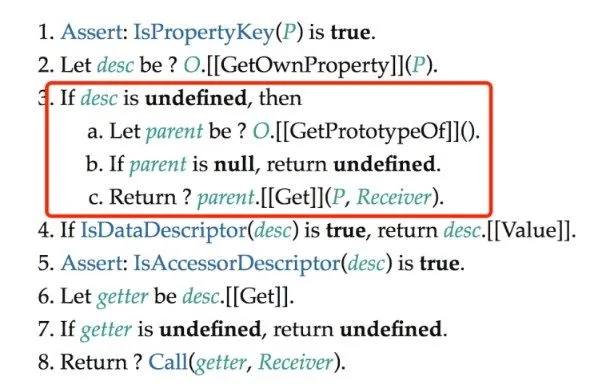
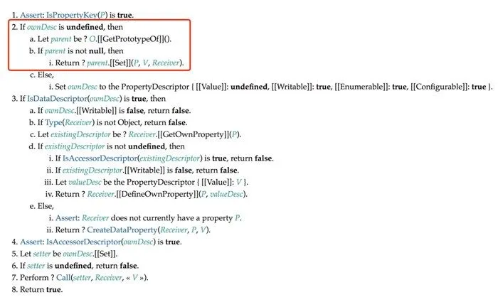
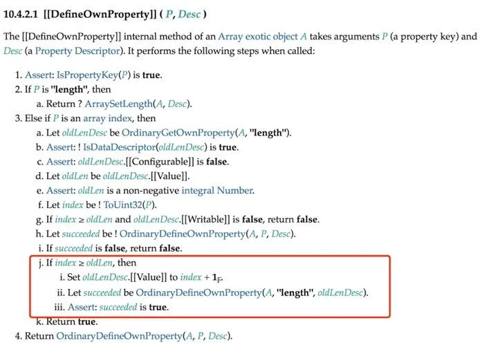
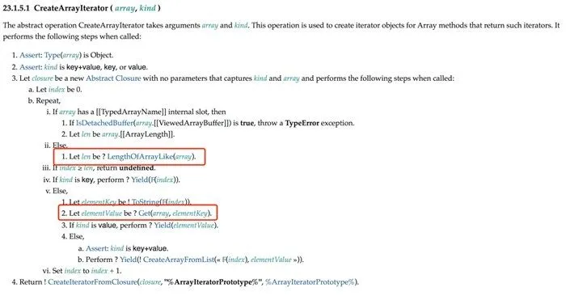
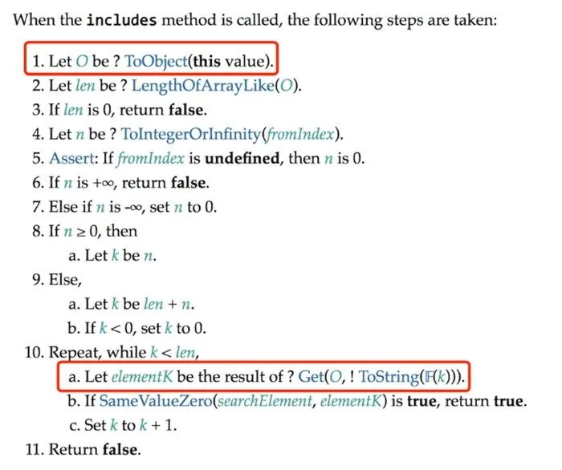
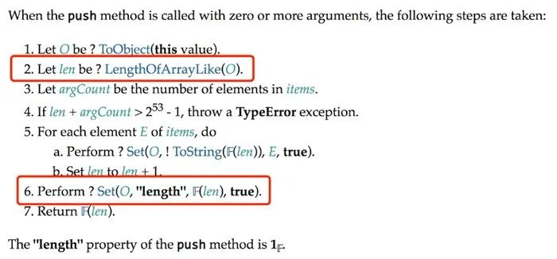

# 第5章非原始值的响应式方案(2)

## 5.4　合理地触发响应

上一节中，我们从规范的角度详细介绍了如何代理对象，在这个过程中，处理了很多边界条

```
件。例如，我们需要明确知道操作的类型是 'ADD' 还是 'SET'，抑或是其他操作类型，从而
```

正确地触发响应。但想要合理地触发响应，还有许多工作要做。

首先，我们来看要面临的第一个问题，即当值没有发生变化时，应该不需要触发响应才对：

```xml
const obj = { foo: 1 }
const p = new Proxy(obj, { /* ... */ })
<p>effect(() => {
console.log(p.foo)
})</p>
// 设置 p.foo 的值，但值没有变化
p.foo = 1
如上面的代码所示，p.foo 的初始值为 1，当为 p.foo 设置新的值时，如果值没有发生变
化，则不需要触发响应。为了满足需求，我们需要修改 set 拦截函数的代码，在调用
trigger 函数触发响应之前，需要检查值是否真的发生了变化：
const p = new Proxy(obj, {
  set(target, key, newVal, receiver) {
    // 先获取旧值
    const oldVal = target[key]
<pre><code> const type = Object.prototype.hasOwnProperty.call(target, key) ? 'SET
const res = Reflect.set(target, key, newVal, receiver)
// 比较新值与旧值，只要当不全等的时候才触发响应
if (oldVal !== newVal) {
  trigger(target, key, type)
}
return res
</code></pre> const type = Object.prototype.hasOwnProperty.call(target, key) ? 'S
const res = Reflect.set(target, key, newVal, receiver)
// 比较新值与旧值，只要当不全等的时候才触发响应
if (oldVal !== newVal) {
  trigger(target, key, type)
}
return res
},
})
如上面的代码所示，我们在 set 拦截函数内首先获取旧值 oldVal，接着比较新值与旧值，
```

只有当它们不全等的时候才触发响应。现在，如果我们再次测试本节开头的例子，会发现重新设置相同的值已经不会触发响应了。

```
然而，仅仅进行全等比较是有缺陷的，这体现在对 NaN 的处理上。我们知道 NaN 与 NaN 进
行全等比较总会得到 false：
NaN === NaN // false
NaN !== NaN // true
换句话说，如果 p.foo 的初始值是 NaN，并且后续又为其设置了 NaN 作为新值，那么仅仅
```

进行全等比较的缺陷就暴露了：

```xml
const obj = { foo: NaN }
const p = new Proxy(obj, { /* ... */ })
<p>effect(() => {
console.log(p.foo)
})</p>
// 仍然会触发响应，因为 NaN !== NaN 为 true
p.foo = NaN
```

这仍然会触发响应，并导致不必要的更新。为了解决这个问题，我们需要再加一个条件，即在

```xml
新值和旧值不全等的情况下，要保证它们都不是 NaN：
const p = new Proxy(obj, {
  set(target, key, newVal, receiver) {
    // 先获取旧值
    const oldVal = target[key]
<pre><code> const type = Object.prototype.hasOwnProperty.call(target, key) ? 'SET
const res = Reflect.set(target, key, newVal, receiver)
// 比较新值与旧值，只有当它们不全等，并且不都是 NaN 的时候才触发响应
if (oldVal !== newVal &amp;&amp; (oldVal === oldVal || newVal === newVal)) {
  trigger(target, key, type)
}
return res
</code></pre> const type = Object.prototype.hasOwnProperty.call(target, key) ? 'S
const res = Reflect.set(target, key, newVal, receiver)
// 比较新值与旧值，只有当它们不全等，并且不都是 NaN 的时候才触发响应
if (oldVal !== newVal &amp;&amp; (oldVal === oldVal || newVal === newVal)) {
  trigger(target, key, type)
}
return res
},
})
```

```
这样我们就解决了 NaN 的问题。
但想要合理地触发响应，仅仅处理关于 NaN 的问题还不够。接下来，我们讨论一种从原型上
继承属性的情况。为了后续讲解方便，我们需要封装一个 reactive 函数，该函数接收一个
```

对象作为参数，并返回为其创建的响应式数据：

```javascript
function reactive(obj) {
  return new Proxy(obj, {
    // 省略前文讲解的拦截函数
  })
}
可以看到，reactive 函数只是对 Proxy 进行了一层封装。接下来，我们基于 reactive
```

创建一个例子：

```javascript
const obj = {}
const proto = { bar: 1 }
const child = reactive(obj)
const parent = reactive(proto)
// 使用 parent 作为 child 的原型
Object.setPrototypeOf(child, parent)
effect(() => {
console.log(child.bar) // 1
})
// 修改 child.bar 的值
child.bar = 2 // 会导致副作用函数重新执行两次
```

```
观察如上代码，我们定义了空对象 obj 和对象 proto，分别为二者创建了对应的响应式数据
child 和 parent，并且使用 Object.setPrototypeOf 方法将 parent 设置为 child
的原型。接着，在副作用函数内访问 child.bar 的值。从代码中可以看出，child 本身并
没有 bar 属性，因此当访问 child.bar 时，值是从原型上继承而来的。但无论如何，既然
child 是响应式数据，那么它与副作用函数之间就会建立联系，因此当我们执行 child.bar
= 2 时，期望副作用函数会重新执行。但如果你尝试运行上面的代码，会发现副作用函数不仅
```

执行了，还执行了两次，这会造成不必要的更新。

```
为了搞清楚问题的原因，我们需要逐步分析整个过程。当在副作用函数中读取 child.bar 的
值时，会触发 child 代理对象的 get 拦截函数。我们知道，在拦截函数内是使用
Reflect.get(target, key, receiver) 来得到最终结果的，对应到上例，这句话相当
```

于：

```
Reflect.get(obj, 'bar', receiver)
这其实是实现了通过 obj.bar 来访问属性值的默认行为。也就是说，引擎内部是通过调用
obj 对象所部署的 [[Get]] 内部方法来得到最终结果的，因此我们有必要查看规范 10.1.8.1
节来了解 [[Get]] 内部方法的执行流程，如图 5-5 所示。
```



```
图 5-5　[[Get]] 内部方法的执行流程
```

图 5-5 中的第 3 步所描述的内容如下。

```
3. 如果 desc 是 undefined，那么
a. 让 parent 的值为 ? O.[[GetPrototypeOf]]()。
b. 如果 parent 是 null，则返回 undefined。
c. 返回 ? parent.[[Get]](P, Receiver)。
```

在第 3 步中，我们能够了解到非常关键的信息，即如果对象自身不存在该属性，那么会获取对

```
象的原型，并调用原型的 [[Get]] 方法得到最终结果。对应到上例中，当读取 child.bar
属性值时，由于 child 代理的对象 obj 自身没有 bar 属性，因此会获取对象 obj 的原型，
也就是 parent 对象，所以最终得到的实际上是 parent.bar 的值。但是大家不要忘了，
parent 本身也是响应式数据，因此在副作用函数中访问 parent.bar 的值时，会导致副作
用函数被收集，从而也建立响应联系。所以我们能够得出一个结论，即 child.bar 和
parent.bar 都与副作用函数建立了响应联系。
但这仍然解释不了为什么当设置 child.bar 的值时，会连续触发两次副作用函数执行，所以
接下来我们需要看看当设置操作发生时的具体执行流程。我们知道，当执行 child.bar =
2 时，会调用 child 代理对象的 set 拦截函数。同样，在 set 拦截函数内，我们使用
Reflect.set(target, key, newVal, receiver) 来完成默认的设置行为，即引擎会
调用 obj 对象部署的 [[Set]] 内部方法，根据规范的 10.1.9.2 节可知 [[Set]] 内部方法
```

的执行流程，如图 5-6 所示。



```
图 5-6　[[Set]] 内部方法的执行流程
```

图 5-6 中第 2 步所描述的内容如下。

```
2. 如果 ownDesc 是 undefined，那么
a. 让 parent 的值为 O.[[GetPrototypeOf]]()。
b. 如果 parent 不是 null，则
　　I. 返回 ? parent.[[Set]](P, V, Receiver)；
```

- c. 否则

```
　　I. 将 ownDesc 设置为 { [[Value]]: undefined, [[Writable]]: true,
[[Enumerable]]: true, [[Configurable]]: true }。
```

由第 2 步可知，如果设置的属性不存在于对象上，那么会取得其原型，并调用原型的

```
[[Set]] 方法，也就是 parent 的 [[Set]] 内部方法。由于 parent 是代理对象，所以这
就相当于执行了它的 set 拦截函数。换句话说，虽然我们操作的是 child.bar，但这也会
导致 parent 代理对象的 set 拦截函数被执行。前面我们分析过，当读取 child.bar 的值
时，副作用函数不仅会被 child.bar 收集，也会被 parent.bar 收集。所以当 parent 代
理对象的 set 拦截函数执行时，就会触发副作用函数重新执行，这就是为什么修改
child.bar 的值会导致副作用函数重新执行两次。
```

接下来，我们需要思考解决方案。思路很简单，既然执行两次，那么只要屏蔽其中一次不就可

```
以了吗？我们可以把由 parent.bar 触发的那次副作用函数的重新执行屏蔽。怎么屏蔽呢？
我们知道，两次更新是由于 set 拦截函数被触发了两次导致的，所以只要我们能够在 set 拦
截函数内区分这两次更新就可以了。当我们设置 child.bar 的值时，会执行 child 代理对
象的 set 拦截函数：
// child 的 set 拦截函数
set(target, key, value, receiver) {
  // target 是原始对象 obj
  // receiver 是代理对象 child
}
此时的 target 是原始对象 obj，receiver 是代理对象 child，我们发现 receiver 其
实就是 target 的代理对象。
但由于 obj 上不存在 bar 属性，所以会取得 obj 的原型 parent，并执行 parent 代理对
象的 set 拦截函数：
// parent 的 set 拦截函数
set(target, key, value, receiver) {
  // target 是原始对象 proto
  // receiver 仍然是代理对象 child
}
我们发现，当 parent 代理对象的 set 拦截函数执行时，此时 target 是原始对象
proto，而 receiver 仍然是代理对象 child，而不再是 target 的代理对象。通过这个
特点，我们可以看到 target 和 receiver 的区别。由于我们最初设置的是 child.bar 的
值，所以无论在什么情况下，receiver 都是 child，而 target 则是变化的。根据这个区
别，我们很容易想到解决办法，只需要判断 receiver 是否是 target 的代理对象即可。只
有当 receiver 是 target 的代理对象时才触发更新，这样就能够屏蔽由原型引起的更新
```

了。

```xml
所以接下来的问题变成了如何确定 receiver 是不是 target 的代理对象，这需要我们为
get 拦截函数添加一个能力，如以下代码所示：
function reactive(obj) {
  return new Proxy(obj {
    get(target, key, receiver) {
      // 代理对象可以通过 raw 属性访问原始数据
      if (key === 'raw') {
        return target
      }
<pre><code>   track(target, key)
  return Reflect.get(target, key, receiver)
}
// 省略其他拦截函数
</code></pre>   track(target, key)
  return Reflect.get(target, key, receiver)
}
// 省略其他拦截函数
})
}
我们增加了一段代码，它实现的功能是，代理对象可以通过 raw 属性读取原始数据，例如：
```

```xml
child.raw === obj // true
parent.raw === proto // true
有了它，我们就能够在 set 拦截函数中判断 receiver 是不是 target 的代理对象了：
function reactive(obj) {
  return new Proxy(obj {
    set(target, key, newVal, receiver) {
      const oldVal = target[key]
      const type = Object.prototype.hasOwnProperty.call(target, key) ? 'SET' : '
      const res = Reflect.set(target, key, newVal, receiver)
<pre><code>   // target === receiver.raw 说明 receiver 就是 target 的代理对象
  if (target === receiver.raw) {
    if (oldVal !== newVal &amp;&amp; (oldVal === oldVal || newVal === newVal)) {
      trigger(target, key, type)
    }
  }
  return res
}
// 省略其他拦截函数
</code></pre>   // target === receiver.raw 说明 receiver 就是 target 的代理对象
  if (target === receiver.raw) {
    if (oldVal !== newVal &amp;&amp; (oldVal === oldVal || newVal === newVal)) {
      trigger(target, key, type)
    }
  }
  return res
}
// 省略其他拦截函数
})
}
如以上代码所示，我们新增了一个判断条件，只有当 receiver 是 target 的代理对象时才
```

触发更新，这样就能屏蔽由原型引起的更新，从而避免不必要的更新操作。

## 5.5　浅响应与深响应

```javascript
本节中我们将介绍 reactive 与 shallowReactive 的区别，即深响应和浅响应的区别。实
际上，我们目前所实现的 reactive 是浅响应的。拿如下代码来说：
const obj = reactive({ foo: { bar: 1 } })
effect(() => {
console.log(obj.foo.bar)
})
// 修改 obj.foo.bar 的值，并不能触发响应
obj.foo.bar = 2
首先，创建 obj 代理对象，该对象的 foo 属性值也是一个对象，即 { bar: 1 }。接着，
在副作用函数内访问 obj.foo.bar 的值。但是我们发现，后续对 obj.foo.bar 的修改不
```

能触发副作用函数重新执行，这是为什么呢？来看一下现在的实现：

```xml
function reactive(obj) {
  return new Proxy(obj {
    get(target, key, receiver) {
      if (key === 'raw') {
        return target
      }
<pre><code>   track(target, key)
  // 当读取属性值时，直接返回结果
  return Reflect.get(target, key, receiver)
}
// 省略其他拦截函数
</code></pre>   track(target, key)
  // 当读取属性值时，直接返回结果
  return Reflect.get(target, key, receiver)
}
// 省略其他拦截函数
})
}
由上面这段代码可知，当我们读取 obj.foo.bar 时，首先要读取 obj.foo 的值。这里我们
直接使用 Reflect.get 函数返回 obj.foo 的结果。由于通过 Reflect.get 得到
obj.foo 的结果是一个普通对象，即 { bar: 1 }，它并不是一个响应式对象，所以在副作
用函数中访问 obj.foo.bar 时，是不能建立响应联系的。要解决这个问题，我们需要对
Reflect.get 返回的结果做一层包装：
function reactive(obj) {
  return new Proxy(obj {
    get(target, key, receiver) {
      if (key === 'raw') {
        return target
      }
<pre><code>   track(target, key)
  // 得到原始值结果
  const res = Reflect.get(target, key, receiver)
  if (typeof res === 'object' &amp;&amp; res !== null) {
    // 调用 reactive 将结果包装成响应式数据并返回
    return reactive(res)
  }
  // 返回 res
  return res
}
// 省略其他拦截函数
</code></pre>   track(target, key)
  // 得到原始值结果
  const res = Reflect.get(target, key, receiver)
  if (typeof res === 'object' &amp;&amp; res !== null) {
    // 调用 reactive 将结果包装成响应式数据并返回
    return reactive(res)
  }
  // 返回 res
  return res
}
// 省略其他拦截函数
})
}
```

如上面的代码所示，当读取属性值时，我们首先检测该值是否是对象，如果是对象，则递归地

```
调用 reactive 函数将其包装成响应式数据并返回。这样当使用 obj.foo 读取 foo 属性值
时，得到的就会是一个响应式数据，因此再通过 obj.foo.bar 读取 bar 属性值时，自然就
会建立响应联系。这样，当修改 obj.foo.bar 的值时，就能够触发副作用函数重新执行
```

了。

```
然而，并非所有情况下我们都希望深响应，这就催生了 shallowReactive，即浅响应。所
```

谓浅响应，指的是只有对象的第一层属性是响应的，例如：

```javascript
const obj = shallowReactive({ foo: { bar: 1 } })
effect(() => {
console.log(obj.foo.bar)
})
// obj.foo 是响应的，可以触发副作用函数重新执行
obj.foo = { bar: 2 }
// obj.foo.bar 不是响应的，不能触发副作用函数重新执行
obj.foo.bar = 3
在这个例子中，我们使用 shallowReactive 函数创建了一个浅响应的代理对象 obj。可以
```

发现，只有对象的第一层属性是响应的，第二层及更深层次的属性则不是响应的。实现此功能并不难，如下面的代码所示：

```xml
// 封装 createReactive 函数，接收一个参数 isShallow，代表是否为浅响应，默认为 false，即非
function createReactive(obj, isShallow = false) {
  return new Proxy(obj, {
    // 拦截读取操作
    get(target, key, receiver) {
      if (key === 'raw') {
        return target
      }
<pre><code>   const res = Reflect.get(target, key, receiver)
  track(target, key)
  // 如果是浅响应，则直接返回原始值
  if (isShallow) {
    return res
  }
  if (typeof res === 'object' &amp;&amp; res !== null) {
    return reactive(res)
  }
  return res
}
// 省略其他拦截函数
</code></pre>   const res = Reflect.get(target, key, receiver)
  track(target, key)
  // 如果是浅响应，则直接返回原始值
  if (isShallow) {
    return res
  }
  if (typeof res === 'object' &amp;&amp; res !== null) {
    return reactive(res)
  }
  return res
}
// 省略其他拦截函数
})
}
```

```javascript
在上面这段代码中，我们把对象创建的工作封装到一个新的函数 createReactive 中。该函
数除了接收原始对象 obj 之外，还接收参数 isShallow，它是一个布尔值，代表是否创建
浅响应对象。默认情况下，isShallow 的值为 false，代表创建深响应对象。这里需要注
意的是，当读取属性操作发生时，在 get 拦截函数内如果发现是浅响应的，那么直接返回原
始数据即可。有了 createReactive 函数后，我们就可以使用它轻松地实现 reactive 以
及 shallowReactive 函数了：
function reactive(obj) {
  return createReactive(obj)
}
function shallowReactive(obj) {
  return createReactive(obj, true)
}
```

## 5.6　只读和浅只读

我们希望一些数据是只读的，当用户尝试修改只读数据时，会收到一条警告信息。这样就实现

```sql
了对数据的保护，例如组件接收到的 props 对象应该是一个只读数据。这时就要用到接下来
要讨论的 readonly 函数，它能够将一个数据变成只读的：
const obj = readonly({ foo: 1 })
// 尝试修改数据，会得到警告
obj.foo = 2
只读本质上也是对数据对象的代理，我们同样可以使用 createReactive 函数来实现。如下
面的代码所示，我们为 createReactive 函数增加第三个参数 isReadonly：
// 增加第三个参数 isReadonly，代表是否只读，默认为 false，即非只读
function createReactive(obj, isShallow = false, isReadonly = false) {
  return new Proxy(obj, {
    // 拦截设置操作
    set(target, key, newVal, receiver) {
      // 如果是只读的，则打印警告信息并返回
      if (isReadonly) {
        console.warn(`属性 $ 是只读的`)
        return true
      }
      const oldVal = target[key]
      const type = Object.prototype.hasOwnProperty.call(target, key) ? 'SET' : '
      const res = Reflect.set(target, key, newVal, receiver)
      if (target === receiver.raw) {
        if (oldVal !== newVal && (oldVal === oldVal || newVal === newVal)) {
          trigger(target, key, type)
        }
      }
<pre><code>   return res
},
deleteProperty(target, key) {
  // 如果是只读的，则打印警告信息并返回
  if (isReadonly) {
    console.warn(`属性 $ 是只读的`)
    return true
  }
  const hadKey = Object.prototype.hasOwnProperty.call(target, key)
  const res = Reflect.deleteProperty(target, key)
  if (res &amp;&amp; hadKey) {
    trigger(target, key, 'DELETE')
  }
  return res
}
// 省略其他拦截函数
</code></pre>   return res
},
deleteProperty(target, key) {
  // 如果是只读的，则打印警告信息并返回
  if (isReadonly) {
    console.warn(`属性 $ 是只读的`)
    return true
  }
  const hadKey = Object.prototype.hasOwnProperty.call(target, key)
  const res = Reflect.deleteProperty(target, key)
  if (res &amp;&amp; hadKey) {
    trigger(target, key, 'DELETE')
  }
  return res
}
// 省略其他拦截函数
})
}
在这段代码中，当使用 createReactive 创建代理对象时，可以通过第三个参数指定是否创
建一个只读的代理对象。同时，我们还修改了 set 拦截函数和 deleteProperty 拦截函数
```

的实现，因为对于一个对象来说，只读意味着既不可以设置对象的属性值，也不可以删除对象的属性。在这两个拦截函数中，我们分别添加了是否是只读的判断，一旦数据是只读的，则当这些操作发生时，会打印警告信息，提示用户这是一个非法操作。

当然，如果一个数据是只读的，那就意味着任何方式都无法修改它。因此，没有必要为只读数据建立响应联系。出于这个原因，当在副作用函数中读取一个只读属性的值时，不需要调用

```xml
track 函数追踪响应：
const obj = readonly({ foo: 1 })
effect(() => {
  obj.foo // 可以读取值，但是不需要在副作用函数与数据之间建立响应联系
})
为了实现该功能，我们需要修改 get 拦截函数的实现：
function createReactive(obj, isShallow = false, isReadonly = false) {
  return new Proxy(obj, {
    // 拦截读取操作
    get(target, key, receiver) {
      if (key === 'raw') {
        return target
      }
      // 非只读的时候才需要建立响应联系
      if (!isReadonly) {
        track(target, key)
      }
<pre><code>   const res = Reflect.get(target, key, receiver)
  if (isShallow) {
    return res
  }
  if (typeof res === 'object' &amp;&amp; res !== null) {
    return reactive(res)
  }
  return res
}
// 省略其他拦截函数
</code></pre>   const res = Reflect.get(target, key, receiver)
  if (isShallow) {
    return res
  }
  if (typeof res === 'object' &amp;&amp; res !== null) {
    return reactive(res)
  }
  return res
}
// 省略其他拦截函数
})
}
如上面的代码所示，在 get 拦截函数内检测 isReadonly 变量的值，判断是否是只读的，只
有在非只读的情况下才会调用 track 函数建立响应联系。基于此，我们就可以实现
readonly 函数了：
function readonly(obj) {
  return createReactive(obj, false, true /* 只读 */)
}
```

```
然而，上面实现的 readonly 函数更应该叫作 shallowReadonly，因为它没有做到深只
```

读：

```javascript
const obj = readonly({ foo: { bar: 1 } })
obj.foo.bar = 2 // 仍然可以修改
所以为了实现深只读，我们还应该在 get 拦截函数内递归地调用 readonly 将数据包装成只
```

读的代理对象，并将其作为返回值返回：

```xml
function createReactive(obj, isShallow = false, isReadonly = false) {
  return new Proxy(obj, {
    // 拦截读取操作
    get(target, key, receiver) {
      if (key === 'raw') {
        return target
      }
      if (!isReadonly) {
        track(target, key)
      }
<pre><code>   const res = Reflect.get(target, key, receiver)
  if (isShallow) {
    return res
  }
  if (typeof res === 'object' &amp;&amp; res !== null) {
    // 如果数据为只读，则调用 readonly 对值进行包装
    return isReadonly ? readonly(res) : reactive(res)
  }
  return res
}
// 省略其他拦截函数
</code></pre>   const res = Reflect.get(target, key, receiver)
  if (isShallow) {
    return res
  }
  if (typeof res === 'object' &amp;&amp; res !== null) {
    // 如果数据为只读，则调用 readonly 对值进行包装
    return isReadonly ? readonly(res) : reactive(res)
  }
  return res
}
// 省略其他拦截函数
})
}
```

如上面的代码所示，我们在返回属性值之前，判断它是否是只读的，如果是只读的，则调用

```javascript
readonly 函数对值进行包装，并把包装后的只读对象返回。
对于 shallowReadonly，实际上我们只需要修改 createReactive 的第二个参数即可：
function readonly(obj) {
  return createReactive(obj, false, true)
}
function shallowReadonly(obj) {
return createReactive(obj, true /* shallow */, true)
}
如上面的代码所示，在 shallowReadonly 函数内调用 createReactive 函数创建代理对
象时，将第二个参数 isShallow 设置为 true，这样就可以创建一个浅只读的代理对象了。
```

## 5.7　代理数组

从本节开始，我们讲解如何代理数组。实际上，在 JavaScript 中，数组只是一个特殊的对象而已，因此想要更好地实现对数组的代理，就有必要了解相比普通对象，数组到底有何特殊之处。

在 5.2 节中，我们深入讲解了 JavaScript 中的对象。我们知道，在 JavaScript 中有两种对象：常规对象和异质对象。我们还讨论了两者的差异。而本节中我们要介绍的数组就是一个异

```
质对象，这是因为数组对象的 [[DefineOwnProperty]] 内部方法与常规对象不同。换句
话说，数组对象除了 [[DefineOwnProperty]] 这个内部方法之外，其他内部方法的逻辑
```

都与常规对象相同。因此，当实现对数组的代理时，用于代理普通对象的大部分代码可以继续使用，如下所示：

```xml
const arr = reactive(['foo'])
<p>effect(() => {
console.log(arr[0]) // ‘foo’
})</p>
arr[0] = ‘bar’ // 能够触发响应
```

上面这段代码能够按预期工作。实际上，当我们通过索引读取或设置数组元素的值时，代理对

```
象的 get/set 拦截函数也会执行，因此我们不需要做任何额外的工作，就能够让数组索引的
```

读取和设置操作是响应式的了。

但对数组的操作与对普通对象的操作仍然存在不同，下面总结了所有对数组元素或属性的“读取”操作。

```
通过索引访问数组元素值：arr[0]。
访问数组的长度：arr.length。
把数组作为对象，使用 for...in 循环遍历。
使用 for...of 迭代遍历数组。
数组的原型方法，如 concat/join/every/some/find/findIndex/includes 等，
```

- 以及其他所有不改变原数组的原型方法。

可以看到，对数组的读取操作要比普通对象丰富得多。我们再来看看对数组元素或属性的设置操作有哪些。

```
通过索引修改数组元素值：arr[1] = 3。
修改数组长度：arr.length = 0。
数组的栈方法：push/pop/shift/unshift。
修改原数组的原型方法：splice/fill/sort 等。
```

除了通过数组索引修改数组元素值这种基本操作之外，数组本身还有很多会修改原数组的原型方法。调用这些方法也属于对数组的操作，有些方法的操作语义是“读取”，而有些方法的操作语义是“设置”。因此，当这些操作发生时，也应该正确地建立响应联系或触发响应。

从上面列出的这些对数组的操作来看，似乎代理数组的难度要比代理普通对象的难度大很多。但事实并非如此，这是因为数组本身也是对象，只不过它是异质对象罢了，它与常规对象的差异并不大。因此，大部分用来代理常规对象的代码对于数组也是生效的。接下来，我们就从通过索引读取或设置数组的元素值说起。

### 5.7.1　数组的索引与 length

拿本节开头的例子来说，当通过数组的索引访问元素的值时，已经能够建立响应联系了：

```xml
const arr = reactive(['foo'])
<p>effect(() => {
console.log(arr[0]) // ‘foo’
})</p>
arr[0] = ‘bar’ // 能够触发响应
```

但通过索引设置数组的元素值与设置对象的属性值仍然存在根本上的不同，这是因为数组对象

```
部署的内部方法 [[DefineOwnProperty]] 不同于常规对象。实际上，当我们通过索引设
置数组元素的值时，会执行数组对象所部署的内部方法 [[Set]]，这一步与设置常规对象的
属性值一样。根据规范可知，内部方法 [[Set]] 其实依赖于 [[DefineOwnProperty]]，
到了这里就体现出了差异。数组对象所部署的内部方法 [[DefineOwnProperty]] 的逻辑
```

定义在规范的 10.4.2.1 节，如图 5-7 所示。



```
图 5-7　[[DefineOwnProperty]] 内部方法的执行流程
```

图 5-7 中第 3 步的 j 子步骤描述的内容如下。

```
j. 如果 index >= oldLen，那么
I. 将 oldLenDesc.[[Value]] 设置为 index + 1。
II. 让 succeeded 的值为 OrdinaryDefineOwnProperty(A, ''length'',
oldLenDesc)。
III. 断言：succeeded 是 true。
```

可以看到，规范中明确说明，如果设置的索引值大于数组当前的长度，那么要更新数组的

```
length 属性。所以当通过索引设置元素值时，可能会隐式地修改 length 的属性值。因此
在触发响应时，也应该触发与 length 属性相关联的副作用函数重新执行，如下面的代码所
```

示：

```javascript
const arr = reactive(['foo']) // 数组的原长度为 1
effect(() => {
console.log(arr.length) // 1
})
// 设置索引 1 的值，会导致数组的长度变为 2
arr[1] = ‘bar’
在这段代码中，数组的原长度为 1，并且在副作用函数中访问了 length 属性。然后设置数
组索引为 1 的元素值，这会导致数组的长度变为 2，因此应该触发副作用函数重新执行。但
目前的实现还做不到这一点，为了实现目标，我们需要修改 set 拦截函数，如下面的代码所
```

示：

```xml
function createReactive(obj, isShallow = false, isReadonly = false) {
  return new Proxy(obj, {
    // 拦截设置操作
    set(target, key, newVal, receiver) {
      if (isReadonly) {
        console.warn(`属性 $ 是只读的`)
        return true
      }
      const oldVal = target[key]
      // 如果属性不存在，则说明是在添加新的属性，否则是设置已有属性
      const type = Array.isArray(target)
        // 如果代理目标是数组，则检测被设置的索引值是否小于数组长度，
        // 如果是，则视作 SET 操作，否则是 ADD 操作
        ? Number(key) < target.length ? 'SET' : 'ADD'
        : Object.prototype.hasOwnProperty.call(target, key) ? 'SET' : 'ADD'
<pre><code>   const res = Reflect.set(target, key, newVal, receiver)
  if (target === receiver.raw) {
    if (oldVal !== newVal &amp;&amp; (oldVal === oldVal || newVal === newVal)) {
      trigger(target, key, type)
    }
  }
  return res
}
// 省略其他拦截函数
</code></pre>   const res = Reflect.set(target, key, newVal, receiver)
  if (target === receiver.raw) {
    if (oldVal !== newVal &amp;&amp; (oldVal === oldVal || newVal === newVal)) {
      trigger(target, key, type)
    }
  }
  return res
}
// 省略其他拦截函数
}
```

我们在判断操作类型时，新增了对数组类型的判断。如果代理的目标对象是数组，那么对于操

```xml
作类型的判断会有所区别。即被设置的索引值如果小于数组长度，就视作 SET 操作，因为它
不会改变数组长度；如果设置的索引值大于数组的当前长度，则视作 ADD 操作，因为这会隐
式地改变数组的 length 属性值。有了这些信息，我们就可以在 trigger 函数中正确地触发
与数组对象的 length 属性相关联的副作用函数重新执行了：
function trigger(target, key, type) {
  const depsMap = bucket.get(target)
  if (!depsMap) return
  // 省略部分内容
<p>// 当操作类型为 ADD 并且目标对象是数组时，应该取出并执行那些与 length 属性相关联的副作用函数
if (type === ‘ADD’ && Array.isArray(target)) {
// 取出与 length 相关联的副作用函数
const lengthEffects = depsMap.get(‘length’)
// 将这些副作用函数添加到 effectsToRun 中，待执行
lengthEffects && lengthEffects.forEach(effectFn => {
if (effectFn !== activeEffect) {
effectsToRun.add(effectFn)
}
})
}</p>
effectsToRun.forEach(effectFn => {
if (effectFn.options.scheduler) {
effectFn.options.scheduler(effectFn)
} else {
effectFn()
}
})
}
但是反过来思考，其实修改数组的 length 属性也会隐式地影响数组元素，例如：
```

```javascript
const arr = reactive(['foo'])
effect(() => {
// 访问数组的第 0 个元素
console.log(arr[0]) // foo
})
// 将数组的长度修改为 0，导致第 0 个元素被删除，因此应该触发响应
arr.length = 0
如上面的代码所示，在副作用函数内访问了数组的第 0 个元素，接着将数组的 length 属性
修改为 0。我们知道这会隐式地影响数组元素，即所有元素都被删除，所以应该触发副作用函
数重新执行。然而并非所有对 length 属性的修改都会影响数组中的已有元素，拿上例来
说，如果我们将 length 属性设置为 100，这并不会影响第 0 个元素，所以也就不需要触发
副作用函数重新执行。这让我们意识到，当修改 length 属性值时，只有那些索引值大于或
等于新的 length 属性值的元素才需要触发响应。但无论如何，目前的实现还做不到这一
点，为了实现目标，我们需要修改 set 拦截函数。在调用 trigger 函数触发响应时，应该
```

把新的属性值传递过去：

```xml
function createReactive(obj, isShallow = false, isReadonly = false) {
  return new Proxy(obj, {
    // 拦截设置操作
    set(target, key, newVal, receiver) {
      if (isReadonly) {
        console.warn(`属性 $ 是只读的`)
        return true
      }
      const oldVal = target[key]
<pre><code>   const type = Array.isArray(target)
    ? Number(key) &lt; target.length ? 'SET' : 'ADD'
    : Object.prototype.hasOwnProperty.call(target, key) ? 'SET' : 'ADD'
  const res = Reflect.set(target, key, newVal, receiver)
  if (target === receiver.raw) {
    if (oldVal !== newVal &amp;&amp; (oldVal === oldVal || newVal === newVal)) {
      // 增加第四个参数，即触发响应的新值
      trigger(target, key, type, newVal)
    }
  }
  return res
},
</code></pre>   const type = Array.isArray(target)
    ? Number(key) &lt; target.length ? 'SET' : 'ADD'
    : Object.prototype.hasOwnProperty.call(target, key) ? 'SET' : 'ADD'
  const res = Reflect.set(target, key, newVal, receiver)
  if (target === receiver.raw) {
    if (oldVal !== newVal &amp;&amp; (oldVal === oldVal || newVal === newVal)) {
      // 增加第四个参数，即触发响应的新值
      trigger(target, key, type, newVal)
    }
  }
  return res
},
})
}
接着，我们还需要修改 trigger 函数：
// 为 trigger 函数增加第四个参数，newVal，即新值
function trigger(target, key, type, newVal) {
  const depsMap = bucket.get(target)
  if (!depsMap) return
  // 省略其他代码
<p>// 如果操作目标是数组，并且修改了数组的 length 属性
if (Array.isArray(target) && key === ‘length’) {
// 对于索引大于或等于新的 length 值的元素，
// 需要把所有相关联的副作用函数取出并添加到 effectsToRun 中待执行
depsMap.forEach((effects, key) => {
if (key >= newVal) {
effects.forEach(effectFn => {
if (effectFn !== activeEffect) {
effectsToRun.add(effectFn)
}
})
}
})
}</p>
effectsToRun.forEach(effectFn => {
if (effectFn.options.scheduler) {
effectFn.options.scheduler(effectFn)
} else {
effectFn()
}
})
}
如上面的代码所示，为 trigger 函数增加了第四个参数，即触发响应时的新值。在本例中，
新值指的是新的 length 属性值，它代表新的数组长度。接着，我们判断操作的目标是否是
数组，如果是，则需要找到所有索引值大于或等于新的 length 值的元素，然后把与它们相
```

关联的副作用函数取出并执行。

### 5.7.2　遍历数组

```javascript
既然数组也是对象，就意味着同样可以使用 for...in 循环遍历：
const arr = reactive(['foo'])
effect(() => {
for (const key in arr) {
console.log(key) // 0
}
})
这里有必要指出一点，我们应该尽量避免使用 for...in 循环遍历数组。但既然在语法上是
```

可行的，那么当然也需要考虑。前面我们提到，数组对象和常规对象的不同仅体现在

```javascript
[[DefineOwnProperty]] 这个内部方法上，也就是说，使用 for...in 循环遍历数组与
遍历常规对象并无差异，因此同样可以使用 ownKeys 拦截函数进行拦截。下面是我们之前实
现的 ownKeys 拦截函数：
function createReactive(obj, isShallow = false, isReadonly = false) {
  return new Proxy(obj, {
    // 省略其他拦截函数
    ownKeys(target) {
      track(target, ITERATE_KEY)
      return Reflect.ownKeys(target)
    }
  })
}
```

```
这段代码取自前文，当初我们为了追踪对普通对象的 for...in 操作，人为创造了
ITERATE_KEY 作为追踪的 key。但这是为了代理普通对象而考虑的，对于一个普通对象来
说，只有当添加或删除属性值时才会影响 for...in 循环的结果。所以当添加或删除属性操
作发生时，我们需要取出与 ITERATE_KEY 相关联的副作用函数重新执行。不过，对于数组
来说情况有所不同，我们看看哪些操作会影响 for...in 循环对数组的遍历。
添加新元素：arr[100] = 'bar'。
修改数组长度：arr.length = 0。
```

其实，无论是为数组添加新元素，还是直接修改数组的长度，本质上都是因为修改了数组的

```
length 属性。一旦数组的 length 属性被修改，那么 for...in 循环对数组的遍历结果就
会改变，所以在这种情况下我们应该触发响应。很自然的，我们可以在 ownKeys 拦截函数
内，判断当前操作目标 target 是否是数组，如果是，则使用 length 作为 key 去建立响应
```

联系：

```xml
function createReactive(obj, isShallow = false, isReadonly = false) {
  return new Proxy(obj, {
    // 省略其他拦截函数
    ownKeys(target) {
      // 如果操作目标 target 是数组，则使用 length 属性作为 key 并建立响应联系
      track(target, Array.isArray(target) ? 'length' : ITERATE_KEY)
      return Reflect.ownKeys(target)
    }
  })
}
这样无论是为数组添加新元素，还是直接修改 length 属性，都能够正确地触发响应了：
const arr = reactive(['foo'])
<p>effect(() => {
for (const key in arr) {
console.log(key)
}
})</p>
arr[1] = ‘bar’ // 能够触发副作用函数重新执行
arr.length = 0 // 能够触发副作用函数重新执行
讲解了使用 for...in 遍历数组，接下来我们再看看使用 for...of 遍历数组的情况。与
for...in 不同，for...of 是用来遍历可迭代对象（iterable object）的，因此我们需要先
```

搞清楚什么是可迭代对象。ES2015 为 JavaScript 定义了迭代协议（iteration protocol），它不是新的语法，而是一种协议。具体来说，一个对象能否被迭代，取决于该对象或者该对象的原

```javascript
型是否实现了 @@iterator 方法。这里的 @@[name] 标志在 ECMAScript 规范里用来代指
JavaScript 内建的 symbols 值，例如 @@iterator 指的就是 Symbol.iterator 这个值。
如果一个对象实现了 Symbol.iterator 方法，那么这个对象就是可以迭代的，例如：
const obj = {
  val: 0,
  [Symbol.iterator]() {
    return {
      next() {
        return {
          value: obj.val++,
          done: obj.val > 10 ? true : false
        }
      }
    }
  }
}
该对象实现了 Symbol.iterator 方法，因此可以使用 for...of 循环遍历它：
```

```javascript
for (const value of obj) {
  console.log(value)  // 0, 1, 2, 3, 4, 5, 6, 7, 8, 9
}
数组内建了 Symbol.iterator 方法的实现，我们可以做一个实验：
const arr = [1, 2, 3, 4, 5]
// 获取并调用数组内建的迭代器方法
const itr = arr[Symbol.iterator]()
console.log(itr.next())  //
console.log(itr.next())  //
console.log(itr.next())  //
console.log(itr.next())  //
console.log(itr.next())  //
console.log(itr.next())  //
可以看到，我们能够通过将 Symbol.iterator 作为键，获取数组内建的迭代器方法。然后
手动执行迭代器的 next 函数，这样也可以得到期望的结果。这也是默认情况下数组可以使用
for...of 遍历的原因：
const arr = [1, 2, 3, 4, 5]
for (const val of arr) {
console.log(val)  // 1, 2, 3, 4, 5
}
```

```
实际上，想要实现对数组进行 for...of 遍历操作的拦截，关键点在于找到 for...of 操作
```

依赖的基本语义。在规范的 23.1.5.1 节中定义了数组迭代器的执行流程，如图 5-8 所示。



- 图 5-8　数组迭代器的执行流程

图 5-8 中第 3 步的 b 子步骤所描述的内容如下。

- b. 重复以下步骤。

```
i. 如果 array 有 [[TypedArrayName]] 内部槽，那么
　　1. 如果 IsDetachedBuffer(array.[[ViewedArrayBuffer]]) 是 true，则抛
出 TypeError 异常。
　　2. 让 len 的值为 array.[[ArrayLength]]。
```

- ii. 否则

```
　　1. 让 len 的值为 LengthOfArrayLike(array)。
iii. 如果 index >= len，则返回 undefined。
iv. 如果 kind 是 key，则执行 ? Yield(𝔽(index))。
```

- v. 否则

```
　　1. 让 elementKey 的值为 ! ToString(𝔽(index))。
　　2. 让 elementValue 的值为 ? Get(array, elementKey)。
　　3. 如果 kind 是 value，执行 ? Yield(elementValue)。
```

- 4. 否则

```
　　　　a. 断言：kind 是 key + value。
　　　　b. 执行：? Yield(! CreateArrayFromList(« 𝔽(index),
elementValue »))。
vi. 将 index 设置为 index + 1。
可以看到，数组迭代器的执行会读取数组的 length 属性。如果迭代的是数组元素值，还会
```

读取数组的索引。其实我们可以给出一个数组迭代器的模拟实现：

```xml
const arr = [1, 2, 3, 4, 5]
<p>arr[Symbol.iterator] = function() {
const target = this
const len = target.length
let index = 0</p>
return {
next() {
return {
value: index < len ? target[index] : undefined,
done: index++ >= len
}
}
}
}
```

如上面的代码所示，我们用自定义的实现覆盖了数组内建的迭代器方法，但它仍然能够正常工作。

这个例子表明，迭代数组时，只需要在副作用函数与数组的长度和索引之间建立响应联系，就

```xml
能够实现响应式的 for...of 迭代：
const arr = reactive([1, 2, 3, 4, 5])
<p>effect(() => {
for (const val of arr) {
console.log(val)
}
})</p>
arr[1] = ‘bar’  // 能够触发响应
arr.length = 0  // 能够触发响应
```

可以看到，不需要增加任何代码就能够使其正确地工作。这是因为只要数组的长度和元素值发生改变，副作用函数自然会重新执行。

```
这里不得不提的一点是，数组的 values 方法的返回值实际上就是数组内建的迭代器，我们
```

可以验证这一点：

```
console.log(Array.prototype.values === Array.prototype[Symbol.iterator]) // true
```

换句话说，在不增加任何代码的情况下，我们也能够让数组的迭代器方法正确地工作：

```xml
const arr = reactive([1, 2, 3, 4, 5])
<p>effect(() => {
for (const val of arr.values()) {
console.log(val)
}
})</p>
arr[1] = ‘bar’  // 能够触发响应
arr.length = 0  // 能够触发响应
最后需要指出的是，无论是使用 for...of 循环，还是调用 values 等方法，它们都会读取
数组的 Symbol.iterator 属性。该属性是一个 symbol 值，为了避免发生意外的错误，以
及性能上的考虑，我们不应该在副作用函数与 Symbol.iterator 这类 symbol 值之间建立
响应联系，因此需要修改 get 拦截函数，如以下代码所示：
function createReactive(obj, isShallow = false, isReadonly = false) {
  return new Proxy(obj, {
    // 拦截读取操作
    get(target, key, receiver) {
      console.log('get: ', key)
      if (key === 'raw') {
        return target
      }
<pre><code>   // 添加判断，如果 key 的类型是 symbol，则不进行追踪
  if (!isReadonly &amp;&amp; typeof key !== 'symbol') {
    track(target, key)
  }
  const res = Reflect.get(target, key, receiver)
  if (isShallow) {
    return res
  }
  if (typeof res === 'object' &amp;&amp; res !== null) {
    return isReadonly ? readonly(res) : reactive(res)
  }
  return res
},
</code></pre>   // 添加判断，如果 key 的类型是 symbol，则不进行追踪
  if (!isReadonly &amp;&amp; typeof key !== 'symbol') {
    track(target, key)
  }
  const res = Reflect.get(target, key, receiver)
  if (isShallow) {
    return res
  }
  if (typeof res === 'object' &amp;&amp; res !== null) {
    return isReadonly ? readonly(res) : reactive(res)
  }
  return res
},
})
}
在调用 track 函数进行追踪之前，需要添加一个判断条件，即只有当 key 的类型不是
symbol 时才进行追踪，这样就避免了上述问题。
```

### 5.7.3　数组的查找方法

通过上一节的介绍我们意识到，数组的方法内部其实都依赖了对象的基本语义。所以大多数情况下，我们不需要做特殊处理即可让这些方法按预期工作，例如：

```xml
const arr = reactive([1, 2])
<p>effect(() => {
console.log(arr.includes(1)) // 初始打印 true
})</p>
arr[0] = 3 // 副作用函数重新执行，并打印 false
这是因为 includes 方法为了找到给定的值，它内部会访问数组的 length 属性以及数组的
```

索引，因此当我们修改某个索引指向的元素值后能够触发响应。

```javascript
然而 includes 方法并不总是按照预期工作，举个例子：
const obj = {}
const arr = reactive([obj])
console.log(arr.includes(arr[0]))  // false
如上面的代码所示。我们首先定义一个对象 obj，并将其作为数组的第一个元素，然后调用
reactive 函数为其创建一个响应式对象，接着尝试调用 includes 方法在数组中进行查
找，看看其中是否包含第一个元素。很显然，这个操作应该返回 true，但如果你尝试运行这
段代码，会发现它返回了 false。
为什么会这样呢？这需要我们去查阅语言规范，看看 includes 方法的执行流程是怎样的。
规范的 23.1.3.13 节给出了 includes 方法的执行流程，如图 5-9 所示。
```



```
图 5-9　includes 方法的执行流程
图 5-9 展示了数组的 includes 方法的执行流程，我们重点关注第 1 步和第 10 步。其中，
```

第 1 步所描述的内容如下。

```
让 O 的值为 ? ToObject(this value)。
```

- 1.

第 10 步所描述的内容如下。

```
10. 重复，while 循环（条件 k < len），
a. 让 elementK 的值为 ? Get(O, ! ToString(𝔽(k))) 的结果。
b. 如果 SameValueZero(searchElement, elementK) 是 true，则返回 true。
c. 将 k 设置为 k + 1。
这里我们注意第 1 步，让 O 的值为 ? ToObject(this value)，这里的 this 是谁呢？在
arr.includes(arr[0]) 语句中，arr 是代理对象，所以 includes 函数执行时的 this
指向的是代理对象，即 arr。接着我们看第 10.a 步，可以看到 includes 方法会通过索引读
取数组元素的值，但是这里的 O 是代理对象 arr。我们知道，通过代理对象来访问元素值
```

时，如果值仍然是可以被代理的，那么得到的值就是新的代理对象而非原始对象。下面这段

```
get 拦截函数内的代码可以证明这一点：
if (typeof res === 'object' && res !== null) {
  // 如果值可以被代理，则返回代理对象
  return isReadonly ? readonly(res) : reactive(res)
}
知道这些后，我们再回头看这句代码：arr.includes(arr[0])。其中，arr[0] 得到的是
一个代理对象，而在 includes 方法内部也会通过 arr 访问数组元素，从而也得到一个代理
对象，问题是这两个代理对象是不同的。这是因为每次调用 reactive 函数时都会创建一个
```

新的代理对象：

```javascript
function reactive(obj) {
  // 每次调用 reactive 时，都会创建新的代理对象
  return createReactive(obj)
}
即使参数 obj 是相同的，每次调用 reactive 函数时，也都会创建新的代理对象。这个问题
```

的解决方案如下所示：

```xml
// 定义一个 Map 实例，存储原始对象到代理对象的映射
const reactiveMap = new Map()
<p>function reactive(obj) {
// 优先通过原始对象 obj 寻找之前创建的代理对象，如果找到了，直接返回已有的代理对象
const existionProxy = reactiveMap.get(obj)
if (existionProxy) return existionProxy</p>
<p>// 否则，创建新的代理对象
const proxy = createReactive(obj)
// 存储到 Map 中，从而避免重复创建
reactiveMap.set(obj, proxy)</p>
return proxy
}
在上面这段代码中，我们定义了 reactiveMap，用来存储原始对象到代理对象的映射。每次
调用 reactive 函数创建代理对象之前，优先检查是否已经存在相应的代理对象，如果存
```

在，则直接返回已有的代理对象，这样就避免了为同一个原始对象多次创建代理对象的问题。接下来，我们再次运行本节开头的例子：

```javascript
const obj = {}
const arr = reactive([obj])
console.log(arr.includes(arr[0]))  // true
```

可以发现，此时的行为已经符合预期了。

然而，还不能高兴得太早，再来看下面的代码：

```xml
const obj = {}
const arr = reactive([obj])
console.log(arr.includes(obj))  // false
在上面这段代码中，我们直接把原始对象作为参数传递给 includes 方法，这是很符合直觉
的行为。而从用户的角度来看，自己明明把 obj 作为数组的第一个元素了，为什么在数组中
却仍然找不到 obj 对象呢？其实原因很简单，因为 includes 内部的 this 指向的是代理对
象 arr，并且在获取数组元素时得到的值也是代理对象，所以拿原始对象 obj 去查找肯定找
不到，因此返回 false。为此，我们需要重写数组的 includes 方法并实现自定义的行为，
才能解决这个问题。首先，我们来看如何重写 includes 方法，如下面的代码所示：
const arrayInstrumentations = {
  includes: function() {/* ... */}
}
<p>function createReactive(obj, isShallow = false, isReadonly = false) {
return new Proxy(obj, {
// 拦截读取操作
get(target, key, receiver) {
console.log('get: ', key)
if (key === ‘raw’) {
return target
}
// 如果操作的目标对象是数组，并且 key 存在于 arrayInstrumentations 上，
// 那么返回定义在 arrayInstrumentations 上的值
if (Array.isArray(target) && arrayInstrumentations.hasOwnProperty(key)) {
return Reflect.get(arrayInstrumentations, key, receiver)
}</p>
<pre><code>   if (!isReadonly &amp;&amp; typeof key !== 'symbol') {
    track(target, key)
  }
  const res = Reflect.get(target, key, receiver)
  if (isShallow) {
    return res
  }
  if (typeof res === 'object' &amp;&amp; res !== null) {
    return isReadonly ? readonly(res) : reactive(res)
  }
  return res
},
</code></pre>   if (!isReadonly &amp;&amp; typeof key !== 'symbol') {
    track(target, key)
  }
  const res = Reflect.get(target, key, receiver)
  if (isShallow) {
    return res
  }
  if (typeof res === 'object' &amp;&amp; res !== null) {
    return isReadonly ? readonly(res) : reactive(res)
  }
  return res
},
})
}
在上面这段代码中，我们修改了 get 拦截函数，目的是重写数组的 includes 方法。具体怎
么做呢？我们知道，arr.includes 可以理解为读取代理对象 arr 的 includes 属性，这
就会触发 get 拦截函数，在该函数内检查 target 是否是数组，如果是数组并且读取的键值
存在于 arrayInstrumentations 上，则返回定义在 arrayInstrumentations 对象上
相应的值。也就是说，当执行 arr.includes 时，实际执行的是定义在
arrayInstrumentations 上的 includes 函数，这样就实现了重写。
接下来，我们就可以自定义 includes 函数了：
const originMethod = Array.prototype.includes
const arrayInstrumentations = {
  includes: function(...args) {
    // this 是代理对象，先在代理对象中查找，将结果存储到 res 中
    let res = originMethod.apply(this, args)
<pre><code> if (res === false) {
  // res 为 false 说明没找到，通过 this.raw 拿到原始数组，再去其中查找并更新 res 值
  res = originMethod.apply(this.raw, args)
}
// 返回最终结果
return res
</code></pre> if (res === false) {
  // res 为 false 说明没找到，通过 this.raw 拿到原始数组，再去其中查找并更新 res 值
  res = originMethod.apply(this.raw, args)
}
// 返回最终结果
return res
}
}
如上面这段代码所示，其中 includes 方法内的 this 指向的是代理对象，我们先在代理对
象中进行查找，这其实是实现了 arr.include(obj) 的默认行为。如果找不到，通过
this.raw 拿到原始数组，再去其中查找，最后返回结果，这样就解决了上述问题。运行如
```

下测试代码：

```javascript
const obj = {}
const arr = reactive([obj])
console.log(arr.includes(obj))  // true
```

可以发现，现在代码的行为已经符合预期了。

```
除了 includes 方法之外，还需要做类似处理的数组方法有 indexOf 和 lastIndexOf，
```

因为它们都属于根据给定的值返回查找结果的方法。完整的代码如下：

```xml
const arrayInstrumentations = {}
<p>;[‘includes’, ‘indexOf’, ‘lastIndexOf’].forEach(method => {
const originMethod = Array.prototype[method]
arrayInstrumentations[method] = function(…args) {
// this 是代理对象，先在代理对象中查找，将结果存储到 res 中
let res = originMethod.apply(this, args)</p>
<pre><code> if (res === false || res === -1) {
  // res 为 false 说明没找到，通过 this.raw 拿到原始数组，再去其中查找，并更新 res 值
  res = originMethod.apply(this.raw, args)
}
// 返回最终结果
return res
</code></pre> if (res === false || res === -1) {
  // res 为 false 说明没找到，通过 this.raw 拿到原始数组，再去其中查找，并更新 res 值
  res = originMethod.apply(this.raw, args)
}
// 返回最终结果
return res
}
})
```

### 5.7.4　隐式修改数组长度的原型方法

本节中我们讲解如何处理那些会隐式修改数组长度的方法，主要指的是数组的栈方法，例如

```
push/pop/shift/unshift。除此之外，splice 方法也会隐式地修改数组长度，我们可
以查阅规范来证实这一点。以 push 方法为例，规范的 23.1.3.20 节定义了 push 方法的执行
```

流程，如图 5-10 所示。



```
图 5-10　数组 push 方法的执行流程
```

图 5-10 所描述的内容如下。

```
当调用 push 方法并传递 0 个或多个参数时，会执行以下步骤。
1. 让 O 的值为 ? ToObject(this value)。
2. 让 len 的值为 ? LengthOfArrayLike(O)。
3. 让 argCount 的值为 items 的元素数量。
4. 如果 len + argCount > 2<sup>53</sup> - 1，则抛出 TypeError 异常。
5. 对于 items 中的每一个元素 E：
a. 执行 ? Set(O, ! ToString((len)), E,
true)</img img src="https:>；
b. 将 len 设置为 len + 1。
6. 执行 ? Set(O, ''length'', (len), true)
</img img src="https:>。
7. 返回 (len)</img img src="https:>。
由第 2 步和第 6 步可知，当调用数组的 push 方法向数组中添加元素时，既会读取数组的
length 属性值，也会设置数组的 length 属性值。这会导致两个独立的副作用函数互相影
```

响。以下面的代码为例：

```javascript
const arr = reactive([])
// 第一个副作用函数
effect(() => {
  arr.push(1)
})
// 第二个副作用函数
effect(() => {
arr.push(1)
})
```

如果你尝试在浏览器中运行上面这段代码，会得到栈溢出的错误（Maximum call stack sizeexceeded）。

为什么会这样呢？我们来详细分析上面这段代码的执行过程。

```
第一个副作用函数执行。在该函数内，调用 arr.push 方法向数组中添加了一个元素。我
们知道，调用数组的 push 方法会间接读取数组的 length 属性。所以，当第一个副作用
函数执行完毕后，会与 length 属性建立响应联系。
接着，第二个副作用函数执行。同样，它也会与 length 属性建立响应联系。但不要忘
记，调用 arr.push 方法不仅会间接读取数组的 length 属性，还会间接设置 length
```

- 属性的值。

```
第二个函数内的 arr.push 方法的调用设置了数组的 length 属性值。于是，响应系统尝
试把与 length 属性相关联的副作用函数全部取出并执行，其中就包括第一个副作用函
```

- 数。问题就出在这里，可以发现，第二个副作用函数还未执行完毕，就要再次执行第一个副作用函数了。

```
第一个副作用函数再次执行。同样，这会间接设置数组的 length 属性。于是，响应系统
又要尝试把所有与 length 属性相关联的副作用函数取出并执行，其中就包含第二个副作
```

- 用函数。

- 如此循环往复，最终导致调用栈溢出。

```
问题的原因是 push 方法的调用会间接读取 length 属性。所以，只要我们“屏蔽”对 length
```

属性的读取，从而避免在它与副作用函数之间建立响应联系，问题就迎刃而解了。这个思路是

```
正确的，因为数组的 push 方法在语义上是修改操作，而非读取操作，所以避免建立响应联系
并不会产生其他副作用。有了解决思路后，我们尝试实现它，这需要重写数组的 push 方法，
```

如下面的代码所示：

```javascript
// 一个标记变量，代表是否进行追踪。默认值为 true，即允许追踪
let shouldTrack = true
// 重写数组的 push 方法
;['push'].forEach(method => {
  // 取得原始 push 方法
  const originMethod = Array.prototype[method]
  // 重写
  arrayInstrumentations[method] = function(...args) {
    // 在调用原始方法之前，禁止追踪
    shouldTrack = false
    // push 方法的默认行为
    let res = originMethod.apply(this, args)
    // 在调用原始方法之后，恢复原来的行为，即允许追踪
    shouldTrack = true
    return res
  }
})
在这段代码中，我们定义了一个标记变量 shouldTrack，它是一个布尔值，代表是否允许追
踪。接着，我们重写了数组的 push 方法，利用了前文介绍的 arrayInstrumentations
对象。重写后的 push 方法保留了默认行为，只不过在执行默认行为之前，先将标记变量
shouldTrack 的值设置为 false，即禁止追踪。当 push 方法的默认行为执行完毕后，再
将标记变量 shouldTrack 的值还原为 true，代表允许追踪。最后，我们还需要修改
track 函数，如下面的代码所示：
function track(target, key) {
  // 当禁止追踪时，直接返回
  if (!activeEffect || !shouldTrack) return
  // 省略部分代码
}
可以看到，当标记变量 shouldTrack 的值为 false 时，即禁止追踪时，track 函数会直
接返回。这样，当 push 方法间接读取 length 属性值时，由于此时是禁止追踪的状态，所
以 length 属性与副作用函数之间不会建立响应联系。这样就实现了前文给出的方案。我们
```

再次尝试运行下面这段测试代码：

```javascript
const arr = reactive([])
// 第一个副作用函数
effect(() => {
  arr.push(1)
})
// 第二个副作用函数
effect(() => {
arr.push(1)
})
```

会发现它能够正确地工作，并且不会导致调用栈溢出。

```
除了 push 方法之外，pop、shift、unshift 以及 splice 等方法都需要做类似的处理。
```

完整的代码如下：

```javascript
let shouldTrack = true
// 重写数组的 push、pop、shift、unshift 以及 splice 方法
;['push', 'pop', 'shift', 'unshift', 'splice'].forEach(method => {
  const originMethod = Array.prototype[method]
  arrayInstrumentations[method] = function(...args) {
    shouldTrack = false
    let res = originMethod.apply(this, args)
    shouldTrack = true
    return res
  }
})
```
